# ☕ Khóa học Java Toàn diện cho Người mới bắt đầu (Mosh Hamedani)

> **Giảng viên**: Mosh Hamedani (*Programming with Mosh*)  
> **Thời lượng**: 2 giờ 30 phút 48 giây  
> **Link bài giảng gốc**: [YouTube - Java Full Course for Beginners](https://youtu.be/eIrMbAQSU34)  
> **Quy chuẩn tài liệu**: Định dạng chuẩn Markdown Obsidian Vault Note tự chứa đựng (Self-contained)

---

> [!summary] 🎯 CỐT LÕI BÀI HỌC (KEY TAKEAWAYS)
> 1. **Triết lý WORA (Write Once, Run Anywhere)**: Mã Java `.java` được biên dịch thành Bytecode `.class` độc lập nền tảng, sau đó máy ảo Java (JVM) trên từng hệ điều hành sẽ dịch thành Machine Code.
> 2. **Phân biệt kiểu dữ liệu**: 8 kiểu Primitive lưu trực tiếp trên **Stack**; Reference Types lưu trên **Heap** và biến chỉ lưu địa chỉ con trỏ. Chuỗi (`String`) mang tính bất biến (immutable).
> 3. **Cạm bẫy so sánh**: Không so sánh chuỗi hoặc đối tượng bằng toán tử `==` (vì nó so sánh địa chỉ bộ nhớ), luôn sử dụng phương thức `.equals()`.
> 4. **Nguyên tắc Clean Code**: Loại bỏ hoàn toàn Magic Numbers bằng hằng số `final`, đặt tên biến rõ nghĩa (`camelCase`), giữ cấu trúc code phẳng bằng Guard Clauses.

---

## 📚 Bảng thuật ngữ & Từ viết tắt

| Thuật ngữ | Tên tiếng Anh đầy đủ | Ý nghĩa & Bản chất kỹ thuật |
|---|---|---|
| **JDK** | Java Development Kit | Bộ công cụ phát triển Java chứa trình biên dịch `javac`, thư viện và JRE |
| **JRE** | Java Runtime Environment | Môi trường thời gian chạy dành cho người dùng cuối để chạy file Java |
| **JVM** | Java Virtual Machine | Máy ảo Java thực thi Bytecode và dịch sang Machine Code của máy chủ |
| **Bytecode** | Java Bytecode (`.class`) | Mã trung gian độc lập phần cứng được tạo ra bởi trình biên dịch `javac` |
| **Stack** | Stack Memory | Vùng nhớ lưu trữ các biến cục bộ và giá trị nguyên thủy (truy xuất cực nhanh) |
| **Heap** | Heap Memory | Vùng nhớ lưu trữ các đối tượng (Objects) được cấp phát động bằng từ khóa `new` |
| **WORA** | Write Once, Run Anywhere | Triết lý viết một lần, chạy mọi nơi của nền tảng Java |
| **OOP** | Object-Oriented Programming | Lập trình hướng đối tượng |
| **PEMDAS** | Order of Operations | Thứ tự ưu tiên toán tử: Dấu ngoặc () → Nhân chia → Cộng trừ |

---

## 📑 Danh mục 43 Bài học chi tiết

### 01. Giới thiệu khóa học (`Introduction`)
- **Mốc thời gian**: [▶️ 00:00 - 01:46](https://youtu.be/eIrMbAQSU34?t=0) *(Bấm vào để xem video)*

- **Mục tiêu khóa học**: Cung cấp nền tảng lập trình Java vững chắc từ con số 0 cho người mới bắt đầu.
- **Đối tượng hướng tới**: Bất kỳ ai muốn bắt đầu học lập trình hoặc chuyển hướng sang phát triển phần mềm bằng Java.
- **Triết lý giảng dạy của Mosh Hamedani**: Học đi đôi với hành qua các ví dụ thực tế và dự án ứng dụng thực chiến (Mortgage Calculator, FizzBuzz) thay vì chỉ nhồi nhét lý thuyết sách vở.

**Slide bài giảng minh họa:**
> [!figure] Slide minh họa: Giới thiệu khóa học
> 
> [!figure] Slide minh họa: Giới thiệu khóa học
> 

---

### 02. Cài đặt Java & Môi trường phát triển (`Installing Java`)
- **Mốc thời gian**: [▶️ 01:46 - 03:59](https://youtu.be/eIrMbAQSU34?t=106) *(Bấm vào để xem video)*

- **JDK (Java Development Kit)**: Bộ công cụ bắt buộc dành cho lập trình viên, bao gồm:
  - **Trình biên dịch Java (`javac`)**: Dịch mã nguồn `.java` thành Bytecode `.class`.
  - **Java Runtime Environment (JRE)**: Môi trường chạy ứng dụng.
  - Các thư viện tiêu chuẩn (Java Standard Libraries).
- **IDE (Integrated Development Environment)**: Môi trường phát triển tích hợp. Khóa học sử dụng **IntelliJ IDEA** (bản Community miễn phí hoặc Ultimate), một trong những IDE mạnh mẽ và thông minh nhất cho hệ sinh thái Java hiện nay.

**Slide bài giảng minh họa:**
> [!figure] Slide minh họa: Cài đặt Java & Môi trường phát triển
> 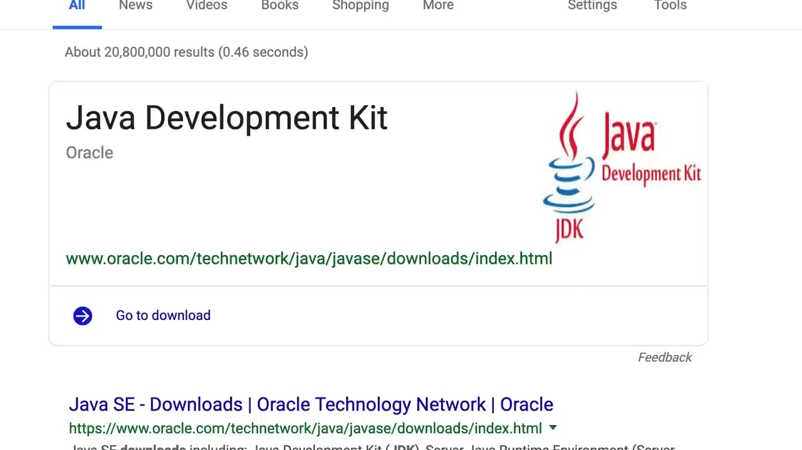
> [!figure] Slide minh họa: Cài đặt Java & Môi trường phát triển
> 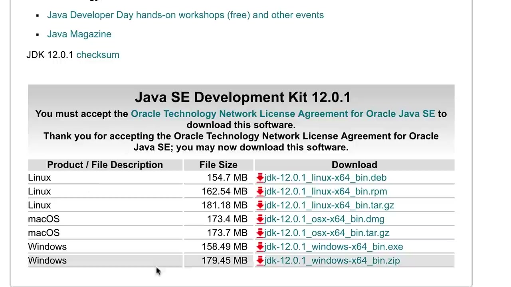
> [!figure] Slide minh họa: Cài đặt Java & Môi trường phát triển
> 
> [!figure] Slide minh họa: Cài đặt Java & Môi trường phát triển
> 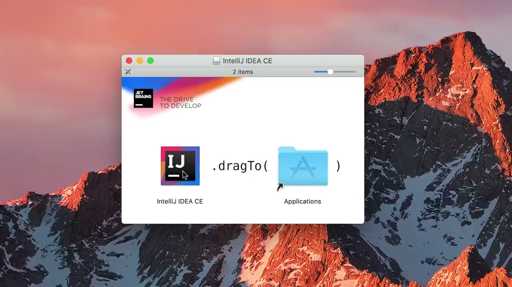

---

### 03. Cấu trúc một chương trình Java (`Anatomy of a Java Program`)
- **Mốc thời gian**: [▶️ 03:59 - 08:41](https://youtu.be/eIrMbAQSU34?t=239) *(Bấm vào để xem video)*

- **Class (Lớp)**: Trong Java, mọi dòng code đều bắt buộc phải nằm bên trong một lớp. Tên class phải đặt theo quy ước **PascalCase** (ví dụ: `Main`, `Calculator`).
- **Method / Function (Phương thức / Hàm)**: Khối lệnh thực hiện một hành động cụ thể, đặt theo quy ước **camelCase** (ví dụ: `printReport`, `calculateMonthlyPayment`).
- **Access Modifier (`public`)**: Xác định phạm vi truy cập của class/method từ các phần khác của chương trình.
- **Hàm `main` - Điểm khởi đầu (Entry Point)**:
  ```java
  public class Main {
      public static void main(String[] args) {
          // Mã nguồn chương trình bắt đầu thực thi từ đây
      }
  }
  ```
  - `public`: Cho phép JVM gọi hàm này từ bên ngoài.
  - `static`: Có thể gọi hàm mà không cần tạo đối tượng từ class `Main`.
  - `void`: Hàm không trả về giá trị nào.
  - `String[] args`: Mảng tham số dòng lệnh truyền vào khi chạy.

**Slide bài giảng minh họa:**
> [!figure] Slide minh họa: Cấu trúc một chương trình Java
> 
> [!figure] Slide minh họa: Cấu trúc một chương trình Java
> 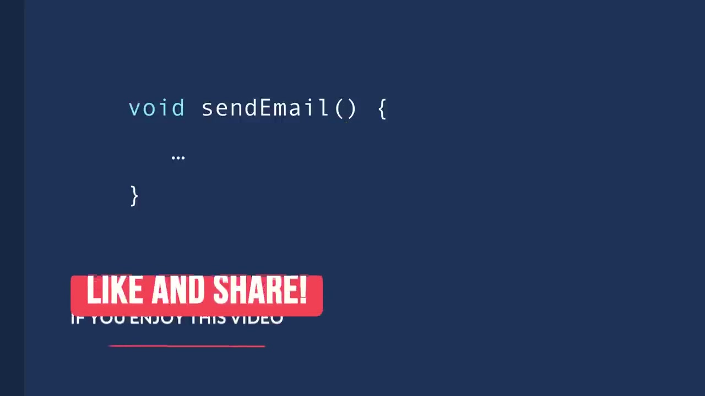
> [!figure] Slide minh họa: Cấu trúc một chương trình Java
> 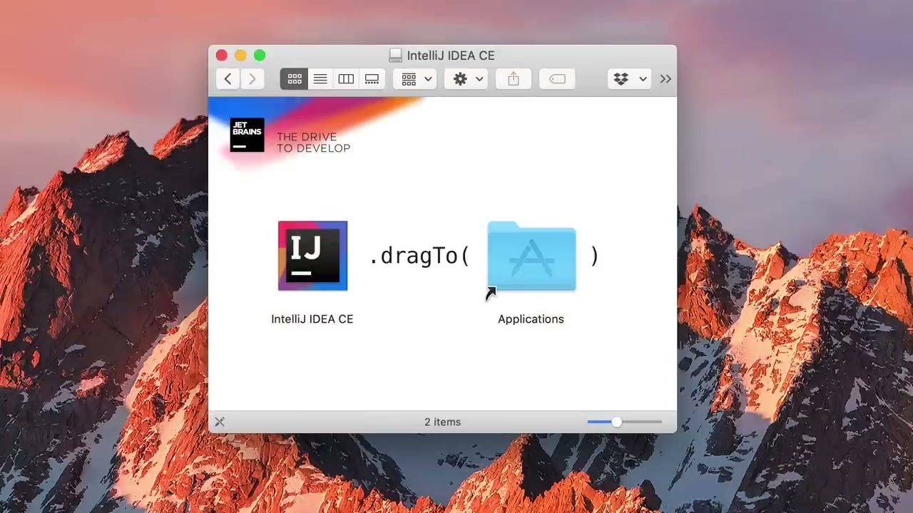

---

### 04. Chương trình Java đầu tiên (Hello World) (`Your First Java Program`)
- **Mốc thời gian**: [▶️ 08:41 - 15:59](https://youtu.be/eIrMbAQSU34?t=521) *(Bấm vào để xem video)*

- Viết câu lệnh in chuỗi ký tự ra màn hình console:
  ```java
  package com.codewithmosh;

  public class Main {
      public static void main(String[] args) {
          System.out.println("Hello World");
      }
  }
  ```
- **Giải thích chi tiết lệnh in**:
  - `System`: Lớp hệ thống thuộc gói `java.lang`.
  - `out`: Luồng xuất chuẩn (Standard Output Stream), thuộc kiểu `PrintStream`.
  - `println()`: Phương thức in dữ liệu ra terminal kèm theo ký tự xuống dòng (`\n`).
- **Quy tắc cú pháp**:
  - Mọi câu lệnh trong Java bắt buộc phải kết thúc bằng dấu chấm phẩy (`;`).
  - Phân biệt chữ hoa và chữ thường (Case-sensitive): `System` khác `system`.

**Slide bài giảng minh họa:**
> [!figure] Slide minh họa: Chương trình Java đầu tiên (Hello World)
> 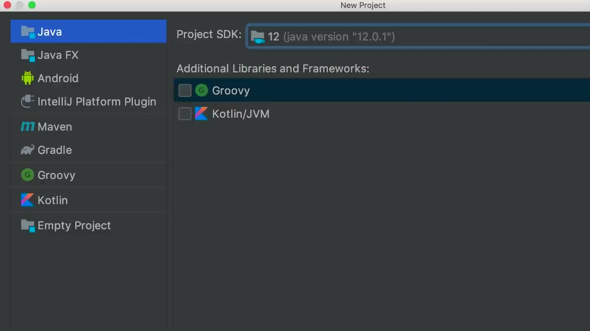
> [!figure] Slide minh họa: Chương trình Java đầu tiên (Hello World)
> 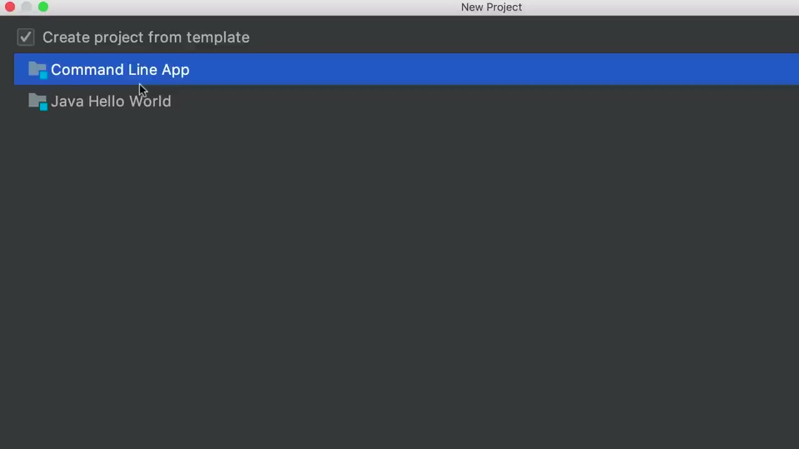
> [!figure] Slide minh họa: Chương trình Java đầu tiên (Hello World)
> 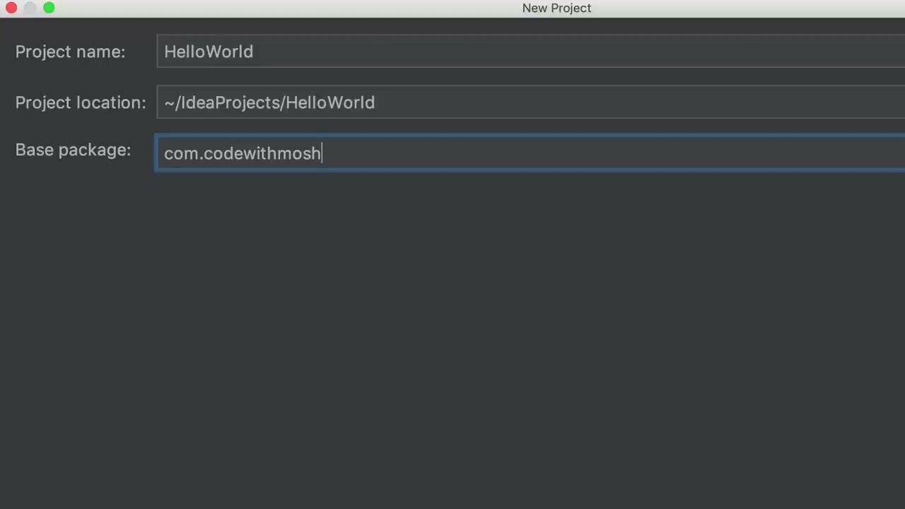
> [!figure] Slide minh họa: Chương trình Java đầu tiên (Hello World)
> 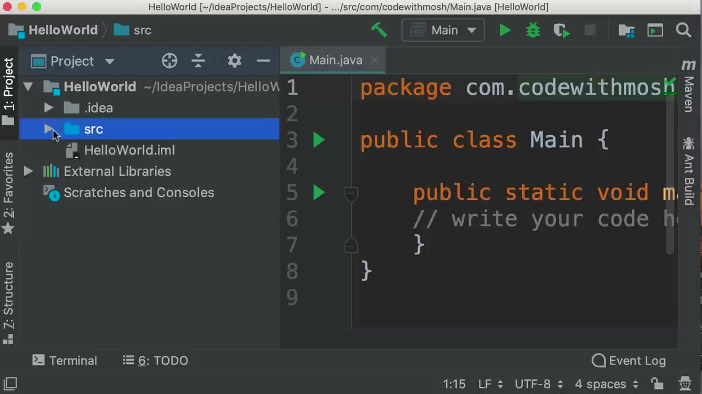

---

### 05. Tài liệu ghi nhớ nhanh cú pháp (Cheat Sheet) (`Cheat Sheet`)
- **Mốc thời gian**: [▶️ 15:59 - 16:29](https://youtu.be/eIrMbAQSU34?t=959) *(Bấm vào để xem video)*

- Tóm tắt nhanh các cú pháp, từ khóa, quy tắc đặt tên và cấu trúc thư mục chuẩn trong dự án Java Maven/Gradle.
- Hỗ trợ học viên tra cứu nhanh trong quá trình học và thực hành dự án.

**Slide bài giảng minh họa:**
> [!figure] Slide minh họa: Tài liệu ghi nhớ nhanh cú pháp (Cheat Sheet)
> 

---

### 06. Cơ chế thực thi của Java (JVM & Bytecode) (`How Java Code Gets Executed`)
- **Mốc thời gian**: [▶️ 16:29 - 22:54](https://youtu.be/eIrMbAQSU34?t=989) *(Bấm vào để xem video)*

- **Mô hình truyền thống (C/C++)**:
  - Source Code → C++ Compiler → Mã máy (Machine Code nhị phân 0101).
  - Nhược điểm: Phụ thuộc cứng vào hệ điều hành và kiến trúc phần cứng CPU (Windows x86 không chạy được trên Mac ARM hay Linux).
- **Mô hình của Java — "Write Once, Run Anywhere" (WORA)**:
  1. **Source Code (`.java`)**: Mã nguồn do lập trình viên viết.
  2. **Biên dịch (`javac`)**: Trình biên dịch Java dịch mã nguồn thành **Bytecode (`.class`)**. Bytecode là một tập chỉ lệnh trừu tượng, độc lập với nền tảng phần cứng.
  3. **Máy ảo Java (JVM - Java Virtual Machine)**: Mỗi nền tảng hệ điều hành (Windows, macOS, Linux) có một phiên bản JVM riêng. JVM nạp Bytecode và dịch thành Machine Code tương thích của máy chủ tại thời điểm chạy (thông qua JIT Compiler - Just-In-Time).
  > [!note] Nhờ cơ chế này, bạn chỉ cần biên dịch file `.java` thành `.class` một lần duy nhất, sau đó có thể mang file `.class` đó chạy trên bất kỳ hệ điều hành nào có cài đặt JVM!

**Slide bài giảng minh họa:**
> [!figure] Slide minh họa: Cơ chế thực thi của Java (JVM & Bytecode)
> 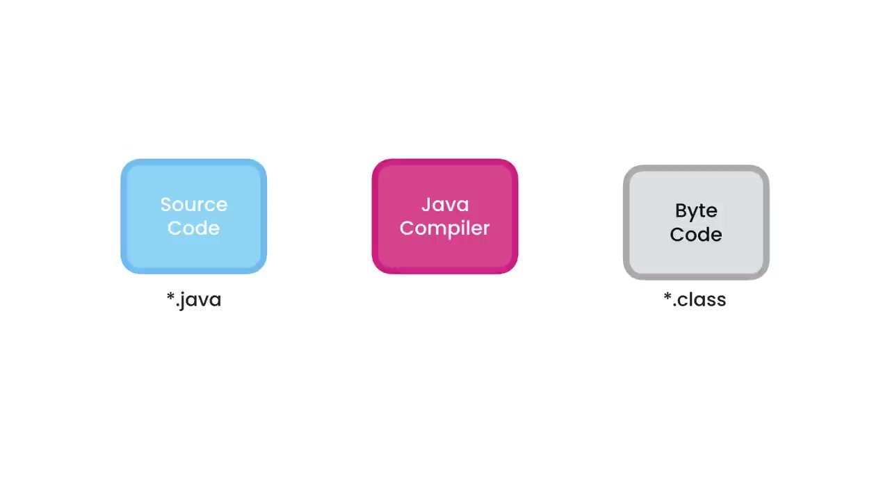
> [!figure] Slide minh họa: Cơ chế thực thi của Java (JVM & Bytecode)
> 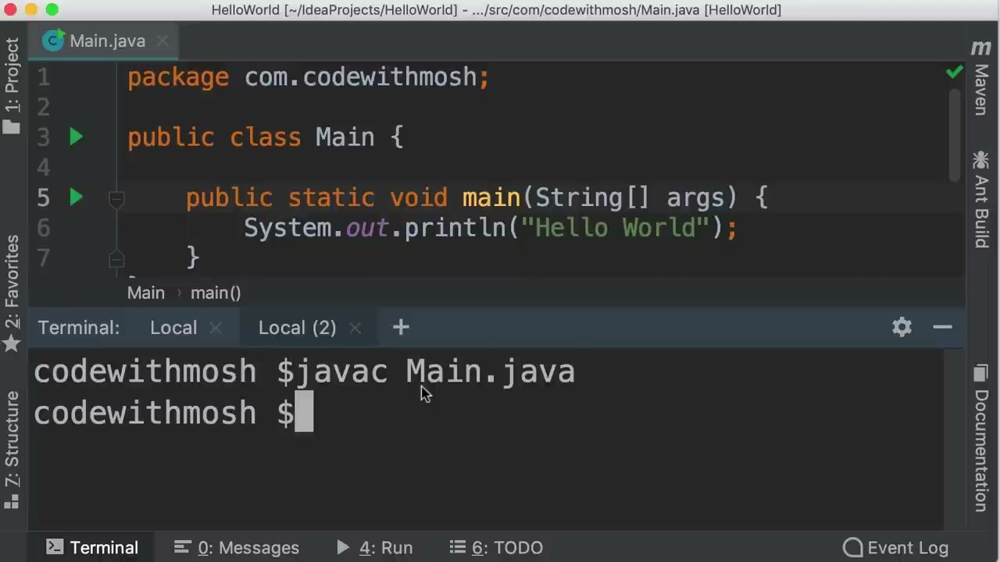
> [!figure] Slide minh họa: Cơ chế thực thi của Java (JVM & Bytecode)
> 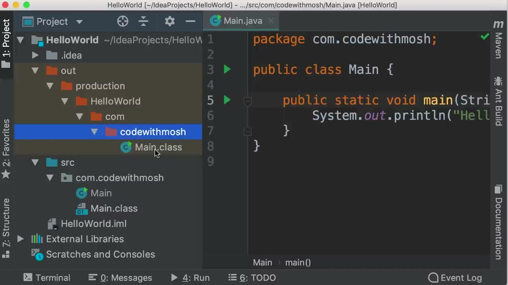
> [!figure] Slide minh họa: Cơ chế thực thi của Java (JVM & Bytecode)
> 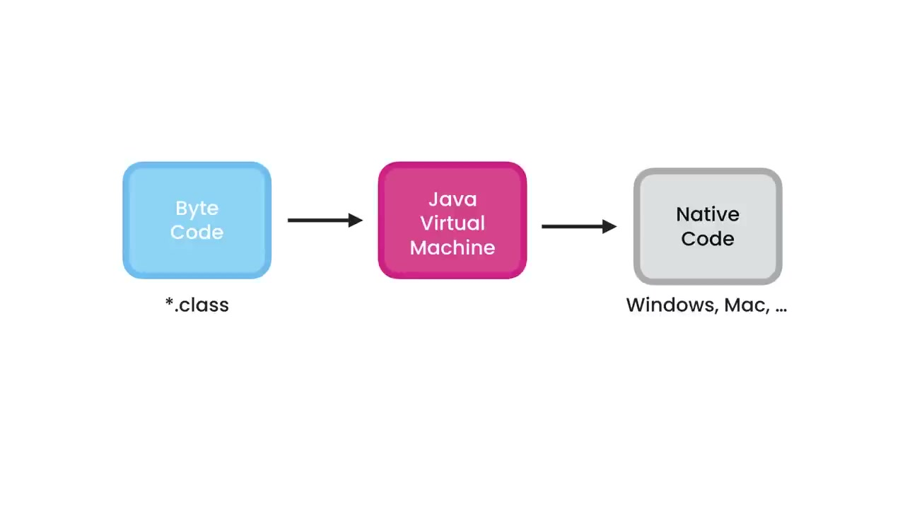

---

### 07. Cấu trúc khóa học (`Course Structure`)
- **Mốc thời gian**: [▶️ 22:54 - 25:22](https://youtu.be/eIrMbAQSU34?t=1374) *(Bấm vào để xem video)*

- Lộ trình tổng thể của khóa học gồm 3 trụ cột lớn:
  1. **Các kiểu dữ liệu cốt lõi (Types)**: Biến, kiểu nguyên thủy, kiểu tham chiếu, mảng, toán tử, ép kiểu.
  2. **Luồng điều khiển (Control Flow)**: Rẽ nhánh if-else, switch, các vòng lặp for, while, do-while, for-each.
  3. **Clean Code & Dự án thực tế**: Áp dụng xây dựng Mortgage Calculator và giải bài toán FizzBuzz.

**Slide bài giảng minh họa:**
> [!figure] Slide minh họa: Cấu trúc khóa học
> 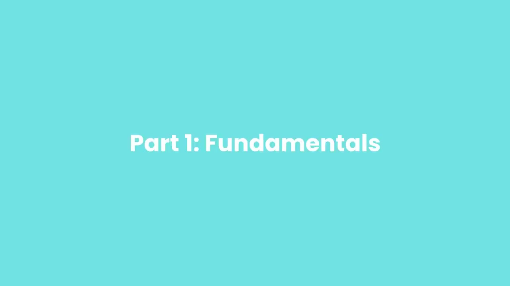
> [!figure] Slide minh họa: Cấu trúc khóa học
> 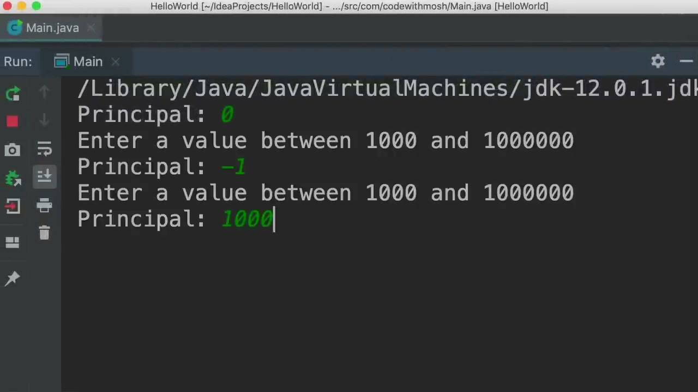
> [!figure] Slide minh họa: Cấu trúc khóa học
> 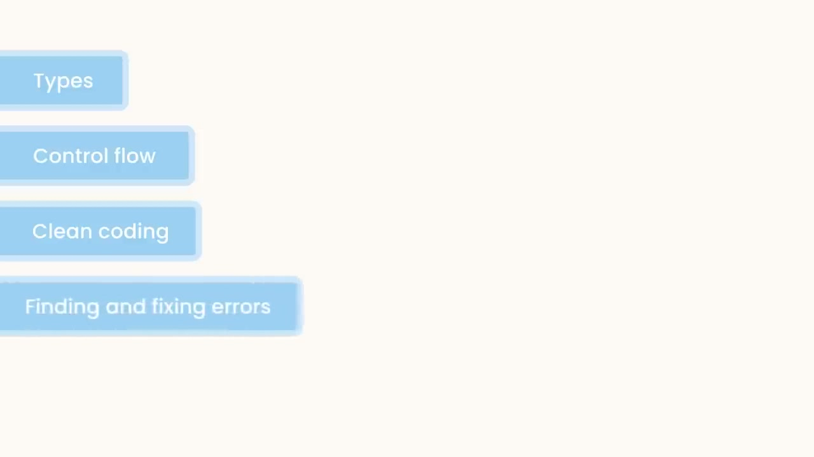
> [!figure] Slide minh họa: Cấu trúc khóa học
> 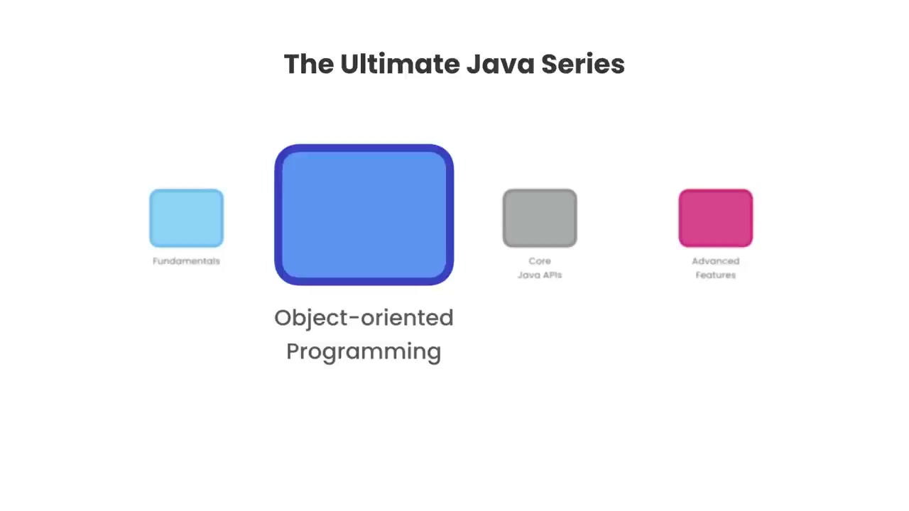

---

### 08. Tổng quan về Kiểu dữ liệu (Types) (`Types Overview`)
- **Mốc thời gian**: [▶️ 25:22 - 25:57](https://youtu.be/eIrMbAQSU34?t=1522) *(Bấm vào để xem video)*

- Java là một ngôn ngữ **Statically-typed** (định kiểu tĩnh): Mọi biến đều phải được khai báo kiểu dữ liệu rõ ràng trước khi sử dụng và kiểu dữ liệu không thể thay đổi sau khi khai báo.
- Java phân chia dữ liệu làm 2 loại rõ rệt:
  - **Primitive Types (Kiểu nguyên thủy)**: Dùng để lưu các giá trị đơn giản (số nguyên, số thực, ký tự, boolean).
  - **Reference Types (Kiểu tham chiếu)**: Dùng để lưu các đối tượng phức tạp (String, Date, Mảng, Class tùy biến).

**Slide bài giảng minh họa:**
> [!figure] Slide minh họa: Tổng quan về Kiểu dữ liệu (Types)
> 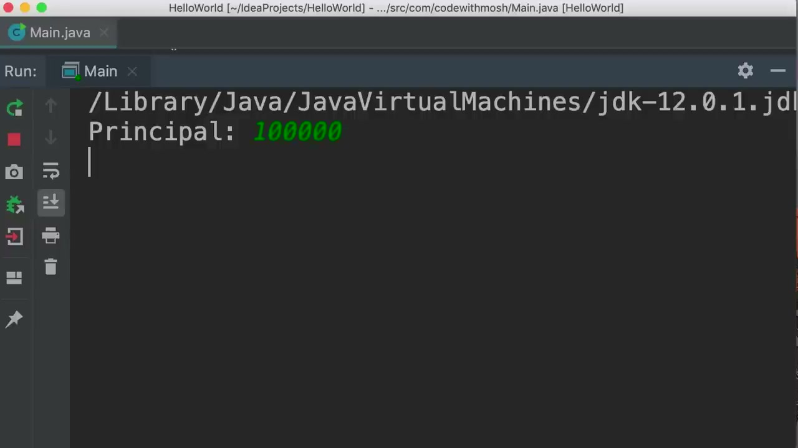

---

### 09. Biến và Khởi tạo biến (Variables) (`Variables`)
- **Mốc thời gian**: [▶️ 25:57 - 29:07](https://youtu.be/eIrMbAQSU34?t=1557) *(Bấm vào để xem video)*

- **Khai báo biến**: `type identifier = initialValue;`
  ```java
  int age = 30;
  age = 35; // Gán lại giá trị mới
  int myAge = 30;
  int herAge = myAge; // Gán giá trị biến này sang biến khác (sao chép độc lập)
  ```
- **Quy ước đặt tên**: Sử dụng `camelCase` (ví dụ: `temperature`, `userCount`, `totalAmount`).

**Slide bài giảng minh họa:**
> [!figure] Slide minh họa: Biến và Khởi tạo biến (Variables)
> 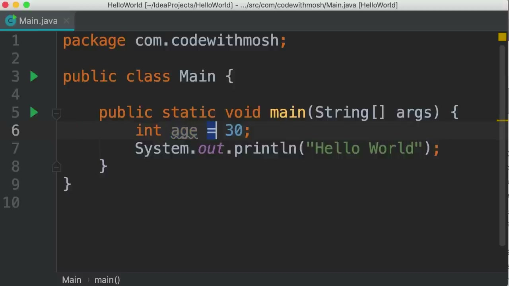
> [!figure] Slide minh họa: Biến và Khởi tạo biến (Variables)
> 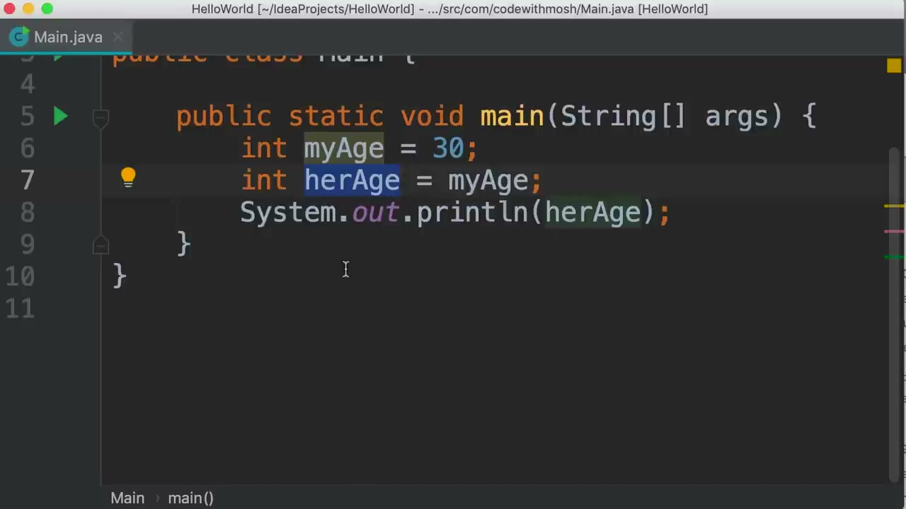
> [!figure] Slide minh họa: Biến và Khởi tạo biến (Variables)
> 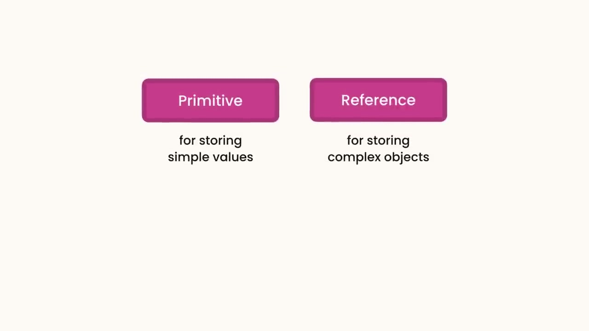

---

### 10. 8 Kiểu dữ liệu nguyên thủy (Primitive Types) (`Primitive Types`)
- **Mốc thời gian**: [▶️ 29:07 - 34:27](https://youtu.be/eIrMbAQSU34?t=1747) *(Bấm vào để xem video)*

| Kiểu dữ liệu | Kích thước | Khoảng giá trị | Ví dụ khai báo | Ghi chú quan trọng |
|---|---|---|---|---|
| `byte` | 1 byte | -128 đến 127 | `byte age = 30;` | Tiết kiệm bộ nhớ trong mảng lớn |
| `short` | 2 bytes | -32,768 đến 32,767 | `short year = 2026;` | Ít dùng |
| `int` | 4 bytes | -2 tỷ đến +2 tỷ | `int views = 123_456_789;` | Sử dụng dấu `_` phân cách hàng nghìn cho dễ đọc |
| `long` | 8 bytes | Rất lớn (-9 * 10^18) | `long count = 3_123_456_789L;` | **Bắt buộc** có hậu tố `L` hoặc `l` |
| `float` | 4 bytes | 6-7 chữ số thập phân | `float price = 10.99F;` | **Bắt buộc** có hậu tố `F` hoặc `f` |
| `double` | 8 bytes | 15 chữ số thập phân | `double ratio = 10.99;` | Kiểu số thực mặc định trong Java |
| `char` | 2 bytes | 1 ký tự Unicode | `char letter = 'A';` | Dùng dấu nháy đơn `' '`, không dùng nháy kép |
| `boolean` | 1 byte | `true` hoặc `false` | `boolean isEligible = true;` | Dùng cho biểu thức điều kiện logic |

**Slide bài giảng minh họa:**
> [!figure] Slide minh họa: 8 Kiểu dữ liệu nguyên thủy (Primitive Types)
> 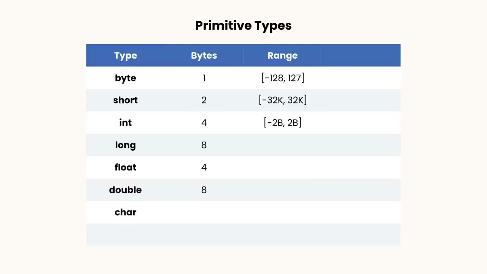
> [!figure] Slide minh họa: 8 Kiểu dữ liệu nguyên thủy (Primitive Types)
> 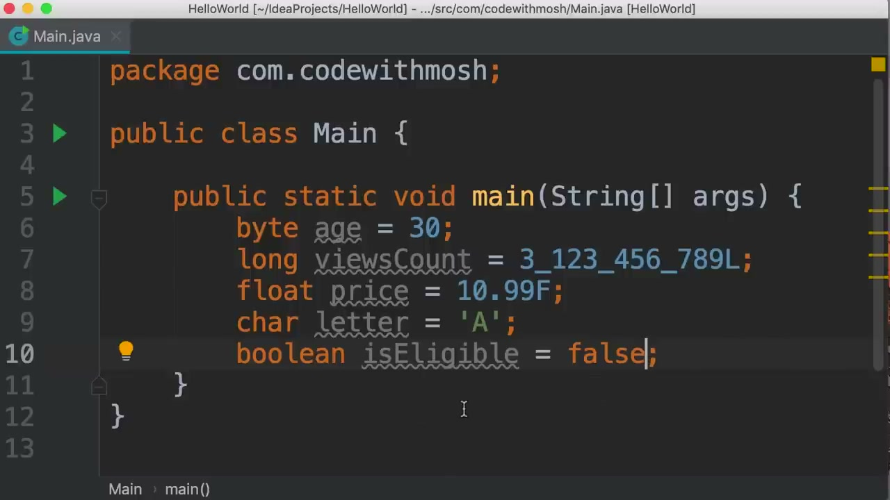

---

### 11. Kiểu dữ liệu tham chiếu (Reference Types) (`Reference Types`)
- **Mốc thời gian**: [▶️ 34:27 - 39:15](https://youtu.be/eIrMbAQSU34?t=2067) *(Bấm vào để xem video)*

- Dùng để lưu trữ các đối tượng phức tạp. Để tạo đối tượng, chúng ta sử dụng từ khóa `new` để cấp phát vùng nhớ:
  ```java
  import java.util.Date;

  Date now = new Date();
  System.out.println(now); // In ra ngày giờ hiện tại
  System.out.println(now.getTime()); // Trả về timestamp mili-giây
  ```
- Khác với primitive types, reference types có chứa các **phương thức (methods)** hỗ trợ tương tác với đối tượng.

**Slide bài giảng minh họa:**
> [!figure] Slide minh họa: Kiểu dữ liệu tham chiếu (Reference Types)
> 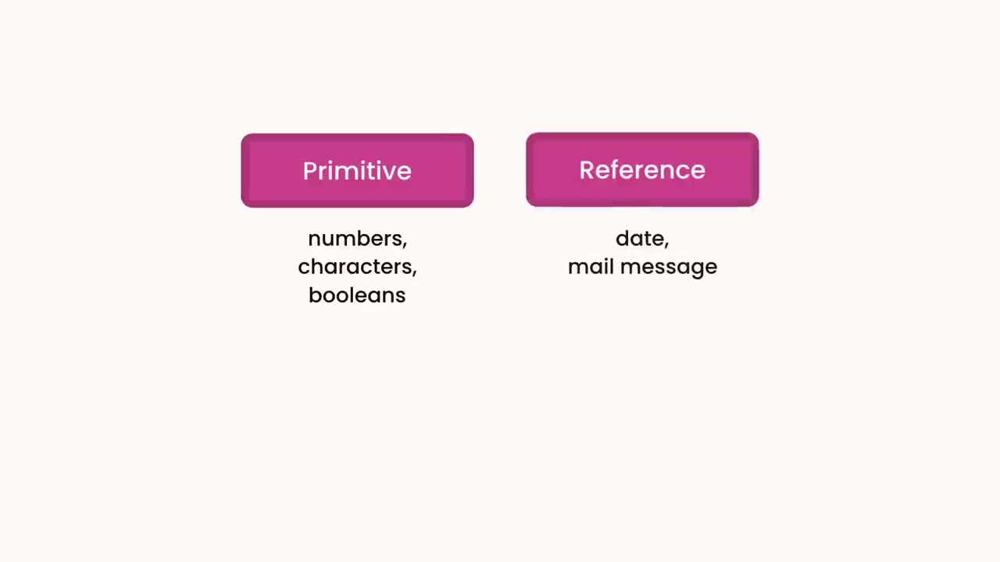
> [!figure] Slide minh họa: Kiểu dữ liệu tham chiếu (Reference Types)
> 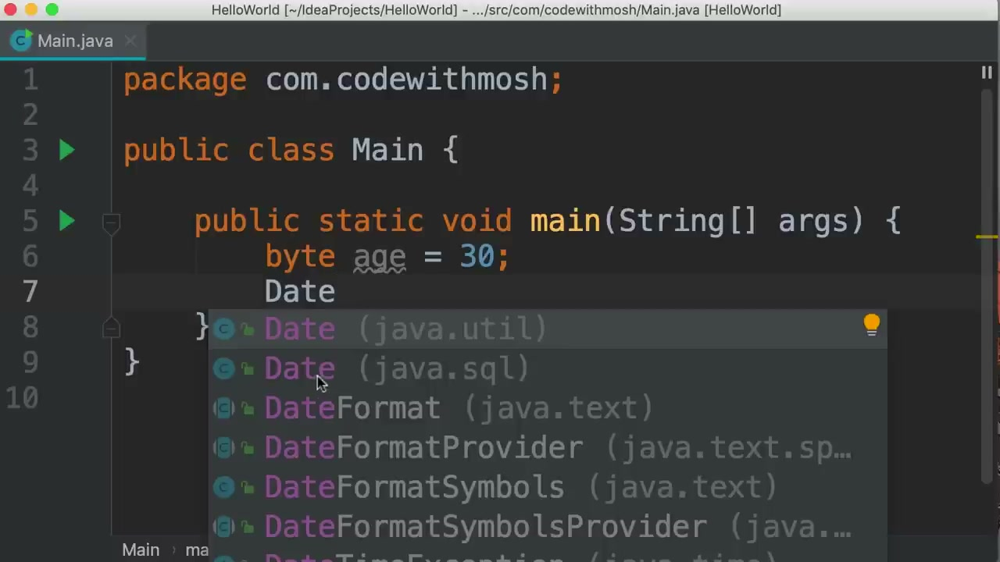
> [!figure] Slide minh họa: Kiểu dữ liệu tham chiếu (Reference Types)
> 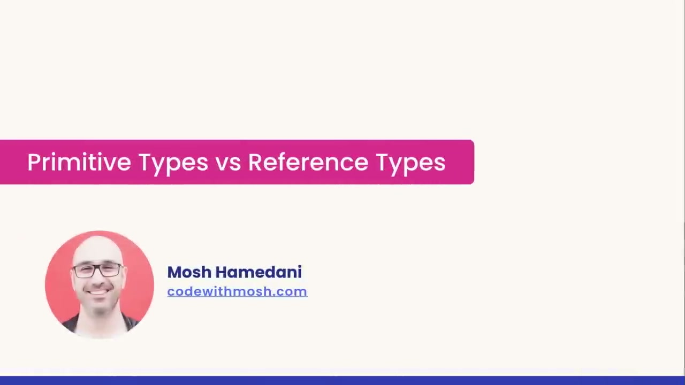

---

### 12. So sánh Primitive vs Reference Types (`Primitive vs Reference Types`)
- **Mốc thời gian**: [▶️ 39:15 - 43:39](https://youtu.be/eIrMbAQSU34?t=2355) *(Bấm vào để xem video)*

- **Quản lý bộ nhớ (Stack vs Heap)**:
  - **Primitive Types**: Giá trị được lưu trực tiếp tại vị trí biến trên vùng nhớ **Stack**.
    ```java
    byte x = 1;
    byte y = x;
    x = 2;
    System.out.println(y); // In ra 1 (y không bị ảnh hưởng vì x và y nằm ở 2 ô nhớ độc lập)
    ```
  - **Reference Types**: Biến trên **Stack** chỉ lưu một **con trỏ/địa chỉ (address)** trỏ tới đối tượng thực sự được cấp phát trên vùng nhớ **Heap**.
    ```java
    import java.awt.Point;

    Point point1 = new Point(1, 1);
    Point point2 = point1; // point2 sao chép địa chỉ, cùng trỏ về 1 vùng nhớ
    point1.x = 2;
    System.out.println(point2.x); // In ra 2! (thay đổi qua point1 làm thay đổi cả point2)
    ```

**Slide bài giảng minh họa:**
> [!figure] Slide minh họa: So sánh Primitive vs Reference Types
> 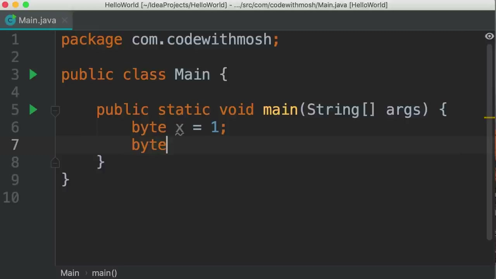
> [!figure] Slide minh họa: So sánh Primitive vs Reference Types
> 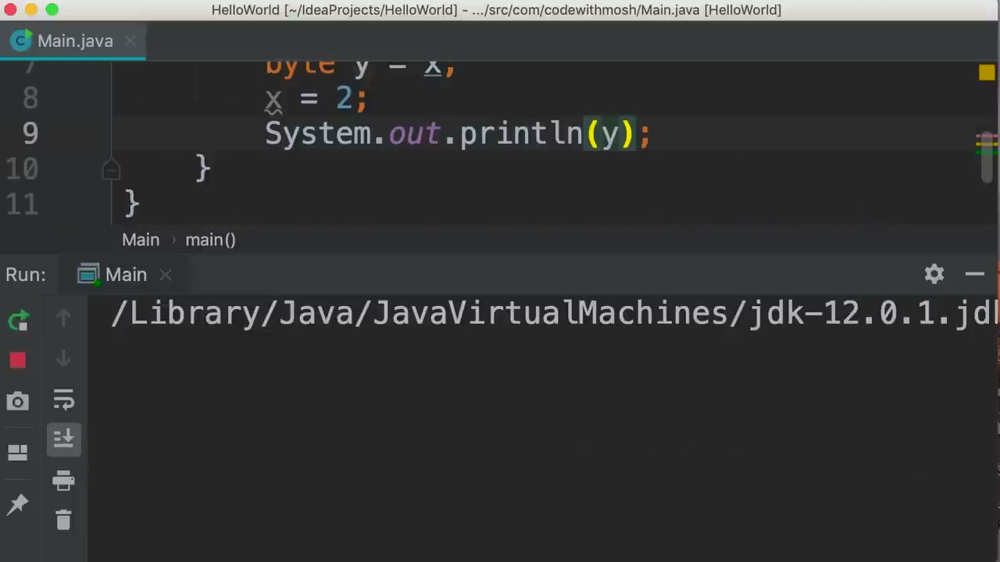
> [!figure] Slide minh họa: So sánh Primitive vs Reference Types
> 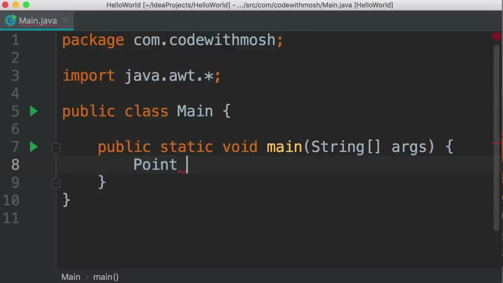
> [!figure] Slide minh họa: So sánh Primitive vs Reference Types
> 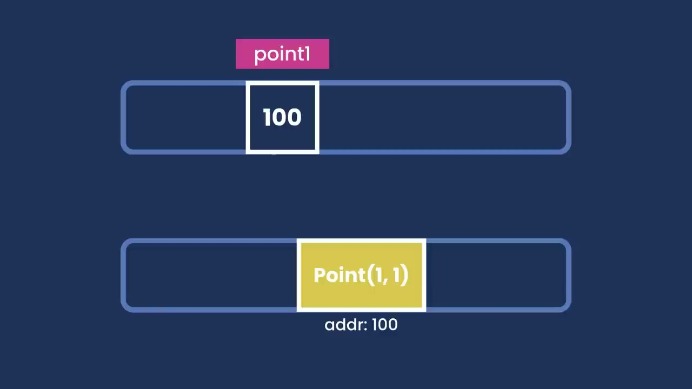

---

### 13. Chuỗi ký tự (Strings) (`Strings`)
- **Mốc thời gian**: [▶️ 43:39 - 50:42](https://youtu.be/eIrMbAQSU34?t=2619) *(Bấm vào để xem video)*

- `String` là một Reference Type nhưng được Java hỗ trợ cú pháp viết tắt đặc biệt:
  ```java
  String message = "Hello World" + "!!";
  ```
- **Tính bất biến (Immutability)**: Chuỗi trong Java một khi đã tạo thì **không bao giờ bị thay đổi** nội dung trong bộ nhớ. Bất kỳ phương thức nào thao tác trên chuỗi đều trả về một đối tượng `String` mới:
  - `message.endsWith("!!")`: Kiểm tra chuỗi kết thúc (trả về `boolean`).
  - `message.startsWith("Hello")`: Kiểm tra chuỗi bắt đầu.
  - `message.length()`: Đếm số lượng ký tự.
  - `message.indexOf("e")`: Tìm vị trí ký tự đầu tiên (trả về `-1` nếu không có).
  - `message.replace("!", "*")`: Thay thế ký tự/chuỗi.
  - `message.toLowerCase()` / `message.toUpperCase()`: Chuyển hoa thường.
  - `message.trim()`: Loại bỏ khoảng trắng thừa ở đầu và cuối chuỗi.

**Slide bài giảng minh họa:**
> [!figure] Slide minh họa: Chuỗi ký tự (Strings)
> 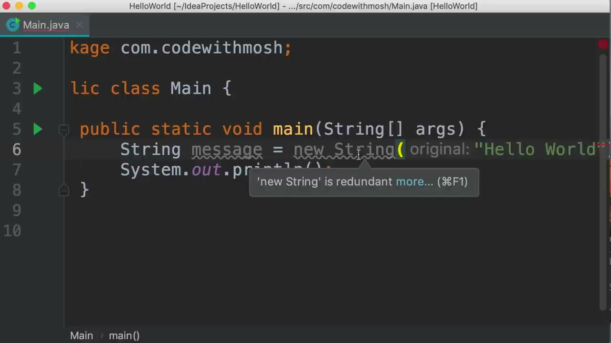
> [!figure] Slide minh họa: Chuỗi ký tự (Strings)
> 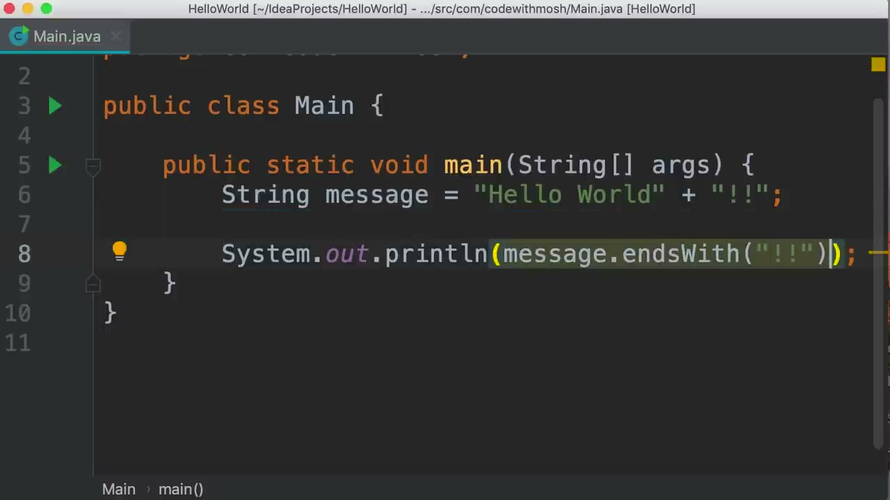
> [!figure] Slide minh họa: Chuỗi ký tự (Strings)
> 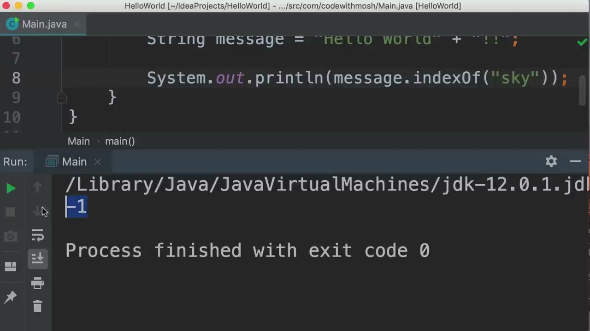
> [!figure] Slide minh họa: Chuỗi ký tự (Strings)
> 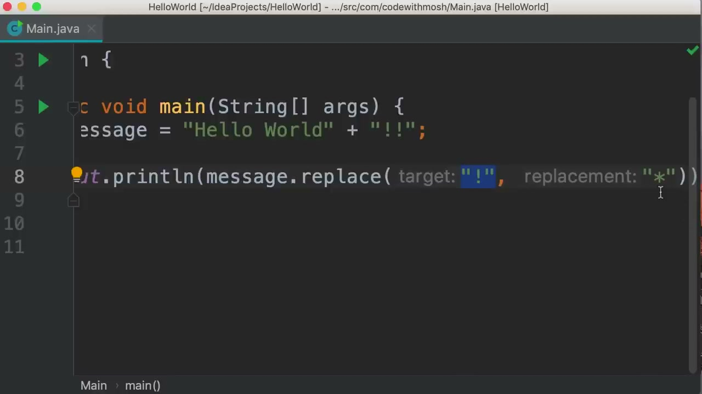

---

### 14. Ký tự thoát (Escape Sequences) (`Escape Sequences`)
- **Mốc thời gian**: [▶️ 50:42 - 53:22](https://youtu.be/eIrMbAQSU34?t=3042) *(Bấm vào để xem video)*

- Dùng dấu gạch chéo ngược (`\`) để chèn các ký tự đặc biệt vào chuỗi:
  - `\"` : Chèn dấu ngoặc kép: `String msg = "Hello \"Mosh\"";`
  - `\\` : Chèn dấu gạch chéo ngược: `String path = "c:\\Windows\\...";`
  - `\n` : Xuống dòng mới (New line).
  - `\t` : Chèn một khoảng cách tab căn lề.

**Slide bài giảng minh họa:**
> [!figure] Slide minh họa: Ký tự thoát (Escape Sequences)
> 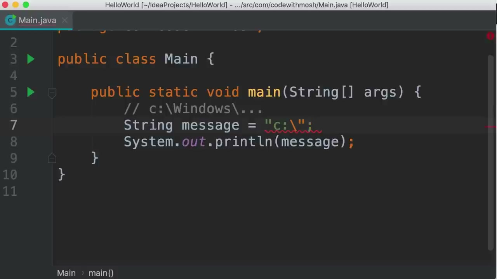
> [!figure] Slide minh họa: Ký tự thoát (Escape Sequences)
> 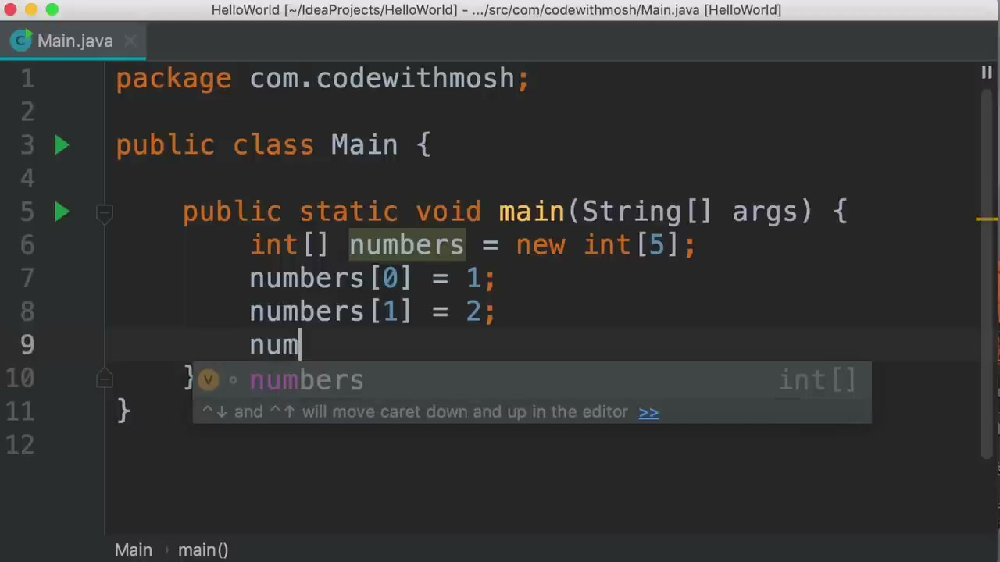

---

### 15. Mảng một chiều (Arrays) (`Arrays`)
- **Mốc thời gian**: [▶️ 53:22 - 58:47](https://youtu.be/eIrMbAQSU34?t=3202) *(Bấm vào để xem video)*

- Mảng trong Java có **kích thước cố định** (fixed size), không thể mở rộng sau khi đã tạo:
  ```java
  import java.util.Arrays;

  // Cách 1: Khởi tạo với kích thước
  int[] numbers = new int[5];
  numbers[0] = 1;
  numbers[1] = 2;

  // Cách 2: Khởi tạo kèm sẵn giá trị
  int[] list = { 2, 3, 5, 1, 4 };
  System.out.println(list.length); // 5

  // Sắp xếp mảng tăng dần
  Arrays.sort(list);

  // In mảng ra console (Dùng Arrays.toString)
  System.out.println(Arrays.toString(list)); // [1, 2, 3, 4, 5]
  ```
  > [!warning] Nếu bạn dùng `System.out.println(list)` trực tiếp, Java sẽ in ra địa chỉ bộ nhớ băm (`[I@15db9742`) thay vì các phần tử!

**Slide bài giảng minh họa:**
> [!figure] Slide minh họa: Mảng một chiều (Arrays)
> 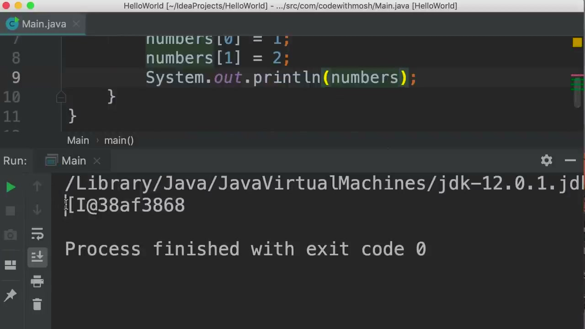
> [!figure] Slide minh họa: Mảng một chiều (Arrays)
> 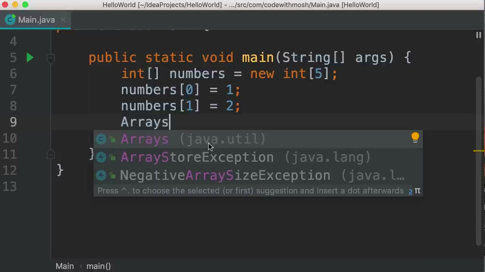
> [!figure] Slide minh họa: Mảng một chiều (Arrays)
> 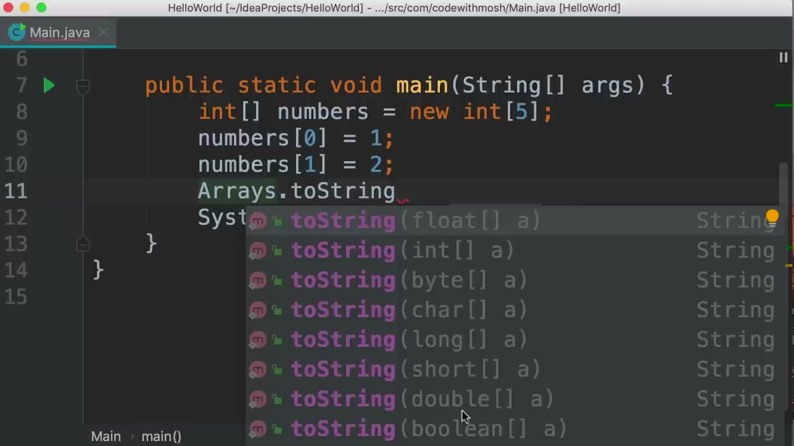
> [!figure] Slide minh họa: Mảng một chiều (Arrays)
> 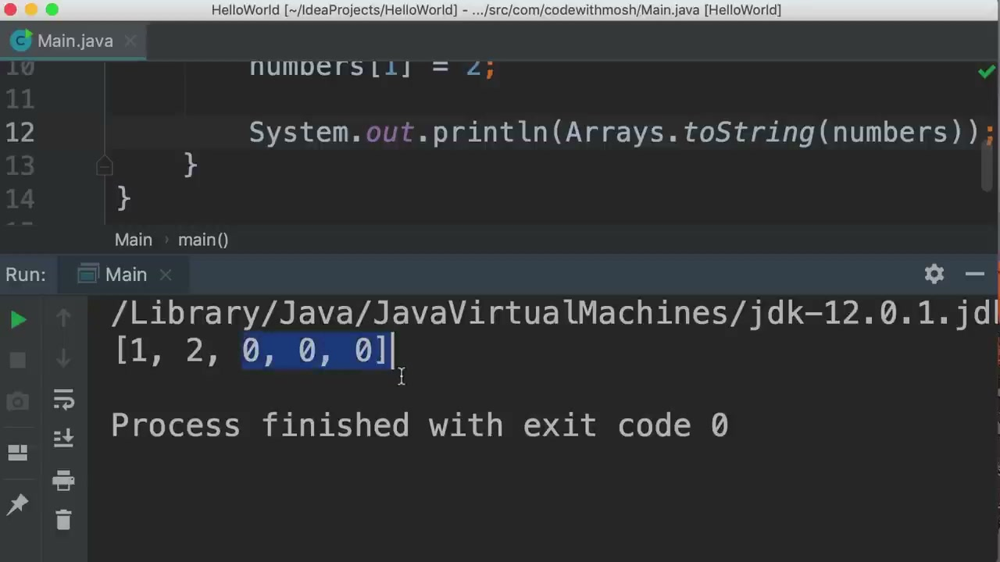

---

### 16. Mảng đa chiều (Multi-Dimensional Arrays) (`Multi-Dimensional Arrays`)
- **Mốc thời gian**: [▶️ 58:47 - 1:01:23](https://youtu.be/eIrMbAQSU34?t=3527) *(Bấm vào để xem video)*

- Dùng để lưu trữ ma trận (2 chiều) hoặc dữ liệu không gian (3 chiều):
  ```java
  import java.util.Arrays;

  // Mảng 2 chiều 2 hàng x 3 cột
  int[][] matrix = new int[2][3];
  matrix[0][0] = 1;

  // Khởi tạo trực tiếp
  int[][] matrix2 = { { 1, 2, 3 }, { 4, 5, 6 } };

  // In mảng đa chiều bằng Arrays.deepToString()
  System.out.println(Arrays.deepToString(matrix2)); // [[1, 2, 3], [4, 5, 6]]
  ```

**Slide bài giảng minh họa:**
> [!figure] Slide minh họa: Mảng đa chiều (Multi-Dimensional Arrays)
> 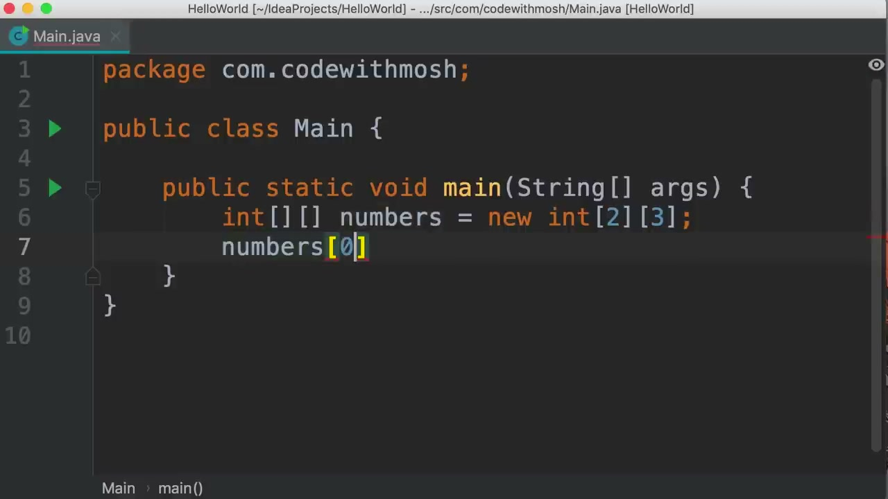
> [!figure] Slide minh họa: Mảng đa chiều (Multi-Dimensional Arrays)
> 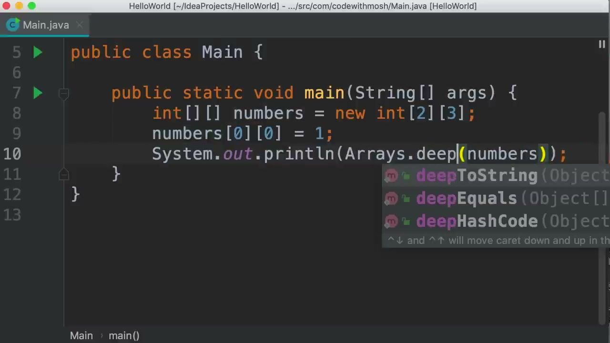

---

### 17. Hằng số (Constants) (`Constants`)
- **Mốc thời gian**: [▶️ 1:01:23 - 1:03:15](https://youtu.be/eIrMbAQSU34?t=3683) *(Bấm vào để xem video)*

- Dùng từ khóa `final` để biến giá trị thành bất biến (không thể gán lại).
- Quy ước đặt tên hằng số là **IN_HOA_TOAN_BO**:
  ```java
  final float PI = 3.14F;
  // PI = 1; // Báo lỗi biên dịch ngay lập tức!
  ```

**Slide bài giảng minh họa:**
> [!figure] Slide minh họa: Hằng số (Constants)
> 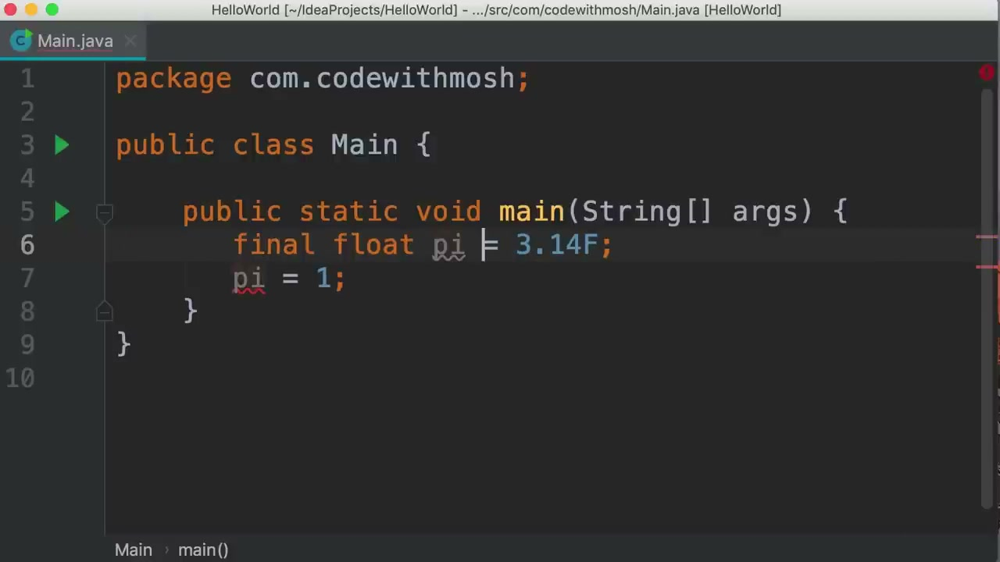
> [!figure] Slide minh họa: Hằng số (Constants)
> 
> [!figure] Slide minh họa: Hằng số (Constants)
> 

---

### 18. Biểu thức số học (Arithmetic Expressions) (`Arithmetic Expressions`)
- **Mốc thời gian**: [▶️ 1:03:15 - 1:07:18](https://youtu.be/eIrMbAQSU34?t=3795) *(Bấm vào để xem video)*

- Các toán tử: `+`, `-`, `*`, `/`, `%` (chia lấy số dư).
- **Phép chia số nguyên**:
  `int result = 10 / 3;` → kết quả là `3` (phần thập phân bị cắt bỏ).
  Để lấy kết quả số thực, phải ép kiểu ít nhất 1 toán hạng:
  `double result = (double)10 / (double)3;` → `3.3333333333333335`.
- **Toán tử tăng giảm**:
  - `x++` (Postfix): Lấy giá trị của `x` sử dụng trong biểu thức trước, rồi mới tăng `x` lên 1.
  - `++x` (Prefix): Tăng `x` lên 1 trước, rồi mới lấy giá trị mới sử dụng.
  - Toán tử gán kết hợp: `x += 5;`, `x -= 2;`, `x *= 3;`.

**Slide bài giảng minh họa:**
> [!figure] Slide minh họa: Biểu thức số học (Arithmetic Expressions)
> 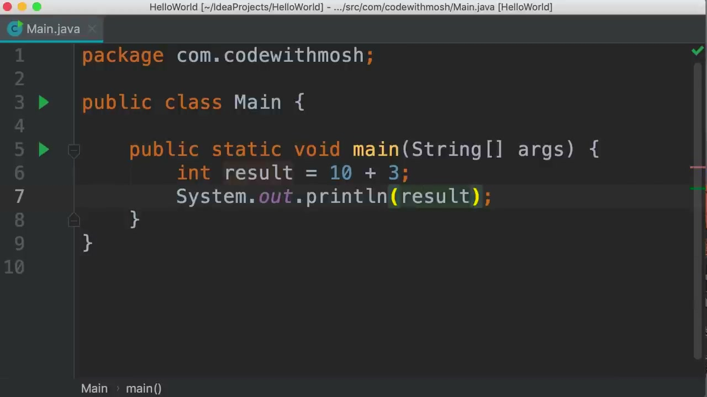
> [!figure] Slide minh họa: Biểu thức số học (Arithmetic Expressions)
> 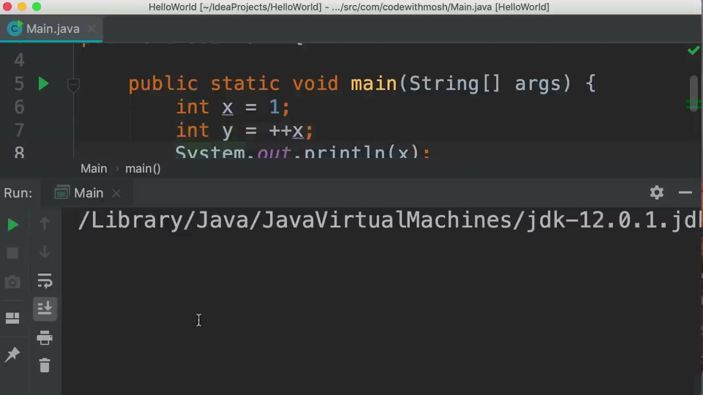
> [!figure] Slide minh họa: Biểu thức số học (Arithmetic Expressions)
> 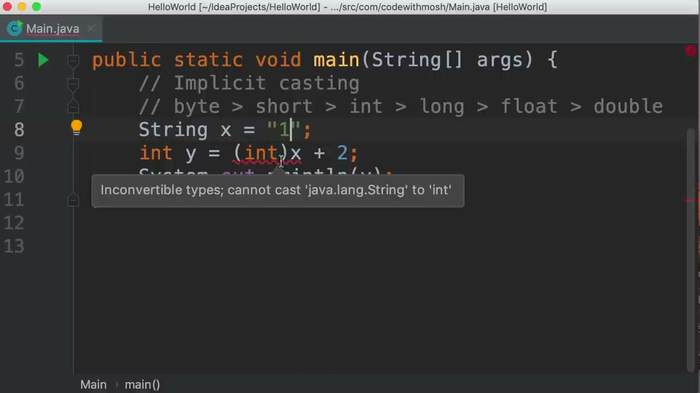

---

### 19. Thứ tự ưu tiên toán tử (Order of Operations) (`Order of Operations`)
- **Mốc thời gian**: [▶️ 1:07:18 - 1:08:40](https://youtu.be/eIrMbAQSU34?t=4038) *(Bấm vào để xem video)*

- Tuân thủ quy tắc toán học tiêu chuẩn:
  1. Dấu ngoặc đơn `()` có độ ưu tiên cao nhất.
  2. Nhân, chia và lấy dư `*`, `/`, `%`.
  3. Cộng và trừ `+`, `-`.
  ```java
  int x = (10 + 3) * 2; // 26
  ```

---

### 20. Ép kiểu (Casting & Type Conversion) (`Casting`)
- **Mốc thời gian**: [▶️ 1:08:40 - 1:15:08](https://youtu.be/eIrMbAQSU34?t=4120) *(Bấm vào để xem video)*

- **Implicit Casting (Ép kiểu ngầm định)**: Xảy ra tự động khi chuyển đổi từ kiểu nhỏ sang kiểu lớn hơn, không gây mất mát dữ liệu:
  `byte → short → int → long → float → double`
  ```java
  short x = 1;
  int y = x + 2; // x tự động ép thành int -> y = 3
  ```
- **Explicit Casting (Ép kiểu tường minh)**: Bắt buộc khai báo khi ép kiểu từ kiểu lớn sang kiểu nhỏ (có nguy cơ mất dữ liệu):
  ```java
  double x = 1.1;
  int y = (int)x + 2; // x bị cắt phần thập phân thành 1 -> y = 3
  ```
- **Chuyển đổi từ Chuỗi sang Số (Wrapper Classes)**:
  - `Integer.parseInt("123")` → `123`
  - `Double.parseDouble("12.34")` → `12.34`
  - `Float.parseFloat("10.5F")` → `10.5F`

**Slide bài giảng minh họa:**
> [!figure] Slide minh họa: Ép kiểu (Casting & Type Conversion)
> 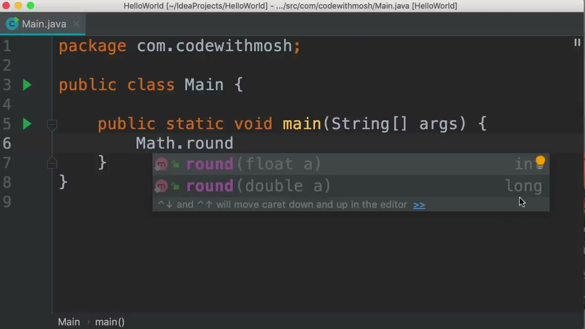

---

### 21. Lớp toán học (The Math Class) (`The Math Class`)
- **Mốc thời gian**: [▶️ 1:15:08 - 1:19:50](https://youtu.be/eIrMbAQSU34?t=4508) *(Bấm vào để xem video)*

- Cung cấp các hàm toán học tiện ích hữu dụng:
  - `Math.round(1.1F)` → `1` (Làm tròn số)
  - `Math.ceil(1.1F)` → `2.0` (Làm tròn lên số nguyên trần)
  - `Math.floor(1.1F)` → `1.0` (Làm tròn xuống số nguyên sàn)
  - `Math.max(1, 2)` / `Math.min(1, 2)` (Tìm giá trị lớn nhất / nhỏ nhất)
  - `Math.random()`: Sinh số thực ngẫu nhiên từ `0.0` đến `1.0`.
  - Sinh số nguyên ngẫu nhiên từ 0 đến 100:
    ```java
    int randomInt = (int) (Math.random() * 100);
    ```

**Slide bài giảng minh họa:**
> [!figure] Slide minh họa: Lớp toán học (The Math Class)
> 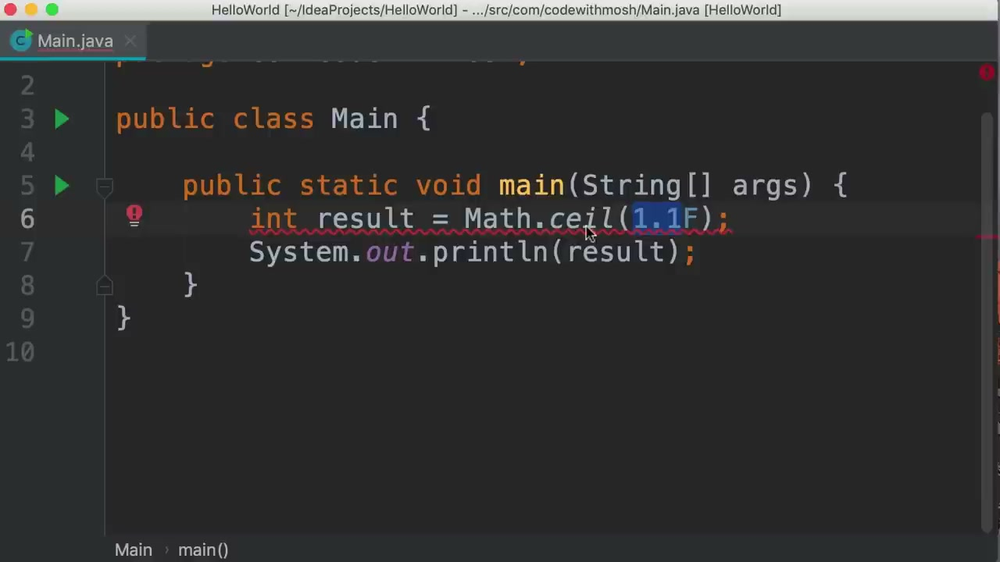
> [!figure] Slide minh họa: Lớp toán học (The Math Class)
> 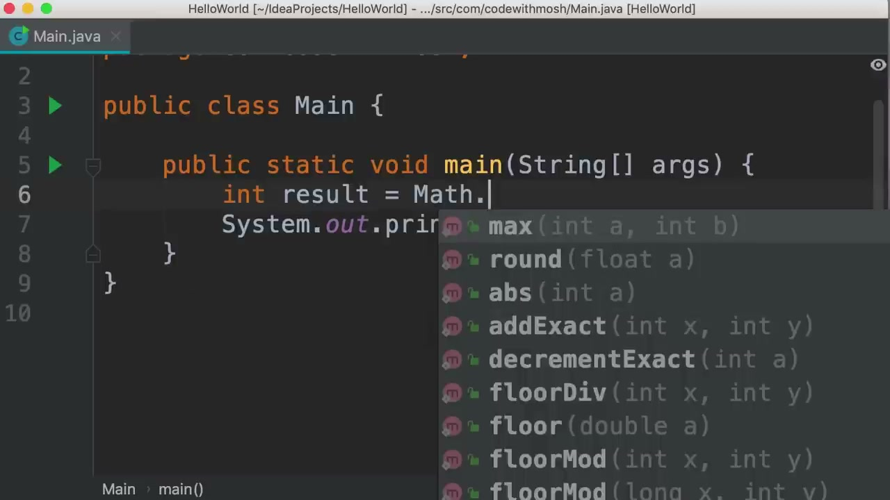

---

### 22. Định dạng số và tiền tệ (Formatting Numbers) (`Formatting Numbers`)
- **Mốc thời gian**: [▶️ 1:19:50 - 1:25:40](https://youtu.be/eIrMbAQSU34?t=4790) *(Bấm vào để xem video)*

- Sử dụng lớp trừu tượng `NumberFormat` trong gói `java.text`:
  ```java
  import java.text.NumberFormat;

  // Định dạng tiền tệ theo chuẩn địa phương ($)
  NumberFormat currency = NumberFormat.getCurrencyInstance();
  String money = currency.format(1234567.891);
  System.out.println(money); // "$1,234,567.89"

  // Định dạng phần trăm (%)
  NumberFormat percent = NumberFormat.getPercentInstance();
  String rate = percent.format(0.1);
  System.out.println(rate); // "10%"
  ```
- Kỹ thuật **Method Chaining** (Gọi chuỗi phương thức):
  `String result = NumberFormat.getPercentInstance().format(0.1);`

**Slide bài giảng minh họa:**
> [!figure] Slide minh họa: Định dạng số và tiền tệ (Formatting Numbers)
> 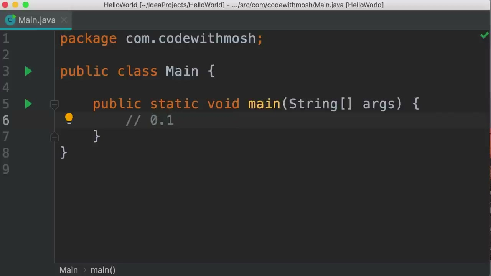
> [!figure] Slide minh họa: Định dạng số và tiền tệ (Formatting Numbers)
> 
> [!figure] Slide minh họa: Định dạng số và tiền tệ (Formatting Numbers)
> 
> [!figure] Slide minh họa: Định dạng số và tiền tệ (Formatting Numbers)
> 

---

### 23. Nhập dữ liệu từ bàn phím (Reading Input) (`Reading Input`)
- **Mốc thời gian**: [▶️ 1:25:40 - 1:30:45](https://youtu.be/eIrMbAQSU34?t=5140) *(Bấm vào để xem video)*

- Sử dụng lớp `Scanner` trong gói `java.util`:
  ```java
  import java.util.Scanner;

  Scanner scanner = new Scanner(System.in);

  System.out.print("Tên của bạn: ");
  String name = scanner.nextLine().trim(); // Đọc nguyên cả dòng văn bản

  System.out.print("Tuổi: ");
  byte age = scanner.nextByte(); // Đọc số byte

  System.out.println("Xin chào " + name + ", bạn " + age + " tuổi.");
  ```
  > [!tip] Dùng `scanner.next()` chỉ đọc một từ (dừng khi gặp dấu cách). Muốn đọc toàn bộ chuỗi có khoảng trắng, luôn dùng `scanner.nextLine()`. Dùng `.trim()` để loại bỏ khoảng trắng dư thừa.

**Slide bài giảng minh họa:**
> [!figure] Slide minh họa: Nhập dữ liệu từ bàn phím (Reading Input)
> 
> [!figure] Slide minh họa: Nhập dữ liệu từ bàn phím (Reading Input)
> 
> [!figure] Slide minh họa: Nhập dữ liệu từ bàn phím (Reading Input)
> 
> [!figure] Slide minh họa: Nhập dữ liệu từ bàn phím (Reading Input)
> 

---

### 24. Dự án: Máy tính trả góp thế chấp (Mô tả) (`Project: Mortgage Calculator`)
- **Mốc thời gian**: [▶️ 1:30:45 - 1:32:55](https://youtu.be/eIrMbAQSU34?t=5445) *(Bấm vào để xem video)*

- **Đề bài ứng dụng Mortgage Calculator**:
  - Nhập vào số tiền vay mua nhà (Principal): ví dụ `$100,000`.
  - Nhập vào lãi suất hàng năm (Annual Interest Rate): ví dụ `3.92%`.
  - Nhập vào thời hạn vay (Period tính bằng năm): ví dụ `30` năm.
  - Áp dụng công thức tài chính để tính ra chính xác số tiền phải thanh toán hàng tháng (Mortgage) và định dạng hiển thị tiền tệ đẹp mắt.

**Slide bài giảng minh họa:**
> [!figure] Slide minh họa: Dự án: Máy tính trả góp thế chấp (Mô tả)
> 
> [!figure] Slide minh họa: Dự án: Máy tính trả góp thế chấp (Mô tả)
> 
> [!figure] Slide minh họa: Dự án: Máy tính trả góp thế chấp (Mô tả)
> 
> [!figure] Slide minh họa: Dự án: Máy tính trả góp thế chấp (Mô tả)
> 

---

### 25. Dự án: Giải thuật Mortgage Calculator (v1) (`Solution: Mortgage Calculator`)
- **Mốc thời gian**: [▶️ 1:32:55 - 1:37:14](https://youtu.be/eIrMbAQSU34?t=5575) *(Bấm vào để xem video)*

- **Công thức tài chính**:
  $$M = P \frac{r(1 + r)^n}{(1 + r)^n - 1}$$
  - $P$ (Principal): Tiền gốc vay.
  - $r$ (Monthly Interest): Lãi suất tháng = Lãi suất năm / 100 / 12.
  - $n$ (NumberOfPayments): Tổng số tháng thanh toán = Số năm * 12.
- **Mã nguồn giải thuật đầy đủ**:
  ```java
  import java.text.NumberFormat;
  import java.util.Scanner;

  public class Main {
      public static void main(String[] args) {
          final byte MONTHS_IN_YEAR = 12;
          final byte PERCENT = 100;

          Scanner scanner = new Scanner(System.in);

          System.out.print("Principal ($): ");
          int principal = scanner.nextInt();

          System.out.print("Annual Interest Rate (%): ");
          float annualInterest = scanner.nextFloat();
          float monthlyInterest = annualInterest / PERCENT / MONTHS_IN_YEAR;

          System.out.print("Period (Years): ");
          byte years = scanner.nextByte();
          int numberOfPayments = years * MONTHS_IN_YEAR;

          double mortgage = principal
                  * (monthlyInterest * Math.pow(1 + monthlyInterest, numberOfPayments))
                  / (Math.pow(1 + monthlyInterest, numberOfPayments) - 1);

          String mortgageFormatted = NumberFormat.getCurrencyInstance().format(mortgage);
          System.out.println("Monthly Mortgage Payment: " + mortgageFormatted);
      }
  }
  ```

**Slide bài giảng minh họa:**
> [!figure] Slide minh họa: Dự án: Giải thuật Mortgage Calculator (v1)
> 
> [!figure] Slide minh họa: Dự án: Giải thuật Mortgage Calculator (v1)
> 
> [!figure] Slide minh họa: Dự án: Giải thuật Mortgage Calculator (v1)
> 
> [!figure] Slide minh họa: Dự án: Giải thuật Mortgage Calculator (v1)
> 

---

### 26. Tóm tắt chương Kiểu dữ liệu (`Types Summary`)
- **Mốc thời gian**: [▶️ 1:37:14 - 1:38:43](https://youtu.be/eIrMbAQSU34?t=5834) *(Bấm vào để xem video)*

- Củng cố toàn bộ kiến thức chương 1:
  - 8 kiểu nguyên thủy lưu giá trị trên Stack.
  - Kiểu tham chiếu lưu con trỏ trỏ tới Heap.
  - Mảng cố định kích thước, String bất biến.
  - Toán tử, ép kiểu và định dạng số.

**Slide bài giảng minh họa:**
> [!figure] Slide minh họa: Tóm tắt chương Kiểu dữ liệu
> 
> [!figure] Slide minh họa: Tóm tắt chương Kiểu dữ liệu
> 
> [!figure] Slide minh họa: Tóm tắt chương Kiểu dữ liệu
> 

---

### 27. Tổng quan về Điều khiển luồng (Control Flow) (`Control Flow`)
- **Mốc thời gian**: [▶️ 1:38:43 - 1:39:30](https://youtu.be/eIrMbAQSU34?t=5923) *(Bấm vào để xem video)*

- Giới thiệu cách máy tính đưa ra quyết định (Rẽ nhánh) và lặp đi lặp lại một hành động (Vòng lặp) dựa trên điều kiện logic boolean.

**Slide bài giảng minh họa:**
> [!figure] Slide minh họa: Tổng quan về Điều khiển luồng (Control Flow)
> 
> [!figure] Slide minh họa: Tổng quan về Điều khiển luồng (Control Flow)
> 

---

### 28. Toán tử so sánh (Comparison Operators) (`Comparison Operators`)
- **Mốc thời gian**: [▶️ 1:39:30 - 1:41:16](https://youtu.be/eIrMbAQSU34?t=5970) *(Bấm vào để xem video)*

- Luôn trả về kết quả kiểu `boolean` (`true` hoặc `false`):
  - `==` : Bằng nhau (Lưu ý: Chỉ dùng so sánh số và primitive types, KHÔNG dùng so sánh String).
  - `!=` : Khác nhau.
  - `>`, `>=` : Lớn hơn, lớn hơn hoặc bằng.
  - `<`, `<=` : Nhỏ hơn, nhỏ hơn hoặc bằng.

**Slide bài giảng minh họa:**
> [!figure] Slide minh họa: Toán tử so sánh (Comparison Operators)
> 
> [!figure] Slide minh họa: Toán tử so sánh (Comparison Operators)
> 

---

### 29. Toán tử logic (Logical Operators) (`Logical Operators`)
- **Mốc thời gian**: [▶️ 1:41:16 - 1:45:52](https://youtu.be/eIrMbAQSU34?t=6076) *(Bấm vào để xem video)*

- Kết hợp nhiều biểu thức boolean:
  - `&&` (AND): Tất cả điều kiện thành phần phải đúng thì kết quả mới là `true`.
  - `||` (OR): Chỉ cần ít nhất một điều kiện đúng thì kết quả là `true`.
  - `!` (NOT): Đảo ngược giá trị boolean (`!true` thành `false`).
- **Short-circuit Evaluation (Đoản mạch tính toán)**:
  - Trong `A && B`: Nếu `A` là `false`, Java bỏ qua không tính toán `B`.
  - Trong `A || B`: Nếu `A` là `true`, Java bỏ qua không tính toán `B`.

**Slide bài giảng minh họa:**
> [!figure] Slide minh họa: Toán tử logic (Logical Operators)
> 
> [!figure] Slide minh họa: Toán tử logic (Logical Operators)
> 
> [!figure] Slide minh họa: Toán tử logic (Logical Operators)
> 
> [!figure] Slide minh họa: Toán tử logic (Logical Operators)
> 

---

### 30. Câu lệnh rẽ nhánh (If Statements) (`If Statements`)
- **Mốc thời gian**: [▶️ 1:45:52 - 1:50:18](https://youtu.be/eIrMbAQSU34?t=6352) *(Bấm vào để xem video)*

```java
int temp = 32;
if (temp > 30) {
    System.out.println("Trời nóng");
    System.out.println("Hãy uống nhiều nước");
} else if (temp > 20) {
    System.out.println("Thời tiết đẹp");
} else {
    System.out.println("Trời lạnh");
}
```

**Slide bài giảng minh họa:**
> [!figure] Slide minh họa: Câu lệnh rẽ nhánh (If Statements)
> 
> [!figure] Slide minh họa: Câu lệnh rẽ nhánh (If Statements)
> 
> [!figure] Slide minh họa: Câu lệnh rẽ nhánh (If Statements)
> 

---

### 31. Đơn giản hóa câu lệnh If (Simplifying If Statements) (`Simplifying If Statements`)
- **Mốc thời gian**: [▶️ 1:50:18 - 1:53:47](https://youtu.be/eIrMbAQSU34?t=6618) *(Bấm vào để xem video)*

- **Cách viết rườm rà (Người mới bắt đầu)**:
  ```java
  boolean hasHighIncome;
  if (income > 100_000)
      hasHighIncome = true;
  else
      hasHighIncome = false;
  ```
- **Cách viết chuyên nghiệp và tối ưu (Clean Code)**:
  ```java
  boolean hasHighIncome = (income > 100_000);
  ```
  Biểu thức `income > 100_000` vốn dĩ đã trả về kiểu `boolean`, hãy gán trực tiếp!

**Slide bài giảng minh họa:**
> [!figure] Slide minh họa: Đơn giản hóa câu lệnh If (Simplifying If Statements)
> 
> [!figure] Slide minh họa: Đơn giản hóa câu lệnh If (Simplifying If Statements)
> 

---

### 32. Toán tử ba ngôi (Ternary Operator) (`The Ternary Operator`)
- **Mốc thời gian**: [▶️ 1:53:47 - 1:56:16](https://youtu.be/eIrMbAQSU34?t=6827) *(Bấm vào để xem video)*

- Cú pháp: `variable = (condition) ? valueIfTrue : valueIfFalse;`
  ```java
  int income = 120_000;
  String className = (income > 100_000) ? "First Class" : "Economy Class";
  ```

**Slide bài giảng minh họa:**
> [!figure] Slide minh họa: Toán tử ba ngôi (Ternary Operator)
> 
> [!figure] Slide minh họa: Toán tử ba ngôi (Ternary Operator)
> 

---

### 33. Câu lệnh Switch (Switch Statements) (`Switch Statements`)
- **Mốc thời gian**: [▶️ 1:56:16 - 2:00:07](https://youtu.be/eIrMbAQSU34?t=6976) *(Bấm vào để xem video)*

- Thay thế chuỗi `if-else` dài khi so sánh một biến với các giá trị rời rạc:
  ```java
  String role = "admin";
  switch (role) {
      case "admin":
          System.out.println("Bạn là Quản trị viên");
          break; // Bắt buộc để tránh fall-through
      case "moderator":
          System.out.println("Bạn là Điều hành viên");
          break;
      default:
          System.out.println("Bạn là Khách");
  }
  ```

**Slide bài giảng minh họa:**
> [!figure] Slide minh họa: Câu lệnh Switch (Switch Statements)
> 
> [!figure] Slide minh họa: Câu lệnh Switch (Switch Statements)
> 
> [!figure] Slide minh họa: Câu lệnh Switch (Switch Statements)
> 
> [!figure] Slide minh họa: Câu lệnh Switch (Switch Statements)
> 

---

### 34. Bài tập phỏng vấn kinh điển: FizzBuzz (`Exercise: FizzBuzz`)
- **Mốc thời gian**: [▶️ 2:00:07 - 2:06:05](https://youtu.be/eIrMbAQSU34?t=7207) *(Bấm vào để xem video)*

- **Yêu cầu bài toán**:
  - Nhập số nguyên $n$.
  - Nếu chia hết cho 5 in `"Fizz"`.
  - Nếu chia hết cho 3 in `"Buzz"`.
  - Nếu chia hết cho cả 5 và 3 (chia hết cho 15) in `"FizzBuzz"`.
  - Trường hợp còn lại in chính số đó.
- **Lời giải tối ưu**:
  ```java
  import java.util.Scanner;

  public class FizzBuzz {
      public static void main(String[] args) {
          Scanner scanner = new Scanner(System.in);
          System.out.print("Number: ");
          int number = scanner.nextInt();

          if (number % 15 == 0) // Điều kiện cụ thể nhất đặt lên đầu tiên
              System.out.println("FizzBuzz");
          else if (number % 5 == 0)
              System.out.println("Fizz");
          else if (number % 3 == 0)
              System.out.println("Buzz");
          else
              System.out.println(number);
      }
  }
  ```

**Slide bài giảng minh họa:**
> [!figure] Slide minh họa: Bài tập phỏng vấn kinh điển: FizzBuzz
> 
> [!figure] Slide minh họa: Bài tập phỏng vấn kinh điển: FizzBuzz
> 
> [!figure] Slide minh họa: Bài tập phỏng vấn kinh điển: FizzBuzz
> 
> [!figure] Slide minh họa: Bài tập phỏng vấn kinh điển: FizzBuzz
> 

---

### 35. Vòng lặp For (For Loops) (`For Loops`)
- **Mốc thời gian**: [▶️ 2:06:05 - 2:09:53](https://youtu.be/eIrMbAQSU34?t=7565) *(Bấm vào để xem video)*

- Dùng khi biết trước số lần lặp:
  ```java
  for (int i = 0; i < 5; i++) {
      System.out.println("Hello World " + i);
  }
  ```

**Slide bài giảng minh họa:**
> [!figure] Slide minh họa: Vòng lặp For (For Loops)
> 

---

### 36. Vòng lặp While (While Loops) (`While Loops`)
- **Mốc thời gian**: [▶️ 2:09:53 - 2:14:19](https://youtu.be/eIrMbAQSU34?t=7793) *(Bấm vào để xem video)*

- Dùng khi chưa biết trước số lần lặp, vòng lặp chạy khi điều kiện còn đúng:
  ```java
  Scanner scanner = new Scanner(System.in);
  String input = "";
  while (!input.equals("quit")) {
      System.out.print("Input: ");
      input = scanner.nextLine().toLowerCase();
      System.out.println(input);
  }
  ```
  > [!important] So sánh chuỗi trong Java luôn dùng `input.equals("quit")`, không bao giờ dùng `input == "quit"`!

**Slide bài giảng minh họa:**
> [!figure] Slide minh họa: Vòng lặp While (While Loops)
> 
> [!figure] Slide minh họa: Vòng lặp While (While Loops)
> 
> [!figure] Slide minh họa: Vòng lặp While (While Loops)
> 
> [!figure] Slide minh họa: Vòng lặp While (While Loops)
> 

---

### 37. Vòng lặp Do...While (`Do...While Loops`)
- **Mốc thời gian**: [▶️ 2:14:19 - 2:15:36](https://youtu.be/eIrMbAQSU34?t=8059) *(Bấm vào để xem video)*

- Luôn luôn thực thi thân vòng lặp ít nhất 1 lần trước khi kiểm tra điều kiện lặp:
  ```java
  do {
      System.out.print("Input: ");
      input = scanner.nextLine().toLowerCase();
  } while (!input.equals("quit"));
  ```

**Slide bài giảng minh họa:**
> [!figure] Slide minh họa: Vòng lặp Do...While
> 
> [!figure] Slide minh họa: Vòng lặp Do...While
> 
> [!figure] Slide minh họa: Vòng lặp Do...While
> 

---

### 38. Lệnh Break và Continue (`Break and Continue`)
- **Mốc thời gian**: [▶️ 2:15:36 - 2:18:52](https://youtu.be/eIrMbAQSU34?t=8136) *(Bấm vào để xem video)*

- `break`: Dừng và thoát hẳn ra khỏi vòng lặp ngay lập tức.
- `continue`: Bỏ qua các lệnh còn lại của lần lặp hiện tại và chuyển sang lần lặp tiếp theo:
  ```java
  while (true) {
      System.out.print("Input: ");
      input = scanner.nextLine().toLowerCase();
      if (input.equals("pass"))
          continue;
      if (input.equals("quit"))
          break;
      System.out.println(input);
  }
  ```

---

### 39. Vòng lặp For-Each (`For-Each Loop`)
- **Mốc thời gian**: [▶️ 2:18:52 - 2:21:59](https://youtu.be/eIrMbAQSU34?t=8332) *(Bấm vào để xem video)*

- Cách duyệt nhanh qua các phần tử của mảng hoặc Collection cực kỳ ngắn gọn và trực quan:
  ```java
  String[] fruits = { "Apple", "Mango", "Orange" };

  for (String fruit : fruits) {
      System.out.println(fruit);
  }
  ```

**Slide bài giảng minh họa:**
> [!figure] Slide minh họa: Vòng lặp For-Each
> 

---

### 40. Dự án: Mortgage Calculator (v2 - Yêu cầu) (`Project: Mortgage Calculator (v2)`)
- **Mốc thời gian**: [▶️ 2:21:59 - 2:23:27](https://youtu.be/eIrMbAQSU34?t=8519) *(Bấm vào để xem video)*

- **Nâng cấp dự án**: Kiểm tra tính hợp lệ của dữ liệu đầu vào (Input Validation):
  - Số tiền vay: từ `$1,000` đến `$1,000,000`.
  - Lãi suất hàng năm: từ `> 0%` đến `30%`.
  - Thời hạn vay: từ `1` đến `30` năm.
  - Nếu người dùng nhập sai, in thông báo lỗi và yêu cầu nhập lại cho đến khi hợp lệ.

**Slide bài giảng minh họa:**
> [!figure] Slide minh họa: Dự án: Mortgage Calculator (v2 - Yêu cầu)
> 
> [!figure] Slide minh họa: Dự án: Mortgage Calculator (v2 - Yêu cầu)
> 

---

### 41. Dự án: Giải pháp Mortgage Calculator (v2) (`Solution: Mortgage Calculator (v2)`)
- **Mốc thời gian**: [▶️ 2:23:27 - 2:28:28](https://youtu.be/eIrMbAQSU34?t=8607) *(Bấm vào để xem video)*

- **Mã nguồn giải pháp hoàn chỉnh**:
  ```java
  import java.text.NumberFormat;
  import java.util.Scanner;

  public class MortgageReport {
      public static void main(String[] args) {
          final byte MONTHS_IN_YEAR = 12;
          final byte PERCENT = 100;

          int principal = 0;
          float monthlyInterest = 0;
          int numberOfPayments = 0;

          Scanner scanner = new Scanner(System.in);

          // 1. Kiểm tra Principal ($1,000 - $1,000,000)
          while (true) {
              System.out.print("Principal ($1K - $1M): ");
              principal = scanner.nextInt();
              if (principal >= 1000 && principal <= 1_000_000)
                  break;
              System.out.println("Enter a number between 1,000 and 1,000,000.");
          }

          // 2. Kiểm tra Annual Interest Rate (0% - 30%)
          while (true) {
              System.out.print("Annual Interest Rate: ");
              float annualInterest = scanner.nextFloat();
              if (annualInterest > 0 && annualInterest <= 30) {
                  monthlyInterest = annualInterest / PERCENT / MONTHS_IN_YEAR;
                  break;
              }
              System.out.println("Enter a value greater than 0 and less than or equal to 30.");
          }

          // 3. Kiểm tra Period (1 - 30 năm)
          while (true) {
              System.out.print("Period (Years): ");
              byte years = scanner.nextByte();
              if (years >= 1 && years <= 30) {
                  numberOfPayments = years * MONTHS_IN_YEAR;
                  break;
              }
              System.out.println("Enter a value between 1 and 30.");
          }

          // 4. Tính toán kết quả
          double mortgage = principal
                  * (monthlyInterest * Math.pow(1 + monthlyInterest, numberOfPayments))
                  / (Math.pow(1 + monthlyInterest, numberOfPayments) - 1);

          String mortgageFormatted = NumberFormat.getCurrencyInstance().format(mortgage);
          System.out.println("
--- RESULT ---");
          System.out.println("Mortgage Monthly Payment: " + mortgageFormatted);
      }
  }
  ```

**Slide bài giảng minh họa:**
> [!figure] Slide minh họa: Dự án: Giải pháp Mortgage Calculator (v2)
> 
> [!figure] Slide minh họa: Dự án: Giải pháp Mortgage Calculator (v2)
> 
> [!figure] Slide minh họa: Dự án: Giải pháp Mortgage Calculator (v2)
> 
> [!figure] Slide minh họa: Dự án: Giải pháp Mortgage Calculator (v2)
> 

---

### 42. Tóm tắt chương Điều khiển luồng (`Control Flow Summary`)
- **Mốc thời gian**: [▶️ 2:28:28 - 2:29:25](https://youtu.be/eIrMbAQSU34?t=8908) *(Bấm vào để xem video)*

- Tổng kết lại các kỹ thuật:
  - So sánh điều kiện bằng boolean và toán tử logic.
  - Phân nhánh với if/else và switch.
  - Lặp có điều kiện với for, while, do-while và for-each.
  - Kiểm soát ngắt luồng với break và continue.

**Slide bài giảng minh họa:**
> [!figure] Slide minh họa: Tóm tắt chương Điều khiển luồng
> 

---

### 43. Nguyên tắc viết code sạch (Clean Coding) (`Clean Coding`)
- **Mốc thời gian**: [▶️ 2:29:25 - 2:30:48](https://youtu.be/eIrMbAQSU34?t=8965) *(Bấm vào để xem video)*

- **Đặt tên biến có ý nghĩa (Descriptive Names)**: Tránh viết tắt khó hiểu như `p`, `r`, `n`. Hãy dùng `principal`, `monthlyInterest`, `numberOfPayments`.
- **Tránh Magic Numbers**: Không gõ thẳng số `12`, `100` vào giữa mã lệnh tính toán. Luôn dùng hằng số `MONTHS_IN_YEAR`, `PERCENT`.
- **Thụt lề đồng nhất (Consistent Indentation)**: Giúp mã nguồn có cấu trúc rõ ràng, dễ bảo trì.
- **Tách hàm nhỏ**: Giữ cho mỗi phương thức làm một nhiệm vụ duy nhất.

**Slide bài giảng minh họa:**
> [!figure] Slide minh họa: Nguyên tắc viết code sạch (Clean Coding)
> 
> [!figure] Slide minh họa: Nguyên tắc viết code sạch (Clean Coding)
> 
> [!figure] Slide minh họa: Nguyên tắc viết code sạch (Clean Coding)
> 

---

## 🛠️ Dự án thực hành cốt lõi

### 1. Ứng dụng Mortgage Calculator v2 (Bản nâng cao với Validation)
```java
package com.codewithmosh;

import java.text.NumberFormat;
import java.util.Scanner;

public class MortgageCalculator {
    public static void main(String[] args) {
        final byte MONTHS_IN_YEAR = 12;
        final byte PERCENT = 100;

        int principal = 0;
        float monthlyInterest = 0;
        int numberOfPayments = 0;

        Scanner scanner = new Scanner(System.in);

        // 1. Kiểm tra tiền gốc ($1K - $1M)
        while (true) {
            System.out.print("Principal ($1K - $1M): ");
            principal = scanner.nextInt();
            if (principal >= 1000 && principal <= 1_000_000)
                break;
            System.out.println("Vui lòng nhập số tiền trong khoảng từ 1,000 đến 1,000,000.");
        }

        // 2. Kiểm tra lãi suất năm (> 0% đến 30%)
        while (true) {
            System.out.print("Annual Interest Rate (%): ");
            float annualInterest = scanner.nextFloat();
            if (annualInterest > 0 && annualInterest <= 30) {
                monthlyInterest = annualInterest / PERCENT / MONTHS_IN_YEAR;
                break;
            }
            System.out.println("Vui lòng nhập lãi suất lớn hơn 0 và nhỏ hơn hoặc bằng 30.");
        }

        // 3. Kiểm tra số năm vay (1 - 30 năm)
        while (true) {
            System.out.print("Period (Years): ");
            byte years = scanner.nextByte();
            if (years >= 1 && years <= 30) {
                numberOfPayments = years * MONTHS_IN_YEAR;
                break;
            }
            System.out.println("Vui lòng nhập số năm trong khoảng từ 1 đến 30.");
        }

        // 4. Áp dụng công thức tính tiền trả góp hàng tháng
        double mortgage = principal
                * (monthlyInterest * Math.pow(1 + monthlyInterest, numberOfPayments))
                / (Math.pow(1 + monthlyInterest, numberOfPayments) - 1);

        String mortgageFormatted = NumberFormat.getCurrencyInstance().format(mortgage);
        System.out.println("\n==================================");
        System.out.println("Số tiền phải trả hàng tháng: " + mortgageFormatted);
        System.out.println("==================================");
    }
}
```

### 2. Thuật toán phỏng vấn FizzBuzz
```java
package com.codewithmosh;

import java.util.Scanner;

public class FizzBuzz {
    public static void main(String[] args) {
        Scanner scanner = new Scanner(System.in);
        System.out.print("Nhập một số nguyên: ");
        int number = scanner.nextInt();

        if (number % 15 == 0)
            System.out.println("FizzBuzz");
        else if (number % 5 == 0)
            System.out.println("Fizz");
        else if (number % 3 == 0)
            System.out.println("Buzz");
        else
            System.out.println(number);
    }
}
```

---

## 📌 Hướng dẫn mở và đọc tài liệu này
- **Xem trong Obsidian**: Mở thư mục bài giảng làm một Vault, mọi hình ảnh `slides/` và callout sẽ hiển thị tuyệt đẹp.
- **Xem trong VS Code**: Mở file `.md` và nhấn tổ hợp phím `Ctrl + Shift + V` (hoặc `Cmd + Shift + V` trên Mac) để bật Markdown Preview.
- **Xem video đồng bộ**: Bấm vào bất kỳ mốc thời gian `[▶️ MM:SS]` ở từng chương để mở đúng đoạn video giảng giải tương ứng trên YouTube!
