# PHÂN TÍCH TẬP 1 PETER PAN

* **Kênh:** Reading English with Eric | **Thời lượng:** 57:51 | **Ngày:** 2026-09-20
* **Video:** https://www.youtube.com/watch?v=NGg8NmPs4NM

---

## Thuật ngữ

| Thuật ngữ | Tiếng Anh | Giải thích |
| :--- | :--- | :--- |
| Đột phá | Breakthrough | Động từ/danh từ chỉ hành động phá vỡ rào cản để tiến vào không gian mới hoặc đạt bước ngoặt lớn. |
| Ngắt hái | Pluck | Hành động dùng ngón tay ngắt hoặc nhổ nhanh một bông hoa hay chiếc lông khỏi cuống. |
| Suy đoán chắc chắn | Confident Guess | Cấu trúc phỏng đoán trong quá khứ có độ tin cậy rất cao dựa trên bằng chứng gián tiếp (must have + V3/ed). |
| Kể từ đó | Henceforth | Phó từ trang trọng mang ý nghĩa từ thời điểm này trở đi trong tương lai (from this time forward). |
| Giễu nhại đáng yêu | Mocking | Nét biểu cảm trêu đùa, hóm hỉnh nhưng không hề mang ác ý hay sự cay độc. |
| Dễ thấy | Conspicuous | Tính từ chỉ trạng thái nổi bật, đập ngay vào mắt, rất dễ nhận ra trong không gian. |
| Đồng thời | Simultaneously | Phó từ chỉ hai hoặc nhiều hành động diễn ra tại cùng một thời điểm chính xác. |
| Thói quen quá khứ | Used to | Cấu trúc chỉ thói quen hoặc trạng thái từng xảy ra thường xuyên trong quá khứ nhưng nay đã chấm dứt. |
| Khoe khoang | Boast / Brag | Hành vi nói quá mức về thành tích, năng lực hoặc tài sản cá nhân trước mặt người khác. |
| Cổ phiếu | Stocks | Phần vốn sở hữu của một doanh nghiệp mà nhà đầu tư nắm giữ trên thị trường tài chính. |
| Cổ phần | Shares | Một trong các phần bằng nhau chia nhỏ từ tổng số vốn cổ phần của công ty. |
| Giả định cách | Subjunctive Mood | Thể thức ngữ pháp dùng để diễn đạt tình huống phi thực tế, giả định trái ngược sự thật hoặc mong muốn. |
| Cộng dồn | Totting up | Thành ngữ cổ của người Anh chỉ việc cộng nhẩm các con số trong sổ cái kế toán gia đình. |
| Kỹ thuật nhại giọng | Shadowing | Phương pháp luyện phát âm bằng cách nghe người bản ngữ đọc và lặp lại ngay lập tức theo ngữ điệu. |

---

## Tổng luận chuyên đề

### Giá trị văn học

Tác phẩm Peter Pan của tác giả J.M. Barrie mở đầu bằng một trong những câu văn kinh điển nhất lịch sử văn học Anh ngữ: `All children, except one, grow up`. Câu mở đầu này xác lập định đề mang tính phổ quát về số phận con người, đồng thời đặt ra ngoại lệ duy nhất là Peter Pan:
* **Quy luật bất biến:** Mọi đứa trẻ đều phải lớn lên và rời bỏ thiên đường tuổi thơ. Sự chuyển giao này diễn ra không thể đảo ngược từ mốc hai tuổi (`Two is the beginning of the end`).
* **Không gian gia đình Darling:** Gia đình Darling sống tại căn nhà số 14, nơi bà Darling đóng vai trò linh hồn của ngôi nhà với tâm hồn lãng mạn và nụ hôn bí ẩn ở khóe miệng mà không ai có thể chạm tới.
* **Phong cách tự sự độc đáo:** J.M. Barrie sử dụng ngôi kể thứ nhất (`I suppose`, `The way Mr. Darling won her was this`) tạo cảm giác như một người bạn tri kỷ đang ngồi trực tiếp tâm tình cùng độc giả bên tách trà.

### Cấu trúc ngữ pháp

* **Suy đoán trong quá khứ:** Cấu trúc `must have + past participle` được tác giả sử dụng tinh tế để thể hiện nhận định chắc chắn của người quan sát (`she must have looked rather delightful`). Khác với suy đoán hiện tại (`must be`), cấu trúc này truy nguyên trạng thái quá khứ dựa trên logic và cảm xúc.
* **Thói quen và hành vi quá khứ:** Phân biệt rõ giữa `used to + V` (thói quen, trạng thái trong quá khứ nay không còn) và `would + V` (hành động lặp đi lặp lại mang tính quy luật hoặc hồi tưởng). Tác giả dùng `used to boast` để miêu tả đặc trưng tính cách cố hữu của ông Darling.
* **Thể giả định và điều kiện phi thực tế:** Cấu trúc `if it were not for...` và `should have been + V-ing` được lồng ghép trong các tình huống nội tâm của bà Darling khi đối diện với gánh nặng tài chính và khát khao làm mẹ.

### Nghệ thuật ẩn dụ

* **Ẩn dụ chiếc hộp lồng nhau:** Tâm trí bà Darling được ví như những chiếc hộp gỗ bí ẩn phương Đông (`tiny boxes, one within the other`). Bất kể người khác khám phá được bao nhiêu lớp, sâu thẳm bên trong vẫn luôn tồn tại một chiếc hộp tận cùng bất khả xâm phạm.
* **Biểu tượng nụ hôn khóe môi:** Nụ hôn ở khóe miệng bên phải của bà Darling là biểu tượng của phần tâm hồn thơ ngây thuần khiết, khoảng trời riêng tư mà ngay cả người chồng chiến thắng tất cả tình địch cũng không bao giờ chiếm hữu được.
* **Ẩn dụ sổ sách gia đình:** Sự đối lập sinh động giữa trách nhiệm thực tế (những con số chi tiêu cho rau củ) và thiên chức làm mẹ (những nét vẽ phác thảo em bé không khuôn mặt thay cho bắp cải Brussels).

---

## Bóc tách chi tiết

### [[01:15](https://www.youtube.com/watch?v=NGg8NmPs4NM&t=75s)] Tựa đề chương

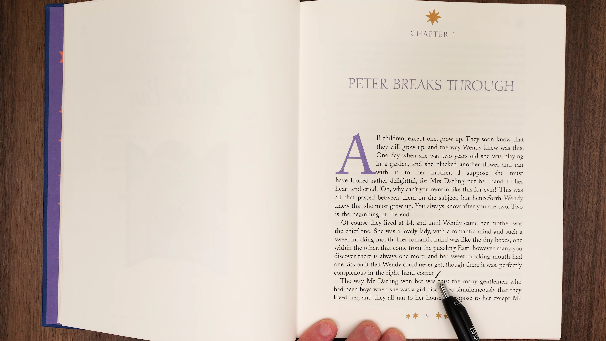

* **Trích đoạn:** `Chapter 1. PETER BREAKS THROUGH`
* **Từ vựng cốt lõi:**
  * `Break through` (cụm động từ): Xuyên thủng, phá vỡ chướng ngại vật để tiến vào một không gian mới. Ở nghĩa bóng, từ này chỉ sự xuất hiện đột ngột mang tính biến cố.
* **Phân tích:** 
  * Cụm từ `break through` báo hiệu một sự kiện bất thường. Peter Pan không gõ cửa hay bước vào như một vị khách thông thường mà sẽ phá vỡ trật tự ngăn nắp của căn phòng trẻ em nhà Darling.
  * Giảng viên nhấn mạnh độc giả cần lưu ý tiêu đề này vì trong suốt phần đầu của chương, Peter Pan chưa hề xuất hiện trực tiếp mà chỉ hiện diện qua dự cảm và không khí câu chuyện.
* **Dịch nghĩa:** Chương 1. Peter đột phá xuất hiện.

---

### [[03:30](https://www.youtube.com/watch?v=NGg8NmPs4NM&t=210s)] Mở đầu định mệnh

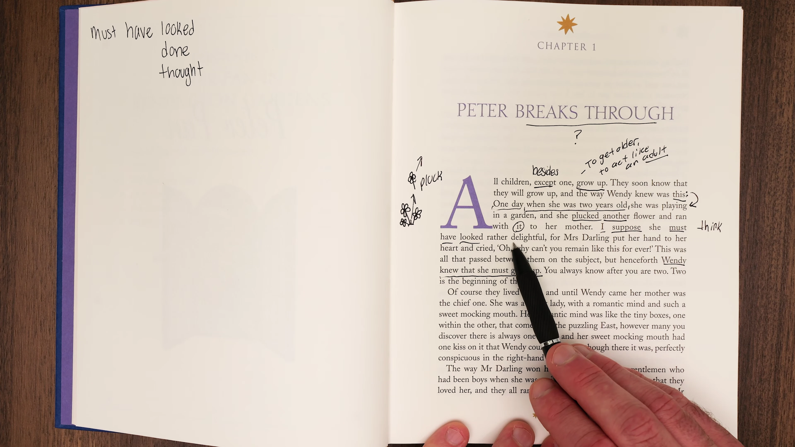

* **Trích đoạn:** `All children, except one, grow up. They soon know that they will grow up, and the way Wendy knew was this: One day when she was two years old she was playing in a garden, and she plucked another flower and ran with it to her mother.`
* **Từ vựng cốt lõi:**
  * `Except` (giới từ): Ngoại trừ, trừ ra (đồng nghĩa: `apart from`, `besides`).
  * `Grow up` (cụm động từ): Trưởng thành, lớn lên về mặt thể xác lẫn nhận thức xã hội.
  * `Pluck` (động từ): Dùng ngón tay ngắt hoặc bứt nhanh một bông hoa, nhổ lông gia cầm (`pluck a flower`, `pluck feathers`).
* **Phân tích:**
  * Cấu trúc dấu hai chấm `:` sau `the way Wendy knew was this:` được dùng kinh điển trong văn học để mở ra một phân đoạn kể chuyện chi tiết chứng minh cho mệnh đề đứng trước.
  * Hành động bé Wendy hai tuổi chạy đến đưa bông hoa vừa ngắt cho mẹ là một hình ảnh ngây thơ tuyệt đối, nhưng lại đánh dấu khoảnh khắc khởi đầu của ý thức về thời gian và sự trưởng thành.
* **Dịch nghĩa:** Mọi đứa trẻ, ngoại trừ một người, đều lớn lên. Chúng sẽ sớm biết rằng mình phải lớn lên, và cách Wendy nhận biết điều đó là như thế này: Một ngày nọ khi cô bé lên hai tuổi, cô đang chơi trong vườn, cô ngắt thêm một bông hoa và chạy ùa về phía mẹ mình.

---

### [[08:15](https://www.youtube.com/watch?v=NGg8NmPs4NM&t=495s)] Suy đoán quá khứ

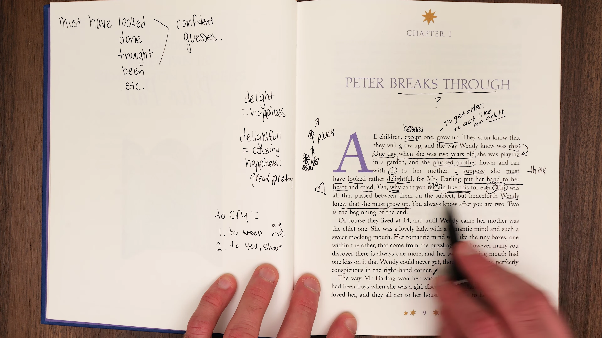

* **Trích đoạn:** `I suppose she must have looked rather delightful, for Mrs Darling put her hand to her heart and cried, ‘Oh, why can’t you remain like this for ever!’`
* **Từ vựng cốt lõi:**
  * `Suppose` (động từ): Cho rằng, phỏng đoán dựa trên linh cảm cá nhân (đồng nghĩa: `think`, `assume`).
  * `Delightful` (tính từ): Đem lại niềm vui sướng hân hoan, vô cùng duyên dáng (`delight` = niềm vui, hạnh phúc tột cùng).
  * `Cry` (động từ): Trong ngữ cảnh này mang nghĩa kêu lên, thốt lên vì xúc động nghẹn ngào (không phải hành động khóc rơi nước mắt).
  * `Remain` (động từ): Giữ nguyên trạng thái, ở lại mãi mãi (đồng nghĩa: `stay`).
* **Cấu trúc ngữ pháp:**
  * `Must have looked` (must have + V3): Diễn đạt một suy đoán có căn cứ xác đáng trong quá khứ. Người kể chuyện tin chắc rằng lúc ấy Wendy trông vô cùng đáng yêu vì hành động tiếp theo của người mẹ là đặt tay lên ngực và thốt lên lời cầu xin thời gian ngừng lại.
* **Dịch nghĩa:** Tôi cho rằng hẳn là lúc đó cô bé trông vô cùng đáng yêu, bởi vì bà Darling đã đưa tay lên ngực và kêu lên: 'Ôi, sao con không thể mãi mãi như thế này hỡi con!'

---

### [[12:30](https://www.youtube.com/watch?v=NGg8NmPs4NM&t=750s)] Khởi đầu kết thúc

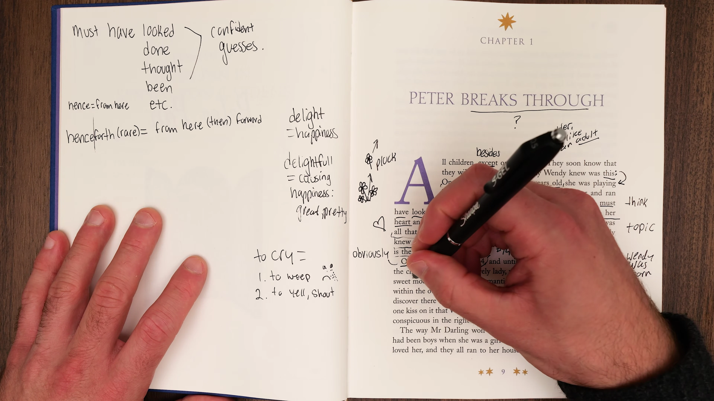

* **Trích đoạn:** `This was all that passed between them on the subject, but henceforth Wendy knew that she must grow up. You always know after you are two. Two is the beginning of the end.`
* **Từ vựng cốt lõi:**
  * `Pass between` (cụm từ): Lời nói qua lại, sự trao đổi giữa hai người (`what passes between people is what they say to each other`).
  * `Subject` (danh từ): Đề tài, chủ đề của cuộc trò chuyện (ở đây là chủ đề trưởng thành).
  * `Henceforth` (phó từ): Kể từ thời điểm đó trở đi (đồng nghĩa cổ: `from then on`).
  * `The beginning of the end` (thành ngữ): Khởi đầu của sự kết thúc, mốc điểm đánh dấu sự sụp đổ hoặc biến mất dần dần của một thời kỳ hoàng kim.
* **Phân tích:**
  * Hai tuổi là khoảnh khắc đứa trẻ bắt đầu hình thành cái tôi cá nhân và nhận ra bản thân tách biệt với thế giới xung quanh. Tuổi thơ vô tư không lo nghĩ chính thức bước vào giai đoạn đếm ngược để kết thúc.
* **Dịch nghĩa:** Đó là tất cả những gì diễn ra giữa hai mẹ con về chủ đề ấy, nhưng kể từ đó Wendy biết rằng mình phải lớn lên. Bạn sẽ luôn biết được điều đó sau khi lên hai tuổi. Hai tuổi chính là khởi đầu của sự kết thúc.

---

### [[17:00](https://www.youtube.com/watch?v=NGg8NmPs4NM&t=1020s)] Tâm hồn lãng mạn

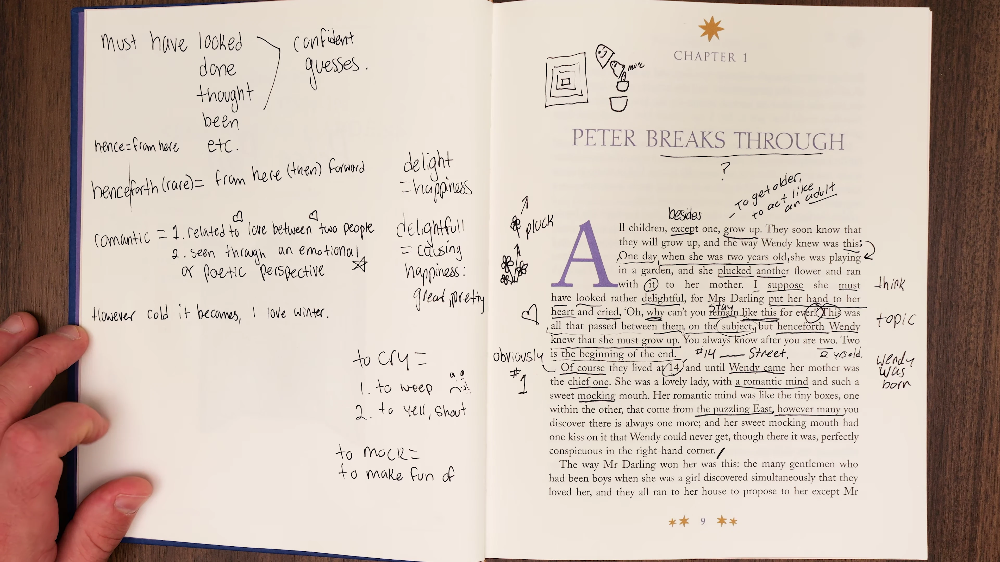

* **Trích đoạn:** `Of course they lived at 14, and until Wendy came her mother was the chief one. She was a lovely lady, with a romantic mind and such a sweet mocking mouth.`
* **Từ vựng cốt lõi:**
  * `Chief one` (danh từ): Người quan trọng nhất, nhân vật trung tâm số một trong gia đình.
  * `Romantic mind` (cụm danh từ): Tâm hồn giàu trí tưởng tượng, luôn nhìn thế giới qua lăng kính mộng mơ và cảm xúc thay vì những toan tính lạnh lùng.
  * `Mocking` (tính từ): Có nét trêu chọc, giễu nhại tinh nghịch nhưng rất ngọt ngào (`sweet mocking`).
* **Phân tích:**
  * Địa chỉ số 14 là cách viết ngắn gọn điển hình của người Anh (`Number 14`).
  * Nụ cười của bà Darling vừa quyến rũ vừa ẩn chứa nét bí ẩn tinh nghịch, tạo nên sức hút đặc biệt đối với tất cả những người đàn ông xung quanh.
* **Dịch nghĩa:** Dĩ nhiên họ sống ở căn nhà số 14, và cho đến khi Wendy ra đời, mẹ cô bé là nhân vật quan trọng nhất. Bà là một quý bà đáng yêu, với một tâm hồn lãng mạn và chiếc miệng ngọt ngào vương nét giễu cợt.

---

### [[21:40](https://www.youtube.com/watch?v=NGg8NmPs4NM&t=1300s)] Chiếc hộp bí mật

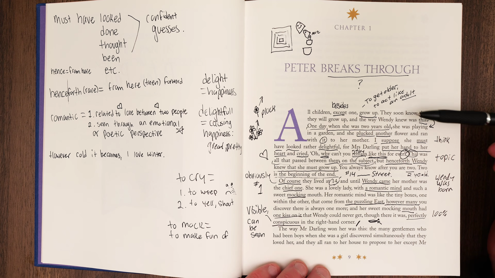

* **Trích đoạn:** `Her romantic mind was like the tiny boxes, one within the other, that come from the puzzling East, however many you discover there is always one more; and her sweet mocking mouth had one kiss on it that Wendy could never get, though there it was, perfectly conspicuous in the right-hand corner.`
* **Từ vựng cốt lõi:**
  * `Tiny boxes, one within the other`: Những chiếc hộp nhỏ lồng vào nhau (tương tự như búp bê Matryoshka hoặc hộp bí ẩn phương Đông).
  * `Puzzling` (tính từ): Đầy bí ẩn, khó hiểu, khơi gợi trí tò mò.
  * `Conspicuous` (tính từ): Rõ ràng, lộ rõ trước mắt, không hề che giấu (`clearly visible`).
* **Phân tích:**
  * Tác giả dùng lối nhân hóa kỳ lạ khi biến `one kiss` (một nụ hôn) thành một thực thể hữu hình đậu trên khóe môi bên phải của người phụ nữ. Nụ hôn này hiện hữu sờ sờ nhưng bất khả đạt được đối với cả đứa con gái yêu quý nhất.
* **Dịch nghĩa:** Tâm hồn lãng mạn của bà tựa như những chiếc hộp nhỏ lồng vào nhau đến từ phương Đông đầy bí ẩn, dẫu bạn có khám phá ra bao nhiêu chiếc đi nữa thì vẫn luôn còn một chiếc sâu hơn; và trên khóe miệng ngọt ngào giễu cợt của bà luôn vương một nụ hôn mà Wendy chẳng thể nào chạm tới, dẫu nó vẫn ở ngay đó, hiện rõ mồn một nơi khóe miệng bên phải.

---

### [[26:15](https://www.youtube.com/watch?v=NGg8NmPs4NM&t=1575s)] Kỹ thuật nhại giọng

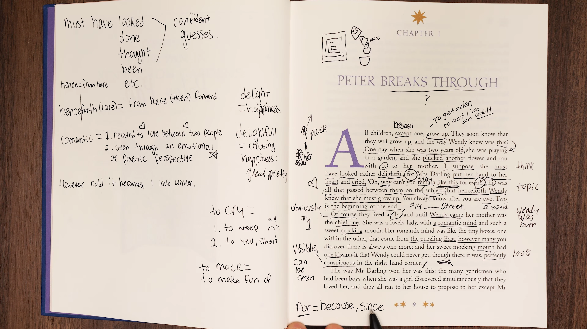

* **Thao tác sư phạm:** Giảng viên Eric tạm dừng phân tích chữ nghĩa để hướng dẫn học viên thực hành kỹ thuật Shadowing toàn bộ đoạn văn mở đầu.
* **Nguyên tắc nhại giọng chuẩn:**
  * Ngắt câu tại các dấu phẩy và dấu chấm phẩy để giữ đúng nhịp thở.
  * Nhấn trọng âm câu vào các từ khóa mang thông tin chính: `grow up`, `plucked`, `delightful`, `beginning of the end`.
  * Hạ giọng ở cuối câu trần thuật để tạo âm sắc kể chuyện trầm ấm cổ điển của văn học Anh thế kỷ 20.
* **Phân tích:** Việc bắt chước đúng ngữ điệu giúp người học thẩm thấu cấu trúc câu phức của tiếng Anh văn học một cách tự nhiên mà không cần dịch ngược sang tiếng mẹ đẻ.

---

### [[31:00](https://www.youtube.com/watch?v=NGg8NmPs4NM&t=1860s)] Chinh phục trái tim

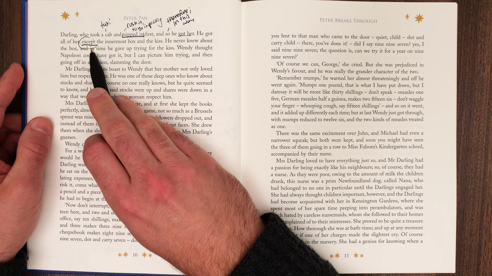

* **Trích đoạn:** `The way Mr Darling won her was this: the many gentlemen who had been boys when she was a girl discovered simultaneously that they loved her, and they all ran to her house to propose to her except Mr Darling, who took a cab and nipped in first, and so he got her.`
* **Từ vựng cốt lõi:**
  * `Won her` (động từ win trong tình cảm): Chinh phục được nàng, chiếm được trái tim người phụ nữ (`to cause someone to like or love you`).
  * `Simultaneously` (phó từ): Cùng một lúc, đồng thời tại cùng thời điểm.
  * `Propose` (động từ): Cầu hôn.
  * `Nip in` (thành ngữ lóng của Anh): Chen nhanh vào trước, lách vào chớp nhoáng trước khi người khác kịp hành động (`to go or get somewhere quickly before others`).
* **Phân tích:**
  * Bằng khiếu hài hước đặc trưng, Barrie miêu tả đám thanh niên cùng chạy bộ đến nhà cầu hôn một lượt, trong khi ông Darling thông minh hơn đã bắt xe ngựa thuê (`cab`) và chạy đến trước, qua đó giành được người đẹp.
* **Dịch nghĩa:** Cách ông Darling chinh phục được bà là thế này: rất nhiều quý ông từng là những cậu bé vào thời bà còn là thiếu nữ đã đồng thời nhận ra rằng họ yêu bà, và tất cả bọn họ đều chạy thục mạng đến nhà bà để cầu hôn, ngoại trừ ông Darling - người đã bắt một chuyến xe ngựa và nhanh chân lách vào trước tiên, và thế là ông đã cưới được bà.

---

### [[35:40](https://www.youtube.com/watch?v=NGg8NmPs4NM&t=2140s)] Chiếc hộp tận cùng

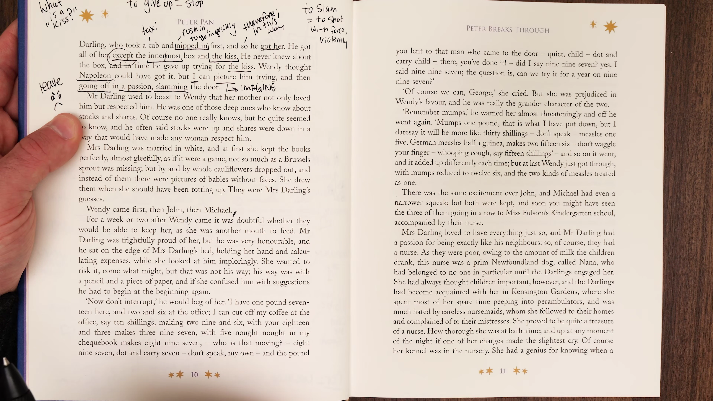

* **Trích đoạn:** `He got all of her, except the innermost box and the kiss. He never knew about the box, and in time he gave up trying for the kiss.`
* **Từ vựng cốt lõi:**
  * `Innermost` (tính từ): Ở sâu tận đáy lòng, tận cùng bên trong, riêng tư nhất (`deepest within`).
  * `In time` (thành ngữ): Theo thời gian, dần dần qua năm tháng (khác với `on time` là đúng giờ).
  * `Give up` (cụm động từ): Từ bỏ, buông xuôi nỗ lực.
* **Phân tích:**
  * Ông Darling chiếm hữu được mọi thứ thuộc về người vợ ngoại trừ chiếc hộp sâu kín nhất và nụ hôn huyền bí. Điều bi kịch pha lẫn hài hước là ông thậm chí còn chẳng biết đến sự tồn tại của chiếc hộp, và sau một thời gian theo đuổi nụ hôn, ông cũng bỏ cuộc.
* **Dịch nghĩa:** Ông có được toàn bộ con người bà, ngoại trừ chiếc hộp sâu kín nhất và nụ hôn nọ. Ông chưa từng biết về chiếc hộp, và theo thời gian ông cũng thôi không còn cố giành lấy nụ hôn ấy nữa.

---

### [[39:20](https://www.youtube.com/watch?v=NGg8NmPs4NM&t=2360s)] Ngữ pháp thói quen

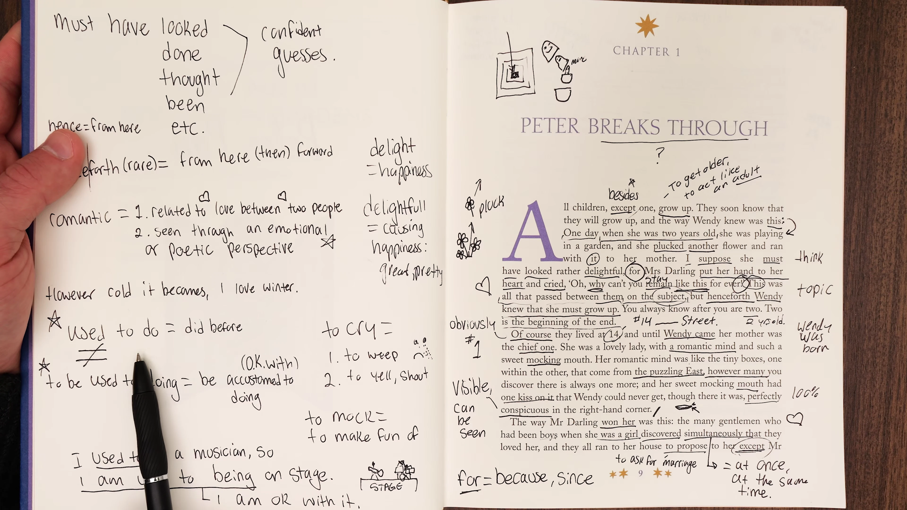

* **Trích đoạn:** `Wendy thought Napoleon could have got it, but I can picture him trying, and then going off in a passion, slamming the door. Mr Darling used to boast to Wendy that her mother not only loved him but respected him.`
* **Phân tích ngữ pháp chuyên sâu:**
  * Bảng phân biệt thói quen quá khứ:
    * `Used to + V`: Hành vi lặp đi lặp lại hoặc trạng thái trong quá khứ nay hoàn toàn chấm dứt (`He used to boast` -> Ngày xưa ông rất hay khoe khoang).
    * `Be used to + V-ing`: Đã quen với việc gì (trạng thái thích nghi).
    * `Get used to + V-ing`: Đang dần làm quen với việc gì (quá trình thay đổi).
  * Hành động giận dữ bỏ đi của Napoleon (`going off in a passion, slamming the door`) được Wendy tưởng tượng thể hiện cái nhìn trẻ thơ về sự thất bại của những người đàn ông quyền lực nhất trước người mẹ của cô.
* **Dịch nghĩa:** Wendy từng nghĩ rằng Napoleon có thể giành được nụ hôn ấy, nhưng tôi có thể mường tượng cảnh ông ta cố gắng trong vô vọng, rồi đùng đùng nổi giận bỏ đi, dằn mạnh cánh cửa. Ông Darling thường hay khoe khoang với Wendy rằng mẹ cô bé không những yêu ông mà còn vô cùng kính trọng ông.

---

### [[43:10](https://www.youtube.com/watch?v=NGg8NmPs4NM&t=2590s)] Tài chính gia đình

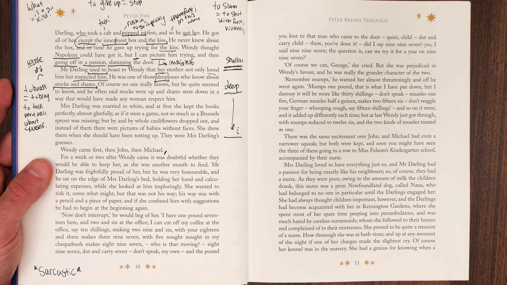

* **Trích đoạn:** `He was one of those deep ones who know about stocks and shares. Of course no one really knows, but he quite seemed to know, and he often said stocks were up and shares were down in a way that would have made any woman respect him.`
* **Từ vựng cốt lõi:**
  * `Deep ones` (cụm từ lóng): Những kẻ sâu sắc, có vẻ hiểu biết uyên bác thâm sâu.
  * `Stocks and shares`: Cổ phiếu và cổ phần tài chính.
  * `Stocks were up and shares were down`: Một câu nói vô nghĩa về mặt thị trường chứng khoán (vì hai khái niệm này gắn liền với nhau), nhưng được ông phát biểu bằng giọng điệu trịnh trọng để khiến phụ nữ phải nể phục.
* **Phân tích:** J.M. Barrie châm biếm sâu cay thói giả vờ hiểu biết thị trường tài chính của tầng lớp trung lưu thành thị Luân Đôn thời kỳ Edwardian.
* **Dịch nghĩa:** Ông là một trong những kẻ có vẻ thâm sâu hiểu biết tường tận về cổ phiếu và cổ phần. Dĩ nhiên chẳng ai thực sự hiểu nổi, nhưng ông trông có vẻ rất hiểu, và ông thường nói cổ phiếu thì tăng còn cổ phần thì giảm bằng một phong thái khiến bất kỳ người phụ nữ nào cũng phải kính nể.

---

### [[47:30](https://www.youtube.com/watch?v=NGg8NmPs4NM&t=2850s)] Ẩn dụ sổ sách

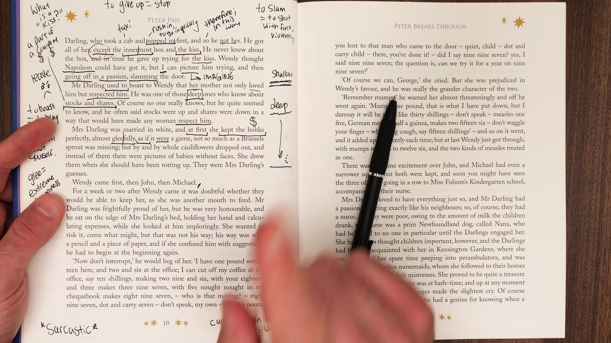

* **Trích đoạn:** `Mrs Darling was married in white, and at first she kept the books perfectly, almost gleefully, as if it were a game, not so much as a Brussels sprout was missing; but by and by whole cauliflowers were dropped...`
* **Từ vựng cốt lõi:**
  * `Keep the books` (thành ngữ kế toán): Ghi chép sổ sách thu chi gia đình.
  * `Gleefully` (phó từ): Một cách hân hoan, thích thú, đầy hào hứng.
  * `Brussels sprout`: Bắp cải tí hon Brussels.
  * `By and by` (thành ngữ cổ): Dần dần, một thời gian sau đó (`before long`, `eventually`).
* **Phân tích:**
  * Ban đầu, việc quản lý chi tiêu được bà Darling xem như một trò chơi thú vị đến mức không thất thoát một cọng bắp cải tí hon nào. Nhưng dần dà cả những cây súp lơ to tướng cũng biến mất khỏi sổ sách kế toán.
* **Dịch nghĩa:** Bà Darling mặc váy cưới màu trắng khi kết hôn, và thuở ban đầu bà ghi chép sổ sách chi tiêu cực kỳ chuẩn xác, gần như thích thú hân hoan như thể chơi một trò chơi, không để thất thoát dẫu chỉ là một búp cải Brussels tí hon; nhưng dần dà về sau, cả những cây súp lơ nguyên vẹn cũng bị bỏ sót...

---

### [[50:15](https://www.youtube.com/watch?v=NGg8NmPs4NM&t=3015s)] Thể thức giả định

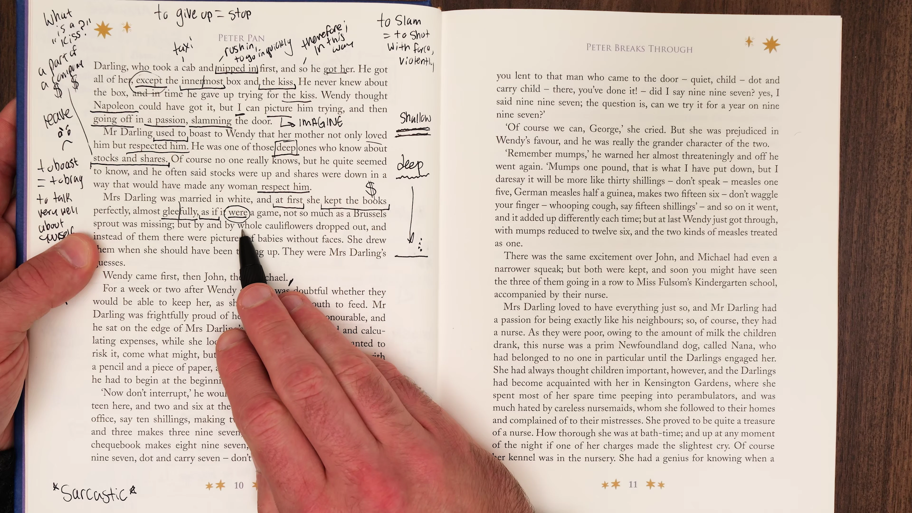

* **Trích đoạn:** `...as if it were a game... She drew them when she should have been totting up. Which of the children would have cost the most?`
* **Ngữ pháp trọng tâm:**
  * `As if it were` (Subjunctive Mood): Thể giả định dùng `were` cho tất cả các ngôi chủ ngữ để diễn tả một điều hoàn toàn không có thật ở hiện tại hoặc quá khứ (việc ghi chép sổ sách không phải là trò chơi, nhưng bà làm với tâm thế giả định như vậy).
  * `Should have been totting up`: Lẽ ra lúc đó phải đang làm gì (diễn tả sự chểnh mảng nghĩa vụ trong quá khứ). Bà Darling lẽ ra phải cộng sổ tiền nong thì lại mải mê vẽ tranh những đứa trẻ.
* **Dịch nghĩa:** ...như thể đó là một trò chơi... Bà đã vẽ chúng vào những lúc mà lẽ ra bà phải đang cặm cụi cộng sổ chi tiêu. Đứa trẻ nào trong số đó sẽ tốn kém chi phí nuôi nấng nhất?

---

### [[53:40](https://www.youtube.com/watch?v=NGg8NmPs4NM&t=3220s)] Thiên chức làm mẹ

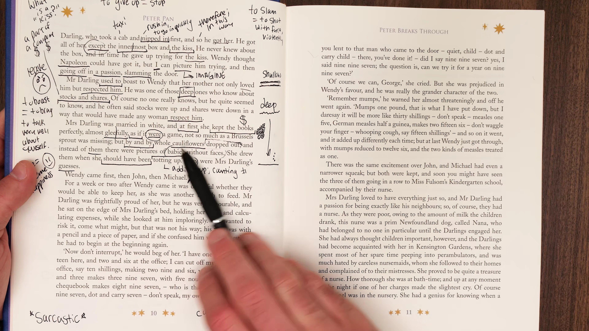

* **Trích đoạn:** `Instead of them, she drew pictures of babies without faces. She drew them when she should have been totting up. Which of the children would have cost the most? Wendy came first, then John, then Michael.`
* **Từ vựng cốt lõi:**
  * `Babies without faces`: Những đứa trẻ vô diện (ẩn dụ cho những đứa con tương lai chưa thành hình, chỉ mới tồn tại trong trí tưởng tượng và niềm mong mỏi của người mẹ).
  * `Totting up`: Cộng nhẩm các khoản tiền chi tiêu nhỏ lẻ.
* **Phân tích:** Sự xuất hiện lần lượt của Wendy, John và Michael được dự báo qua các bức vẽ vô thức của người mẹ trên cuốn sổ chi tiêu gia đình. Trực giác người mẹ đã vượt lên trên các con số kế toán khô khan của người cha.
* **Dịch nghĩa:** Thay vì ghi chép chúng, bà lại vẽ những bức tranh em bé chưa rõ mặt mày. Bà vẽ chúng vào những lúc lẽ ra phải đang cộng sổ tiền nong. Đứa trẻ nào sẽ tốn kém nhất đây? Wendy ra đời đầu tiên, rồi đến John, rồi sau đó là Michael.

---

### [[56:30](https://www.youtube.com/watch?v=NGg8NmPs4NM&t=3390s)] Tổng kết trang đầu

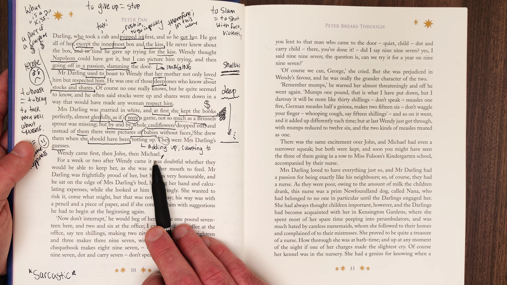

* **Nội dung đúc kết:**
  * Toàn bộ trang đầu tiên của cuốn tiểu thuyết đã khéo léo thiết lập bối cảnh gia đình Edwardian kinh điển: sự giằng co giữa trách nhiệm tài chính thực tế và thế giới mộng mơ trẻ thơ.
  * Giảng viên Eric nhấn mạnh tầm quan trọng của việc học tiếng Anh qua văn học: không chỉ học từ vựng đơn lẻ mà phải hiểu cách tác giả kết hợp nhịp điệu (`rhythm`), sắc thái biểu cảm (`tone`) và các lớp nghĩa ẩn dụ (`metaphors`).
* **Dịch nghĩa:** Chúng ta đã hoàn thành việc bóc tách từng chữ của trang mở đầu. Hãy luyện đọc lại toàn bộ đoạn văn này để biến từ vựng và ngữ pháp của tác giả thành phản xạ tự nhiên của chính mình.

---

## Trích dẫn then chốt

* [[01:05](https://www.youtube.com/watch?v=NGg8NmPs4NM&t=65s)] `All children, except one, grow up.` (Mọi đứa trẻ, ngoại trừ một người, đều lớn lên.)
* [[09:12](https://www.youtube.com/watch?v=NGg8NmPs4NM&t=552s)] `Two is the beginning of the end.` (Hai tuổi chính là khởi đầu của sự kết thúc.)
* [[22:45](https://www.youtube.com/watch?v=NGg8NmPs4NM&t=1365s)] `Her romantic mind was like the tiny boxes, one within the other, that come from the puzzling East...` (Tâm hồn lãng mạn của bà tựa như những chiếc hộp nhỏ lồng vào nhau đến từ phương Đông đầy bí ẩn...)
* [[32:10](https://www.youtube.com/watch?v=NGg8NmPs4NM&t=1930s)] `...except Mr Darling, who took a cab and nipped in first, and so he got her.` (...ngoại trừ ông Darling - người đã bắt một chuyến xe ngựa và nhanh chân lách vào trước tiên, và thế là ông đã cưới được bà.)
* [[36:15](https://www.youtube.com/watch?v=NGg8NmPs4NM&t=2175s)] `He got all of her, except the innermost box and the kiss.` (Ông có được toàn bộ con người bà, ngoại trừ chiếc hộp sâu kín nhất và nụ hôn nọ.)

---

## Lệnh & Công cụ

### Cấu trúc suy đoán quá khứ
* Công thức: `Subject + must have + Past Participle (V3/ed)`
* Áp dụng: Khẳng định suy đoán gần như chắc chắn về một sự việc trong quá khứ dựa trên bằng chứng gián tiếp.
* Ví dụ: `She must have looked rather delightful.` (Hẳn là lúc đó cô bé trông vô cùng đáng yêu.)

### Phân biệt thói quen quá khứ
* `used to + V-inf`: Từng có thói quen hoặc trạng thái trong quá khứ, nay không còn nữa (`He used to boast`).
* `would + V-inf`: Từng thường xuyên làm gì trong quá khứ mang tính chất hồi tưởng hoặc hành vi lặp lại.
* `be used to + V-ing`: Đã quen với việc gì ở hiện tại.

### Thể thức giả định
* Cấu trúc: `as if / as though + S + were / Past Subjunctive`
* Ý nghĩa: Diễn tả một giả định phi thực tế, trái với bản chất thực tế đang diễn ra.
* Ví dụ: `...as if it were a game...` (như thể đó là một trò chơi).

---

## Đánh đổi & Rủi ro

* **Nguy cơ lạm dụng từ vựng cổ:** Các từ như `henceforth`, `gleefully`, `nipped in` mang sắc thái văn phong văn học cổ điển đầu thế kỷ 20. Nếu người học lạm dụng trong giao tiếp hàng ngày hoặc viết email công việc hiện đại sẽ tạo cảm giác xa cách, cứng nhắc hoặc lỗi thời.
* **Bẫy dịch từng chữ:** Văn phong của J.M. Barrie sử dụng nhiều cấu trúc đảo ngữ và ẩn dụ (`sweet mocking mouth`, `one kiss on it`). Nếu cố gắng dịch thô từng từ sang tiếng Việt sẽ phá vỡ hoàn toàn tính thi vị và làm biến dạng ý đồ nghệ thuật của tác giả.
* **Nhầm lẫn giữa cổ phiếu và cổ phần:** Trong văn bản gốc, tác giả cố ý châm biếm ông Darling khi viết `stocks were up and shares were down`. Người học cần nhận diện đây là sự mỉa mai của nhà văn chứ không phải quy luật kinh tế học nghiêm túc.
