# PHÂN TÍCH TẬP 2 PETER PAN

* **Kênh:** Reading English with Eric | **Thời lượng:** 01:09:11 | **Ngày:** 2026-09-27
* **Video:** https://www.youtube.com/watch?v=PUgDKBGc5UQ

---

## Thuật ngữ

| Thuật ngữ | Tiếng Anh | Giải thích |
| :--- | :--- | :--- |
| Nghi vấn gián tiếp | Indirect Question | Mệnh đề danh ngữ bắt đầu bằng whether/if diễn đạt sự hoài nghi hoặc lựa chọn giữa các khả năng. |
| Van nài tha thiết | Imploringly | Phó từ chỉ trạng thái ánh mắt hoặc giọng điệu cầu xin khẩn thiết, mong mỏi sự thương xót. |
| Suýt soát thoát nạn | Narrow squeak | Thành ngữ cổ chỉ tình huống vừa vặn thoát hiểm hoặc suýt nữa thì thất bại trong gang tấc. |
| Do bởi | Owing to | Cụm giới từ chỉ nguyên nhân, đồng nghĩa với because of hoặc due to, dùng trong văn phong trang trọng. |
| Đoan trang nghiêm cẩn | Prim | Tính từ miêu tả tính cách chuẩn mực, kỹ tính, luôn giữ gìn khuôn phép và nề nếp kỷ luật. |
| Người quen biết | Acquaintance | Người từng gặp gỡ và giao tiếp xã giao nhưng chưa đủ thân thiết để trở thành bạn bè thân cận. |
| Làm ra vẻ | Affect to do | Cấu trúc cổ chỉ hành vi giả vờ, vờ vịt làm một hành động nào đó (đồng nghĩa: pretend to do). |
| Khinh miệt coi thường | Despise | Động từ chỉ cảm xúc xem thường sâu sắc, không tôn trọng đối tượng vì nhận thấy sự nông cạn. |
| Chuyện phiếm | Light talk | Những cuộc trò chuyện dông dài, nhẹ nhàng, vô thưởng vô phạt về thời tiết hoặc tin đồn vô căn cứ. |
| Đồng tiền Guinea | Guinea | Đơn vị tiền tệ quý tộc của nước Anh thời xưa, tương đương 21 shillings (1 pound 1 shilling). |
| Bệnh quai bị | Mumps | Bệnh truyền nhiễm sưng tuyến nước bọt ở mang tai thường gặp ở trẻ nhỏ thời xưa. |
| Bệnh sởi | Measles | Bệnh truyền nhiễm gây sốt cao và phát ban đỏ toàn thân ở trẻ nhỏ. |
| Bệnh ho gà | Whooping cough | Bệnh nhiễm trùng đường hô hấp gây ra những cơn ho rũ rượi kèm tiếng rít khi hít thở. |

---

## Tổng luận chuyên đề

### Giá trị văn học

Tập 2 tiếp tục đưa người đọc đi sâu vào bức tranh gia đình tầng lớp trung lưu thành thị nước Anh thời kỳ Edwardian:
* **Áp lực kinh tế và tình mẫu tử:** Sự ra đời của mỗi đứa trẻ (Wendy, John, Michael) không đơn thuần là niềm vui mà là một bài toán chi phí sinh tử. Tác giả khắc họa sâu sắc sự giằng xé giữa tính toán thực tế của người cha và tình mẫu tử bao dung, đầy định kiến vị tha của người mẹ.
* **Hình tượng độc đáo về bảo mẫu:** Điểm sáng kỳ ảo và hóm hỉnh nhất của câu chuyện là sự xuất hiện của Nana - một cô chó giống Newfoundland đảm nhiệm vai trò bảo mẫu toàn diện. Nana không phải thú cưng mà là một thành viên cốt cán có kỷ luật thép trong gia đình.
* **Châm biếm xã hội ngầm:** Tác giả châm biếm sâu sắc giới bảo mẫu thượng lưu qua ánh mắt của Nana. Trong khi các bảo mẫu loài người mải mê tán gẫu chuyện phiếm nơi công viên thì Nana chuyên tâm tuyệt đối vào sự an nguy của những đứa trẻ.

### Cấu trúc ngữ pháp

* **Mệnh đề nghi vấn với Whether:** Phân biệt rõ `whether` (liệu rằng có hay không) và `weather` (thời tiết). `Whether` mở ra mệnh đề phụ đóng vai trò bổ ngữ hoặc chủ ngữ, thường đi kèm `or not` ngầm định (`whether they would be able to keep her`).
* **Cụm giới từ chỉ nguyên nhân:** Tác giả sử dụng luân phiên các cấu trúc nguyên nhân mang sắc thái cổ điển: `owing to` (do bởi), `as they were poor` (bởi vì họ nghèo), `on account of` thay cho liên từ `because` thông thường.
* **Động từ chỉ thái độ giả vờ:** Cấu trúc `affect to + V-inf` là một điểm ngữ pháp văn học kinh điển miêu tả hành vi cố tình làm ra vẻ phớt lờ (`they affected to ignore her`), thể hiện tính kiêu hãnh ngầm của giai cấp quý tộc.

### Kỹ thuật ngữ điệu

* **Ngữ điệu câu hỏi trong văn học:** Giảng viên Eric phân tích đặc tính âm nhạc của tiếng Anh (`every sentence is a song`). Khi gặp câu hỏi nghi vấn, cao độ giọng nói bắt buộc phải đi lên (`voice goes up`), tạo cảm giác hồi hộp và mong đợi phản hồi từ người nghe.
* **Ngắt nhịp cảm xúc:** Việc sử dụng các dấu gạch ngang (`dashes`) trong văn bản thể hiện những quãng ngắt giọng đột ngột của ông Darling khi bị dòng suy nghĩ hoặc hành động bên ngoài làm phân tâm lúc đang làm toán.

---

## Bóc tách chi tiết

### [[02:15](https://www.youtube.com/watch?v=PUgDKBGc5UQ&t=135s)] Tính toán sinh tử

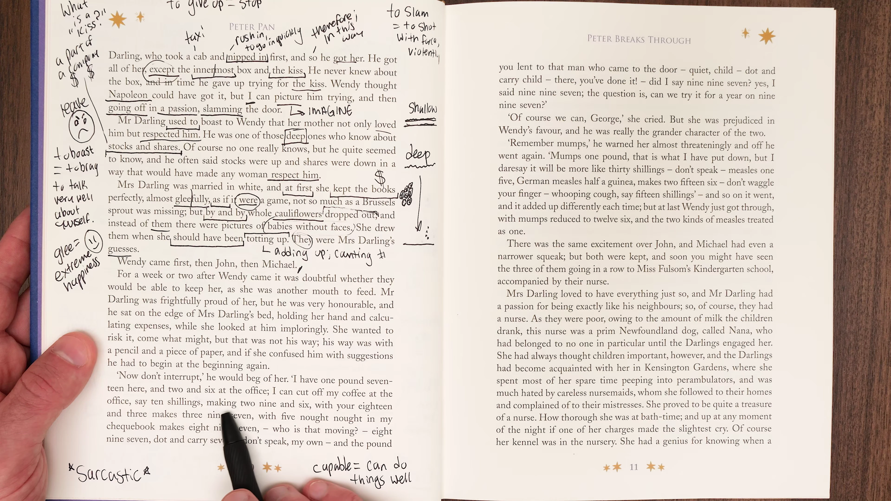

* **Trích đoạn:** `For a week or two after Wendy came it was doubtful whether they would be able to keep her, as she was another mouth to feed.`
* **Từ vựng cốt lõi:**
  * `Doubtful` (tính từ): Đầy nghi ngờ, chưa chắc chắn, bấp bênh (`uncertain`).
  * `Another mouth to feed` (thành ngữ): Thêm một miệng ăn, gia tăng thêm gánh nặng tài chính cho gia đình.
  * `Keep her` (cụm động từ): Giữ lại nuôi nấng đứa trẻ thay vì gửi cho người khác nhận nuôi hoặc gửi vào trại tế bần.
* **Phân tích:** Mở đầu đoạn văn hé lộ thực tế phũ phàng: gia đình nghèo đến mức sự tồn tại của đứa con đầu lòng phải trải qua một cuộc sát hạch chi phí gắt gao trong suốt hai tuần đầu đời.
* **Dịch nghĩa:** Trong một hoặc hai tuần sau khi Wendy ra đời, việc họ có thể giữ cô bé lại nuôi hay không vẫn còn là điều nghi vấn, bởi vì cô bé lại là thêm một miệng ăn trong nhà.

---

### [[06:40](https://www.youtube.com/watch?v=PUgDKBGc5UQ&t=400s)] Mép giường bệnh

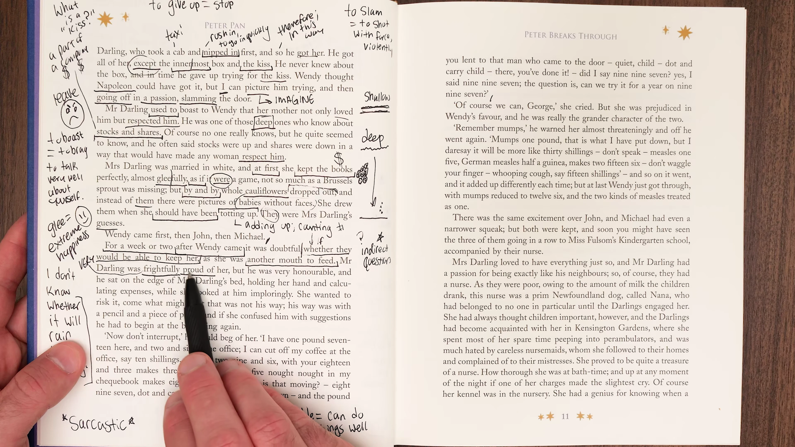

* **Trích đoạn:** `Mr Darling was frightfully proud of her, but he was also exceedingly honourable, and he sat on the edge of Mrs Darling’s bed, holding her hand and calculating expenses, while she looked at him imploringly.`
* **Từ vựng cốt lõi:**
  * `Frightfully proud` (phó từ tăng cường độ): Vô cùng tự hào, kiêu hãnh tột bậc (phong cách nói quá của người Anh thời kỳ Edwardian).
  * `Exceedingly honourable` (cụm tính từ): Cực kỳ trọng danh dự và nguyên tắc sống.
  * `Imploringly` (phó từ): Bằng ánh mắt van nài, khẩn cầu tha thiết.
* **Phân tích:** 
  * Thế tiến thoái lưỡng nan của người cha: vừa tự hào về đứa con mới sinh nhưng lòng tự trọng không cho phép ông nhận nuôi nếu không đủ khả năng tài chính chi trả.
  * Hình ảnh ông ngồi ở mép giường bệnh nắm tay vợ làm toán đối lập sâu sắc với ánh mắt van xin của người mẹ vừa vượt cạn.
* **Dịch nghĩa:** Ông Darling tự hào về cô bé đến phát sợ, nhưng ông cũng là một người cực kỳ trọng danh dự, và ông ngồi ở mép giường của bà Darling, nắm lấy tay bà và tính toán các khoản chi tiêu, trong khi bà nhìn ông bằng ánh mắt van nài tha thiết.

---

### [[11:20](https://www.youtube.com/watch?v=PUgDKBGc5UQ&t=680s)] Phép tính sổ sách

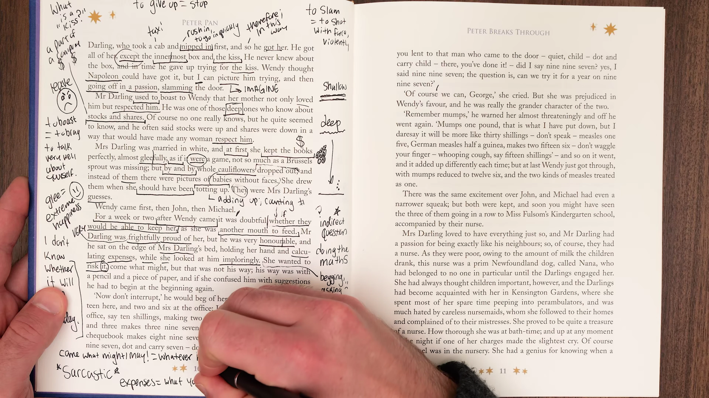

* **Trích đoạn:** `She wanted to risk it, come what might, but that was not his way; his way was with a pencil and a piece of paper, and if she confused him with suggestions he had to begin at the beginning again.`
* **Từ vựng cốt lõi:**
  * `Risk it` (cụm động từ): Chấp nhận liều lĩnh, đánh cược số phận.
  * `Come what might` (thành ngữ cổ): Dù cho bất cứ chuyện gì xảy ra đi chăng nữa (`whatever happens`).
  * `Confuse` (động từ): Làm cho bối rối, làm rối trí, gây mất tập trung.
* **Phân tích:** Sự khác biệt cơ bản trong tư duy nam nữ: người phụ nữ sẵn sàng liều lĩnh vì tình mẫu tử, trong khi người đàn ông bắt buộc phải lượng hóa mọi rủi ro bằng bút chì và mảnh giấy trắng.
* **Dịch nghĩa:** Bà muốn chấp nhận liều lĩnh, dẫu có chuyện gì xảy ra đi chăng nữa, nhưng đó không phải là cách làm của ông; cách của ông là giải quyết bằng một cây bút chì và một mảnh giấy, và nếu bà làm ông rối trí bởi những gợi ý thì ông lại phải bắt đầu tính lại từ đầu.

---

### [[16:30](https://www.youtube.com/watch?v=PUgDKBGc5UQ&t=990s)] Khoản nợ cà phê

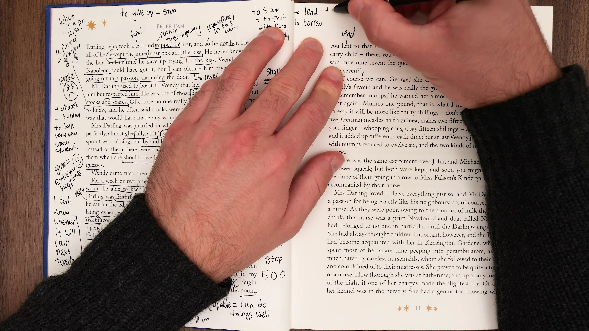

* **Trích đoạn:** `‘Now let’s see,’ he would say. ‘One pound two and six, that is the doctor; and the pound you lent to that man who came to the door—’ ‘He didn’t come to the door, George,’ Mrs Darling corrected him. ‘Well, wherever he came from, it’s gone. And I can cut off my coffee at the office...’`
* **Từ vựng cốt lõi:**
  * `One pound two and six`: Hệ thống tiền tệ Anh cổ (1 bảng, 2 shilling và 6 pence).
  * `Correct` (động từ): Sửa sai, đính chính lại thông tin.
  * `Cut off` (cụm động từ): Cắt giảm hoàn toàn, ngừng chi tiêu cho một khoản nào đó.
* **Phân tích:** 
  * Tác giả miêu tả chi tiết từng khoản tiền vụn vặt: tiền công bác sĩ đỡ đẻ, một bảng bà Darling trót cho người lạ vay, và sự hy sinh nhỏ bé của người cha là nhịn uống cà phê ở cơ quan để bù vào chi phí nuôi con.
* **Dịch nghĩa:** 'Nào để xem nào,' ông thường nói. 'Một bảng, hai shilling và sáu xu, đó là tiền bác sĩ; và một bảng em đã cho gã đàn ông đến trước cửa nhà vay—' 'Anh ấy không đến trước cửa, George à,' bà Darling đính chính. 'Thôi được, dẫu hắn đến từ đâu thì số tiền đó cũng mất rồi. Và anh có thể cắt khoản cà phê của mình ở sở làm...'

---

### [[22:15](https://www.youtube.com/watch?v=PUgDKBGc5UQ&t=1335s)] Chi phí bệnh tật

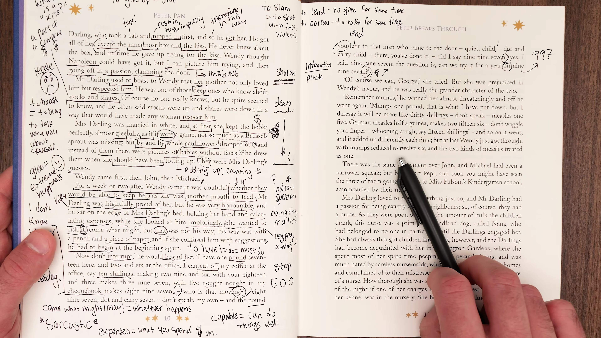

* **Trích đoạn:** `‘Mumps one pound, that is what I have put down, but I daresay it will be more like thirty shillings—don’t speak—measles one pound, German measles half a guinea, makes two fifteen six—don’t waggle your finger—whooping-cough, say fifteen shillings—’`
* **Từ vựng cốt lõi:**
  * `Daresay` (động từ): Dám chắc rằng, có lẽ là vậy.
  * `Waggle your finger`: Cựa quậy hoặc lắc lắc ngón tay làm phân tâm người đang nhẩm tính.
  * `Half a guinea`: Nửa đồng guinea (10 shilling 6 pence).
* **Phân tích:**
  * Ông Darling quy đổi trước mọi căn bệnh tiềm ẩn của trẻ thơ thành tiền mặt: quai bị 1 bảng, sởi thường 1 bảng, sởi Đức nửa guinea, ho gà 15 shilling. Đây là cái nhìn hài hước nhưng chua chát về việc nuôi dạy con cái thời xưa.
* **Dịch nghĩa:** 'Bệnh quai bị một bảng, đó là khoản anh đã ghi xuống, nhưng anh dám chắc sẽ lên tới ba mươi shilling—đừng nói gì cả—sởi một bảng, sởi Đức nửa đồng guinea, tổng cộng là hai bảng mười lăm shilling sáu xu—đừng lắc ngón tay nữa—ho gà, cứ cho là mười lăm shilling—'

---

### [[28:50](https://www.youtube.com/watch?v=PUgDKBGc5UQ&t=1730s)] Hai cậu con trai

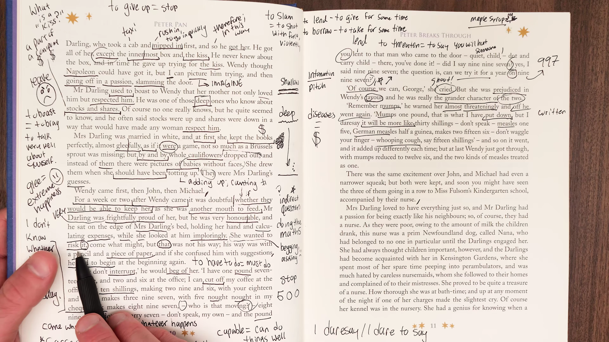

* **Trích đoạn:** `There was the same excitement over John, and Michael had even a narrower squeak, but both were kept, and soon you might have seen the three of them going in a row to Miss Folsom’s kindergarten school, accompanied by their nurse.`
* **Từ vựng cốt lõi:**
  * `Excitement` (danh từ): Sự xao động, ồn ào lo lắng (không chỉ là niềm phấn khích).
  * `Narrow squeak` (thành ngữ): Sự thoát hiểm suýt soát trong gang tấc.
  * `Going in a row`: Đi thành một hàng thẳng tắp ngay ngắn.
  * `Accompanied by` (quá khứ phân từ bị động): Được hộ tống, đi kèm bởi ai đó.
* **Phân tích:** Sự ra đời của John và Michael cũng trải qua các vòng tính toán tương tự. Cậu bé út Michael thậm chí còn suýt bị từ chối nuôi nấng vì ngân quỹ gia đình đã chạm đáy, nhưng cuối cùng cả ba đều được giữ lại.
* **Dịch nghĩa:** Cũng có sự xao động lo lắng tương tự khi John chào đời, và Michael thậm chí còn trải qua một phen suýt soát hiểm nghèo hơn, nhưng cả hai đều được giữ lại nuôi nấng, và chẳng mấy chốc bạn có thể thấy cả ba đứa trẻ xếp thành một hàng đi đến trường mẫu giáo của cô Folsom, dưới sự hộ tống của bảo mẫu của chúng.

---

### [[34:20](https://www.youtube.com/watch?v=PUgDKBGc5UQ&t=2060s)] Định kiến vị tha

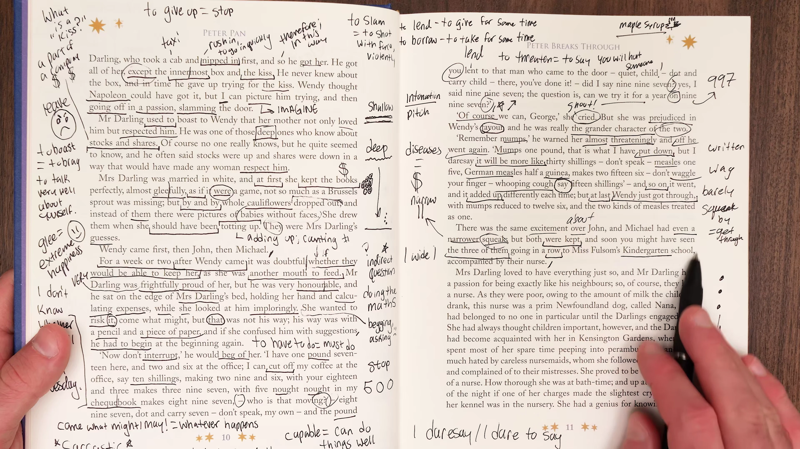

* **Trích đoạn:** `Mrs Darling was prejudiced in Wendy’s favour, and Wendy just got through, with mumps reduced to seven and six, and the two kinds of measles treated as one.`
* **Từ vựng cốt lõi:**
  * `Prejudiced in one's favour` (thành ngữ): Có định kiến thiên vị, luôn dành ưu ái đặc biệt cho ai đó.
  * `Get through` (cụm động từ): Vượt qua bài kiểm tra hoặc cửa ải khó khăn.
  * `Treated as one`: Được gộp chung lại làm một khoản chi duy nhất để giảm bớt số tiền tính toán.
* **Phân tích:** Người mẹ dùng sự thiên vị đầy tình yêu thương để bẻ cong các con số: nài nỉ chồng hạ giá tiền bệnh quai bị xuống còn 7 shilling 6 xu và gộp hai loại bệnh sởi làm một để đứa con gái đầu lòng được phép ở lại trong gia đình.
* **Dịch nghĩa:** Bà Darling đã có sẵn định kiến thiên vị nghiêng về Wendy, và Wendy đã vừa vặn vượt qua được cửa ải, với khoản chi phí quai bị được giảm xuống còn bảy shilling sáu xu, và hai loại bệnh sởi được gộp lại tính làm một.

---

### [[40:10](https://www.youtube.com/watch?v=PUgDKBGc5UQ&t=2410s)] Chó bảo mẫu Nana

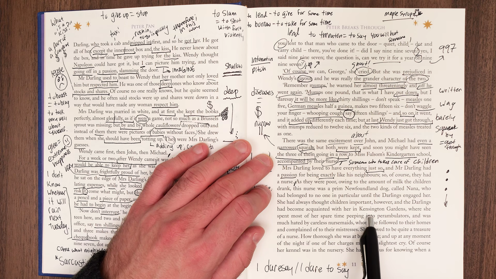

* **Trích đoạn:** `Mrs Darling loved to have everything respectable, and they were poor, owing to the amount of milk the children drank, so this nurse was a prim Newfoundland dog, called Nana, that had belonged to no one in particular until the Darlings engaged her.`
* **Từ vựng cốt lõi:**
  * `Respectable` (tính từ): Đàng hoàng, chỉnh chu, đúng chuẩn mực xã hội để không bị người ngoài dị nghị.
  * `Owing to` (cụm giới từ): Xuất phát từ nguyên nhân, bởi vì (`because of`).
  * `Prim` (tính từ): Nghiêm cẩn, đoan trang, cầu toàn và rất mực ngăn nắp.
  * `Engage` (động từ trang trọng): Tuyển dụng, thuê mướn nhân sự (`to employ someone`).
* **Phân tích:** Để gia đình giữ được thể diện trung lưu cần có một bảo mẫu đưa đón trẻ nhỏ, nhưng do nghèo nên họ không thể thuê bảo mẫu người mà quyết định tuyển một chú chó giống Newfoundland lang thang.
* **Dịch nghĩa:** Bà Darling thích mọi thứ phải thật đàng hoàng chỉnh chu, và họ thì lại nghèo, do lượng sữa mà bọn trẻ uống quá nhiều, vì vậy vị bảo mẫu này là một cô chó giống Newfoundland nghiêm cẩn, tên là Nana, vốn dĩ chẳng thuộc về riêng ai cho đến khi gia đình Darling thuê cô ấy.

---

### [[45:15](https://www.youtube.com/watch?v=PUgDKBGc5UQ&t=2715s)] Kỷ luật giờ tắm

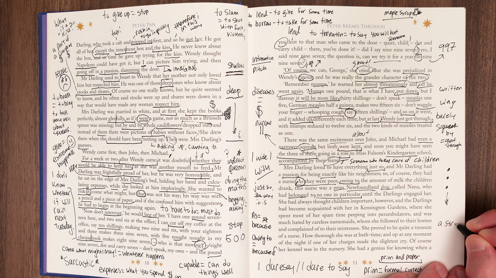

* **Trích đoạn:** `She had always thought children important, and the Darlings met her in Kensington Gardens, where she spent most of her spare time peeping into perambulators. It was quite a lesson in manners to see her escorting the children... and she was thorough at bath-time.`
* **Từ vựng cốt lõi:**
  * `Perambulator / Pram` (danh từ cổ): Xe đẩy trẻ em.
  * `A lesson in manners` (thành ngữ): Một tấm gương mẫu mực về cung cách ứng xử chuẩn mực.
  * `Thorough` (tính từ): Chu đáo, cẩn trọng, làm việc gì cũng tỉ mỉ đến từng chi tiết nhỏ.
* **Phân tích:** 
  * Nana có niềm đam mê bẩm sinh với trẻ nhỏ, thường ngó nghiêng vào các xe đẩy trẻ em ở công viên Kensington.
  * Khi tắm cho lũ trẻ, Nana kiểm tra nhiệt độ nước bằng chân trước và không bao giờ để một vết bẩn nào sót lại.
* **Dịch nghĩa:** Cô ấy luôn cho rằng trẻ con là quan trọng nhất, và gia đình Darling đã gặp cô trong Vườn Kensington, nơi cô dành phần lớn thời gian rảnh rỗi để ngó nghiêng vào các xe đẩy em bé. Thật là một bài học mẫu mực về cung cách khi thấy cô hộ tống lũ trẻ... và cô ấy cực kỳ chu đáo cẩn thận trong giờ tắm rửa.

---

### [[50:20](https://www.youtube.com/watch?v=PUgDKBGc5UQ&t=3020s)] Chiếc dù che mưa

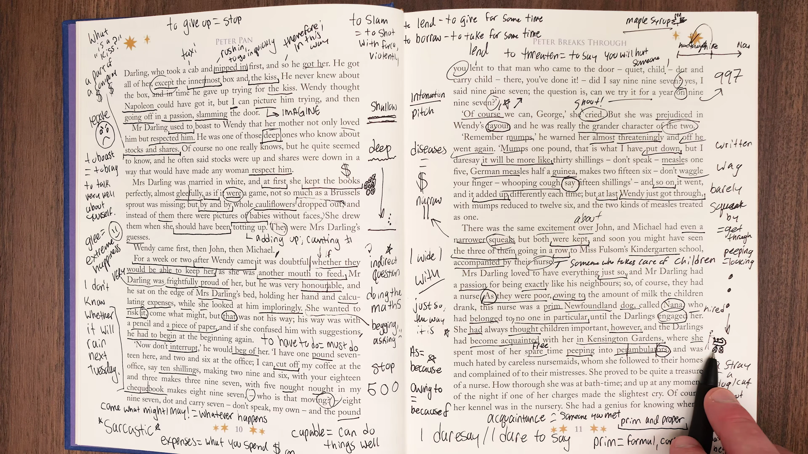

* **Trích đoạn:** `She carried an umbrella in her mouth in case of rain, and she always made sure they wore their mufflers when the wind was cold. She walked on the outside of the pavement to keep them safe from horses and carriages.`
* **Từ vựng cốt lõi:**
  * `In case of` (liên từ điều kiện): Phòng khi, trong trường hợp xảy ra sự cố.
  * `Muffler` (danh từ cổ): Khăn quàng cổ bằng len ấm (`scarf`).
  * `Pavement` (danh từ Anh-Anh): Vỉa hè đi bộ (tiếng Anh-Mỹ dùng `sidewalk`).
  * `Carriage` (danh từ): Cỗ xe ngựa kéo lưu thông trên đường phố Luân Đôn xưa.
* **Phân tích:** Chi tiết Nana ngậm ô trong miệng phòng khi trời mưa và luôn đi ở mép ngoài vỉa hè để che chắn lũ trẻ khỏi móng ngựa và bánh xe là minh chứng tuyệt mỹ cho sự tận tụy và thông minh vượt bậc của loài vật.
* **Dịch nghĩa:** Cô ấy ngậm một chiếc ô trong miệng phòng khi trời đổ mưa, và cô luôn đảm bảo rằng chúng phải quàng khăn len khi gió trở lạnh. Cô luôn đi ở phía mép ngoài của vỉa hè để bảo vệ bọn trẻ an toàn khỏi xe ngựa và người cưỡi ngựa.

---

### [[56:45](https://www.youtube.com/watch?v=PUgDKBGc5UQ&t=3405s)] Giám sát ban đêm

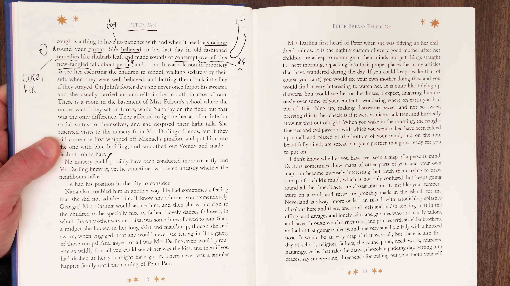

* **Trích đoạn:** `She had a kennel of her own in the nursery, and she was always up in the night if one of the children made the slightest cry. She knew to a nicety when any of them had a cough, and would instantly appear with bandages or medicine.`
* **Từ vựng cốt lõi:**
  * `Kennel` (danh từ): Chuồng chó, góc nằm riêng của chó trong phòng ngủ trẻ em.
  * `The slightest cry`: Tiếng ọ ẹ hoặc cựa mình khóc nhỏ nhất trong đêm.
  * `To a nicety` (thành ngữ cổ): Chuẩn xác đến từng chân tơ kẽ tóc (`with absolute precision`).
  * `Bandage` (danh từ): Băng gạc y tế.
* **Phân tích:** Vị trí túc trực của Nana ngay trong phòng ngủ cho phép cô phát hiện tức thì mọi biến chuyển sức khỏe của ba đứa trẻ, thậm chí phân biệt chính xác tiếng ho nhẹ do sặc nước hay tiếng ho do cảm lạnh.
* **Dịch nghĩa:** Cô có một chiếc chuồng riêng đặt ngay trong phòng giữ trẻ, và cô luôn thức dậy trong đêm nếu một trong những đứa trẻ phát ra tiếng khóc dù là nhỏ nhất. Cô biết chuẩn xác đến từng ly khi nào đứa nào trong số chúng bị ho, và sẽ xuất hiện ngay lập tức với băng gạc hoặc thuốc men.

---

### [[62:10](https://www.youtube.com/watch?v=PUgDKBGc5UQ&t=3730s)] Khinh miệt chuyện phiếm

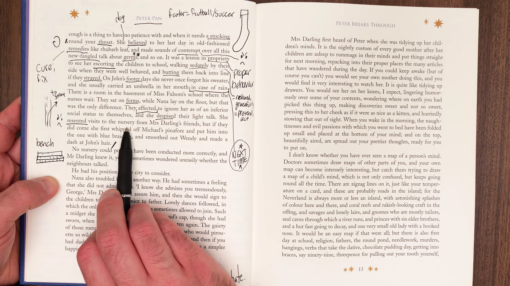

* **Trích đoạn:** `There was a sort of club where the nurses met in Kensington Gardens, and they affected to ignore Nana because she was a dog, while she despised their light talk and would not condescend to mix with them.`
* **Từ vựng cốt lõi:**
  * `Affect to ignore` (cấu trúc ngữ pháp cổ): Giả vờ làm ra vẻ phớt lờ, làm như không nhìn thấy.
  * `Despise` (động từ): Khinh miệt, xem thường tận đáy lòng.
  * `Light talk` (danh từ): Những lời buôn chuyện phù phiếm, tầm phào.
  * `Condescend` (động từ): Hạ mình, nhún nhường làm điều gì thấp kém hơn phẩm giá của mình.
* **Phân tích:** 
  * Sự mỉa mai giai cấp sâu sắc: các nữ bảo mẫu loài người tự cho mình cao quý nên giả vờ phớt lờ cô chó Nana, nhưng Nana đáp trả bằng sự khinh bỉ tột độ trước những câu chuyện tầm phào của họ và kiên quyết không hạ mình kết giao.
* **Dịch nghĩa:** Có một hội nhóm nơi các cô bảo mẫu thường tụ tập trong Vườn Kensington, và họ làm ra vẻ phớt lờ Nana vì cô là một con chó, trong khi cô khinh miệt những chuyện phiếm nông cạn của họ và chẳng thèm hạ mình hòa nhập với đám người đó.

---

### [[65:30](https://www.youtube.com/watch?v=PUgDKBGc5UQ&t=3930s)] Vị thế gia đình

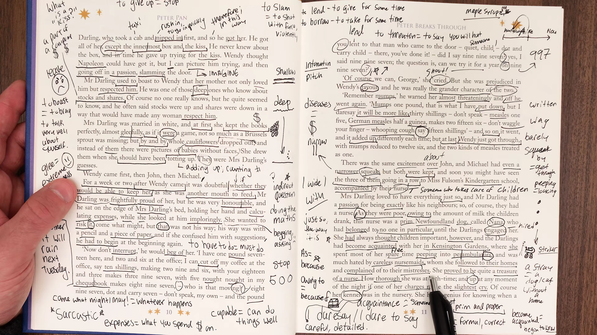

* **Trích đoạn:** `Mrs Darling had the highest opinion of Nana, and she often said that no children could have had a better nurse. But Mr Darling sometimes worried what the neighbours would think of having a dog for a nurse.`
* **Từ vựng cốt lõi:**
  * `Have the highest opinion of` (thành ngữ): Đánh giá cực kỳ cao phẩm chất và năng lực của ai đó.
  * `Neighbours` (danh từ): Hàng xóm láng giềng xung quanh.
* **Phân tích:** Mầm mống của xung đột bắt đầu hé lộ: trong khi bà Darling hoàn toàn tin tưởng giao phó con cái cho Nana, ông Darling lại bắt đầu lo âu về thể diện gia đình và ánh mắt soi mói của hàng xóm láng giềng khi thấy một chú chó làm bảo mẫu.
* **Dịch nghĩa:** Bà Darling có sự kính nể và đánh giá cao nhất đối với Nana, và bà thường nói rằng không đứa trẻ nào có thể có được một bảo mẫu tuyệt vời hơn thế. Nhưng ông Darling đôi khi lại lo lắng xem hàng xóm láng giềng sẽ nghĩ gì khi họ dùng một con chó để làm bảo mẫu.

---

### [[68:00](https://www.youtube.com/watch?v=PUgDKBGc5UQ&t=4080s)] Tổng kết tập hai

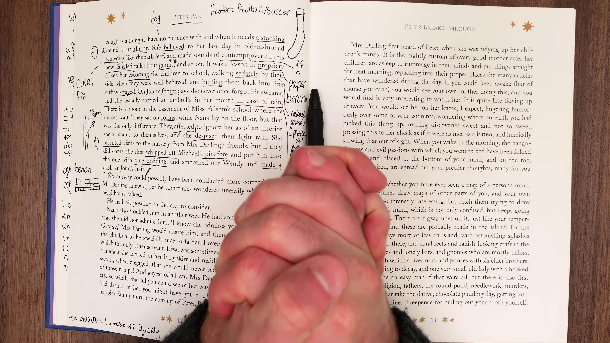

* **Nội dung đúc kết:**
  * Khép lại bức tranh hoàn chỉnh về tổ ấm nhà Darling: ba đứa trẻ Wendy, John, Michael và cô chó bảo mẫu Nana tận tụy.
  * Toàn bộ trật tự gia đình được xây dựng trên sự cân bằng mong manh giữa tình yêu thương, kỷ luật của Nana và lòng kiêu hãnh bất an của ông Darling.
  * Giảng viên Eric nhấn mạnh tầm quan trọng của việc học từ vựng qua văn cảnh đời thực: người học cần chú ý sự biến đổi ngữ nghĩa của từ vựng qua các thời kỳ lịch sử.
* **Dịch nghĩa:** Chúng ta đã hoàn thành bài phân tích chi tiết Tập 2. Hãy nghe lại toàn bộ đoạn văn và tự thu âm giọng đọc của chính mình để so sánh ngữ điệu với người bản ngữ.

---

## Trích dẫn then chốt

* [[02:25](https://www.youtube.com/watch?v=PUgDKBGc5UQ&t=145s)] `For a week or two after Wendy came it was doubtful whether they would be able to keep her...` (Trong một hoặc hai tuần sau khi Wendy ra đời, việc họ có thể giữ cô bé lại nuôi hay không vẫn còn là điều nghi vấn...)
* [[07:15](https://www.youtube.com/watch?v=PUgDKBGc5UQ&t=435s)] `...he sat on the edge of Mrs Darling’s bed, holding her hand and calculating expenses, while she looked at him imploringly.` (...ông ngồi ở mép giường của bà Darling, nắm lấy tay bà và tính toán các khoản chi tiêu, trong khi bà nhìn ông bằng ánh mắt van nài tha thiết.)
* [[29:40](https://www.youtube.com/watch?v=PUgDKBGc5UQ&t=1780s)] `Michael had even a narrower squeak, but both were kept...` (Michael thậm chí còn trải qua một phen suýt soát hiểm nghèo hơn, nhưng cả hai đều được giữ lại nuôi nấng...)
* [[41:30](https://www.youtube.com/watch?v=PUgDKBGc5UQ&t=2490s)] `...this nurse was a prim Newfoundland dog, called Nana...` (...vị bảo mẫu này là một cô chó giống Newfoundland nghiêm cẩn, tên là Nana...)
* [[63:05](https://www.youtube.com/watch?v=PUgDKBGc5UQ&t=3785s)] `...they affected to ignore Nana because she was a dog, while she despised their light talk...` (...họ làm ra vẻ phớt lờ Nana vì cô là một con chó, trong khi cô khinh miệt những chuyện phiếm nông cạn của họ...)

---

## Lệnh & Công cụ

### Cấu trúc nghi vấn gián tiếp
* Công thức: `Subject + be doubtful / wonder + whether + Clause`
* Áp dụng: Diễn đạt sự băn khoăn, không chắc chắn về một sự việc trong tương lai hoặc quá khứ.
* Ví dụ: `It was doubtful whether they would be able to keep her.` (Liệu rằng họ có khả năng giữ cô bé lại hay không vẫn là điều nghi vấn.)

### Cụm giới từ chỉ nguyên nhân
* `owing to + Noun Phrase`: Do bởi, bắt nguồn từ nguyên nhân khách quan (`owing to the amount of milk`).
* `as + Clause`: Bởi vì (liên từ nguyên nhân đặt ở đầu hoặc giữa mệnh đề).
* `on account of + Noun Phrase`: Vì lý do gì đó.

### Cấu trúc giả vờ trong văn học
* Công thức: `Subject + affect to + Verb (infinitive)`
* Nghĩa: Cố tình làm ra vẻ, giả vờ làm một hành động nào đó để che giấu cảm xúc thật.
* Ví dụ: `They affected to ignore Nana.` (Họ làm ra vẻ phớt lờ Nana.)

---

## Đánh đổi & Rủi ro

* **Hệ thống tiền tệ cổ gây nhiễu:** Tiền tệ nước Anh trước năm 1971 sử dụng hệ thống Pounds, Shillings, Pence và Guineas (1 pound = 20 shillings = 240 pence; 1 guinea = 21 shillings). Người học chỉ nên nắm bản chất hài hước trong việc tính toán chi li của tác giả chứ không cần ghi nhớ công thức quy đổi tiền tệ cổ này vào thực tế hiện đại.
* **Nghĩa cổ của từ vựng hiện đại:** Từ `affect` trong tiếng Anh hiện đại thường dùng với nghĩa "ảnh hưởng đến" (`to influence`). Tuy nhiên, trong văn học cổ, `affect to do something` mang nghĩa "giả vờ làm điều gì". Nếu người học không nắm rõ ngữ cảnh sẽ dịch sai hoàn toàn ý nghĩa câu văn.
* **Thành ngữ có nguy cơ lỗi thời:** Cụm từ `narrow squeak` (suýt soát) hiện nay thường được thay thế bằng `close call` hoặc `narrow escape`. Người học nên nhận diện để đọc hiểu văn bản cổ thay vì ưu tiên dùng trong văn nói hàng ngày.
