# PHÂN TÍCH TẬP 3 PETER PAN

* **Kênh:** Reading English with Eric | **Thời lượng:** 41:03 | **Ngày:** 2026-10-04
* **Video:** https://www.youtube.com/watch?v=8Sg5X4KVeK8

---

## Thuật ngữ

| Thuật ngữ | Tiếng Anh | Giải thích |
| :--- | :--- | :--- |
| Vận hành quản lý | Conduct | Động từ chỉ việc chỉ đạo, điều hành và tổ chức các hoạt động sinh hoạt trong gia đình hoặc tổ chức. |
| Sự đúng đắn | Correctly | Phó từ chỉ tính quy củ, nề nếp, chuẩn mực theo đúng quy tắc ứng xử xã hội. |
| Ngưỡng mộ kính nể | Admire | Động từ chỉ cảm xúc tôn trọng, nể phục phẩm chất hoặc tài năng của người khác. |
| Nhạy cảm dễ tổn thương | Sensitive | Tính từ miêu tả người có tâm hồn nhạy cảm, dễ bị tác động bởi lời nhận xét hoặc ánh nhìn của người khác. |
| Trò chơi nô đùa | Romp | Danh từ/động từ chỉ cuộc vui chơi huyên náo, chạy nhảy đùa giỡn tràn đầy năng lượng của trẻ thơ. |
| Xoay tròn mũi chân | Pirouette | Động tác xoay tròn nhanh toàn thân trên một mũi chân bắt nguồn từ kỹ thuật múa ba lê cổ điển. |
| Tươi vui rạng rỡ | Gayest | Dạng so sánh nhất của tính từ cổ gay, mang nghĩa vui tươi, hạnh phúc nhất, tràn ngập tiếng cười. |
| Phong tục thói quen | Custom | Thói quen hoặc tập quán định kỳ diễn ra thường xuyên theo một quy luật cố định. |
| Lục lọi tìm kiếm | Rummage | Hành động bới tung, tìm kiếm cẩn thận mọi ngóc ngách trong ngăn kéo hoặc không gian kín. |
| Sắp xếp ngăn nắp | Put things straight | Thành ngữ chỉ hành động chỉnh đốn, dọn dẹp mọi thứ về đúng vị trí trật tự ban đầu. |
| Đảo ngữ câu | Inversion | Biện pháp tu từ đảo trật tự bình thường của chủ ngữ và vị ngữ nhằm nhấn mạnh cảm xúc hoặc hành động. |
| Đất Neverland | Neverland | Vùng đất giả tưởng huyền thoại trong tâm trí trẻ thơ, nơi không ai phải chịu quy luật trưởng thành. |

---

## Tổng luận chuyên đề

### Giá trị văn học

Tập 3 là đỉnh cao nghệ thuật miêu tả tâm lý và thế giới nội tâm của J.M. Barrie:
* **Sự mong manh của trật tự gia đình:** Phòng trẻ của nhà Darling được vận hành chuẩn xác đến mức không một gia đình quý tộc nào có thể sánh kịp (`No nursery could possibly have been conducted more correctly`). Tuy nhiên, sự chuẩn mực này luôn bị đe dọa bởi tính tự ti, mặc cảm địa vị xã hội của ông Darling trước một chú chó bảo mẫu.
* **Điệu vũ của nụ hôn:** Trong những giờ phút nô đùa (`romps`) cùng đàn con, bà Darling xoay tít những vòng quay ba lê (`pirouette`) cuồng nhiệt đến mức tất cả những gì người ta nhìn thấy chỉ còn lại nụ hôn bất khả xâm phạm ở khóe môi.
* **Ẩn dụ tâm trí trẻ thơ kinh điển:** Đoạn văn miêu tả người mẹ dọn dẹp tâm trí con trẻ vào ban đêm (`tidying up her children's minds`) được đánh giá là một trong những áng văn ẩn dụ đẹp nhất của văn học thiếu nhi thế giới. Tâm trí của một đứa trẻ được hữu hình hóa thành một chiếc ngăn kéo chứa đầy những suy nghĩ lang thang cần được người mẹ gập gọn gàng trước khi bình minh ló rạng.

### Cấu trúc ngữ pháp

* **Cấu trúc điều kiện không có thật:** Cặp câu điều kiện loại 2 giả định `If you could keep awake (but of course you can't), you would see...` được dùng để khẳng định tính bí mật tuyệt đối của nghi thức làm mẹ. Không đứa trẻ nào có thể thức để chứng kiến mẹ dọn dẹp tâm trí của chính mình.
* **Nghệ thuật đảo ngữ tu từ:** Tác giả sử dụng biện pháp đảo ngữ đưa cụm phân từ hoặc trạng từ chỉ không gian/cách thức lên đầu câu (`making sweet discoveries and some discoveries which are not so sweet`) nhằm tạo nhịp điệu uyển chuyển như một câu chuyện cổ tích thì thầm trong đêm.
* **Đại từ phản thân và ngôi xưng gia đình:** Giảng viên Eric phân tích sự chuyển dịch linh hoạt trong cách dùng từ `mother`: người cha khi nói với các con dùng `mother` từ góc nhìn của lũ trẻ, thể hiện sự kính trọng tuyệt đối dành cho người mẹ trong cấu trúc gia đình truyền thống.

### Kỹ thuật đọc hiểu

* **Nhận diện nghĩa cổ của từ ngữ:** Phân tích từ `gay` trong bối cảnh văn học đầu thế kỷ 20 với nghĩa thuần túy là "hân hoan, rạng rỡ", hoàn toàn không liên quan đến ngữ nghĩa xu hướng tính dục hiện đại.
* **Phân biệt từ vựng dọn dẹp:** Phân biệt rõ giữa `tidy up` (dọn dẹp, xếp cho ngay ngắn), `clean` (tẩy rửa vết bẩn), và `rummage` (lục lọi, bới tìm trong không gian kín).

---

## Bóc tách chi tiết

### [[03:15](https://www.youtube.com/watch?v=8Sg5X4KVeK8&t=195s)] Kết nối bối cảnh

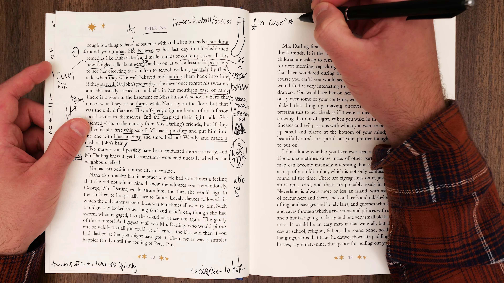

* **Nội dung kết nối:** Giảng viên Eric tóm tắt lại vị thế của Nana trong phòng giữ trẻ nhà Darling và dẫn dắt người học vào đoạn văn mở đầu trang sách tiếp theo.
* **Phân tích:** Việc liên kết mạch truyện giúp học viên củng cố vốn từ về các nhân vật: Wendy, John, Michael, ông bà Darling và cô chó Nana trước khi bước vào những phân tích tâm lý sâu sắc hơn.
* **Dịch nghĩa:** Chúng ta tiếp tục hành trình đọc hiểu từng chữ cuốn tiểu thuyết Peter Pan, khám phá cách vận hành trật tự trong căn phòng trẻ em nhà Darling.

---

### [[06:40](https://www.youtube.com/watch?v=8Sg5X4KVeK8&t=400s)] Phòng trẻ gương mẫu

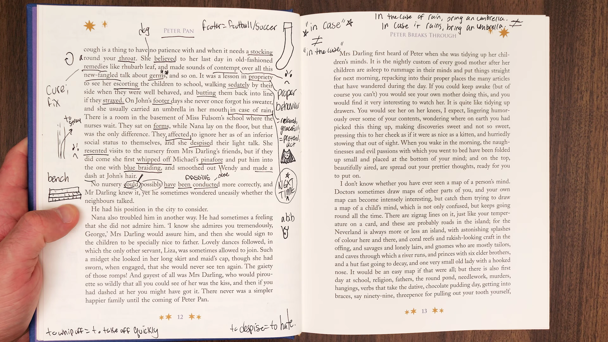

* **Trích đoạn:** `No nursery could possibly have been conducted more correctly, and Mr Darling knew it, yet he sometimes wondered whether the neighbours talked.`
* **Từ vựng cốt lõi:**
  * `Nursery` (danh từ): Phòng ngủ kiêm phòng chơi dành riêng cho trẻ nhỏ trong các gia đình phương Tây xưa.
  * `Conducted` (quá khứ phân từ bị động): Được điều hành, quản lý, duy trì nếp sống (`managed`, `guided`).
  * `Correctly` (phó từ): Một cách đúng đắn, chuẩn chỉ, tuân thủ nghiêm ngặt chuẩn mực đạo đức xã hội.
  * `Wonder` (động từ): Tự hỏi, băn khoăn trăn trở trong lòng.
* **Phân tích:** 
  * Cấu trúc phủ định tuyệt đối `No nursery could possibly have been...` khẳng định không một phòng trẻ nào trên khắp nước Anh có thể nề nếp hơn phòng trẻ nhà Darling.
  * Thế nhưng, bi kịch tâm lý của ông Darling lập tức lộ diện: ông biết căn phòng hoàn hảo, nhưng ông vẫn không ngừng lo sợ miệng lưỡi thế gian (`whether the neighbours talked`).
* **Dịch nghĩa:** Không một căn phòng giữ trẻ nào có thể được vận hành một cách chuẩn mực hơn thế, và ông Darling biết rõ điều đó, vậy mà đôi khi ông vẫn tự hỏi liệu hàng xóm láng giềng có xì xào bàn tán hay không.

---

### [[10:15](https://www.youtube.com/watch?v=8Sg5X4KVeK8&t=615s)] Áp lực thể diện

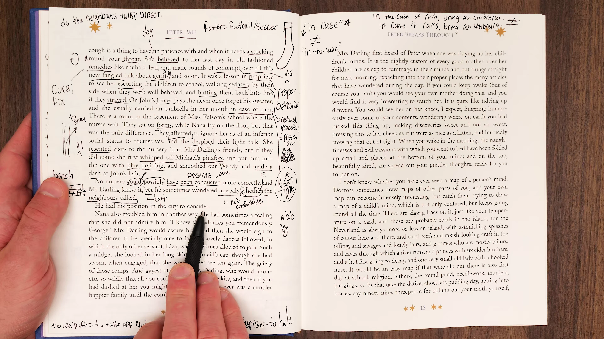

* **Trích đoạn:** `He had his position in the city to consider. Nana also troubled him in another way. He had sometimes a feeling that she did not admire him. ‘I assure you, George,’ Mrs Darling would tell him, ‘she has the highest respect for you.’`
* **Từ vựng cốt lõi:**
  * `Position in the city`: Địa vị xã hội và công việc tại trung tâm tài chính Luân Đôn (`the City of London`).
  * `Trouble` (động từ): Làm cho bận lòng, quấy rầy sự bình yên trong tâm trí ai đó.
  * `Admire` (động từ): Ngưỡng mộ, kính trọng.
  * `Assure` (động từ): Cam đoan, quả quyết để trấn an nỗi bất an của người đối diện.
* **Phân tích:** 
  * Ông Darling là hiện thân tiêu biểu của người đàn ông trung lưu luôn ám ảnh về vị thế xã hội.
  * Điều trớ trêu và hài hước là ông không chỉ sợ đối tác ở sở làm đánh giá, mà ông còn tự ti trước cả chú chó của mình, luôn nghi ngờ rằng Nana không thực sự ngưỡng mộ ông.
* **Dịch nghĩa:** Ông còn phải bận tâm đến địa vị của mình nơi sở làm tài chính. Nana cũng làm ông phiền lòng theo một cách khác. Ông đôi khi có cảm giác rằng cô ấy không hề ngưỡng mộ ông. 'Em cam đoan với anh, George à,' bà Darling thường trấn an ông, 'cô ấy dành cho anh sự tôn kính cao nhất đấy.'

---

### [[13:20](https://www.youtube.com/watch?v=8Sg5X4KVeK8&t=800s)] Sự bất an dai dẳng

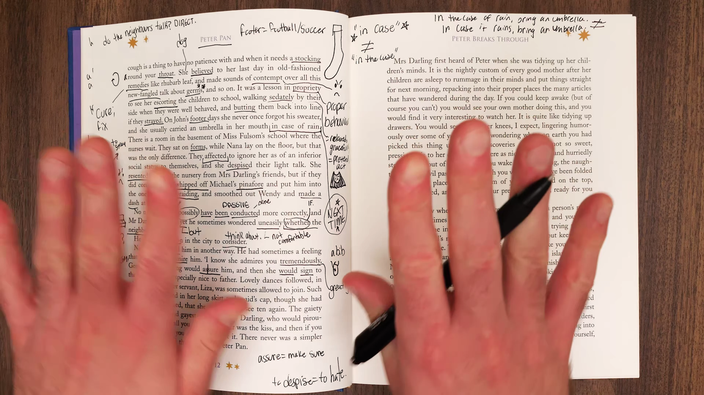

* **Trích đoạn:** `‘Does she respect me, George?’ ‘She admires you tremendously, George; she was saying so to me only the other day about your stocks and shares.’`
* **Từ vựng cốt lõi:**
  * `Tremendously` (phó từ): Cực kỳ, vô cùng to lớn (`hugely`, `immensely`).
  * `The other day` (thành ngữ): Mấy hôm trước, một ngày gần đây trong quá khứ.
* **Phân tích:**
  * Lời thoại ngây ngô đầy dụng ý của bà Darling: bà xoa dịu sự tự ái của chồng bằng cách bịa ra rằng một con chó bảo mẫu đã khen ngợi sự hiểu biết của ông về thị trường cổ phiếu và cổ phần. Sự dỗ dành này cho thấy bản tính trẻ con của người đàn ông trụ cột gia đình.
* **Dịch nghĩa:** 'Cô ấy có kính trọng anh không?' 'Cô ấy ngưỡng mộ anh ghê gớm lắm George à; mới mấy hôm trước cô ấy còn nói với em về sự am hiểu cổ phiếu và cổ phần của anh cơ mà.'

---

### [[16:50](https://www.youtube.com/watch?v=8Sg5X4KVeK8&t=1010s)] Tâm hồn nhạy cảm

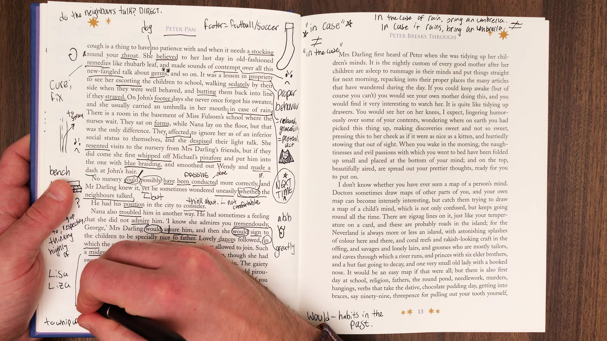

* **Trích đoạn:** `Mr Darling was a very sensitive man. He was really the grander character, but Nana was so wonderfully practical that he could not help feeling insignificant beside her.`
* **Từ vựng cốt lõi:**
  * `Sensitive` (tính từ): Nhạy cảm, dễ mủi lòng, dễ cảm thấy bị tổn thương lòng tự trọng.
  * `Grander character`: Nhân vật có tầm vóc vĩ đại hơn, có phẩm chất cao quý hơn về mặt danh nghĩa gia đình.
  * `Practical` (tính từ): Thực tế, tháo vát, biết cách xử lý công việc đời thường một cách hiệu quả.
  * `Insignificant` (tính từ): Nhỏ bé, tầm thường, không đáng kể.
* **Phân tích:** Barrie chỉ ra căn nguyên tâm lý: ông Darling cao quý hơn về mặt xã hội, nhưng đứng trước sự tháo vát thực tiễn hoàn hảo của Nana, ông không thể không cảm thấy bản thân mình trở nên nhỏ bé và thừa thãi.
* **Dịch nghĩa:** Ông Darling là một người đàn ông rất nhạy cảm. Ông thực sự là nhân vật có tầm vóc lớn lao hơn, nhưng Nana lại thực tế đến mức kỳ diệu khiến ông không thể không cảm thấy mình thật nhỏ bé tầm thường khi đứng bên cạnh cô.

---

### [[21:40](https://www.youtube.com/watch?v=8Sg5X4KVeK8&t=1300s)] Điệu vũ nụ hôn

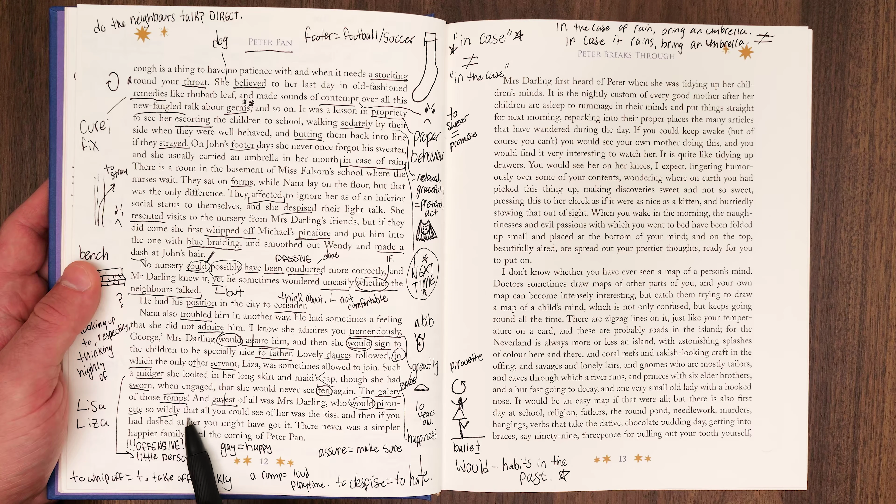

* **Trích đoạn:** `There never was a simpler happier family until the coming of Peter Pan. Mrs Darling loved to join in those romps, and the gayest of all was Mrs Darling, who would pirouette so wildly that all you could see of her was the kiss, and then she would cry, ‘Are you ready, boys?’`
* **Từ vựng cốt lõi:**
  * `Romp` (danh từ): Cuộc nô đùa huyên náo, trò chơi chạy nhảy ầm ĩ của lũ trẻ.
  * `The gayest` (so sánh nhất): Người vui tươi, rạng rỡ và tràn đầy niềm hạnh phúc nhất.
  * `Pirouette` (động từ): Xoay tít mũi chân theo điệu ba lê.
  * `Wildly` (phó từ): Một cách cuồng nhiệt, không kiềm tỏa.
* **Phân tích:** 
  * Hình ảnh bà Darling hòa mình vào các trò chơi của con và xoay tít người đẹp như một bức tranh thần tiên. Trong chuyển động quay cuồng đó, mọi đường nét thân thể đều mờ đi, chỉ còn lại nụ hôn khóe môi rực sáng.
* **Dịch nghĩa:** Chưa từng có một gia đình nào giản dị và hạnh phúc hơn thế cho đến khi Peter Pan xuất hiện. Bà Darling rất thích tham gia vào những trò nô đùa huyên náo ấy, và người rạng rỡ tươi vui nhất chính là bà Darling, người thường xoay tít những vòng xoay ba lê cuồng nhiệt đến độ tất cả những gì bạn có thể nhìn thấy ở bà chỉ là nụ hôn nọ, và rồi bà sẽ cất tiếng reo: 'Các con đã sẵn sàng chưa, những chàng trai của mẹ?'

---

### [[24:15](https://www.youtube.com/watch?v=8Sg5X4KVeK8&t=1455s)] Điềm báo biến cố

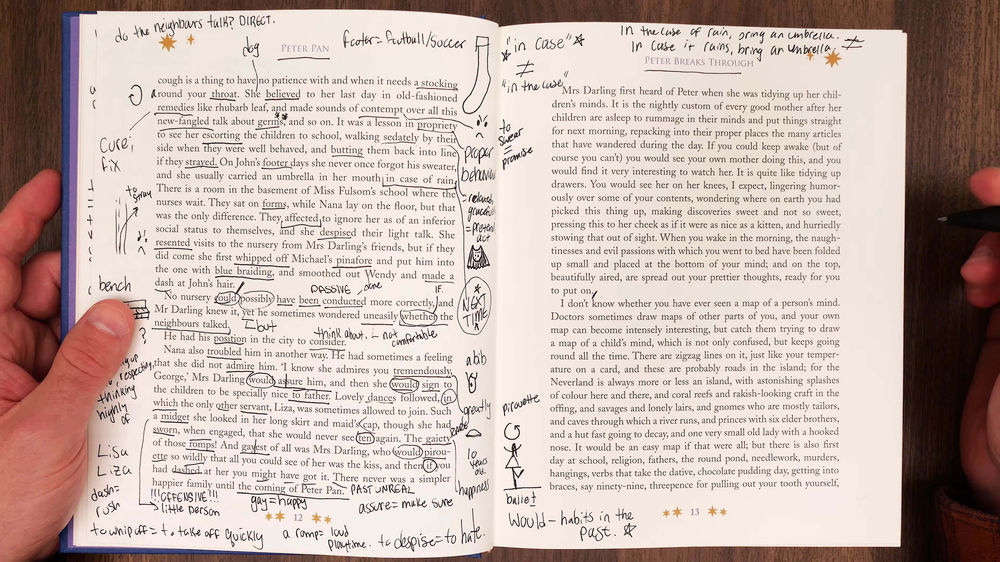

* **Trích đoạn:** `There never was a simpler happier family until the coming of Peter Pan.`
* **Phân tích ngữ pháp và cấu trúc kịch tính:**
  * Cấu trúc đảo ngữ phủ định `There never was... until...` là kỹ thuật tạo điềm báo kinh điển trong nghệ thuật kể chuyện. Câu văn dựng lên một bức tranh hạnh phúc tột đỉnh chỉ để làm nổi bật sự chấn động sắp xảy ra khi Peter Pan bước qua ranh giới bước vào căn phòng.
* **Dịch nghĩa:** Chưa từng có một gia đình nào giản dị và hạnh phúc hơn thế cho đến ngày Peter Pan xuất hiện.

---

### [[27:10](https://www.youtube.com/watch?v=8Sg5X4KVeK8&t=1630s)] Dọn dẹp tâm trí

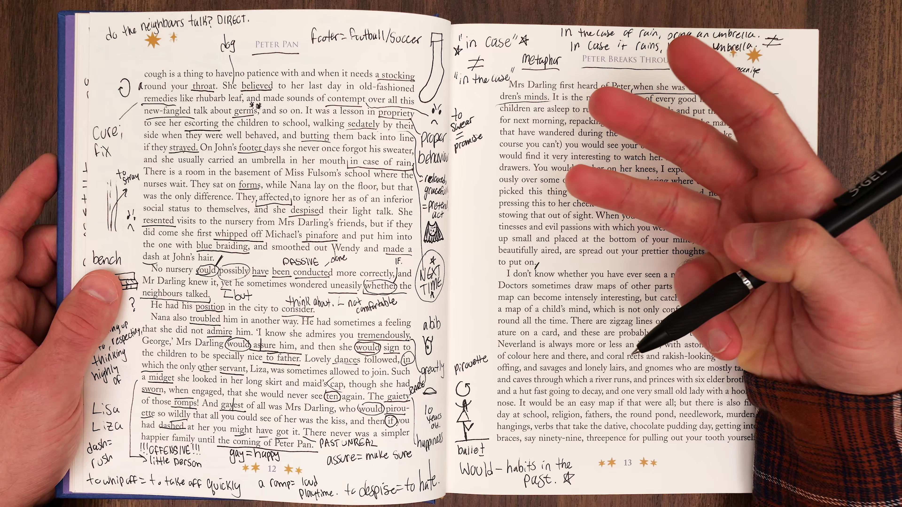

* **Trích đoạn:** `Mrs Darling first heard of Peter when she was tidying up her children’s minds. It is the nightly custom of every good mother after her children are asleep to rummage in their minds and put things straight for next morning...`
* **Từ vựng cốt lõi:**
  * `Tidy up` (cụm động từ): Dọn dẹp, chỉnh đốn cho ngăn nắp gọn gàng.
  * `Nightly custom` (cụm danh từ): Tập quán quen thuộc diễn ra hàng đêm.
  * `Rummage` (động từ): Lục lọi, bới tìm kỹ lưỡng trong mọi ngóc ngách.
  * `Put things straight` (thành ngữ): Chỉnh đốn mọi việc về lại trật tự đúng đắn.
* **Phân tích:** 
  * Một sáng tạo văn học vô song của J.M. Barrie: công việc dọn dẹp phòng ngủ của người mẹ được nâng tầm thành hành động tâm linh thiêng liêng - dọn dẹp những suy nghĩ ngổn ngang trong tâm trí đứa con khi chúng đã chìm sâu vào giấc ngủ.
* **Dịch nghĩa:** Bà Darling lần đầu tiên nghe nói về Peter khi bà đang dọn dẹp tâm trí của các con mình. Đó là tập quán hàng đêm của mọi người mẹ tốt sau khi con cái đã ngủ say: lục lọi trong tâm trí chúng và sắp xếp mọi thứ ngăn nắp lại cho buổi sáng ngày hôm sau...

---

### [[30:30](https://www.youtube.com/watch?v=8Sg5X4KVeK8&t=1830s)] Ngăn kéo ký ức

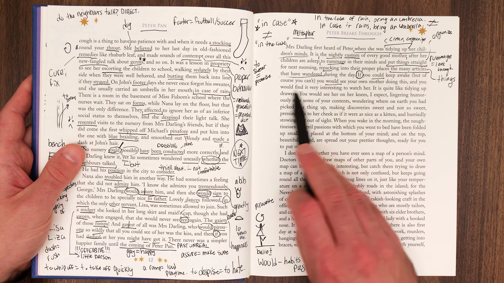

* **Trích đoạn:** `...repacking into their proper places the many articles that have wandered during the day. If you could keep awake (but of course you can’t) you would see your own mother doing this, and you would find it very interesting to watch her.`
* **Từ vựng cốt lõi:**
  * `Repack` (động từ): Thu dọn, xếp lại vào nơi chốn quy định.
  * `Proper places`: Vị trí thích hợp, đúng chỗ của nó.
  * `Wandered` (quá khứ phân từ): Đi lang thang, trôi dạt khỏi vị trí ban đầu trong suốt một ngày dài hoạt động.
* **Phân tích:** Những suy nghĩ, nỗi sợ hãi và niềm vui của đứa trẻ sau một ngày vui chơi chạy nhảy sẽ vương vãi khắp nơi trong não bộ giống như quần áo bị vứt bừa bãi. Người mẹ phải kiên nhẫn thu gom từng món đồ tâm tưởng ấy đặt lại đúng ngăn nắp.
* **Dịch nghĩa:** ...xếp dọn lại vào đúng vị trí thích hợp rất nhiều những ý nghĩ đã đi lang thang trong suốt một ngày dài. Nếu bạn có thể thức (nhưng dĩ nhiên là bạn không thể nào làm được), bạn sẽ thấy chính mẹ mình đang làm điều này, và bạn sẽ thấy việc ngắm nhìn bà làm điều đó thật vô cùng thú vị.

---

### [[33:50](https://www.youtube.com/watch?v=8Sg5X4KVeK8&t=2030s)] Gấp gọn suy nghĩ

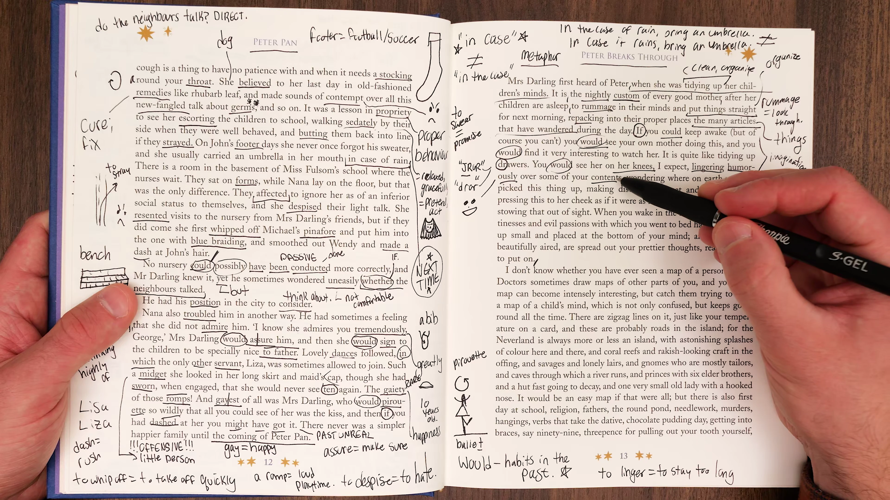

* **Trích đoạn:** `It is quite like tidying up drawers. You would see her on her knees, I expect, lingering humorously over some of your contents, wondering where on earth you had picked this thing up, making sweet discoveries and some discoveries that were not so sweet...`
* **Từ vựng cốt lõi:**
  * `On her knees`: Quỳ gối (tư thế của người mẹ khi cúi xuống dọn dẹp ngăn kéo tủ dưới sàn).
  * `Linger` (động từ): Nán lại, chần chừ ngắm nghía vì lưu luyến (`stay longer than necessary`).
  * `Where on earth`: Cụm từ cảm thán biểu thị sự ngạc nhiên tột độ (rốt cuộc là ở nơi quái quỷ nào).
  * `Pick up` (cụm động từ): Nhặt nhạnh, vô tình học được hoặc nhiễm phải một thói xấu/ý nghĩ lạ.
* **Phân tích:** Người mẹ quỳ gối soi rọi tâm trí con, mỉm cười trước những ý nghĩ ngây thơ đáng yêu (`sweet discoveries`), đồng thời băn khoăn không hiểu đứa con đã nhặt nhạnh những suy nghĩ kỳ quặc, tinh quái từ đâu về.
* **Dịch nghĩa:** Nó hoàn toàn giống hệt như việc dọn dẹp những chiếc ngăn kéo vậy. Tôi tin rằng bạn sẽ thấy bà quỳ gối trên sàn, nán lại đầy hóm hỉnh bên một vài món đồ trong tâm trí bạn, tự hỏi rốt cuộc nơi trần gian này bạn đã nhặt nhạnh thứ này ở đâu ra, khám phá ra những điều ngọt ngào và cả những điều chẳng mấy ngọt ngào...

---

### [[37:15](https://www.youtube.com/watch?v=8Sg5X4KVeK8&t=2235s)] Bản đồ tâm trí

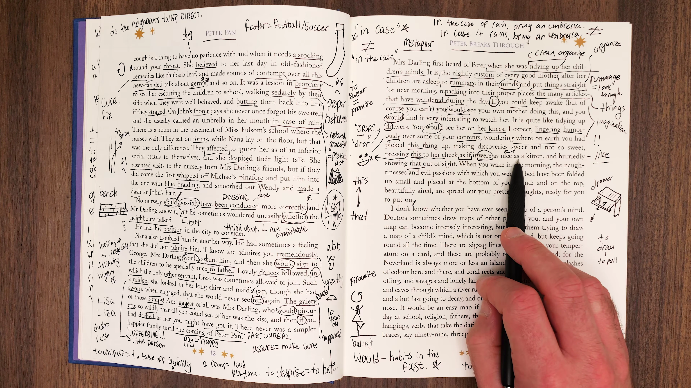

* **Trích đoạn:** `...pressing this to her cheek as if it were nice as a kitten, and hurriedly stowing that out of sight. When you wake in the morning, the naughtiness and evil passions with which you went to bed have been folded up small and placed at the bottom of your mind...`
* **Từ vựng cốt lõi:**
  * `Press to her cheek`: Áp một ý nghĩ ngọt ngào lên má như âu yếm một chú mèo con.
  * `Stow out of sight`: Cất giấu nhanh chóng khỏi tầm mắt, giấu kín vào góc sâu.
  * `Naughtiness` (danh từ): Sự nghịch ngợm, hư đốn của trẻ con.
  * `Folded up small`: Được gấp lại thật nhỏ gọn.
* **Phân tích:** 
  * Cơ chế tâm lý tuyệt vời: người mẹ bao dung ép những suy nghĩ ngây thơ vào má, còn những cơn giận dữ, xấu tính ban ngày thì bà khéo léo gập thật nhỏ lại và giấu xuống tận đáy tâm trí.
  * Khi đứa trẻ thức dậy vào buổi sáng, trên bề mặt tâm trí chỉ còn lại sự trong trẻo, tinh khôi sẵn sàng cho một ngày mới.
* **Dịch nghĩa:** ...áp thứ này lên má bà như thể nó êm ái như một chú mèo con, và vội vã giấu biến thứ kia khuất khỏi tầm mắt. Khi bạn thức dậy vào buổi sáng, những trò nghịch ngợm hư đốn và những cơn giận dữ xấu xa mà bạn mang theo khi đi ngủ đã được gấp lại thật nhỏ và xếp đặt dưới tận đáy tâm trí bạn...

---

### [[40:10](https://www.youtube.com/watch?v=8Sg5X4KVeK8&t=2410s)] Tổng kết tập ba

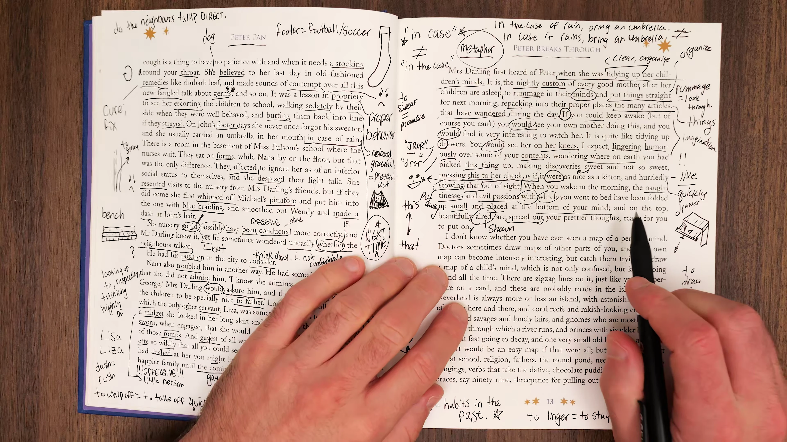

* **Nội dung đúc kết:**
  * Khép lại phân đoạn văn học sâu sắc nhất về tình mẫu tử và tâm lý học ấu thơ.
  * Sự xuất hiện của cái tên Peter Pan trong tâm trí Wendy chính là vết nứt đầu tiên báo hiệu vùng đất Neverland sắp sửa tràn vào thế giới thực.
  * Giảng viên Eric hướng dẫn người học thực hành Shadowing đoạn văn dọn dẹp ngăn kéo tâm trí để cảm nhận trọn vẹn nhạc tính và vẻ đẹp êm dịu của câu chữ.
* **Dịch nghĩa:** Chúng ta đã hoàn thành bài bóc tách chi tiết Tập 3. Hãy luyện tập đọc to đoạn văn dọn dẹp tâm trí này nhiều lần để rèn luyện sự uyển chuyển trong phát âm và khả năng cảm thụ văn học tiếng Anh.

---

## Trích dẫn then chốt

* [[06:55](https://www.youtube.com/watch?v=8Sg5X4KVeK8&t=415s)] `No nursery could possibly have been conducted more correctly, and Mr Darling knew it, yet he sometimes wondered whether the neighbours talked.` (Không một căn phòng giữ trẻ nào có thể được vận hành một cách chuẩn mực hơn thế, và ông Darling biết rõ điều đó, vậy mà đôi khi ông vẫn tự hỏi liệu hàng xóm láng giềng có xì xào bàn tán hay không.)
* [[22:30](https://www.youtube.com/watch?v=8Sg5X4KVeK8&t=1350s)] `...who would pirouette so wildly that all you could see of her was the kiss...` (...người thường xoay tít những vòng xoay ba lê cuồng nhiệt đến độ tất cả những gì bạn có thể nhìn thấy ở bà chỉ là nụ hôn nọ...)
* [[24:30](https://www.youtube.com/watch?v=8Sg5X4KVeK8&t=1470s)] `There never was a simpler happier family until the coming of Peter Pan.` (Chưa từng có một gia đình nào giản dị và hạnh phúc hơn thế cho đến ngày Peter Pan xuất hiện.)
* [[27:45](https://www.youtube.com/watch?v=8Sg5X4KVeK8&t=1665s)] `It is the nightly custom of every good mother after her children are asleep to rummage in their minds and put things straight for next morning...` (Đó là tập quán hàng đêm của mọi người mẹ tốt sau khi con cái đã ngủ say: lục lọi trong tâm trí chúng và sắp xếp mọi thứ ngăn nắp lại cho buổi sáng ngày hôm sau...)
* [[38:20](https://www.youtube.com/watch?v=8Sg5X4KVeK8&t=2300s)] `...the naughtiness and evil passions with which you went to bed have been folded up small and placed at the bottom of your mind...` (...những trò nghịch ngợm hư đốn và những cơn giận dữ xấu xa mà bạn mang theo khi đi ngủ đã được gấp lại thật nhỏ và xếp đặt dưới tận đáy tâm trí bạn...)

---

## Lệnh & Công cụ

### Cấu trúc đảo ngữ phủ định
* Công thức: `There never was + Noun Phrase + until + Clause / Event`
* Tác dụng: Nhấn mạnh tính chất duy nhất, tuyệt đối của trạng thái trước khi một biến cố mang tính bước ngoặt xảy ra.
* Ví dụ: `There never was a simpler happier family until the coming of Peter Pan.` (Chưa từng có một gia đình nào giản dị hạnh phúc hơn thế cho đến khi Peter Pan xuất hiện.)

### Câu điều kiện phi thực tế
* Cấu trúc: `If + S + could + V-inf, S + would + V-inf`
* Ý nghĩa: Diễn tả một giả định hoàn toàn trái ngược với thực tế ở hiện tại.
* Ví dụ: `If you could keep awake (but of course you can't), you would see your own mother doing this.` (Nếu bạn có thể thức - nhưng dĩ nhiên là không thể - bạn sẽ thấy chính mẹ mình đang làm điều này.)

### Cụm từ thành ngữ với tâm trí
* `tidy up one's mind`: Dọn dẹp, chỉnh đốn lại những suy nghĩ trong tâm trí.
* `rummage in one's mind`: Lục lọi, hồi tưởng lại các ký ức sâu kín.
* `put things straight`: Đưa mọi việc về đúng trật tự quy củ ban đầu.

---

## Đánh đổi & Rủi ro

* **Hiểu lầm nghĩa từ vựng theo thời gian:** Từ `gay` trong văn học kinh điển thế kỷ 20 mang nghĩa thanh lịch, vui tươi, hân hoan (`lighthearted and carefree`). Người học cần phân biệt rõ ngữ cảnh lịch sử để tránh sự bối rối hoặc suy diễn lệch lạc sang nghĩa hiện đại.
* **Nguy cơ nhầm lẫn giữa sự nhạy cảm và yếu đuối:** Từ `sensitive` trong tính cách ông Darling miêu tả một tâm lý nhạy cảm xã hội (`socially sensitive`), tự ti trước định kiến đẳng cấp thay vì mang nghĩa tích cực là sự tinh tế trong thấu cảm người khác.
* **Cạm bẫy trừu tượng hóa quá mức:** Đoạn văn dọn dẹp tâm trí là một tác phẩm ẩn dụ nghệ thuật văn học thuần túy. Người học cần thưởng thức nó dưới góc độ thẩm mỹ văn chương và hình tượng học thay vì cố gắng tìm kiếm một lời giải thích khoa học tâm lý thần kinh chính xác.
