# GIẢI ĐỀ TOEIC 2026 MỚI NHẤT | PART 2 [VIDEO 2]

* **Kênh:** Anh ngữ Ms Thanh | **Thời lượng:** 01:24:27 | **Ngày:** 2026-02-28
* **Video:** [https://www.youtube.com/watch?v=kCoRDcjknNI](https://www.youtube.com/watch?v=kCoRDcjknNI)

---

## Thuật ngữ

| Thuật ngữ | Giải thích |
| :--- | :--- |
| **Part 2 Listening** | Phần thi Hỏi - Đáp gồm 25 câu (từ câu 7 đến câu 31), mỗi câu có 1 câu hỏi/phát biểu và 3 lựa chọn trả lời (A, B, C). |
| **Indirect Response** | Phản hồi gián tiếp, không trả lời thẳng vào từ để hỏi mà giải quyết bản chất tình huống hoặc đưa ra giải pháp thay thế. |
| **Question Tag** | Câu hỏi đuôi, dùng để xác nhận lại thông tin, quy tắc trả lời tương tự câu hỏi Yes/No. |
| **Statement Question** | Dạng câu trần thuật đưa ra một thông tin hoặc ý kiến, phản hồi thường mang tính đồng thuận, hỏi thăm chi phí hoặc đưa ý kiến tiếp nối. |
| **Gap-fill Listening** | Kỹ thuật luyện nghe đục lỗ từ khóa trọng tâm thay vì ghi chép toàn bộ văn bản để tăng phản xạ tai. |
| **American Nuance** | Hiện tượng nuốt âm hoặc biến âm trong tiếng Anh Mỹ, ví dụ chuyển âm /t/ thành âm /d/ nhẹ giữa hai nguyên âm. |

---

## Tổng luận chuyên đề

#### Bản chất phản hồi gián tiếp
Càng về cuối phần thi (từ câu 20 đến câu 31), độ khó của bài thi tăng cao do tần suất xuất hiện các câu trả lời gián tiếp dày đặc. Thí sinh không thể dựa vào mẹo máy móc như nghe từ để hỏi Where tìm nơi chốn, When tìm giờ giấc. Thay vào đó, người nói thường đưa ra câu trả lời giải quyết vấn đề, thông báo sự cố phát sinh, hoặc phủ định tiền đề câu hỏi.

#### Quy tắc loại trừ bẫy
Bài thi cài cắm có hệ thống ba loại bẫy kinh điển:
1. **Bẫy lặp từ và đồng âm:** Dùng lại từ ngữ trong câu hỏi nhưng đổi sang ngữ cảnh khác hoặc dùng từ đồng âm khác nghĩa để đánh lừa phản xạ thí sinh.
2. **Bẫy sai chủ ngữ:** Câu hỏi nhắm vào ngôi thứ nhất hoặc thứ hai nhưng câu trả lời lại sử dụng đại từ ngôi thứ ba không liên quan.
3. **Bẫy hỏi một đằng đáp một nẻo:** Đưa ra địa điểm khi câu hỏi hỏi thời gian, hoặc đưa ra thời gian khi câu hỏi yêu cầu giải pháp.

#### Chiến thuật sự kiện và lịch trình
Mọi câu hỏi liên quan đến tổ chức hội nghị, tiệc công ty hoặc cuộc họp thường có xu hướng chọn đáp án rơi vào trạng thái thay đổi lịch trình: sự kiện bị hủy bỏ, dời sang ngày khác, hoặc đã được ghi chú sẵn trên lịch biểu cá nhân.

---

## Bóc tách chi tiết

### [[00:00:20](https://www.youtube.com/watch?v=kCoRDcjknNI&t=20s)] Câu 21: Cách thức truy cập

* **Đề bài:** "How can I access my email on my laptop?"
* **Phương án lựa chọn:**
  * **A.** "The mail carrier hasn't come yet."
  * **B.** "On the top of the table next to the front door."
  * **C.** "Download the email program."
* **Đáp án đúng:** **C**

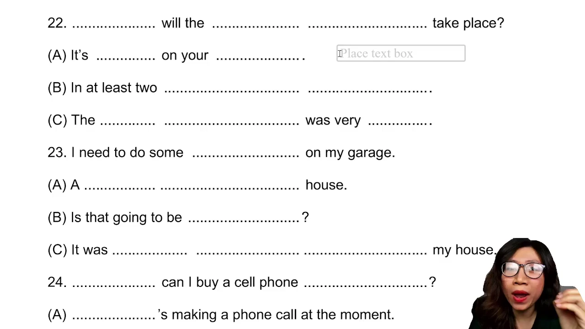

* **Phân tích phương án:**
  * **Phương án A (Sai):** Bẫy liên tưởng từ vựng. Từ ngữ `mail carrier` chỉ người đưa thư của bưu điện, hoàn toàn lệch ngữ cảnh truy cập tài khoản thư điện tử trên máy tính.
  * **Phương án B (Sai):** Bẫy nơi chốn. Cụm từ `On the top of the table next to the front door` trả lời cho câu hỏi vị trí Where, không trả lời cho cách thức thực hiện How.
  * **Phương án C (Đúng):** Trả lời trực tiếp vào hành động hướng dẫn giải pháp kỹ thuật: tải phần mềm thư điện tử về máy tính.
* **Mở rộng kiến thức:**
  * `access`: truy cập vào hệ thống hoặc tài liệu.
  * `mail carrier`: nhân viên bưu chính, người đưa thư.
  * `program`: phần mềm máy tính, chương trình.

---

### [[00:08:15](https://www.youtube.com/watch?v=kCoRDcjknNI&t=495s)] Câu 22: Thời gian tổ chức

* **Đề bài:** "When will the conference take place?"
* **Phương án lựa chọn:**
  * **A.** "It's marked on your calendar."
  * **B.** "In at least two conference centers."
  * **C.** "The keynote speech was very impressive."
* **Đáp án đúng:** **A**

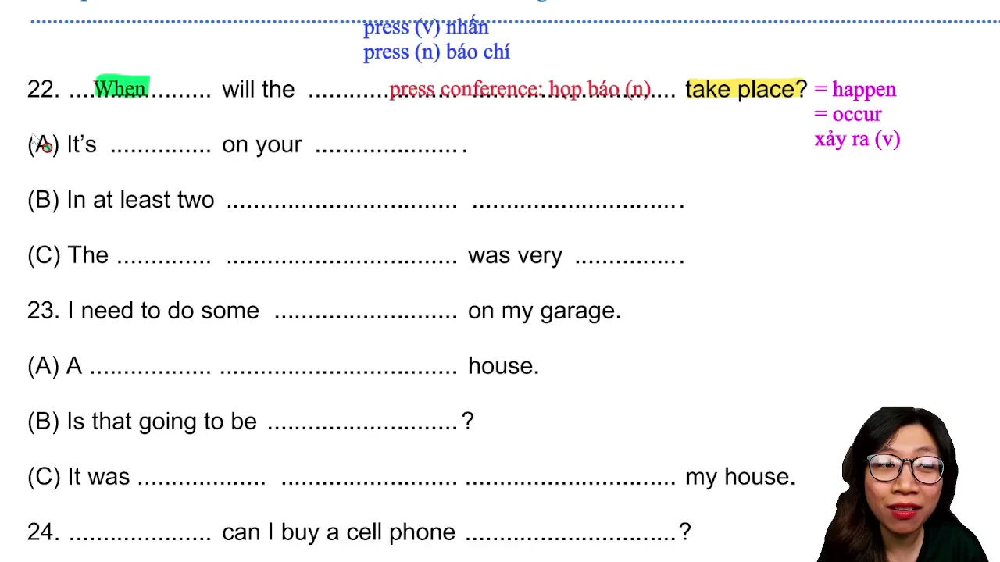

* **Phân tích phương án:**
  * **Phương án A (Đúng):** Câu trả lời gián tiếp mẫu mực. Thay vì cung cấp ngày giờ cụ thể, người trả lời chỉ ra nguồn thông tin xác thực đã được lưu sẵn trên lịch làm việc của người hỏi.
  * **Phương án B (Sai):** Bẫy lặp từ và sai thông tin. Lặp lại từ `conference` và đưa ra địa điểm trung tâm hội nghị, trả lời cho câu hỏi Where.
  * **Phương án C (Sai):** Lạc đề và sai thì. Đưa ra nhận xét về bài phát biểu chính trong quá khứ, không liên quan đến thời điểm diễn ra hội nghị sắp tới.
* **Mở rộng kiến thức:**
  * `take place`: diễn ra, được tổ chức.
  * `calendar`: lịch biểu làm việc cá nhân.
  * `keynote speech`: bài diễn văn định hướng, bài phát biểu chủ đạo.

---

### [[00:13:00](https://www.youtube.com/watch?v=kCoRDcjknNI&t=780s)] Kinh nghiệm phòng thi

* **Phương pháp luyện nghe đục lỗ:**
  * Không chép chính tả toàn bộ văn bản vì phương pháp này tốn thời gian nhưng không tạo phản xạ nhận diện từ khóa.
  * Chỉ tập trung nghe và điền từ khóa mang tải trọng thông tin: trợ động từ, danh từ chính, động từ hành động và từ chỉ thời gian hoặc nơi chốn.
* **Phân biệt thi máy và thi giấy:**
  * Thi trên máy tính cung cấp tai nghe chụp tai cách âm chuẩn, tín hiệu âm thanh rõ nét hơn loa phòng thi truyền thống.
  * Khi gặp câu hỏi khó hoặc phân vân hai đáp án ở phần Đọc hiểu, nếu đã chọn một đáp án ban đầu thì tuyệt đối không quay lại đổi đáp án trừ phi nhớ chính xác kiến thức, bởi linh cảm đầu tiên thường có xác suất đúng cao nhất.

---

### [[00:28:39](https://www.youtube.com/watch?v=kCoRDcjknNI&t=1719s)] Câu 23: Nhu cầu sửa chữa

* **Đề bài:** "I need to do some repairs on my garage."
* **Phương án lựa chọn:**
  * **A.** "A two-story house."
  * **B.** "Is that going to be expensive?"
  * **C.** "It was parked right in front of my house."
* **Đáp án đúng:** **B**

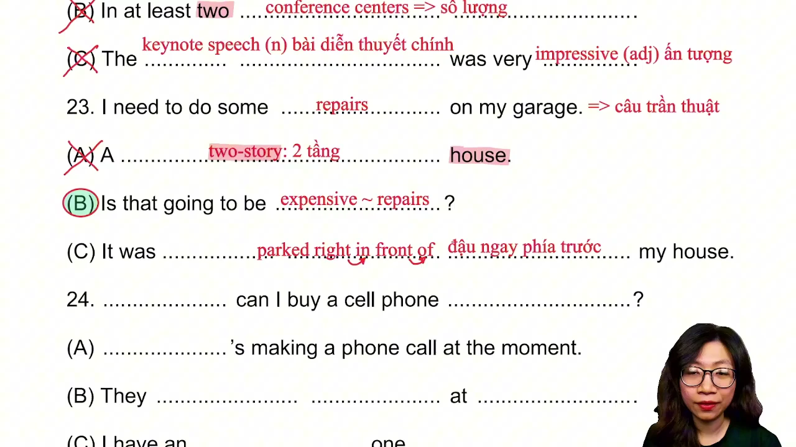

* **Phân tích phương án:**
  * **Phương án A (Sai):** Lạc đề. Cụm từ `two-story house` chỉ ngôi nhà hai tầng. Từ `story` khi kết hợp với công trình kiến trúc mang nghĩa tầng lầu, không phải câu chuyện.
  * **Phương án B (Đúng):** Phản hồi trần thuật tự nhiên. Khi nghe đối phương thông báo cần sửa chữa nhà để xe, phản ứng thường thấy là hỏi thăm về chi phí phát sinh.
  * **Phương án C (Sai):** Bẫy liên tưởng. Từ `garage` kích hoạt liên tưởng đến xe đậu (`parked`), nhưng câu trần thuật đang bàn về công việc sửa chữa chứ không bàn về vị trí đỗ xe.
* **Mở rộng kiến thức:**
  * `repairs`: công tác sửa chữa, bảo dưỡng.
  * `garage`: nhà để xe.
  * `two-story house`: nhà hai tầng.
  * `parked right in front of`: đỗ ngay trước cửa.

---

### [[00:33:54](https://www.youtube.com/watch?v=kCoRDcjknNI&t=2034s)] Câu 24: Thiết bị sạc pin

* **Đề bài:** "Where can I buy a cell phone charger?"
* **Phương án lựa chọn:**
  * **A.** "She's making a phone call at the moment."
  * **B.** "They charge more at night."
  * **C.** "I have an extra one."
* **Đáp án đúng:** **C**

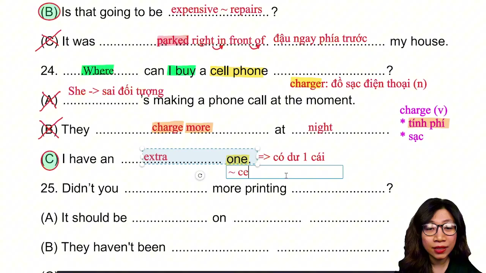

* **Phân tích phương án:**
  * **Phương án A (Sai):** Bẫy lặp âm `phone` và sai chủ ngữ `She` trong khi người hỏi xưng `I`.
  * **Phương án B (Sai):** Bẫy đồng âm đa nghĩa. Từ `charge` ở đây mang nghĩa tính tiền hoặc thu phí vào ban đêm, hoàn toàn không liên quan đến hành vi sạc điện thiết bị di động.
  * **Phương án C (Đúng):** Giải quyết tình huống thay vì chỉ đường. Đại từ `one` thay thế trực tiếp cho cụm từ `cell phone charger`. Người nói báo rằng mình có dư một chiếc sẵn sàng cho mượn.
* **Mở rộng kiến thức:**
  * `cell phone charger`: bộ sạc điện thoại di động.
  * `charge`: danh từ/động từ mang hai nghĩa phổ biến: sạc điện hoặc tính phí dịch vụ.
  * `extra`: có dư, dự phòng.

---

### [[00:40:50](https://www.youtube.com/watch?v=kCoRDcjknNI&t=2450s)] Câu 25: Tiến độ giao hàng

* **Đề bài:** "Didn't you order more printer paper?"
* **Phương án lựa chọn:**
  * **A.** "It should be printed on both sides."
  * **B.** "It hasn't been delivered yet."
  * **C.** "In alphabetical order."
* **Đáp án đúng:** **B**

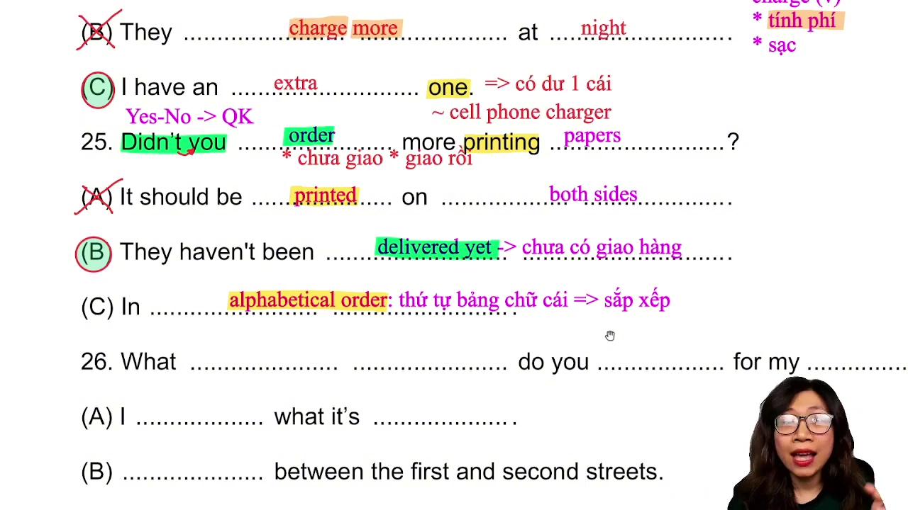

* **Phân tích phương án:**
  * **Phương án A (Sai):** Bẫy lặp gốc từ `print` và lạc đề khi khuyên in ấn hai mặt giấy.
  * **Phương án B (Đúng):** Đáp ứng đúng logic đặt hàng. Đối với các câu hỏi về hành vi đặt mua văn phòng phẩm (`order`), câu trả lời thường xoay quanh trạng thái đơn hàng: đã nhận hay chưa giao tới.
  * **Phương án C (Sai):** Bẫy đa nghĩa của từ `order`. Cụm từ `in alphabetical order` mang nghĩa sắp xếp theo thứ tự bảng chữ cái, dùng cho hồ sơ lưu trữ chứ không phải hành vi đặt hàng.
* **Mở rộng kiến thức:**
  * `printer paper`: giấy in ấn chuyên dụng.
  * `deliver`: giao phát hàng hóa.
  * `in alphabetical order`: theo trình tự chữ cái.
  * Kỹ thuật nối âm: `Didn't you` đọc nối âm /t/ với bán nguyên âm /j/ tạo thành âm /tʃ/.

---

### [[00:46:48](https://www.youtube.com/watch?v=kCoRDcjknNI&t=2808s)] Câu 26: Phần mềm bảo mật

* **Đề bài:** "What security software do you recommend for my company?"
* **Phương án lựa chọn:**
  * **A.** "I forgot what it's called."
  * **B.** "Somewhere between First and Second Streets."
  * **C.** "One of my colleagues recommended your place."
* **Đáp án đúng:** **A**

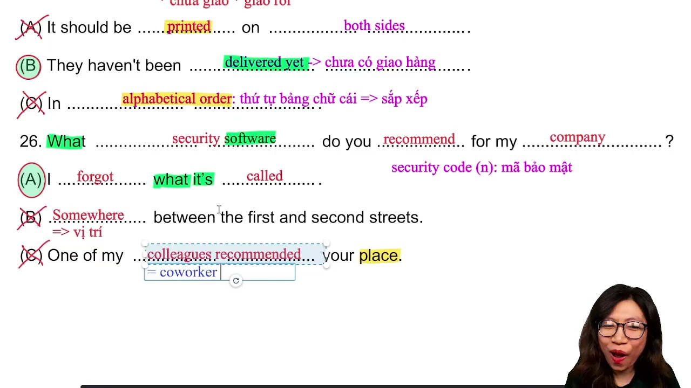

* **Phân tích phương án:**
  * **Phương án A (Đúng):** Câu trả lời thoái thác thông tin phổ biến. Người được hỏi đã quên mất tên gọi chính xác của phần mềm nên không thể đưa ra lời khuyên cụ thể.
  * **Phương án B (Sai):** Bẫy vị trí địa lý. Trả lời cho câu hỏi Where bằng vị trí giữa hai con phố.
  * **Phương án C (Sai):** Bẫy lặp từ `recommended` nhưng nói về việc đồng nghiệp giới thiệu địa điểm của bạn, sai bản chất đối tượng phần mềm.
* **Mở rộng kiến thức:**
  * `security software`: phần mềm an ninh, bảo mật hệ thống.
  * `recommend`: giới thiệu, tiến cử.
  * `colleague`: đồng nghiệp (đồng nghĩa với `coworker`).

---

### [[00:52:48](https://www.youtube.com/watch?v=kCoRDcjknNI&t=3168s)] Câu 27: Lựa chọn hoạt động

* **Đề bài:** "Do you want to take a fitness class or just use the pool?"
* **Phương án lựa chọn:**
  * **A.** "I don't like to swim."
  * **B.** "It fits very well."
  * **C.** "There is a gym down the street."
* **Đáp án đúng:** **A**

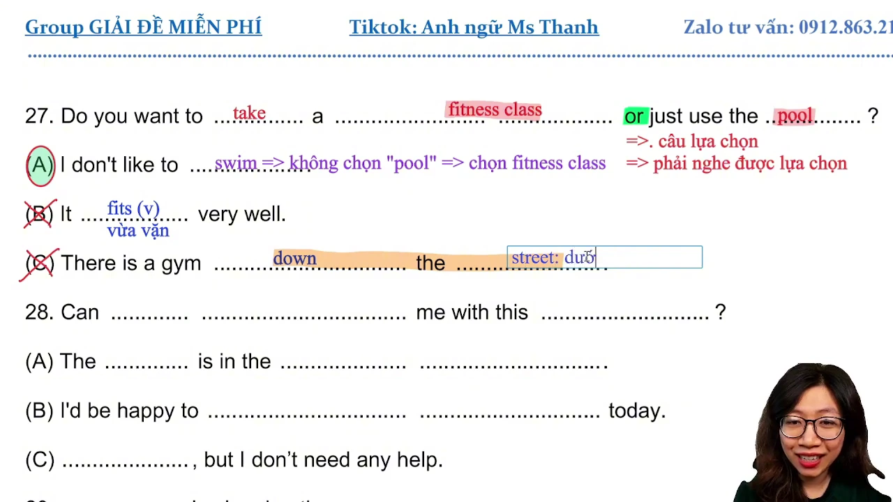

* **Phân tích phương án:**
  * **Phương án A (Đúng):** Loại bỏ một phương án trong câu hỏi lựa chọn. Khi người nói nêu rõ bản thân không thích bơi lội (`swim`), ngầm khẳng định sẽ tham gia lớp thể dục.
  * **Phương án B (Sai):** Bẫy ngữ âm tương đồng giữa danh từ `fitness` và động từ `fit` (vừa vặn về trang phục).
  * **Phương án C (Sai):** Bẫy chỉ dẫn vị trí phòng tập thể hình ở cuối phố (`down the street`), trả lời cho câu hỏi Where.
* **Mở rộng kiến thức:**
  * `fitness class`: lớp rèn luyện thể lực.
  * `pool`: bể bơi.
  * `fit`: vừa vặn (kích cỡ quần áo, giày dép).
  * `down the street`: dọc theo tuyến phố.

---

### [[00:57:44](https://www.youtube.com/watch?v=kCoRDcjknNI&t=3464s)] Câu 28: Hỗ trợ văn bản

* **Đề bài:** "Can you help me with this paperwork?"
* **Phương án lựa chọn:**
  * **A.** "The paper is in the bottom drawer."
  * **B.** "I'd be happy to help later today."
  * **C.** "Thanks, but I don't need any help."
* **Đáp án đúng:** **B**

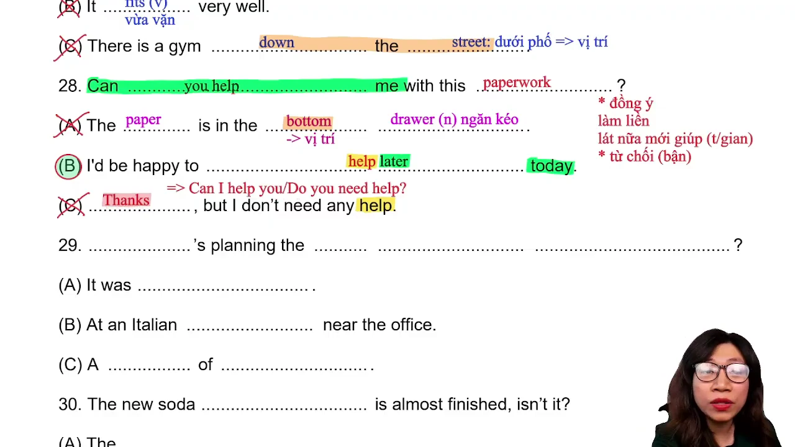

* **Phân tích phương án:**
  * **Phương án A (Sai):** Bẫy lặp từ `paper` và chỉ vị trí tài liệu nằm ở ngăn kéo dưới cùng.
  * **Phương án B (Đúng):** Đồng ý hỗ trợ nhưng hẹn mốc thời gian muộn hơn trong ngày (`later today`).
  * **Phương án C (Sai):** Lỗi vai vế giao tiếp. Câu hỏi là lời nhờ giúp đỡ, người trả lời không thể cảm ơn và từ chối như thể mình là người được đề nghị hỗ trợ.
* **Mở rộng kiến thức:**
  * `paperwork`: hồ sơ, giấy tờ thủ tục hành chính.
  * `bottom drawer`: ngăn kéo dưới đáy tủ. Từ `drawer` trong tiếng Anh phát âm gọn thành /drɔː/.
  * `I'd be happy to`: sẵn lòng làm việc gì đó.

---

### [[01:05:00](https://www.youtube.com/watch?v=kCoRDcjknNI&t=3900s)] Câu 29: Nhân sự tổ chức

* **Đề bài:** "Who's planning the employee appreciation dinner?"
* **Phương án lựa chọn:**
  * **A.** "It was canceled."
  * **B.** "At an Italian restaurant near the office."
  * **C.** "A choice of appetizers."
* **Đáp án đúng:** **A**

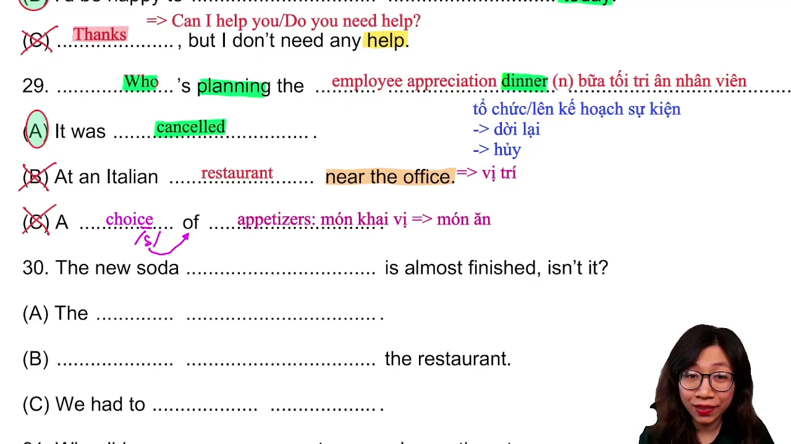

* **Phân tích phương án:**
  * **Phương án A (Đúng):** Phủ định sự tồn tại của sự kiện. Do bữa tiệc tri ân nhân viên đã bị hủy bỏ (`canceled`), câu hỏi về người chịu trách nhiệm lập kế hoạch trở nên vô hiệu.
  * **Phương án B (Sai):** Bẫy vị trí nhà hàng Ý gần văn phòng công ty, trả lời cho câu hỏi Where.
  * **Phương án C (Sai):** Bẫy chủ đề ẩm thực với các món khai vị (`appetizers`), không liên quan đến nhân sự phụ trách.
* **Mở rộng kiến thức:**
  * `employee appreciation dinner`: tiệc tối tri ân người lao động.
  * `cancel`: bãi bỏ, hủy bỏ.
  * `appetizer`: món khai vị trước bữa ăn chính.

---

### [[01:11:19](https://www.youtube.com/watch?v=kCoRDcjknNI&t=4279s)] Câu 30: Hoàn tất quảng cáo

* **Đề bài:** "The new soda commercial is almost finished, isn't it?"
* **Phương án lựa chọn:**
  * **A.** "The yearly inspection."
  * **B.** "Across from the restaurant."
  * **C.** "We had to start over."
* **Đáp án đúng:** **C**

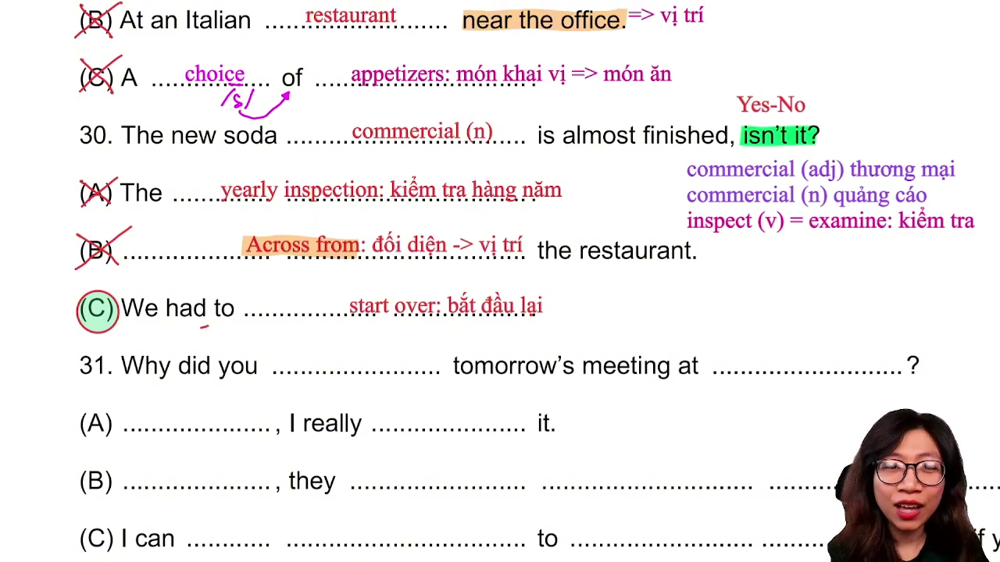

* **Phân tích phương án:**
  * **Phương án A (Sai):** Cụm danh từ rời rạc chỉ đợt thanh tra hàng năm, không cấu thành câu trả lời cho câu hỏi đuôi.
  * **Phương án B (Sai):** Bẫy vị trí đối diện nhà hàng.
  * **Phương án C (Đúng):** Phủ định gián tiếp tiến độ hoàn thành. Do nhóm sản xuất phải làm lại từ đầu (`start over`), đoạn quảng cáo nước giải khát vẫn chưa thể hoàn tất.
* **Mở rộng kiến thức:**
  * `commercial`: danh từ chỉ mẫu quảng cáo phát thanh hoặc truyền hình; tính từ chỉ tính chất thương mại.
  * `start over`: làm lại từ vạch xuất phát.
  * `inspection`: đợt kiểm tra, thanh tra (từ đồng nghĩa: `examination`).
  * Kỹ thuật nuốt âm: cụm `isn't it` được đọc lướt nhanh theo phong cách Anh Mỹ thành /ɪzndɪt/.

---

### [[01:18:42](https://www.youtube.com/watch?v=kCoRDcjknNI&t=4722s)] Câu 31: Xếp lịch họp

* **Đề bài:** "Why did you schedule tomorrow's meeting at noon?"
* **Phương án lựa chọn:**
  * **A.** "Thanks. I really appreciate it."
  * **B.** "Of course they arrived on time."
  * **C.** "I can move it to 1:00 if you want."
* **Đáp án đúng:** **C**

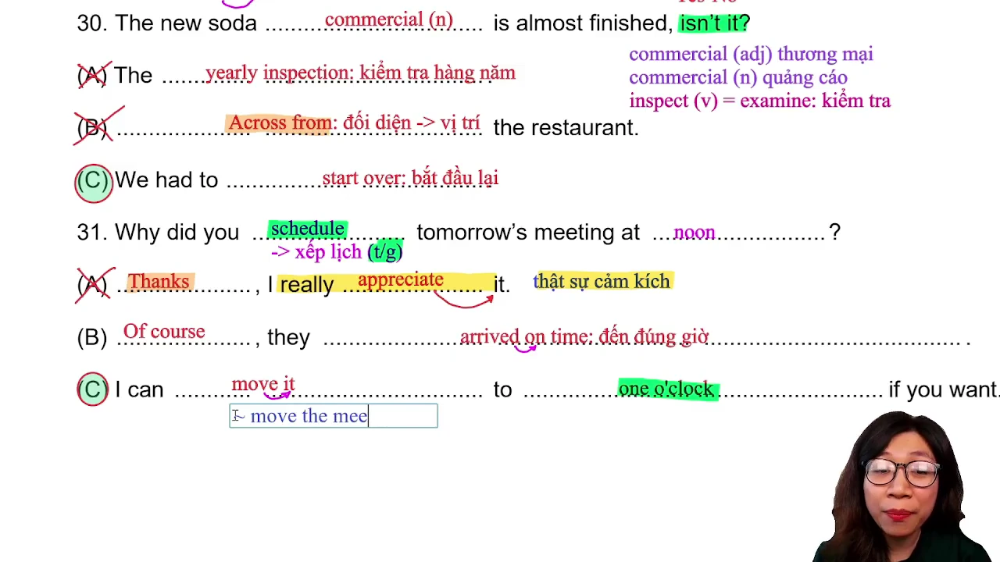

* **Phân tích phương án:**
  * **Phương án A (Sai):** Câu cảm ơn lịch sự chỉ dùng khi được người khác giúp đỡ.
  * **Phương án B (Sai):** Sai thì và chủ ngữ. Đề cập đến việc họ đã đến đúng giờ trong quá khứ, không giải quyết việc xếp lịch họp tương lai.
  * **Phương án C (Đúng):** Đưa ra giải pháp điều chỉnh lịch họp thay vì giải thích nguyên nhân. Người nói sẵn sàng dời cuộc họp sang một giờ chiều nếu đối phương thấy bất tiện với mốc trưa.
* **Mở rộng kiến thức:**
  * `schedule`: sắp xếp thời gian biểu.
  * `at noon`: vào 12 giờ trưa.
  * `move the meeting`: dời cuộc họp sang khung giờ khác.
  * Kỹ thuật nối âm: `move it` đọc nối phụ âm /v/ sang nguyên âm /ɪ/ thành /muːvɪt/.

---

## Trích dẫn then chốt

* [[00:22:26](https://www.youtube.com/watch?v=kCoRDcjknNI&t=1346s)] *"Miễn câu đó mình đã chọn rồi thì mình không bao giờ quay trở lại đổi đáp án, tại vì linh cảm ban đầu của mình thường là đúng nhất."*
* [[00:36:28](https://www.youtube.com/watch?v=kCoRDcjknNI&t=2188s)] *"Càng về gần câu 31 là người ta càng trả lời gián tiếp. Người ta sẽ không đọc trực tiếp nơi chốn hay thời gian cho mình đâu mà sẽ nói một cách khó hơn."*
* [[01:08:00](https://www.youtube.com/watch?v=kCoRDcjknNI&t=4080s)] *"Cứ mỗi lần thấy tổ chức sự kiện hay lên kế hoạch cho sự kiện là luôn luôn có khả năng đáp án sẽ là dời lại hoặc đã bị hủy rồi."*
* [[01:20:07](https://www.youtube.com/watch?v=kCoRDcjknNI&t=4807s)] *"Cứ nghe được chữ schedule là biết sẽ có yếu tố thời gian xuất hiện, mình cứ tập trung xử lý mốc thời gian là ăn điểm."*

---

## Lệnh & Công cụ

#### Phương pháp nghe đục lỗ từ khóa
1. Nghe câu hỏi lần một: xác định loại câu (Wh-question, Yes/No, lựa chọn, trần thuật).
2. Đục lỗ tinh gọn: chỉ chép lại các vị trí mang nghĩa cốt lõi gồm trợ động từ, động từ hành động và danh từ chỉ đối tượng.
3. Dự đoán trường từ vựng: định hình trước các phản hồi gián tiếp có khả năng xảy ra (hủy sự kiện, dời giờ, hết hàng, người khác phụ trách).

#### Bảng đối chiếu nối âm thường gặp
* `Didn't you` -> `/dɪdntʃuː/`
* `Isn't it` -> `/ɪzndɪt/`
* `Choice of` -> `/tʃɔɪsəv/`
* `Move it` -> `/muːvɪt/`
* `Arrived on` -> `/əraɪvdɑːn/`

---

## Đánh đổi & Rủi ro

* **Dịch từng từ sang tiếng Việt:** Đánh mất nhịp điệu của bài thi. Trong Part 2, khoảng cách giữa các câu chỉ từ 3 đến 5 giây; việc cố dịch toàn bộ câu thoại sẽ khiến thí sinh lỡ mất từ khóa của câu kế tiếp.
* **Cố chấp thay đổi đáp án:** Rủi ro mất điểm rất cao khi quay lại sửa câu đã chọn do tâm lý hoang mang ở cuối giờ làm bài.
* **Lệ thuộc vào từ để hỏi:** Việc chỉ bắt chắt từ đầu câu (Where, When, Who) mà bỏ qua nội dung phía sau sẽ rơi thẳng vào bẫy trả lời gián tiếp của các câu từ 25 đến 31.