# GIẢI ĐỀ TOEIC 2026 MỚI NHẤT | PART 2 [VIDEO 1]

* **Kênh:** Anh ngữ Ms Thanh | **Thời lượng:** 01:42:15 | **Ngày:** 2026-02-26
* **Video:** [https://www.youtube.com/watch?v=RHPLKHoJcZI](https://www.youtube.com/watch?v=RHPLKHoJcZI)

---

## Thuật ngữ

| Thuật ngữ | Giải thích |
| :--- | :--- |
| **Part 2 Listening** | Phần thi Hỏi - Đáp gồm 25 câu hỏi (từ câu 7 đến câu 31), mỗi câu có 1 phát biểu hoặc câu hỏi và 3 lựa chọn phản hồi (A, B, C). |
| **Wh-question** | Dạng câu hỏi có từ để hỏi trực tiếp (Who, Where, When, Why, How...), tuyệt đối không dùng Yes hoặc No để phản hồi. |
| **Alternative Question** | Câu hỏi lựa chọn có liên từ Or, yêu cầu chọn một trong hai phương án, chọn cả hai, từ chối cả hai hoặc đưa ra phương án thứ ba; cấm trả lời bằng Yes hoặc No. |
| **Question Tag** | Câu hỏi đuôi dùng để xác nhận thông tin, cách thức trả lời tương tự câu hỏi Yes/No nhưng bắt buộc phải khớp về chủ ngữ và thì. |
| **Statement Question** | Dạng câu trần thuật đưa ra thông tin hoặc quan điểm; phản hồi thường có xu hướng đồng thuận (khoảng 90%) hoặc đưa thêm điều kiện bổ trợ. |
| **Indirect Response** | Phản hồi gián tiếp, người nói không cung cấp thông tin trực diện mà chỉ ra người giải quyết, nguồn tra cứu hoặc dẫn lại lời người khác. |
| **Gap-fill Listening** | Kỹ thuật nghe đục lỗ tập trung vào từ khóa mang tải trọng thông tin thay vì chép chính tả toàn bộ câu. |

---

## Tổng luận chuyên đề

#### Cấu trúc bài thi và phân loại câu hỏi
Part 2 kéo dài xuyên suốt 25 câu với mật độ âm thanh dồn dập, không có gợi ý hình ảnh hay văn bản in sẵn trên đề. Đề thi chia thành ba nhóm câu hỏi chính:
1. **Câu hỏi có từ để hỏi (Wh-questions):** Chiếm tỷ trọng lớn nhất ở nửa đầu bài thi (từ câu 7 đến câu 15). Cốt lõi của dạng này là bắt trọn từ để hỏi và động từ chính, lập tức loại bỏ các phương án trả lời bằng Yes hoặc No.
2. **Câu hỏi Yes/No, câu hỏi đuôi và câu hỏi lựa chọn:** Đòi hỏi nhận diện trợ động từ, liên từ `or` hoặc câu hỏi đuôi ở cuối câu. Với câu hỏi lựa chọn, thí sinh cần lưu ý xu hướng đưa ra phương án thứ ba hoàn toàn mới.
3. **câu trần thuật Statements:** Thường xuất hiện ở các câu cuối phân đoạn (như câu 20). Phản hồi thường thể hiện sự đồng tình, đưa ra điều kiện bổ trợ hoặc giải thích lý do logic.

#### Hệ thống bẫy trọng tâm
Đề thi cài cắm bẫy tinh vi nhằm đánh lừa phản xạ nghe máy móc:
* **Bẫy lặp từ và đồng âm:** Lặp lại một từ trong câu hỏi nhưng đổi sang nghĩa khác, hoặc dùng từ phát âm gần giống (ví dụ `position` với `edition`, `interview` với `view`, `sign up` với `sign-up sheet`).
* **Bẫy liên tưởng ngữ nghĩa:** Dùng các từ vựng thuộc cùng trường từ vựng nhưng không trả lời trọng tâm (ví dụ hỏi mua `umbrella` thì đáp án bẫy nhắc tới `rain`, hỏi tham gia `join` thì đáp án bẫy nhắc tới `member`).
* **Bẫy sai chủ ngữ và sai thì:** Câu hỏi nhắm vào ngôi thứ hai (`you`) hoặc ngôi thứ nhất số nhiều (`we`), nhưng câu trả lời lại sử dụng đại từ ngôi thứ ba (`she`, `they`) không hề được định danh trước đó; hoặc câu hỏi ở quá khứ (`did`) nhưng câu trả lời lại dùng mốc tương lai.

#### Chiến lược nghe đục lỗ
Thay vì cố gắng nghe hiểu 100% từng mạo từ hay giới từ, người học cần áp dụng triệt để kỹ thuật nghe đục lỗ:
* Xác định từ để hỏi hoặc trợ động từ đứng đầu câu.
* Bắt trọn động từ hành động và danh từ chính làm tân ngữ.
* Loại trừ phương án ngay khi phát hiện dấu hiệu bẫy (Yes/No cho Wh-question, bẫy đồng âm, bẫy sai ngôi).

---

## Bóc tách chi tiết

### [[00:11:55](https://www.youtube.com/watch?v=RHPLKHoJcZI&t=715s)] Phương pháp luyện nghe

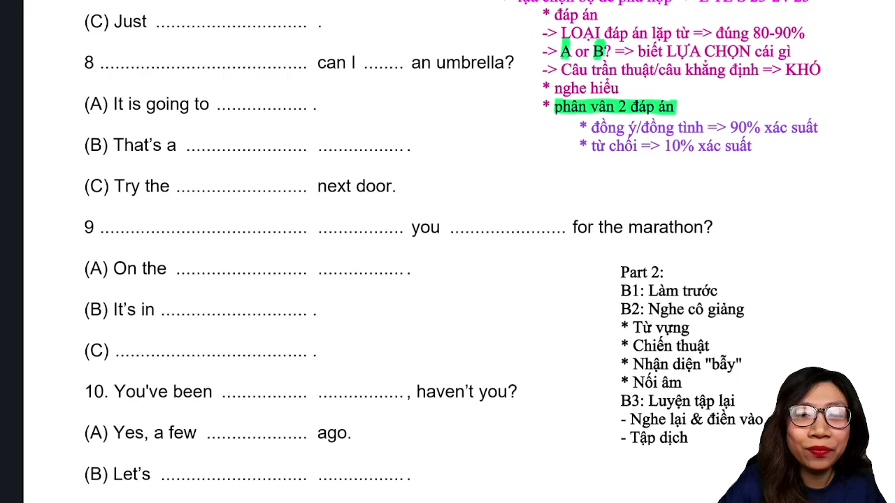

* **Chiến thuật làm bài Part 2:**
  * Part 2 là phần thi có số lượng câu hỏi liên tục dài nhất trong bài thi Nghe (25 câu hỏi).
  * Trong lúc nghe, tuyệt đối không vội vàng tô đen ô đáp án vào tờ phiếu trả lời vì thao tác cúi xuống tô tròn làm mất tập trung cho câu tiếp theo. Nên dùng đầu bút chì chấm nhẹ đánh dấu mốc hoặc định vị nhanh, đợi kết thúc phần thi mới hoàn thiện tô đáp án.
* **Nguyên tắc phân loại 3 nhóm câu hỏi:**
  * Nhóm 1: Câu hỏi Wh-questions (Who, Where, When, Why, How, What).
  * Nhóm 2: Câu hỏi Yes/No, câu hỏi đuôi Tag questions, câu hỏi lựa chọn (Or), câu mời mọc hoặc gợi ý (Would you like...).
  * Nhóm 3: câu trần thuật Statements mang tính phát biểu quan điểm hoặc tình huống.

---

### [[00:13:40](https://www.youtube.com/watch?v=RHPLKHoJcZI&t=820s)] Câu 7: Khoảng thời gian

* **Đề bài:** "How long will it take to fix this elevator?"
* **Phương án lựa chọn:**
  * **A.** "About three days."
  * **B.** "Yes, they will."
  * **C.** "Just last week."
* **Đáp án đúng:** **A**

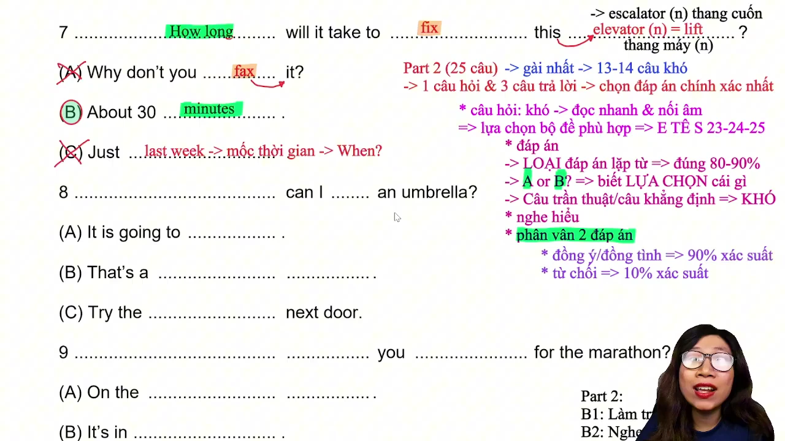

* **Phân tích phương án:**
  * **Phương án A (Đúng):** Cung cấp khoảng thời gian đo lường cụ thể (`About three days` - khoảng ba ngày), trả lời trực diện cho câu hỏi đo lường thời lượng `How long`.
  * **Phương án B (Sai):** Bẫy phản xạ Yes/No. Câu hỏi có từ để hỏi `How long` tuyệt đối không trả lời bằng `Yes` hoặc `No`.
  * **Phương án C (Sai):** Bẫy mốc thời gian. Cụm từ `Just last week` (chỉ mới tuần trước) là mốc thời gian trong quá khứ trả lời cho câu hỏi `When`, không phải khoảng thời gian `How long`.
* **Mở rộng kiến thức:**
  * `elevator`: thang máy.
  * `fix`: sửa chữa, khắc phục sự cố.
  * Phân biệt `How long` (khoảng thời gian: three days, two hours) và `When` (mốc thời gian: last week, at 5 PM).

---

### [[00:18:36](https://www.youtube.com/watch?v=RHPLKHoJcZI&t=1116s)] Câu 8: Nơi chốn mua sắm

* **Đề bài:** "Where can I buy an umbrella?"
* **Phương án lựa chọn:**
  * **A.** "It is going to rain."
  * **B.** "That's a brilliant idea."
  * **C.** "Try the shop next door."
* **Đáp án đúng:** **C**

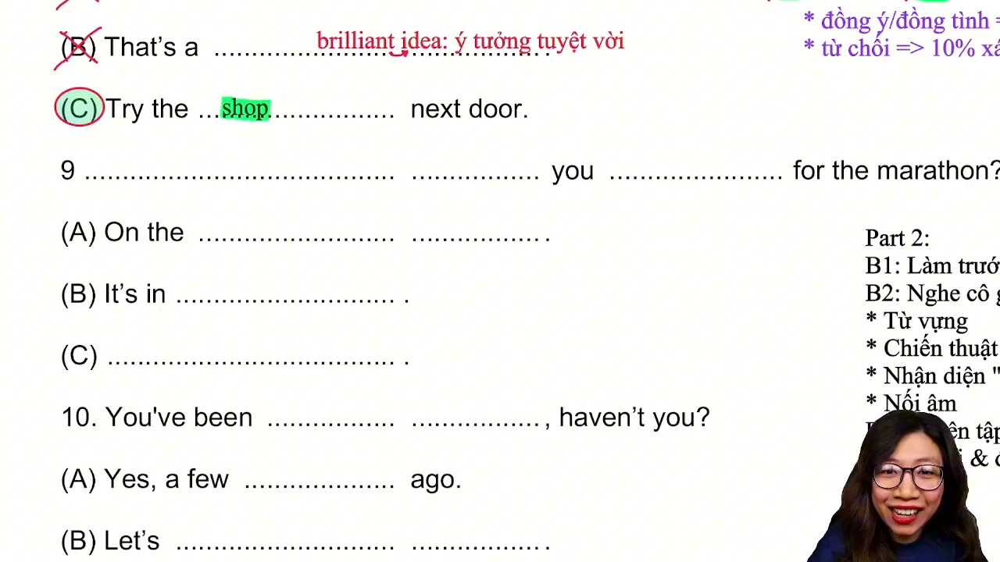

* **Phân tích phương án:**
  * **Phương án A (Sai):** Bẫy liên tưởng ngữ nghĩa. Từ ngữ `umbrella` gợi liên tưởng đến trời mưa (`rain`), nhưng câu này không chỉ ra nơi chốn mua hàng.
  * **Phương án B (Sai):** Lời khen ngợi một ý tưởng hay (`brilliant idea`), không liên quan đến câu hỏi vị trí `Where`.
  * **Phương án C (Đúng):** Đưa ra địa điểm cửa hàng lân cận (`shop next door` - cửa hàng ngay sát bên cạnh), đáp ứng chính xác nhu cầu tìm kiếm nơi chốn.
* **Mở rộng kiến thức:**
  * `umbrella`: cây dù, cái ô.
  * `next door`: ngay sát bên cạnh, nhà bên cạnh.
  * `brilliant`: xuất sắc, thông minh, tuyệt vời.

---

### [[00:22:52](https://www.youtube.com/watch?v=RHPLKHoJcZI&t=1372s)] Câu 9: Mốc thời gian

* **Đề bài:** "When did you sign up for the marathon?"
* **Phương án lựa chọn:**
  * **A.** "On the sign-up sheet."
  * **B.** "It's in August."
  * **C.** "Last month."
* **Đáp án đúng:** **C**

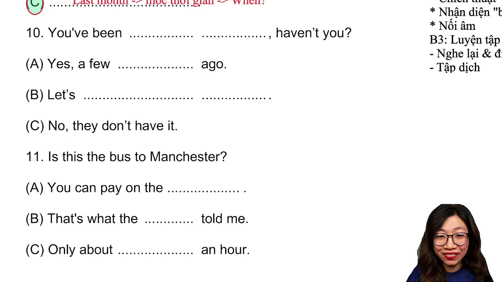

* **Phân tích phương án:**
  * **Phương án A (Sai):** Bẫy lặp từ `sign-up`. Cụm từ `on the sign-up sheet` (trên danh sách đăng ký) là vị trí nơi chốn trả lời cho câu hỏi `Where`.
  * **Phương án B (Sai):** Bẫy thì ngữ pháp. Cụm `It's in August` dùng thì hiện tại hoặc tương lai, trong khi câu hỏi dùng trợ động từ quá khứ `did you sign up`.
  * **Phương án C (Đúng):** Mốc thời gian quá khứ `Last month` (tháng trước) hoàn toàn tương thích với trợ động từ quá khứ `did`.
* **Mở rộng kiến thức:**
  * `sign up for`: đăng ký tham gia vào một sự kiện hoặc hoạt động.
  * `marathon`: cuộc thi chạy việt dã.
  * `sign-up sheet`: bảng biểu hoặc phiếu đăng ký.

---

### [[00:29:03](https://www.youtube.com/watch?v=RHPLKHoJcZI&t=1743s)] Câu 10: Câu hỏi đuôi

* **Đề bài:** "You've been here before, haven't you?"
* **Phương án lựa chọn:**
  * **A.** "Yes, a few years ago."
  * **B.** "Let's wait here."
  * **C.** "No, they don't have it."
* **Đáp án đúng:** **A**

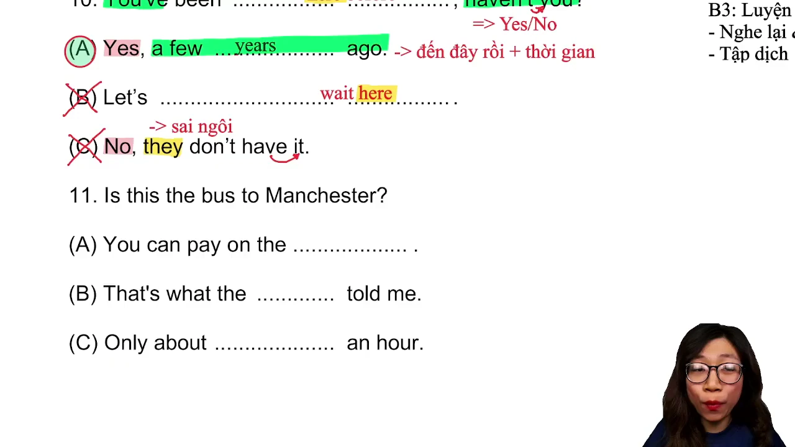

* **Phân tích phương án:**
  * **Phương án A (Đúng):** Xác nhận bằng `Yes` và cung cấp mốc thời gian quá khứ xác thực (`a few years ago` - vài năm trước), khớp với thì hiện tại hoàn thành trải nghiệm.
  * **Phương án B (Sai):** Lời rủ rê chờ đợi tại đây (`Let's wait here`), lặp lại từ `here`, lạc đề hoàn toàn.
  * **Phương án C (Sai):** Bẫy sai chủ ngữ. Câu hỏi hướng đến ngôi thứ hai (`you`), phương án lại dùng đại từ số nhiều `they` và tân ngữ `it` không liên quan.
* **Mở rộng kiến thức:**
  * `haven't you`: câu hỏi đuôi thì hiện tại hoàn thành, mang ý nghĩa xác nhận trải nghiệm.
  * `a few years ago`: cách đây vài năm.
  * Quy tắc câu hỏi đuôi: đối xử tương tự câu hỏi Yes/No, đặc biệt chú ý sự đồng nhất về ngôi xưng hô.

---

### [[00:34:45](https://www.youtube.com/watch?v=RHPLKHoJcZI&t=2085s)] Câu 11: Xác nhận tuyến xe

* **Đề bài:** "Is this the bus to Manchester?"
* **Phương án lựa chọn:**
  * **A.** "You can pay on the bus."
  * **B.** "That's what the driver told me."
  * **C.** "At the central station."
* **Đáp án đúng:** **B**

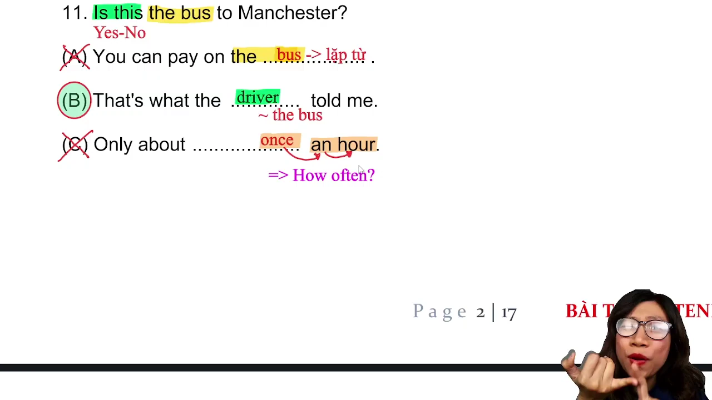

* **Phân tích phương án:**
  * **Phương án A (Sai):** Bẫy lặp từ `bus`, cung cấp thông tin thanh toán tiền vé xe, không xác nhận lộ trình tuyến đường.
  * **Phương án B (Đúng):** Phản hồi gián tiếp kinh điển. Người trả lời cũng là hành khách và dẫn lại thông tin từ tài xế (`That's what the driver told me` - Đó là điều tài xế nói với tôi) để gián tiếp xác nhận chuyến xe.
  * **Phương án C (Sai):** Cung cấp địa điểm nhà ga trung tâm, trả lời cho câu hỏi `Where`.
* **Mở rộng kiến thức:**
  * `bus to [Địa danh]`: tuyến xe buýt hướng về một địa điểm cụ thể.
  * `driver`: tài xế, người lái xe.
  * `central station`: nhà ga trung tâm.

---

### [[00:39:12](https://www.youtube.com/watch?v=RHPLKHoJcZI&t=2352s)] Câu 12: Câu hỏi lựa chọn

* **Đề bài:** "Should I fax or mail the invitation?"
* **Phương án lựa chọn:**
  * **A.** "To the mayor's office."
  * **B.** "Yes, that's better."
  * **C.** "I'll deliver it by hand."
* **Đáp án đúng:** **C**

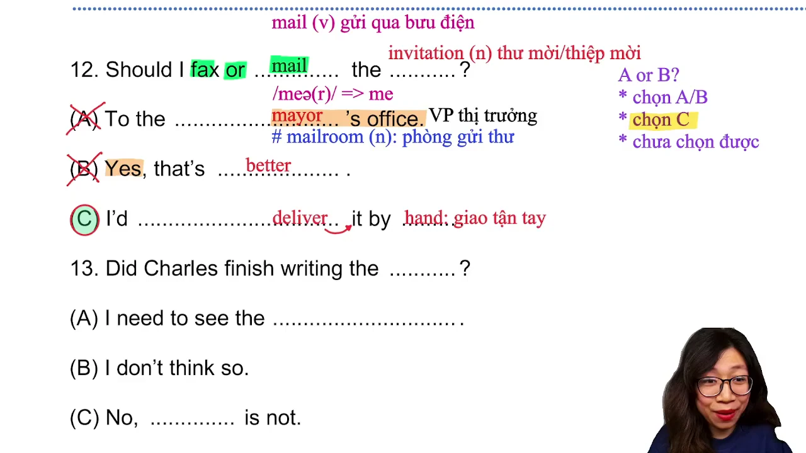

* **Phân tích phương án:**
  * **Phương án A (Sai):** Trả lời địa điểm gửi đến văn phòng thị trưởng (`mayor's office`), trả lời cho câu hỏi `Where`.
  * **Phương án B (Sai):** Bẫy trả lời Yes/No. Câu hỏi lựa chọn có liên từ `or` tuyệt đối không được dùng `Yes` hoặc `No`.
  * **Phương án C (Đúng):** Đưa ra phương án thứ ba vượt ra ngoài hai lựa chọn trong câu hỏi: không gửi fax, cũng không gửi bưu điện mà giao tận tay (`deliver it by hand`).
* **Mở rộng kiến thức:**
  * `fax`: gửi qua đường máy fax.
  * `mail`: gửi qua đường bưu chính.
  * `invitation`: thiệp mời, thư mời.
  * `deliver by hand`: giao tận tay trực tiếp.
  * `mayor`: thị trưởng thành phố.

---

### [[00:49:12](https://www.youtube.com/watch?v=RHPLKHoJcZI&t=2952s)] Câu 13: Báo cáo công việc

* **Đề bài:** "Did Charles finish writing the report?"
* **Phương án lựa chọn:**
  * **A.** "I need to see the reporter."
  * **B.** "I don't think so."
  * **C.** "No, it is not."
* **Đáp án đúng:** **B**

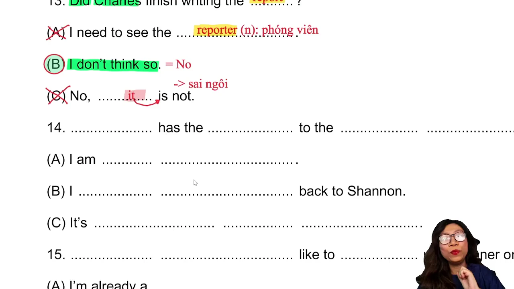

* **Phân tích phương án:**
  * **Phương án A (Sai):** Bẫy đồng âm và gia đình từ. Từ ngữ `report` gợi ra `reporter` (phóng viên, người báo cáo), không trả lời cho câu hỏi.
  * **Phương án B (Đúng):** Cách phủ định lịch sự và gián tiếp (`I don't think so` - Tôi không nghĩ vậy), mang ý nghĩa tương đương `No, he didn't finish it`.
  * **Phương án C (Sai):** Bẫy sai chủ ngữ và thì ngữ pháp. Câu hỏi hỏi về hành động của người (`Charles`) trong quá khứ (`Did`), câu trả lời lại dùng chủ ngữ chỉ vật `it` và tobe hiện tại `is not`.
* **Mở rộng kiến thức:**
  * `finish writing`: hoàn tất việc soạn thảo hoặc viết.
  * `report`: bản báo cáo, văn bản tường trình.
  * `reporter`: phóng viên, ký giả.
  * `I don't think so`: cách diễn đạt phủ định gián tiếp thông dụng trong giao tiếp công sở.

---

### [[00:55:11](https://www.youtube.com/watch?v=RHPLKHoJcZI&t=3311s)] Câu 14: Người giữ chìa khóa

* **Đề bài:** "Who has the key to the archives room?"
* **Phương án lựa chọn:**
  * **A.** "I am free tonight."
  * **B.** "I gave it back to Shannon."
  * **C.** "It's actually quite far."
* **Đáp án đúng:** **B**

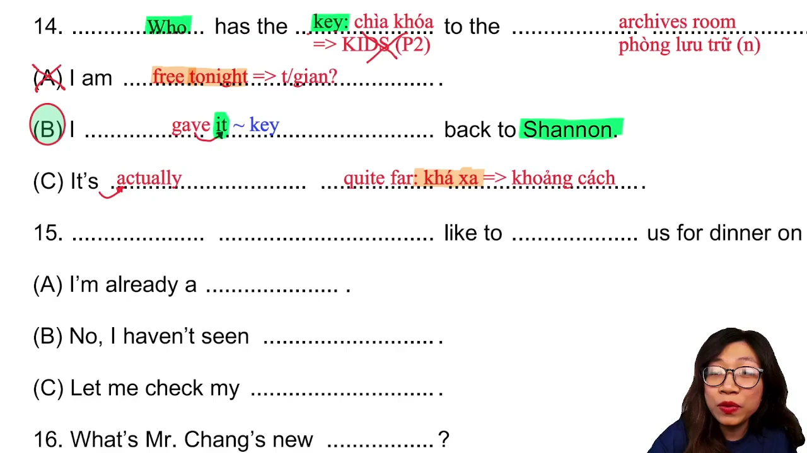

* **Phân tích phương án:**
  * **Phương án A (Sai):** Lạc đề hoàn toàn ("Tối nay tôi rảnh").
  * **Phương án B (Đúng):** Phản hồi gián tiếp chỉ ra người hiện tại đang nắm giữ chìa khóa (`I gave it back to Shannon` - Tôi đã trả lại nó cho Shannon rồi).
  * **Phương án C (Sai):** Bẫy khoảng cách. Trả lời về cự ly địa lý (`quite far` - khá xa), phù hợp cho câu hỏi `How far`.
* **Mở rộng kiến thức:**
  * `archives room`: phòng lưu trữ tài liệu, phòng văn thư.
  * `key to [something]`: chìa khóa mở một căn phòng hoặc thiết bị.
  * `give back to`: hoàn trả lại cho ai đó.
  * `quite far`: tương đối xa.

---

### [[01:03:25](https://www.youtube.com/watch?v=RHPLKHoJcZI&t=3805s)] Câu 15: Lời mời ăn tối

* **Đề bài:** "Would you like to join us for dinner on Friday?"
* **Phương án lựa chọn:**
  * **A.** "I'm already a member."
  * **B.** "No, I haven't seen her."
  * **C.** "Let me check my calendar."
* **Đáp án đúng:** **C**

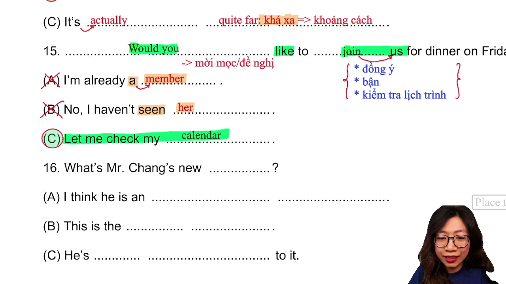

* **Phân tích phương án:**
  * **Phương án A (Sai):** Bẫy liên tưởng từ vựng. Từ `join` (tham gia) gợi liên tưởng đến việc làm thành viên câu lạc bộ (`member`).
  * **Phương án B (Sai):** Bẫy sai đại từ đối tượng. Xuất hiện đại từ `her` không hề có tiền đề nhắc tới trước đó.
  * **Phương án C (Đúng):** Phản hồi trì hoãn kiểm tra lịch biểu làm việc (`Let me check my calendar` - Để tôi kiểm tra lại lịch đã), phản ánh ứng xử công sở thực tế.
* **Mở rộng kiến thức:**
  * `join us for dinner`: cùng đi ăn tối với chúng tôi.
  * `check calendar`: tra cứu lịch làm việc hoặc lịch trình cá nhân.
  * `member`: thành viên tổ chức hoặc hội nhóm.

---

### [[01:08:27](https://www.youtube.com/watch?v=RHPLKHoJcZI&t=4107s)] Câu 16: Vị trí công tác

* **Đề bài:** "What's Mr. Chang's new position?"
* **Phương án lựa chọn:**
  * **A.** "I think he's an assistant manager."
  * **B.** "This is the latest edition."
  * **C.** "He's looking forward to it."
* **Đáp án đúng:** **A**

* **Phân tích phương án:**
  * **Phương án A (Đúng):** Nêu chính xác tên chức danh công việc (`assistant manager` - trợ lý quản lý), khớp với câu hỏi về chức vụ mới `What position`.
  * **Phương án B (Sai):** Bẫy phát âm biến âm. Từ ngữ `position` nghe phát âm gần giống `edition` (`latest edition` - ấn bản xuất bản mới nhất).
  * **Phương án C (Sai):** Miêu tả tâm trạng trông đợi (`looking forward to it`), không đưa ra thông tin về chức vụ.
* **Mở rộng kiến thức:**
  * `position`: vị trí, chức vụ, chức danh công tác.
  * `assistant manager`: trợ lý trưởng phòng, phó quản lý.
  * `latest edition`: ấn bản xuất bản mới nhất.
  * `look forward to`: háo hức mong chờ điều gì.

---

### [[01:13:18](https://www.youtube.com/watch?v=RHPLKHoJcZI&t=4398s)] Câu 17: Hoa cưới trang trí

* **Đề bài:** "Wouldn't these flowers be good for the wedding?"
* **Phương án lựa chọn:**
  * **A.** "It was very useful."
  * **B.** "I think they're perfect."
  * **C.** "A table for five, please."
* **Đáp án đúng:** **B**

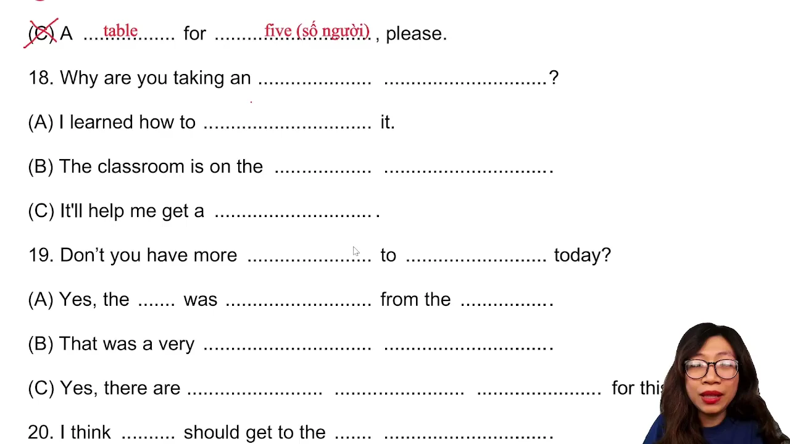

* **Phân tích phương án:**
  * **Phương án A (Sai):** Bẫy sai đại từ và thì. Dùng đại từ số ít `it` và thì quá khứ `was`, lệch với danh từ số nhiều `these flowers`.
  * **Phương án B (Đúng):** Đại từ số nhiều `they` quy chiếu chuẩn xác về `these flowers`, kèm theo sự tán thành tuyệt đối (`perfect` - hoàn hảo cho lễ cưới).
  * **Phương án C (Sai):** Lời gọi đặt bàn ăn tại nhà hàng (`A table for five, please` - Vui lòng cho một bàn 5 người), hoàn toàn lệch ngữ cảnh.
* **Mở rộng kiến thức:**
  * `wedding`: lễ cưới, đám cưới.
  * `perfect`: hoàn hảo, lý tưởng.
  * `useful`: hữu ích, có ích.
  * Quy tắc hòa hợp đại từ: danh từ số nhiều (`these flowers`) bắt buộc được thay thế bằng đại từ số nhiều (`they / them`).

---

### [[01:20:48](https://www.youtube.com/watch?v=RHPLKHoJcZI&t=4848s)] Câu 18: Mục tiêu học tập

* **Đề bài:** "Why are you taking an accounting class?"
* **Phương án lựa chọn:**
  * **A.** "I learned how to fix it."
  * **B.** "The classroom is on the fifth floor."
  * **C.** "It will help me get a promotion."
* **Đáp án đúng:** **C**

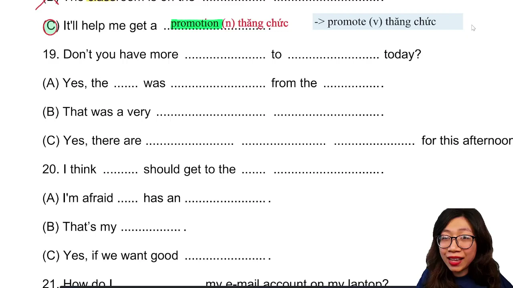

* **Phân tích phương án:**
  * **Phương án A (Sai):** Nói về việc học cách sửa chữa đồ vật, không liên quan đến ngành kế toán.
  * **Phương án B (Sai):** Bẫy lặp từ `classroom` và trả lời vị trí tầng lầu (phù hợp câu hỏi `Where`).
  * **Phương án C (Đúng):** Nêu rõ mục đích và lý do học tập: hỗ trợ cho việc thăng tiến sự nghiệp (`get a promotion`).
* **Mở rộng kiến thức:**
  * `accounting class`: lớp học bồi dưỡng kiến thức kế toán.
  * `promotion`: sự thăng chức, đề bạt lên vị trí cao hơn.
  * `promote`: thăng cấp, đề bạt, xúc tiến thương mại.

---

### [[01:26:22](https://www.youtube.com/watch?v=RHPLKHoJcZI&t=5182s)] Câu 19: Lịch phỏng vấn

* **Đề bài:** "Don't you have more candidates to interview today?"
* **Phương án lựa chọn:**
  * **A.** "Yes, the view was fantastic from the top."
  * **B.** "That was a very interesting article."
  * **C.** "Yes, there are two more scheduled for this afternoon."
* **Đáp án đúng:** **C**

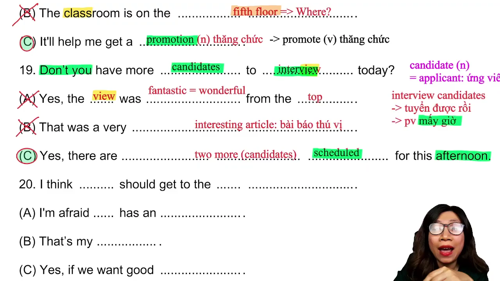

* **Phân tích phương án:**
  * **Phương án A (Sai):** Bẫy đồng âm giữa `interview` (phỏng vấn) và `view` (tầm nhìn, phong cảnh).
  * **Phương án B (Sai):** Đưa ra nhận xét về một bài báo thú vị (`interesting article`), hoàn toàn lạc đề.
  * **Phương án C (Đúng):** Khẳng định có thêm ứng viên (`Yes`) và cung cấp số lượng cùng thời gian cụ thể (`two more scheduled for this afternoon` - còn hai ứng viên nữa xếp lịch chiều nay).
* **Mở rộng kiến thức:**
  * `candidate`: ứng viên tham gia ứng tuyển.
  * `interview`: buổi phỏng vấn tuyển dụng.
  * `scheduled for`: được lên lịch hoặc sắp xếp vào khung giờ cụ thể.
  * `article`: bài báo, bài viết chuyên luận.

---

### [[01:35:57](https://www.youtube.com/watch?v=RHPLKHoJcZI&t=5757s)] Câu 20: Câu trần thuật

* **Đề bài:** "I think we should get to the stadium early."
* **Phương án lựa chọn:**
  * **A.** "I'm afraid she has an appointment."
  * **B.** "That's my favorite."
  * **C.** "Yes, if we want good seats."
* **Đáp án đúng:** **C**

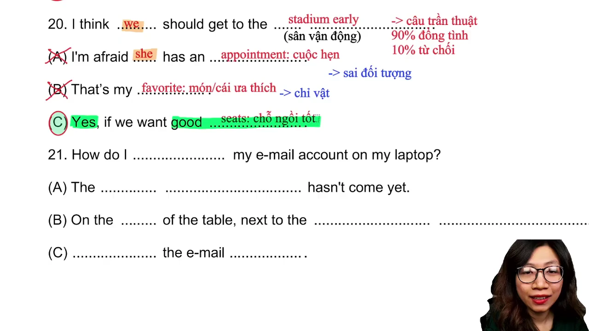

* **Phân tích phương án:**
  * **Phương án A (Sai):** Bẫy sai đối tượng xưng hô. Sử dụng đại từ `she` trong khi câu gốc thảo luận hành động chung của nhóm `we`.
  * **Phương án B (Sai):** Bẫy khen ngợi món đồ hoặc vật yêu thích (`That's my favorite`), không logic với lời đề nghị đi sớm.
  * **Phương án C (Đúng):** Tán thành lời đề xuất (`Yes`) và nêu điều kiện logic chứng minh tại sao cần đến sớm: để có được chỗ ngồi tốt (`if we want good seats`).
* **Mở rộng kiến thức:**
  * `stadium`: sân vận động thể thao.
  * `early`: sớm hơn khung giờ quy định hoặc bắt đầu sự kiện.
  * `good seats`: vị trí ngồi thuận lợi, chỗ ngồi đẹp.
  * `appointment`: cuộc hẹn làm việc hoặc khám chữa bệnh.

---

## Trích dẫn then chốt

* [[00:00:49](https://www.youtube.com/watch?v=RHPLKHoJcZI&t=49s)]: *"Tuyệt đối trong Part 2 không có được tô đáp án liền vào đề, nghe dứt điểm từng câu rồi dùng đầu bút chì chấm nhẹ định vị để không bị cuốn trôi nhịp làm bài."*
* [[00:10:18](https://www.youtube.com/watch?v=RHPLKHoJcZI&t=618s)]: *"Bắt buộc phải nắm vững ba trụ cột: câu hỏi Wh-question cấm Yes/No, câu hỏi Yes/No và lựa chọn Or, và nhóm câu trần thuật luôn ưu tiên hướng phản hồi đồng tình."*
* [[00:39:31](https://www.youtube.com/watch?v=RHPLKHoJcZI&t=2371s)]: *"Gặp câu hỏi lựa chọn có từ Or thì 90% đề thi sẽ đưa ra phương án thứ ba vượt ngoài hai phương án ban đầu, tuyệt đối cấm chọn Yes hoặc No."*
* [[01:00:42](https://www.youtube.com/watch?v=RHPLKHoJcZI&t=3642s)]: *"Người ta hỏi Who không nhất thiết phải trả lời bằng tên người có mặt, mà thường sẽ là chỉ ra người đang cầm chìa khóa hoặc người phụ trách thực tế."*
* [[01:38:27](https://www.youtube.com/watch?v=RHPLKHoJcZI&t=5907s)]: *"Câu trần thuật là câu khẳng định tình huống, phản hồi đúng thường là lời đồng thuận kèm theo điều kiện giải thích tại sao phải thực hiện hành động đó."*

---

## Lệnh & Công cụ

* **Quy trình xử lý âm thanh trong phòng thi:**
  1. Giữ ngón tay trỏ và bút chì ở vị trí ba ngón tay ứng với 3 đáp án A, B, C.
  2. Khi nghe câu hỏi, lập tức loại bỏ phương án sai ngay khi loa vừa đọc xong bằng cách cụp ngón tay tương ứng.
  3. Khi loa đọc hết phương án C, đưa ra quyết định tức thì trong vòng 1.5 giây và chấm nhẹ vào phiếu trả lời.
  4. Tuyệt đối không suy nghĩ dây dưa về câu cũ khi loa đã chuyển sang câu tiếp theo.

---

## Đánh đổi & Rủi ro

* **Bẫy âm thanh nuốt âm American Nuance:**
  * Tiếng Anh Mỹ thường biến âm /t/ thành âm /d/ nhẹ khi đứng giữa hai nguyên âm (ví dụ: `city` nghe như `cidy`, `writing` nghe như `wri-ding`).
  * Nếu không luyện nghe theo cụm, thí sinh sẽ bị khựng lại cố dịch từng từ đơn lẻ và đánh mất các từ khóa quan trọng tiếp theo.
* **Nguy cơ sa đà vào dịch nghĩa toàn câu:**
  * Việc cố gắng dịch trọn vẹn 100% nghĩa tiếng Việt của câu hỏi sẽ gây quá tải bộ nhớ ngắn hạn.
  * Giải pháp là chỉ bắt 3 điểm tựa: Từ để hỏi / Trợ động từ + Động từ hành động + Danh từ trọng tâm.