# GIẢI ĐỀ TOEIC 2026 - TEST 1 [VIDEO 2]

* **Kênh:** Anh ngữ Ms Thanh | **Thời lượng:** 01:49:10 | **Ngày:** 2026-02-15
* **Video:** [https://www.youtube.com/watch?v=yw4xUVGvexQ](https://www.youtube.com/watch?v=yw4xUVGvexQ)

---

## Thuật ngữ

| Thuật ngữ | Giải thích |
| :--- | :--- |
| **Part 5 Incomplete Sentences** | Phần thi hoàn thành câu gồm 30 câu hỏi trắc nghiệm ngữ pháp và từ vựng (từ câu 101 đến câu 130). |
| **Transitive Verb** | Ngoại động từ đòi hỏi một tân ngữ là danh từ hoặc cụm danh từ đứng ngay sau để hoàn chỉnh ý nghĩa. |
| **Passive Voice** | Thể bị động có cấu trúc Be + V3/V-ed; trong đề thi thường không có cụm danh từ làm tân ngữ trực tiếp theo sau. |
| **Relative Pronoun** | Đại từ quan hệ (Who, Whom, Which, That, Whose) dùng để thay thế và liên kết danh từ đứng trước với mệnh đề phụ. |
| **Quantifier** | Từ định lượng xác định phạm vi số lượng của danh từ (Other, Another, Each Other). |
| **Participle Adjective** | Tính từ phân từ cấu tạo từ V-ed (mang nghĩa bị động) hoặc V-ing (mang nghĩa chủ động, bản chất). |
| **Inherent Adjective** | Tính từ gốc nguyên bản mang nghĩa nội tại, không bị giới hạn bởi quy tắc phân từ bị động (ví dụ Specialized). |
| **Time Expression** | Cụm từ diễn đạt thời gian đóng vai trò dấu hiệu nhận biết thì của động từ chính trong câu. |

---

## Tổng luận chuyên đề

#### Cấu trúc bài thi và nhóm câu hỏi
Video 2 của Test 1 tập trung xử lý toàn diện 15 câu hỏi nửa sau của Part 5 (từ Câu 16 đến Câu 30, tương ứng Câu 116 đến Câu 130 của đề thi chuẩn). Độ khó được phân tầng rõ rệt:
1. **Nhóm câu hỏi ngữ pháp và từ loại (Chiếm 40%):** Bao gồm nhận diện từ loại đứng sau ngoại động từ, vị trí xen kẽ giữa Be và cụm danh từ, phân định tính từ gốc và tính từ phân từ, đại từ quan hệ và đại từ định lượng.
2. **Nhóm câu hỏi giới từ và liên từ (Chiếm 20%):** Kiểm tra khả năng phân biệt giới từ đi với khoảng thời gian đối chiếu với danh từ đếm được, liên từ phụ thuộc thời gian và điều kiện.
3. **Nhóm câu hỏi từ vựng chuyên sâu (Chiếm 40%):** Nhóm câu phân loại thí sinh ở mốc 700+ và 800+, đòi hỏi kiến thức về Collocation theo ngữ cảnh kinh doanh, vận tải, y tế và nhân sự.

#### Quy tắc định vị hai phía
Đối với tất cả các câu hỏi ngữ pháp và từ loại trong Part 5, nguyên tắc cốt lõi là kiểm tra hai chiều:
* **Nhìn phía trước:** Xác định động từ chính, trợ động từ, giới từ hoặc liên từ để khoanh vùng chức năng ngữ pháp cần điền.
* **Nhìn phía sau:** Xác định xem có cụm danh từ làm tân ngữ hay chỉ có giới từ bổ nghĩa; kiểm tra đuôi từ để loại bỏ các phương án không phù hợp trước khi dịch nghĩa.

#### Chiến lược xử lý kết hợp từ
Các câu hỏi từ vựng nâng cao không kiểm tra khả năng dịch từng từ đơn lẻ mà kiểm tra cặp từ đi liền:
* **Bối cảnh thời tiết:** Đi liền với tính từ biểu thị mức độ thuận lợi hoặc bất lợi (`unfavorable weather conditions`).
* **Bối cảnh quy trình:** Đi liền với danh từ trình tự các bước (`sequence of steps`).
* **Bối cảnh chi phí và giá cả:** Đi liền với động từ biến động tăng hoặc giảm (`increase the rate`).
* **Bối cảnh không gian sống:** Đi liền với động từ nâng tầm, cải thiện (`enhance the atmosphere`).

---

## Bóc tách chi tiết

### [[00:00:01](https://www.youtube.com/watch?v=yw4xUVGvexQ&t=1s)] Câu 16: Từ loại danh từ

* **Đề bài và phương án:**
  * *The company has an automated system that sends a _______ of every online order by email.*
  * A. confirms
  * B. confirmed
  * C. confirming
  * D. confirmation
* **Phân tích ngữ pháp:**
  * Phía trước chỗ trống là ngoại động từ `sends`, đòi hỏi một tân ngữ Object đứng sau.
  * Phía sau chỗ trống là giới từ `of` (thành phần giới từ không quyết định từ loại của vị trí đứng trước).
  * Tân ngữ của động từ bắt buộc là một danh từ hoặc cụm danh từ.
  * Xét các phương án: Phương án A là động từ chia ngôi thứ ba số ít; phương án B là V-ed hoặc tính từ phân từ; phương án C là V-ing hoặc tính từ; phương án D có hậu tố `-tion` là danh từ duy nhất.
  * **Đáp án đúng:** **D** (`confirmation`).
* **Dịch nghĩa:** Công ty có một hệ thống tự động gửi xác nhận cho mỗi đơn hàng trực tuyến qua thư điện tử.
* **Mở rộng kiến thức:**
  * `confirm` (động từ): xác nhận.
  * `confirmation` (danh từ): sự xác nhận, giấy xác nhận.
  * `automated system`: hệ thống tự động hóa.
  * `by email`: qua thư điện tử.

---

### [[00:02:30](https://www.youtube.com/watch?v=yw4xUVGvexQ&t=150s)] Câu 17: Trạng từ thời gian

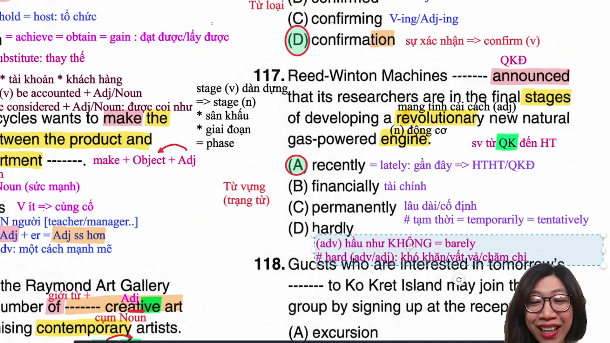

* **Đề bài và phương án:**
  * *The company _______ announced that its researchers are in the final stages of developing a revolutionary new natural gas powered engine.*
  * A. recently
  * B. financially
  * C. permanently
  * D. hardly
* **Phân tích ngữ pháp và ngữ nghĩa:**
  * Động từ chính phía sau chỗ trống là `announced` chia ở thì quá khứ đơn.
  * Phương án A (`recently`): trạng từ chỉ thời gian mang nghĩa gần đây, thường bổ nghĩa cho thì hiện tại hoàn thành hoặc quá khứ đơn (bản chất của hiện tại hoàn thành có gốc từ quá khứ nên có thể dùng quá khứ đơn thay thế).
  * Phương án B (`financially`): về mặt tài chính (xuất phát từ `finance`).
  * Phương án C (`permanently`): vĩnh viễn, lâu dài, cố định (trái nghĩa với `temporarily`, `tentatively`).
  * Phương án D (`hardly`): trạng từ mang nghĩa hầu như không (`barely`), tuyệt đối không dịch là chăm chỉ hay khó khăn (tính từ/trạng từ chăm chỉ là `hard`).
  * **Đáp án đúng:** **A** (`recently`).
* **Dịch nghĩa:** Công ty gần đây đã thông báo rằng các nhà nghiên cứu của họ đang ở những giai đoạn cuối cùng của việc phát triển một động cơ chạy bằng khí đốt tự nhiên mới mang tính cách mạng.
* **Mở rộng kiến thức:**
  * `recently` = `lately`: gần đây.
  * `permanently` (lâu dài) đối lập `temporarily` / `tentatively` (tạm thời).
  * `hardly` = `barely`: hầu như không (ví dụ: *She can hardly hear anything*).
  * `stage` = `phase`: giai đoạn, thời kỳ (nghĩa khác của stage: sân khấu; dàn dựng).
  * `revolutionary`: mang tính cách mạng, mang tính cải cách.
  * `engine`: động cơ máy móc.

---

### [[00:12:35](https://www.youtube.com/watch?v=yw4xUVGvexQ&t=755s)] Câu 18: Danh từ chuyến đi

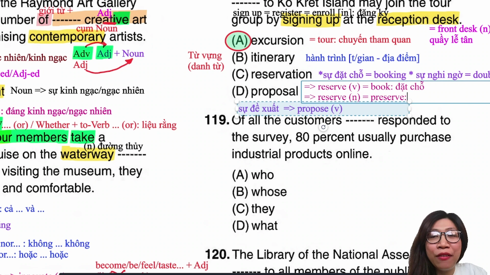

* **Đề bài và phương án:**
  * *Guests interested in tomorrow's _______ to the island can join the group tour by signing up at the reception desk.*
  * A. excursion
  * B. itinerary
  * C. reservation
  * D. proposal
* **Phân tích ngữ pháp và ngữ nghĩa:**
  * Vị trí chỗ trống đứng sau sở hữu cách `tomorrow's` và đứng trước cụm giới từ `to the island`.
  * Phương án A (`excursion`): chuyến tham quan, chuyến du ngoạn ngắn ngày.
  * Phương án B (`itinerary`): lịch trình, hành trình chi tiết (thường liệt kê giờ bay, địa điểm xuất phát, thời gian hạ cánh).
  * Phương án C (`reservation`): sự đặt chỗ trước (`booking`); hoặc sự nghi ngờ (`doubt`).
  * Phương án D (`proposal`): bản đề xuất, sự kiến nghị (xuất phát từ động từ `propose`).
  * Ngữ cảnh đề cập đến việc khách mời quan tâm đến chuyến đi đảo ngày mai và có thể tham gia đoàn tham quan nhóm (`group tour`). Từ phù hợp nhất là `excursion`.
  * **Đáp án đúng:** **A** (`excursion`).
* **Dịch nghĩa:** Những khách hàng quan tâm đến chuyến tham quan ngày mai tới hòn đảo có thể tham gia tour du lịch nhóm bằng cách đăng ký tại quầy lễ tân.
* **Mở rộng kiến thức:**
  * `excursion` = `tour` / `trip`: chuyến tham quan, du ngoạn.
  * `itinerary`: hành trình, lộ trình chi tiết.
  * `reservation`: sự đặt chỗ trước; sự e ngại, nghi ngờ (`doubt` - âm b câm).
  * `reserve` (động từ): đặt chỗ (`book`); `reserve` (danh từ) = `preserve`: khu bảo tồn.
  * `sign up (for)` = `register (for)` = `enroll (in)`: đăng ký tham gia.
  * `reception desk` = `front desk`: quầy lễ tân.

---

### [[00:22:27](https://www.youtube.com/watch?v=yw4xUVGvexQ&t=1347s)] Câu 19: Đại từ quan hệ

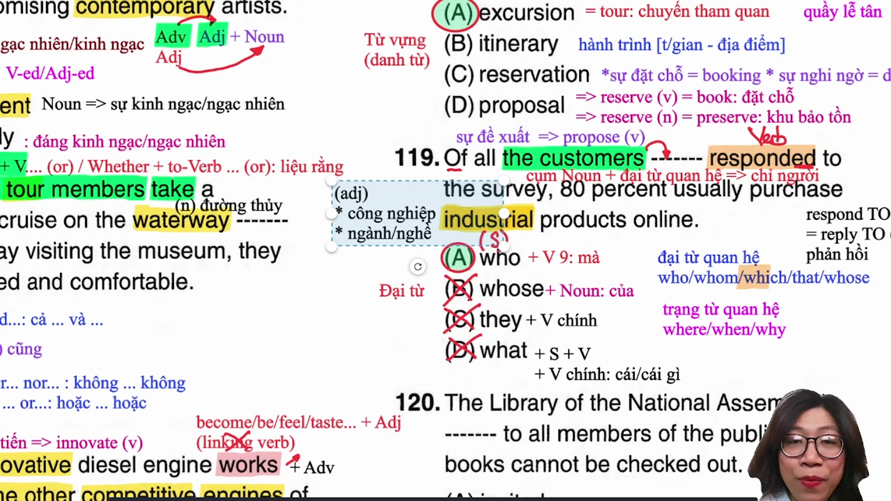

* **Đề bài và phương án:**
  * *Among all the customers _______ responded to the survey, 80% usually purchase industrial products online.*
  * A. who
  * B. whose
  * C. what
  * D. they
* **Phân tích ngữ pháp:**
  * Phía trước chỗ trống là danh từ chỉ người `the customers`.
  * Phía sau chỗ trống là động từ chính `responded` (có đuôi `-ed`), theo sau là cụm giới từ `to the survey`.
  * Cần một đại từ quan hệ thay thế cho danh từ chỉ người và đóng vai trò làm chủ ngữ cho mệnh đề quan hệ đứng sau.
  * Phương án A (`who`): đại từ quan hệ thay cho người, làm chủ ngữ trước động từ chính.
  * Phương án B (`whose`): đại từ quan hệ sở hữu, bắt buộc theo sau phải là một danh từ.
  * Phương án C (`what`): không làm đại từ quan hệ đứng sau danh từ tiền ngữ.
  * Phương án D (`they`): đại từ nhân xưng, không có chức năng liên kết mệnh đề phụ với danh từ phía trước.
  * **Đáp án đúng:** **A** (`who`).
* **Dịch nghĩa:** Trong số tất cả khách hàng đã phản hồi khảo sát, 80% trong số họ thường mua các sản phẩm công nghiệp trực tuyến.
* **Mở rộng kiến thức:**
  * `who` + V (chính): người mà (làm chủ ngữ).
  * `whose` + N: của người mà (quan hệ sở hữu).
  * `respond to` = `reply to`: phản hồi, trả lời.
  * `industrial`: thuộc về công nghiệp, ngành nghề sản xuất.
  * `purchase`: mua hàng, vật phẩm mua.

---

### [[00:30:18](https://www.youtube.com/watch?v=yw4xUVGvexQ&t=1818s)] Câu 20: Tính từ trạng thái

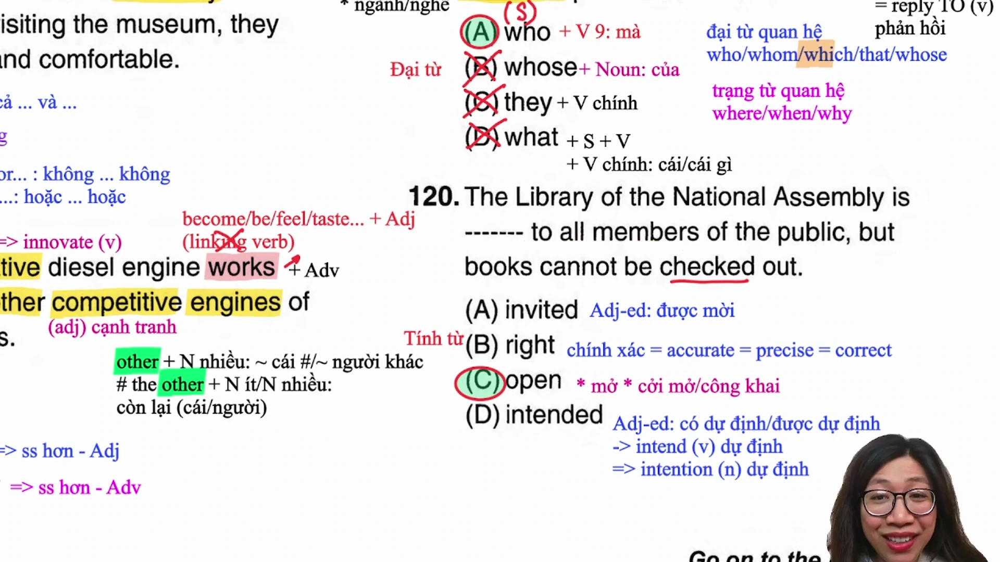

* **Đề bài và phương án:**
  * *The library is _______ to all members of the public, but books cannot be checked out.*
  * A. invited
  * B. right
  * C. open
  * D. intended
* **Phân tích ngữ pháp và ngữ nghĩa:**
  * Cấu trúc vị ngữ: `is _______ to all members of the public`.
  * Phương án A (`invited`): tính từ phân từ bị động mang nghĩa được mời.
  * Phương án B (`right`): đúng đắn, chính xác (`accurate`, `precise`, `correct`).
  * Phương án C (`open`): mở cửa, đón tiếp công chúng (`open to someone`).
  * Phương án D (`intended`): được dự định (xuất phát từ `intend`, danh từ `intention`).
  * Vế sau có liên từ tương phản `but` nêu rõ: *sách không thể được mượn về nhà*. Điều này làm rõ nghĩa vế trước là thư viện mở cửa cho công chúng vào xem tại chỗ.
  * **Đáp án đúng:** **C** (`open`).
* **Dịch nghĩa:** Thư viện mở cửa cho tất cả mọi người dân, nhưng sách không thể mượn mang về.
* **Mở rộng kiến thức:**
  * `open to the public`: mở cửa phục vụ đại chúng.
  * `right` = `accurate` = `precise` = `correct`: chuẩn xác.
  * `intend` (động từ): dự định; `intention` (danh từ): ý định, sự dự định.
  * `check out` (đi với sách): làm thủ tục mượn sách thư viện mang về.

---

### [[00:33:53](https://www.youtube.com/watch?v=yw4xUVGvexQ&t=2033s)] Câu 21: Giới từ thời gian

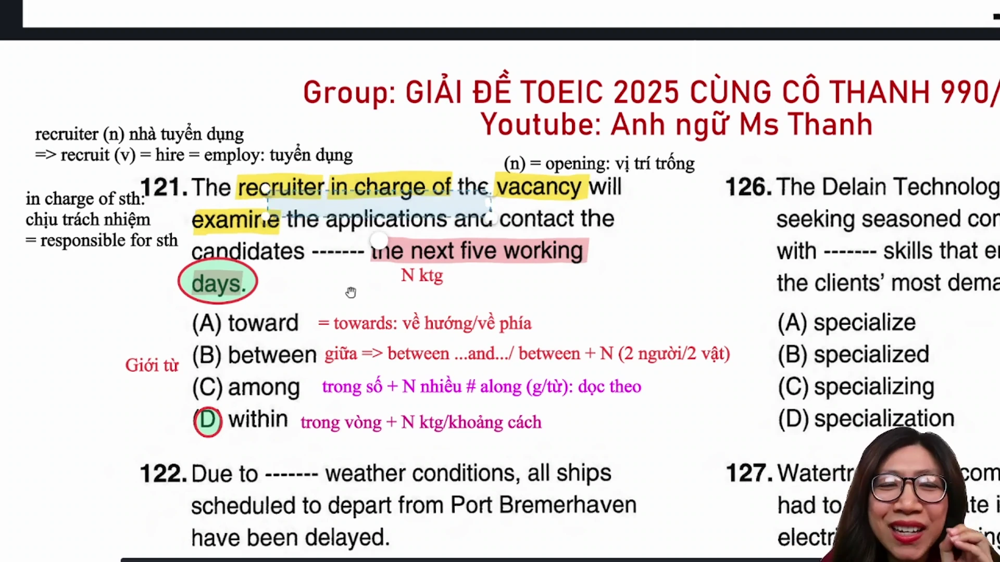

* **Đề bài và phương án:**
  * *The recruiter in charge of the vacancy will examine applications and contact candidates _______ the next five working days.*
  * A. toward
  * B. between
  * C. among
  * D. within
* **Phân tích ngữ pháp và ngữ nghĩa:**
  * Cụm từ đứng sau chỗ trống là `the next five working days` (khoảng thời gian cụ thể dài 5 ngày).
  * Phương án A (`toward` / `towards`): về phía, về hướng.
  * Phương án B (`between`): ở giữa, chỉ dùng với `between A and B` hoặc danh từ chỉ chính xác hai đối tượng (`between two options`).
  * Phương án C (`among`): trong số, đi với danh từ số nhiều chỉ từ ba đối tượng trở lên, không đi với khoảng thời gian.
  * Phương án D (`within`): trong vòng, đi với danh từ chỉ khoảng thời gian (`within five days`) hoặc khoảng cách (`within walking distance`).
  * **Đáp án đúng:** **D** (`within`).
* **Dịch nghĩa:** Nhà tuyển dụng chịu trách nhiệm cho vị trí tuyển dụng sẽ kiểm tra hồ sơ và liên hệ với các ứng viên trong vòng năm ngày làm việc tới.
* **Mở rộng kiến thức:**
  * `within` + khoảng thời gian: trong vòng bao lâu.
  * `recruiter` (nhà tuyển dụng); động từ: `recruit` = `hire` = `employ`.
  * `in charge of` = `responsible for`: chịu trách nhiệm về.
  * `vacancy` = `opening`: vị trí trống, vị trí cần tuyển dụng.
  * `examine` = `inspect`: kiểm tra, xem xét kỹ lưỡng.

---

### [[00:41:42](https://www.youtube.com/watch?v=yw4xUVGvexQ&t=2502s)] Câu 22: Tính từ thời tiết

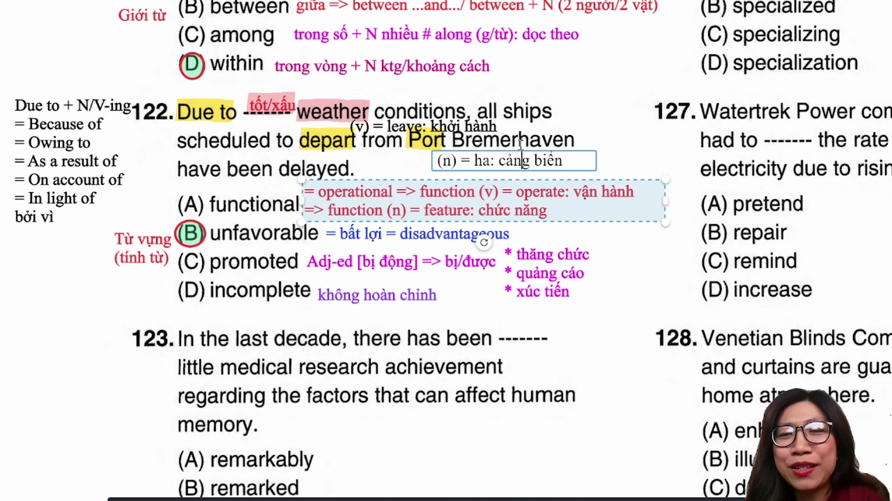

* **Đề bài và phương án:**
  * *Due to _______ weather conditions, all ships scheduled to depart from Bremerhaven have been delayed.*
  * A. functional
  * B. unfavorable
  * C. promoted
  * D. incomplete
* **Phân tích ngữ nghĩa và kết hợp từ:**
  * Chỗ trống đứng trước cụm danh từ `weather conditions` (điều kiện thời tiết). Trong tiếng Anh bài thi TOEIC, tính từ bổ nghĩa cho thời tiết chỉ xoay quanh hai cực: thời tiết thuận lợi hoặc thời tiết xấu/bất lợi.
  * Vế sau cho biết kết quả: tất cả các tàu thuyền đều bị hoãn (`have been delayed`), suy ra thời tiết mang tính tiêu cực.
  * Phương án A (`functional`): thuộc về chức năng, có thể vận hành được (xuất phát từ `function` = `operate`).
  * Phương án B (`unfavorable`): bất lợi, không thuận lợi (`disadvantageous`).
  * Phương án C (`promoted`): được thăng chức, được quảng bá, được xúc tiến.
  * Phương án D (`incomplete`): chưa hoàn tất, không đầy đủ (tiền tố `in-` + `complete`).
  * **Đáp án đúng:** **B** (`unfavorable`).
* **Dịch nghĩa:** Do điều kiện thời tiết bất lợi, tất cả các con tàu dự kiến khởi hành từ Bremerhaven đều đã bị hoãn lại.
* **Mở rộng kiến thức:**
  * `unfavorable` = `disadvantageous`: bất lợi.
  * `due to` = `because of` = `owing to` = `as a result of` = `on account of` = `in light of`: bởi vì (+ N / V-ing).
  * `depart` = `leave`: rời đi, khởi hành.
  * `port` = `harbor`: cảng biển.
  * `delay` = `postpone` = `put off`: trì hoãn.

---

### [[00:50:00](https://www.youtube.com/watch?v=yw4xUVGvexQ&t=3000s)] Câu 23: Trạng từ bổ nghĩa

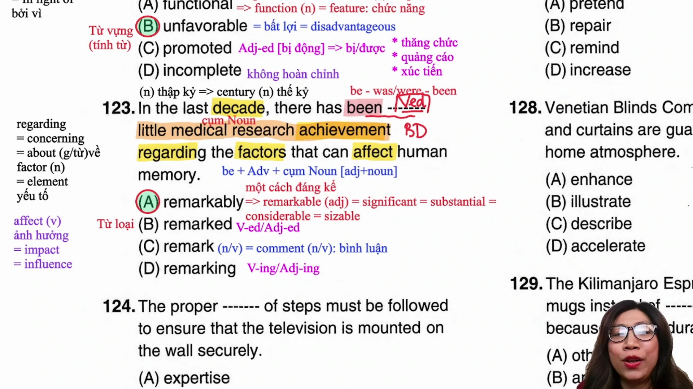

* **Đề bài và phương án:**
  * *In the last decade, there has been _______ little medical research achievement regarding factors that can affect human memory.*
  * A. remarkably
  * B. remarked
  * C. remark
  * D. remarking
* **Phân tích ngữ pháp nâng cao (Mốc 800+):**
  * Cấu trúc: `there has been [ chỗ trống ] little medical research achievement`.
  * Phía trước là động từ to be (`been`), phía sau là cụm danh từ hoàn chỉnh `little medical research achievement` (trong đó `little` là từ định lượng, `medical` là tính từ, `research achievement` là cụm danh từ ghép).
  * Từ loại duy nhất có thể đứng giữa động từ to be và cụm danh từ để bổ nghĩa nhấn mạnh cho mức độ của từ định lượng hoặc tính từ trong cụm là **trạng từ** (`Adverb`).
  * Loại phương án B (động từ V-ed/tính từ phân từ - nếu chọn bị động thì phía sau không thể có tân ngữ danh từ); loại C (danh từ/động từ nguyên mẫu); loại D (V-ing).
  * **Đáp án đúng:** **A** (`remarkably`).
* **Dịch nghĩa:** Trong thập kỷ vừa qua, đã có cực kỳ ít thành tựu nghiên cứu y học đáng kể liên quan đến các nhân tố có thể ảnh hưởng đến trí nhớ của con người.
* **Mở rộng kiến thức:**
  * `remarkably` (trạng từ): một cách đáng kể, rõ rệt.
  * `remarkable` = `significant` = `substantial` = `considerable` = `sizable`: đáng kể, to lớn.
  * `remark` = `comment`: lời nhận xét, bình luận (vừa là danh từ vừa là động từ).
  * `decade`: thập kỷ (10 năm); `century`: thế kỷ (100 năm); `millennium`: thiên niên kỷ (1000 năm).
  * `regarding` = `about` = `concerning`: liên quan đến, về.
  * `factor` = `element`: nhân tố, yếu tố.
  * `affect` = `influence` = `impact`: tác động, ảnh hưởng đến.

---

### [[01:02:05](https://www.youtube.com/watch?v=yw4xUVGvexQ&t=3725s)] Câu 24: Danh từ trình tự

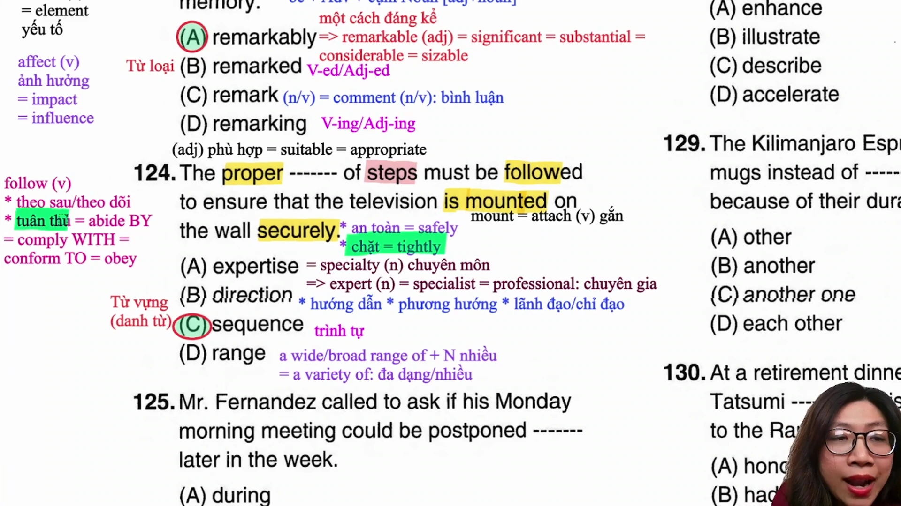

* **Đề bài và phương án:**
  * *The proper _______ of steps must be followed to ensure that the television is mounted onto the wall securely.*
  * A. expertise
  * B. direction
  * C. sequence
  * D. range
* **Phân tích ngữ nghĩa và kết hợp từ:**
  * Cụm danh từ: `The proper _______ of steps`. Phía sau có giới từ `of` và danh từ số nhiều `steps` (các bước thực hiện).
  * Phương án A (`expertise`): chuyên môn, kiến thức chuyên ngành (`specialty`).
  * Phương án B (`direction`): sự hướng dẫn, phương hướng, sự chỉ đạo.
  * Phương án C (`sequence`): trình tự, thứ tự nối tiếp (`sequence of steps` = trình tự các bước).
  * Phương án D (`range`): phạm vi, chuỗi (`a wide range of` = nhiều, đa dạng).
  * **Đáp án đúng:** **C** (`sequence`).
* **Dịch nghĩa:** Trình tự các bước phù hợp phải được tuân thủ nghiêm ngặt để đảm bảo rằng tivi được gắn chắc chắn lên tường.
* **Mở rộng kiến thức:**
  * `sequence of steps`: trình tự các bước thực hiện.
  * `proper` = `suitable` = `appropriate`: đúng đắn, thích hợp.
  * `follow` = `abide by` = `comply with` = `conform to` = `adhere to`: tuân thủ, làm theo.
  * `mount` = `attach`: gắn lên, lắp đặt lên (thường dùng dạng bị động `is mounted on/onto`).
  * `securely` = `tightly` (chặt chẽ); hoặc `safely` (an toàn).
  * `expertise` = `specialty`: chuyên môn; phân biệt `expert` = `specialist` = `professional`: chuyên gia.

---

### [[01:11:10](https://www.youtube.com/watch?v=yw4xUVGvexQ&t=4270s)] Câu 25: Liên từ thời gian

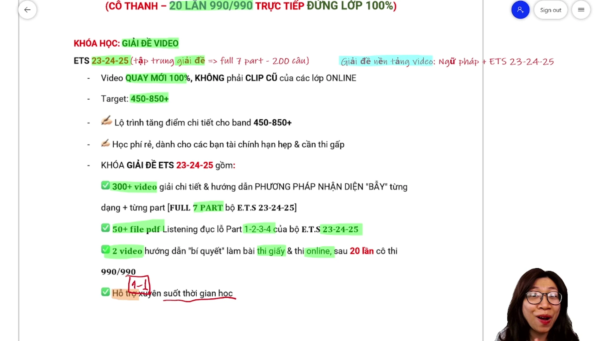

* **Đề bài và phương án:**
  * *Mr. Tanaka called to ask if his Monday morning meeting could be postponed _______ later in the week.*
  * A. during
  * B. when
  * C. since
  * D. until
* **Phân tích ngữ pháp và ngữ nghĩa:**
  * Động từ đứng trước là `be postponed` (bị hoãn lại). Đi liền với các động từ mang nghĩa trì hoãn như `postpone`, `delay`, `put off` luôn là giới từ chỉ mốc thời gian kéo dài đến lúc sau: `until` (cho đến khi).
  * Cụm thời gian: `until later in the week` (cho đến thời điểm muộn hơn trong tuần).
  * Phương án A (`during`): trong suốt (đi với danh từ/sự kiện).
  * Phương án B (`when`): khi (từ nối mệnh đề).
  * Phương án C (`since`): kể từ khi (đi với thì hiện tại hoàn thành); hoặc bởi vì (`because`).
  * **Đáp án đúng:** **D** (`until`).
* **Dịch nghĩa:** Ông Tanaka đã gọi điện hỏi liệu cuộc họp sáng thứ Hai của ông có thể được hoãn lại cho đến cuối tuần hay không.
* **Mở rộng kiến thức:**
  * `postpone` / `delay` / `put off` + `until`: trì hoãn cho đến mốc thời gian nào.
  * `if` = `whether`: liệu rằng (trong câu tường thuật gián tiếp).
  * `during` + N: trong suốt một khoảng thời gian/sự kiện.
  * `since`: kể từ khi (ưu tiên thì hiện tại hoàn thành); bởi vì (`since` = `because` = `as`).

---

### [[01:20:18](https://www.youtube.com/watch?v=yw4xUVGvexQ&t=4818s)] Câu 26: Tính từ chuyên môn

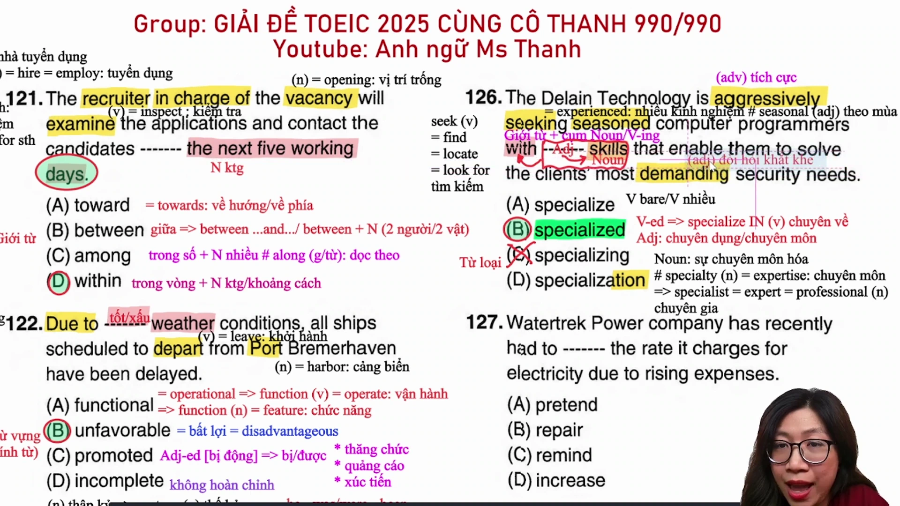

* **Đề bài và phương án:**
  * *The company is aggressively seeking seasoned computer programmers with _______ skills that enable them to solve clients' most demanding security needs.*
  * A. specialize
  * B. specialized
  * C. special
  * D. specialization
* **Phân tích ngữ pháp nâng cao (Mốc 800+):**
  * Chỗ trống đứng sau giới từ `with` và đứng trước danh từ số nhiều `skills`.
  * Cần một tính từ bổ nghĩa cho danh từ `skills` để chỉ tính chất kỹ năng nghiệp vụ chuyên môn hóa.
  * Phương án B (`specialized`): đây là một tính từ gốc nguyên bản mang nghĩa chuyên môn, chuyên dụng, không mang nghĩa bị động.
  * Phương án C (`special`): mang nghĩa đặc biệt chung chung, không dùng để ghép thành thuật ngữ chuyên môn với `skills`.
  * Phương án A (`specialize`): động từ nguyên mẫu (thường đi với giới từ `in`: `specialize in`).
  * Phương án D (`specialization`): danh từ chỉ sự chuyên môn hóa.
  * **Đáp án đúng:** **B** (`specialized`).
* **Dịch nghĩa:** Công ty đang tích cực tìm kiếm những lập trình viên máy tính dày dạn kinh nghiệm với các kỹ năng chuyên môn cho phép họ giải quyết những nhu cầu bảo mật khắt khe nhất của khách hàng.
* **Mở rộng kiến thức:**
  * `specialized skills`: các kỹ năng chuyên môn, chuyên sâu.
  * `aggressively` = `actively`: một cách tích cực, ráo riết.
  * `seek` = `find` = `locate` = `look for`: tìm kiếm.
  * `seasoned` = `experienced`: dày dạn kinh nghiệm (phân biệt `seasonal`: theo mùa vụ).
  * `demanding`: đòi hỏi cao, khắt khe.

---

### [[01:29:39](https://www.youtube.com/watch?v=yw4xUVGvexQ&t=5379s)] Câu 27: Động từ tăng giá

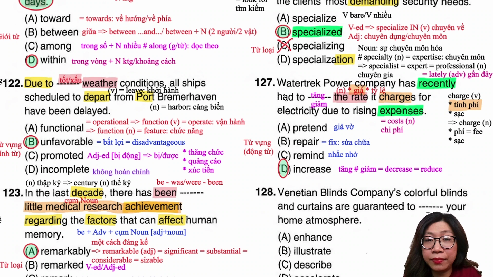

* **Đề bài và phương án:**
  * *The utility company recently _______ the rate it charges for electricity due to rising expenses.*
  * A. pretended
  * B. repaired
  * C. reminded
  * D. increased
* **Phân tích ngữ nghĩa và kết hợp từ:**
  * Tân ngữ phía sau là `the rate it charges for electricity` (mức giá cước mà công ty tính phí cho dịch vụ điện).
  * Động từ kết hợp tự nhiên với danh từ giá cước (`rate` / `price`) là tăng giá hoặc giảm giá.
  * Vế sau giải thích nguyên nhân: `due to rising expenses` (do chi phí gia tăng), suy ra hành động phải là tăng giá cước.
  * Phương án A (`pretended`): giả vờ, làm bộ.
  * Phương án B (`repaired`): sửa chữa (`fixed`).
  * Phương án C (`reminded`): nhắc nhở.
  * Phương án D (`increased`): làm tăng lên.
  * **Đáp án đúng:** **D** (`increased`).
* **Dịch nghĩa:** Công ty dịch vụ tiện ích gần đây đã tăng giá cước điện do chi phí đầu vào ngày càng gia tăng.
* **Mở rộng kiến thức:**
  * `increase` (tăng lên); đối lập: `decrease` / `reduce` (giảm xuống).
  * `rate`: mức giá cước, tỷ lệ.
  * `charge`: tính phí (động từ); tiền phí (danh từ).
  * `expenses` = `costs`: chi phí tiêu hao.
  * `recently` = `lately`: gần đây.

---

### [[01:33:26](https://www.youtube.com/watch?v=yw4xUVGvexQ&t=5606s)] Câu 28: Động từ nâng cao

* **Đề bài và phương án:**
  * *Colorful blinds and curtains are guaranteed to _______ your home atmosphere.*
  * A. enhance
  * B. illustrate
  * C. describe
  * D. accelerate
* **Phân tích ngữ nghĩa và kết hợp từ:**
  * Vị trí chỗ trống đứng sau cấu trúc bị động chỉ cam kết: `are guaranteed to + V (nguyên mẫu)`.
  * Tân ngữ theo sau là `your home atmosphere` (bầu không khí không gian nhà ở).
  * Trong văn phong thương mại, động từ đi kèm để cải thiện bầu không khí, cảnh quan hoặc chất lượng là `enhance`.
  * Phương án A (`enhance`): nâng cao, làm tăng vẻ đẹp, cải thiện (`improve`).
  * Phương án B (`illustrate`): minh họa bằng tranh ảnh hoặc ví dụ.
  * Phương án C (`describe`): miêu tả chi tiết.
  * Phương án D (`accelerate`): tăng tốc độ vận hành hoặc tiến độ.
  * **Đáp án đúng:** **A** (`enhance`).
* **Dịch nghĩa:** Những chiếc rèm lá và màn cửa rực rỡ sắc màu được cam kết sẽ nâng tầm bầu không khí cho ngôi nhà của bạn.
* **Mở rộng kiến thức:**
  * `enhance` = `improve`: cải thiện, nâng cao giá trị/vẻ đẹp.
  * `atmosphere`: bầu không khí, môi trường xung quanh.
  * `blinds`: rèm lá sách (chất liệu nhựa/kim loại).
  * `curtains`: rèm vải treo cửa (lưu ý phát âm nuốt âm /t/).
  * `guarantee` (động từ: cam kết, bảo đảm; danh từ: giấy bảo hành = `warranty`).

---

### [[01:37:32](https://www.youtube.com/watch?v=yw4xUVGvexQ&t=5852s)] Câu 29: Đại từ định lượng

* **Đề bài và phương án:**
  * *The chain distributes mugs instead of _______ promotional items because of their durability and visibility.*
  * A. other
  * B. another
  * C. another one
  * D. each other
* **Phân tích ngữ pháp:**
  * Danh từ đứng sau chỗ trống là `promotional items` (danh từ số nhiều có hậu tố `-s`).
  * Phương án A (`other`): đại từ/tính từ định lượng bắt buộc đi với danh từ số nhiều (`other + plural noun`) hoặc danh từ không đếm được.
  * Phương án B (`another`): cấu tạo từ `an` + `other`, chỉ một đối tượng khác, bắt buộc đi với danh từ số ít (`another + singular noun`).
  * Phương án C (`another one`): thay thế cho một danh từ số ít đã đề cập, không đứng trước danh từ số nhiều.
  * Phương án D (`each other`): đại từ tương hỗ mang nghĩa lẫn nhau (ví dụ: *support each other*), không đi với danh từ số nhiều đứng sau.
  * **Đáp án đúng:** **A** (`other`).
* **Dịch nghĩa:** Chuỗi cửa hàng phân phối cốc uống nước thay vì các vật phẩm quảng cáo khác nhờ vào độ bền và khả năng nhận diện cao của chúng.
* **Mở rộng kiến thức:**
  * `other` + danh từ số nhiều: những cái khác, những người khác.
  * `another` + danh từ số ít: một cái khác, một người khác.
  * `each other`: lẫn nhau (bổ trợ tương hỗ giữa 2 đối tượng).
  * `mugs` = `cups`: cốc, tách uống nước.
  * `durability`: độ bền (tính từ: `durable`).
  * `visibility`: khả năng nhìn thấy, độ hiển thị (tính từ: `visible`).

---

### [[01:44:13](https://www.youtube.com/watch?v=yw4xUVGvexQ&t=6253s)] Câu 30: Chia thì bị động

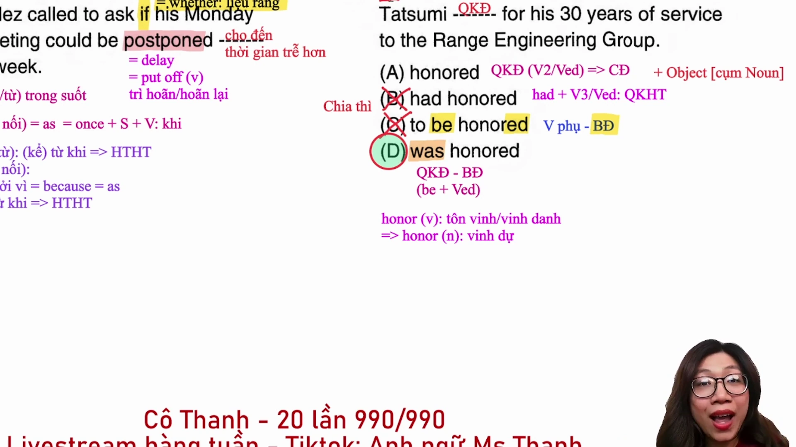

* **Đề bài và phương án:**
  * *At a retirement dinner last week, he _______ for his 30 years of service.*
  * A. honored
  * B. had honored
  * C. to be honored
  * D. was honored
* **Phân tích ngữ pháp và thì:**
  * Cụm trạng từ thời gian ở đầu câu là `last week`, xác định động từ chính bắt buộc chia ở thì **quá khứ đơn** (`Simple Past`).
  * Loại phương án B vì chia ở thì quá khứ hoàn thành (`had honored`); loại phương án C vì động từ nguyên mẫu có `to` không thể làm động từ vị ngữ chính của câu.
  * Còn lại phương án A (`honored` - quá khứ đơn thể chủ động) và phương án D (`was honored` - quá khứ đơn thể bị động).
  * Kiểm tra tân ngữ: Phía sau chỗ trống chỉ có cụm giới từ `for his 30 years of service`, hoàn toàn không có cụm danh từ làm tân ngữ trực tiếp của hành động `honor`. Vì vậy, câu mang nghĩa bị động: ông ấy được vinh danh.
  * **Đáp án đúng:** **D** (`was honored`).
* **Dịch nghĩa:** Tại bữa tiệc chia tay nghỉ hưu tuần trước, ông ấy đã được vinh danh cho 30 năm cống hiến cho tập đoàn.
* **Mở rộng kiến thức:**
  * `honor` (phát âm câm chữ /h/): vinh danh, tôn vinh (động từ); niềm vinh dự, vinh hạnh (danh từ).
  * `retirement dinner`: tiệc chia tay nghỉ hưu.
  * Thể bị động quá khứ đơn: `was/were + V3/V-ed`.
  * Quy tắc 90% TOEIC: Động từ chủ động thường có tân ngữ danh từ theo sau; động từ bị động thường theo sau bởi giới từ.

---

## Trích dẫn then chốt

* [[00:03:15](https://www.youtube.com/watch?v=yw4xUVGvexQ&t=195s)] *"Hiện tại hoàn thành diễn tả sự việc bắt đầu từ quá khứ kéo dài đến hiện tại. Cho nên mỗi khi không tìm ra hiện tại hoàn thành, chúng ta hoàn toàn có thể thay thế bằng quá khứ đơn vì cả hai đều có gốc rễ xảy ra trong quá khứ."*
* [[00:10:10](https://www.youtube.com/watch?v=yw4xUVGvexQ&t=610s)] *"Hardly tuyệt đối không được dịch là chăm chỉ hay vất vả. Hardly phải dịch là hầu như không để xử lý chính xác tuyệt đối các câu ở thang điểm 800+ và 900+."*
* [[00:51:30](https://www.youtube.com/watch?v=yw4xUVGvexQ&t=3090s)] *"Đứng chính giữa động từ to be và một cụm danh từ chỉ có thể là trạng từ để làm rõ mức độ cho cả cụm danh từ phía sau, không thể là tính từ hay động từ bị động."*
* [[01:21:45](https://www.youtube.com/watch?v=yw4xUVGvexQ&t=4905s)] *"Specialized trong bài thi TOEIC là một tính từ gốc nguyên bản mang nghĩa chuyên môn hoặc chuyên dụng, không phải là một phân từ mang nghĩa bị động."*
* [[01:46:15](https://www.youtube.com/watch?v=yw4xUVGvexQ&t=6375s)] *"Động từ ở thể chủ động 90% sẽ có tân ngữ là cụm danh từ đứng ngay sau. Nếu phía sau chỗ trống chỉ có giới từ thì hãy tự tin chọn ngay thể bị động."*

---

## Lệnh & Công cụ

* **Tài liệu tham khảo:** Bộ đề ETS TOEIC Test 1 Part 5 (từ Câu 116 đến Câu 130).
* **Quy tắc phân loại đại từ định lượng:**
  * `Other` + Danh từ số nhiều / Danh từ không đếm được.
  * `Another` + Danh từ số ít (mang nghĩa 1 cái khác).
  * `Each other`: Bổ trợ tương hỗ giữa 2 đối tượng, không đứng trước danh từ.
* **Cụm giới từ nguyên nhân chuẩn:**
  * `Due to` = `Because of` = `Owing to` = `As a result of` = `On account of` = `In light of` (+ N / V-ing).

---

## Đánh đổi & Rủi ro

* **Bẫy dịch nghĩa từng từ đơn lẻ:** Cố gắng dịch máy móc từng từ trong Part 5 gây tiêu hao quỹ thời gian quý giá (vốn cần dành cho Part 6 và Part 7). Thí sinh cần ưu tiên phân tích cấu trúc ngữ pháp hai phía trước khi dịch.
* **Bẫy đồng âm và từ loại dễ nhầm lẫn:**
  * `Hard` (chăm chỉ, vất vả) khác hoàn toàn `Hardly` (hầu như không).
  * `Seasonal` (theo mùa vụ) khác hoàn toàn `Seasoned` (dày dạn kinh nghiệm).
  * `Expertise` / `Specialty` (chuyên môn) khác hoàn toàn `Expert` / `Specialist` (chuyên gia).
  * `Reserve` (đặt chỗ, khu bảo tồn) khác hoàn toàn `Reservation` (sự đặt chỗ, sự nghi ngờ).
* **Rủi ro phân định chủ động và bị động:** Không nhận diện được tân ngữ giả sau giới từ (ví dụ cụm danh từ đứng sau giới từ `for` là bổ ngữ của giới từ chứ không phải tân ngữ của động từ chính).