# GIẢI ĐỀ TOEIC 2026 - TEST 1 [VIDEO 1]

* **Kênh:** Anh ngữ Ms Thanh | **Thời lượng:** 01:43:09 | **Ngày:** 2026-01-10
* **Video:** [https://www.youtube.com/watch?v=2zuDwiSgPug](https://www.youtube.com/watch?v=2zuDwiSgPug)

---

## Thuật ngữ

| Thuật ngữ | Giải thích |
| :--- | :--- |
| **Possessive Adjective** | Tính từ sở hữu đứng trước danh từ để bổ nghĩa và xác định quyền sở hữu (Their, Our, His, Her). |
| **Locative Passive** | Dạng bị động chỉ nơi chốn của động từ Locate (Be located on/in/at), mang nghĩa tọa lạc tại một vị trí địa lý. |
| **Compound Adjective** | Tính từ ghép cấu tạo từ hai hoặc nhiều từ nối bằng dấu gạch ngang (ví dụ: Newly-hired, Award-winning). |
| **Appositive Phrase** | Cụm đồng vị ngữ đứng giữa hai dấu phẩy bổ sung thông tin giải thích danh từ tiền ngữ phía trước. |
| **Correlative Conjunction** | Cặp liên từ tương liên kết hợp song song (Whether... or, Either... or, Neither... nor, Both... and). |
| **Comparative Adverb** | Trạng từ so sánh hơn có cấu trúc More + Adv + Than, dùng để bổ nghĩa cho động từ hành động thông thường. |
| **Linking Verb** | Động từ nối liên kết chủ ngữ với tính từ bổ ngữ (Become, Feel, Seem, Taste), không đi với trạng từ. |
| **Prepositional Complement** | Giới từ bổ ngữ đi cố định theo cấu trúc động từ Provide something to somebody. |

---

## Tổng luận chuyên đề

#### Cấu trúc bài thi và nhóm câu hỏi
Video 1 của Test 1 tập trung giải quyết trọn vẹn 15 câu đầu tiên của Part 5 (từ Câu 1 đến Câu 15, tương ứng Câu 101 đến Câu 115 của đề thi chuẩn ETS). Mức độ câu hỏi được chia thành ba mảng kiến thức:
1. **Nhóm nhận diện từ loại và đại từ (Chiếm 40%):** Xuất hiện dày đặc ở các câu mở màn (Câu 1, Câu 5, Câu 6, Câu 11, Câu 12, Câu 14), đòi hỏi xử lý tốc độ trong 5 đến 10 giây mà không cần dịch nghĩa toàn câu.
2. **Nhóm cấu trúc ngữ pháp và liên từ (Chiếm 27%):** Bao gồm thể bị động chỉ vị trí địa lý, cặp liên từ tương liên `Whether... or`, cấu trúc ngoại động từ đặc biệt `Make + Object + Adjective`, và giới từ đi theo cấu trúc `Provide`.
3. **Nhóm từ vựng và Collocation (Chiếm 33%):** Kiểm tra phản xạ nhận diện các cặp từ ngữ kinh doanh chuẩn xác như thời gian ngoài dự kiến (`unexpectedly long`), kỷ lục doanh số (`achieving record sales`), và sự tham gia tùy chọn (`entirely optional`).

#### Chiến lược phân bổ thời gian
Thí sinh cần kiểm soát chặt chẽ tổng thời gian làm bài của Part 5 và Part 6 dưới 25 phút:
* Part 5 hoàn tất tối đa trong 12 đến 14 phút.
* 10 câu đầu của Part 5 là các câu cho điểm, chỉ mất từ 5 đến 15 giây mỗi câu bằng kỹ thuật phân tích vị trí hai phía.
* Tiết kiệm thời gian ở Part 5 là điều kiện tiên quyết để giữ đủ quỹ thời gian đọc hiểu văn bản dài ở Part 7.

#### Kỹ thuật xử lý mệnh đề đồng vị
Khi xuất hiện hai dấu phẩy ngăn cách một thành phần phụ ở giữa câu:
* Bản chất của thành phần giữa hai dấu phẩy là thông tin giải thích cho danh từ đứng trước.
* Nếu danh từ phía trước chỉ người thì thành phần phụ trong hai dấu phẩy bắt buộc phải là cụm từ chỉ người.
* Khi làm bài ngữ pháp hoặc chia động từ chính, thí sinh có thể tạm thời bỏ qua thành phần nằm giữa hai dấu phẩy để cấu trúc câu trở nên rõ ràng và trong sáng.

---

## Bóc tách chi tiết

### [[00:00:01](https://www.youtube.com/watch?v=2zuDwiSgPug&t=1s)] Câu 1: Tính từ sở hữu

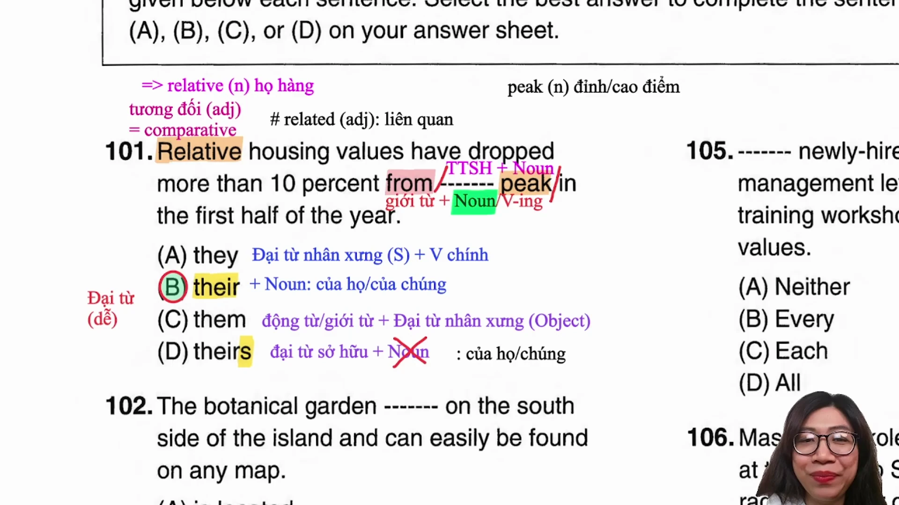

* **Đề bài và phương án:**
  * *Sales of winter clothing dropped from _______ peak in the first half of the year.*
  * A. they
  * B. their
  * C. them
  * D. themselves
* **Phân tích ngữ pháp:**
  * Phía trước chỗ trống là giới từ `from`.
  * Phía sau chỗ trống là danh từ `peak` (đỉnh cao, mức cao nhất), theo sau bởi cụm giới từ chỉ thời gian `in the first half of the year`.
  * Trước danh từ cần một tính từ sở hữu để tạo thành cụm danh từ làm tân ngữ cho giới từ `from`.
  * Xét các phương án: Phương án A là đại từ chủ ngữ; phương án C là đại từ tân ngữ; phương án D là đại từ phản thân; phương án B (`their`) là tính từ sở hữu duy nhất.
  * **Đáp án đúng:** **B** (`their`).
* **Dịch nghĩa:** Doanh số bán quần áo mùa đông đã giảm từ mức đỉnh điểm của chúng trong nửa đầu năm.
* **Mở rộng kiến thức:**
  * `their`: có hai nét nghĩa là của họ (chỉ người) hoặc của chúng (chỉ vật/sự vật).
  * `peak` (danh từ): đỉnh cao, mức cao nhất; tính từ: thời kỳ cao điểm (`peak season`).
  * `drop from ... to ...`: sụt giảm từ mức nào xuống mức nào.
  * `in the first half of the year`: trong nửa đầu năm.

---

### [[00:07:31](https://www.youtube.com/watch?v=2zuDwiSgPug&t=451s)] Câu 2: Động từ tọa lạc

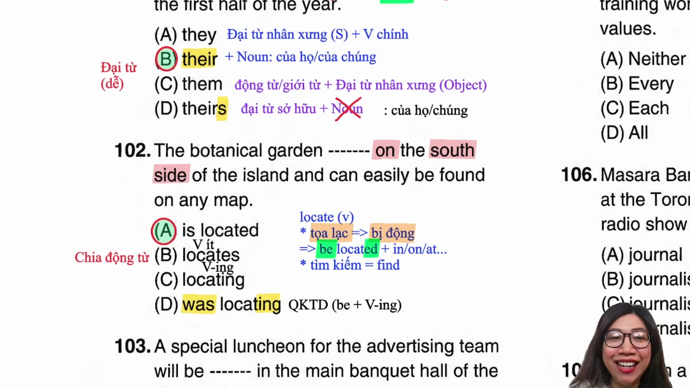

* **Đề bài và phương án:**
  * *The botanical garden _______ on the south side of the island and can be easily found on any local map.*
  * A. is located
  * B. locates
  * C. was locating
  * D. locate
* **Phân tích ngữ pháp và ngữ nghĩa:**
  * Động từ `locate` có hai nét nghĩa chính: tọa lạc (kèm giới từ chỉ vị trí) hoặc tìm kiếm (`find`).
  * Khi mang nghĩa tọa lạc tại vị trí địa lý, `locate` bắt buộc chia ở thể bị động: `be located in/on/at`.
  * Phía sau chỗ trống xuất hiện giới từ `on` và cụm danh từ chỉ vị trí `the south side of the island`, khẳng định động từ mang nghĩa tọa lạc.
  * Phương án duy nhất ở thể bị động là phương án A (`is located`).
  * **Đáp án đúng:** **A** (`is located`).
* **Dịch nghĩa:** Vườn bách thảo tọa lạc ở phía nam của hòn đảo và có thể dễ dàng được tìm thấy trên bất kỳ bản đồ địa phương nào.
* **Mở rộng kiến thức:**
  * `be located in/on/at`: tọa lạc ở vị trí nào đó.
  * `botanical garden`: vườn thực vật, vườn bách thảo.
  * `island`: hòn đảo (lưu ý phát âm chữ cái /s/ là âm câm).
  * `easily found`: dễ dàng tìm thấy (thể bị động sau động từ khuyết thiếu: `can be found`).

---

### [[00:12:05](https://www.youtube.com/watch?v=2zuDwiSgPug&t=725s)] Câu 3: Động từ tổ chức

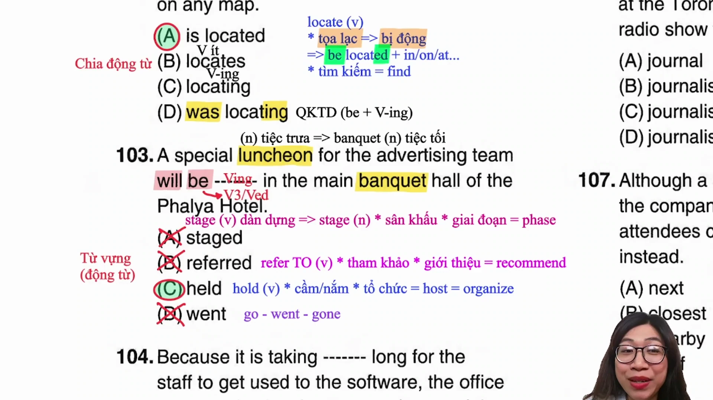

* **Đề bài và phương án:**
  * *A special banquet will be _______ to celebrate the company's twentieth anniversary.*
  * A. staged
  * B. referred
  * C. held
  * D. went
* **Phân tích ngữ pháp và ngữ nghĩa:**
  * Vị trí chỗ trống đứng sau trợ động từ bị động `will be`, đòi hỏi một quá khứ phân từ V3/V-ed.
  * Loại phương án D (`went`) vì là dạng quá khứ đơn V2 của động từ `go`.
  * Loại phương án B (`referred`) vì động từ `refer` bắt buộc đi kèm giới từ `to` (`refer to`).
  * Chủ ngữ của câu là `a special banquet` (bữa tiệc tối trang trọng). Động từ đi kèm tự nhiên với tiệc tùng hoặc sự kiện là `hold` (tổ chức, quá khứ phân từ là `held`).
  * Phương án A (`staged`): mang nghĩa dàn dựng sân khấu kịch hoặc biểu diễn, không đi kèm với tiệc tùng.
  * **Đáp án đúng:** **C** (`held`).
* **Dịch nghĩa:** Một bữa tiệc tối đặc biệt sẽ được tổ chức để kỷ niệm hai mươi năm ngày thành lập công ty.
* **Mở rộng kiến thức:**
  * `hold` = `organize` = `host`: tổ chức sự kiện, hội nghị, tiệc tùng.
  * `banquet`: tiệc tối trang trọng (trong bài thi TOEIC thường ngầm định diễn ra vào buổi tối).
  * `refer to`: tham khảo tài liệu; giới thiệu khách hàng (`recommend`).
  * `stage` = `phase`: giai đoạn; động từ: dàn dựng.

---

### [[00:19:15](https://www.youtube.com/watch?v=2zuDwiSgPug&t=1155s)] Câu 4: Trạng từ bất ngờ

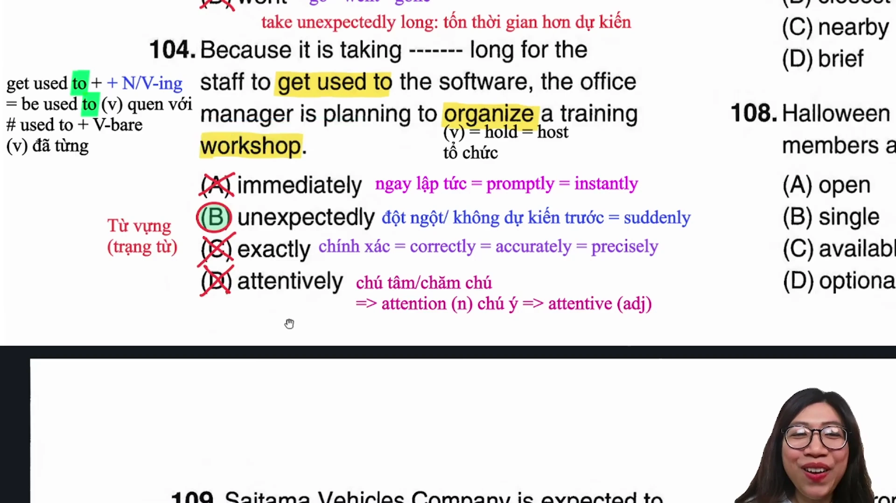

* **Đề bài và phương án:**
  * *Because it is taking _______ long for employees to get used to the software, the office manager plans to organize a training workshop.*
  * A. immediately
  * B. unexpectedly
  * C. exactly
  * D. attentively
* **Phân tích ngữ nghĩa và Collocation:**
  * Vế chỉ nguyên nhân: `it is taking _______ long for employees to get used to the software`.
  * Phương án A (`immediately`): ngay lập tức (`promptly`, `instantly`).
  * Phương án B (`unexpectedly`): ngoài dự kiến, đột ngột (`suddenly`). Cụm từ `taking unexpectedly long` mang nghĩa tiêu tốn nhiều thời gian hơn dự kiến ban đầu.
  * Phương án C (`exactly`): một cách chính xác (`correctly`, `accurately`, `precisely`).
  * Phương án D (`attentively`): một cách chăm chú, chú tâm (xuất phát từ danh từ `attention`).
  * Do việc làm quen phần mềm tốn nhiều thời gian ngoài dự tính nên người quản lý mới phải lên kế hoạch mở buổi hội thảo đào tạo bổ sung.
  * **Đáp án đúng:** **B** (`unexpectedly`).
* **Dịch nghĩa:** Bởi vì nhân viên mất nhiều thời gian hơn dự kiến để làm quen với phần mềm, người quản lý văn phòng dự định tổ chức một buổi hội thảo đào tạo.
* **Mở rộng kiến thức:**
  * `taking unexpectedly long`: tốn thời gian hơn dự kiến.
  * `get used to` / `be used to` + V-ing/N: quen thuộc với điều gì.
  * `workshop` = `seminar`: buổi hội thảo, tập huấn nghiệp vụ.
  * `immediately` = `promptly` = `instantly`: ngay tức khắc.

---

### [[00:26:26](https://www.youtube.com/watch?v=2zuDwiSgPug&t=1586s)] Câu 5: Đại từ định lượng

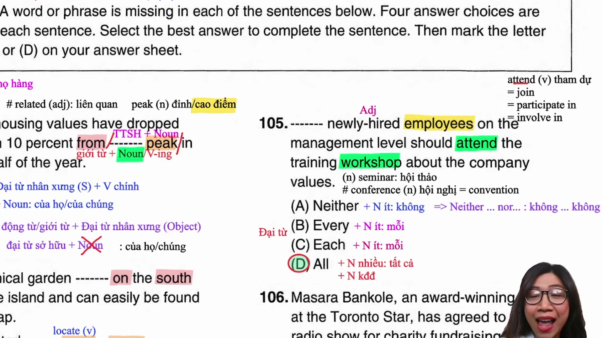

* **Đề bài và phương án:**
  * *_______ newly hired employees should attend the orientation session tomorrow morning.*
  * A. Neither
  * B. Every
  * C. Each
  * D. All
* **Phân tích ngữ pháp từ định lượng:**
  * Danh từ trung tâm đứng sau chỗ trống là `employees` (danh từ đếm được số nhiều có hậu tố `-s`), đi kèm tính từ ghép bổ nghĩa `newly hired`.
  * Phương án A (`Neither`): đi với danh từ số ít khi đứng độc lập (hoặc cặp `Neither... nor`).
  * Phương án B (`Every`) và Phương án C (`Each`): bắt buộc đi với danh từ đếm được số ít.
  * Phương án D (`All`): đại từ định lượng đi kèm với danh từ số nhiều hoặc danh từ không đếm được.
  * **Đáp án đúng:** **D** (`All`).
* **Dịch nghĩa:** Tất cả nhân viên mới được tuyển dụng nên tham dự buổi định hướng vào sáng ngày mai.
* **Mở rộng kiến thức:**
  * `All` + Danh từ số nhiều / Danh từ không đếm được: tất cả.
  * `Every` / `Each` + Danh từ số ít: mỗi, mọi.
  * `Neither` + Danh từ số ít: không người nào/vật nào trong hai.
  * `newly hired`: mới được tuyển dụng (tính từ ghép).
  * `orientation session`: buổi định hướng công việc.

---

### [[00:33:47](https://www.youtube.com/watch?v=2zuDwiSgPug&t=2027s)] Câu 6: Danh từ chỉ người

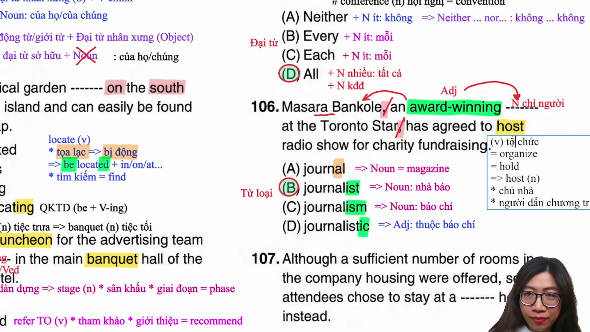

* **Đề bài và phương án:**
  * *Elena Vance, an award-winning _______ at the Toronto Star, has agreed to host a radio show for charity fundraising.*
  * A. journal
  * B. journalist
  * C. journalism
  * D. journalistic
* **Phân tích ngữ pháp cụm đồng vị:**
  * Chỗ trống nằm trong cụm đồng vị ngữ nằm giữa hai dấu phẩy: `, an award-winning _______ at the Toronto Star,`.
  * Cụm từ này đóng vai trò chú thích, làm rõ danh tính cho chủ ngữ `Elena Vance` (tên riêng chỉ người).
  * Vì vậy, danh từ chính trong cụm bắt buộc phải là danh từ chỉ người làm nghề nghiệp.
  * Phương án A (`journal`): tạp chí, tập san chuyên ngành.
  * Phương án B (`journalist`): nhà báo, phóng viên (danh từ chỉ người).
  * Phương án C (`journalism`): ngành báo chí.
  * Phương án D (`journalistic`): thuộc về báo chí (tính từ).
  * **Đáp án đúng:** **B** (`journalist`).
* **Dịch nghĩa:** Elena Vance, một nhà báo từng đoạt giải thưởng tại tòa soạn Toronto Star, đã đồng ý dẫn chương trình phát thanh gây quỹ từ thiện.
* **Mở rộng kiến thức:**
  * `award-winning`: từng đạt giải thưởng (tính từ ghép).
  * `journalist`: nhà báo; phân biệt `journal` (tạp chí) và `journalism` (ngành báo chí).
  * `host` (động từ): chủ trì, dẫn chương trình; danh từ: người dẫn chương trình.
  * `charity fundraising`: hoạt động gây quỹ từ thiện.

---

### [[00:41:33](https://www.youtube.com/watch?v=2zuDwiSgPug&t=2493s)] Câu 7: Tính từ vị trí

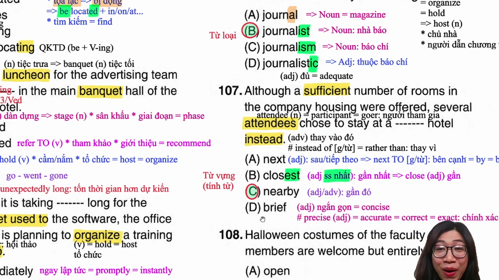

* **Đề bài và phương án:**
  * *Although the conference center had sufficient accommodations, some attendees chose to stay at a _______ hotel instead.*
  * A. next
  * B. closest
  * C. nearby
  * D. brief
* **Phân tích ngữ pháp và ngữ nghĩa:**
  * Vị trí chỗ trống đứng sau mạo từ `a` và đứng trước danh từ số ít `hotel`.
  * Loại phương án A (`next`) vì khi dùng chỉ vị trí phải có `to` (`next to`); nếu làm tính từ chỉ thời gian phải có mạo từ xác định `the` (`the next day`).
  * Loại phương án B (`closest`) vì là tính từ so sánh nhất, bắt buộc phải đi với mạo từ xác định `the` chứ không thể đi với `a`.
  * Loại phương án D (`brief`) vì mang nghĩa ngắn gọn (`concise`), không thể dùng để miêu tả khách sạn.
  * Phương án C (`nearby`): tính từ mang nghĩa gần đó, nằm ở cự ly gần (`a nearby hotel`).
  * **Đáp án đúng:** **C** (`nearby`).
* **Dịch nghĩa:** Mặc dù trung tâm hội nghị có đủ chỗ lưu trú, một vài người tham dự vẫn chọn ở tại một khách sạn gần đó.
* **Mở rộng kiến thức:**
  * `nearby`: gần đó (vừa là tính từ vừa là trạng từ).
  * `sufficient` = `enough` = `adequate`: đầy đủ, thỏa đáng.
  * `accommodations`: chỗ ở, nơi lưu trú.
  * `instead`: thay vào đó (trạng từ đứng cuối câu); `instead of` = `rather than` (+ N/V-ing).
  * `brief` = `concise`: ngắn gọn; phân biệt `precise` = `accurate` = `correct` = `exact`: chính xác.

---

### [[00:48:05](https://www.youtube.com/watch?v=2zuDwiSgPug&t=2885s)] Câu 8: Tính từ tùy chọn

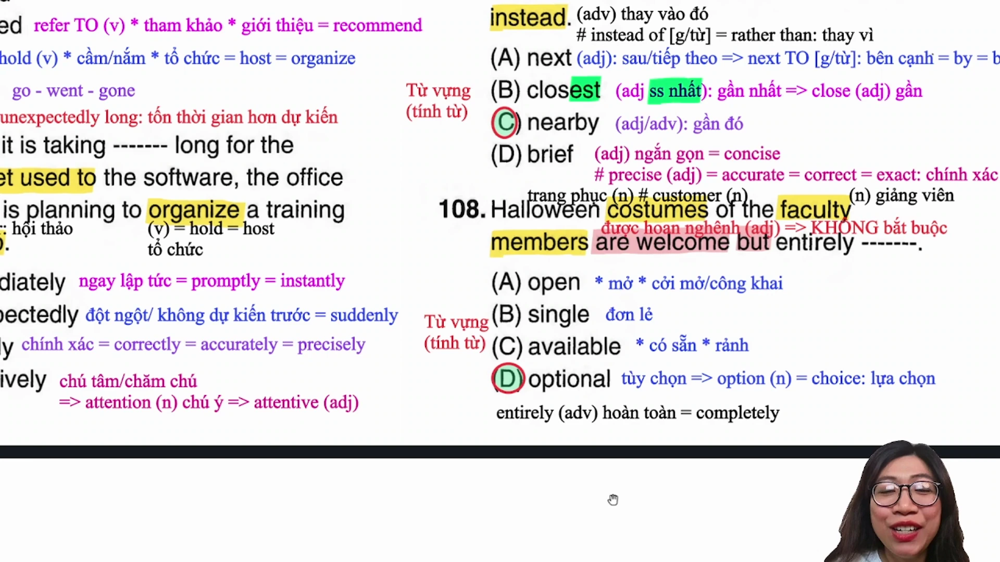

* **Đề bài và phương án:**
  * *All faculty members are welcome to attend the seminar, but attendance is entirely _______.*
  * A. open
  * B. single
  * C. available
  * D. optional
* **Phân tích ngữ nghĩa và kết hợp từ:**
  * Vế trước đưa ra thông tin chào đón: `are welcome to attend` (được hoan nghênh tham dự).
  * Liên từ tương phản `but` mở đầu cho vế sau: `attendance is entirely _______` (việc tham dự thì hoàn toàn...).
  * Phương án A (`open`): mở cửa, cởi mở đón nhận (`open to suggestions`).
  * Phương án B (`single`): đơn lẻ, độc thân.
  * Phương án C (`available`): có sẵn; rảnh rỗi.
  * Phương án D (`optional`): tùy ý, không bắt buộc (xuất phát từ danh từ `option` = `choice`).
  * Đi liền với trạng từ nhấn mạnh `entirely` để diễn đạt việc tham gia không mang tính ép buộc là `entirely optional`.
  * **Đáp án đúng:** **D** (`optional`).
* **Dịch nghĩa:** Tất cả các giảng viên đều được hoan nghênh tham dự buổi hội thảo, nhưng việc có mặt hoàn toàn là tùy chọn cá nhân.
* **Mở rộng kiến thức:**
  * `entirely optional`: hoàn toàn tùy chọn, không bắt buộc.
  * `faculty members`: thành viên ban giảng huấn, giảng viên nhà trường.
  * `attendance`: sự có mặt, số lượng người tham dự.
  * `available`: có sẵn (hàng hóa); rảnh rỗi (người).

---

### [[00:54:33](https://www.youtube.com/watch?v=2zuDwiSgPug&t=3273s)] Câu 9: Động từ đạt được

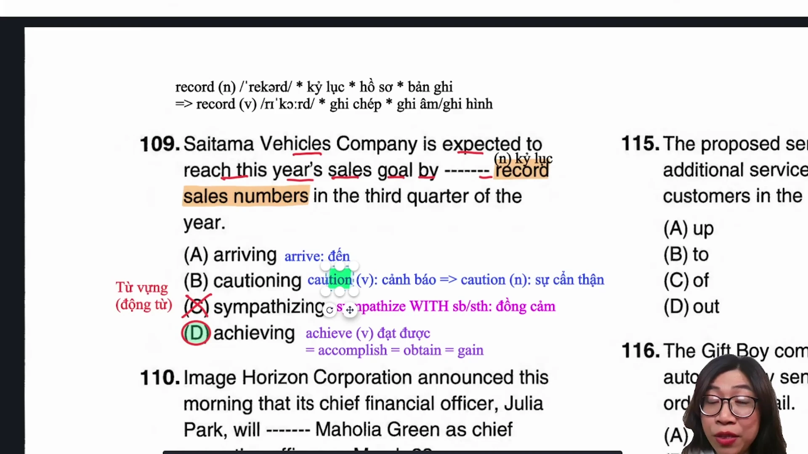

* **Đề bài và phương án:**
  * *The regional division met its annual target by _______ record sales numbers in the third quarter of the year.*
  * A. arriving
  * B. cautioning
  * C. sympathizing
  * D. achieving
* **Phân tích ngữ nghĩa và Collocation:**
  * Vị trí chỗ trống đứng sau giới từ `by`, theo sau là cụm danh từ tân ngữ `record sales numbers` (những con số doanh số bán hàng kỷ lục).
  * Loại phương án C (`sympathizing`) vì động từ này bắt buộc đi kèm giới từ `with` (`sympathize with somebody/something`).
  * Loại phương án A (`arriving`) vì nội động từ chỉ sự đến nơi không nhận tân ngữ trực tiếp là con số doanh thu.
  * Loại phương án B (`cautioning`) vì mang nghĩa cảnh báo (`caution` vừa là danh từ vừa là động từ).
  * Phương án D (`achieving`): đạt được thành tựu hoặc chỉ số mục tiêu (`achieve record sales`).
  * **Đáp án đúng:** **D** (`achieving`).
* **Dịch nghĩa:** Chi nhánh khu vực đã đạt được mục tiêu hàng năm bằng cách xác lập các con số doanh số bán hàng kỷ lục trong quý thứ ba của năm.
* **Mở rộng kiến thức:**
  * `achieve` = `accomplish` = `obtain` = `gain`: đạt được, giành được.
  * `record sales`: doanh số bán hàng kỷ lục (`record` vừa là kỷ lục, hồ sơ, vừa là đĩa ghi âm).
  * `quarter of the year`: quý trong năm (ba tháng).
  * `annual target`: mục tiêu thường niên.

---

### [[00:59:54](https://www.youtube.com/watch?v=2zuDwiSgPug&t=3594s)] Câu 10: Động từ thay thế

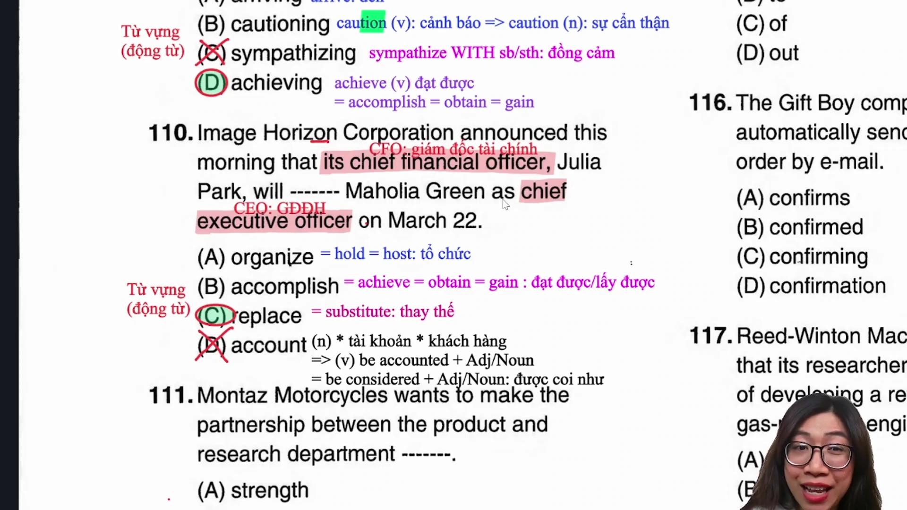

* **Đề bài và phương án:**
  * *Chief Financial Officer Julia Park will _______ Maholia Green as chief executive officer on March 22.*
  * A. organize
  * B. accomplish
  * C. replace
  * D. account
* **Phân tích ngữ nghĩa theo chức vụ:**
  * Chủ ngữ chính là `Julia Park` (đang giữ chức vụ Giám đốc Tài chính CFO).
  * Tân ngữ theo sau là `Maholia Green`, đi kèm bổ ngữ chức danh `as chief executive officer` (làm Giám đốc Điều hành CEO).
  * Phương án A (`organize`): tổ chức sự kiện (`hold`, `host`).
  * Phương án B (`accomplish`): hoàn thành mục tiêu (`achieve`).
  * Phương án D (`account`): đi với `account for` (giải thích cho; chiếm tỷ lệ).
  * Phương án C (`replace`): thay thế một nhân sự tiếp quản vị trí lãnh đạo (`replace somebody as something`).
  * **Đáp án đúng:** **C** (`replace`).
* **Dịch nghĩa:** Giám đốc Tài chính Julia Park sẽ thay thế Maholia Green đảm nhiệm chức vụ Giám đốc Điều hành vào ngày 22 tháng 3.
* **Mở rộng kiến thức:**
  * `replace` = `substitute`: thay thế ai đó.
  * `CFO` = `Chief Financial Officer`: Giám đốc Tài chính.
  * `CEO` = `Chief Executive Officer`: Giám đốc Điều hành.
  * `account for`: chiếm tỷ lệ bao nhiêu; giải thích nguyên nhân.

---

### [[01:06:21](https://www.youtube.com/watch?v=2zuDwiSgPug&t=3981s)] Câu 11: Tính từ so sánh

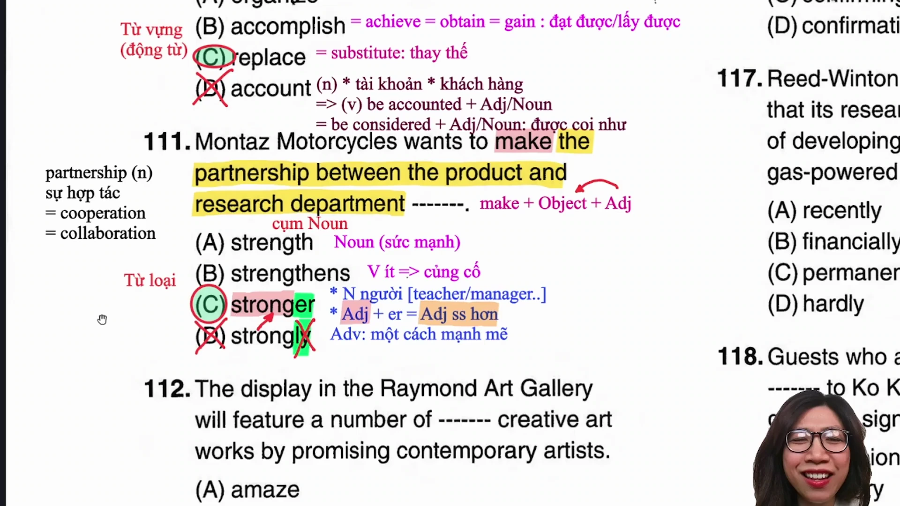

* **Đề bài và phương án:**
  * *The company aims to make the partnership between the product and research departments _______.*
  * A. strength
  * B. strengthens
  * C. stronger
  * D. strongly
* **Phân tích ngữ pháp nâng cao (Mốc 800+):**
  * Cấu trúc vị ngữ đặc biệt: `Make + Object + Adjective` (làm cho tân ngữ trở nên như thế nào).
  * Tân ngữ Object trong câu là cụm danh từ dài: `the partnership between the product and research departments` (mối quan hệ hợp tác giữa hai phòng ban).
  * Vị trí chỗ trống đứng cuối câu đóng vai trò tính từ bổ ngữ làm rõ tính chất cho tân ngữ đó.
  * Loại phương án A (`strength`): danh từ chỉ sức mạnh.
  * Loại phương án B (`strengthens`): động từ số ít.
  * Loại phương án D (`strongly`): trạng từ (sau tân ngữ của Make không dùng trạng từ).
  * Phương án C (`stronger`): tính từ so sánh hơn có hậu tố `-er` xuất phát từ tính từ gốc `strong`.
  * **Đáp án đúng:** **C** (`stronger`).
* **Dịch nghĩa:** Công ty hướng tới mục tiêu làm cho mối quan hệ đối tác giữa bộ phận sản phẩm và bộ phận nghiên cứu trở nên bền chặt hơn.
* **Mở rộng kiến thức:**
  * Cấu trúc: `make + Object + Adjective` (ví dụ: *make this speech interesting*).
  * `partnership` = `cooperation` = `collaboration`: quan hệ đối tác, sự hợp tác.
  * `strengthen` (động từ): củng cố, tăng cường sức mạnh.
  * `strength` (danh từ): thế mạnh, sức mạnh.

---

### [[01:12:29](https://www.youtube.com/watch?v=2zuDwiSgPug&t=4349s)] Câu 12: Trạng từ mức độ

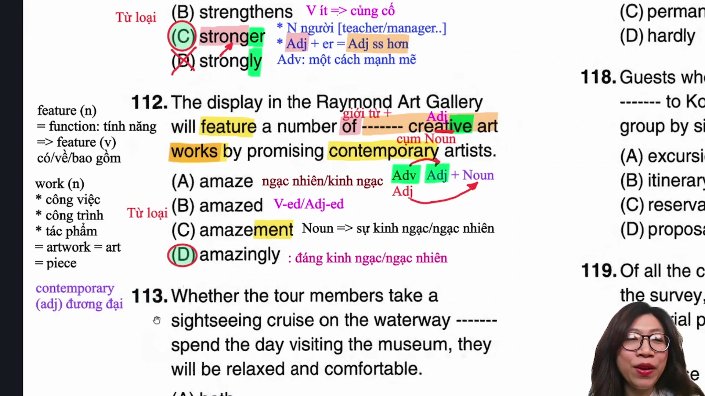

* **Đề bài và phương án:**
  * *The exhibition features a display of _______ creative works by promising contemporary artists.*
  * A. amazement
  * B. amazing
  * C. amazingly
  * D. amazed
* **Phân tích ngữ pháp nâng cao:**
  * Cụm danh từ: `a display of _______ creative works`.
  * Danh từ trung tâm là `works` (các tác phẩm nghệ thuật), đứng trước là tính từ `creative` (mang tính sáng tạo).
  * Vị trí đứng trước tính từ để bổ nghĩa nhấn mạnh cho mức độ sáng tạo của tác phẩm phải là một **trạng từ** (`Adverb`).
  * Loại phương án A (`amazement`): danh từ chỉ sự kinh ngạc.
  * Phương án B (`amazing`) và D (`amazed`) là các tính từ; hai tính từ không xếp liền nhau khi một từ làm rõ mức độ cho từ còn lại.
  * Phương án C (`amazingly`): trạng từ bổ nghĩa cho tính từ `creative` (`amazingly creative` = sáng tạo một cách đáng kinh ngạc).
  * **Đáp án đúng:** **C** (`amazingly`).
* **Dịch nghĩa:** Triển lãm trưng bày những tác phẩm sáng tạo đáng kinh ngạc của các nghệ sĩ đương đại đầy triển vọng.
* **Mở rộng kiến thức:**
  * Cấu trúc bổ nghĩa: `Adv + Adj + Noun` (trạng từ bổ nghĩa cho tính từ).
  * `contemporary artists`: các nghệ sĩ đương đại.
  * `promising`: đầy hứa hẹn, đầy triển vọng.
  * `feature` (động từ): trưng bày, bao gồm đặc điểm nổi bật; danh từ: tính năng, đặc điểm.

---

### [[01:21:23](https://www.youtube.com/watch?v=2zuDwiSgPug&t=4883s)] Câu 13: Cấu trúc tương liên

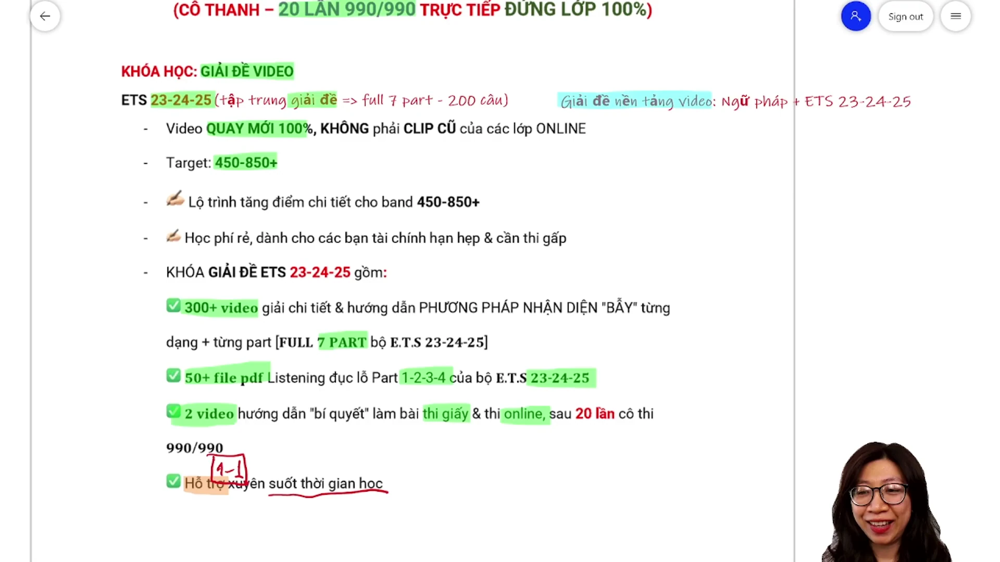

* **Đề bài và phương án:**
  * *Whether the tour members take a boat cruise on the waterways _______ spend the day visiting museums, they will be relaxed and comfortable.*
  * A. both
  * B. also
  * C. or
  * D. nor
* **Phân tích ngữ pháp cặp liên từ:**
  * Mệnh đề trạng ngữ đầu câu mở đầu bằng liên từ `Whether` (`Whether the tour members take a boat cruise...`).
  * Cặp liên từ tương liên chuẩn tắc đi liền với `Whether` là **`or`** (`Whether A or B`: dù làm phương án A hay phương án B).
  * Loại phương án A (`both`) vì đi với `and` (`both... and`).
  * Loại phương án D (`nor`) vì đi với `neither` (`neither... nor`).
  * Phương án C (`or`) là từ ghép cặp hoàn chỉnh với `Whether`.
  * **Đáp án đúng:** **C** (`or`).
* **Dịch nghĩa:** Dù các thành viên đoàn du lịch chọn đi du thuyền ngắm cảnh trên đường thủy hay dành cả ngày ghé thăm các viện bảo tàng, họ đều sẽ cảm thấy thư thái và dễ chịu.
* **Mở rộng kiến thức:**
  * `Whether A or B`: dù là A hay là B (có thể đi với mệnh đề hoặc To-Verb).
  * `Either A or B`: hoặc A hoặc B.
  * `Neither A nor B`: không A cũng không B.
  * `Both A and B`: cả A và B.
  * `boat cruise`: chuyến du ngoạn bằng thuyền.

---

### [[01:30:00](https://www.youtube.com/watch?v=2zuDwiSgPug&t=5400s)] Câu 14: Trạng từ so sánh

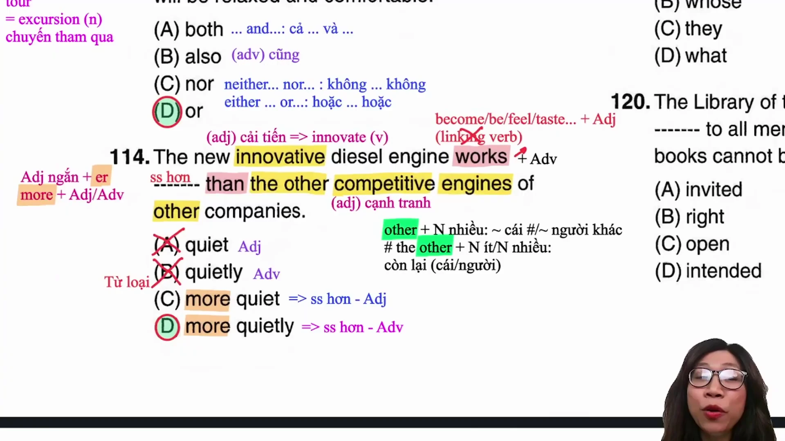

* **Đề bài và phương án:**
  * *The new model of engine works _______ than any of the other machines in the factory.*
  * A. quiet
  * B. quietly
  * C. more quiet
  * D. more quietly
* **Phân tích ngữ pháp so sánh hơn:**
  * Phía sau chỗ trống có liên từ so sánh `than`, xác định cấu trúc câu là **so sánh hơn**.
  * Loại phương án A và B vì không có hình thức so sánh hơn.
  * Động từ đứng trước chỗ trống là `works` (vận hành, hoạt động). Đây là động từ hành động thông thường, không phải là động từ nối Linking Verb (`become`, `seem`, `feel`).
  * Động từ thường bắt buộc đi với trạng từ để bổ nghĩa, do đó hình thức so sánh hơn phải là `more quietly`.
  * **Đáp án đúng:** **D** (`more quietly`).
* **Dịch nghĩa:** Mẫu động cơ mới hoạt động êm ái hơn bất kỳ cỗ máy nào khác trong nhà máy.
* **Mở rộng kiến thức:**
  * So sánh hơn với trạng từ: `more + Adv + than`.
  * Phân biệt động từ thường (đi với trạng từ) và Linking Verb (đi với tính từ).
  * `the other` + Danh từ số nhiều: những đối tượng còn lại trong một nhóm xác định.
  * `factory`: nhà máy sản xuất.

---

### [[01:38:17](https://www.youtube.com/watch?v=2zuDwiSgPug&t=5897s)] Câu 15: Giới từ cung cấp

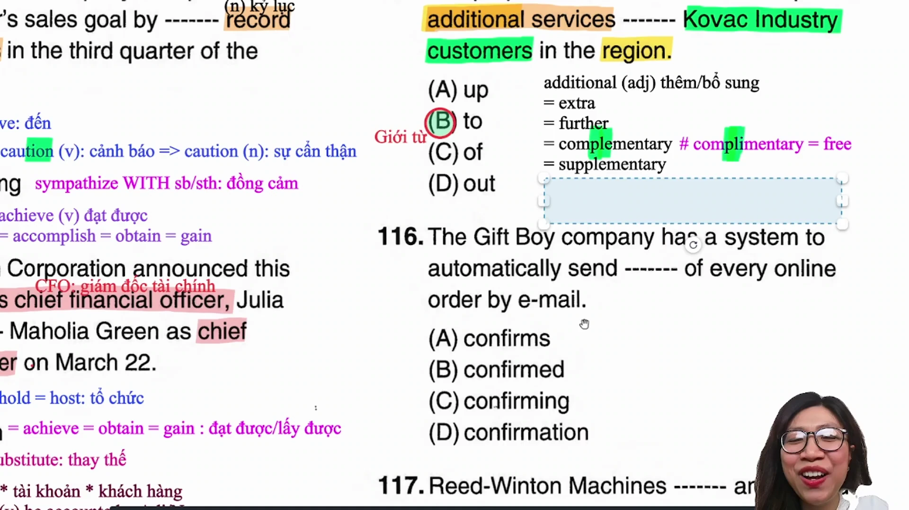

* **Đề bài và phương án:**
  * *The proposed service center will provide additional services _______ customers of Covc Industry in the region.*
  * A. of
  * B. to
  * C. with
  * D. at
* **Phân tích ngữ pháp và cấu trúc giới từ:**
  * Động từ vị ngữ trong câu là `will provide`.
  * Phía trước chỗ trống là tân ngữ chỉ vật `additional services` (các dịch vụ bổ sung).
  * Phía sau chỗ trống là đối tượng thụ hưởng chỉ người `customers of Covc Industry` (khách hàng của công ty).
  * Cấu trúc chuẩn của động từ Provide: `Provide something to somebody` (cung cấp vật gì cho ai); nếu đổi lại người đứng trước sẽ dùng `Provide somebody with something`.
  * Do vật đứng trước người nên giới từ bắt buộc là **`to`**.
  * **Đáp án đúng:** **B** (`to`).
* **Dịch nghĩa:** Trung tâm dịch vụ được đề xuất sẽ cung cấp các dịch vụ bổ sung tới khách hàng của Covc Industry trong khu vực.
* **Mở rộng kiến thức:**
  * `provide something to somebody`: cung cấp cái gì cho ai.
  * `provide somebody with something`: cung cấp cho ai cái gì.
  * `additional` = `extra` = `further` = `supplementary`: bổ sung, tăng thêm.
  * Phân biệt `complimentary` (miễn phí, có chữ 'i') và `complementary` (bổ trợ, bù trừ, có chữ 'e').
  * `region` = `area` = `neighborhood`: khu vực địa lý.

---

## Trích dẫn then chốt

* [[00:00:45](https://www.youtube.com/watch?v=2zuDwiSgPug&t=45s)] *"Tổng thời gian làm Part 5 và Part 6 không bao giờ được vượt quá 25 phút. Part 5 phải cố gắng hoàn tất dưới 15 phút thì mới có cơ hội bứt phá điểm số cao ở Part 7."*
* [[00:08:15](https://www.youtube.com/watch?v=2zuDwiSgPug&t=495s)] *"Khi động từ Locate mang nghĩa tọa lạc ở một vị trí địa lý thì 100% bắt buộc phải chia ở thể bị động Be located kèm giới từ in, on hoặc at."*
* [[00:34:30](https://www.youtube.com/watch?v=2zuDwiSgPug&t=2070s)] *"Cụm nằm giữa hai dấu phẩy là thông tin phụ bổ nghĩa cho danh từ tiền ngữ. Nếu phía trước là tên riêng người thì cụm danh từ phía sau chắc chắn phải là danh từ chỉ người."*
* [[01:07:30](https://www.youtube.com/watch?v=2zuDwiSgPug&t=4050s)] *"Sau động từ Make và tân ngữ Object bắt buộc là một tính từ để làm rõ tính chất của tân ngữ, tuyệt đối không dùng trạng từ."*
* [[01:40:15](https://www.youtube.com/watch?v=2zuDwiSgPug&t=6415s)] *"Hai từ Complimentary và Supplementary phát âm đều nuốt âm a ở đuôi, nhưng complimentary có chữ i mang nghĩa miễn phí, còn supplementary mang nghĩa bổ sung."*

---

## Lệnh & Công cụ

* **Tài liệu tham khảo:** Bộ đề ETS TOEIC 2026 Test 1 Part 5 (từ Câu 101 đến Câu 115).
* **Quy tắc phân loại từ định lượng:**
  * `Neither` / `Each` / `Every` + Danh từ đếm được số ít.
  * `All` + Danh từ số nhiều / Danh từ không đếm được.
* **Cấu trúc động từ Make:**
  * `Make + Object + Adjective` (tạo ra/làm cho đối tượng mang tính chất nào đó).
* **Cấu trúc động từ Provide:**
  * `Provide something to somebody`.
  * `Provide somebody with something`.

---

## Đánh đổi & Rủi ro

* **Bẫy áp dụng máy móc cấu trúc Trạng - Tính - Danh:**
  * Không phải mọi vị trí trước Tính từ đều là Trạng từ. Thí sinh cần xác định rõ từ cần điền bổ nghĩa cho Tính từ (dùng Trạng từ) hay bổ nghĩa độc lập cho Danh từ chính phía sau (dùng Tính từ ghép).
* **Bẫy nhầm lẫn giữa tính từ và trạng từ so sánh hơn:**
  * Cần quan sát động từ vị ngữ đứng trước: nếu là động từ hành động thì dùng trạng từ so sánh hơn (`works more quietly`), nếu là Linking Verb mới dùng tính từ so sánh hơn.
* **Bẫy từ vựng đồng âm dị nghĩa:**
  * `Complimentary` (miễn phí) phát âm tương đồng với `Complementary` (bổ sung/bù trừ).
  * `Island` phát âm câm chữ cái /s/, nếu phát âm sai sẽ dẫn đến việc không nhận diện được từ khóa trong bài thi Listening Part 1 và Part 2.