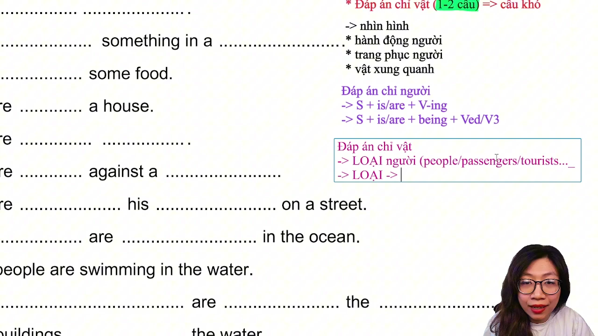
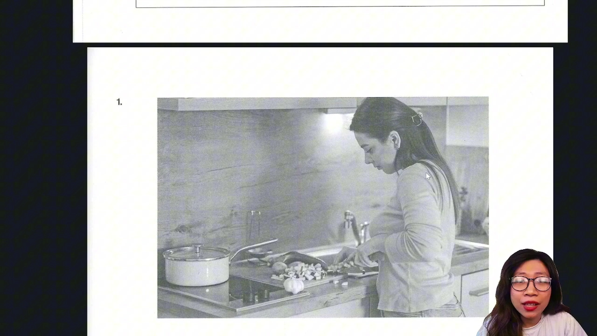
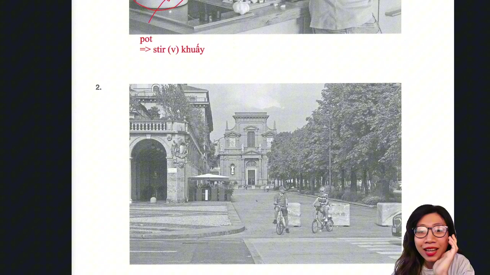
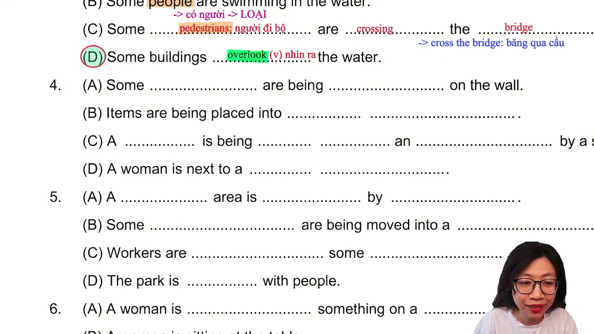
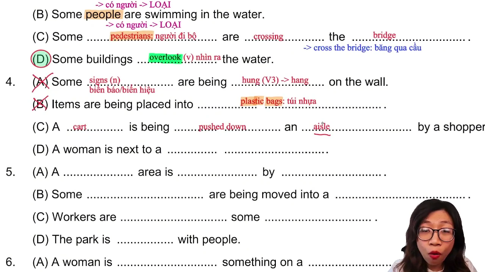
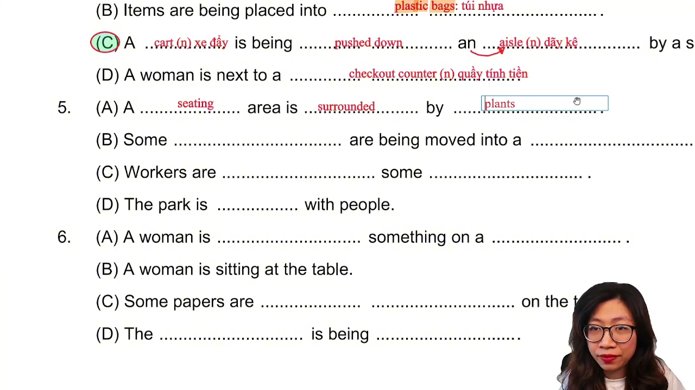
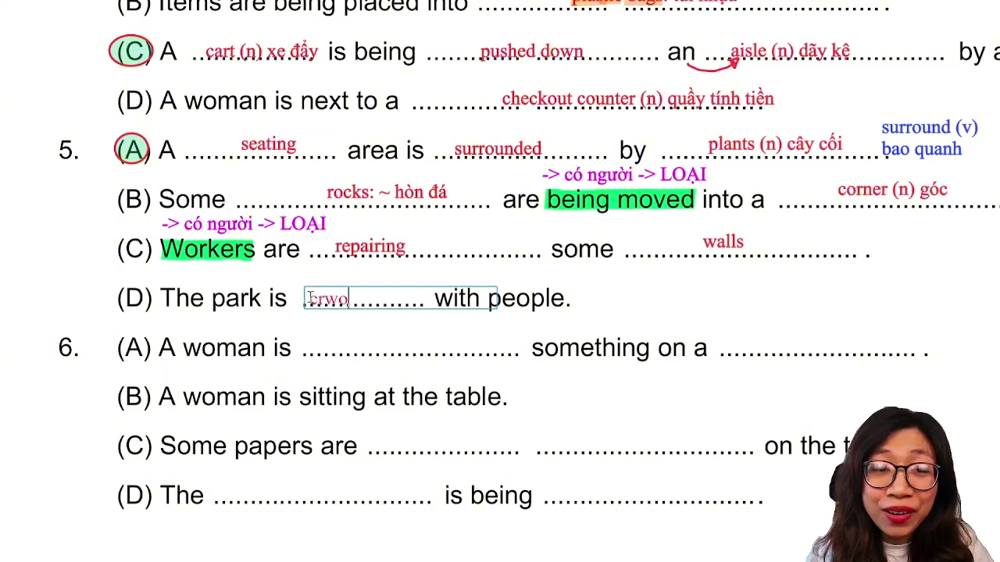
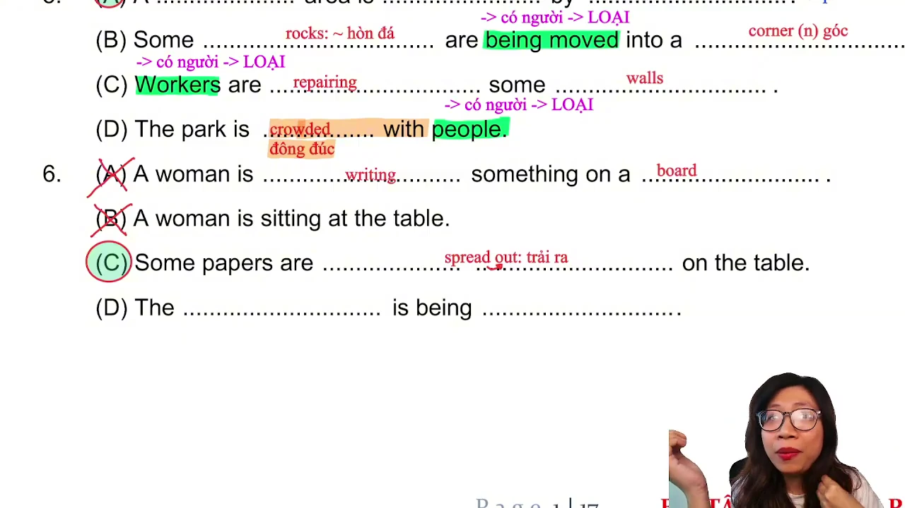
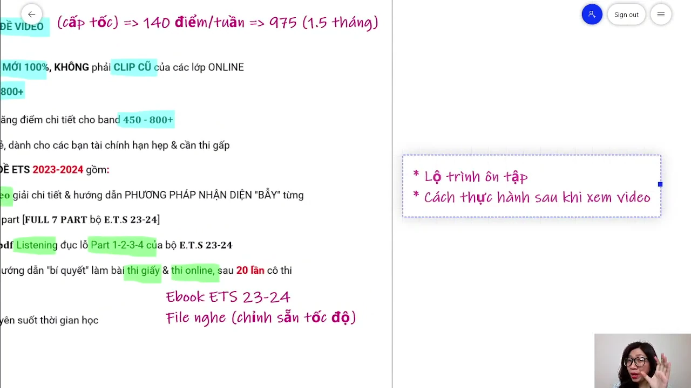

# GIẢI ĐỀ TOEIC 2026 MỚI NHẤT | PART 1

* **Kênh:** Anh ngữ Ms Thanh | **Thời lượng:** 57:15 | **Ngày:** 2026-01-03
* **Video:** [https://www.youtube.com/watch?v=JgryGPIN97M](https://www.youtube.com/watch?v=JgryGPIN97M)

---

## Thuật ngữ

| Thuật ngữ | Giải thích |
| :--- | :--- |
| **Part 1 Photographs** | Phần thi mô tả tranh gồm 6 câu hỏi hình ảnh (từ câu 1 đến câu 6) mở đầu bài thi TOEIC Listening. |
| **Action Verb** | Động từ hành động mô tả trực tiếp tư thế hoặc thao tác của nhân vật trong hình ảnh. |
| **State Description** | Miêu tả trạng thái tĩnh của đồ vật hoặc khung cảnh không có người tác động. |
| **Periodic Capture** | Khung hình trích xuất định kỳ phục vụ theo dõi trực quan bài giảng khi video không có bản ghi phụ đề. |

---

## Tổng luận chuyên đề

#### Cấu trúc bài giảng Part 1
Bài giảng tập trung phân tích 6 câu hỏi tranh hình ảnh của bài thi TOEIC Listening 2026. Do video gốc không có phụ đề transcript, tài liệu này lưu trữ toàn bộ các khung hình slide bài giảng được trích xuất định kỳ mỗi 5 phút để người học tiện đối chiếu trực quan.

#### Chiến lược làm bài Part 1
1. **Quan sát tranh trước khi nghe:** Dành 3 đến 5 giây trước mỗi câu để quét nhanh nhân vật chính (hành động, hướng nhìn, trang phục) và khung cảnh đồ vật xung quanh.
2. **Quy tắc phân biệt hành động và trạng thái:** Đặc biệt lưu ý bẫy giữa việc đang mặc đồ (Putting on - hành động) và đã mặc sẵn đồ (Wearing - trạng thái).
3. **Loại trừ phương án có yếu tố không xuất hiện:** Bất kỳ phương án nào nhắc đến người hoặc vật không có trong tranh đều bị loại ngay lập tức.

---

## Bóc tách chi tiết

### [[00:05:00](https://www.youtube.com/watch?v=JgryGPIN97M&t=300s)] Khung hình mốc 05 phút

* **Mốc thời gian:** 05:00.
* **Nội dung hiển thị:** Slide bài giảng phân tích câu hỏi Part 1.

---

### [[00:10:00](https://www.youtube.com/watch?v=JgryGPIN97M&t=600s)] Khung hình mốc 10 phút

* **Mốc thời gian:** 10:00.
* **Nội dung hiển thị:** Slide bài giảng phân tích câu hỏi Part 1.

---

### [[00:15:00](https://www.youtube.com/watch?v=JgryGPIN97M&t=900s)] Khung hình mốc 15 phút

* **Mốc thời gian:** 15:00.
* **Nội dung hiển thị:** Slide bài giảng phân tích câu hỏi Part 1.

---

### [[00:20:00](https://www.youtube.com/watch?v=JgryGPIN97M&t=1200s)] Khung hình mốc 20 phút

* **Mốc thời gian:** 20:00.
* **Nội dung hiển thị:** Slide bài giảng phân tích câu hỏi Part 1.

---

### [[00:25:00](https://www.youtube.com/watch?v=JgryGPIN97M&t=1500s)] Khung hình mốc 25 phút

* **Mốc thời gian:** 25:00.
* **Nội dung hiển thị:** Slide bài giảng phân tích câu hỏi Part 1.

---

### [[00:30:00](https://www.youtube.com/watch?v=JgryGPIN97M&t=1800s)] Khung hình mốc 30 phút

* **Mốc thời gian:** 30:00.
* **Nội dung hiển thị:** Slide bài giảng phân tích câu hỏi Part 1.

---

### [[00:35:00](https://www.youtube.com/watch?v=JgryGPIN97M&t=2100s)] Khung hình mốc 35 phút

* **Mốc thời gian:** 35:00.
* **Nội dung hiển thị:** Slide bài giảng phân tích câu hỏi Part 1.

---

### [[00:40:00](https://www.youtube.com/watch?v=JgryGPIN97M&t=2400s)] Khung hình mốc 40 phút

* **Mốc thời gian:** 40:00.
* **Nội dung hiển thị:** Slide bài giảng phân tích câu hỏi Part 1.

---

### [[00:45:00](https://www.youtube.com/watch?v=JgryGPIN97M&t=2700s)] Khung hình mốc 45 phút

* **Mốc thời gian:** 45:00.
* **Nội dung hiển thị:** Slide bài giảng phân tích câu hỏi Part 1.

---

### [[00:50:00](https://www.youtube.com/watch?v=JgryGPIN97M&t=3000s)] Khung hình mốc 50 phút

* **Mốc thời gian:** 50:00.
* **Nội dung hiển thị:** Slide bài giảng phân tích câu hỏi Part 1.

---

### [[00:55:00](https://www.youtube.com/watch?v=JgryGPIN97M&t=3300s)] Khung hình mốc 55 phút

* **Mốc thời gian:** 55:00.
* **Nội dung hiển thị:** Slide bài giảng phân tích câu hỏi Part 1.

---

## Trích dẫn then chốt

* [[00:05:00](https://www.youtube.com/watch?v=JgryGPIN97M&t=300s)] *"Quan sát toàn diện hành động của nhân vật và vị trí đồ vật trước khi audio bắt đầu đọc các phương án A, B, C, D."*
* [[00:30:00](https://www.youtube.com/watch?v=JgryGPIN97M&t=1800s)] *"Tuyệt đối không suy đoán những yếu tố không hiển thị trực tiếp trên bức tranh."*

---

## Lệnh & Công cụ

* **Tài liệu tham khảo:** Đề thi TOEIC 2026 Listening Part 1 (Câu 1 đến Câu 6).
* **Phương tiện lưu trữ:** 11 ảnh chụp màn hình định kỳ WebP lưu tại thư mục `screenshots/`.

---

## Đánh đổi & Rủi ro

* **Thiếu phụ đề tự động:** Video gốc không cung cấp phụ đề tiếng Anh hay tiếng Việt trên YouTube, do đó tài liệu phục vụ đối chiếu trực quan qua chuỗi hình ảnh định kỳ.
