# GIẢI ĐỀ TOEIC 2025 MỚI NHẤT | TEST 6 [VIDEO 2]

* **Kênh:** Anh ngữ Ms Thanh | **Thời lượng:** 01:43:22 | **Ngày:** 2025-12-06
* **Video:** [https://www.youtube.com/watch?v=Kmym0ByOy9s](https://www.youtube.com/watch?v=Kmym0ByOy9s)

---

## Thuật ngữ

| Thuật ngữ | Giải thích |
| :--- | :--- |
| **Part 5 Incomplete Sentences** | Phần thi hoàn thành câu gồm 30 câu hỏi trắc nghiệm ngữ pháp và từ vựng từ câu 101 đến câu 130. |
| **Reduced Relative Clause** | Mệnh đề quan hệ rút gọn lược bỏ đại từ quan hệ và trợ động từ, chuyển động từ chính sang dạng V-ing hoặc V-ed. |
| **Preposition** | Giới từ đứng trước danh từ, cụm danh từ hoặc danh động từ để chỉ mối quan hệ ngữ pháp hoặc ngữ nghĩa. |
| **Subordinating Conjunction** | Liên từ phụ thuộc liên kết mệnh đề phụ với mệnh đề chính trong câu phức. |
| **Relative Pronoun** | Đại từ quan hệ thay thế cho danh từ đứng trước và liên kết mệnh đề quan hệ với mệnh đề chính. |
| **Compound Noun** | Cụm danh từ ghép cấu tạo từ danh từ kết hợp danh từ hoặc tính từ kết hợp danh từ mang một khái niệm độc lập. |
| **Distributive Pronoun** | Đại từ phân phối xác định từng cá thể riêng lẻ trong một tập thể hoặc nhóm đối tượng. |
| **Comparative Adjective** | Tính từ so sánh hơn diễn đạt mức độ chênh lệch giữa hai đối tượng hoặc thực thể. |

---

## Tổng luận chuyên đề

#### Phân loại nhóm câu hỏi
Video 2 của Test 6 tập trung giải quyết trọn vẹn 15 câu hỏi nửa sau của Part 5 từ Câu 116 đến Câu 130. Đây là chặng phân loại điểm số then chốt từ band 650 đến 850+:
1. **Nhóm từ loại và đại từ:** Chiếm tỷ trọng lớn ở các vị trí câu 117, 118, 120, 125, 127. Thí sinh cần giải quyết nhanh gọn bằng việc phân tích cấu trúc trước và sau chỗ trống mà không cần đọc hiểu toàn văn bản.
2. **Nhóm liên từ và giới từ:** Chiếm tỷ trọng cao ở các câu 116, 124, 128, 129. Đòi hỏi phân định rõ ràng giữa từ nối đi kèm mệnh đề có động từ chia thì và giới từ chỉ đi kèm cụm danh từ.
3. **Nhóm từ vựng và Collocation:** Xuất hiện tại các câu 119, 121, 122, 123, 130. Kiểm tra trực diện năng lực hiểu nghĩa từ vựng kinh tế, vận tải, y tế và phản xạ nhận diện cụm từ đi liền cố định.

#### Kỹ thuật định vị hai phía
Để duy trì tốc độ dưới 30 giây cho mỗi câu Part 5:
* **Nhìn phía trước:** Nhận diện trợ động từ, mạo từ, tính từ sở hữu hoặc ngoại động từ để xác định chức năng từ loại còn thiếu.
* **Nhìn phía sau:** Kiểm tra xem có cụm danh từ làm tân ngữ hay chỉ có giới từ bổ nghĩa; tìm kiếm từ khóa so sánh hoặc mệnh đề đi sau dấu phẩy.

#### Chiến lược xử lý liên từ
Khi gặp các câu hỏi liên từ và giới từ chỉ nguyên nhân hoặc tương phản:
* Xác định ngay phía sau chỗ trống là một mệnh đề hoàn chỉnh hay chỉ là cụm danh từ.
* Loại bỏ các liên từ nối nếu phía sau không có động từ chính chia thì.
* Đối chiếu sắc thái ngữ nghĩa tương phản hay nguyên nhân để chọn đáp án chuẩn xác nhất.

---

## Bóc tách chi tiết

### [[00:00:01](https://www.youtube.com/watch?v=Kmym0ByOy9s&t=1s)] Câu 116: Giới từ Regarding

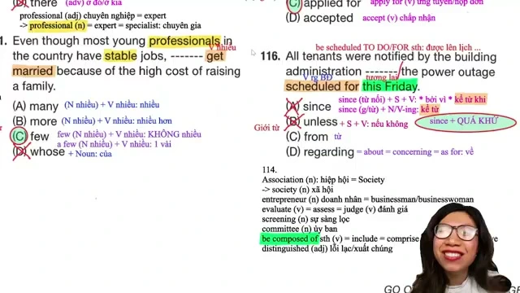

* **Đề bài và phương án:**
  * *All tenants were notified by the building administration ------- the power outage scheduled for this Friday.*
  * A. since
  * B. unless
  * C. from
  * D. regarding
* **Phân tích ngữ pháp:**
  * Phía trước chỗ trống là mệnh đề bị động hoàn chỉnh: `All tenants were notified by the building administration`. Động từ `notify` có cấu trúc thông báo quen thuộc: `notify somebody about / of / regarding something` (thông báo cho ai về vấn đề gì).
  * Phía sau chỗ trống là cụm danh từ: `the power outage scheduled for this Friday` (sự cố mất điện được lên lịch vào thứ Sáu tuần này).
  * Xét các phương án:
    * Phương án A (`since`): Nếu là từ nối thì đi với mệnh đề `S + V` mang nghĩa bởi vì hoặc kể từ khi. Nếu là giới từ thì đi với mốc thời gian quá khứ. Cụm phía sau chỉ sự việc ở tương lai (`scheduled for this Friday`) nên không phù hợp.
    * Phương án B (`unless`): Liên từ phụ thuộc đi kèm mệnh đề `S + V` mang nghĩa trừ khi hoặc nếu không, không đi trực tiếp với cụm danh từ.
    * Phương án C (`from`): Giới từ chỉ xuất xứ hoặc nơi chốn, không dùng trong ngữ cảnh thông báo nội dung sự việc.
    * Phương án D (`regarding`): Giới từ đồng nghĩa với `about`, `concerning`, `as for` mang nghĩa về điều gì hoặc liên quan đến điều gì. Hoàn toàn phù hợp đứng trước cụm danh từ làm tân ngữ.
  * **Đáp án đúng:** **D** (`regarding`).
* **Dịch nghĩa:** Toàn bộ cư dân đã được ban quản lý tòa nhà thông báo về sự cố mất điện được lên lịch vào thứ Sáu tuần này.
* **Mở rộng kiến thức:**
  * `regarding = about = concerning = as for`: về, liên quan đến.
  * `tenant` (danh từ): người thuê nhà, cư dân căn hộ.
  * `power outage` (cụm danh từ): sự cố mất điện.
  * `be scheduled to do something / for something`: được lên lịch làm gì / vào thời điểm nào.

---

### [[00:07:20](https://www.youtube.com/watch?v=Kmym0ByOy9s&t=440s)] Câu 117: Từ loại danh từ

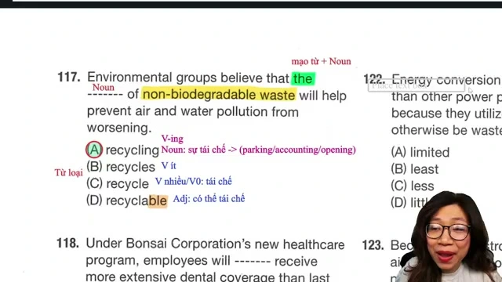

* **Đề bài và phương án:**
  * *Environmental groups believe that the ------- of non-biodegradable waste will help prevent air and water pollution from worsening.*
  * A. recycling
  * B. recycles
  * C. recycle
  * D. recyclable
* **Phân tích ngữ pháp:**
  * Vị trí chỗ trống nằm trong cấu trúc: `the ------- of non-biodegradable waste`.
  * Đứng sau mạo từ `the` và đứng trước giới từ `of` bắt buộc phải là một danh từ (`the + Noun + of`).
  * Xét các phương án:
    * Phương án A (`recycling`): Danh động từ đóng vai trò danh từ chỉ hoạt động hoặc sự tái chế. Tương tự các danh từ đuôi `-ing` thông dụng như `parking`, `accounting`, `opening`.
    * Phương án B (`recycles`): Động từ chia thì hiện tại đơn ngôi thứ ba số ít.
    * Phương án C (`recycle`): Động từ nguyên mẫu.
    * Phương án D (`recyclable`): Tính từ có đuôi `-able` mang nghĩa có thể tái chế được.
  * Danh từ `recycling` đóng vai trò làm chủ ngữ cho mệnh đề phụ `that ... will help prevent...`.
  * **Đáp án đúng:** **A** (`recycling`).
* **Dịch nghĩa:** Các nhóm bảo vệ môi trường tin rằng việc tái chế rác thải không phân hủy sinh học sẽ giúp ngăn chặn tình trạng ô nhiễm không khí và nguồn nước trở nên tồi tệ hơn.
* **Mở rộng kiến thức:**
  * `recycling` (danh từ): việc tái chế, sự tái chế.
  * `non-biodegradable waste`: rác thải không phân hủy sinh học.
  * `prevent something from V-ing`: ngăn chặn cái gì khỏi việc gì.
  * `worsen` (động từ): làm cho tồi tệ hơn, diễn biến xấu đi.

---

### [[00:13:45](https://www.youtube.com/watch?v=Kmym0ByOy9s&t=825s)] Câu 118: Đại từ định lượng

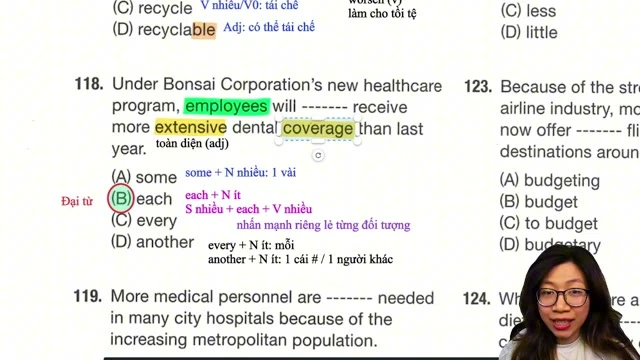

* **Đề bài và phương án:**
  * *Under Bonsai Corporation's new healthcare program, employees will ------- receive more extensive dental coverage than last year.*
  * A. some
  * B. each
  * C. every
  * D. another
* **Phân tích ngữ pháp:**
  * Câu có chủ ngữ số nhiều `employees`, theo sau là vị ngữ `will ------- receive`. Chỗ trống nằm xen kẽ giữa trợ động từ khiếm khuyết `will` và động từ nguyên mẫu `receive`.
  * Xét các phương án:
    * Phương án A (`some`): Lượng từ đứng trước danh từ hoặc làm đại từ độc lập ở đầu câu, không đứng xen giữa trợ động từ và động từ theo vị trí này.
    * Phương án B (`each`): Đại từ phân phối có cấu trúc đặc biệt đứng ở vị trí đồng vị sau chủ ngữ số nhiều: `Subject (số nhiều) + each + Verb` hoặc `Subject + Modal Verb + each + Verb`, dùng để nhấn mạnh riêng rẽ từng cá nhân trong tập thể (`employees will each receive`).
    * Phương án C (`every`): Tính từ hạn định bắt buộc phải đi kèm trực tiếp với danh từ đếm được số ít (`every employee`), không thể đứng độc lập.
    * Phương án D (`another`): Đi kèm với danh từ đếm được số ít mang nghĩa một người khác hoặc một vật khác.
  * **Đáp án đúng:** **B** (`each`).
* **Dịch nghĩa:** Theo chương trình chăm sóc sức khỏe mới của Tập đoàn Bonsai, các nhân viên sẽ mỗi người đều nhận được gói bảo hiểm nha khoa toàn diện hơn năm ngoái.
* **Mở rộng kiến thức:**
  * `Subject (số nhiều) + each + Verb`: Cấu trúc nhấn mạnh riêng rẽ từng đối tượng trong tập thể.
  * `extensive` (tính từ): toàn diện, quy mô lớn.
  * `coverage` (danh từ): phạm vi bảo hiểm, sự bảo đảm chi trả.
  * `dental coverage`: bảo hiểm nha khoa.

---

### [[00:19:30](https://www.youtube.com/watch?v=Kmym0ByOy9s&t=1170s)] Câu 119: Trạng từ Urgently

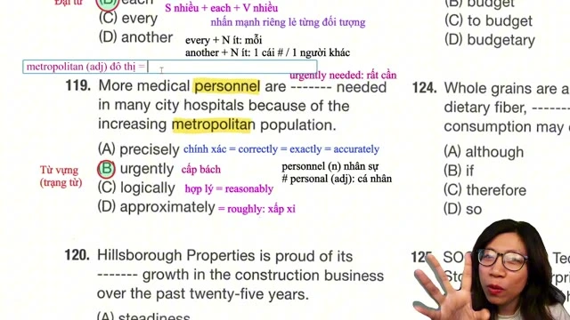

* **Đề bài và phương án:**
  * *More medical personnel are ------- needed in many city hospitals because of the increasing metropolitan population.*
  * A. precisely
  * B. urgently
  * C. logically
  * D. approximately
* **Phân tích ngữ pháp:**
  * Chỗ trống đứng giữa động từ to be `are` và phân từ quá khứ `needed` trong cấu trúc câu bị động `are ------- needed`. Vị trí này cần một trạng từ bổ nghĩa mức độ cho hành động.
  * Xét nghĩa các trạng từ:
    * Phương án A (`precisely`): một cách chính xác (`= correctly = exactly = accurately`).
    * Phương án B (`urgently`): một cách cấp bách, khẩn cấp. Kết hợp thành Collocation cố định: `urgently needed` (đang rất cần, cần gấp).
    * Phương án C (`logically`): một cách hợp lý, theo lẽ logic (`= reasonably`).
    * Phương án D (`approximately`): xấp xỉ, khoảng chừng (`= roughly`).
  * Ngữ cảnh câu nêu nguyên nhân dân số đô thị ngày càng gia tăng (`increasing metropolitan population`), vì vậy các bệnh viện thành phố đang cần gấp thêm nhân lực y tế.
  * **Đáp án đúng:** **B** (`urgently`).
* **Dịch nghĩa:** Nhiều bệnh viện thành phố đang cần bổ sung khẩn cấp thêm nhân lực y tế do quy mô dân số đô thị ngày càng gia tăng.
* **Mở rộng kiến thức:**
  * `urgently needed`: được cần một cách cấp thiết.
  * `personnel` (danh từ số nhiều không đếm được): nhân sự, đội ngũ nhân viên. Phân biệt với `personal` (tính từ: cá nhân, riêng tư).
  * `metropolitan` (tính từ): thuộc về đô thị lớn (`= urban = municipal # rural`: nông thôn).

---

### [[00:26:10](https://www.youtube.com/watch?v=Kmym0ByOy9s&t=1570s)] Câu 120: Từ loại tính từ

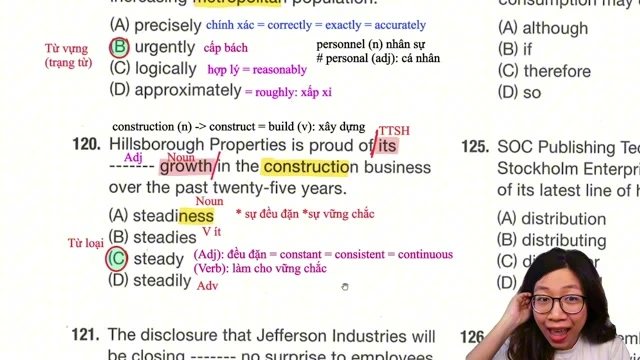

* **Đề bài và phương án:**
  * *Hillsborough Properties is proud of its ------- growth in the construction business over the past twenty-five years.*
  * A. steadiness
  * B. steadies
  * C. steady
  * D. steadily
* **Phân tích ngữ pháp:**
  * Vị trí chỗ trống nằm trong cụm: `its ------- growth`.
  * Đứng trước danh từ `growth` và đứng sau tính từ sở hữu `its` bắt buộc phải là một tính từ bổ nghĩa cho danh từ (`Possessive Adjective + Adjective + Noun`).
  * Xét các phương án:
    * Phương án A (`steadiness`): Danh từ có hậu tố `-ness` mang nghĩa sự vững chắc hoặc sự đều đặn.
    * Phương án B (`steadies`): Động từ chia ở ngôi thứ ba số ít thì hiện tại đơn.
    * Phương án C (`steady`): Tính từ mang nghĩa vững chắc, đều đặn, ổn định (`= constant = consistent = continuous`).
    * Phương án D (`steadily`): Trạng từ có đuôi `-ly`.
  * **Đáp án đúng:** **C** (`steady`).
* **Dịch nghĩa:** Công ty Bất động sản Hillsborough tự hào về sự tăng trưởng đều đặn và vững chắc trong lĩnh vực xây dựng suốt hai mươi lăm năm qua.
* **Mở rộng kiến thức:**
  * `steady growth`: sự tăng trưởng đều đặn, tăng trưởng ổn định.
  * `be proud of something`: tự hào về điều gì.
  * `construction business`: ngành nghề kinh doanh xây dựng.
  * `over the past / last twenty-five years`: trong suốt hai mươi lăm năm qua.

---

### [[00:31:40](https://www.youtube.com/watch?v=Kmym0ByOy9s&t=1900s)] Câu 121: Cụm từ Comes As

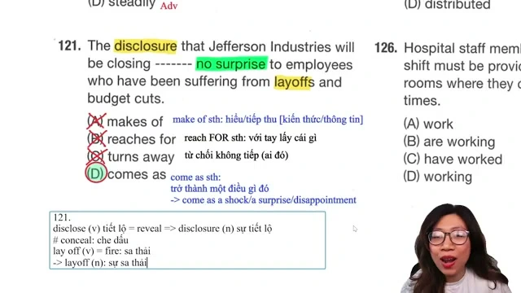

* **Đề bài và phương án:**
  * *The disclosure that Jefferson Industries will be closing ------- no surprise to employees who have been suffering from layoffs and budget cuts.*
  * A. makes of
  * B. reaches for
  * C. turns away
  * D. comes as
* **Phân tích ngữ pháp:**
  * Chủ ngữ chính của câu là danh từ `The disclosure` (thông tin tiết lộ), theo sau bởi mệnh đề quan hệ bổ nghĩa `that Jefferson Industries will be closing`.
  * Vị trí chỗ trống cần động từ chính của toàn câu kết hợp với cụm từ phía sau: `------- no surprise to employees`.
  * Xét các cụm động từ:
    * Phương án A (`makes of`): Cụm `make of something` mang nghĩa hiểu được hoặc có ý kiến về điều gì.
    * Phương án B (`reaches for`): Với tay tới để lấy vật gì.
    * Phương án C (`turns away`): Quay đi, khước từ hoặc không tiếp nhận ai.
    * Phương án D (`comes as`): Cụm thành ngữ cố định `come as something` mang nghĩa diễn ra hoặc xuất hiện như một điều gì đó. Cấu trúc chuẩn: `come as a shock` (đến như một cú sốc), `come as a surprise` (đến như một sự bất ngờ), `come as no surprise to somebody` (không phải là điều bất ngờ đối với ai).
  * **Đáp án đúng:** **D** (`comes as`).
* **Dịch nghĩa:** Thông tin tiết lộ rằng Công ty Công nghiệp Jefferson sẽ đóng cửa không gây bất kỳ sự bất ngờ nào đối với các nhân viên vốn đã phải chịu đựng những đợt sa thải và cắt giảm ngân sách.
* **Mở rộng kiến thức:**
  * `come as no surprise to somebody`: không phải là điều bất ngờ đối với ai.
  * `disclosure` (danh từ): sự tiết lộ, thông tin công khai (`disclose = reveal # conceal`: che giấu).
  * `layoff` (danh từ): đợt sa thải nhân viên (`lay off somebody = fire somebody`).
  * `budget cuts`: việc cắt giảm ngân sách chi tiêu.

---

### [[00:37:10](https://www.youtube.com/watch?v=Kmym0ByOy9s&t=2230s)] Câu 122: So sánh hơn Less

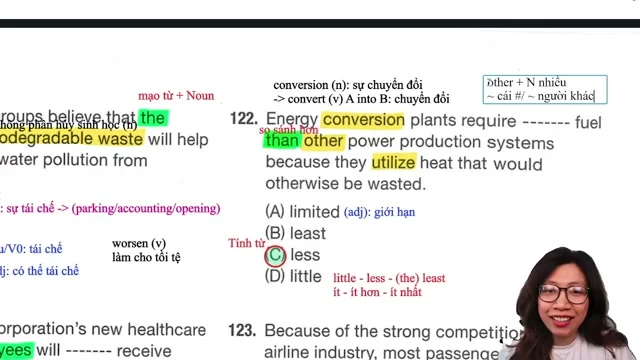

* **Đề bài và phương án:**
  * *Energy conversion plants require ------- fuel than other power production systems because they utilize heat that would otherwise be wasted.*
  * A. limited
  * B. least
  * C. less
  * D. little
* **Phân tích ngữ pháp:**
  * Dấu hiệu nhận biết cốt lõi trong câu là liên từ so sánh `than` nằm sau danh từ `fuel` (`------- fuel than other power production systems`).
  * Cấu trúc đòi hỏi một dạng thức Comparative để bổ nghĩa cho danh từ không đếm được `fuel`.
  * Phân tích các cấp độ so sánh của lượng từ `little`:
    * Cấp độ nguyên mẫu: `little` (ít, dùng cho danh từ không đếm được).
    * Cấp độ so sánh hơn: `less` (ít hơn: `less + Noun không đếm được + than`).
    * Cấp độ so sánh nhất: `least` / `the least` (ít nhất).
  * Phương án A (`limited`) là tính từ có giới hạn, không kết hợp trực tiếp với `than`. Do có `than`, từ cần điền bắt buộc là dạng so sánh hơn `less`.
  * **Đáp án đúng:** **C** (`less`).
* **Dịch nghĩa:** Các nhà máy chuyển hóa năng lượng yêu cầu ít nhiên liệu hơn so với những hệ thống sản xuất điện năng khác vì chúng tận dụng nguồn nhiệt mà nếu không sẽ bị lãng phí.
* **Mở rộng kiến thức:**
  * `little - less - the least`: chuỗi cấp độ so sánh của lượng từ không đếm được.
  * `conversion` (danh từ): sự chuyển đổi (`convert A into B`).
  * `utilize` (động từ): tận dụng, sử dụng hiệu quả (`= use = exploit`).
  * `otherwise` (trạng từ): nếu không thì.

---

### [[00:44:00](https://www.youtube.com/watch?v=Kmym0ByOy9s&t=2640s)] Câu 123: Danh từ ghép Budget

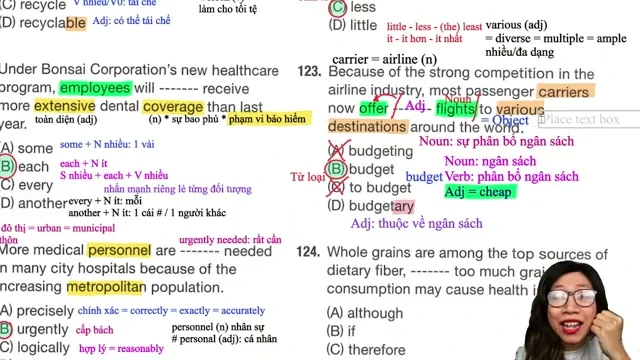

* **Đề bài và phương án:**
  * *Because of the strong competition in the airline industry, most passenger carriers now offer ------- flights to various destinations around the world.*
  * A. budgeting
  * B. budget
  * C. to budget
  * D. budgetary
* **Phân tích ngữ pháp:**
  * Vị trí chỗ trống nằm giữa ngoại động từ `offer` và danh từ số nhiều `flights` (`offer ------- flights to various destinations`). Cụm từ này đóng vai trò làm tân ngữ.
  * Xét các phương án liên quan đến gốc từ `budget`:
    * Phương án A (`budgeting`): Danh từ chỉ quy trình lập ngân sách hoặc phân bổ tài chính.
    * Phương án B (`budget`): Danh từ ngân sách, động từ lập dự toán, và đóng vai trò tính từ mang nghĩa giá rẻ hoặc tiết kiệm chi phí (`budget = cheap = economical`). Kết hợp thành cụm danh từ ghép tiêu chuẩn: `budget flights` (các chuyến bay giá rẻ).
    * Phương án C (`to budget`): Động từ nguyên mẫu có to, không thể đứng xen giữa ngoại động từ và danh từ tân ngữ.
    * Phương án D (`budgetary`): Tính từ mang nghĩa thuộc về ngân sách tài chính của tổ chức (`budgetary requirements`), không mang nghĩa giá rẻ.
  * Ngữ cảnh câu nói về áp lực cạnh tranh nên các hãng hàng không phải cung cấp chuyến bay giá rẻ.
  * **Đáp án đúng:** **B** (`budget`).
* **Dịch nghĩa:** Do sự cạnh tranh gay gắt trong ngành hàng không, hầu hết các hãng vận tải hành khách hiện nay đều cung cấp các chuyến bay giá rẻ tới nhiều điểm đến khác nhau trên khắp thế giới.
* **Mở rộng kiến thức:**
  * `budget flight / budget airline`: chuyến bay giá rẻ / hãng hàng không giá rẻ.
  * `carrier = airline` (danh từ): hãng vận chuyển, công ty hàng không.
  * `various = diverse = multiple = ample` (tính từ): đa dạng, nhiều nơi khác nhau.
  * `destination` (danh từ): điểm đến.

---

### [[00:53:00](https://www.youtube.com/watch?v=Kmym0ByOy9s&t=3180s)] Câu 124: Liên từ nhượng bộ

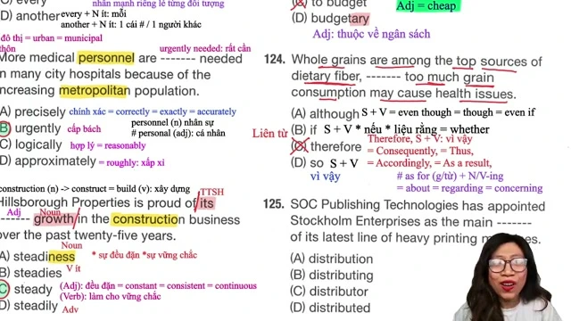

* **Đề bài và phương án:**
  * *Whole grains are among the top sources of dietary fiber, ------- too much grain consumption may cause health issues.*
  * A. although
  * B. if
  * C. therefore
  * D. so
* **Phân tích ngữ pháp:**
  * Câu gồm hai mệnh đề hoàn chỉnh được ngăn cách bởi dấu phẩy:
    * Mệnh đề 1: `Whole grains are among the top sources of dietary fiber` (Ngũ cốc nguyên hạt nằm trong nhóm nguồn cung cấp chất xơ hàng đầu).
    * Mệnh đề 2: `too much grain consumption may cause health issues` (việc tiêu thụ quá nhiều ngũ cốc có thể gây ra các vấn đề về sức khỏe).
  * Mối quan hệ giữa hai mệnh đề là sự tương phản nhượng bộ giữa mặt lợi ích và nguy cơ sức khỏe.
  * Xét các phương án:
    * Phương án A (`although`): Liên từ phụ thuộc chỉ sự nhượng bộ đi kèm mệnh đề `S + V` (`although = even though = though = even if`).
    * Phương án B (`if`): Liên từ chỉ điều kiện giả định.
    * Phương án C (`therefore`): Trạng từ liên kết chỉ kết quả, không đứng trực tiếp nối hai mệnh đề độc lập chỉ bằng dấu phẩy đơn lẻ.
    * Phương án D (`so`): Liên từ kết hợp chỉ hệ quả, không phù hợp quan hệ tương phản.
  * **Đáp án đúng:** **A** (`although`).
* **Dịch nghĩa:** Ngũ cốc nguyên hạt nằm trong số những nguồn cung cấp chất xơ hàng đầu, mặc dù việc tiêu thụ quá nhiều ngũ cốc có thể gây ra một số vấn đề về sức khỏe.
* **Mở rộng kiến thức:**
  * `although / even though / though + S + V`: mặc dù.
  * `dietary fiber`: chất xơ dinh dưỡng trong thực phẩm.
  * `grain consumption`: mức độ tiêu thụ ngũ cốc.
  * `cause health issues`: gây ra các vấn đề sức khỏe.

---

### [[00:59:45](https://www.youtube.com/watch?v=Kmym0ByOy9s&t=3585s)] Câu 125: Cụm danh từ người

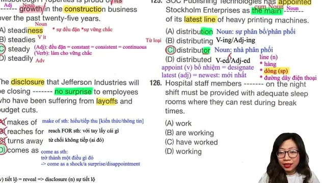

* **Đề bài và phương án:**
  * *SOC Publishing Technologies has appointed Stockholm Enterprises as the main ------- of its latest line of heavy printing machines.*
  * A. distribution
  * B. distributing
  * C. distributor
  * D. distributed
* **Phân tích ngữ pháp:**
  * Vị trí chỗ trống nằm trong cụm: `as the main ------- of its latest line...`.
  * Đứng sau mạo từ `the` và tính từ `main`, đứng trước giới từ `of` bắt buộc phải là một danh từ (`the + main + Noun`).
  * Xét hai danh từ:
    * Phương án A (`distribution`): Danh từ chỉ sự phân phối, việc phân phối hàng hóa.
    * Phương án C (`distributor`): Danh từ chỉ người hoặc tổ chức đóng vai trò nhà phân phối.
  * Đối tượng được bổ nhiệm là `Stockholm Enterprises` (Doanh nghiệp Stockholm). Một doanh nghiệp đóng vai trò là "nhà phân phối chính" (`the main distributor`) cho dòng máy in mới.
  * **Đáp án đúng:** **C** (`distributor`).
* **Dịch nghĩa:** Công ty Công nghệ Xuất bản SOC đã bổ nhiệm Doanh nghiệp Stockholm làm nhà phân phối chính cho dòng máy in công nghiệp nặng mới nhất của mình.
* **Mở rộng kiến thức:**
  * `distributor` (danh từ): nhà phân phối sản phẩm.
  * `distribution` (danh từ): mạng lưới phân phối, sự phân bổ.
  * `appoint somebody/something as...`: bổ nhiệm ai/tổ chức nào làm vị trí gì.
  * `latest line of products`: dòng sản phẩm mới nhất (`line` = dòng sản phẩm).

---

### [[01:06:10](https://www.youtube.com/watch?v=Kmym0ByOy9s&t=3970s)] Câu 126: Quan hệ rút gọn

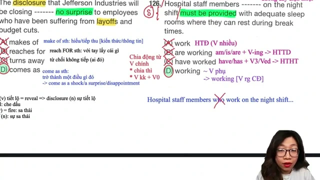

* **Đề bài và phương án:**
  * *Hospital staff members ------- on the night shift must be provided with adequate sleep rooms where they can rest during break times.*
  * A. work
  * B. are working
  * C. have worked
  * D. working
* **Phân tích ngữ pháp:**
  * Cấu trúc câu đã có động từ chính hoàn chỉnh được chia ở thể bị động khiếm khuyết: `must be provided with` (phải được cung cấp).
  * Do câu chỉ có một mệnh đề chính và không có liên từ nối, vị trí chỗ trống đứng sau chủ ngữ `Hospital staff members` không thể là một động từ chính chia thì tiếp theo.
  * Loại các phương án A, B, C vì đều là các dạng động từ chính chia thì (`work`, `are working`, `have worked`).
  * Vị trí cần một động từ phụ đóng vai trò Reduced Relative Clause dạng chủ động. Câu gốc đầy đủ: `Hospital staff members who work on the night shift...`. Rút gọn bằng cách lược bỏ `who` và chuyển động từ sang dạng V-ing: `working on the night shift`.
  * **Đáp án đúng:** **D** (`working`).
* **Dịch nghĩa:** Các nhân viên bệnh viện làm việc vào ca đêm phải được cung cấp phòng ngủ đầy đủ tiện nghi, nơi họ có thể nghỉ ngơi trong các khung giờ giải lao.
* **Mở rộng kiến thức:**
  * Rút gọn mệnh đề quan hệ chủ động: `who / which + Verb -> V-ing`.
  * `night shift`: ca làm việc ban đêm.
  * `be provided with something`: được cung cấp cái gì.
  * `adequate` (tính từ): đầy đủ, thỏa đáng, đáp ứng tốt nhu cầu.

---

### [[01:11:40](https://www.youtube.com/watch?v=Kmym0ByOy9s&t=4300s)] Câu 127: Đại từ quan hệ

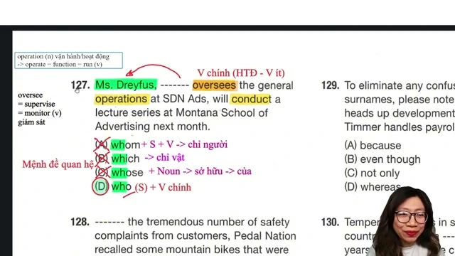

* **Đề bài và phương án:**
  * *Ms. Dreyfus, ------- oversees the general operations at SDN Ads, will conduct a lecture series at Montana School of Advertising next month.*
  * A. whom
  * B. which
  * C. whose
  * D. who
* **Phân tích ngữ pháp:**
  * Thành phần giữa hai dấu phẩy là mệnh đề quan hệ bổ nghĩa cho danh từ riêng chỉ người: `Ms. Dreyfus`.
  * Phía sau chỗ trống là động từ chia thì hiện tại đơn ngôi thứ ba số ít: `oversees` (giám sát).
  * Vị trí cần một đại từ quan hệ thay thế cho danh từ chỉ người và đóng vai trò làm chủ ngữ cho động từ `oversees`.
  * Xét các phương án:
    * Phương án A (`whom`): Đại từ quan hệ chỉ người làm tân ngữ (`whom + S + V`), không làm chủ ngữ.
    * Phương án B (`which`): Đại từ quan hệ thay thế cho danh từ chỉ đồ vật hoặc sự việc.
    * Phương án C (`whose`): Đại từ quan hệ chỉ sở hữu, bắt buộc theo sau phải là danh từ (`whose + Noun`).
    * Phương án D (`who`): Đại từ quan hệ chỉ người làm chủ ngữ đứng trước động từ (`who + Verb`).
  * **Đáp án đúng:** **D** (`who`).
* **Dịch nghĩa:** Bà Dreyfus, người giám sát các hoạt động vận hành chung tại Công ty Quảng cáo SDN, sẽ tổ chức một chuỗi bài giảng tại Trường Quảng cáo Montana vào tháng tới.
* **Mở rộng kiến thức:**
  * `who + Verb`: Đại từ quan hệ đóng vai trò chủ ngữ chỉ người.
  * `oversee = supervise = monitor` (động từ): giám sát, quản lý bao quát.
  * `general operations`: các hoạt động vận hành chung.
  * `conduct = implement = carry out = perform` (động từ): tiến hành, tổ chức thực hiện.

---

### [[01:17:35](https://www.youtube.com/watch?v=Kmym0ByOy9s&t=4655s)] Câu 128: Giới từ nguyên nhân

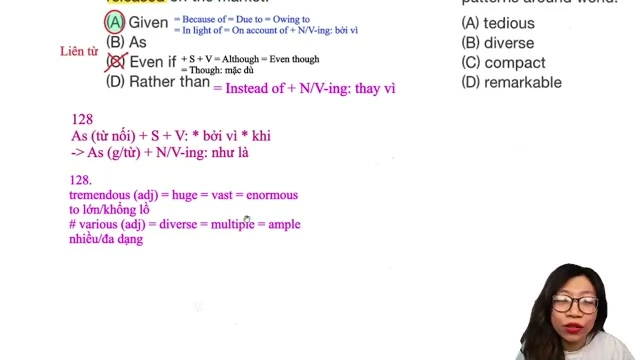

* **Đề bài và phương án:**
  * *------- the tremendous number of safety complaints from customers, Pedal Nation recalled some mountain bikes that were released on the market.*
  * A. Given
  * B. As
  * C. Even if
  * D. Rather than
* **Phân tích ngữ pháp:**
  * Vị trí đứng đầu câu trước một cụm danh từ dài: `the tremendous number of safety complaints from customers` (số lượng khổng lồ các khiếu nại về an toàn từ khách hàng). Phía sau dấu phẩy là mệnh đề chính hoàn chỉnh.
  * Vị trí này đòi hỏi một giới từ kết hợp với cụm danh từ (`Preposition + Noun Phrase`).
  * Xét các phương án:
    * Phương án A (`Given`): Đóng vai trò giới từ mang nghĩa dựa vào, xét đến, bởi vì (`Given = Because of = Due to = Owing to = In light of = On account of + Noun / V-ing`). Phù hợp chuẩn xác cả ngữ pháp và ngữ nghĩa nguyên nhân.
    * Phương án B (`As`): Nếu là liên từ thì đi với mệnh đề `S + V`. Nếu là giới từ thì mang nghĩa "như là / với tư cách là", không chỉ nguyên nhân đi với danh từ chỉ số lượng khiếu nại.
    * Phương án C (`Even if`): Liên từ phụ thuộc đi với mệnh đề `S + V` mang nghĩa ngay cả khi hoặc dù cho.
    * Phương án D (`Rather than`): Mang nghĩa thay vì (`= instead of`), không hợp logic với quyết định thu hồi sản phẩm.
  * **Đáp án đúng:** **A** (`Given`).
* **Dịch nghĩa:** Trước số lượng khổng lồ các khiếu nại về độ an toàn từ khách hàng, Hãng Pedal Nation đã thu hồi một số dòng xe đạp địa hình từng được tung ra thị trường.
* **Mở rộng kiến thức:**
  * `Given + Noun Phrase`: Xét đến, căn cứ vào, do bởi (`= Because of = In light of`).
  * `tremendous = huge = vast = enormous` (tính từ): cực kỳ lớn, khổng lồ.
  * `safety complaints`: khiếu nại về độ an toàn.
  * `recall` (động từ): thu hồi sản phẩm lỗi.

---

### [[01:33:00](https://www.youtube.com/watch?v=Kmym0ByOy9s&t=5580s)] Câu 129: Liên từ tương phản

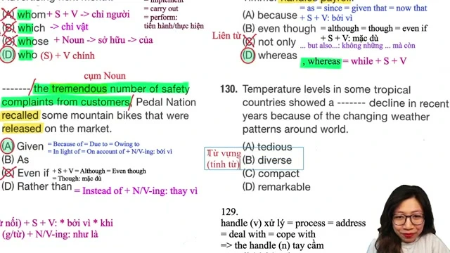

* **Đề bài và phương án:**
  * *To eliminate any confusion with their similar surnames, please note that Mr. Timmons heads up development team, ------- Mr. Timmer handles payroll.*
  * A. because
  * B. even though
  * C. not only
  * D. whereas
* **Phân tích ngữ pháp:**
  * Câu cần liên kết hai mệnh đề mô tả hai phân công công việc đối chiếu nhau giữa hai nhân sự có họ tên dễ nhầm lẫn:
    * Mệnh đề 1: `Mr. Timmons heads up development team` (Ông Timmons phụ trách nhóm phát triển).
    * Mệnh đề 2: `Mr. Timmer handles payroll` (Ông Timmer xử lý việc chi trả lương).
  * Vị trí giữa hai mệnh đề (ngăn cách bởi dấu phẩy `, -------`) cần một liên từ thể hiện sự so sánh đối chiếu, tương phản trực tiếp giữa hai sự việc diễn ra song song.
  * Xét các phương án:
    * Phương án A (`because`): Liên từ nguyên nhân (bởi vì = `as = since = given that = now that`). Không có quan hệ nhân quả giữa hai bộ phận.
    * Phương án B (`even though`): Liên từ nhượng bộ (mặc dù = `although = though`).
    * Phương án C (`not only`): Cặp liên từ tương liên đòi hỏi vế sau phải có `but also`, câu không có `but also`.
    * Phương án D (`whereas`): Liên từ tương phản mang nghĩa "trong khi đó" (`whereas = while + S + V`). Dùng để đối chiếu song song hai đối tượng hoặc hai nhiệm vụ khác biệt nhau.
  * **Đáp án đúng:** **D** (`whereas`).
* **Dịch nghĩa:** Nhằm xóa bỏ mọi sự nhầm lẫn về những nhân viên có họ tương tự nhau, xin lưu ý rằng ông Timmons phụ trách nhóm phát triển, trong khi ông Timmer phụ trách mảng bảng lương.
* **Mở rộng kiến thức:**
  * `, whereas + S + V`: trong khi đó (đối chiếu song song hai vế).
  * `eliminate = remove = get rid of` (động từ): loại trừ, triệt tiêu sự nhầm lẫn.
  * `head up` (cụm động từ): lãnh đạo, đứng đầu một đội ngũ.
  * `handle = process = deal with = cope with` (động từ): giải quyết, phụ trách.

---

### [[01:38:30](https://www.youtube.com/watch?v=Kmym0ByOy9s&t=5910s)] Câu 130: Tính từ mức độ

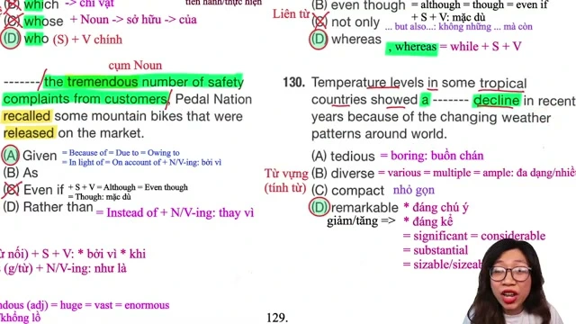

* **Đề bài và phương án:**
  * *Temperature levels in some tropical countries showed a ------- decline in recent years because of the changing weather patterns around world.*
  * A. tedious
  * B. diverse
  * C. compact
  * D. remarkable
* **Phân tích ngữ pháp:**
  * Chỗ trống nằm trong cụm danh từ: `a ------- decline` (mạo từ `a` + chỗ trống + danh từ `decline`). Vị trí này cần một tính từ bổ nghĩa cho mức độ suy giảm của nhiệt độ.
  * Phân tích ý nghĩa các tính từ:
    * Phương án A (`tedious`): tẻ nhạt, buồn chán (`= boring = dull`).
    * Phương án B (`diverse`): đa dạng, phong phú (`= various = multiple = ample`).
    * Phương án C (`compact`): nhỏ gọn, cô đọng.
    * Phương án D (`remarkable`): đáng chú ý, nổi bật. Khi kết hợp với các danh từ chỉ sự biến động tăng hoặc giảm (`increase, decrease, decline, drop, growth`), tính từ `remarkable` mang nghĩa "đáng kể, rõ rệt" (`= significant = considerable = substantial = sizable`).
  * Cụm từ `a remarkable decline` mô tả sự sụt giảm đáng kể về mức nhiệt độ.
  * **Đáp án đúng:** **D** (`remarkable`).
* **Dịch nghĩa:** Mức nhiệt độ ở một số quốc gia nhiệt đới đã cho thấy sự sụt giảm đáng kể trong những năm gần đây do sự thay đổi của các hình thái thời tiết trên khắp thế giới.
* **Mở rộng kiến thức:**
  * `a remarkable decline / increase`: sự sụt giảm / gia tăng đáng kể.
  * Nhóm tính từ chỉ mức độ biến động lớn: `remarkable = significant = considerable = substantial = dramatic = sharp`.
  * `weather patterns`: các hình thái thời tiết.
  * `tropical countries`: các quốc gia vùng nhiệt đới.

---

## Trích dẫn then chốt

* [[00:01:25](https://www.youtube.com/watch?v=Kmym0ByOy9s&t=85s)] "Khi gặp thông báo về một sự việc, động từ notify thường đi liền với giới từ regarding mang nghĩa về vấn đề gì, tương đương hoàn toàn với about hay concerning."
* [[00:15:20](https://www.youtube.com/watch?v=Kmym0ByOy9s&t=920s)] "Đại từ each có cách dùng rất độc đáo khi đứng ngay sau chủ ngữ số nhiều để nhấn mạnh từng cá thể riêng lẻ trong một tập thể."
* [[00:33:15](https://www.youtube.com/watch?v=Kmym0ByOy9s&t=1995s)] "Cụm thành ngữ come as no surprise là một Collocation kinh điển trong đề thi TOEIC để diễn đạt một tin tức hoàn toàn nằm trong dự liệu."
* [[01:08:40](https://www.youtube.com/watch?v=Kmym0ByOy9s&t=4120s)] "Trong một câu đã có động từ chính chia thì hoàn chỉnh, chỗ trống đứng sau chủ ngữ bắt buộc phải là mệnh đề quan hệ rút gọn dạng V-ing hoặc V-ed."
* [[01:19:10](https://www.youtube.com/watch?v=Kmym0ByOy9s&t=4750s)] "Given đứng trước cụm danh từ đóng vai trò như một giới từ chỉ nguyên nhân, mang nghĩa căn cứ vào hoặc xét đến một thực tế đã xảy ra."

---

## Lệnh & Công cụ

#### Công thức ngữ pháp cốt lõi
* `notify somebody regarding / about / of something`: thông báo cho ai về việc gì.
* `Subject (số nhiều) + each + Verb`: đại từ phân phối nhấn mạnh từng thành viên riêng lẻ.
* `come as a shock / a surprise / disappointment`: diễn ra như một sự ngạc nhiên / thất vọng.
* `Reduced Relative Clause`: `Noun + who/which + Verb (chủ động) -> Noun + V-ing`.
* `Given + Noun Phrase`: `Given = Because of = Due to = In light of + Noun Phrase`.
* `, whereas + S + V`: liên từ đối chiếu tương phản hai mệnh đề song song.

#### Bảng đối chiếu từ vựng đồng nghĩa
| Thuật ngữ gốc | Nhóm từ đồng nghĩa tương đương | Ý nghĩa ngữ cảnh |
| :--- | :--- | :--- |
| **Regarding** | about, concerning, as for, with regard to | Về việc, liên quan đến |
| **Urgently** | desperately, critically, pressingly | Cấp bách, khẩn thiết |
| **Oversee** | supervise, monitor, manage, administer | Giám sát, quản lý bao quát |
| **Conduct** | implement, carry out, perform, execute | Tiến hành, thực hiện |
| **Tremendous** | huge, vast, enormous, immense | Cực kỳ to lớn, khổng lồ |
| **Remarkable** | significant, considerable, substantial, sizable | Đáng kể, rõ rệt khi biến động |

---

## Đánh đổi & Rủi ro

#### Bẫy hai động từ chính trong câu
Tại câu 126, lỗi sai phổ biến nhất của thí sinh là chọn các động từ chia thì như `work`, `are working` hoặc `have worked`.
* **Nguyên nhân:** Thí sinh chỉ nhìn thấy chủ ngữ `Hospital staff members` rồi vội vã chia thì mà không quét hết câu để nhận ra động từ chính `must be provided with` nằm ở phía sau.
* **Hậu quả:** Tạo ra lỗi sai cấu trúc nghiêm trọng khi một mệnh đề đơn có hai động từ chính chia thì mà không có liên từ nối.
* **Cách khắc phục:** Luôn quét cấu trúc hai phía để xác định vị trí của động từ chính trước khi quyết định điền động từ.

#### Bẫy phân định giới từ và liên từ
Tại câu 116 và câu 128, thí sinh thường nhầm lẫn giữa các cặp từ nối và giới từ:
* Nhầm `since` (đi với mốc thời gian quá khứ) với `regarding` (đi với nội dung sự việc tương lai).
* Nhầm `as` (khi/bởi vì đi với mệnh đề `S + V`) với `Given` (giới từ đi với cụm danh từ).
* Quy tắc khắc phục: Kiểm tra ngay sau chỗ trống là mệnh đề có động từ chia thì hay chỉ là cụm danh từ để loại trừ dứt điểm 50% phương án gây nhiễu.
