# GIẢI ĐỀ TOEIC 2025 MỚI NHẤT | TEST 6 [VIDEO 1]

* **Kênh:** Anh ngữ Ms Thanh | **Thời lượng:** 01:43:11 | **Ngày:** 2025-11-30
* **Video:** https://www.youtube.com/watch?v=R6l7KYxHaeA

---

## Thuật ngữ

| Thuật ngữ | Giải thích |
| :--- | :--- |
| Part 5 Incomplete Sentences | Dạng bài điền vào chỗ trống trắc nghiệm 4 lựa chọn trong đề thi TOEIC Reading |
| Collocation | Cụm từ cố định thường xuyên đi kèm với nhau theo thói quen ngôn ngữ bản xứ |
| Prepositional Phrase | Cụm giới từ gồm giới từ đi kèm danh từ, đại từ hoặc danh động từ làm bổ ngữ |
| Possessive Adjective | Tính từ sở hữu đứng trước danh từ để bổ nghĩa và xác định quyền sở hữu |
| Relative Clause | Mệnh đề quan hệ dùng để bổ nghĩa cho tiền từ đứng trước |
| Quantifier | Lượng từ dùng để chỉ số lượng đi kèm danh từ đếm được hoặc không đếm được |
| Passive Voice | Thể bị động diễn tả chủ ngữ chịu tác động trực tiếp của hành động |
| Compound Noun | Danh từ ghép cấu tạo từ hai hoặc nhiều từ đơn kết hợp thành một khái niệm |

---

## Tổng luận chuyên đề

#### Xác định từ loại và trật tự từ

Các câu hỏi ngữ pháp Part 5 yêu cầu phân tích nhanh thành phần câu xung quanh chỗ trống:
* **Vị trí trạng từ:** Đứng giữa trợ động từ và động từ chính (`will be + automatically + locked`), đứng sau động từ và tân ngữ bổ nghĩa cho cách thức hành động (`connect the video camera + directly + to...`), hoặc đứng trước V-ing bổ nghĩa hành vi (`by + actively + engaging in`).
* **Vị trí tính từ sở hữu:** Đứng trước cụm danh từ (`their + impressive ability`) để làm rõ đối tượng thực hiện hoặc sở hữu phẩm chất.
* **Vị trí danh từ chủ ngữ:** Đứng đầu câu trước cụm giới từ và vị ngữ chính (`Nominations + for the annual award + must be submitted`).

#### Collocation và cấu trúc giới từ cố định

Đề thi kiểm tra độ nhạy về việc ghi nhớ các cụm giới từ và động từ đi kèm:
* Cụm danh từ đi với giới từ: `vacancies for somebody/something` (vị trí tuyển dụng cho ai), `investments in something` (đầu tư vào lĩnh vực gì), `nominations for something` (đề cử cho giải thưởng gì).
* Tính từ đi với giới từ: `close to` (gần với cái gì, tương đương `near`).
* Động từ đi với giới từ: `engage in` (tham gia vào), `contribute to` (đóng góp vào), `apply for` (ứng tuyển vào vị trí nào).

#### Lượng từ và danh từ đếm được

Phân biệt chặt chẽ lượng từ chỉ số lượng đi với danh từ đếm được số nhiều và danh từ không đếm được:
* Đi với danh từ đếm được số nhiều: `a few`, `few`, `many`, `several`.
* Đi với danh từ không đếm được: `a little`, `little`, `much`, `less`.
* Tránh bẫy danh từ đếm được số ít đứng trơ trọi không có mạo từ: Từ như `forecast` là danh từ đếm được, khi đứng độc lập làm bổ ngữ không có mạo từ `a/the` thì bắt buộc phải ở dạng số nhiều `forecasts`.

#### Mệnh đề quan hệ rút gọn và thì quá khứ

* Mệnh đề quan hệ tỉnh lược đại từ quan hệ làm tân ngữ: Cấu trúc `the position [that/which] he applied for last week`. Khi động từ đi kèm giới từ cố định (`apply for`), giới từ `for` bắt buộc phải giữ lại ở cuối mệnh đề.
* Nhận diện mốc thời gian quá khứ xác định: Sự xuất hiện của trạng ngữ chỉ thời gian quá khứ (`last week`) đòi hỏi động từ chia ở thì Past Simple (`applied`), không dùng thì Present Perfect hoặc Present Simple.

---

## Bóc tách chi tiết

### [[00:07:45](https://www.youtube.com/watch?v=R6l7KYxHaeA&t=465s)] Câu 101 Giới từ chỉ đối tượng tuyển dụng

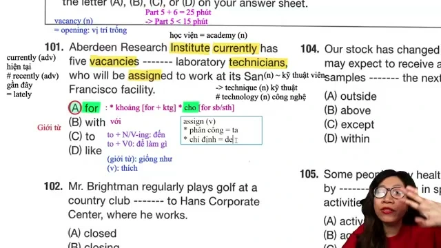

**Đề bài:**
> Kestner Laboratories will soon advertise vacancies ------- laboratory technicians.
> (A) for
> (B) upon
> (C) between
> (D) except

**Phân tích các phương án:**
* **(A) for:** Chính xác. Cụm cấu trúc chuẩn trong tuyển dụng: `vacancies for somebody / positions for somebody` mang nghĩa "các vị trí tuyển dụng dành cho đối tượng nào".
* **(B) upon:** Sai. `upon` mang nghĩa trang trọng của `on` (ở trên bề mặt, hoặc ngay khi), không kết hợp với danh từ vacancy.
* **(C) between:** Sai. `between` mang nghĩa ở giữa hai đối tượng, thường đi kèm cấu trúc "between A and B" hoặc danh từ số nhiều chỉ hai bên.
* **(D) except:** Sai. `except` mang nghĩa ngoại trừ, không tạo ra nghĩa hợp lý trong câu thông báo tuyển dụng.

**Mở rộng kiến thức:**
* `vacancy` (danh từ): vị trí tuyển dụng trống, phòng trống trong khách sạn.
* `vacant` (tính từ): còn trống, chưa có người đảm nhận (`a vacant position`).
* `laboratory technician` (cụm danh từ ghép): kỹ thuật viên phòng thí nghiệm.

---

### [[00:13:45](https://www.youtube.com/watch?v=R6l7KYxHaeA&t=825s)] Câu 102 Cụm tính từ chỉ khoảng cách vị trí

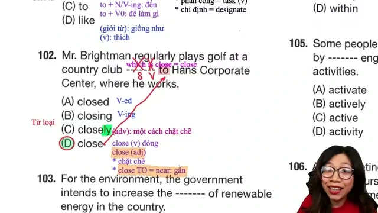

**Đề bài:**
> Our office is located ------- to the train station, making it convenient for commuters.
> (A) alongside
> (B) nearby
> (C) closely
> (D) close

**Phân tích các phương án:**
* **(D) close:** Chính xác. Cụm cố định `close to something` = `near something` chỉ khoảng cách địa lý gần gũi ("văn phòng của chúng tôi nằm gần nhà ga xe lửa").
* **(A) alongside:** Sai. `alongside` là giới từ đứng trực tiếp trước danh từ (ví dụ: `alongside the road`), không đi với giới từ `to`.
* **(B) nearby:** Sai. `nearby` là tính từ đứng trước danh từ (`nearby station`) hoặc trạng từ đứng độc lập (`live nearby`), không bao giờ đi kèm cấu trúc `nearby to`.
* **(C) closely:** Sai. `closely` là trạng từ mang nghĩa "một cách chặt chẽ, sát sao" (ví dụ: `work closely with`, `closely monitored`), không dùng để chỉ khoảng cách vật lý.

**Mở rộng kiến thức:**
* `commuter` (danh từ): người đi làm hàng ngày bằng phương tiện giao thông.
* `commute` (động từ/danh từ): việc di chuyển đi làm đều đặn.
* `make it convenient for somebody`: tạo điều kiện thuận lợi cho ai.

---

### [[00:22:00](https://www.youtube.com/watch?v=R6l7KYxHaeA&t=1320s)] Câu 103 Danh từ nguồn cung năng lượng

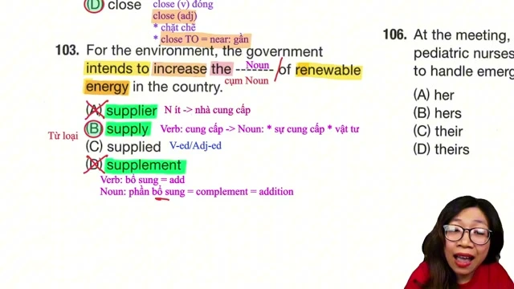

**Đề bài:**
> In order to increase the ------- of renewable energy, the government plans to build several wind farms along the coast.
> (A) capacity
> (B) supply
> (C) expense
> (D) access

**Phân tích các phương án:**
* **(B) supply:** Chính xác. Cụm từ `the supply of renewable energy` mang nghĩa "nguồn cung năng lượng tái tạo". Ngữ cảnh câu là xây dựng thêm trang trại điện gió để gia tăng nguồn cung năng lượng.
* **(A) capacity:** Sai. `capacity` mang nghĩa sức chứa, dung tích, công suất. Thường dùng trong cấu trúc `capacity to do something` hoặc `generating capacity`, không tự nhiên bằng `supply of energy` khi kết hợp với hành động sản xuất cấp nguồn.
* **(C) expense:** Sai. `expense` mang nghĩa chi phí, trái ngược với mục tiêu phát triển kinh tế và năng lượng của chính phủ.
* **(D) access:** Sai. `access` mang nghĩa sự tiếp cận, thường đi với giới từ `to` (`access to renewable energy`), không dùng cấu trúc `access of`.

**Mở rộng kiến thức:**
* `renewable energy`: năng lượng tái tạo (điện gió, điện mặt trời, thủy điện).
* `wind farm`: trang trại điện gió, cụm tuabin gió.
* `in order to + V_bare`: để làm gì (chỉ mục đích hành động).

---

### [[00:27:20](https://www.youtube.com/watch?v=R6l7KYxHaeA&t=1640s)] Câu 104 Giới từ thời hạn hoàn thành kiểm tra

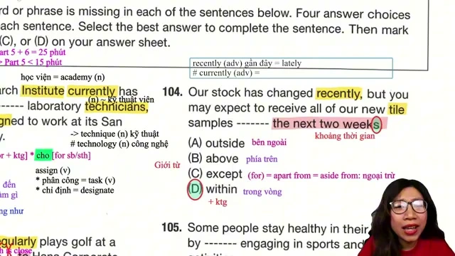

**Đề bài:**
> The maintenance team will inspect the heating system ------- the next two weeks to ensure it operates properly during winter.
> (A) among
> (B) into
> (C) across
> (D) within

**Phân tích các phương án:**
* **(D) within:** Chính xác. Cấu trúc `within + khoảng thời gian` diễn tả hành động xảy ra trong vòng bao lâu (`within the next two weeks`: trong vòng hai tuần tới).
* **(A) among:** Sai. `among` mang nghĩa trong số nhiều đối tượng (từ 3 đối tượng trở lên), không đi với khoảng thời gian để chỉ hạn định.
* **(B) into:** Sai. `into` là giới từ chỉ hướng chuyển động vào bên trong hoặc chuyển đổi trạng thái.
* **(C) across:** Sai. `across` đi với địa điểm (ngang qua, khắp nơi: `across the region`), không dùng để chỉ mốc hoàn tất trong khoảng thời gian xác định.

**Mở rộng kiến thức:**
* `maintenance team`: đội ngũ bảo trì kỹ thuật.
* `operate properly`: vận hành trơn tru, hoạt động bình thường đúng quy chuẩn.
* `ensure that`: đảm bảo điều gì đó xảy ra.

---

### [[00:33:15](https://www.youtube.com/watch?v=R6l7KYxHaeA&t=1995s)] Câu 105 Trạng từ bổ nghĩa cho danh động từ

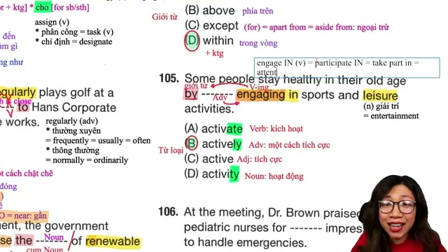

**Đề bài:**
> Employees can contribute to the success of the project by ------- engaging in team discussions and sharing their ideas.
> (A) active
> (B) actively
> (C) activity
> (D) activate

**Phân tích các phương án:**
* **(B) actively:** Chính xác. Đứng trước và bổ nghĩa cho V-ing (`engaging`) trong cấu trúc giới từ `by + V-ing` bắt buộc phải là một trạng từ chỉ mức độ/thái độ hành động (`by actively engaging in`: bằng cách chủ động tham gia vào).
* **(A) active:** Sai. `active` là tính từ, chỉ dùng bổ nghĩa cho danh từ, không bổ nghĩa cho động từ/V-ing.
* **(C) activity:** Sai. `activity` là danh từ (hoạt động).
* **(D) activate:** Sai. `activate` là động từ nguyên mẫu (kích hoạt).

**Mở rộng kiến thức:**
* `engage in something`: chủ động tham gia, tham dự vào một hoạt động.
* `contribute to + N / V-ing`: đóng góp vào sự thành công hoặc kết quả của việc gì.
* `share ideas`: chia sẻ ý tưởng đóng góp.

---

### [[00:41:30](https://www.youtube.com/watch?v=R6l7KYxHaeA&t=2490s)] Câu 106 Tính từ sở hữu trước cụm danh từ

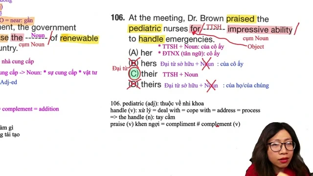

**Đề bài:**
> The marketing team was commended for ------- impressive ability to analyze customer feedback and adapt strategies accordingly.
> (A) they
> (B) them
> (C) their
> (D) themselves

**Phân tích các phương án:**
* **(C) their:** Chính xác. Chỗ trống đứng trước cụm danh từ `impressive ability` (tính từ + danh từ), đóng vai trò làm tính từ sở hữu xác định chủ quyền của marketing team.
* **(A) they:** Sai. `they` là đại từ nhân xưng chủ ngữ, chỉ đứng đầu mệnh đề làm Subject trước động từ.
* **(B) them:** Sai. `them` là đại từ tân ngữ, chỉ đứng sau động từ hoặc giới từ khi không có danh từ theo sau làm trung tâm.
* **(D) themselves:** Sai. `themselves` là đại từ phản thân, không dùng đứng trước cụm danh từ để bổ nghĩa thay cho tính từ sở hữu.

**Mở rộng kiến thức:**
* `commend somebody for something`: khen ngợi, biểu dương ai vì điều gì.
* `impressive ability`: khả năng ấn tượng, năng lực xuất sắc.
* `adapt strategies accordingly`: điều chỉnh các chiến lược một cách tương ứng, phù hợp.

---

### [[00:46:15](https://www.youtube.com/watch?v=R6l7KYxHaeA&t=2775s)] Câu 107 Trạng từ trong thể bị động thì tương lai

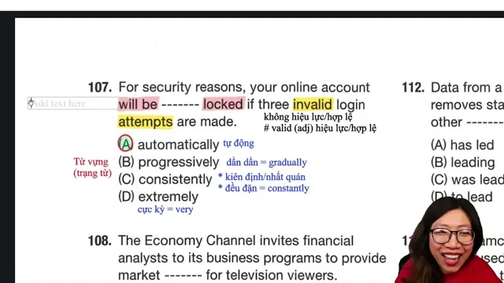

**Đề bài:**
> To protect sensitive documents, the file storage room will be ------- locked after 7:00 P.M. each day.
> (A) automatically
> (B) automated
> (C) automation
> (D) automatic

**Phân tích các phương án:**
* **(A) automatically:** Chính xác. Vị trí nằm giữa trợ động từ bị động `will be` và phân từ hai `locked` đòi hỏi một trạng từ thể hiện cách thức vận hành (`will be automatically locked`: sẽ được tự động khóa lại).
* **(B) automated:** Sai. `automated` là dạng phân từ hai/tính từ, không thể ghép hai phân từ liên tiếp `automated locked`.
* **(C) automation:** Sai. `automation` là danh từ chỉ sự tự động hóa.
* **(D) automatic:** Sai. `automatic` là tính từ, không đứng giữa trợ động từ và V3/ed để bổ nghĩa cho động từ.

**Mở rộng kiến thức:**
* `sensitive documents`: tài liệu mật, hồ sơ quan trọng cần bảo mật.
* `file storage room`: phòng lưu trữ hồ sơ, kho tài liệu.
* `automatic` (adj) -> `automatically` (adv): tự động.

---

### [[00:52:45](https://www.youtube.com/watch?v=R6l7KYxHaeA&t=3165s)] Câu 108 Danh từ ghép số nhiều trong ngữ cảnh dự báo

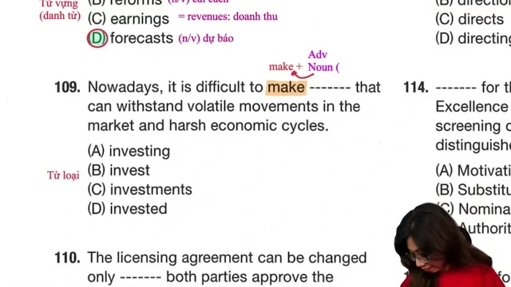

**Đề bài:**
> According to recent market -------, consumer demand for electric vehicles will continue to rise over the next decade.
> (A) forecast
> (B) forecasting
> (C) forecasted
> (D) forecasts

**Phân tích các phương án:**
* **(D) forecasts:** Chính xác. Cụm danh từ ghép `market forecasts` mang nghĩa "các bản dự báo thị trường". `forecast` là danh từ đếm được; trong câu đứng sau tính từ `recent` mà không có mạo từ `a/the` phía trước, bắt buộc danh từ phải ở dạng số nhiều `forecasts`.
* **(A) forecast:** Sai. Nếu là danh từ số ít thì bắt buộc phải có mạo từ đứng trước (`a recent market forecast`).
* **(B) forecasting:** Sai. `forecasting` là danh động từ chỉ hành động dự báo, không diễn tả các bản báo cáo số liệu cụ thể.
* **(C) forecasted:** Sai. `forecasted` là dạng động từ quá khứ hoặc phân từ hai.

**Mở rộng kiến thức:**
* `market forecast`: dự báo thị trường.
* `consumer demand`: nhu cầu tiêu dùng của khách hàng.
* `electric vehicle`: phương tiện xe điện.
* `over the next decade`: trong suốt một thập kỷ tới.

---

### [[00:58:00](https://www.youtube.com/watch?v=R6l7KYxHaeA&t=3480s)] Câu 109 Cụm từ danh từ đi với động từ make

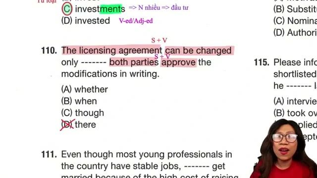

**Đề bài:**
> The finance committee decided to make substantial ------- in modern manufacturing equipment to improve factory efficiency.
> (A) investors
> (B) invest
> (C) investments
> (D) investing

**Phân tích các phương án:**
* **(C) investments:** Chính xác. Cụm kết hợp từ vựng chuẩn mực: `make investments in something` mang nghĩa "thực hiện các khoản đầu tư vào lĩnh vực nào". Sau tính từ `substantial` cần một danh từ chỉ sự vật/khoản tiền đầu tư.
* **(A) investors:** Sai. `investors` là danh từ chỉ người (các nhà đầu tư), không đi với cấu trúc "make investors in equipment".
* **(B) invest:** Sai. `invest` là động từ nguyên mẫu.
* **(D) investing:** Sai. `investing` là danh động từ, không kết hợp tự nhiên với tính từ `substantial` trong cụm diễn đạt tài chính này.

**Mở rộng kiến thức:**
* `substantial` (tính từ): đáng kể, to lớn, quan trọng (= `significant`, `considerable`).
* `manufacturing equipment`: thiết bị máy móc sản xuất công nghiệp.
* `factory efficiency`: hiệu suất hoạt động của nhà máy.

---

### [[01:03:45](https://www.youtube.com/watch?v=R6l7KYxHaeA&t=3825s)] Câu 110 Liên từ điều kiện chỉ mốc hiệu lực hợp đồng

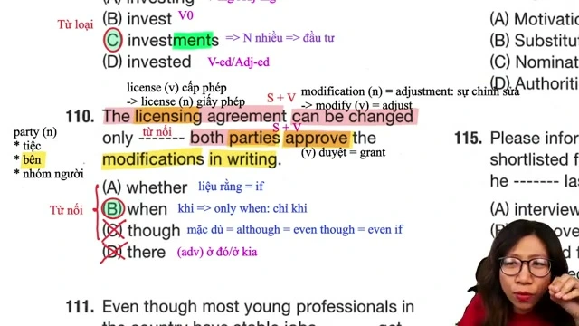

**Đề bài:**
> The contract will become effective only ------- both parties approve the revised terms and sign the final agreement.
> (A) although
> (B) when
> (C) during
> (D) unless

**Phân tích các phương án:**
* **(B) when:** Chính xác. Cụm liên từ `only when + S + V` mang nghĩa "chỉ khi mà cả hai bên cùng phê duyệt các điều khoản đã sửa đổi và ký kết thỏa thuận cuối cùng". Phía sau là mệnh đề hoàn chỉnh có chủ ngữ và vị ngữ.
* **(A) although:** Sai. `although` mang nghĩa nhượng bộ (mặc dù), hoàn toàn trái ngược logic pháp lý và không đi cùng cấu trúc `only although`.
* **(C) during:** Sai. `during` là giới từ chỉ đi kèm cụm danh từ (`during the meeting`), không kết nối hai mệnh đề độc lập.
* **(D) unless:** Sai. `unless` mang nghĩa "trừ khi" (mang hàm ý phủ định `if not`), làm sai lệch ý nghĩa điều kiện kích hoạt hiệu lực hợp đồng.

**Mở rộng kiến thức:**
* `become effective`: chính thức có hiệu lực thi hành.
* `both parties`: cả hai bên đối tác tham gia hợp đồng.
* `revised terms`: các điều khoản đã được chỉnh sửa, cập nhật.

---

### [[01:09:45](https://www.youtube.com/watch?v=R6l7KYxHaeA&t=4185s)] Câu 111 Lượng từ đi kèm danh từ đếm được số nhiều

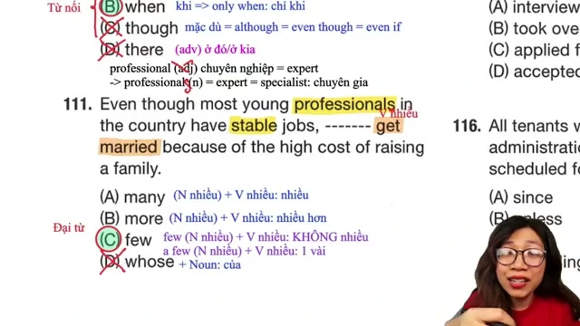

**Đề bài:**
> Although many people applied for the management position, only a ------- candidates possessed the required qualifications.
> (A) little
> (B) much
> (C) few
> (D) less

**Phân tích các phương án:**
* **(C) few:** Chính xác. Cụm lượng từ `a few + danh từ đếm được số nhiều` (`candidates`). Cụm từ `only a few candidates` mang nghĩa "chỉ một vài ứng viên".
* **(A) little:** Sai. `a little / little` chỉ đi kèm danh từ không đếm được (ví dụ: `a little water`, `little time`).
* **(B) much:** Sai. `much` chỉ đi kèm danh từ không đếm được trong câu phủ định hoặc nghi vấn.
* **(D) less:** Sai. `less` là dạng so sánh hơn của `little`, đi kèm danh từ không đếm được.

**Mở rộng kiến thức:**
* `qualification` (danh từ): bằng cấp, chứng chỉ, năng lực chuyên môn đáp ứng yêu cầu.
* `possess required qualifications`: sở hữu các phẩm chất/trình độ chuyên môn được yêu cầu.
* `apply for a position`: nộp hồ sơ ứng tuyển vào vị trí công việc.

---

### [[01:15:15](https://www.youtube.com/watch?v=R6l7KYxHaeA&t=4515s)] Câu 112 Phân từ đóng vai trò tính từ miêu tả thương hiệu

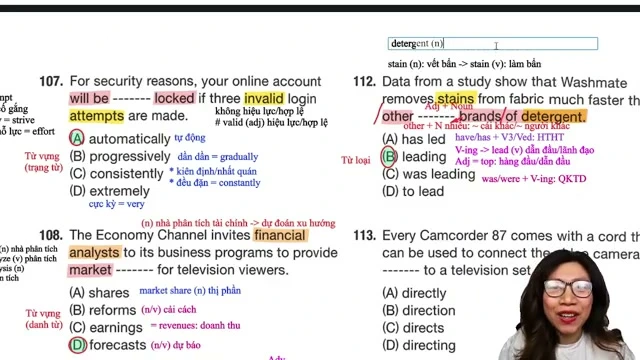

**Đề bài:**
> Compared with other ------- brands on the market, our new smartphone offers superior battery life at a lower price.
> (A) lead
> (B) leading
> (C) leaders
> (D) leadership

**Phân tích các phương án:**
* **(B) leading:** Chính xác. `leading` là hiện tại phân từ đóng vai trò tính từ, thường xuyên kết hợp trong cụm `leading brands / leading companies` mang nghĩa "các thương hiệu dẫn đầu, thương hiệu hàng đầu trên thị trường".
* **(A) lead:** Sai. `lead` là động từ nguyên mẫu hoặc danh từ, không thể làm tính từ đứng trước danh từ `brands` để chỉ phẩm chất hàng đầu.
* **(C) leaders:** Sai. `leaders` là danh từ số nhiều chỉ các nhà lãnh đạo/người đứng đầu.
* **(D) leadership:** Sai. `leadership` là danh từ trừu tượng chỉ khả năng lãnh đạo, vai trò lãnh đạo.

**Mở rộng kiến thức:**
* `superior battery life`: thời lượng pin vượt trội, bền bỉ hơn.
* `compared with / to`: khi so sánh đối chiếu với.
* `at a lower price`: với mức giá thấp hơn, kinh tế hơn.

---

### [[01:21:15](https://www.youtube.com/watch?v=R6l7KYxHaeA&t=4875s)] Câu 113 Trạng từ bổ nghĩa cho động từ kết nối

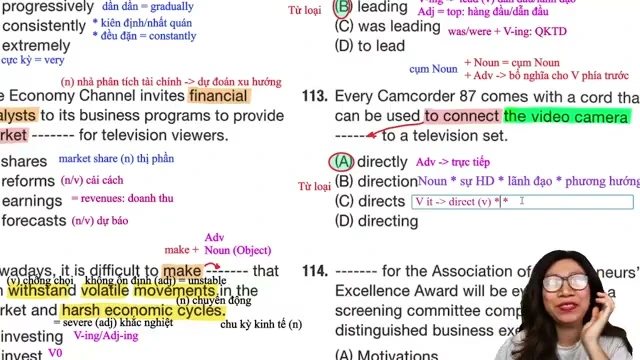

**Đề bài:**
> Users can connect the video camera ------- to a computer using the included USB cable without installing extra drivers.
> (A) directly
> (B) direct
> (C) directional
> (D) direction

**Phân tích các phương án:**
* **(A) directly:** Chính xác. Cấu trúc `connect something directly to something` mang nghĩa "kết nối trực tiếp thiết bị nào với thiết bị nào". Trạng từ `directly` bổ nghĩa cho hành động kết nối của động từ `connect`.
* **(B) direct:** Sai. `direct` là tính từ hoặc động từ, không dùng bổ nghĩa cho động từ hành động đã có tân ngữ.
* **(C) directional:** Sai. `directional` là tính từ chỉ phương hướng (ví dụ: `directional antenna`).
* **(D) direction:** Sai. `direction` là danh từ chỉ hướng đi hoặc sự hướng dẫn.

**Mở rộng kiến thức:**
* `included USB cable`: cáp USB đi kèm sẵn trong hộp sản phẩm.
* `driver` (trong công nghệ phần mềm): phần mềm điều khiển thiết bị phần cứng.
* `without installing`: mà không cần cài đặt thêm.

---

### [[01:37:30](https://www.youtube.com/watch?v=R6l7KYxHaeA&t=5850s)] Câu 114 Danh từ số nhiều làm chủ ngữ cho vị ngữ bị động

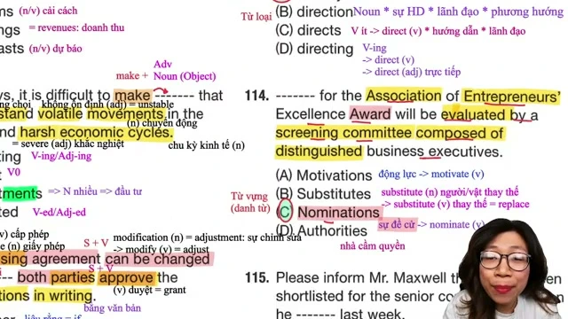

**Đề bài:**
> ------- for the annual Community Leadership Award must be submitted to the committee by Friday afternoon.
> (A) Nominate
> (B) Nominated
> (C) Nominations
> (D) Nominating

**Phân tích các phương án:**
* **(C) Nominations:** Chính xác. Đứng đầu câu làm chủ ngữ cho động từ bị động `must be submitted` cần một danh từ chỉ sự vật/hồ sơ (`Nominations`: các hồ sơ đề cử, các bản đề cử).
* **(A) Nominate:** Sai. `Nominate` là động từ nguyên mẫu, không thể đứng làm chủ ngữ.
* **(B) Nominated:** Sai. `Nominated` là động từ quá khứ hoặc phân từ hai.
* **(D) Nominating:** Sai. `Nominating` là danh động từ chỉ hành vi đề cử; bản thân hành vi không thể "được nộp cho hội đồng" (`be submitted`), mà phải là các bộ hồ sơ đề cử (`Nominations`).

**Mở rộng kiến thức:**
* `nomination` (danh từ): sự đề cử, hồ sơ đề cử.
* `nominee` (danh từ): người được đề cử nhận giải thưởng.
* `submit something to somebody`: nộp cái gì cho ai duyệt.
* `annual award`: giải thưởng được tổ chức thường niên hàng năm.

---

### [[01:42:45](https://www.youtube.com/watch?v=R6l7KYxHaeA&t=6165s)] Câu 115 Giới từ trong mệnh đề quan hệ rút gọn thì quá khứ

**Đề bài:**
> Mr. Tanaka was thrilled to learn that he was selected for the position he ------- last week.
> (A) applies
> (B) applying
> (C) applied for
> (D) has applied

**Phân tích các phương án:**
* **(C) applied for:** Chính xác. Cấu trúc mệnh đề quan hệ xác định lược bỏ đại từ quan hệ tân ngữ: `the position [which/that] he applied for last week`. Có hai yếu tố ngữ pháp then chốt:
  1. Trạng từ chỉ thời gian quá khứ xác định `last week` buộc động từ phải chia thì Past Simple (`applied`).
  2. Động từ `apply` khi đi với vị trí công việc bắt buộc phải có giới từ `for` (`apply for a position`). Khi mệnh đề quan hệ rút gọn đại từ làm tân ngữ, giới từ `for` bắt buộc phải giữ lại ở cuối mệnh đề.
* **(A) applies:** Sai. `applies` chia thì hiện tại đơn, mâu thuẫn hoàn toàn với mốc thời gian quá khứ `last week`.
* **(B) applying:** Sai. `applying` là dạng V-ing, không thể làm vị ngữ chính cho chủ ngữ `he` trong mệnh đề.
* **(D) has applied:** Sai. Thì hiện tại hoàn thành không được phép dùng với trạng từ thời gian quá khứ xác định như `last week`.

**Mở rộng kiến thức:**
* `thrilled to learn that`: vô cùng phấn khởi, vui mừng khi biết tin rằng.
* `be selected for`: được tuyển chọn vào một vị trí cụ thể.
* `apply for a position / job`: nộp hồ sơ ứng tuyển một công việc.

---

## Trích dẫn then chốt

* [[00:09:12](https://www.youtube.com/watch?v=R6l7KYxHaeA&t=552s)] "Khi gặp từ vacancy thì phản xạ ngay đến giới từ for, bởi vì trong tiếng Anh tuyển vị trí nào là vacancy for vị trí đó."
* [[00:15:30](https://www.youtube.com/watch?v=R6l7KYxHaeA&t=930s)] "Nhiều bạn cứ thấy to là chọn nearby, nhưng nearby tuyệt đối không đi với to. Chỉ có close to bằng với near mới chỉ khoảng cách gần."
* [[00:48:20](https://www.youtube.com/watch?v=R6l7KYxHaeA&t=2900s)] "Đứng giữa trợ động từ will be và động từ phân từ hai locked luôn là đất diễn của trạng từ đuôi ly để bổ nghĩa cho hành động."
* [[01:11:05](https://www.youtube.com/watch?v=R6l7KYxHaeA&t=4265s)] "Muốn làm đúng câu lượng từ, mắt phải nhìn ngay sang danh từ phía sau xem là danh từ đếm được hay không đếm được trước khi chọn."
* [[01:43:00](https://www.youtube.com/watch?v=R6l7KYxHaeA&t=6180s)] "Khi rút gọn đại từ quan hệ làm tân ngữ của giới từ, giới từ for của động từ apply for bắt buộc phải được giữ lại ở cuối câu."

---

## Lệnh & Công cụ

* **Phương pháp rà soát 3 bước Part 5:**
  1. Nhìn nhanh 4 phương án để phân loại câu hỏi (ngữ pháp từ loại, ngữ nghĩa từ vựng, hay giới từ/liên từ).
  2. Khoanh vùng cấu trúc ngữ pháp ngay trước và ngay sau chỗ trống để xác định thành phần còn thiếu.
  3. Chỉ dịch nghĩa toàn câu khi gặp câu hỏi thuần từ vựng hoặc cần kiểm tra sự hòa hợp ngữ nghĩa.
* **Bảng tra cứu lượng từ cơ bản:**
  * Danh từ đếm được số nhiều: `few`, `a few`, `many`, `several`, `both`.
  * Danh từ không đếm được: `little`, `a little`, `much`, `less`.

---

## Đánh đổi & Rủi ro

* **Bẫy nhầm lẫn giữa nearby và close:** `nearby` đóng vai trò là tính từ đứng trước danh từ hoặc phó từ đứng cuối câu, không đi kèm `to`. Chọn `nearby to` là lỗi phổ biến nhất trong đề thi Part 5.
* **Bẫy thiếu mạo từ của danh từ đếm được:** Nhầm lẫn giữa danh từ đếm được số ít và số nhiều (như `forecast` vs `forecasts`). Khi không có mạo từ `a/an/the` phía trước, danh từ đếm được bắt buộc phải ở dạng số nhiều.
* **Rủi ro rơi rụng giới từ trong mệnh đề quan hệ rút gọn:** Khi động từ có giới từ đi kèm như `apply for`, nhiều thí sinh chọn nhầm phương án thiếu `for`, dẫn đến câu sai ngữ pháp nghiêm ngặt trong tiếng Anh chuẩn.
