# Lộ Trình Backend Từ Nguyên Lý Gốc

* **Kênh:** Sriniously | **Thời lượng:** 00:31:24 | **Ngày:** 2024-09-23
* **Video:** https://www.youtube.com/watch?v=0Rwb4Xmlcwc

---

## Thuật ngữ

| Thuật ngữ | Giải thích |
| :--- | :--- |
| First Principles Thinking | Tư duy từ nguyên lý gốc; phương pháp phân rã hệ thống phức tạp về các thành phần cốt lõi và chân lý nền tảng thay vì sao chép khuôn mẫu có sẵn. |
| CRUD | Bốn thao tác cơ bản trên dữ liệu gồm Create, Read, Update, Delete. |
| Serialization & Deserialization | Quá trình chuyển đổi cấu trúc dữ liệu trong bộ nhớ thành chuỗi byte/text để truyền mạng qua Serialization và phục hồi ngược lại thành đối tượng trong bộ nhớ qua Deserialization. |
| Protocol Buffers (Protobuf) | Chuẩn tuần tự hóa dữ liệu nhị phân hiệu năng cao do Google phát triển, tối ưu dung lượng và tốc độ xử lý hơn so với JSON/XML. |
| RBAC, ABAC & ReBAC | Các mô hình kiểm soát quyền truy cập: Role-Based (dựa trên vai trò), Attribute-Based (dựa trên thuộc tính) và Relationship-Based (dựa trên mối quan hệ sở hữu đối tượng). |
| Fail-fast | Nguyên tắc thiết kế ngắt sớm tiến trình ngay khi phát hiện dữ liệu đầu vào không hợp lệ để bảo vệ tài nguyên và logic phía sau. |
| Middleware | Khối mã trung gian chặn giữa bộ định tuyến Router và bộ xử lý cuối (Handler/Controller), đảm nhiệm xác thực, logging, rate limiting hoặc tiền xử lý request. |
| Request Context | Đối tượng lưu trữ metadata gắn liền xuyên suốt vòng đời của một HTTP Request duy nhất qua các tầng xử lý (User ID, Trace ID, Deadline/Timeout). |
| Layered Architecture | Kiến trúc phân tầng tách bạch trách nhiệm: Presentation Layer (Controller/Router) -> Business Logic Layer (Service) -> Data Access Layer (Repository/Database). |
| Connection Pooling | Cơ chế duy trì một tập hợp các kết nối cơ sở dữ liệu mở sẵn để tái sử dụng, loại bỏ chi phí mở/đóng kết nối liên tục cho từng query. |
| Cache-Aside | Chiến lược cache phổ biến nhất: Ứng dụng kiểm tra cache trước, nếu cache miss thì truy vấn database rồi lưu kết quả vào cache để phục vụ các lần gọi sau. |
| Inverted Index | Cấu trúc dữ liệu chỉ mục đảo ngược trong các công cụ tìm kiếm như Elasticsearch, ánh xạ từng từ khóa về danh sách tài liệu chứa từ khóa đó. |
| Graceful Shutdown | Quy trình tắt máy chủ an toàn có kiểm soát: Ngừng nhận request mới, hoàn tất các request đang xử lý dở dang, giải phóng kết nối database và tài nguyên trước khi tiến trình dừng hoàn toàn. |
| 12-Factor App | Bộ mười hai nguyên tắc kiến trúc xây dựng ứng dụng đám mây (Cloud-native) hiện đại, bảo đảm tính mở rộng và dễ bảo trì. |
| OpenAPI Specification | Chuẩn đặc tả REST API định dạng máy đọc được (JSON/YAML), hỗ trợ sinh tài liệu Swagger và tạo mã tự động. |
| Webhook | Cơ chế giao tiếp hướng sự kiện Reverse API cho phép server chủ động phát thông báo dữ liệu sang server khác qua HTTP POST khi có sự kiện xảy ra. |

---

## Tổng luận chuyên đề

#### Bản đồ tư duy toàn diện

Kỹ thuật backend vượt xa việc viết vài endpoint CRUD thông thường. Khóa học giải phẫu toàn bộ bức tranh kiến trúc qua 6 trụ cột lớn:
- **Tầng truyền thông mạng:** Bóc tách hành trình của một request từ lúc xuất phát từ browser, vượt qua DNS, Firewall, Load Balancer đến Backend Server. Thấu hiểu ngữ nghĩa HTTP, Headers, Status Codes, CORS và cơ chế Preflight Request với method OPTIONS.
- **Tầng biểu diễn và xử lý dữ liệu:** Định tuyến URL (Path Params vs Query Params), cơ chế Serialization/Deserialization (so sánh JSON và Protobuf), xác thực phân quyền (RBAC, ABAC, ReBAC) và phễu kiểm thực Fail-fast.
- **Kiến trúc phần mềm phân tầng:** Phân tách rõ ràng giữa Controller/Handler (tiếp nhận HTTP Request), Service/Business Logic Layer (quy tắc nghiệp vụ) và Repository/Database (truy xuất dữ liệu). Sử dụng Request Context và Middleware để truyền dữ liệu an toàn xuyên suốt luồng thực thi.
- **Dữ liệu và tối ưu hóa truy vấn:** Làm chủ Database quan hệ PostgreSQL với Connection Pooling và Transaction ACID; ứng dụng Caching (Redis) theo mô hình Cache-Aside; triển khai Full-Text Search hiệu năng cao với Elasticsearch và Inverted Index.
- **Hệ thống bất đồng bộ và khả năng mở rộng:** Tách biệt tác vụ tốn thời gian ra Task Queues & Workers; phân biệt rõ Concurrency (xử lý I/O-bound) và Parallelism (xử lý CPU-bound); lưu trữ tệp lớn với Object Storage (AWS S3) qua cơ chế Multipart và Presigned URL; xây dựng hệ thống thời gian thực với WebSockets và Server-Sent Events (SSE).
- **Vận hành chuẩn công nghiệp:** Kiểm thử tự động (Unit, Integration, Mocks, TDD), Observability (Logging có cấu trúc, Metrics, Distributed Tracing), Graceful Shutdown chống mất mát dữ liệu, thiết kế chuẩn 12-Factor App, OpenAPI chuẩn mực, Webhooks và nền tảng DevOps (Docker, CI/CD).

---

## Bóc tách chi tiết

### [[00:00](https://www.youtube.com/watch?v=0Rwb4Xmlcwc&t=0s)] Giới thiệu lộ trình

* **Vấn đề thực tế:** Người học thường lạc lối trong ma trận hàng trăm công nghệ và thư viện rời rạc mà không hiểu bức tranh kiến trúc tổng thể.
* **Mục tiêu phương pháp:** Tiếp cận từ nguyên lý gốc giúp kỹ sư hiểu rõ *tại sao* hệ thống lại được thiết kế như vậy, từ đó tự tin làm việc trên bất kỳ ngôn ngữ hay framework nào.

### [[02:22](https://www.youtube.com/watch?v=0Rwb4Xmlcwc&t=142s)] Kiến trúc tổng quan

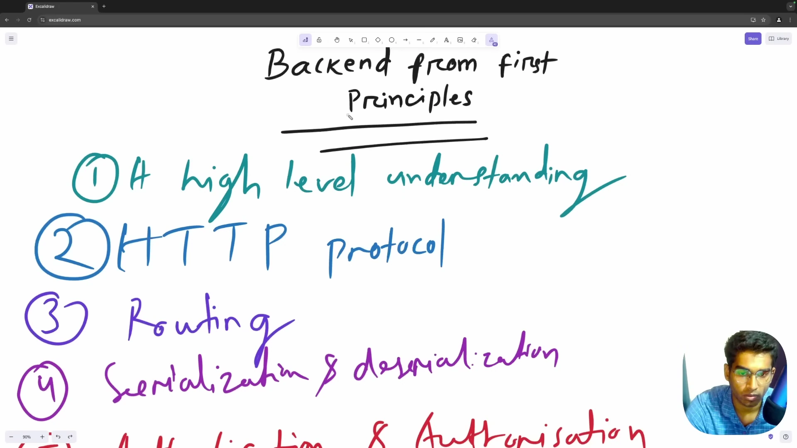

* **Hành trình của một Request:** Một request từ browser của người dùng không đi thẳng vào mã nguồn backend mà phải đi qua một chuỗi các mắt xích hạ tầng:
  1. Trình duyệt thực hiện DNS Resolution để tìm địa chỉ IP của server.
  2. Gói tin đi qua hệ thống Firewall để lọc các lưu lượng độc hại hoặc tấn công DDoS.
  3. Load Balancer hoặc Reverse Proxy (Nginx) tiếp nhận kết nối và điều phối tải đến cụm Backend Server phù hợp.
  4. Backend Server chạy trên nền tảng đám mây xử lý logic, đọc ghi Database/Cache rồi đóng gói HTTP Response gửi ngược lại cho client.
* **Ý nghĩa:** Hiểu rõ từng mắt xích giúp kỹ sư định vị chính xác vị trí phát sinh độ trễ hoặc lỗi trong hệ thống.

### [[02:51](https://www.youtube.com/watch?v=0Rwb4Xmlcwc&t=171s)] Giao thức HTTP

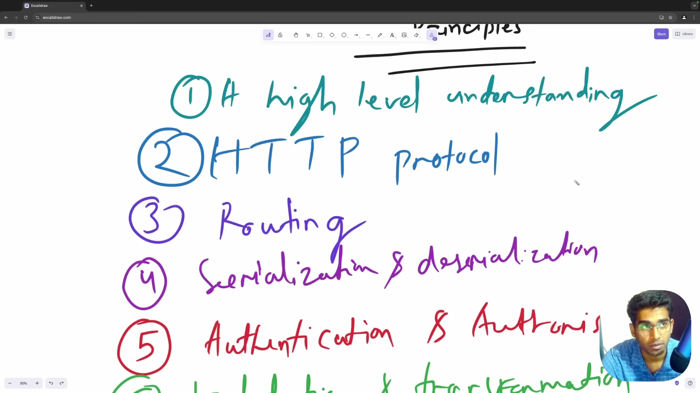

* **Cấu trúc thông điệp:** Bóc tách giải phẫu thông điệp HTTP gồm Start Line, Headers, Empty Line và Payload Body.
* **Hệ thống Headers:** Phân loại 4 nhóm tiêu đề chính: Request Headers, Response Headers, Representation Headers và Security Headers (HSTS, CSP, X-Frame-Options).
* **Ngữ nghĩa Methods:** Chuẩn hóa hành vi của GET, POST, PUT, PATCH, DELETE và ma trận tính chất Safe / Idempotent.
* **Cơ chế CORS và Preflight Request:** Trình duyệt thực thi Same-Origin Policy (SOP). Đối với các request phức tạp (như method PUT/DELETE hoặc mang header Authorization), browser tự động gửi trước một Preflight Request với method `OPTIONS` để hỏi quyền server.
* **Tiến hóa giao thức:** So sánh HTTP 1.0 (kết nối ngắn hạn), HTTP 1.1 (Keep-Alive và Chunked Transfer), HTTP/2 (Binary Framing và Multiplexing trên 1 kết nối TCP) đến HTTP/3 (chạy trên giao thức QUIC/UDP loại bỏ Head-of-Line Blocking).

### [[04:25](https://www.youtube.com/watch?v=0Rwb4Xmlcwc&t=265s)] Định tuyến và dữ liệu

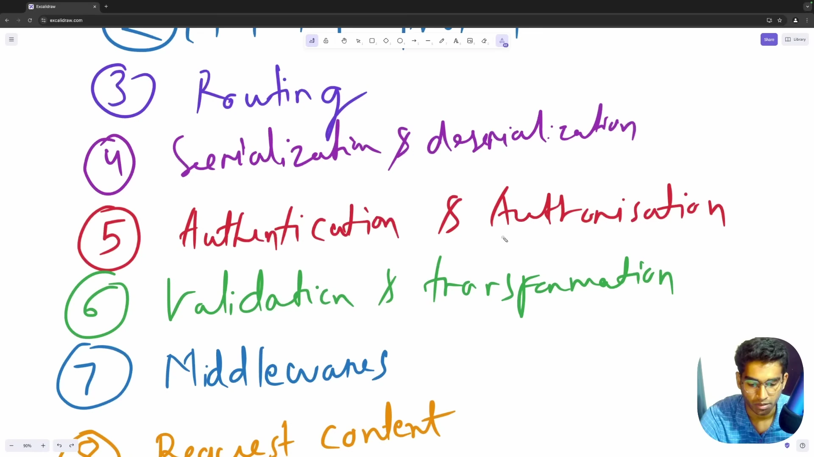

* **Routing (Định tuyến):** Cơ chế phân tích HTTP Method và URL Path để dẫn luồng xử lý vào đúng Controller/Handler function. Phân biệt rõ Path Parameters (định danh tài nguyên) và Query Parameters (lọc, sắp xếp, phân trang).
* **Serialization & Deserialization:**
  - Serialization: Biến đổi cấu trúc dữ liệu trong bộ nhớ (Object, Struct) thành định dạng có thể truyền qua mạng (JSON, XML, Protobuf).
  - Deserialization: Phục hồi chuỗi byte từ mạng trở lại thành kiểu dữ liệu nguyên bản trong mã nguồn.
* **So sánh JSON và Protocol Buffers:** JSON dễ đọc nhưng kích thước lớn; Protocol Buffers dạng nhị phân nhẹ hơn 6-10 lần và tốc độ tuần tự hóa vượt trội, lý tưởng cho microservices giao tiếp nội bộ qua gRPC.

### [[07:13](https://www.youtube.com/watch?v=0Rwb4Xmlcwc&t=433s)] Xác thực và phân quyền

* **Phân biệt Authentication và Authorization:**
  - Authentication (AuthN): Xác minh *bạn là ai* (qua Mật khẩu, JWT, Session Cookie, OAuth2, 2FA/MFA).
  - Authorization (AuthZ): Xác định *bạn có quyền làm gì* trên tài nguyên cụ thể.
* **Các mô hình phân quyền hiện đại:**
  - `RBAC` (Role-Based Access Control): Gán quyền theo vai trò (Admin, User, Moderator).
  - `ABAC` (Attribute-Based Access Control): Phân quyền linh hoạt theo thuộc tính người dùng, tài nguyên và ngữ cảnh (ví dụ: chỉ cho phép xem tài liệu nếu người dùng thuộc phòng ban A và đang truy cập trong giờ hành chính).
  - `ReBAC` (Relationship-Based Access Control): Phân quyền dựa trên đồ thị quan hệ sở hữu đối tượng (mô hình của Google Zanzibar).
* **Bảo mật mật khẩu:** Bắt buộc băm mật khẩu với các thuật toán chậm có Salt (bcrypt, Argon2) và phòng chống lỗ hổng Timing Attack khi so sánh chuỗi mã hóa.

### [[08:45](https://www.youtube.com/watch?v=0Rwb4Xmlcwc&t=525s)] Kiểm thực dữ liệu

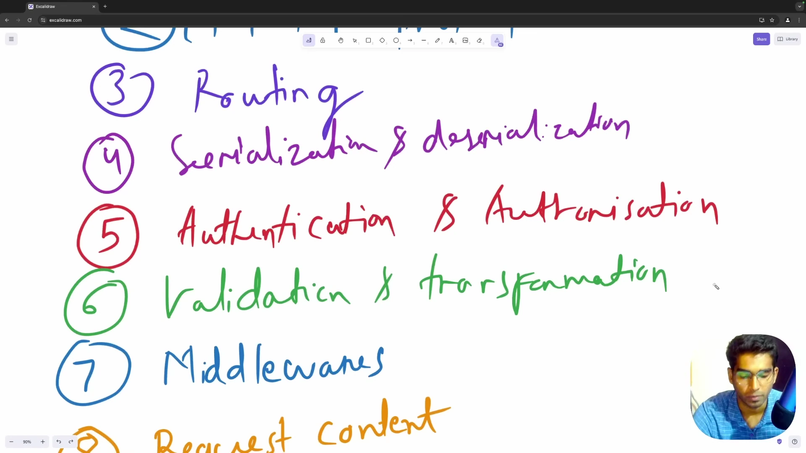

* **Nguyên tắc Fail-fast:** Chặn và trả về lỗi `400 Bad Request` ngay tại lớp ngoài cùng nếu dữ liệu không hợp lệ, không để dữ liệu bẩn lọt sâu vào tầng xử lý nghiệp vụ hay database.
* **Ba cấp độ Validation:**
  - Syntactic Validation: Kiểm tra cấu trúc cú pháp (chuỗi email đúng định dạng, số điện thoại hợp lệ, độ dài mật khẩu).
  - Type Validation: Kiểm tra kiểu dữ liệu (trường tuổi phải là số nguyên, không phải chuỗi hay mảng).
  - Semantic Validation: Kiểm tra logic nghiệp vụ (ngày kết thúc phải sau ngày bắt đầu, số dư tài khoản phải lớn hơn số tiền muốn rút).
* **Sanitization:** Làm sạch dữ liệu đầu vào (cắt khoảng trắng thừa, lọc các ký tự nguy hiểm để phòng chống SQL Injection và XSS).

### [[12:03](https://www.youtube.com/watch?v=0Rwb4Xmlcwc&t=723s)] Middleware và Context

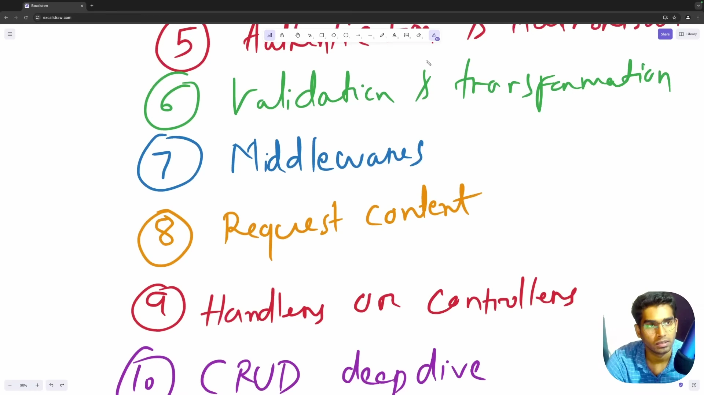

* **Bản chất Middleware:** Chuỗi các hàm xử lý trung gian nằm giữa Router và Controller. Mỗi middleware có thể chặn, thay đổi request/response hoặc ngắt sớm luồng thực thi.
  - Các use-case phổ biến: Authentication Middleware (giải mã token), Logging Middleware, Rate Limiting Middleware, CORS Middleware, Error Handling Middleware.
* **Request Context:** Ngăn chứa metadata tồn tại xuyên suốt vòng đời của một request:
  - Giúp truyền an toàn User ID, Trace ID, Correlation ID giữa các tầng mà không làm ô nhiễm chữ ký hàm function signature.
  - Hỗ trợ cơ chế Cancellation và Timeout: Khi client đóng trình duyệt ngắt kết nối, Context phát tín hiệu dừng xử lý để server không lãng phí tài nguyên CPU và database query tiếp tục.

### [[15:45](https://www.youtube.com/watch?v=0Rwb4Xmlcwc&t=945s)] Phân tầng ứng dụng và CRUD

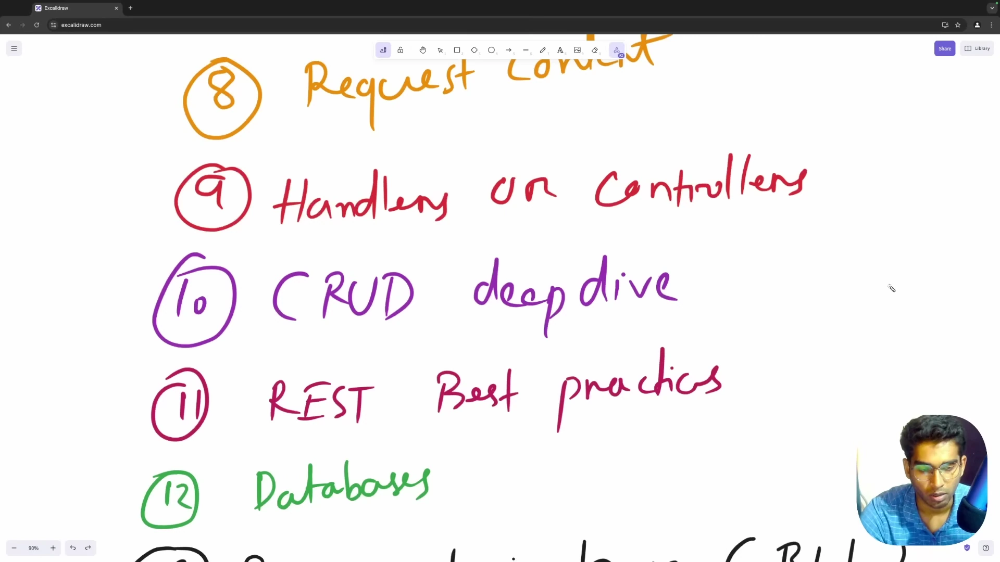

* **Mô hình kiến trúc phân tầng chuẩn Layered Architecture:**
  - `Controllers / Handlers`: Tầng giao diện HTTP, tiếp nhận request, kiểm tra cú pháp và trả về response format chuẩn.
  - `Services (Business Logic Layer)`: Tầng nghiệp vụ thuần túy, chứa toàn bộ thuật toán và quy tắc kinh doanh của hệ thống, độc lập hoàn toàn với framework web.
  - `Repositories`: Tầng tương tác dữ liệu, thực hiện các câu lệnh SQL hoặc ORM thao tác với database.
* **Chuẩn hóa RESTful API:** Thiết kế endpoint bám sát tài nguyên danh từ số nhiều (ví dụ: `GET /users`, `POST /users`, `DELETE /users/123`), trả về đúng HTTP Status Codes chuẩn mực (200, 201, 204, 400, 404, 409).

### [[17:44](https://www.youtube.com/watch?v=0Rwb4Xmlcwc&t=1064s)] Cơ sở dữ liệu và BLL

* **Làm chủ Database:** Thấu hiểu bản chất cơ sở dữ liệu quan hệ PostgreSQL từ nguyên lý gốc:
  - Tính chất ACID của Transaction để bảo toàn tính nhất quán dữ liệu tài chính.
  - Cơ chế Connection Pooling để quản lý số lượng kết nối đồng thời đến database tối ưu nhất.
  - Cơ chế B-Tree Index: Đánh index đúng trường để tăng tốc tìm kiếm và tránh quét toàn bảng Full Table Scan.
  - Nhận diện và phòng chống triệt để lỗi N+1 Query.

### [[18:51](https://www.youtube.com/watch?v=0Rwb4Xmlcwc&t=1131s)] Caching và Hàng đợi

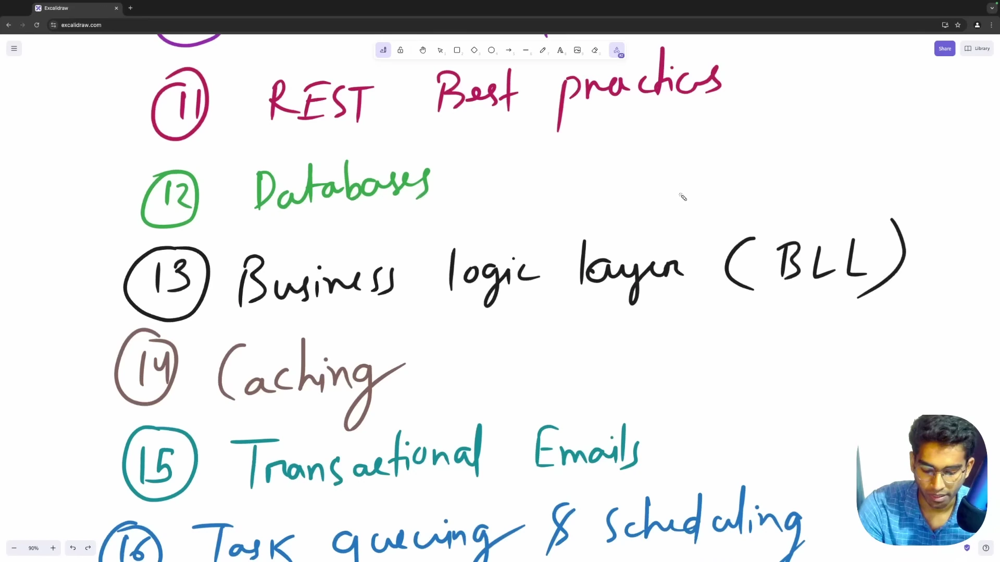

* **HTTP & In-Memory Caching (Redis):**
  - Mô hình Cache-Aside: Kiểm tra Redis trước, nếu trượt mới query PostgreSQL và lưu lại vào Redis.
  - Các chiến lược dọn dẹp cache: TTL (Time To Live), LRU (Least Recently Used) và LFU (Least Frequently Used).
  - Phòng chống các hiện tượng sập cache: Cache Penetration, Cache Breakdown và Cache Stampede.
* **Task Queues & Background Jobs:**
  - Tách các tác vụ nặng (gửi email kích hoạt, xử lý hình ảnh, tạo file PDF, đồng bộ dữ liệu bên thứ ba) ra khỏi chu trình request/response của người dùng.
  - Đẩy công việc vào hàng đợi (Redis Queue, RabbitMQ, Kafka) để các Worker process xử lý bất đồng bộ trong nền, giữ cho thời gian phản hồi API luôn dưới 100ms.

### [[21:35](https://www.youtube.com/watch?v=0Rwb4Xmlcwc&t=1295s)] Tìm kiếm toàn văn

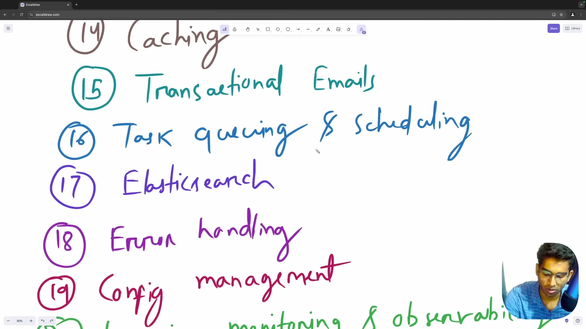

* **Giới hạn của SQL LIKE:** Khi tìm kiếm văn bản trong hàng triệu bản ghi, câu lệnh `LIKE '%query%'` trong SQL bắt buộc phải quét toàn bộ bảng và không thể tối ưu hóa bằng B-Tree index thông thường, gây nghẽn database nghiêm trọng.
* **Giải pháp với Elasticsearch:**
  - Sử dụng cấu trúc Inverted Index: Phân rã văn bản thành các token từ khóa và ánh xạ về tài liệu chứa từ khóa.
  - Hỗ trợ Fuzzy Search (tìm kiếm gần đúng), Stemming (gốc từ) và xếp hạng mức độ liên quan (Relevance Scoring) với tốc độ mili-giây.

### [[23:16](https://www.youtube.com/watch?v=0Rwb4Xmlcwc&t=1396s)] Xử lý lỗi và Cấu hình

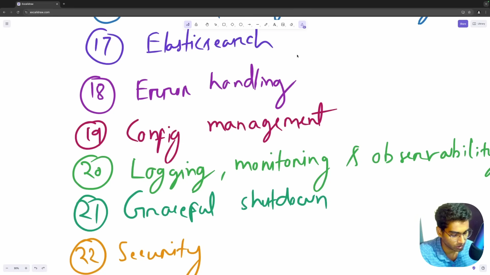

* **Xử lý lỗi hệ thống:** Thiết lập Error Handling tập trung; phân loại lỗi người dùng (4xx) và lỗi hệ thống (5xx); che giấu Stack Trace nội bộ để bảo mật hệ thống.
* **Quản trị cấu hình chuẩn 12-Factor:** Tách biệt hoàn toàn mã nguồn và cấu hình; nạp Environment Variables từ file `.env` hoặc secret manager (AWS Secrets Manager, Vault) theo từng môi trường dev, staging, production.
* **Bộ ba Observability:**
  - Structured Logging: Ghi log định dạng JSON kèm timestamp, log level và Trace ID.
  - Metrics: Đo lường tài nguyên CPU, RAM, thời gian đáp ứng (p95, p99 latency) và Error Rate.
  - Distributed Tracing: Theo dõi đường đi của request qua các microservices.

### [[25:50](https://www.youtube.com/watch?v=0Rwb4Xmlcwc&t=1550s)] Bảo mật và Tắt an toàn

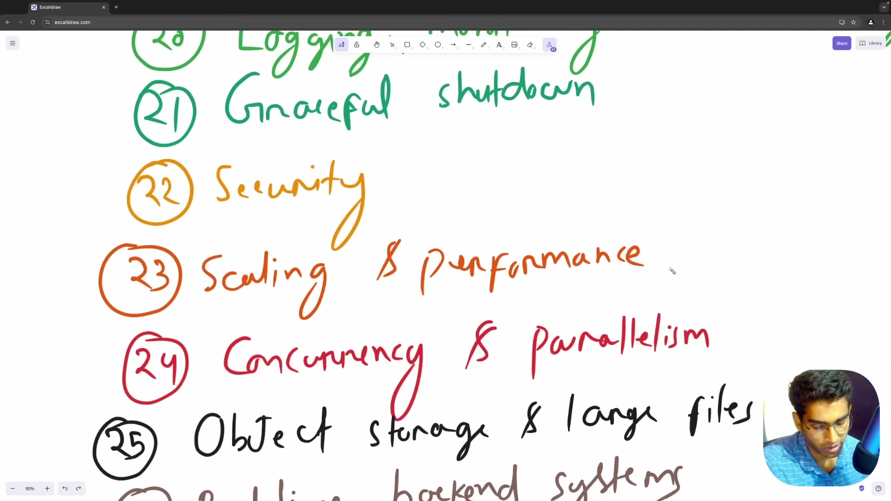

* **Graceful Shutdown:** Bắt tín hiệu hệ điều hành `SIGINT` và `SIGTERM`:
  - Ngừng tiếp nhận request mới tại load balancer.
  - Cho phép các request đang xử lý có tối đa 30 giây để hoàn tất.
  - Đóng an toàn kết nối database pool, redis client và worker loop trước khi tiến trình tắt hoàn toàn.
* **Bảo mật backend đa tầng:**
  - Phòng chống OWASP Top 10: SQL Injection (dùng Parameterized Queries), XSS (Sanitize HTML), CSRF (SameSite Cookie), Timing Attacks (constant-time comparison).
  - Rate Limiting: Chống tấn công brute-force và spam request qua thuật toán Token Bucket hoặc Leaky Bucket.

### [[27:47](https://www.youtube.com/watch?v=0Rwb4Xmlcwc&t=1667s)] Lưu trữ tệp và Thời gian thực

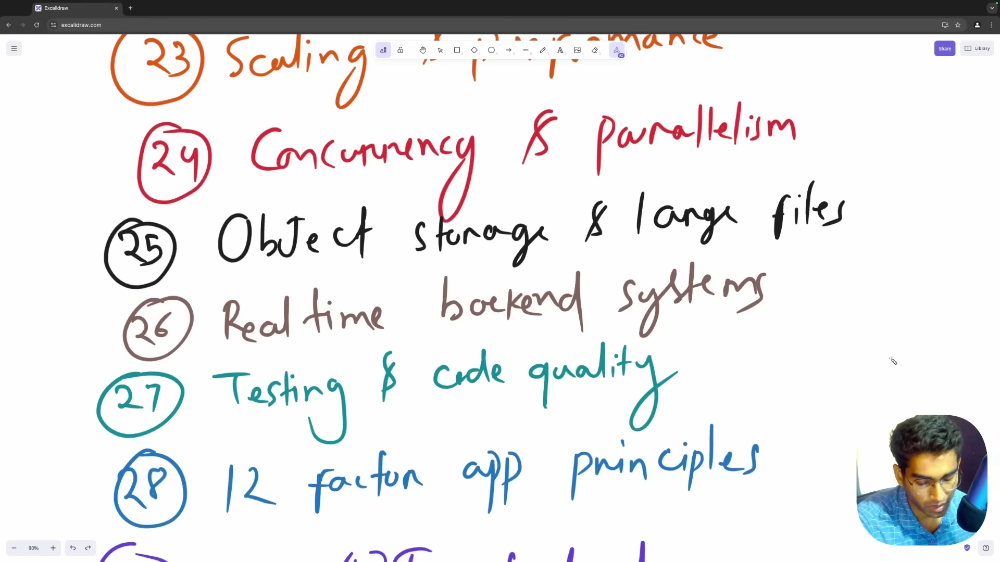

* **Concurrency vs Parallelism:**
  - Concurrency: Xử lý nhiều tác vụ xen kẽ (cực kỳ hiệu quả cho I/O-bound tasks như gọi database, gọi API ngoài qua Event Loop / Async I/O).
  - Parallelism: Chạy đồng thời nhiều tác vụ trên nhiều nhân CPU vật lý (dành cho CPU-bound tasks như mã hóa video, nén file, tính toán AI).
* **Object Storage (AWS S3, MinIO):**
  - Không lưu tệp nhị phân trực tiếp trong database quan hệ hoặc local disk của server.
  - Sử dụng cơ chế Presigned URL để client upload trực tiếp lên S3, giảm tải hoàn toàn băng thông cho backend server.
* **Hệ thống thời gian thực (Real-time Backends):**
  - WebSockets: Kết nối hai chiều liên tục (Full-duplex) cho chat và game.
  - Server-Sent Events (SSE): Kết nối một chiều server đẩy về client qua HTTP thông thường cho bảng tin, thông báo và streaming AI.

### [[28:06](https://www.youtube.com/watch?v=0Rwb4Xmlcwc&t=1686s)] Kiểm thử và Chuẩn OpenAPI

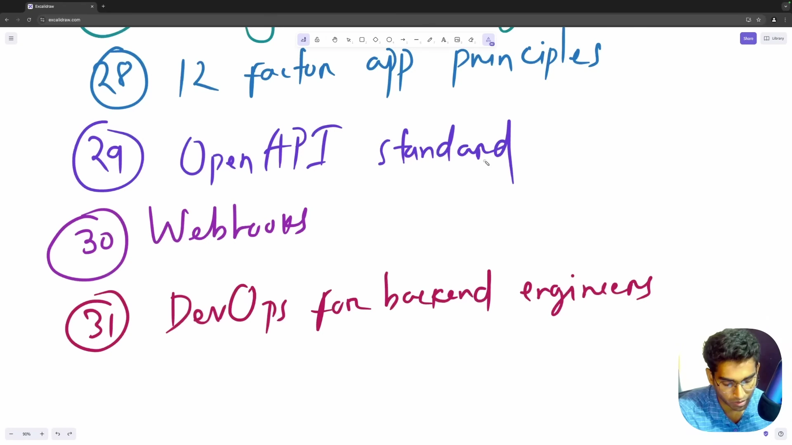

* **Chiến lược kiểm thử:**
  - Unit Testing: Kiểm tra logic các hàm nghiệp vụ độc lập.
  - Integration Testing: Kiểm tra tương tác thực tế giữa API, Database và Cache.
  - Mocking: Giả lập các service bên thứ ba để bài test chạy nhanh và ổn định.
  - Test-Driven Development (TDD): Viết test trước, viết code sau, liên tục refactor.
* **Chuẩn hóa OpenAPI Specification:**
  - Viết tài liệu API định dạng JSON/YAML chuẩn quốc tế.
  - Tự động sinh Swagger UI tương tác và tự động sinh mã client SDK (Code Generation).
  - Phương pháp API-First Development: Thống nhất bản đặc tả API giữa Frontend và Backend trước khi bắt tay viết mã.

### [[29:58](https://www.youtube.com/watch?v=0Rwb4Xmlcwc&t=1798s)] Webhooks và DevOps

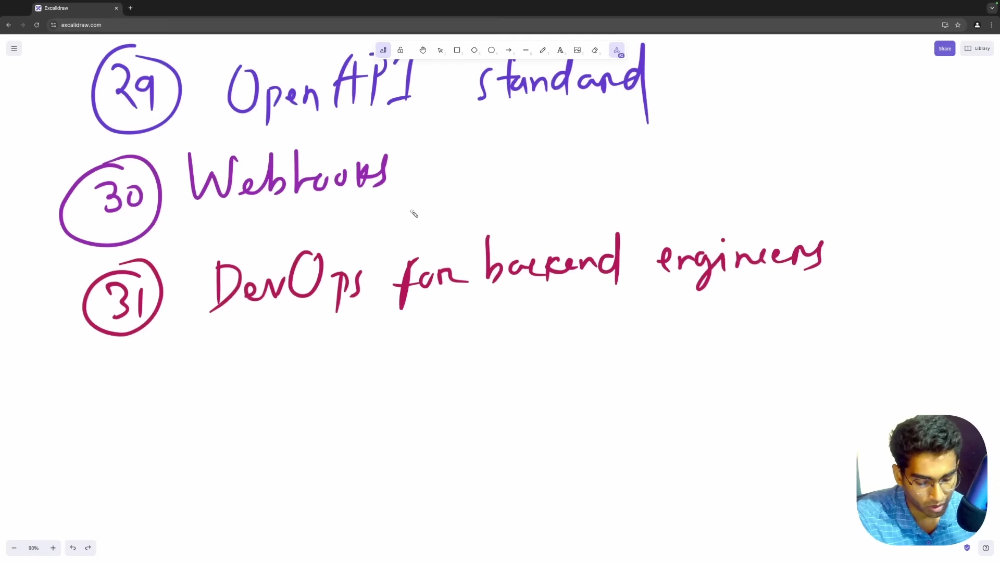

* **Webhooks (Reverse API):**
  - Khác biệt so với Polling: Polling buộc client liên tục hỏi server xem có dữ liệu mới chưa; Webhook là server chủ động bắn HTTP POST sang endpoint của đối tác ngay khi sự kiện xảy ra.
  - Thực chiến Webhook: Bắt buộc xác thực chữ ký (Signature Verification qua HMAC SHA-256) và thiết lập cơ chế Retry có lũy thừa thời gian chờ Exponential Backoff.
* **Nền tảng DevOps cho kỹ sư Backend:**
  - Đóng gói ứng dụng thành Container với Docker để bảo đảm tính nhất quán môi trường.
  - Tự động hóa kiểm thử và triển khai qua CI/CD Pipelines (GitHub Actions).
  - Nắm vững các chiến lược triển khai không gián đoạn: Rolling Deployment và Blue-Green Deployment.

---

## Trích dẫn then chốt

* [[00:00](https://www.youtube.com/watch?v=0Rwb4Xmlcwc&t=0s)] "Backend engineering is not just about writing CRUD APIs. It's about building systems that are reliable, scalable, fault-tolerant, and maintainable."
* [[02:22](https://www.youtube.com/watch?v=0Rwb4Xmlcwc&t=142s)] "Understanding the high-level path of a request—from the browser, through DNS, firewall, and load balancer—is critical for diagnosing real-world latency and bottlenecks."
* [[07:13](https://www.youtube.com/watch?v=0Rwb4Xmlcwc&t=433s)] "Authentication is about who you are. Authorization is about what you are allowed to do. Never mix the two concepts in your architecture."
* [[15:45](https://www.youtube.com/watch?v=0Rwb4Xmlcwc&t=945s)] "Separating your controllers, services, and repositories ensures that your core business logic remains independent of any HTTP framework or database driver."
* [[25:13](https://www.youtube.com/watch?v=0Rwb4Xmlcwc&t=1513s)] "Graceful shutdown is not optional in production. Your server must finish in-flight requests and close database pools safely before terminating."

---

## Lệnh & Công cụ

| Công nghệ / Công cụ | Phân loại | Mục đích sử dụng trong lộ trình |
| :--- | :--- | :--- |
| PostgreSQL | Relational Database | Lưu trữ dữ liệu quan hệ với bảo đảm toàn vẹn giao dịch ACID |
| Redis | In-Memory Data Store | Triển khai phân cấp Caching theo mô hình Cache-Aside và quản lý phiên |
| Elasticsearch | Search Engine | Triển khai Full-Text Search hiệu năng cao qua cấu trúc Inverted Index |
| RabbitMQ / Kafka | Message Broker | Triển khai Task Queues xử lý tác vụ nền bất đồng bộ và kiến trúc hướng sự kiện |
| AWS S3 / MinIO | Object Storage | Lưu trữ tệp nhị phân lớn phân tách khỏi database qua Presigned URL |
| Docker & CI/CD | DevOps Tools | Đóng gói môi trường container và tự động hóa chu trình kiểm thử, triển khai |
| OpenAPI / Swagger | API Specification | Thiết lập hợp đồng giao tiếp chuẩn mực giữa Frontend và Backend |

---

## Đánh đổi & Rủi ro

| Lựa chọn kiến trúc | Lợi ích đạt được | Đánh đổi và điểm mù rủi ro |
| :--- | :--- | :--- |
| Mô hình phân tầng Layered Architecture | Tách biệt trách nhiệm rõ ràng, dễ viết Unit Test và bảo trì lâu dài. | Tăng số lượng file boilerplate và lớp trung gian; cần tuân thủ nghiêm ngặt ranh giới giữa các tầng. |
| Cơ chế Caching phân tán Redis | Giảm tải database hơn 90%, tăng tốc độ phản hồi API xuống dưới 10ms. | Phức tạp trong việc xóa/đồng bộ cache (Cache Invalidation); rủi ro đọc phải dữ liệu cũ nếu cấu hình sai. |
| Xử lý bất đồng bộ qua Task Queues | Giữ API luôn phản hồi nhanh, cô lập các lỗi xử lý bên ngoài. | Cần quản lý thêm hạ tầng Broker và Worker; phải xử lý các bài toán Dead Letter Queue và idempotent job. |
| Định dạng Protocol Buffers so với JSON | Kích thước gói tin siêu nhẹ, tốc độ phân giải nhanh gấp nhiều lần. | Dữ liệu dạng nhị phân không đọc được trực tiếp bằng mắt thường; quy trình debug đòi hỏi công cụ chuyên dụng. |