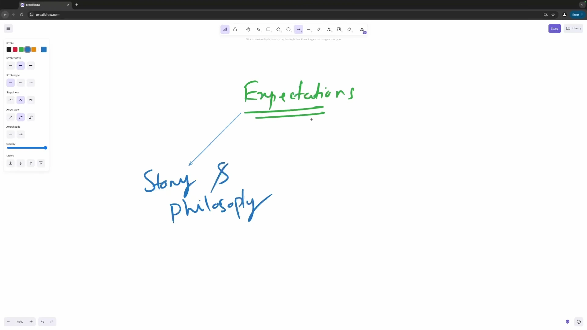
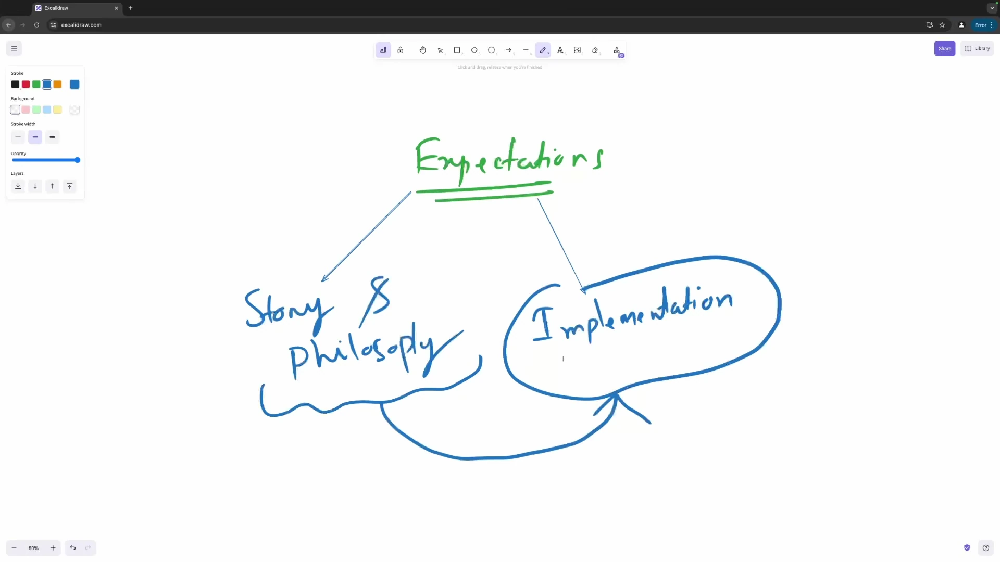
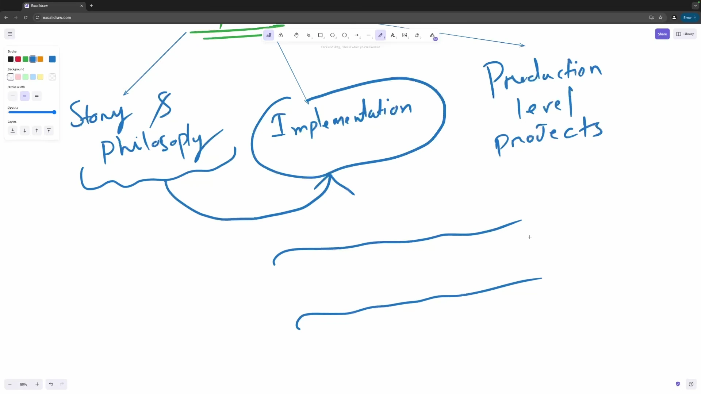

# Con Đường Trở Thành Kỹ Sư Backend

* **Kênh:** Sriniously | **Thời lượng:** 00:03:53 | **Ngày:** 2024-09-23
* **Video:** https://www.youtube.com/watch?v=3qFjZbFRSAU

---

## Thuật ngữ

| Thuật ngữ | Giải thích |
| :--- | :--- |
| Language-Agnostic | Năng lực tư duy và kỹ năng kiến trúc độc lập với ngôn ngữ lập trình, không bị đóng khung trong bất kỳ cú pháp cụ thể nào. |
| Framework Abstraction | Lớp trừu tượng của framework che giấu các cơ chế vận hành mạng và hệ thống phức tạp bên dưới. |
| Runtime Environment | Môi trường thực thi cung cấp các dịch vụ hệ thống cơ bản cho ứng dụng chạy (Node.js runtime, Go runtime). |
| Production-Grade | Tiêu chuẩn phần mềm sẵn sàng triển khai thực tế với độ tin cậy, bảo mật, khả năng scale và giám sát cao. |
| Driver | Thư viện giao tiếp tầng thấp kết nối trực tiếp ứng dụng với cơ sở dữ liệu qua giao thức socket (như postgres.js hoặc pgx). |

---

## Tổng luận chuyên đề

#### Lộ trình 3 giai đoạn

Hành trình trở thành kỹ sư backend chuyên nghiệp được phân định rõ ràng thành ba giai đoạn kế thừa nhau:
- **Giai đoạn 1: Triết lý và kiến trúc cốt lõi:** Tập trung vào các nguyên lý nền tảng độc lập với ngôn ngữ. Giúp kỹ sư thấu hiểu bức tranh tổng thể, nắm bắt bản chất tương tác giữa các thành phần và thoát khỏi sự lệ thuộc vào framework.
- **Giai đoạn 2: Hiện thực hóa mã nguồn:** Hiện thực hóa các nguyên lý trừu tượng bằng code thực tế trên hai hệ sinh thái tiêu biểu: Node.js và Go. Đi sâu vào từng Database Driver (postgres.js, pgx) và cơ chế xử lý cụ thể.
- **Giai đoạn 3: Dự án thực chiến chuẩn Production:** Tổng hợp toàn bộ kiến thức để tự tay xây dựng hệ thống hoàn chỉnh từ đầu đến cuối, đáp ứng chuẩn công nghiệp và năng lực mở rộng từ 0 lên 1 triệu người dùng.

#### Định hình tư duy kỹ sư

Một kỹ sư backend thực thụ không được đo bằng số lượng framework họ học thuộc, mà bằng khả năng nhìn thấu những cơ chế mà framework đang trừu tượng hóa:
- **Nhận diện khuôn mẫu chung:** Mọi ứng dụng backend đều chia sẻ chung các bài toán cốt lõi: kết nối database, routing, authentication, xử lý bất đồng bộ, concurrency và caching.
- **Chuyển đổi công nghệ linh hoạt:** Khi đã nắm vững nguyên lý gốc, việc chuyển đổi giữa các tech stack (từ JavaScript sang Go, Rust hay Python) chỉ đơn thuần là làm quen với cú pháp mới trong vài ngày.

---

## Bóc tách chi tiết

### [[00:00](https://www.youtube.com/watch?v=3qFjZbFRSAU&t=0s)] Thiết lập mục tiêu

* **Mục đích bài mở đầu:** Xác định rõ đích đến cuối cùng của lộ trình để người học duy trì định hướng xuyên suốt và không bị ngợp trước khối lượng kiến thức đồ sộ của toàn bộ series.
* **Tư duy tiếp cận:** Không tiếp cận theo kiểu học vẹt cú pháp của một thư viện nhất thời, mà học cách tư duy của một kỹ sư thiết kế hệ thống.

### [[00:11](https://www.youtube.com/watch?v=3qFjZbFRSAU&t=11s)] Bóc tách tầng trừu tượng

* **Bức tranh thực tế:** Chuỗi bài giảng kể lại toàn bộ câu chuyện về kỹ thuật backend: các nguyên lý kiến trúc nền tảng và cách các cỗ máy phối hợp nhịp nhàng với nhau trong môi trường sản xuất.
* **Vượt qua Framework Abstraction:** Ngôn ngữ lập trình, runtime, framework và ORM thường che giấu đi sự thật vận hành cơ bản bên dưới. Khóa học giúp người học bóc tách lớp vỏ này để hiểu rõ bản chất từng gói tin và từng kết nối mạng.

### [[00:45](https://www.youtube.com/watch?v=3qFjZbFRSAU&t=45s)] Kỹ năng Language-Agnostic

* **Xây dựng nền tảng độc lập:** Bước đi đầu tiên bắt buộc phải là trang bị kỹ năng Language-Agnostic: tư duy kiến trúc vượt lên trên mọi framework hay thư viện cụ thể.
* **Kết nối các mắt xích:** Khi nền tảng đã vững chắc, kỹ sư sẽ nhận ra các khuôn mẫu thiết kế lặp lại trong mọi ứng dụng backend và tự tin ghép nối các thành phần hệ thống.

### [[01:30](https://www.youtube.com/watch?v=3qFjZbFRSAU&t=90s)] Hiện thực hóa với Node.js và Go

* **Lựa chọn hai hệ sinh thái:** Sau khi nắm vững triết lý, mã nguồn thực tế sẽ được triển khai trên hai ngôn ngữ: Node.js (đại diện cho mô hình Event-driven bất đồng bộ) và Go (đại diện cho mô hình Concurrency hiệu năng cao).
* **Ánh xạ lý thuyết sang thực hành:** Mỗi video lý thuyết sẽ có video thực hành tương ứng. Ví dụ: khi học về Database và Connection Pool, người học sẽ được hướng dẫn dùng driver `postgres.js` cho Node.js hoặc `pgx` cho Go để làm chủ chi tiết tầng thấp.

### [[02:50](https://www.youtube.com/watch?v=3qFjZbFRSAU&t=170s)] Dự án thực chiến Production

* **Hội tụ toàn diện:** Giai đoạn 3 là nơi lý thuyết kiến trúc và kỹ thuật code thực tế kết hợp với nhau trong một dự án hoàn chỉnh.
* **Xây dựng hệ thống mở rộng:** Người học tự tay xây dựng các ứng dụng chuẩn production có khả năng scale từ 0 lên 1 triệu users, bảo đảm tính sẵn sàng cao và dễ bảo trì lâu dài.

---

## Trích dẫn then chốt

* [[00:11](https://www.youtube.com/watch?v=3qFjZbFRSAU&t=11s)] "The narration will help you see the big picture of a production-grade backend and help you appreciate the concepts that are abstracted by the languages, runtimes, frameworks, and libraries that we use every day."
* [[00:45](https://www.youtube.com/watch?v=3qFjZbFRSAU&t=45s)] "This playlist is about the story and philosophy. This is the first step towards being a backend engineer with language-agnostic skills, skills which are beyond frameworks or any particular library."
* [[01:30](https://www.youtube.com/watch?v=3qFjZbFRSAU&t=90s)] "Once you have the foundations clear, once you start to see the common patterns behind every backend application and understand the philosophies, now that is the best time to talk about implementations."
* [[02:50](https://www.youtube.com/watch?v=3qFjZbFRSAU&t=170s)] "By the end of this journey, you should be able to go out there and build real systems: systems that scale, systems that start from zero users and scale to a million users, systems that people can maintain over a long period of time."

---

## Lệnh & Công cụ

| Công cụ / Thư viện | Hệ sinh thái | Vai trò đề cập trong bài giảng |
| :--- | :--- | :--- |
| Node.js | JavaScript Runtime | Nền tảng thực hành cho kiến trúc bất đồng bộ và hướng sự kiện |
| Go | Compiled Language | Nền tảng thực hành cho các dịch vụ concurrency hiệu năng cao |
| PostgreSQL | RDBMS | Hệ quản trị cơ sở dữ liệu quan hệ chuẩn mực được chọn làm mẫu thực hành |
| postgres.js | Node.js Driver | Database driver cho PostgreSQL trong hệ sinh thái Node.js |
| pgx | Go Driver | Database driver và toolkit chuyên sâu cho PostgreSQL trong Go |

---

## Đánh đổi & Rủi ro

| Hướng tiếp cận | Ưu thế nhận được | Điểm mù và rủi ro tiềm ẩn |
| :--- | :--- | :--- |
| Học vẹt Framework ngay từ đầu | Dựng nhanh ứng dụng mẫu (CRUD cơ bản) trong thời gian ngắn bằng template có sẵn. | Mất phương hướng khi gặp sự cố hiệu năng, lỗi concurrency hoặc khi dự án yêu cầu đổi tech stack. |
| Học nguyên lý gốc trước khi viết mã | Xây dựng tư duy hệ thống vững chắc, tự tin thiết kế và tối ưu kiến trúc phức tạp. | Cần kiên nhẫn ở giai đoạn đầu vì phải nắm vững kiến thức mạng và hệ thống trước khi thấy sản phẩm chạy. |