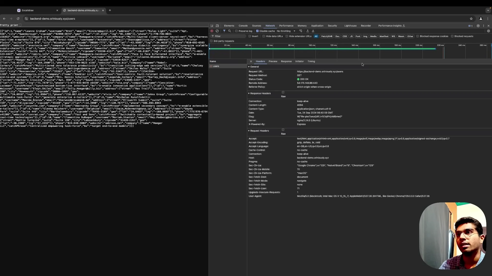
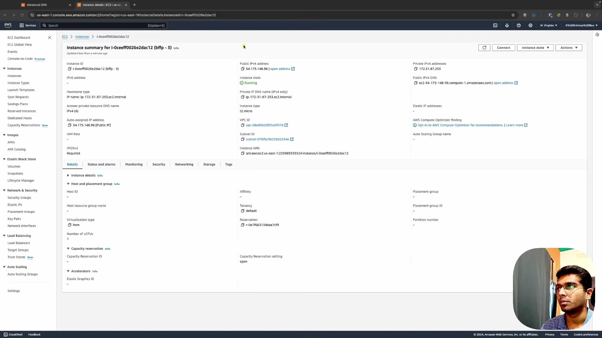
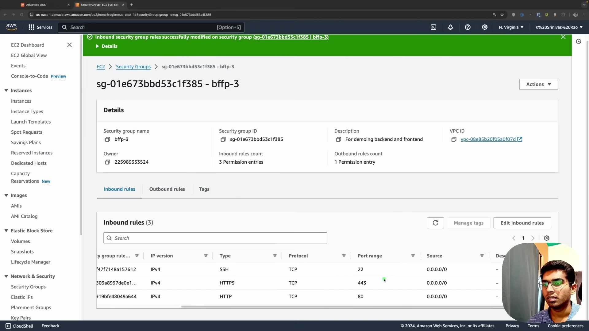
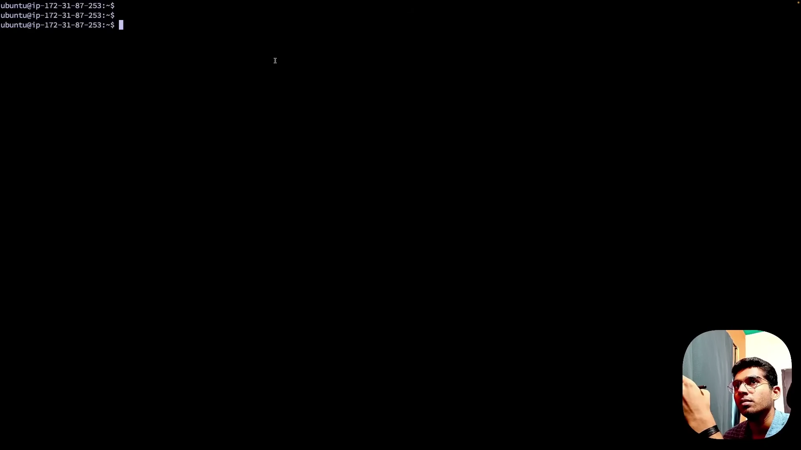
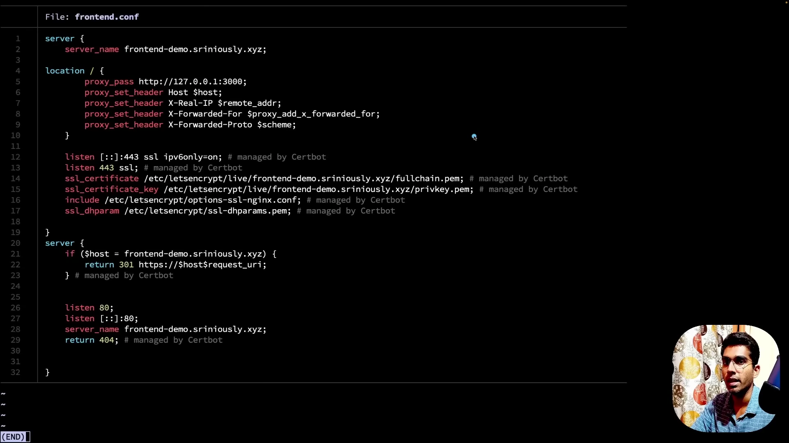

# Bản Chất Và Nguyên Lý Vận Hành Backend

* **Kênh:** Sriniously | **Thời lượng:** 00:19:01 | **Ngày:** 2024-09-23
* **Video:** https://www.youtube.com/watch?v=6Ss4dJD9Kzg

---

## Thuật ngữ

| Thuật ngữ | Giải thích |
| :--- | :--- |
| Reverse Proxy | Máy chủ trung gian (như Nginx) đón nhận request từ Internet, xử lý SSL/TLS termination và điều phối lưu lượng đến các backend service nội bộ. |
| Security Group | Tường lửa ảo cấp mạng của hạ tầng đám mây kiểm soát lưu lượng in-bound và out-bound trên các cổng cổng dịch vụ. |
| Port | Cổng logic giao tiếp mạng cho phép phân biệt các ứng dụng khác nhau chạy chung trên một máy chủ vật lý (ví dụ: port 80 cho HTTP, port 443 cho HTTPS). |
| Sandboxed Environment | Môi trường cách ly của trình duyệt; ngăn chặn mã JavaScript phía client truy cập trực tiếp vào file hệ thống, biến môi trường hay tiến trình OS của máy tính người dùng. |
| CORS | Cross-Origin Resource Sharing; chính sách an ninh của trình duyệt kiểm soát việc gọi API chéo giữa các domain khác nhau. |
| Connection Pool | Tập hợp các kết nối database được mở sẵn và quản lý tập trung để tái sử dụng, tránh chi phí mở và đóng TCP socket liên tục. |
| Hydration | Tiến trình trình duyệt gắn các event listener JavaScript vào cây DOM đã kết xuất từ HTML tĩnh do server trả về. |
| Centralized State | Trạng thái dữ liệu được lưu trữ tập trung tại server/database để bảo đảm tính tính nhất quán consistency cho toàn bộ người dùng trong hệ thống. |

---

## Tổng luận chuyên đề

#### Hành trình một Request qua hạ tầng thực tế

Một request backend trong môi trường production không bao giờ đi thẳng vào code ứng dụng mà phải vượt qua chuỗi hạ tầng mạng vật lý:
- **Phân giải DNS:** Tên miền được DNS dịch thành địa chỉ IP máy chủ thông qua bản ghi A record.
- **Tường lửa Security Group:** Kiểm soát cổng vào cấp hạ tầng mạng; chỉ những port được cấu hình tường minh (port 22 cho SSH, port 80 cho HTTP, port 443 cho HTTPS) mới cho phép gói tin đi qua.
- **Reverse Proxy (Nginx):** Đóng vai trò cổng đón tiếp tập trung, tiếp nhận request từ Internet, giải mã HTTPS/TLS và điều hướng nội bộ về port của ứng dụng backend (ví dụ: port 3001).
- **Process Manager (PM2):** Quản lý tiến trình backend (Node.js) chạy liên tục trên cổng nội bộ, tự động khởi động lại khi crash và quản lý log.

#### Ranh giới kiến trúc: Frontend vs Backend

Sự phân định cốt lõi giữa frontend và backend nằm ở môi trường thực thi và quyền hạn truy cập tài nguyên:
- **Frontend là code chuyển giao (Client-side):** Toàn bộ file HTML, CSS và JavaScript được server gửi về và thực thi trực tiếp trên máy của người dùng trong môi trường Sandboxed Environment bị cô lập nghiêm ngặt.
- **Backend là xử lý tập trung (Server-side):** Logic nghiệp vụ, xác thực danh tính và kết nối database được thực thi an toàn trong mạng nội bộ của doanh nghiệp.
- **Nhiệm vụ tối thượng của Backend:** Tất cả quy về một từ duy nhất: **Dữ liệu Data** — bao gồm khả năng fetch data, receive data và lưu trữ bền vững dữ liệu persist data.

---

## Bóc tách chi tiết

### [[00:00](https://www.youtube.com/watch?v=6Ss4dJD9Kzg&t=0s)] Định nghĩa kỹ thuật Backend

* **Bản chất thực tế:** Backend là một server liên tục lắng nghe các network request (HTTP, WebSocket, gRPC) qua các port mở trên Internet.
* **Cung cấp nội dung:** Server phục vụ static files (HTML, CSS, JavaScript, media) hoặc API responses dạng JSON, đồng thời tiếp nhận và xử lý payload gửi lên từ client.
* **Tầm nhìn hạ tầng:** Để làm chủ backend, kỹ sư cần nhìn thấy toàn bộ cỗ máy vật lý và luồng đi của gói tin mạng chứ không dừng lại ở định nghĩa trừu tượng trong sách giáo khoa.

### [[00:56](https://www.youtube.com/watch?v=6Ss4dJD9Kzg&t=56s)] Vận hành thực tế trên Server

* **DNS Resolution:** Khi người dùng truy cập một subdomain, DNS Server sử dụng bản ghi A record để ánh xạ tên miền về IP công khai của Cloud Server.

* **Kiểm soát cổng với Security Group:** Trước khi chạm vào hệ điều hành, gói tin phải qua tường lửa Security Group. Phải mở tường minh port 22 (SSH), port 80 (HTTP) và port 443 (HTTPS). Mọi request gửi vào các port chưa mở sẽ bị drop ngay lập tức tại biên mạng.

* **Cấu hình Reverse Proxy Nginx:** Nginx lắng nghe port 80/443, quản lý chứng chỉ SSL/TLS và proxy pass request vào port nội bộ 3001 của backend service.

* **Tiến trình Backend với PM2:** Ứng dụng Node.js chạy trên localhost port 3001 được PM2 giám sát để duy trì trạng thái luôn chạy (zero-downtime reload). Request gọi nội bộ từ server qua curl cho ra kết quả đồng nhất với request gọi từ trình duyệt qua Internet.

### [[07:30](https://www.youtube.com/watch?v=6Ss4dJD9Kzg&t=450s)] Trọng tâm dữ liệu và State tập trung

* **Use-case nút Like mạng xã hội:** Khi người dùng bấm Like một bài viết, request gửi lên server. Server nhận diện User ID, ghi nhận vào database, kiểm tra quyền và kích hoạt notification đẩy sang bạn bè.
* **Centralized State:** Client chỉ lưu trữ tạm thời dữ liệu của chính thiết bị đó. Backend server là nơi duy nhất nắm giữ toàn bộ trạng thái tập trung và tính nhất quán dữ liệu của hàng triệu người dùng.
* **Ba nhu cầu cốt lõi:** Toàn bộ công việc của backend quy về: Fetch data, Receive data và Persist data.

### [[10:20](https://www.youtube.com/watch?v=6Ss4dJD9Kzg&t=620s)] Cách Frontend hoạt động

* **Chu trình nạp tài nguyên:** Nginx điều hướng request sang port 3000 chạy ứng dụng Next.js. Trình duyệt tải file HTML đầu tiên, sau đó phân tích và tải tiếp các bundle CSS, JavaScript và fonts.
* **Rendering và Hydration:** Sau khi nạp CSS, browser vẽ giao diện (Paint/Render). Khi JavaScript tải xong, browser thực hiện Hydration gắn các event listener để kích hoạt tương tác của người dùng.

### [[12:40](https://www.youtube.com/watch?v=6Ss4dJD9Kzg&t=760s)] Bốn lý do cần tách biệt Backend

* **Môi trường Sandboxed của Browser:** Mã frontend chạy trực tiếp trên máy tính của người dùng cuối trong môi trường Sandboxed bị cô lập tuyệt đối, không được phép chạm vào file hệ thống, biến môi trường hay tiến trình OS.
* **Bốn lý do không thể đưa toàn bộ logic ra Frontend:**
  1. Bảo mật hệ thống: Nếu cho phép JavaScript trên trình duyệt truy cập file hệ thống hay biến môi trường, kẻ tấn công có thể chèn mã độc đánh cắp toàn bộ dữ liệu nhạy cảm trên máy tính người dùng.
  2. Giới hạn mạng và CORS: Trình duyệt áp đặt Same-Origin Policy chặn gọi API chéo domain nếu thiếu header cấp phép, trong khi backend cần quyền tự do gọi microservices và tích hợp API đối tác.
  3. Quản lý kết nối Database qua Connection Pool: Database yêu cầu driver chuyên dụng giao tiếp qua socket nhị phân và duy trì Connection Pool mở sẵn. Trình duyệt không thể duy trì socket trực tiếp đến database; nếu 1 triệu client cùng mở socket thẳng vào database, server dữ liệu sẽ sập ngay lập tức.
  4. Năng lực tính toán phân tán: Thiết bị người dùng phân mảnh rất lớn (điện thoại giá rẻ, laptop cấu hình yếu). Đặt logic nặng tại backend server tập trung cho phép dễ dàng scale CPU và RAM theo nhu cầu thực tế.

---

## Trích dẫn then chốt

* [[00:00](https://www.youtube.com/watch?v=6Ss4dJD9Kzg&t=0s)] "A backend in its traditional definition is a computer which is listening for HTTP, WebSocket, or gRPC requests through an open port accessible over the Internet."
* [[07:30](https://www.youtube.com/watch?v=6Ss4dJD9Kzg&t=450s)] "If you try to strip down the responsibility and the use of backend to a single word, it will be this: data. The need to fetch data, receive data, and persist data."
* [[12:40](https://www.youtube.com/watch?v=6Ss4dJD9Kzg&t=760s)] "The browser is our runtime for frontend, where it sends us the code and the browser runs it. For backend, the server processes the request and only sends back the result."
* [[12:40](https://www.youtube.com/watch?v=6Ss4dJD9Kzg&t=760s)] "Database drivers are written in a way that can maintain a connection pool. Browsers are not designed to maintain persistent socket connections to databases."

---

## Lệnh & Công cụ

| Công cụ / Khái niệm | Phân loại | Mục đích sử dụng trong bài giảng |
| :--- | :--- | :--- |
| Nginx | Reverse Proxy & Web Server | Lắng nghe port 80/443, xử lý SSL/TLS và proxy pass về port ứng dụng nội bộ |
| PM2 | Node.js Process Manager | Giữ tiến trình backend luôn chạy liên tục trên server, tự khởi động lại khi crash |
| Security Group | Cloud Firewall | Kiểm soát cho phép mở cổng 22, 80, 443 ở cấp hạ tầng mạng đám mây |
| DNS A Record | Domain Configuration | Ánh xạ tên miền và subdomain về IP công khai của server |
| Next.js | Frontend Framework | Dựng ứng dụng giao diện SSR chạy trên port 3000 thực hiện Hydration |

---

## Đánh đổi & Rủi ro

| Lựa chọn kiến trúc | Lợi ích đạt được | Đánh đổi và điểm mù rủi ro |
| :--- | :--- | :--- |
| Kiến trúc Client-Server phân tách | Bảo mật tuyệt đối dữ liệu và bí mật nghiệp vụ; tối ưu tài nguyên tính toán tập trung. | Phát sinh Network Latency cho mỗi chu trình request/response; phải cấu hình Reverse Proxy và CORS chuẩn mực. |
| Sử dụng Reverse Proxy (Nginx) | Che giấu port nội bộ của ứng dụng, tập trung hóa quản lý chứng chỉ SSL/TLS và load balancing. | Trở thành điểm lỗi duy nhất Single Point of Failure nếu không cấu hình cụm dự phòng High Availability. |
| Quản lý kết nối qua Connection Pool | Tái sử dụng socket database, tăng tốc độ xử lý câu lệnh query lên gấp hàng chục lần. | Cần điều chỉnh kích thước pool (pool size) phù hợp; nếu cấu hình quá lớn sẽ làm cạn kiệt RAM của database server. |