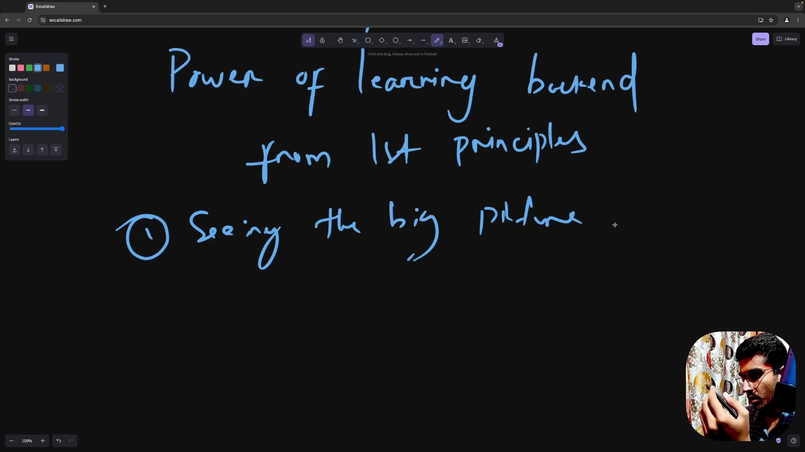
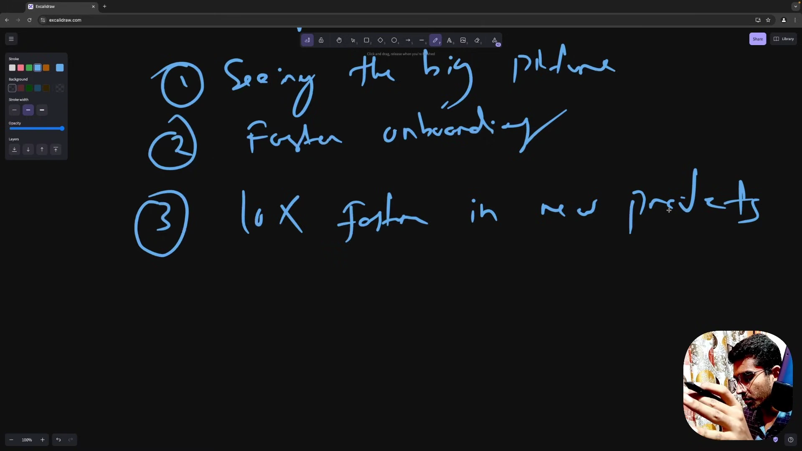
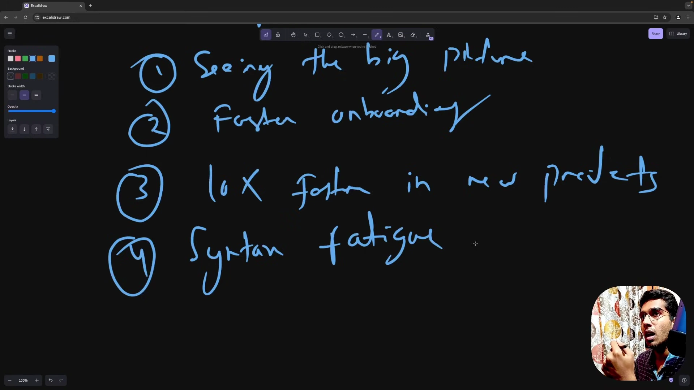
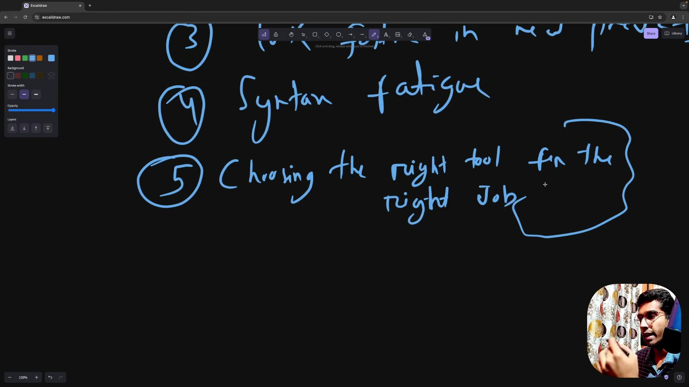
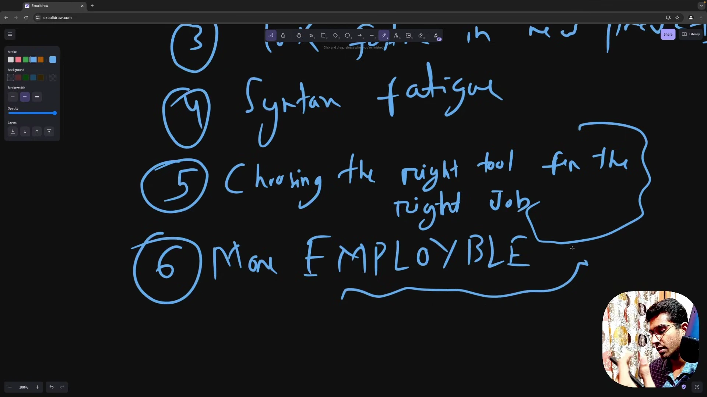

# Lợi Ích Của Tư Duy Nguyên Lý Gốc

* **Kênh:** Sriniously | **Thời lượng:** 00:10:11 | **Ngày:** 2024-09-23
* **Video:** https://www.youtube.com/watch?v=6fqZs5Z3k9A

---

## Thuật ngữ

| Thuật ngữ | Giải thích |
| :--- | :--- |
| First Principles Thinking | Tư duy từ nguyên lý gốc; phương pháp phân rã hệ thống phức tạp về các thành phần cốt lõi và quy luật phổ quát nhất thay vì suy luận dựa trên tương tự. |
| Syntax Fatigue | Tình trạng quá tải và kiệt sức khi phải liên tục học thuộc cú pháp của các thư viện và framework mới mà không hiểu cách áp dụng vào giải quyết vấn đề thực tế. |
| Deliberate Practice | Quá trình luyện tập có chủ đích và có phương pháp để rút ngắn thời gian tích lũy phản xạ kỹ thuật từ nhiều năm xuống còn vài tháng. |
| MVP (Minimum Viable Product) | Sản phẩm khả dụng tối thiểu được xây dựng nhanh chóng để kiểm chứng bài toán thị trường trước khi mở rộng quy mô. |
| Internal Compass | Chiếc la bàn tư duy nội tại giúp kỹ sư định hướng, phân tích và tự tin giải quyết vấn đề trong một cơ sở mã hoàn toàn xa lạ. |
| Tech Stack Agnostic | Năng lực làm việc độc lập với ngăn xếp công nghệ; không bị giới hạn hay định danh nghề nghiệp bởi một ngôn ngữ lập trình duy nhất. |

---

## Tổng luận chuyên đề

#### Chuyển đổi tư duy: Từ Framework Developer sang Software Engineer

Tư duy từ nguyên lý gốc nâng tầm một lập trình viên đóng khung theo framework thành một kỹ sư phần mềm thực thụ:
- **Tách biệt bản chất và cú pháp:** Cú pháp của từng ngôn ngữ lập trình chỉ là phương tiện biểu đạt bên ngoài. Bản chất kỹ thuật backend xoay quanh: Routing, Middleware, Authentication, Validation, Business Logic, Database Interaction và Async Processing.
- **Rút ngắn thời gian tiếp cận:** Thay vì mất hàng tuần đọc tài liệu của từng thư viện rời rạc, kỹ sư áp dụng các mẫu kiến trúc chuẩn mực để dựng lại bài toán trong ngôn ngữ mới chỉ sau 2-3 ngày.

#### Lợi thế thực chiến trong doanh nghiệp

Nắm vững nguyên lý gốc mang lại ưu thế cạnh tranh vượt trội:
- **Tốc độ Onboarding thần tốc:** Dễ dàng đọc hiểu cấu trúc của một cơ sở mã phức tạp (FastAPI, Axum, NestJS), bóc tách nhanh các đoạn mã bị over-engineering và định vị chính xác vùng phát sinh lỗi.
- **Xây dựng hệ thống chuẩn Production:** Tự tin khởi tạo dự án mới từ con số 0 với chất lượng sẵn sàng cho môi trường sản xuất mà không cần dựa dẫm vào các template sơ sài.
- **Lựa chọn đúng công cụ:** Không bị giới hạn bởi các nhãn dán như "Node.js developer" hay "Python developer"; tự tin chọn Redis cho in-memory cache, PostgreSQL cho dữ liệu quan hệ, MongoDB cho tài liệu phi cấu trúc hoặc Kafka cho luồng event streaming tùy theo đặc thù bài toán.

---

## Bóc tách chi tiết

### [[00:00](https://www.youtube.com/watch?v=6fqZs5Z3k9A&t=0s)] Thách thức khi đổi Tech Stack

* **Tình huống thực tế:** Một lập trình viên frontend chuyển sang backend, hoặc một kỹ sư Node.js lâu năm được yêu cầu chuyển sang viết service bằng Rust hoặc Python.
* **Rào cản khởi đầu:** Vấn đề lớn nhất không nằm ở độ khó của cú pháp ngôn ngữ, mà là sự hoang mang không biết bắt đầu từ đâu giữa ma trận thư viện mới như FastAPI, Pydantic, Axum, Diesel hay SQLAlchemy.
* **Nguy cơ lạc lối:** Thiếu bản đồ kiến trúc tổng thể khiến lập trình viên mất hàng giờ đọc docs của từng thư viện rời rạc mà vẫn không hình dung được luồng data flow đi qua hệ thống như thế nào.

### [[01:08](https://www.youtube.com/watch?v=6fqZs5Z3k9A&t=68s)] Tầm nhìn kiến trúc của Senior Engineer

* **Bóc tách cấu trúc hệ thống:** Tiếp cận từ nguyên lý gốc giúp kỹ sư phân chia mã nguồn thành các khối độc lập: Routing layer, Middleware pipeline, Business logic layer, Data access layer và nhận diện ngay phần mã bị over-engineering.
* **Trực giác của Senior / Lead Engineer:** Các kỹ sư dày dạn kinh nghiệm có khả năng lướt qua một repo xa lạ và định vị ngay vùng phát sinh lỗi nhờ vào phản xạ nhận diện khuôn mẫu kiến trúc pattern recognition tích lũy qua nhiều năm.
* **Rèn luyện có chủ đích Deliberate Practice:** Không cần phải chờ đợi 5-10 năm thử sai để có được trực giác này; người học có thể rèn luyện tư duy nhận diện khuôn mẫu ngay từ ngày đầu tiên để đạt được năng lực tương đương trong 6 tháng đến 1 năm.

### [[02:25](https://www.youtube.com/watch?v=6fqZs5Z3k9A&t=145s)] Onboarding và khởi tạo dự án mới

* **Hòa nhập cơ sở mã mới:** Khi hiểu sâu cách HTTP vận hành, cách Database kết nối qua Connection Pool và cách request đi qua Middleware, cú pháp chỉ còn là yếu tố phụ. Kỹ sư tập trung thẳng vào logic nghiệp vụ và nắm bắt dự án mới trong thời gian ngắn.
* **Khởi tạo dự án tốc độ cao:** Khi xây dựng một sản phẩm mới từ đầu, kiến thức nguyên lý gốc giúp tạo ra mã nguồn chuẩn production với tốc độ vượt trội. Kỹ sư tự thiết lập routing, database connection pool, caching, logging và error handling mà không cần phụ thuộc vào boilerplate có sẵn.

### [[03:47](https://www.youtube.com/watch?v=6fqZs5Z3k9A&t=227s)] Vượt qua Syntax Fatigue

* **Nguyên nhân gây kiệt sức Syntax Fatigue:** Nắm được cú pháp của ngôn ngữ mới nhưng không biết áp dụng vào đâu để giải quyết bài toán thực tế thường dẫn đến bế tắc và nản lòng.
* **Bài toán chuyển đổi sang Rust:** Một lập trình viên Node.js muốn học Rust thường tìm kiếm các khóa học làm dự án hoàn chỉnh kéo dài 4-5 tiếng. Tuy nhiên, Rust là hệ sinh thái mới nên rất hiếm tutorial về full-stack backend chuẩn production. Điều này khiến lập trình viên loay hoay ở mức cú pháp cơ bản mà không thể bứt phá lên môi trường sản xuất.

### [[05:19](https://www.youtube.com/watch?v=6fqZs5Z3k9A&t=319s)] Quy trình chuyển giao tri thức thực tế

* **Quy trình 4 bước chuyển đổi sang ngôn ngữ mới:** Khi đã thấu hiểu cấu trúc chuẩn của một backend qua Node.js (gồm Routing, Middleware, Validation, Serialization, Repository Pattern và Error Handling), việc học Rust được chia nhỏ thành từng bài toán thành phần:
  1. Khởi tạo cấu trúc dự án Rust theo chuẩn cộng đồng Cargo workspace.
  2. Tìm kiếm cách giải quyết từng module riêng biệt: tra cứu thư viện hoặc chuẩn ngôn ngữ để viết module validation (như validator crate).
  3. Kết hợp cú pháp Rust với các nguyên lý thiết kế chất lượng cao đã biết từ trước.
  4. Lặp lại quy trình cho Routing (Axum/Actix), Authentication (JWT) và Database (Diesel/SQLx).
* **Kết quả:** Chỉ trong 2 đến 3 ngày, kỹ sư có thể hoàn thành một cơ sở mã Rust hoàn chỉnh sẵn sàng cho môi trường sản xuất.

### [[06:47](https://www.youtube.com/watch?v=6fqZs5Z3k9A&t=407s)] Chọn đúng công cụ theo bài toán

* **Thoát khỏi nhãn dán công nghệ:** Nhiều lập trình viên tự giới hạn bản thân trong các danh xưng như "Node.js developer" hay "Ruby developer". Khi đối mặt với yêu cầu về độ trễ cực thấp hoặc concurrency siêu cao, họ thiếu tự tin tìm kiếm công cụ phù hợp hơn.
* **Tự do lựa chọn công nghệ:** Thấu hiểu bản chất các bài toán lưu trữ dữ liệu, bảo mật và mở rộng giúp kỹ sư tự do chọn đúng công cụ: chọn Redis khi cần in-memory cache, PostgreSQL cho quan hệ ACID, MongoDB cho documents hoặc Kafka cho event streaming bất kể ngôn ngữ chính đang dùng là gì.

### [[07:54](https://www.youtube.com/watch?v=6fqZs5Z3k9A&t=474s)] Giá trị nghề nghiệp lâu dài

* **Năng lực thích ứng vượt trội:** Doanh nghiệp luôn săn đón các kỹ sư có tư duy độc lập, có thể gia nhập bất kỳ đội ngũ nào và đóng góp giá trị ngay lập tức mà không bị ràng buộc bởi một framework duy nhất.
* **Chiếc Internal Compass:** Tập trung vào các khái niệm bất biến giữa mọi hệ thống backend giúp người kỹ sư định hình chiếc la bàn tư duy để tự tin khai phá mọi vùng đất công nghệ mới.

---

## Trích dẫn then chốt

* [[01:08](https://www.youtube.com/watch?v=6fqZs5Z3k9A&t=68s)] "The ability to break down complex systems into their most basic and universal components gives you a massive edge."
* [[02:25](https://www.youtube.com/watch?v=6fqZs5Z3k9A&t=145s)] "Once you have learned the core concepts behind authentication, routing, middleware, and database interaction, the syntax is secondary."
* [[06:47](https://www.youtube.com/watch?v=6fqZs5Z3k9A&t=407s)] "By understanding the core problems backend engineering solves, you won't be limited by your framework, language, or library. You'll know exactly which tool to use."
* [[07:54](https://www.youtube.com/watch?v=6fqZs5Z3k9A&t=474s)] "Learning backend from first principles elevates you from a framework-specific developer to a true software engineer."

---

## Lệnh & Công cụ

| Công nghệ / Thư viện | Ngôn ngữ | Vai trò đề cập trong bài giảng |
| :--- | :--- | :--- |
| FastAPI & Pydantic | Python | Web framework và thư viện data validation hiệu năng cao |
| Axum & Diesel | Rust | Web routing framework và ORM tương tác database trong hệ sinh thái Rust |
| PostgreSQL & MongoDB | Đa nền tảng | Lưu trữ dữ liệu quan hệ ACID và tài liệu phi cấu trúc |
| Redis | In-Memory Cache | Lưu trữ dữ liệu tạm thời phục vụ tăng tốc độ đọc và quản lý phiên |
| Apache Kafka | Event Streaming | Nền tảng phân phối và truyền luồng thông điệp thời gian thực |

---

## Đánh đổi & Rủi ro

| Hướng tiếp cận | Mặt tích cực | Nguy cơ và rủi ro |
| :--- | :--- | :--- |
| Chuyên biệt hóa một Stack duy nhất | Viết mã rất nhanh trong phạm vi công cụ quen thuộc. | Bị động khi công nghệ lỗi thời hoặc khi đối mặt với bài toán vượt quá năng lực của công cụ. |
| Làm chủ nguyên lý gốc đa nền tảng | Tự tin chuyển đổi ngôn ngữ, thích nghi với mọi dự án trong vài ngày. | Cần kỷ luật học tập nghiêm túc ở giai đoạn đầu để nắm chắc nền tảng mạng và hệ thống. |
| Chọn công cụ theo xu hướng | Dễ tuyển dụng nhân sự ban đầu nhờ vào độ phổ biến của thư viện. | Nguy cơ chọn sai công nghệ cho bài toán cốt lõi, gây lãng phí tài nguyên và khó bảo trì lâu dài. |