# Hiểu Sâu Giao Thức HTTP

* **Kênh:** Sriniously | **Thời lượng:** 01:18:13 | **Ngày:** 2024-09-27
* **Video:** https://www.youtube.com/watch?v=a3C1DMswClQ

---

## Thuật ngữ

| Thuật ngữ | Giải thích |
| :--- | :--- |
| Statelessness | Tính chất phi trạng thái; máy chủ không lưu ngữ cảnh tương tác giữa các yêu cầu, mỗi request được xử lý độc lập và tự chứa đầy đủ dữ liệu nhận diện. |
| Client-Server Model | Mô hình máy khách - máy chủ; kết nối luôn do client chủ động khởi tạo để yêu cầu tài nguyên hoặc dữ liệu từ server. |
| OSI Model | Mô hình tham chiếu mạng 7 tầng; HTTP hoạt động tại Tầng 7 (Application Layer) trên nền giao thức truyền tải tin cậy TCP tại Tầng 4 (Transport Layer). |
| TCP Three-Way Handshake | Cơ chế bắt tay 3 bước (SYN, SYN-ACK, ACK) của giao thức TCP nhằm thiết lập kênh truyền dữ liệu bảo đảm trước khi gửi dữ liệu ứng dụng. |
| Idempotency | Tính chất giao phó của một phương thức HTTP; gọi một lần hay nhiều lần liên tiếp với cùng dữ liệu đều dẫn đến cùng một trạng thái hệ thống trên server. |
| Same-Origin Policy (SOP) | Chính sách bảo mật cùng nguồn gốc của trình duyệt nhằm cô lập tài nguyên giữa các cặp Scheme, Host và Port khác nhau. |
| CORS | Cross-Origin Resource Sharing; cơ chế dùng các HTTP Header để server cấp quyền cho trình duyệt truy cập tài nguyên từ các domain bên ngoài. |
| Preflight Request | Yêu cầu tiền kiểm sử dụng phương thức OPTIONS do trình duyệt tự động gửi trước các request xuyên nguồn phức tạp để thăm dò quyền hạn server. |
| Burp Suite | Bộ công cụ phân tích lưu lượng mạng và kiểm thử thâm nhập, dùng để bắt chặn, quan sát và can thiệp gói tin HTTP Request/Response. |
| Cache-Control | Tiêu đề chỉ thị chính sách lưu cache tại client và các proxy trung gian với các tham số thời hạn và mức độ lưu trữ. |
| ETag | Chuỗi mã băm đại diện cho phiên bản nội dung tài nguyên, dùng để đối soát tính thay đổi qua header If-None-Match trong Conditional GET. |
| Content Negotiation | Cơ chế thương lượng nội dung giúp client và server thống nhất định dạng dữ liệu (JSON/XML), ngôn ngữ hoặc kiểu nén dữ liệu tối ưu nhất. |
| Gzip & Brotli | Các thuật toán nén luồng dữ liệu HTTP phía server nhằm tối ưu kích thước payload truyền tải qua mạng. |
| HTTP Keep-Alive | Cơ chế duy trì kết nối TCP bền vững Persistent Connection qua header Connection, tái sử dụng một kết nối TCP duy nhất cho nhiều chu trình request/response. |
| Multipart Form Data | Định dạng truyền dữ liệu phân đoạn qua chuỗi Boundary để tải lên các tệp nhị phân kích thước lớn. |
| Chunked Transfer Encoding | Phương thức truyền tải dữ liệu theo từng khối kích thước biến thiên qua header Transfer-Encoding: chunked cho luồng streaming liên tục. |
| TLS Handshake | Quy trình thương lượng mật mã sử dụng chứng chỉ số để xác thực server và thiết lập khóa phiên đối xứng an toàn cho kết nối HTTPS. |

---

## Tổng luận chuyên đề

#### Nền tảng giao thức

HTTP đóng vai trò huyết mạch trong kiến trúc phần mềm hiện đại, vận hành theo mô hình Client-Server trên nền tảng kết nối tin cậy của TCP:
- **Nguyên lý Stateless:** Server không lưu trữ bất kỳ trạng thái hay phiên làm việc nào của client trong bộ nhớ. Mọi request gửi lên bắt buộc phải mang đầy đủ ngữ cảnh như Authentication Token hoặc Cookie. Tính chất này loại bỏ việc đồng bộ session giữa các máy chủ, giúp hệ thống scale ngang (horizontal scaling) cực kỳ linh hoạt và chịu lỗi tốt.
- **Tiến hóa kiến trúc mạng:** Lịch sử phát triển phản ánh nỗ lực tối ưu hóa độ trễ đường truyền: từ HTTP 1.0 (mỗi request mở một kết nối TCP riêng rồi đóng ngay, gây lãng phí chi phí bắt tay 3 bước), HTTP 1.1 (chuẩn hóa kết nối bền vững Keep-Alive và phân đoạn Chunked Transfer), HTTP/2 (chuyển sang Binary Framing, ghép kênh Multiplexing trên 1 kết nối duy nhất và nén header HPACK) đến HTTP/3 (chuyển sang giao thức QUIC trên nền UDP để xóa bỏ triệt để hiện tượng Head-of-Line Blocking ở tầng mạng).

#### Kiểm soát trao đổi

Giao thức thiết lập ngôn ngữ chuẩn mực để client và server trao đổi dữ liệu:
- **Giải phẫu HTTP Message:** Mỗi thông điệp gồm dòng khởi đầu Start Line, tập hợp các cặp khóa-giá trị Headers, một dòng trống phân tách bắt buộc và phần Body. Header đóng vai trò nhãn bì thư bên ngoài bưu kiện, cho phép hạ tầng mạng kiểm tra metadata mà không cần đọc hay giải mã phần body.
- **Ngữ nghĩa HTTP Methods và Idempotency:** Phân định rõ ràng giữa Safe Method (không làm thay đổi tài nguyên như GET, HEAD), Idempotent Method (thực thi lặp lại nhiều lần vẫn cho ra cùng một kết quả như PUT, DELETE) và Non-Idempotent Method (mỗi lần gọi sinh ra một thực thể mới như POST). Quy tắc thực chiến chuẩn mực là luôn ưu tiên dùng PATCH để cập nhật cục bộ từng phần và chỉ dùng PUT khi muốn thay thế toàn bộ thực thể.

#### Bảo mật và tối ưu

Các cơ chế vận hành chuyên sâu bảo vệ tài nguyên và giảm tải mạng:
- **Cơ chế CORS và Preflight Request:** Trình duyệt thực thi Same-Origin Policy để bảo vệ người dùng. Đối với các request phức tạp (phương thức PUT/DELETE, header Authorization tùy biến, Content-Type là application/json), trình duyệt bắt buộc gửi một Preflight Request sử dụng method OPTIONS để thăm dò quyền hạn trước khi gửi request chính thức.
- **Hệ thống Status Codes:** Chuẩn hóa kết quả qua các nhóm mã 3 chữ số từ 1xx đến 5xx, phân biệt dứt khoát giữa lỗi do client gửi sai định dạng (4xx) và lỗi hệ thống nội bộ phía server (5xx).
- **Chiến lược tối ưu hóa:** Kết hợp HTTP Caching thông qua ETag và mã 304 Not Modified, nén payload bằng Gzip/Brotli giảm hơn 85% băng thông, và mã hóa bảo mật toàn vẹn bằng TLS.

---

## Bóc tách chi tiết

### [[00:00](https://www.youtube.com/watch?v=a3C1DMswClQ&t=0s)] Phạm vi tiếp cận

* **Thực trạng học tập:** Thế giới backend bao gồm hàng trăm công nghệ, giao thức và khái niệm chồng chéo. Nếu cố gắng nghiên cứu cặn kẽ mọi ngóc ngách mạng máy tính, kỹ sư sẽ mất nhiều năm mà không xây dựng được sản phẩm thực tế.
* **Nguyên lý 90%:** Khóa học tập trung trực diện vào nhóm 90% kiến thức cốt lõi xuất hiện trong hầu hết các cơ sở mã sản xuất thực tế.
* **Vị trí của HTTP:** Là điểm khởi đầu tối quan trọng của mọi kỹ sư backend, quyết định cách browser và mobile app trao đổi dữ liệu với server.

### [[00:15](https://www.youtube.com/watch?v=a3C1DMswClQ&t=15s)] Kiến trúc giao thức

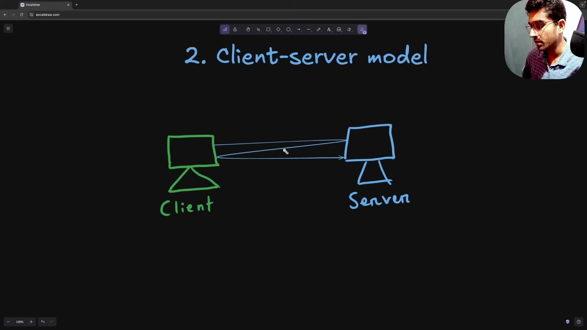

* **Bản chất Stateless:** Server không ghi nhớ bất kỳ thông tin nào về các request trong quá khứ. Sau khi gửi response xong, server giải phóng hoàn toàn ngữ cảnh tương tác.
* **Hệ quả kiến trúc:**
  - Request độc lập: Mọi thao tác của client (ví dụ: truy cập profile cá nhân) phải mang theo đầy đủ thông tin chứng thực (Token hoặc Cookie) để server nhận diện danh tính.
  - Đơn giản hóa server: Server không cần duy trì session state trong RAM, loại bỏ rủi ro mất trạng thái khi server khởi động lại.
  - Scale ngang dễ dàng: Load balancer có thể điều phối các request liên tiếp của cùng một user đến bất kỳ server node nào trong cluster mà không bị đứt đoạn phiên.
* **Mô hình Client-Server:**
  - Kết nối một chiều: Client luôn là bên chủ động mở kết nối và gửi request; server luôn ở trạng thái lắng nghe và chỉ gửi response khi nhận được request.
  - Định dạng response đa dạng: Server có thể trả về HTML, JSON, tệp văn bản, file nhị phân đa phương tiện hoặc mã lỗi.
* **Vị trí trong OSI Model:**
  - HTTP hoạt động ở Tầng 7 (Application Layer).
  - Tầng truyền tải bên dưới dựa trên giao thức TCP thông qua cơ chế TCP Three-Way Handshake để bảo đảm gói tin được gửi đầy đủ và đúng thứ tự.

### [[05:46](https://www.youtube.com/watch?v=a3C1DMswClQ&t=346s)] Tiến hóa HTTP

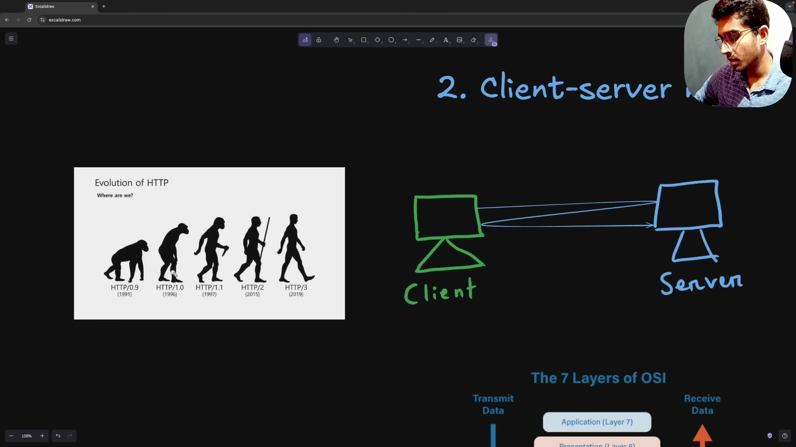

* **HTTP 1.0 (1996):**
  - Cơ chế Short-lived Connection: Mỗi chu trình request/response bắt buộc mở một kết nối TCP riêng và đóng ngay sau khi nhận phản hồi.
  - Độ trễ cao: Gây nghẽn mạng nghiêm trọng do chi phí bắt tay TCP liên tục khi web tải nhiều tài nguyên ảnh và script.
* **HTTP 1.1 (1997 - 1999):**
  - Persistent Connection: Bổ sung tính năng Keep-Alive cho phép tái sử dụng cùng một kết nối TCP đã thiết lập để gửi nhiều request/response liên tiếp.
  - Bổ sung Chunked Transfer Encoding và hoàn thiện cơ chế cache với Cache-Control và ETag.
* **HTTP/2 (2015):**
  - Binary Framing: Chuyển từ định dạng văn bản thuần sang các khung nhị phân nhỏ gọn, tối ưu tốc độ phân tích cú pháp.
  - Multiplexing: Ghép kênh cho phép truyền đồng thời nhiều luồng request và response lồng ghép trên một kết nối TCP duy nhất, loại bỏ tắc nghẽn hàng đợi tại tầng ứng dụng.
  - Nén header: Áp dụng thuật toán HPACK để nén metadata header và bổ sung cơ chế Server Push.
* **HTTP/3 (2022):**
  - Nền tảng QUIC: Chuyển dịch từ TCP sang giao thức QUIC chạy trên nền UDP.
  - Khắc phục nghẽn tầng mạng: Loại bỏ triệt để hiện tượng Head-of-Line Blocking ở transport layer; khi một packet bị drop, các luồng độc lập khác vẫn truyền nhận bình thường mà không bị đình trệ toàn bộ kết nối.

### [[07:29](https://www.youtube.com/watch?v=a3C1DMswClQ&t=449s)] Cấu trúc HTTP Message

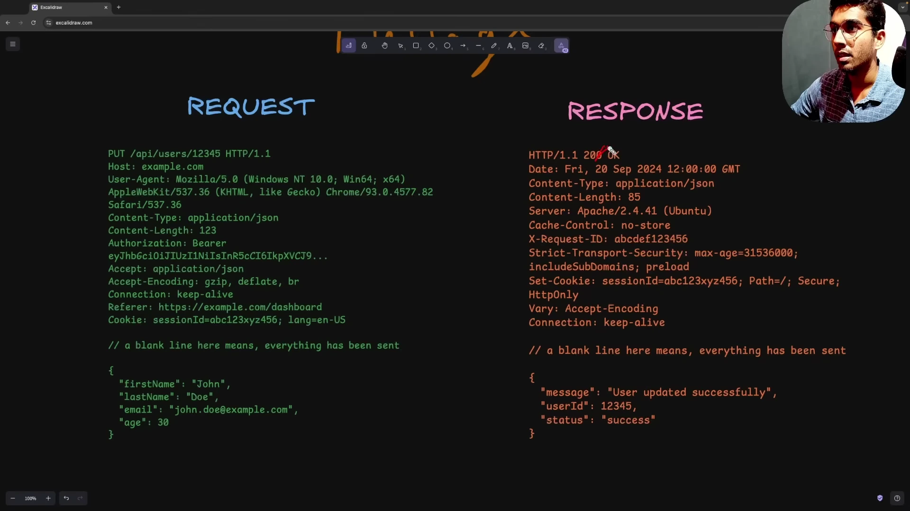

* **Cấu trúc HTTP Request Message:**
  ```http
  POST /api/v1/users HTTP/1.1
  Host: api.example.com
  User-Agent: Mozilla/5.0
  Content-Type: application/json
  Authorization: Bearer eyJhbGciOi...

  {
    "username": "srinious",
    "role": "admin"
  }
  ```
  - Request Line: Chứa HTTP Method (POST), Request URI (/api/v1/users) và HTTP Version (HTTP/1.1).
  - Request Headers: Tập hợp các cặp key-value mang metadata về client và ngữ cảnh request.
  - Empty Line: Dòng trống bắt buộc phân cách khối headers và phần payload body.
  - Request Body: Dữ liệu tải trọng gửi lên server (JSON, form data hoặc binary).
* **Cấu trúc HTTP Response Message:**
  ```http
  HTTP/1.1 200 OK
  Date: Fri, 27 Sep 2024 12:00:00 GMT
  Content-Type: application/json
  Content-Length: 48
  Connection: keep-alive

  {
    "status": "success",
    "message": "User created"
  }
  ```
  - Status Line: Gồm HTTP Version (HTTP/1.1), Status Code dạng số (200) và Reason Phrase giải thích (OK).
  - Response Headers: Metadata từ server (Content-Type, Content-Length, Cache directives, Date).
  - Empty Line: Dòng trống phân cách.
  - Response Body: Dữ liệu phản hồi thực tế trả về cho client.

### [[09:09](https://www.youtube.com/watch?v=a3C1DMswClQ&t=549s)] Vai trò HTTP Headers

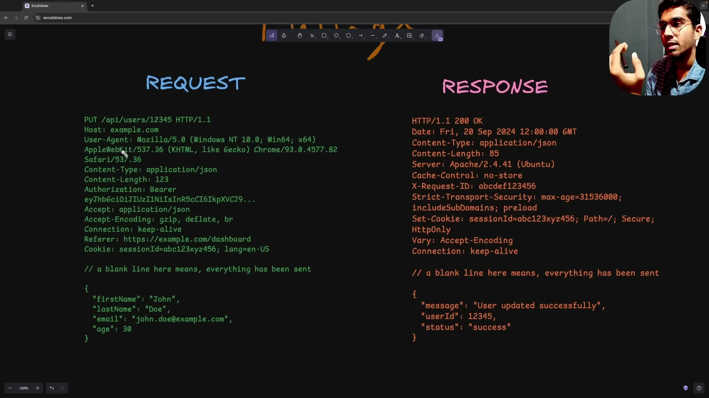

* **Bản chất kỹ thuật:** HTTP Headers là các cặp key-value truyền tải metadata của thông điệp.
* **Ẩn dụ nhãn bưu kiện:**
  - Khi gửi bưu phẩm, địa chỉ người nhận, số điện thoại, mã bưu chính và loại hàng hóa được dán ngay trên nhãn ngoài vỏ hộp.
  - Nhân viên bưu điện và hệ thống phân loại bưu cục chỉ cần quét nhãn ngoài để định tuyến kiện hàng mà không cần bóc hộp xem đồ vật bên trong.
  - Tương tự, HTTP Headers cho phép Firewall, Reverse Proxy, Load Balancer và Server kiểm tra nhanh quyền truy cập, kích thước và định dạng mà không cần đọc hay giải mã toàn bộ phần body.

### [[11:22](https://www.youtube.com/watch?v=a3C1DMswClQ&t=682s)] Phân loại Headers

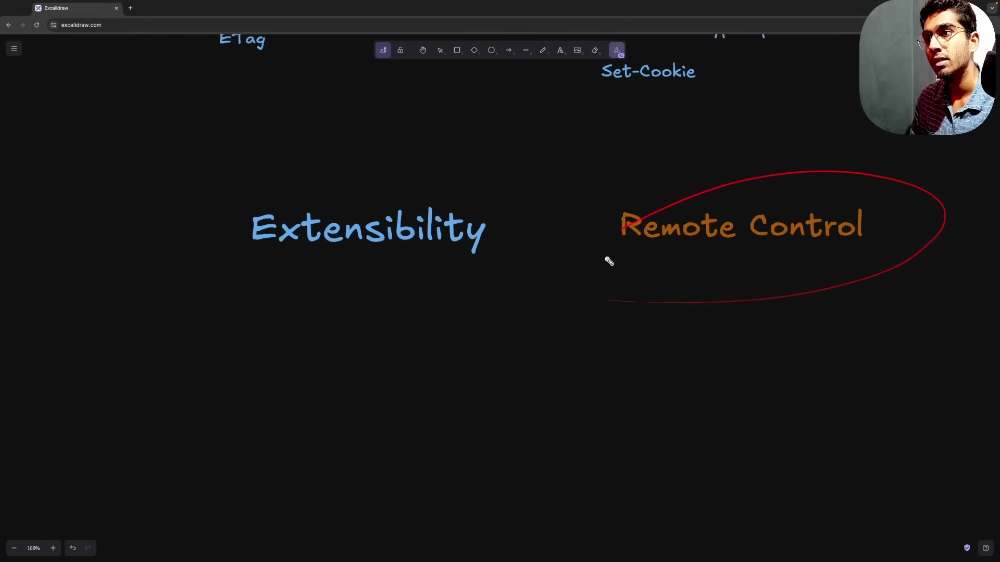

* **Request Headers:**
  - Cung cấp thông tin môi trường và quyền hạn của client gửi lên.
  - Ví dụ: `User-Agent` (thông tin trình duyệt hoặc API client), `Authorization` (Bearer token chứng thực), `Accept` (định dạng dữ liệu client mong muốn nhận về).
* **General Headers:**
  - Áp dụng chung cho cả request và response nhưng không phụ thuộc vào dữ liệu body.
  - Ví dụ: `Date` (thời điểm tạo thông điệp), `Connection` (chỉ thị duy trì hoặc ngắt kết nối TCP).
* **Representation Headers (Entity Headers):**
  - Mô tả trực tiếp cấu trúc và thuộc tính của dữ liệu body.
  - Ví dụ: `Content-Type` (MIME type như application/json), `Content-Length` (kích thước tính theo byte), `Content-Encoding` (chuẩn nén gzip/br), `ETag` (chuỗi hash đối soát).
* **Security Headers:**
  - Chỉ thị browser thực thi chính sách bảo vệ nghiêm ngặt:
  - `Strict-Transport-Security` (HSTS): Ép buộc client chỉ giao tiếp qua HTTPS để chống tấn công SSL Stripping.
  - `Content-Security-Policy` (CSP): Giới hạn các domain nguồn được phép tải script và resource nhằm chống tấn công XSS.
  - `X-Frame-Options`: Ngăn chặn website bị nhúng vào iframe nhằm chống tấn công Clickjacking.
  - `X-Content-Type-Options: nosniff`: Cấm browser tự ý đoán định dạng MIME sai lệch với khai báo.
  - `Set-Cookie` gắn cờ `HttpOnly` (chặn JavaScript đọc cookie) và `Secure` (chỉ truyền qua HTTPS).
* **Tính năng Remote Control:**
  - Headers hoạt động như chiếc điều khiển từ xa: Client gửi các chỉ thị qua header để điều hướng hành vi xử lý của server mà không cần thay đổi cấu trúc giao thức cốt lõi.

### [[16:23](https://www.youtube.com/watch?v=a3C1DMswClQ&t=983s)] HTTP Methods

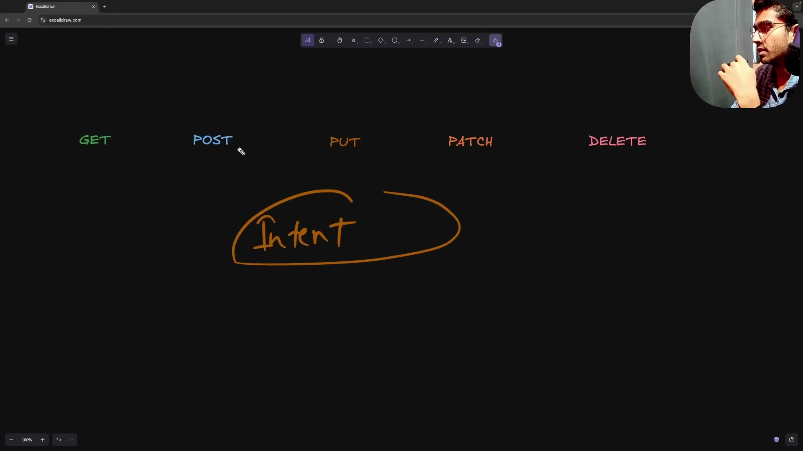

* **Ngữ nghĩa hành động:** Method thể hiện ý đồ thao tác cụ thể của client lên tài nguyên server.
* **Các phương thức tiêu chuẩn:**
  - `GET`: Lấy dữ liệu tài nguyên từ server; tuyệt đối không làm biến đổi trạng thái hệ thống.
  - `POST`: Tạo mới tài nguyên trên server; bắt buộc đính kèm payload body chứa dữ liệu thực thể.
  - `PATCH`: Cập nhật cục bộ một phần các trường dữ liệu của tài nguyên hiện có.
  - `PUT`: Thay thế hoàn toàn thực thể cũ bằng một thực thể mới gửi lên trong body.
  - `DELETE`: Xóa tài nguyên cụ thể khỏi hệ thống.
* **Quy tắc phân biệt PUT và PATCH:**
  - Lập trình viên hay mắc lỗi dùng PUT khi chỉ muốn sửa một vài thuộc tính (ví dụ: đổi tên user).
  - Theo chuẩn RFC, nếu dùng PUT mà không gửi kèm các trường còn lại, các trường không xuất hiện sẽ bị ghi đè thành null hoặc giá trị mặc định.
  - Quy tắc ngón tay cái: Luôn ưu tiên dùng PATCH cho các tác vụ update thông thường, chỉ dùng PUT khi có nhu cầu thay thế nguyên trạng toàn bộ thực thể.

### [[18:03](https://www.youtube.com/watch?v=a3C1DMswClQ&t=1083s)] Nguyên lý Idempotency

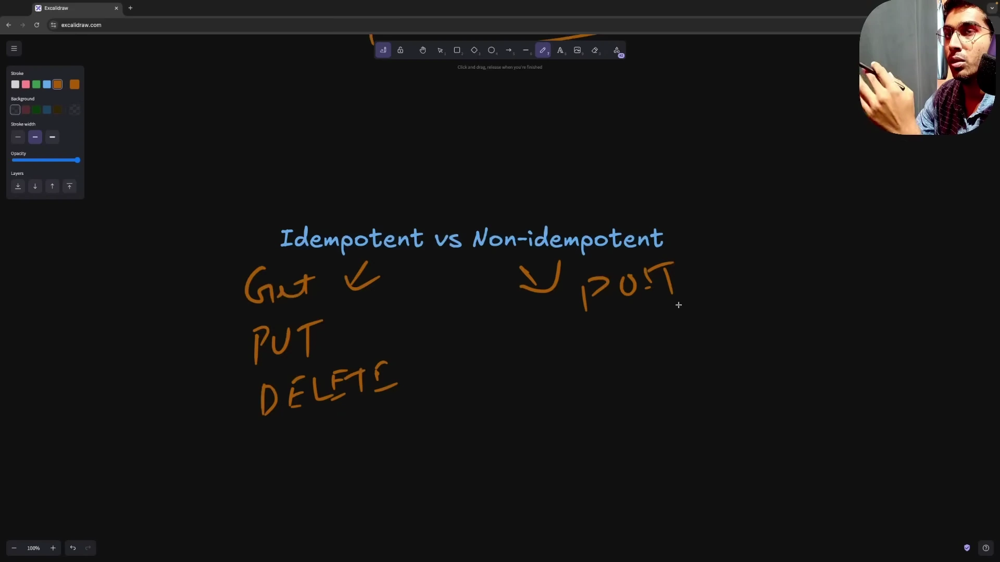

* **Định nghĩa Idempotency:** Một method được coi là Idempotent nếu gọi 1 lần hay gọi lặp lại 100 lần với cùng tham số đều tạo ra cùng một trạng thái hệ thống trên server.
* **Ma trận Safe và Idempotent Methods:**

| HTTP Method | Safe Method | Idempotent | Bản chất kỹ thuật |
| :--- | :--- | :--- | :--- |
| `GET` | Có | Có | Chỉ đọc dữ liệu; gọi bao nhiêu lần thì dữ liệu trên server vẫn giữ nguyên trạng thái. |
| `PUT` | Không | Có | Thay thế hoàn toàn thực thể; gọi thay thế 1 lần hay 10 lần với cùng payload thì kết quả cuối cùng trên database vẫn là thực thể đó. |
| `DELETE` | Không | Có | Xóa tài nguyên; lần gọi đầu tài nguyên bị xóa, các lần gọi kế tiếp tài nguyên vẫn ở trạng thái đã bị xóa. |
| `POST` | Không | Không | Tạo mới tài nguyên; mỗi lần gọi POST hệ thống sẽ chèn thêm một bản ghi mới riêng biệt vào database. |
| `PATCH` | Không | Tùy ngữ cảnh | Không được coi là Idempotent mặc định trong chuẩn RFC vì các thao tác tăng giảm tương đối (ví dụ: cộng thêm 10 vào số dư) cho ra kết quả khác nhau sau mỗi lần gọi. |

### [[20:07](https://www.youtube.com/watch?v=a3C1DMswClQ&t=1207s)] Quy trình CORS và Preflight

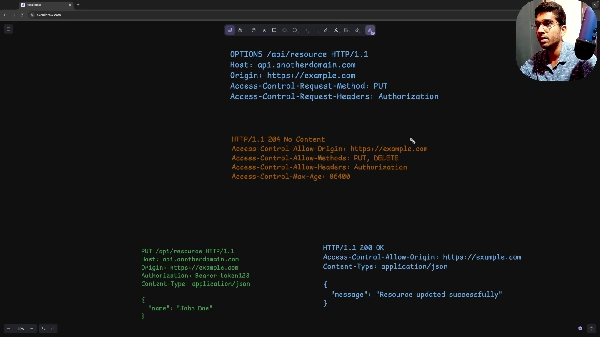

* **Same-Origin Policy (SOP):** Cơ chế bảo mật của browser mặc định chặn mã JavaScript từ một nguồn truy cập tài nguyên của nguồn khác. Một nguồn được xác định bởi bộ ba: Scheme + Host + Port.
* **CORS (Cross-Origin Resource Sharing):** Cơ chế cho phép server chủ động mở quyền truy cập tài nguyên cho các client chạy ở domain khác thông qua các HTTP Header tương ứng.
* **Simple Request:**
  - Điều kiện: Dùng method GET, POST hoặc HEAD; chỉ chứa các header tiêu chuẩn đơn giản; Content-Type thuộc application/x-www-form-urlencoded, multipart/form-data hoặc text/plain.
  - Luồng xử lý: Browser gửi thẳng request kèm header `Origin: https://frontend.com`. Server phản hồi kèm header `Access-Control-Allow-Origin: https://frontend.com` (hoặc `*`). Nếu server không trả về header này, browser sẽ chặn không cho JavaScript đọc response và báo lỗi CORS trong console.
* **Preflight Request:**
  - Kích hoạt khi: Request sử dụng method PUT, DELETE, PATCH; hoặc có header tùy biến như `Authorization`; hoặc Content-Type là `application/json` (định dạng phổ biến nhất của các ứng dụng backend hiện đại).
  - Hành vi: Trước khi gửi request chính thức, browser tự động phát một Preflight Request sử dụng method `OPTIONS` để hỏi quyền server.
* **Bộ Headers phản hồi Preflight cốt lõi:**
  - `Access-Control-Allow-Origin`: Khai báo domain client được phép gọi (ví dụ: `http://localhost:5173`).
  - `Access-Control-Allow-Methods`: Danh sách các method được server hỗ trợ trên route này (ví dụ: `GET, POST, PUT, DELETE`).
  - `Access-Control-Allow-Headers`: Danh sách các header tùy biến được chấp nhận (ví dụ: `Content-Type, Authorization`).
  - `Access-Control-Max-Age`: Thời gian browser được phép cache kết quả Preflight tính theo giây (ví dụ: `86400` tương đương 24 giờ) để tránh việc mọi request đều phải tốn thêm một vòng OPTIONS gây lãng phí băng thông.

### [[29:44](https://www.youtube.com/watch?v=a3C1DMswClQ&t=1784s)] Thực hành Burp Suite

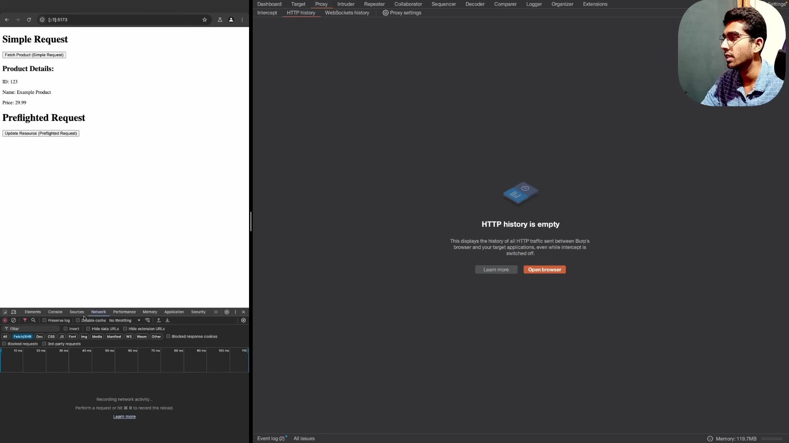

* **Môi trường thực nghiệm:**
  - Frontend app chạy tại `http://localhost:5173`.
  - Backend API chạy tại `http://localhost:3000`.
  - Khác port cấu thành một yêu cầu xuyên nguồn (Cross-Origin Request).
* **Thao tác bắt chặn với Burp Suite:**
  - Cấu hình proxy bắt chặn lưu lượng HTTP giữa browser và backend.
  - Quan sát request thực tế: Browser tự động chèn header `Origin: http://localhost:5173` và `Host: localhost:3000`.
  - Khi server trả về response có kèm `Access-Control-Allow-Origin: http://localhost:5173`, dữ liệu hiển thị thành công trên giao diện frontend.

### [[34:10](https://www.youtube.com/watch?v=a3C1DMswClQ&t=2050s)] Phân tích phản hồi CORS

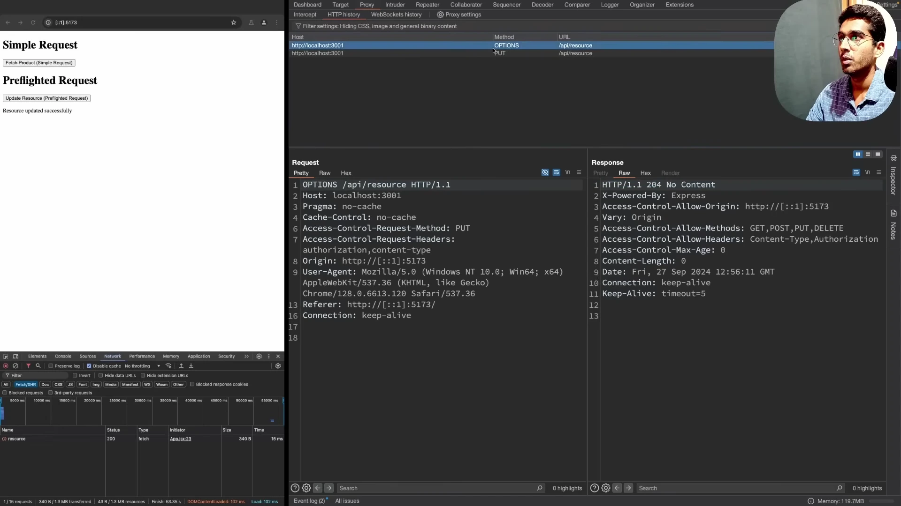

* **Mô phỏng sự cố thiếu Header CORS:**
  - Giảng viên tắt cấu hình `Access-Control-Allow-Origin` trên code server và kích hoạt lại request.
  - Phân tích bản chất: Request thực tế vẫn đến được server và server vẫn xử lý bình thường; tuy nhiên khi response trả về browser phát hiện thiếu header CORS cho phép nên chính browser đã chủ động chặn dữ liệu và ném lỗi ra console.
* **Quan sát chu trình Preflight OPTIONS:**
  - Khi gửi request PUT kèm payload JSON và header Authorization, Burp Suite ghi nhận 2 request liên tiếp:
    1. Yêu cầu `OPTIONS /api/resource` với status code trả về là `204 No Content` kèm 4 header cấp phép của CORS.
    2. Sau khi Preflight thành công, browser mới gửi tiếp request `PUT /api/resource` mang dữ liệu payload thực sự.

### [[38:51](https://www.youtube.com/watch?v=a3C1DMswClQ&t=2331s)] Hệ thống Status Codes

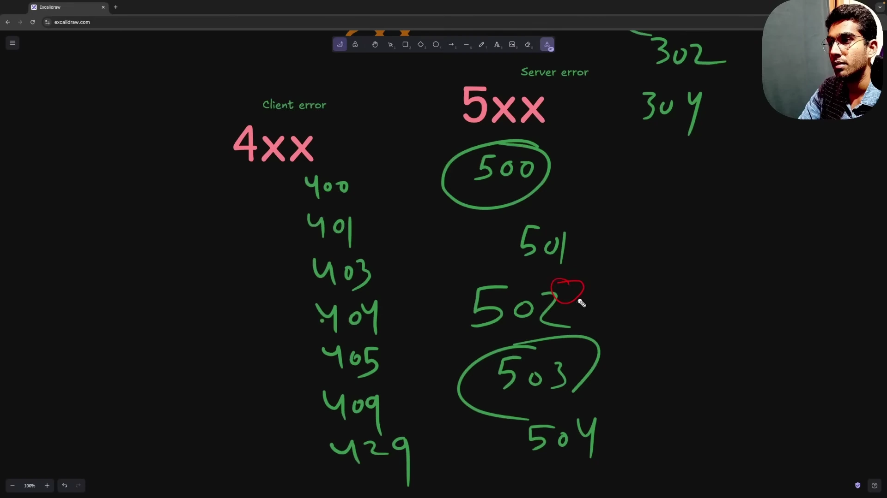

* **Tầm quan trọng của chuẩn hóa:**
  - Status Code cung cấp ngôn ngữ chung độc lập với ngôn ngữ lập trình (Go, Rust, Python, Node.js).
  - Client phân nhánh xử lý logic tự động ngay lập tức dựa trên mã số 3 chữ số mà không cần bóc tách chuỗi text trong body.
* **Phân loại 5 nhóm Status Codes:**
  - **1xx (Informational):** Báo hiệu request đã được tiếp nhận và đang xử lý. Điển hình có `100 Continue` (client gửi header trước, server duyệt xong mới gửi body dung lượng lớn) và `101 Switching Protocols` (nâng cấp kết nối từ HTTP lên WebSocket).
  - **2xx (Success):**
    * `200 OK`: Request thành công, tài nguyên trả về trong phần body.
    * `201 Created`: Tạo mới tài nguyên thành công (dùng cho POST request).
    * `204 No Content`: Xử lý thành công nhưng không có dữ liệu trả về trong body (dùng cho Preflight OPTIONS hoặc DELETE request).
  - **3xx (Redirection):**
    * `301 Moved Permanently`: Tài nguyên đã chuyển vĩnh viễn sang URL mới, browser tự động cache và đổi link cho các lần gọi sau.
    * `302 Found`: Chuyển hướng tạm thời sang URL khác.
    * `304 Not Modified`: Tài nguyên chưa bị thay đổi so với bản cache; client tái sử dụng dữ liệu cục bộ mà không cần tải lại body.
  - **4xx (Client Errors):**
    * `400 Bad Request`: Payload gửi lên sai định dạng hoặc thiếu trường dữ liệu bắt buộc.
    * `401 Unauthorized`: Thiếu thông tin xác thực hoặc Token đã hết hạn / không hợp lệ.
    * `403 Forbidden`: Server hiểu danh tính client nhưng từ chối cấp quyền thực hiện hành động trên tài nguyên cụ thể.
    * `404 Not Found`: Không tìm thấy tài nguyên tại URL yêu cầu.
    * `405 Method Not Allowed`: Phương thức HTTP không được server hỗ trợ trên route này (ví dụ: gửi POST vào endpoint chỉ cho GET).
    * `409 Conflict`: Xung đột trạng thái tài nguyên (ví dụ: tạo folder có tên đã tồn tại).
    * `429 Too Many Requests`: Vượt quá hạn ngạch giới hạn tần suất gọi Rate Limiting.
  - **5xx (Server Errors):**
    * `500 Internal Server Error`: Server gặp lỗi không mong muốn hoặc crash unhandled exception.
    * `501 Not Implemented`: Server chưa hỗ trợ tính năng hoặc method này.
    * `502 Bad Gateway`: Server trung gian (Nginx, Load Balancer) nhận response không hợp lệ từ upstream server phía sau.
    * `503 Service Unavailable`: Hệ thống quá tải hoặc đang trong trạng thái bảo trì tạm thời.
    * `504 Gateway Timeout`: Server trung gian hết thời gian chờ phản hồi từ upstream server nội bộ.

### [[52:20](https://www.youtube.com/watch?v=a3C1DMswClQ&t=3140s)] Kiểm thử Status Codes

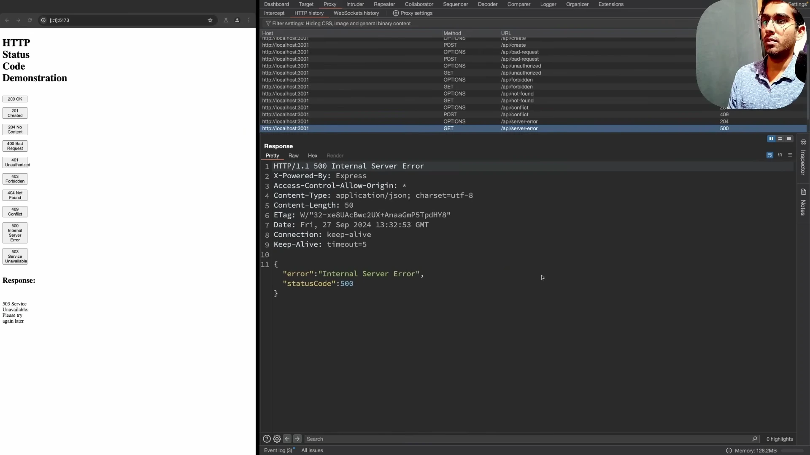

* **Mô phỏng các kịch bản thực tế:**
  - Kích hoạt thao tác tạo user: Server trả về `201 Created` xác nhận thành công.
  - Gửi dữ liệu thiếu email: Server trả về `400 Bad Request` với message lỗi chi tiết.
  - Gọi API mà không đính kèm Bearer Token: Server trả về `401 Unauthorized`, kích hoạt luồng tự động điều hướng client về trang đăng nhập.
  - Cố tình tạo trùng tên thư mục: Server trả về `409 Conflict`, báo cho client chọn tên thư mục khác.
  - Lỗi sụp đổ mã nguồn: Trả về `500 Internal Server Error` cô đọng để tránh lộ Stack Trace nhạy cảm ra ngoài.

### [[55:20](https://www.youtube.com/watch?v=a3C1DMswClQ&t=3320s)] Cơ chế HTTP Caching

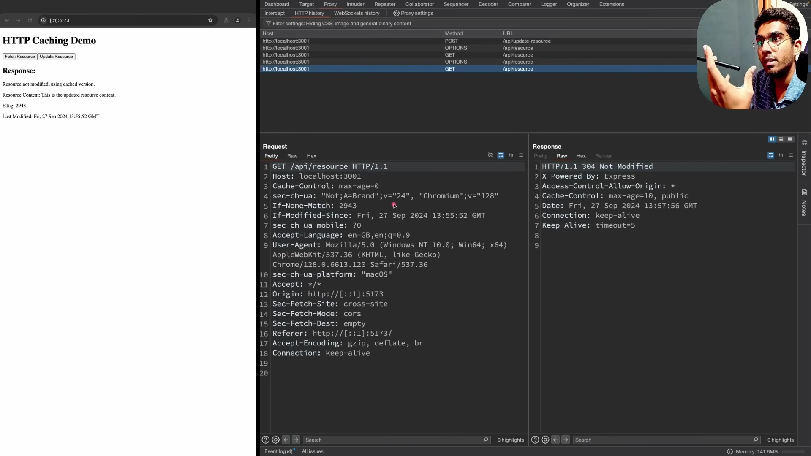

* **Lợi ích kiến trúc:** Tái sử dụng dữ liệu phản hồi giúp giảm độ trễ, tiết kiệm băng thông mạng và giảm tải truy vấn cho database.
* **Bộ ba Headers kiểm soát cache:**
  - `Cache-Control: max-age=10`: Chỉ thị client lưu cache tài nguyên trong 10 giây; trong thời gian này client không cần gọi lại server.
  - `ETag: \"hash_value\"`: Chuỗi hash đại diện duy nhất cho nội dung tài nguyên tại thời điểm phản hồi.
  - `Last-Modified`: Thời điểm tài nguyên được cập nhật lần cuối trên hệ thống.
* **Quy trình Conditional GET:**
  1. Request lần đầu: Client nhận tài nguyên kèm header `ETag: 3141` và lưu vào cache trình duyệt.
  2. Request lần thứ hai: Client gửi request kèm header `If-None-Match: 3141`.
  3. Xử lý phía server: Server so sánh mã hash hiện tại của tài nguyên; nếu vẫn khớp 3141, server lập tức trả về mã `304 Not Modified` với phần body hoàn toàn rỗng.
  4. Client nhận mã 304 và tự động lấy dữ liệu từ cache nội bộ, tiết kiệm 100% dung lượng payload truyền tải qua mạng.
* **Kịch bản cập nhật tài nguyên:**
  - Khi tài nguyên bị sửa đổi (qua POST/PUT), server tính toán sinh mã ETag mới (ví dụ: `2943`). Lần gọi tiếp theo kiểm tra thấy lệch hash, server sẽ trả về mã `200 OK` kèm body mới và ETag mới.
* **So sánh giải pháp đệm hiện đại:**
  - Quản lý ETag thủ công trên backend đòi hỏi chi phí tính toán hash và dễ phát sinh lỗi logic đồng bộ.
  - Các hệ thống hiện đại thường kết hợp client-side caching mạnh mẽ (như React Query / TanStack Query) với tầng phân tán Redis tại API Gateway.

### [[01:02:29](https://www.youtube.com/watch?v=a3C1DMswClQ&t=3749s)] Content Negotiation

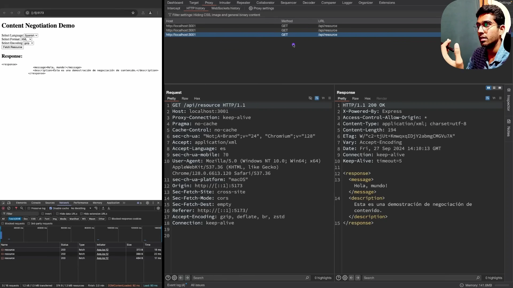

* **Bản chất kỹ thuật:** Cơ chế giúp client và server thỏa thuận định dạng dữ liệu tối ưu nhất dựa trên khả năng hỗ trợ và ưu tiên của client.
* **Ba khía cạnh thương lượng:**
  - Media Type: Client gửi `Accept: application/json` hoặc `Accept: application/xml`. Server tuần tự hóa dữ liệu theo chuẩn tương ứng và gắn nhãn `Content-Type` trong response.
  - Language: Client gửi `Accept-Language: es` (tiếng Tây Ban Nha) hoặc `en` (tiếng Anh); server trích xuất bản địa hóa phù hợp để trả về.
  - Encoding: Client gửi `Accept-Encoding: gzip, deflate, br` để thông báo danh sách các chuẩn nén mà browser hỗ trợ giải nén.

### [[01:06:53](https://www.youtube.com/watch?v=a3C1DMswClQ&t=4013s)] HTTP Compression

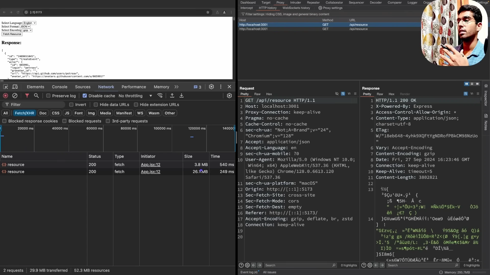

* **Thực nghiệm hiệu năng với 11.000 bản ghi:**
  - Khi bật nén Gzip trên server (`Content-Encoding: gzip`), kích thước gói tin tải về qua mạng chỉ còn **3.8 MB**. Trình duyệt tự động giải nén trong bộ nhớ và hiển thị dữ liệu toàn vẹn.
  - Khi tắt nén trên server, kích thước file JSON thô tăng vọt lên **26 MB** (tăng gấp gần 7 lần dung lượng mạng).
* **Khuyến nghị thực chiến:** Luôn kích hoạt nén Gzip hoặc Brotli tại tầng Reverse Proxy (Nginx) hoặc API Gateway đối với mọi response dạng văn bản có dung lượng trên 1 KB để tối ưu băng thông và giảm độ trễ mạng.

### [[01:08:51](https://www.youtube.com/watch?v=a3C1DMswClQ&t=4131s)] Keep-Alive và Connection

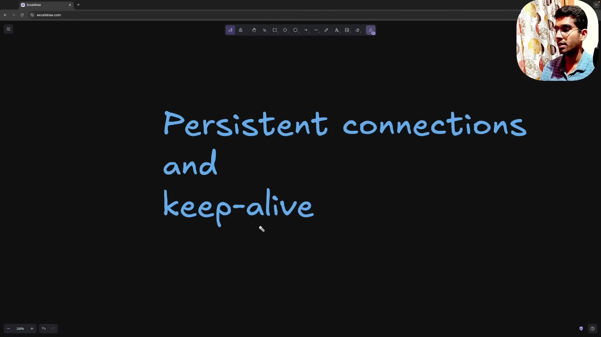

* **Chi phí của kết nối ngắn:** Trong HTTP 1.0, mỗi chu trình request/response phải trải qua 3 bước bắt tay TCP rồi đóng kết nối, gây lãng phí tài nguyên CPU và tăng độ trễ mạng.
* **Cơ chế Keep-Alive trong HTTP 1.1:**
  - Mặc định mọi kết nối HTTP 1.1 đều là Persistent Connection trừ khi có khai báo `Connection: close`.
  - Một kết nối TCP duy nhất được giữ mở để phục vụ tuần tự nhiều chu trình request/response tiếp theo.
  - Header `Keep-Alive: timeout=5, max=1000` cho phép cấu hình thời gian rảnh rỗi tối đa và số lượng request tối đa trước khi ngắt kết nối TCP.

### [[01:11:04](https://www.youtube.com/watch?v=a3C1DMswClQ&t=4264s)] Multipart và Chunked

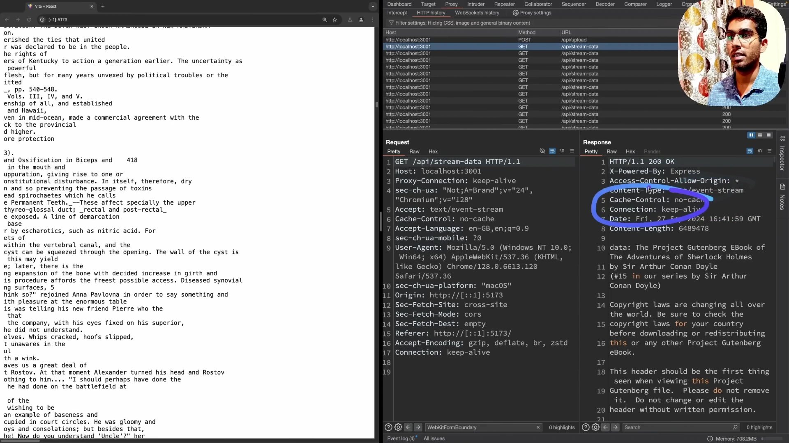

* **Tải tệp lên server bằng Multipart Form Data:**
  - Khi upload file nhị phân lớn (ảnh, video, audio), client sử dụng header `Content-Type: multipart/form-data; boundary=---------------------------974767299852498929531610575`.
  - Chuỗi Boundary đóng vai trò dấu phân cách giữa các phần dữ liệu nhị phân trong body, giúp server phân rã và đọc luồng stream an toàn.
* **Truyền luồng dữ liệu bằng Chunked Transfer:**
  - Đối với các response không xác định trước kích thước Content-Length tổng (file rất lớn hoặc dữ liệu sinh ra theo thời gian thực), server sử dụng header `Transfer-Encoding: chunked` hoặc `Content-Type: text/event-stream`.
  - Dữ liệu được đẩy về client theo từng chunk nhỏ nối tiếp; kết nối được duy trì liên tục cho đến khi chunk kết thúc rỗng được gửi tới client.

### [[01:15:18](https://www.youtube.com/watch?v=a3C1DMswClQ&t=4518s)] Bảo mật TLS và HTTPS

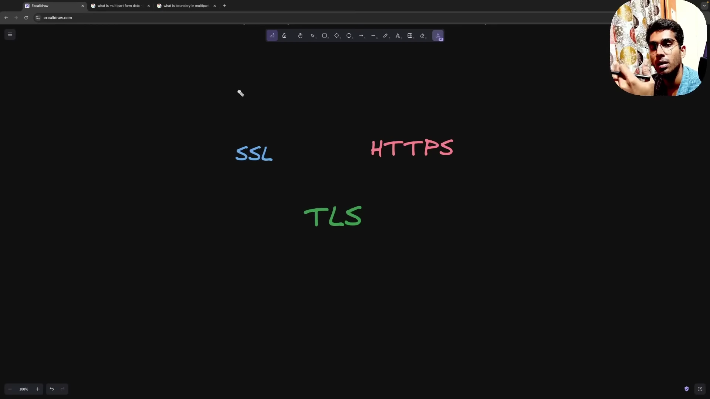

* **Thay thế SSL bằng TLS:**
  - SSL là giao thức mã hóa sơ khai giữa browser và server nhưng đã bị khai tử do nhiều lỗ hổng bảo mật nghiêm trọng.
  - TLS là giao thức kế thừa hiện đại và an toàn (chuẩn khuyến nghị hiện nay là TLS 1.3).
* **Bản chất của HTTPS:**
  - HTTPS bản chất là giao thức HTTP chạy trên nền tầng bảo mật TLS (`HTTP over TLS`).
  - Sử dụng chứng chỉ số số cấp bởi các tổ chức CA (Certificate Authority) để xác thực danh tính server.
  - Sử dụng mật mã bất đối xứng (Public/Private Key) để thực hiện TLS Handshake, sau đó chuyển sang mã hóa đối xứng bằng Session Key để mã hóa toàn bộ dữ liệu truyền tải với hiệu năng cao.
  - Đối với kỹ sư backend ở tầng ứng dụng, HTTPS hoàn toàn trong suốt; tuy nhiên cần nắm vững nguyên lý để cấu hình chứng chỉ SSL/TLS tại tầng Reverse Proxy và thiết lập đúng cờ bảo mật cho Cookie.

---

## Trích dẫn then chốt

* [[01:08](https://www.youtube.com/watch?v=a3C1DMswClQ&t=68s)] "Statelessness essentially means that it has no memory of past interactions. Each HTTP request contains all the necessary information for the server to process."
* [[09:09](https://www.youtube.com/watch?v=a3C1DMswClQ&t=549s)] "HTTP headers act as a kind of remote control on the server side. They allow the client to send instructions affecting how the server responds."
* [[16:23](https://www.youtube.com/watch?v=a3C1DMswClQ&t=983s)] "HTTP methods exist to represent different types of actions. Instead of every request doing the same thing, methods define intent."
* [[23:31](https://www.youtube.com/watch?v=a3C1DMswClQ&t=1411s)] "HTTP response codes exist to communicate the result of a request in a standardized way across all web services, regardless of the platform or language used."
* [[45:18](https://www.youtube.com/watch?v=a3C1DMswClQ&t=2718s)] "HTTPS is essentially HTTP, but with the added security features provided by TLS. TLS encrypts data during transmission, preventing eavesdropping and data leaks."

---

## Lệnh & Công cụ

| Công cụ / Tiêu đề | Phân loại | Mục đích sử dụng trong bài giảng |
| :--- | :--- | :--- |
| Burp Suite | Security Testing Tool | Bắt chặn, kiểm tra và can thiệp gói tin HTTP Request/Response để phân tích luồng CORS và Preflight |
| `OPTIONS` | HTTP Method | Phương thức tiền kiểm tra do browser tự động kích hoạt để thăm dò quyền hạn server trước request phức tạp |
| `Access-Control-Allow-Origin` | CORS Response Header | Khai báo domain client được phép truy xuất tài nguyên từ xa |
| `Access-Control-Allow-Methods` | CORS Response Header | Danh sách các method HTTP được server chấp thuận trên route tài nguyên |
| `Access-Control-Max-Age` | CORS Response Header | Thời gian lưu cache kết quả Preflight OPTIONS tại client tính bằng giây |
| `ETag` & `If-None-Match` | Caching Headers | Cơ chế xác thực tính toàn vẹn của bản sao tài nguyên nhằm trả về mã 304 Not Modified |
| `Content-Type: multipart/form-data` | Entity Header | Định dạng truyền tải tệp nhị phân lớn phân chia theo chuỗi ranh giới Boundary |
| `Content-Encoding: gzip` | Compression Header | Nén tải trọng dữ liệu phản hồi giúp giảm 85% dung lượng truyền tải mạng |

---

## Đánh đổi & Rủi ro

| Lựa chọn thiết kế | Ưu điểm kỹ thuật | Đánh đổi và điểm mù rủi ro |
| :--- | :--- | :--- |
| Kiến trúc Stateless | Dễ dàng scale ngang cụm server node, khả năng chịu lỗi cao khi session không bị gắn chặt vào một node cụ thể. | Mọi request đều phải gửi kèm Authentication Token làm tăng dung lượng header; phải xây dựng tầng cache tập trung (như Redis) để quản lý phiên khi cần thiết. |
| Cơ chế Preflight Request trong CORS | Bảo vệ tài nguyên server trước các request xuyên nguồn độc hại và nguy cơ tấn công CSRF. | Làm tăng gấp đôi số lượng request qua mạng (mỗi thao tác phát sinh thêm 1 lệnh OPTIONS); cần cấu hình `Access-Control-Max-Age` hợp lý để tối ưu hiệu năng. |
| HTTP Caching qua ETag | Giảm thiểu băng thông server khi dữ liệu tĩnh không thay đổi (trả về mã rỗng 304). | Server vẫn phải tiếp nhận request và tốn chi phí tính toán hash ETag; nếu cấu hình cache sai sót client có nguy cơ đọc dữ liệu lỗi thời. |
| Nén tải trọng Gzip / Brotli | Tiết kiệm tối đa chi phí truyền dẫn dữ liệu qua mạng, tăng tốc độ phản hồi cho client ở kết nối yếu. | Tiêu tốn thêm chu kỳ CPU của server để nén và của client để giải nén; không nên áp dụng cho các response nhỏ dưới 1 KB hoặc file đã nén sẵn (JPEG, PNG). |