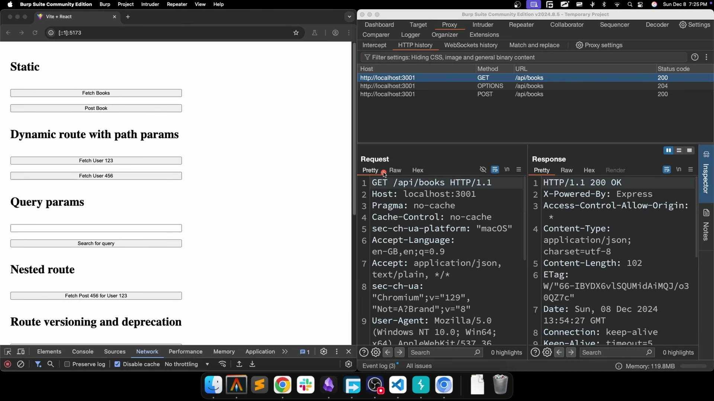
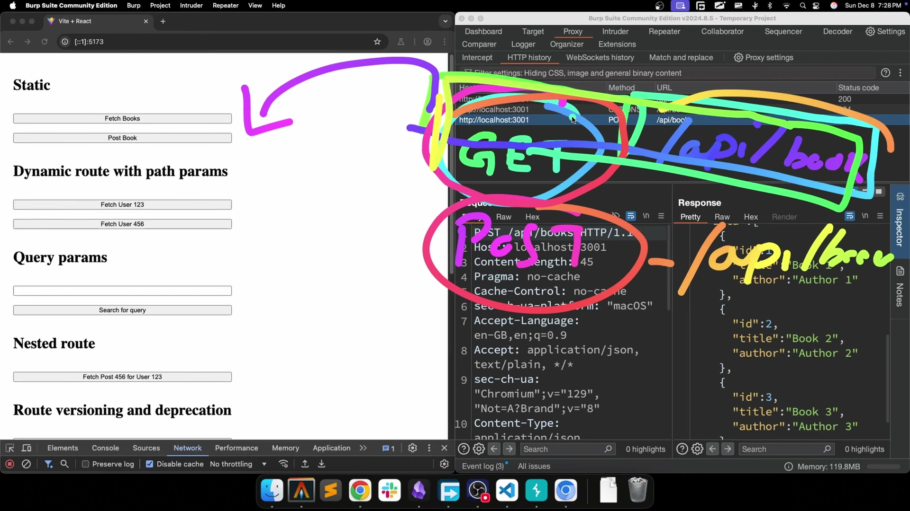
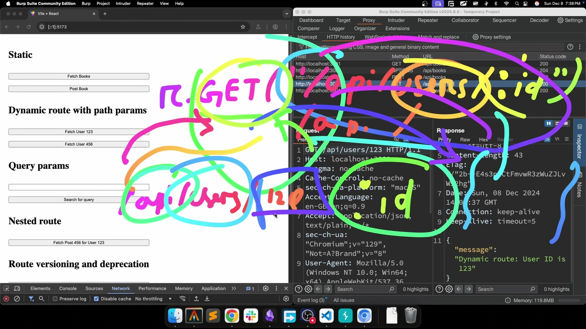
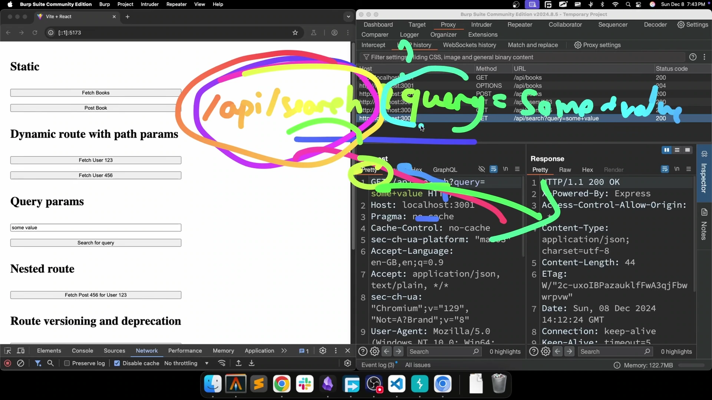
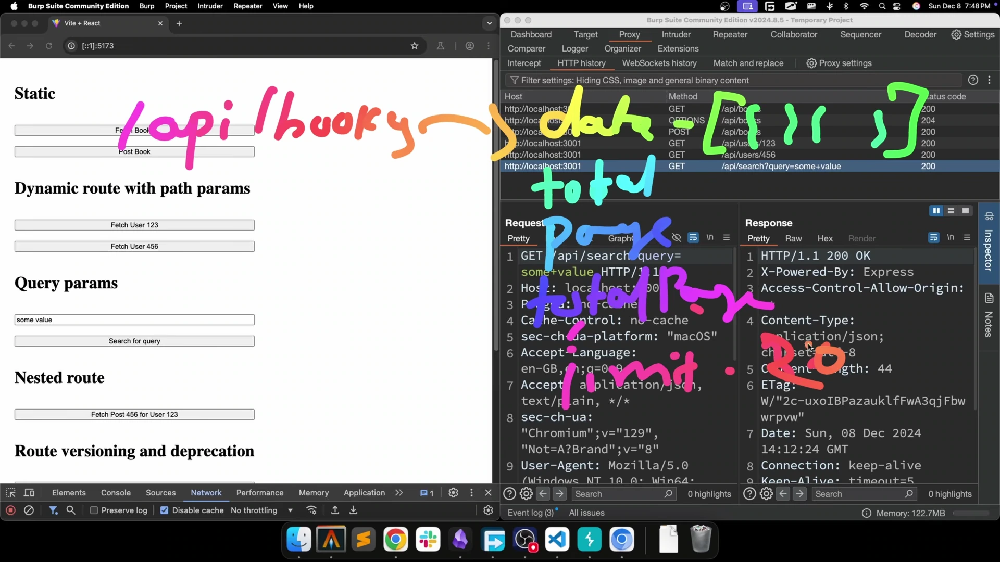
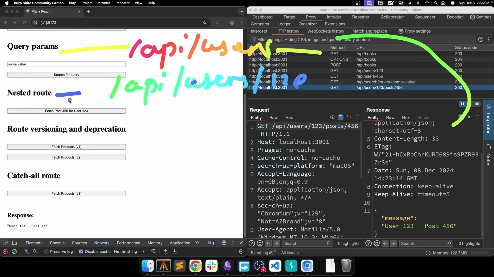
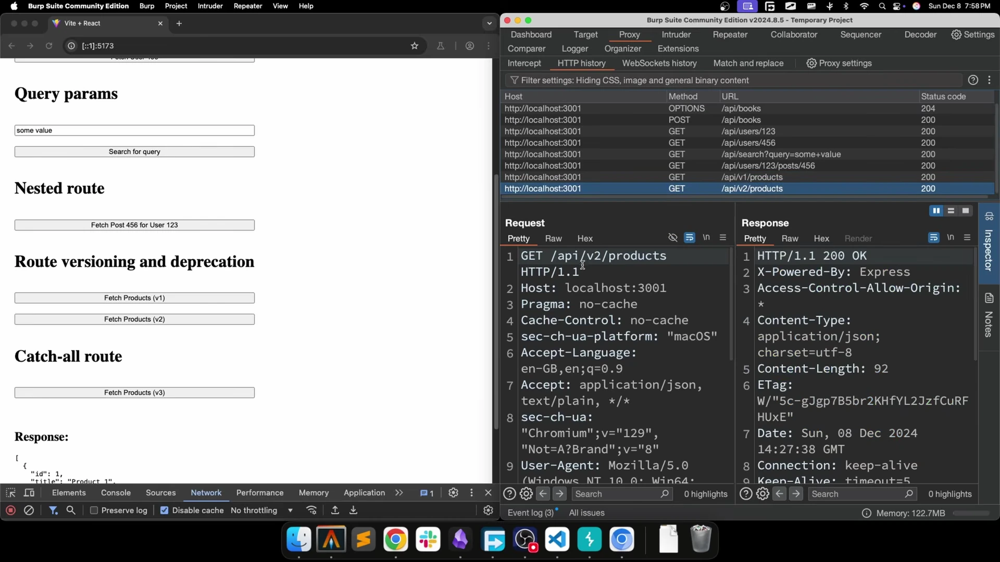
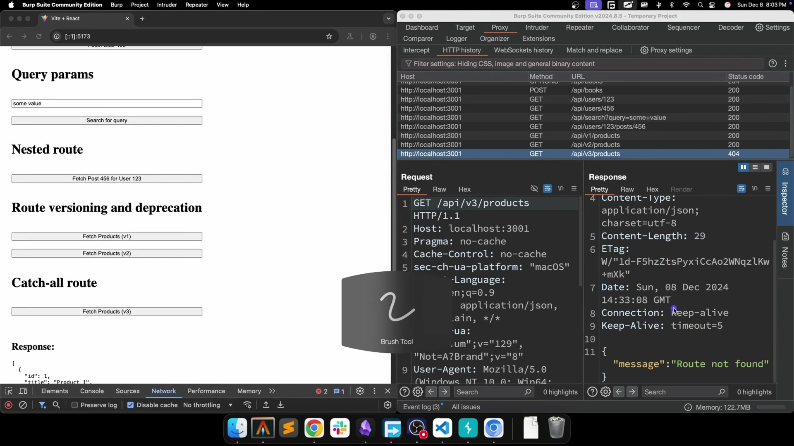

# Bản Chất Của Routing Trong Backend

* **Kênh:** Sriniously | **Thời lượng:** 24:03 | **Ngày:** 2024-12-09
* **Video:** https://www.youtube.com/watch?v=SubuU1iOC2s

---

## Thuật ngữ

| Thuật ngữ | Giải thích |
| :--- | :--- |
| Routing | Cơ chế tiếp nhận và ánh xạ cặp định danh HTTP Method kết hợp URL Path tới đúng hàm Handler xử lý tương ứng trên máy chủ. |
| Handler | Hàm hoặc đoạn mã logic nghiệp vụ phía máy chủ chịu trách nhiệm tiếp nhận Request Context, tương tác cơ sở dữ liệu và trả về HTTP Response. |
| Static Route | Tuyến đường cố định có chuỗi ký tự URL Path tĩnh, không thay đổi và không chứa biến động, ví dụ `/api/books`. |
| Dynamic Route | Tuyến đường chứa tham số động biến thiên Path Parameter, cho phép trích xuất giá trị cụ thể trực tiếp từ URL Path, ví dụ `/api/users/:id`. |
| Path Parameter | Tham số định danh tài nguyên nằm trực tiếp trong cấu trúc đường dẫn URL sau dấu gạch chéo `/`. |
| Query Parameter | Tập hợp các cặp key-value nằm sau dấu chấm hỏi `?` trên URL, dùng để truyền dữ liệu lọc, sắp xếp, phân trang mà không thay đổi cấu trúc tuyến đường. |
| Nested Route | Cấu trúc định tuyến lồng ghép biểu diễn quan hệ phân cấp thứ bậc cha-con giữa các tài nguyên RESTful, ví dụ `/api/users/:id/posts/:postId`. |
| Route Versioning | Kỹ thuật gắn nhãn phiên bản vào URL Path như `/api/v1/products` và `/api/v2/products` để quản lý các breaking changes. |
| Route Deprecation | Quy trình thông báo và duy trì phiên bản API cũ song song trong một khoảng thời gian trước khi loại bỏ hoàn toàn, giúp client kịp thời migrate. |
| Catch-All Route | Tuyến đường bắt tất cả với Wildcard dạng `/*` đặt ở cuối danh sách định tuyến để xử lý mọi request không khớp và trả về phản hồi 404 thân thiện. |

---

## Tổng luận chuyên đề

#### Bản chất nhị nguyên của HTTP Request

Kiến trúc giao tiếp HTTP trong hệ thống backend luôn được định hình bởi hai thành phần tối thượng:
- **HTTP Method (The "What"):** Thể hiện ý định hoặc hành vi tác động lên tài nguyên (`GET` để lấy dữ liệu, `POST` để tạo mới, `PUT`/`PATCH` để cập nhật, `DELETE` để xóa).
- **URL Path / Route (The "Where"):** Xác định chính xác địa chỉ hoặc tài nguyên đích mà client muốn tác động tới trong không gian tài nguyên của server.
- **Quy tắc vàng của Routing:** `Routing Key = HTTP Method + URL Path`. Server ghép cặp hai thành phần này thành một khóa duy nhất để tra cứu và chuyển tiếp tới hàm Handler tương ứng. Cùng một URL Path `/api/books`, nếu Method là `GET` thì gọi Handler truy vấn danh sách, nếu Method là `POST` thì kích hoạt Handler tạo bản ghi mới; hai luồng xử lý độc lập hoàn toàn và không bao giờ xung đột.

#### Phân định Path Parameter vs Query Parameter

Một trong những quyết định thiết kế RESTful quan trọng nhất là phân bổ dữ liệu vào Path Parameter hay Query Parameter:
- **Path Parameter (Định danh tài nguyên):** Dùng để xác định thực thể cụ thể và bảo toàn tính biểu đạt ngữ nghĩa của URL. Khi thực thể là một phần không thể thiếu của tài nguyên, ví dụ người dùng mang ID `123`, bắt buộc dùng Path Parameter: `/api/users/123`.
- **Query Parameter (Metadata và Tùy chọn):** Dùng để gửi các cặp key-value bổ trợ cho request, đặc biệt là trong các request `GET` vốn không có Request Body. Thích hợp tuyệt đối cho các thao tác tìm kiếm (`?query=value`), phân trang (`?page=2&limit=20`), lọc trạng thái (`?status=active`) và sắp xếp (`?sort=price_desc`).
- **Nguyên tắc phân định:** Nếu thiếu tham số đó mà tài nguyên không còn là chính nó, đó là Path Parameter. Nếu tham số đó chỉ dùng để biến đổi cách thức hiển thị hoặc tập con của tài nguyên, đó là Query Parameter.

#### Chiến lược Versioning và Vòng đời API

Khi nghiệp vụ thay đổi hoặc cấu trúc Response Model có breaking changes, ví dụ đổi tên trường `name` thành `title`:
- **Không tạo URL tùy tiện:** Tránh đặt tên theo kiểu `/api/new-products` vì phá vỡ tính nhất quán RESTful.
- **Tiền tố phiên bản URL:** Tách bạch rõ ràng `/api/v1/products` và `/api/v2/products`.
- **Migration Window:** Duy trì song song V1 và V2, gửi thông báo deprecation cho các đội ngũ client gồm Web và Mobile App. Khi toàn bộ client đã chuyển sang V2, server tiến hành thu hồi V1 một cách an toàn mà không gây gián đoạn hệ thống.

---

## Bóc tách chi tiết

### [[00:00](https://www.youtube.com/watch?v=SubuU1iOC2s&t=0s)] Khái niệm Routing trong Backend

* **Mục tiêu của Routing:** Nếu HTTP Method diễn đạt ý định, thì Route trả lời câu hỏi thực hiện ở đâu.
* **Định nghĩa cốt lõi:** Routing là tiến trình ánh xạ các tham số URL và giao thức của request đến khối logic nghiệp vụ cụ thể phía server.
* **Quy trình ghép cặp:**
  ```text
  Incoming Request [GET + /api/users] ──> Router Matching ──> User Handler (Business Logic & DB Query)
  Incoming Request [POST + /api/users] ──> Router Matching ──> Create User Handler
  ```

### [[02:55](https://www.youtube.com/watch?v=SubuU1iOC2s&t=175s)] Minh họa Static Routes qua Burp Suite



* **Phân tích Request GET:** Thao tác gửi request `GET /api/books`. URL là một chuỗi hằng số tĩnh không thay đổi (`/api/books`). Server nhận diện method `GET`, điều phối vào hàm lấy danh sách sách và trả về JSON payload.
* **Tính chất Static Route:** Không chứa tham số động biến thiên. Mỗi lần gọi tới URL này, cấu trúc định tuyến luôn trỏ về đúng một Handler cố định.

### [[04:20](https://www.youtube.com/watch?v=SubuU1iOC2s&t=260s)] Khác biệt giữa GET và POST trên cùng Route



* **Thao tác gửi POST:** Thực hiện request `POST /api/books`. Đường dẫn URL hoàn toàn trùng khớp với request trước (`/api/books`), nhưng HTTP Method đã đổi thành `POST`.
* **Cơ chế phân tách của Router:** Máy chủ kết hợp `Method + Path` để tạo thành khóa định tuyến:
  - Khóa 1: `GET /api/books` -> Ánh xạ đến Handler đọc dữ liệu.
  - Khóa 2: `POST /api/books` -> Ánh xạ đến Handler ghi dữ liệu.
* **Kết quả:** Hai request dùng chung URL path nhưng kích hoạt hai hàm xử lý hoàn toàn khác nhau, đảm bảo tách bạch trách nhiệm nghiệp vụ.

### [[08:10](https://www.youtube.com/watch?v=SubuU1iOC2s&t=490s)] Cơ chế Dynamic Route và Path Parameter



* **Cú pháp định danh hai chấm:** Trên hầu hết framework backend như Express, Gin, Spring Boot, FastAPI, tham số động được khai báo bằng tiền tố hai chấm, ví dụ `/api/users/:id`.
* **Cơ chế bóc tách tham số:**
  - Khai báo pattern: `/api/users/:id`
  - URL thực tế gửi lên: `/api/users/123`
  - Router trích xuất chuỗi `"123"` và gán vào biến `req.params.id`. Lưu ý: trong routing path, mọi tham số động ban đầu đều được truyền tải dưới dạng chuỗi string, sau đó tầng controller sẽ parse sang kiểu dữ liệu số nguyên hoặc UUID nếu cần.
* **Tính biểu đạt ngữ nghĩa RESTful:** Đường dẫn đọc trực quan như một câu lệnh: *"Lấy thông tin người dùng có ID bằng 123"*.

### [[10:20](https://www.youtube.com/watch?v=SubuU1iOC2s&t=620s)] Vai trò và Cấu trúc Query Parameter



* **Bản chất kỹ thuật:** Bắt đầu bằng dấu hỏi chấm `?`, theo sau là các cặp `key=value`, liên kết với nhau bằng dấu `&`. Ví dụ: `/api/search?query=some+value`.
* **Tại sao cần Query Parameter:** Trong chuẩn REST, request `GET` không chứa Request Body. Khi client cần gửi dữ liệu tùy biến hoặc bộ lọc lên server mà không muốn làm biến dạng cấu trúc URL tĩnh, Query Parameter là giải pháp chuẩn mực duy nhất.
* **Ứng dụng điển hình:**
  1. Tìm kiếm và lọc dữ liệu: `?query=react&status=published`.
  2. Phân trang: `?page=2&limit=20`. Server trả về dữ liệu trang hiện tại kèm theo metadata (`total`, `currentPage`, `totalPages`) để client tiếp tục tính toán cho các trang sau.
  3. Sắp xếp: `?sort=created_at&order=desc`.

### [[13:50](https://www.youtube.com/watch?v=SubuU1iOC2s&t=830s)] Cấu trúc Nested Route đa cấp



* **Quan hệ thứ bậc tài nguyên:** Trong hệ thống thực tế, các thực thể thường có quan hệ cha-con, ví dụ User sở hữu Post.
* **Phân cấp qua từng bậc URL:**
  - Cấp 0 (Danh sách toàn bộ): `GET /api/users` -> Trả về danh sách tất cả người dùng.
  - Cấp 1 (Thực thể cụ thể): `GET /api/users/123` -> Trả về chi tiết người dùng `123`.
  - Cấp 2 (Tài nguyên con của thực thể): `GET /api/users/123/posts` -> Trả về toàn bộ bài viết của người dùng `123`.
  - Cấp 3 (Thực thể con cụ thể): `GET /api/users/123/posts/456` -> Trả về bài viết `456` thuộc quyền sở hữu của người dùng `123`.
* **Ý nghĩa:** Định tuyến lồng ghép giúp URL tự mô tả đầy đủ ngữ cảnh sở hữu mà không cần truyền thêm tham số ẩn.

### [[17:10](https://www.youtube.com/watch?v=SubuU1iOC2s&t=1030s)] Cơ chế Route Versioning và Deprecation



* **Tình huống thực tế:** Phiên bản V1 trả về response schema `{ "id": 1, "name": "Book A", "price": 100 }`. Do yêu cầu mới từ ứng dụng mobile, server cần đổi trường `name` thành `title`.
* **Giải pháp Versioning:**
  - Cung cấp song song `/api/v1/products` và `/api/v2/products`.
  - Không làm sập ứng dụng web cũ đang tiêu thụ schema V1.
  - Cho phép ứng dụng mobile mới tiêu thụ schema V2 ngay lập tức.
* **Quy trình Deprecation:** Đặt cờ đánh dấu V1 là deprecated, gửi thông báo migration window cho đối tác và đội ngũ frontend. Khi lưu lượng V1 về 0, tiến hành gỡ bỏ endpoint V1 khỏi mã nguồn.

### [[20:10](https://www.youtube.com/watch?v=SubuU1iOC2s&t=1210s)] Xử lý ngoại lệ với Catch-All Route



* **Vấn đề khi gọi route không tồn tại:** Khi client gọi vào `/api/v3/products` mà server chưa hỗ trợ, nếu không có xử lý bao quát, server có thể trả về lỗi trắng hoặc kết nối bị treo không rõ nguyên nhân.
* **Cơ chế Catch-All Wildcard:** Khai báo một route dạng `/*` đặt ở vị trí cuối cùng sau toàn bộ các route hợp lệ:
  ```javascript
  // Express.js pattern
  app.all('*', (req, res) => {
    res.status(404).json({ error: "Route not found", path: req.originalUrl });
  });
  ```
* **Lợi ích:** Bắt trọn vẹn mọi request đi lạc và trả về HTTP Status Code `404 Not Found` kèm thông điệp JSON rõ ràng giúp client dễ dàng debug.

### [[22:30](https://www.youtube.com/watch?v=SubuU1iOC2s&t=1350s)] Tổng kết và Ứng dụng thực tiễn



* **Bức tranh tổng thể:** Nắm vững cấu trúc routing, path parameter, query parameter, nested routing và versioning là nền tảng bắt buộc trước khi bước vào xây dựng kiến trúc REST API hoàn chỉnh, triển khai middleware và tích hợp cơ sở dữ liệu.

---

## Trích dẫn then chốt

* [[00:00](https://www.youtube.com/watch?v=SubuU1iOC2s&t=0s)] "HTTP methods describe your intent or the 'what' of a request. The role of routing is it expresses the 'where' of a request — which resource you want to perform your action on."
* [[00:00](https://www.youtube.com/watch?v=SubuU1iOC2s&t=0s)] "To summarize it, you can say that routing is basically mapping URL parameters to server-side logic."
* [[04:20](https://www.youtube.com/watch?v=SubuU1iOC2s&t=260s)] "The method and the route form a unique key which maps to a particular handler in the server. These two will never clash."
* [[08:10](https://www.youtube.com/watch?v=SubuU1iOC2s&t=490s)] "The colon convention tells the server it is a dynamic parameter that the user is going to send in place of ID."
* [[17:10](https://www.youtube.com/watch?v=SubuU1iOC2s&t=1030s)] "Using route versioning you have a very stable workflow to add breaking changes to your API endpoints and give your clients a window to migrate."

---

## Lệnh & Công cụ

```javascript
const express = require('express');
const app = express();
app.use(express.json());

// 1. Static Route
app.get('/api/books', (req, res) => {
  res.json({ message: "List of books" });
});

// 2. Dynamic Route với Path Parameter
app.get('/api/users/:id', (req, res) => {
  const userId = req.params.id;
  res.json({ userId, name: "Sample User" });
});

// 3. Query Parameter (Search & Pagination)
app.get('/api/search', (req, res) => {
  const { query, page = 1, limit = 20 } = req.query;
  res.json({ query, page, limit });
});

// 4. Nested Route
app.get('/api/users/:id/posts/:postId', (req, res) => {
  const { id, postId } = req.params;
  res.json({ userId: id, postId });
});

// 5. Versioning Route
app.get('/api/v1/products', (req, res) => {
  res.json({ data: [{ id: 1, name: "Product A", price: 100 }] });
});
app.get('/api/v2/products', (req, res) => {
  res.json({ data: [{ id: 1, title: "Product A", price: 100 }] });
});

// 6. Catch-All Route (Đặt ở cuối cùng)
app.all('*', (req, res) => {
  res.status(404).json({ error: "Route not found", requestedPath: req.originalUrl });
});
```

```bash
# Gọi Static Route
curl -X GET http://localhost:3000/api/books

# Gọi Dynamic Route với Path Parameter
curl -X GET http://localhost:3000/api/users/123

# Gọi Query Parameter
curl -X GET "http://localhost:3000/api/search?query=backend&page=1&limit=10"

# Gọi Nested Route
curl -X GET http://localhost:3000/api/users/123/posts/456

# Kiểm tra Catch-All Route 404
curl -X GET http://localhost:3000/api/unknown-endpoint
```

---

## Đánh đổi & Rủi ro

| Thành phần | Ưu điểm cốt lõi | Đánh đổi & Rủi ro tiềm ẩn | Biện pháp phòng ngừa |
| :--- | :--- | :--- | :--- |
| **Path Parameter** | Ngữ nghĩa tường minh, thân thiện SEO và RESTful chuẩn mực. | Dễ bị nhầm lẫn kiểu dữ liệu khi mọi param từ URL đều là String; nguy cơ Injection nếu không validate. | Ép kiểu tường minh và dùng schema validator như Zod hoặc Joi trước khi đưa vào database query. |
| **Query Parameter** | Linh hoạt tối đa cho lọc và phân trang mà không đổi cấu trúc route. | URL dài dòng; dễ bị cache miss nếu thứ tự key bị đảo lộn (`?a=1&b=2` so với `?b=2&a=1`). | Chuẩn hóa thứ tự query key tại tầng CDN/Cache Layer và giới hạn độ dài query string. |
| **Nested Route** | Thể hiện chính xác quan hệ sở hữu phân cấp như User, Posts, Comments. | URL phình to, sâu quá 3 cấp gây khó bảo trì và tăng độ phức tạp trong logic phân quyền. | Không lồng ghép vượt quá 2-3 tầng; các tài nguyên con có thể chuyển thành root route với filter (`/api/posts?userId=123`). |
| **Route Versioning** | An toàn tuyệt đối cho client cũ khi triển khai breaking changes. | Duy trì nhiều phiên bản làm phình to mã nguồn và tăng chi phí bảo trì cơ sở hạ tầng. | Thiết lập chính sách deprecation nghiêm ngặt với thời hạn rõ ràng qua Sunset Header. |
| **Catch-All Route** | Ngăn rò rỉ stack trace hệ thống, trả về phản hồi 404 chuẩn format JSON. | Nếu đặt sai vị trí ở trước các route khác, nó sẽ nuốt chửng toàn bộ request hợp lệ. | Luôn đặt Catch-All Route ở dòng lệnh cuối cùng sau khi toàn bộ endpoint đã được khai báo. |
