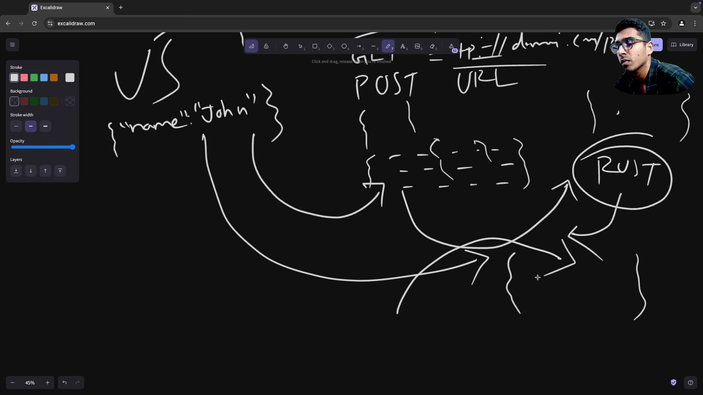
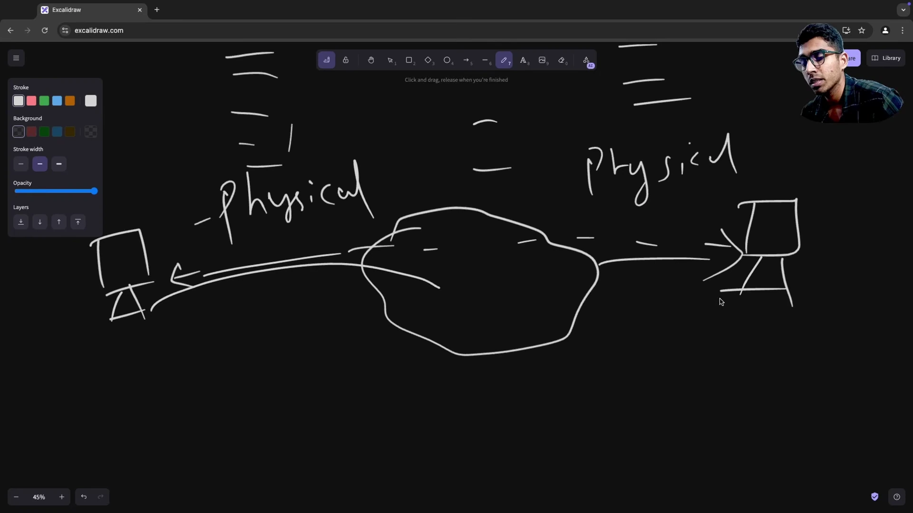
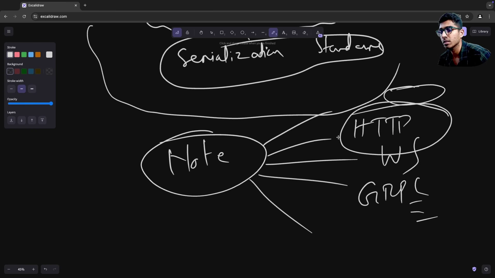
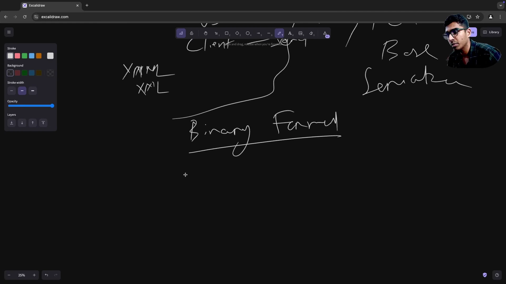
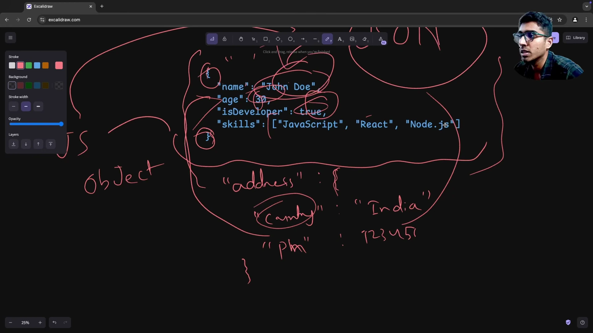
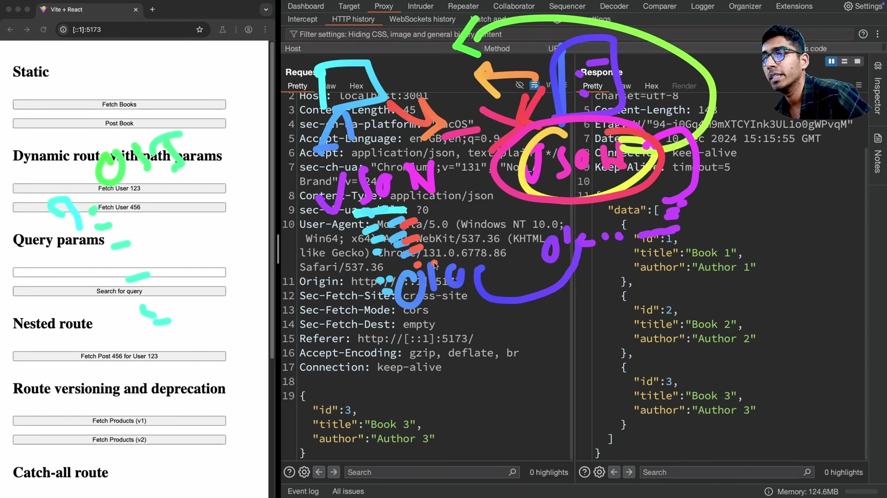

# Bản Chất Serialization Và Deserialization Trong Backend

* **Kênh:** Sriniously | **Thời lượng:** 21:48 | **Ngày:** 2024-12-11
* **Video:** https://www.youtube.com/watch?v=vzg90tY3uM0

---

## Thuật ngữ

| Thuật ngữ | Giải thích |
| :--- | :--- |
| Serialization | Quá trình chuyển đổi cấu trúc dữ liệu hoặc đối tượng trong bộ nhớ chương trình thành định dạng trung gian tiêu chuẩn để truyền qua mạng hoặc lưu trữ. |
| Deserialization | Quá trình tái tạo cấu trúc dữ liệu hoặc đối tượng ngôn ngữ từ chuỗi byte hoặc định dạng trung gian tiêu chuẩn nhận được từ mạng hoặc ổ đĩa. |
| Language Agnostic | Đặc tính độc lập ngôn ngữ, cho phép các hệ thống viết bằng các ngôn ngữ khác nhau giao tiếp và hiểu dữ liệu của nhau một cách nhất quán. |
| JSON | JavaScript Object Notation; định dạng tuần tự hóa dạng văn bản đọc được bởi con người, sử dụng cặp key-value với key bắt buộc nằm trong nháy kép. |
| Protocol Buffers | Định dạng tuần tự hóa dạng nhị phân hiệu năng cao do Google phát triển, tối ưu kích thước gói tin và tốc độ giải mã cho gRPC và microservices. |
| Text-based Serialization | Nhóm định dạng tuần tự hóa dạng văn bản thô như JSON, XML, YAML có ưu thế dễ đọc hiểu và debug trực tiếp. |
| Binary Serialization | Nhóm định dạng tuần tự hóa dạng chuỗi byte nhị phân như Protobuf, Avro, MessagePack tối ưu băng thông mạng và năng lực xử lý CPU. |
| Application Layer | Tầng ứng dụng trong mô hình OSI, nơi các giao thức như HTTP hoạt động và cũng là ranh giới trừu tượng hóa trực tiếp của kỹ sư backend. |

---

## Tổng luận chuyên đề

#### Bài toán giao tiếp đa ngôn ngữ trong hệ thống phân tán

Trong kiến trúc mạng hiện đại, client và server hiếm khi dùng chung một ngôn ngữ lập trình hoặc chung kiến trúc bộ nhớ:
- **Client phía Frontend:** Ứng dụng JavaScript hoặc TypeScript chạy trong trình duyệt với hệ thống kiểu dữ liệu dynamic typing linh hoạt.
- **Server phía Backend:** Máy chủ viết bằng Rust, Go, Java với hệ thống kiểu dữ liệu strict static typing và biểu diễn bộ nhớ qua Struct hoặc Class.
- **Rào cản vật lý:** Bộ nhớ máy tính này không thể hiểu con trỏ hay layout bộ nhớ của máy tính khác nằm cách xa hàng nghìn cây số qua Internet.
- **Giải pháp tiêu chuẩn hóa:** Thiết lập một định dạng dữ liệu trung gian chung mà cả hai bên cùng đồng thuận tuân thủ. Phía gửi chuyển đổi object nội bộ thành định dạng chung thông qua Serialization, phía nhận chuyển đổi định dạng chung thành object nội bộ của mình thông qua Deserialization.

#### Hai trường phái Serialization: Text-based vs Binary

Tùy thuộc vào yêu cầu bài toán, kỹ sư backend lựa chọn chuẩn tuần tự hóa phù hợp:
- **Text-based Formats gồm JSON, XML, YAML:**
  - *Ưu điểm:* Hoàn toàn human-readable đọc được bởi con người, dễ debug bằng công cụ giám sát mạng như Burp Suite, DevTools, cURL, là tiêu chuẩn thực tế của REST API.
  - *Nhược điểm:* Tốn dung lượng do lưu trữ text thô, chi phí string parsing phân tích cú pháp chuỗi lớn hơn định dạng nhị phân.
- **Binary Formats gồm Protobuf, Avro, MessagePack:**
  - *Ưu điểm:* Kích thước gói tin cực nhỏ, tốc độ tuần tự hóa và giải mã vượt trội, hỗ trợ code generation sinh mã schema chặt chẽ.
  - *Nhược điểm:* Không thể đọc trực tiếp bằng mắt thường nếu không có schema định nghĩa trước.

#### Mô hình tư duy OSI cho kỹ sư Backend

Mô hình OSI có 7 tầng từ Application Layer ở đỉnh xuống Physical Layer ở đáy (chuyển đổi qua data frames, IP packets và bit nhị phân `0101` trên đường truyền dây cáp quang):
- **Trừu tượng hóa tầng ứng dụng:** Kỹ sư backend làm việc trực tiếp tại Application Layer với payload JSON.
- **Ranh giới trách nhiệm:** Bạn chỉ cần đảm bảo client gửi đúng chuẩn JSON và server đọc đúng chuẩn JSON. Toàn bộ các bước trung gian phân mảnh gói tin, định tuyến IP, kiểm tra lỗi bit hay biến đổi điện áp vật lý đều do hệ điều hành và hạ tầng mạng tự động đảm nhiệm.

---

## Bóc tách chi tiết

### [[00:00](https://www.youtube.com/watch?v=vzg90tY3uM0&t=0s)] Vấn đề lệch pha dữ liệu giữa Client và Server

* **Bối cảnh giao tiếp:** Client trình duyệt viết bằng JavaScript gửi request qua HTTP đến một backend server viết bằng Rust.
* **Sự khác biệt bản chất:** JavaScript quản lý object linh hoạt không cần biên dịch, trong khi Rust yêu cầu Struct với kiểu dữ liệu khắt khe được cấp phát bộ nhớ cố định.
* **Câu hỏi đặt ra:** Làm thế nào một cấu trúc dữ liệu trong runtime JavaScript có thể bay qua Internet và biến thành Struct hợp lệ trong runtime Rust để xử lý nghiệp vụ?

### [[03:20](https://www.youtube.com/watch?v=vzg90tY3uM0&t=200s)] Mô hình đồng thuận định dạng chung



* **Thiết lập chuẩn chung:** Để giải bài toán giao tiếp, hai bên phải thống nhất một bộ quy tắc đóng gói dữ liệu độc lập ngôn ngữ theo chuẩn Language Agnostic.
* **Quy trình hai chiều:**
  - Client đóng gói object JavaScript thành chuẩn chung qua Serialization rồi gửi qua HTTP Request Body.
  - Server Rust nhận luồng dữ liệu, phân tích cú pháp và nạp vào Rust Struct qua Deserialization.
  - Khi phản hồi, Server Rust tuần tự hóa Struct thành chuẩn chung và Client giải mã ngược lại thành object JavaScript.

### [[06:40](https://www.youtube.com/watch?v=vzg90tY3uM0&t=400s)] Mô hình OSI và ranh giới trách nhiệm Backend



* **Chuỗi hạ tầng mạng:** Từ Application Layer ở trên đỉnh xuống Physical Layer ở đáy cùng, dữ liệu đi qua nhiều tầng đóng gói gồm Data Frames, IP Packets và Bitstream `0101`.
* **Mental Model của kỹ sư Backend:** Bạn không cần phải lo lắng về việc từng bit nhị phân hay điện áp quang di chuyển ra sao trên dây cáp. Trong Application Layer, bạn gửi JSON thì ở đầu nhận server cũng sẽ nhận lại đúng chuỗi JSON đó sau khi network stack của OS hoàn tất giải mã.

### [[10:00](https://www.youtube.com/watch?v=vzg90tY3uM0&t=600s)] Phân loại các chuẩn Serialization phổ biến



* **Hệ sinh thái công nghệ đa dạng:** Backend sử dụng nhiều giao thức truyền dẫn gồm HTTP, WebSocket, gRPC và nhiều chuẩn lưu trữ gồm Relational Database như PostgreSQL hay Document Database như MongoDB.
* **Hai nhóm định dạng tuần tự hóa chính:**
  1. *Text-based Serialization:* Bao gồm JSON, XML, YAML. Trong đó JSON chiếm hơn 80% lưu lượng giao tiếp client-server hiện nay nhờ tính tinh gọn và tương thích cao.
  2. *Binary Format:* Bao gồm Protocol Buffers, Apache Avro. Thường dùng trong giao tiếp microservices nội bộ qua gRPC để tối ưu tốc độ và băng thông.

### [[12:30](https://www.youtube.com/watch?v=vzg90tY3uM0&t=750s)] So sánh định dạng Text-based và Binary



* **Đặc tính Text-based gồm JSON, YAML, XML:** Dễ đọc hiểu, trực quan, thân thiện cho việc viết file cấu hình và API công khai, nhưng dung lượng payload lớn hơn.
* **Đặc tính Binary gồm Protobuf:** Dữ liệu được mã hóa thành các byte nhị phân đặc thù, loại bỏ hoàn toàn các ký tự thừa như khoảng trắng, ngoặc nhọn hay tên trường lặp lại, mang lại hiệu năng cao nhưng đòi hỏi file schema `.proto` để dịch ngược.

### [[16:00](https://www.youtube.com/watch?v=vzg90tY3uM0&t=960s)] Quy chuẩn cú pháp nghiêm ngặt của JSON



* **Nguồn gốc:** Tên viết tắt của JavaScript Object Notation, nhưng hiện nay đã trở thành chuẩn dữ liệu độc lập hỗ trợ trên mọi ngôn ngữ.
* **Quy tắc vàng của JSON:**
  1. Toàn bộ đối tượng được bao bọc bởi cặp ngoặc nhọn `{}` hoặc mảng `[]`.
  2. Toàn bộ Key bắt buộc phải là chuỗi String nằm trong dấu nháy kép `""` (không dùng nháy đơn hay để trần key như trong JavaScript thông thường).
  3. Value hỗ trợ các kiểu cơ bản: String, Number, Boolean, Array, Object lồng nhau hoặc Null.

### [[19:10](https://www.youtube.com/watch?v=vzg90tY3uM0&t=1150s)] Thực tế kiểm tra JSON qua Burp Suite



* **Quan sát Request POST:** Client gửi request `POST /api/books` với header `Content-Type: application/json`. Payload trong Request Body có cấu trúc JSON hợp lệ:
  ```json
  {
    "id": 101,
    "title": "Backend Engineering",
    "author": "Sriniously"
  }
  ```
* **Xử lý phía Server:** Server phân tích cú pháp JSON này, trích xuất các trường dữ liệu, ghi vào database và trả về Response Body dạng JSON chứa danh sách sách đã cập nhật. Client nhận JSON, phân tích ngược thành state và render giao diện.

---

## Trích dẫn then chốt

* [[00:00](https://www.youtube.com/watch?v=vzg90tY3uM0&t=0s)] "How one data type that is transmitted over a network is able to reach another machine and make sense of that data in its own format? The solution is coming up with a common standard."
* [[08:36](https://www.youtube.com/watch?v=vzg90tY3uM0&t=516s)] "Serialization and deserialization is basically converting to and from data to a common format so that during transmission it is domain agnostic and language agnostic."
* [[10:00](https://www.youtube.com/watch?v=vzg90tY3uM0&t=600s)] "JSON is one of the most popular serialization and deserialization standards that gets used for client and server communication — I'd say 80% of the time."
* [[12:57](https://www.youtube.com/watch?v=vzg90tY3uM0&t=777s)] "All the keys in JSON will have to be inside double quotes and they will have to be strings. You cannot make any other data type as a key."
* [[16:45](https://www.youtube.com/watch?v=vzg90tY3uM0&t=1005s)] "As a backend engineer, the mental model to have is: in the application layer data gets converted into JSON. You don't have to worry about what intermediary network layers convert the data into."

---

## Lệnh & Công cụ

```javascript
// Đối tượng dữ liệu ban đầu trong bộ nhớ
const bookObject = {
  id: 101,
  title: "Backend Engineering",
  author: "Sriniously",
  isPublished: true
};

// 1. Serialization (Object -> JSON String để gửi qua mạng)
const serializedData = JSON.stringify(bookObject);
console.log("Chuỗi JSON gửi qua mạng:", serializedData);

// 2. Deserialization (JSON String từ mạng -> Object bộ nhớ)
const receivedPayload = '{"id":101,"title":"Backend Engineering","author":"Sriniously","isPublished":true}';
const deserializedObject = JSON.parse(receivedPayload);
console.log("Đối tượng sau khi deserialize:", deserializedObject.title);
```

```rust
use serde::{Deserialize, Serialize};

#[derive(Serialize, Deserialize, Debug)]
struct Book {
    id: u32,
    title: String,
    author: String,
    is_published: bool,
}

fn main() {
    let json_data = r#"{"id":101,"title":"Backend Engineering","author":"Sriniously","is_published":true}"#;

    // Deserialization từ JSON String sang Rust Struct
    let book: Book = serde_json::from_str(json_data).expect("Lỗi parse JSON");
    println!("Struct trong bộ nhớ Rust: {:?}", book);

    // Serialization từ Rust Struct ngược về JSON String
    let serialized = serde_json::to_string(&book).expect("Lỗi serialize");
    println!("JSON tuần tự hóa: {}", serialized);
}
```

---

## Đánh đổi & Rủi ro

| Tiêu chí | JSON dạng Text-based | Protocol Buffers dạng Binary |
| :--- | :--- | :--- |
| **Độ thân thiện con người** | Tuyệt đối; đọc và chỉnh sửa trực tiếp bằng mắt hoặc editor. | Kém; yêu cầu tool chuyên dụng và file schema `.proto` để giải mã. |
| **Hiệu năng và Kích thước** | Dung lượng lớn hơn do chứa key string và khoảng trắng lặp lại. | Cực nhỏ gọn; dữ liệu được nén nhị phân theo trường định danh field tag. |
| **Tốc độ CPU** | Chậm hơn do chi phí phân tích cú pháp chuỗi string parsing. | Rất nhanh; giải mã nhị phân trực tiếp vào struct bộ nhớ mà ít overhead. |
| **Rủi ro bảo mật tiềm ẩn** | Dễ bị quá tải DoS nếu nhận JSON payload khổng lồ lồng nhau nhiều cấp. | Rủi ro schema mismatch nếu client và server lệch phiên bản `.proto`. |
| **Biện pháp phòng ngừa** | Giới hạn dung lượng request body và độ sâu lồng nhau của JSON parser. | Áp dụng CI/CD tự động kiểm tra backward compatibility cho schema. |
