# Bản Chất Authentication Và Authorization Trong Backend

* **Kênh:** Sriniously | **Thời lượng:** 01:35:56 | **Ngày:** 2024-12-23
* **Video:** https://www.youtube.com/watch?v=A95rliroC8Q

---

## Thuật ngữ

| Thuật ngữ | Giải thích |
| :--- | :--- |
| Authentication | Quá trình xác thực danh tính để trả lời câu hỏi đối tượng là ai. |
| Authorization | Quá trình phân quyền để trả lời câu hỏi đối tượng được phép làm những gì. |
| Session-based Authentication | Cơ chế xác thực trạng thái lưu trữ session trên server hoặc Redis và định danh client qua Session ID trong Cookie. |
| JWT | JSON Web Token; cơ chế xác thực không trạng thái bao gồm ba phần Header, Payload và Signature được mã hóa Base64. |
| Stateful Authentication | Mô hình xác thực mà server lưu giữ trạng thái đăng nhập trong bộ nhớ, database hoặc cache tập trung. |
| Stateless Authentication | Mô hình xác thực mà server không lưu trạng thái đăng nhập; mọi thông tin định danh và quyền hạn nằm trọn vẹn trong token tự chứa self-contained. |
| OAuth 2.0 | Giao thức ủy quyền cho phép ứng dụng bên thứ ba truy cập tài nguyên người dùng mà không cần chia sẻ mật khẩu gốc. |
| OpenID Connect | Tầng nhận dạng xây dựng trên nền tảng OAuth 2.0 bổ sung ID Token để chuẩn hóa quá trình xác thực danh tính. |
| RBAC | Role-Based Access Control; mô hình quản lý truy cập dựa trên vai trò gán cho người dùng trong hệ thống. |
| HTTP-Only Cookie | Thuộc tính bảo mật của cookie ngăn chặn mã JavaScript phía client truy cập, chống tấn công XSS đánh cắp phiên. |

---

## Tổng luận chuyên đề

#### Phân định ranh giới giữa Authentication và Authorization

Hai khái niệm cốt lõi tạo nên nền tảng an ninh ứng dụng:
- **Authentication:** Kiểm tra tính hợp lệ của thông tin định danh Credentials như Username/Password, OTP, vân tay để xác định người dùng là ai.
- **Authorization:** Sau khi đã biết danh tính, hệ thống kiểm tra người dùng có quyền thực hiện thao tác hay truy cập tài nguyên cụ thể hay không, ví dụ User thường không được xóa dữ liệu của Admin.
- **Quy tắc vàng:** Authentication luôn đi trước Authorization. Một hệ thống không thể phân quyền chính xác nếu chưa xác minh được danh tính.

#### So sánh hai trường phái Stateful Session và Stateless JWT

Việc lựa chọn chiến lược xác thực quyết định kiến trúc mở rộng của backend:
- **Stateful Session truyền thống:**
  - Server tạo Session ID, lưu user data vào Redis hoặc Database, trả Session ID về Client qua HTTP-Only Cookie.
  - *Ưu điểm:* Dễ dàng thu hồi quyền truy cập qua Revocation ngay lập tức khi đăng xuất hoặc tài khoản bị xâm nhập.
  - *Nhược điểm:* Tốn tài nguyên lưu trữ và độ trễ truy vấn bộ nhớ khi số lượng người dùng đồng thời tăng lên hàng triệu.
- **Stateless JWT hiện đại:**
  - Server ký số và cấp phát JWT chứa User ID và Roles; Client tự lưu và gửi qua Authorization Bearer Header.
  - *Ưu điểm:* Server không tốn dung lượng RAM lưu session; các microservices dùng chung Secret Key có thể tự giải mã và xác thực độc lập.
  - *Nhược điểm:* Khó thu hồi token trước Expiration Time; nếu lộ token, kẻ tấn công có toàn quyền mạo danh cho đến khi token hết hạn.

#### Chiến lược Hybrid và Tiêu chuẩn hóa với OAuth 2.0 và OIDC

Để khắc phục nhược điểm của cả hai mô hình:
- **Mô hình Hybrid:** Sử dụng JWT không trạng thái cho các tác vụ thường ngày, kết hợp duy trì Blacklist trên Redis khi cần thu hồi token khẩn cấp.
- **Ủy quyền bên thứ ba với OAuth 2.0 và OIDC:**
  - Thay vì bắt người dùng nhập mật khẩu Google hay Facebook trực tiếp vào ứng dụng, hệ thống chuyển hướng người dùng qua Authorization Server để nhận Authorization Code rồi đổi lấy Access Token.
  - OpenID Connect bổ sung ID Token chuẩn hóa thông tin cá nhân của người dùng, giải quyết dứt điểm sự mập mờ giữa ủy quyền của OAuth 2.0 và xác thực danh tính.

---

## Bóc tách chi tiết

### [[00:00](https://www.youtube.com/watch?v=A95rliroC8Q&t=0s)] Khái niệm cốt lõi Authentication và Authorization

* **Bản chất nhị nguyên:** Authentication trả lời câu hỏi *"Who are you?"*, còn Authorization trả lời câu hỏi *"What can you do?"*.
* **Luồng vận hành thực tế:** Người dùng gửi thông tin chứng minh danh tính để vượt qua cánh cửa Authentication, sau đó Router và Middleware kiểm tra quyền hạn để cấp phép Authorization vào từng API cụ thể.

### [[01:55](https://www.youtube.com/watch?v=A95rliroC8Q&t=115s)] Tiến trình lịch sử từ con dấu sáp đến mật khẩu


* **Thời kỳ tiền công nghiệp:** Xác thực dựa trên sự quen biết cá nhân và lòng tin giữa các thành viên làng xã.
* **Sự xuất hiện của con dấu sáp Wax Seal:** Khi xã hội mở rộng, con người cần một bằng chứng vật lý để chứng thực người gửi thư tín hoặc hợp đồng. Đây là hình thái sơ khai của Token vật lý.
* **Bước nhảy vọt Passphrase:** Khi điện tín ra đời trong cách mạng công nghiệp, xác thực chuyển từ vật thể sở hữu sang thông tin ghi nhớ trong đầu dưới dạng Shared Secret.

### [[08:40](https://www.youtube.com/watch?v=A95rliroC8Q&t=520s)] Kỷ nguyên máy tính và thảm họa Plaintext Passwords


* **Dự án CTSS tại MIT năm 1961:** Máy tính đa người dùng đầu tiên ra đời. Ban đầu mật khẩu được lưu dưới dạng Plaintext thô trong một file văn bản.
* **Sự cố in file mật khẩu:** Một lỗi hệ thống đã in toàn bộ file mật khẩu ra máy in công cộng, thức tỉnh giới kỹ sư về sự nguy hiểm của việc lưu mật khẩu thô.
* **Sự ra đời của Cryptographic Hashing:** Mật khẩu chuyển sang lưu trữ dạng chuỗi băm một chiều với Hash Function. Server không bao giờ lưu mật khẩu gốc mà chỉ so sánh giá trị hash khi người dùng đăng nhập.

### [[15:00](https://www.youtube.com/watch?v=A95rliroC8Q&t=900s)] Sự phát triển của Multi-Factor Authentication

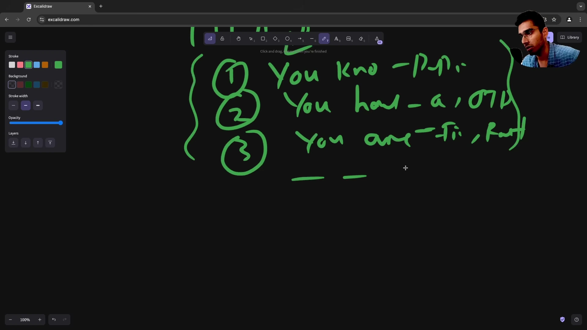

* **Giới hạn của Username và Password:** Tấn công Brute Force và Dictionary Attack khiến mật khẩu đơn lẻ trở nên không an toàn.
* **Ba yếu tố của MFA:**
  1. Yếu tố bạn biết: Password, mã PIN.
  2. Yếu tố bạn sở hữu: Điện thoại nhận OTP, Smart Card, Hardware Key.
  3. Yếu tố thuộc về bản thân bạn: Vân tay, quét võng mạc, nhận diện khuôn mặt qua Biometrics.
* **Kết hợp đa lớp:** Buộc kẻ tấn công phải vượt qua ít nhất hai rào cản độc lập để chiếm đoạt tài khoản.

### [[18:30](https://www.youtube.com/watch?v=A95rliroC8Q&t=1110s)] Bản chất Stateless của HTTP và nhu cầu Stateful

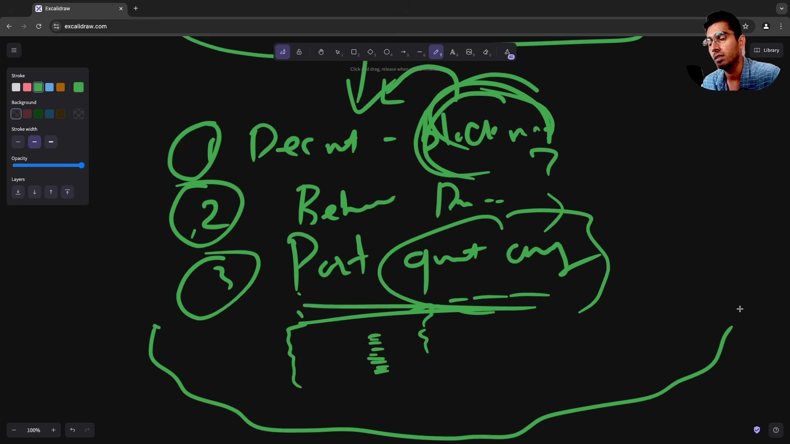

* **HTTP vốn dĩ không có trạng thái:** Mỗi request HTTP là một giao dịch biệt lập hoàn toàn, máy chủ không ghi nhớ request trước đó là của ai.
* **Mâu thuẫn với Web hiện đại:** Ứng dụng như giỏ hàng thương mại điện tử hay mạng xã hội bắt buộc phải nhớ trạng thái đăng nhập qua nhiều trang khác nhau.
* **Khái niệm Session ra đời:** Cung cấp cơ chế lưu trữ tạm thời phía máy chủ để gắn kết các request rời rạc của một người dùng thành một phiên làm việc liên tục.

### [[22:00](https://www.youtube.com/watch?v=A95rliroC8Q&t=1320s)] Vận hành Session-based với Cookie và Redis

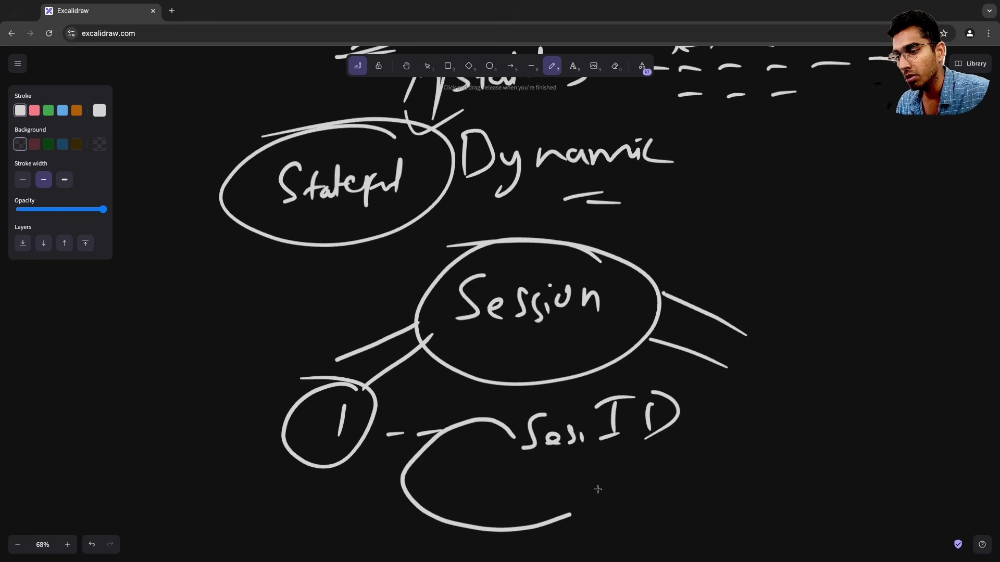

* **Quy trình luân chuyển Session ID:**
  1. Client gửi Username và Password lên server.
  2. Server kiểm tra DB, tạo chuỗi ngẫu nhiên an toàn mang tên Session ID.
  3. Server lưu Session ID cùng dữ liệu người dùng vào In-memory Cache như Redis.
  4. Server gửi Session ID về trình duyệt thông qua HTTP-Only Cookie.
  5. Các request kế tiếp của trình duyệt tự động gửi kèm Cookie này để server tra cứu Redis.

### [[27:30](https://www.youtube.com/watch?v=A95rliroC8Q&t=1650s)] Kiến trúc giải phẫu của JSON Web Token

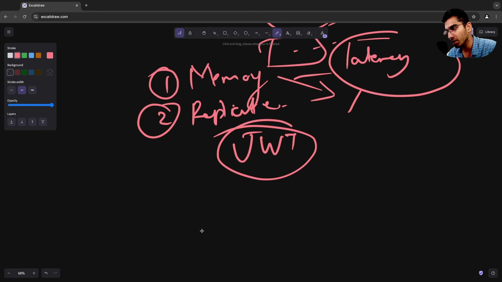

* **Ba thành phần ngăn cách bởi dấu chấm:**
  1. **Header:** Chứa metadata gồm loại token `typ: JWT` và thuật toán ký số `alg: HS256` hoặc `RS256`.
  2. **Payload hay Claims:** Chứa dữ liệu nghiệp vụ gồm `sub` cho Subject hay User ID, `iat` cho Issued At, `exp` cho Expiration và vai trò người dùng Roles.
  3. **Signature:** Chữ ký số tạo từ Header, Payload và Secret Key phía server để đảm bảo tính toàn vẹn Tamper-proof.
* **Bản chất Self-contained:** Mọi thông tin cần thiết đều nằm sẵn trong token, server giải mã và kiểm tra chữ ký mà không cần truy vấn database.

### [[35:50](https://www.youtube.com/watch?v=A95rliroC8Q&t=2150s)] Giải pháp Hybrid: Kết hợp JWT và Blacklist

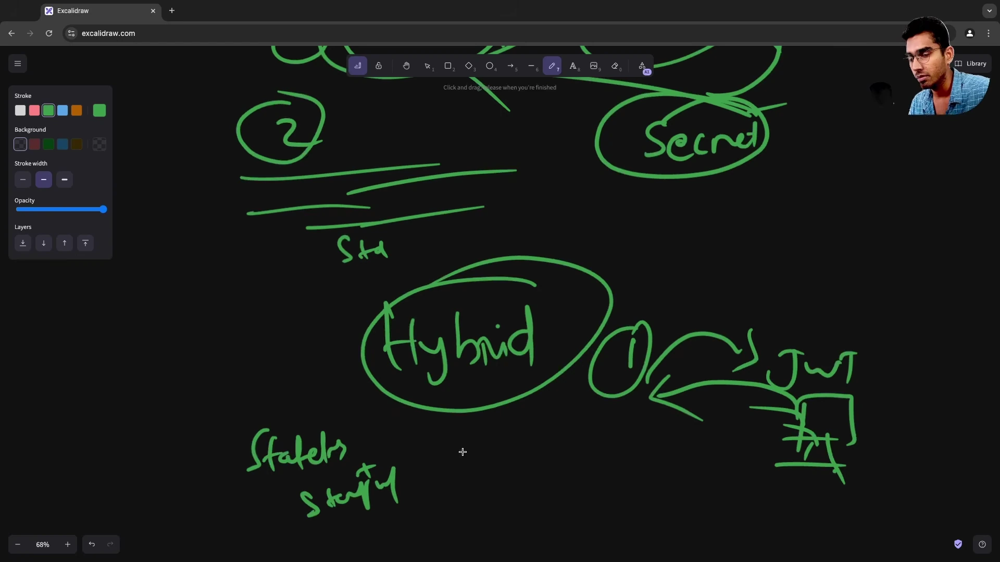

* **Vấn đề cốt tử của JWT:** Khi token đã phát hành, server không thể hủy revoke cho đến khi token tự hết hạn.
* **Cơ chế Blacklist trên Redis:**
  - Trong điều kiện bình thường: Xác thực token không trạng thái hoàn toàn bằng Secret Key để đạt tốc độ cao.
  - Khi có sự cố như User bấm đăng xuất hoặc tài khoản bị nghi ngờ hack: Lưu Token ID `jti` vào Redis Blacklist với TTL bằng thời gian sống còn lại của token.
  - Tầng middleware kiểm tra nhanh xem token có nằm trong Blacklist hay không trước khi cho phép đi tiếp.

### [[40:50](https://www.youtube.com/watch?v=A95rliroC8Q&t=2450s)] Vai trò an ninh của Cookies và HTTP-Only

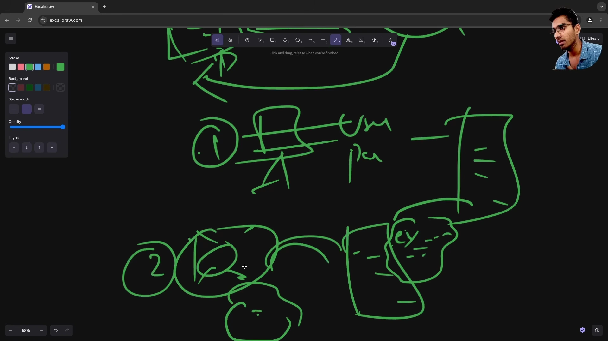

* **Nguy cơ khi lưu Token ở LocalStorage:** Bất kỳ đoạn mã JavaScript độc hại nào chạy qua lỗ hổng XSS đều có thể đọc token từ storage và gửi về máy chủ kẻ tấn công.
* **Lá chắn HTTP-Only Cookie:** Thuộc tính `HttpOnly` cấm tuyệt đối JavaScript truy cập cookie. Kết hợp cờ `Secure` truyền qua HTTPS và `SameSite=Strict` hoặc `Lax` chống tấn công CSRF tạo thành cơ chế lưu trữ token an toàn nhất trên trình duyệt.

### [[49:40](https://www.youtube.com/watch?v=A95rliroC8Q&t=2980s)] Xác thực giao tiếp máy qua API Keys

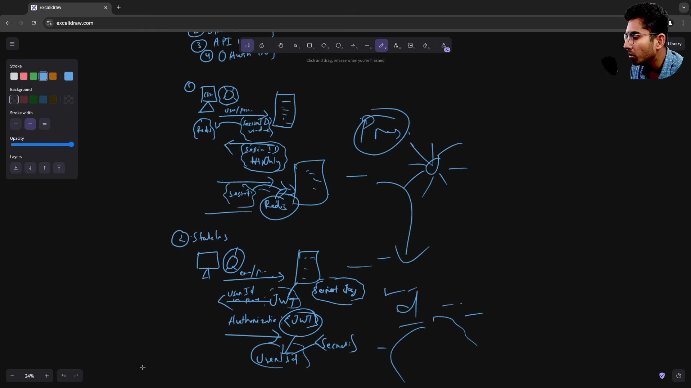

* **Khác biệt với User Authentication:** API Key sinh ra để phục vụ giao tiếp Machine-to-Machine giữa các máy chủ hoặc tích hợp SDK của nhà phát triển.
* **Quản lý hạn ngạch và quyền hạn:** Mỗi API Key gắn liền với hạn mức gọi Rate Limit hoặc Quota, danh sách quyền hạn cụ thể Scopes và có thể thu hồi bất cứ lúc nào từ dashboard quản trị.

### [[55:00](https://www.youtube.com/watch?v=A95rliroC8Q&t=3300s)] Cơ chế ủy quyền hiện đại với OAuth 2.0

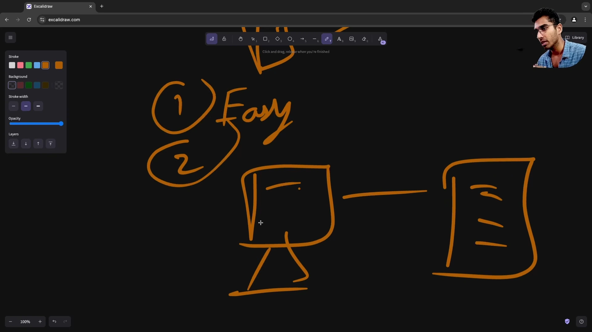

* **Bối cảnh lịch sử:** Trước đây ứng dụng bên thứ ba yêu cầu người dùng nhập thẳng username và password của tài khoản chính để lấy dữ liệu, tạo ra rủi ro bảo mật nghiêm trọng.
* **Luồng Authorization Code Flow:**
  1. Ứng dụng client chuyển hướng người dùng sang Authorization Server của nhà cung cấp dịch vụ như Google, GitHub.
  2. Người dùng đăng nhập và chấp thuận quyền truy cập trên màn hình Consent Screen.
  3. Authorization Server chuyển hướng về kèm Authorization Code tạm thời.
  4. Backend của client đổi Authorization Code lấy Access Token an toàn qua kênh Back-channel.

### [[1:03:20](https://www.youtube.com/watch?v=A95rliroC8Q&t=3800s)] Chuẩn hóa danh tính qua OpenID Connect

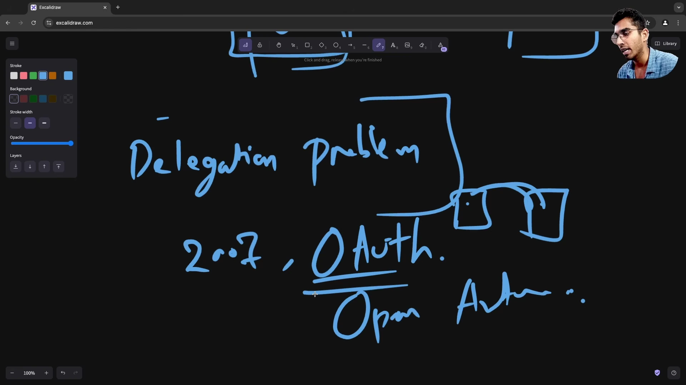

* **OAuth 2.0 chỉ là Authorization:** OAuth 2.0 thiết kế cho việc cấp quyền truy cập tài nguyên Access Token, không chuẩn hóa cách thức lấy thông tin định danh người dùng.
* **OIDC bổ sung ID Token:** Phát hành một JWT chuẩn mực chứa thông tin cá nhân của người dùng gồm email, tên, avatar. Giúp hiện thực hóa tính năng đăng nhập một chạm Single Sign-On trên phạm vi toàn cầu.

### [[1:11:40](https://www.youtube.com/watch?v=A95rliroC8Q&t=4300s)] Ma trận lựa chọn kiến trúc Authentication

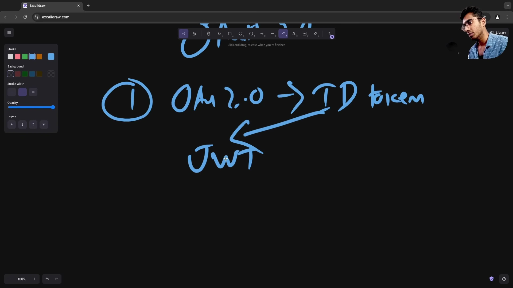

* **Ứng dụng Web đơn khối Monolith:** Stateful Session kết hợp Redis là giải pháp đơn giản, bảo mật cao và dễ kiểm soát trạng thái phiên.
* **Hệ thống Microservices phân tán:** Stateless JWT hoặc Hybrid Token là lựa chọn tối ưu để giảm tải lưu lượng tra cứu giữa các cụm dịch vụ.
* **Hệ sinh thái API công khai:** API Key kết hợp Rate Limiting.
* **Đăng nhập mạng xã hội và SSO doanh nghiệp:** OAuth 2.0 kết hợp OpenID Connect.

### [[1:20:00](https://www.youtube.com/watch?v=A95rliroC8Q&t=4800s)] Phân quyền dựa trên vai trò qua RBAC


* **Nguyên lý cốt lõi của RBAC:** Phân tách rõ ràng giữa Người dùng User, Vai trò Role và Quyền hạn Permission:
  - Người dùng được gán một hoặc nhiều Vai trò như `Admin`, `Editor`, `Viewer`.
  - Mỗi Vai trò sở hữu một tập hợp Quyền hạn cụ thể như `post:create`, `post:edit`, `post:delete`.
* **Kiểm tra quyền tại Middleware:** Tầng controller không kiểm tra trực tiếp User ID mà đối soát quyền hạn của Role trên từng endpoint API.

### [[1:30:00](https://www.youtube.com/watch?v=A95rliroC8Q&t=5400s)] Thực hành an ninh tốt nhất trong Production

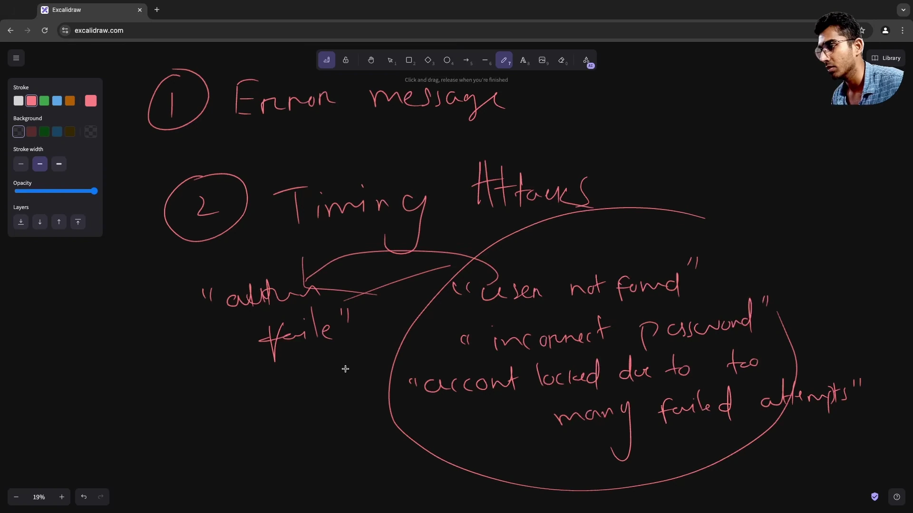

* **Băm mật khẩu an toàn:** Bắt buộc sử dụng các thuật toán chuyên dụng có độ trễ tính toán Cost Factor như Argon2id, bcrypt hoặc PBKDF2 kèm chuỗi muối ngẫu nhiên Salt. Tuyệt đối cấm dùng MD5 hay SHA-256 thuần để băm mật khẩu.
* **Thời gian sống của Token:** Giữ Access Token có hạn sử dụng ngắn tầm 15 phút và quản lý phiên dài hạn bằng Refresh Token được lưu trữ an toàn.
* **Tận dụng Identity Provider uy tín:** Với các hệ thống phức tạp, ưu tiên sử dụng các dịch vụ chuyên nghiệp như Auth0, Clerk, Cognito, Keycloak thay vì tự xây dựng cơ chế xác thực từ đầu.

---

## Trích dẫn then chốt

* [[00:00](https://www.youtube.com/watch?v=A95rliroC8Q&t=0s)] "Authentication is finding the answer to 'Who are you?' while Authorization is finding the answer to 'What can you do?'"
* [[18:26](https://www.youtube.com/watch?v=A95rliroC8Q&t=1106s)] "By design HTTP is stateless. But modern interactive web applications required stateful interactions — that is why the concept of a session arrived."
* [[28:40](https://www.youtube.com/watch?v=A95rliroC8Q&t=1720s)] "The crucial innovation of JWTs is that they are self-contained. The user ID, roles, and cryptographic signature are all inside the token itself."
* [[40:50](https://www.youtube.com/watch?v=A95rliroC8Q&t=2450s)] "HttpOnly cookies cannot be accessed by client-side JavaScript. This offers a fundamental layer of security against XSS attacks."
* [[1:10:51](https://www.youtube.com/watch?v=A95rliroC8Q&t=4251s)] "OAuth 2.0 solved the authorization problem, but it was not designed for authentication. That is why in 2014 OpenID Connect was introduced to standardize identity."

---

## Lệnh & Công cụ

```javascript
const express = require('express');
const jwt = require('jsonwebtoken');
const app = express();
app.use(express.json());

const JWT_SECRET = process.env.JWT_SECRET || "supersecretkey";

// Middleware xác thực JWT
function authenticateToken(req, res, next) {
  const authHeader = req.headers['authorization'];
  const token = authHeader && authHeader.split(' ')[1]; // Format: Bearer <token>

  if (!token) {
    return res.status(401).json({ error: "Access token missing" });
  }

  jwt.verify(token, JWT_SECRET, (err, user) => {
    if (err) {
      return res.status(403).json({ error: "Invalid or expired token" });
    }
    req.user = user;
    next();
  });
}

// Middleware phân quyền RBAC
function authorizeRole(requiredRole) {
  return (req, res, next) => {
    if (!req.user || req.user.role !== requiredRole) {
      return res.status(403).json({ error: "Insufficient permissions" });
    }
    next();
  };
}

// Endpoint công khai tạo token
app.post('/api/login', (req, res) => {
  const { username, role } = req.body;
  const token = jwt.sign({ username, role }, JWT_SECRET, { expiresIn: '15m' });
  res.json({ accessToken: token });
});

// Endpoint được bảo vệ bằng RBAC
app.delete('/api/books/:id', authenticateToken, authorizeRole('admin'), (req, res) => {
  res.json({ message: `Book ${req.params.id} deleted by admin` });
});
```

```bash
# Đăng nhập lấy JWT
curl -X POST http://localhost:3000/api/login \
  -H "Content-Type: application/json" \
  -d '{"username": "srinious", "role": "admin"}'

# Gọi API bảo vệ bằng Bearer Token
curl -X DELETE http://localhost:3000/api/books/101 \
  -H "Authorization: Bearer <YOUR_ACCESS_TOKEN>"

# Kiểm tra cờ bảo mật Set-Cookie
curl -I http://localhost:3000/api/session-login
# Đảm bảo header trả về chứa: Set-Cookie: session_id=...; HttpOnly; Secure; SameSite=Strict
```

---

## Đánh đổi & Rủi ro

| Mô hình xác thực | Ưu điểm cốt lõi | Đánh đổi & Nguy cơ tiềm ẩn | Biện pháp phòng ngừa |
| :--- | :--- | :--- | :--- |
| **Stateful Session** | Thu hồi quyền tức thì; bảo mật cao khi kết hợp HttpOnly Cookie. | Nghẽn bộ nhớ Redis khi quy mô lớn; khó mở rộng khi chia tách Microservices. | Thiết lập TTL hợp lý; sử dụng Redis Cluster để mở rộng ngang vùng lưu trữ session. |
| **Stateless JWT** | Hiệu năng cao; không tốn dung lượng server; dễ scale đa dịch vụ. | Không thể thu hồi token trước hạn; lộ token là lộ toàn quyền phiên. | Đặt thời hạn token ngắn cỡ 15 phút; dùng Refresh Token xoay vòng và Blacklist khi cần. |
| **OAuth 2.0 & OIDC** | Không phải lưu mật khẩu người dùng; hỗ trợ Single Sign-On toàn diện. | Phụ thuộc vào tính sẵn sàng của bên thứ ba; luồng triển khai phức tạp. | Bắt buộc kiểm tra tham số state để chống CSRF; áp dụng PKCE cho client công khai. |
| **API Keys** | Đơn giản, gọn nhẹ cho giao tiếp máy với máy Machine-to-Machine. | Dễ bị commit nhầm lên git công khai; không hỗ trợ phân quyền người dùng cụ thể. | Quét secret bằng Git Hooks; giới hạn IP nguồn và cấp hạn mức quota chặt chẽ. |
| **RBAC** | Rõ ràng, dễ hiểu và dễ kiểm toán quyền hạn hệ thống. | Hiện tượng bùng nổ vai trò Role Explosion khi nghiệp vụ phức tạp. | Thiết kế ma trận quyền chuẩn mực; chuyển dịch sang ABAC khi cần phân quyền ngữ cảnh sâu. |
