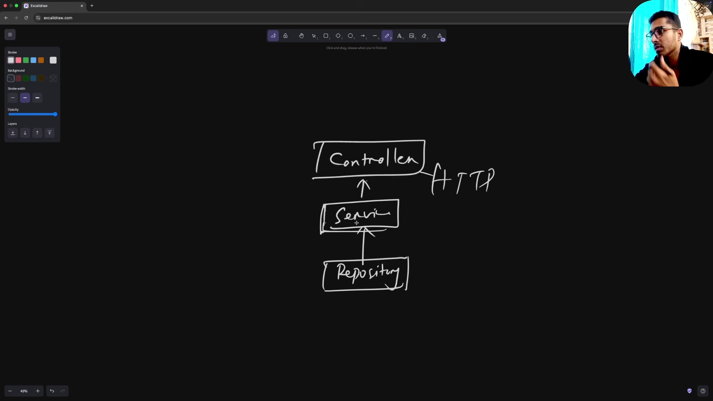
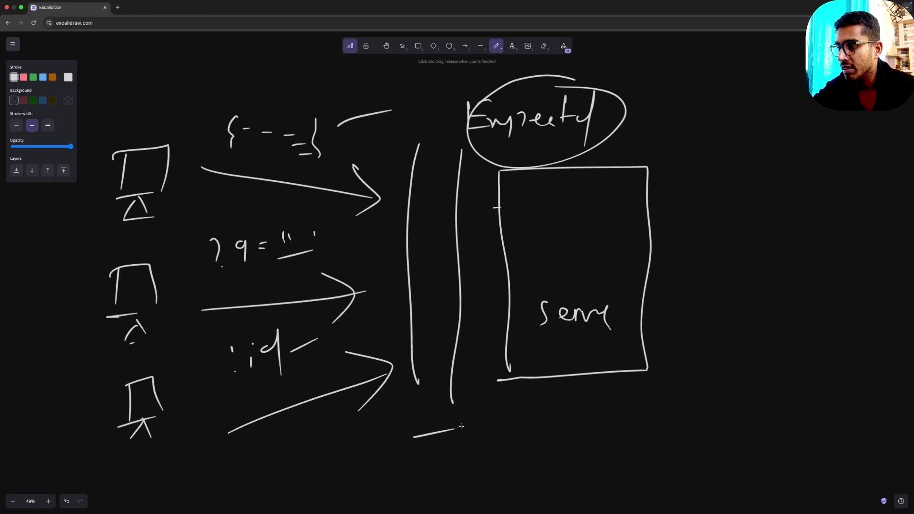
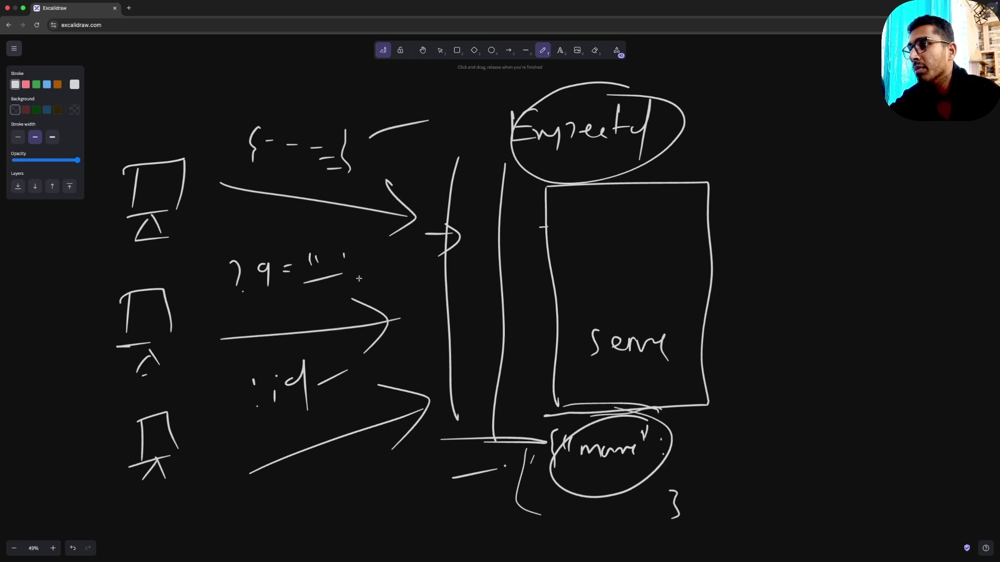
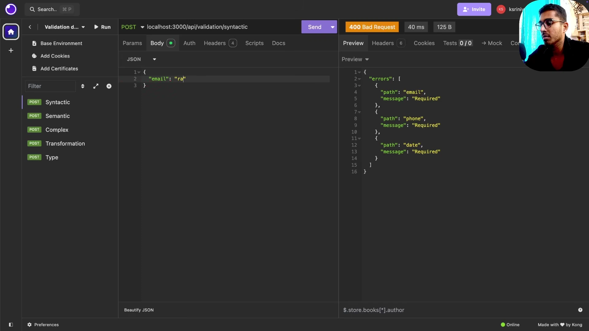
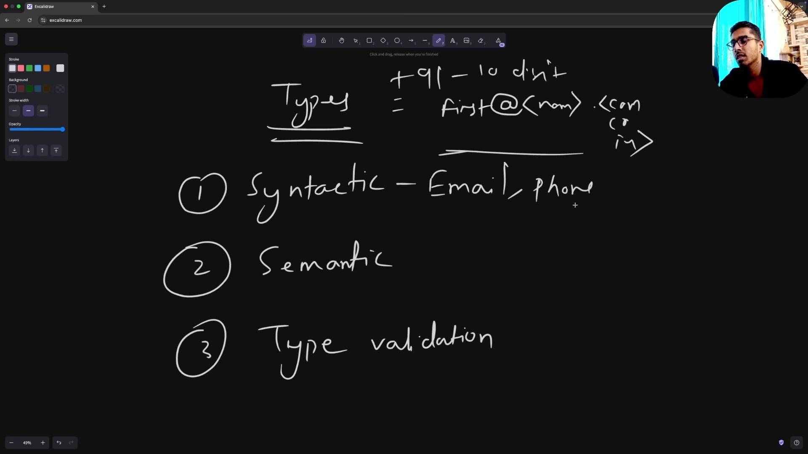
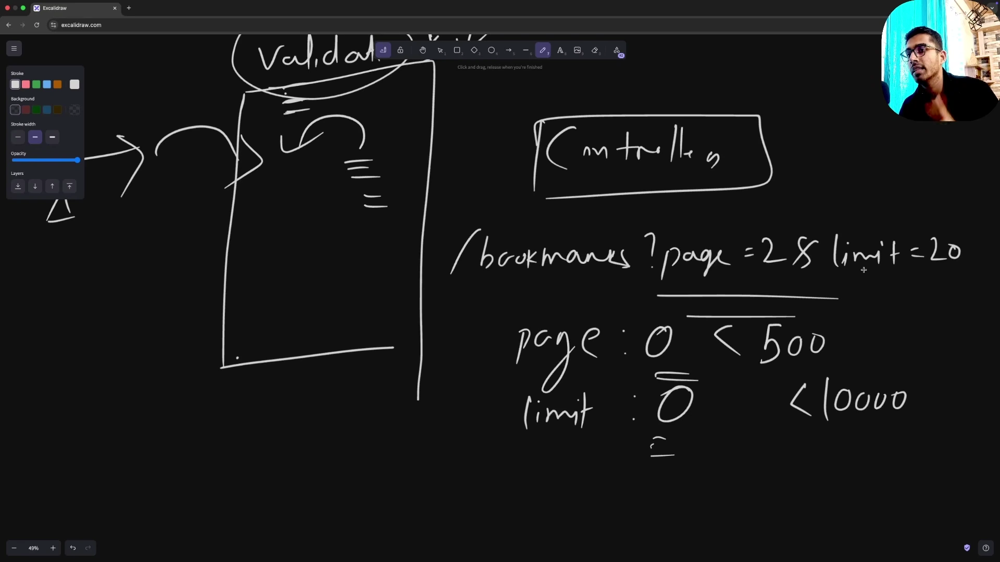
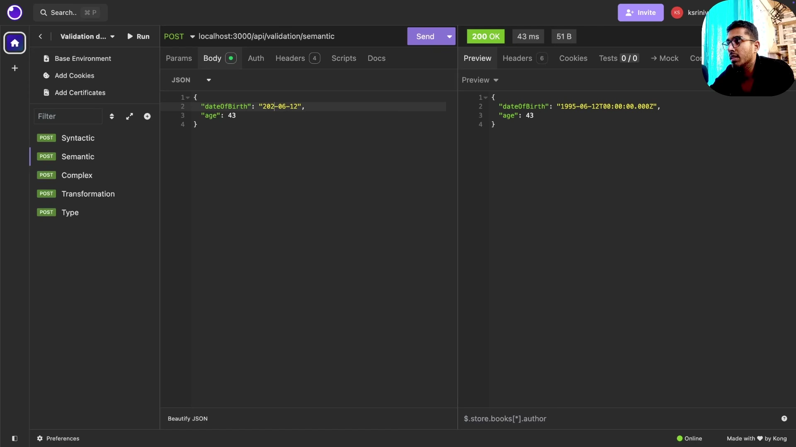
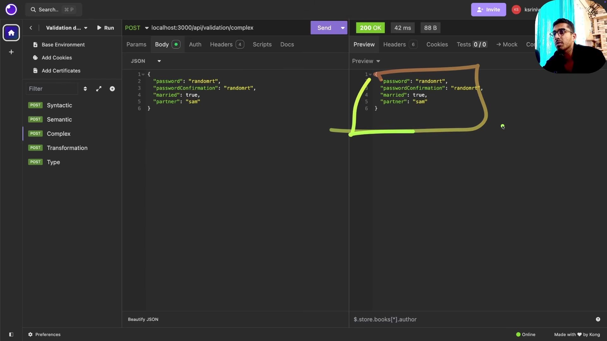
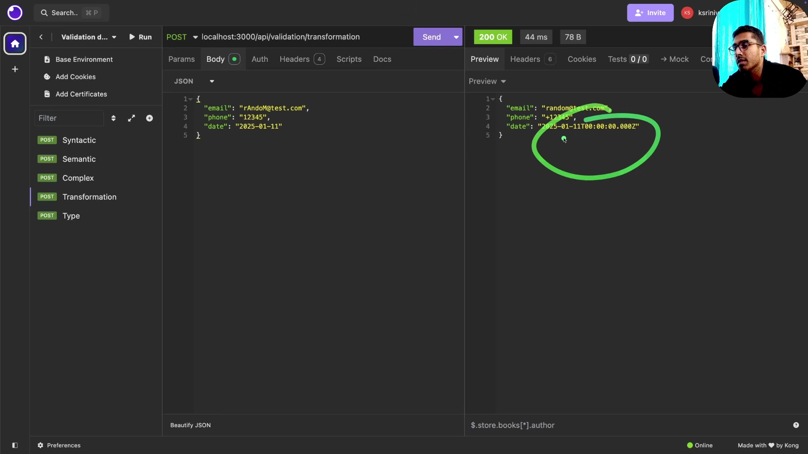
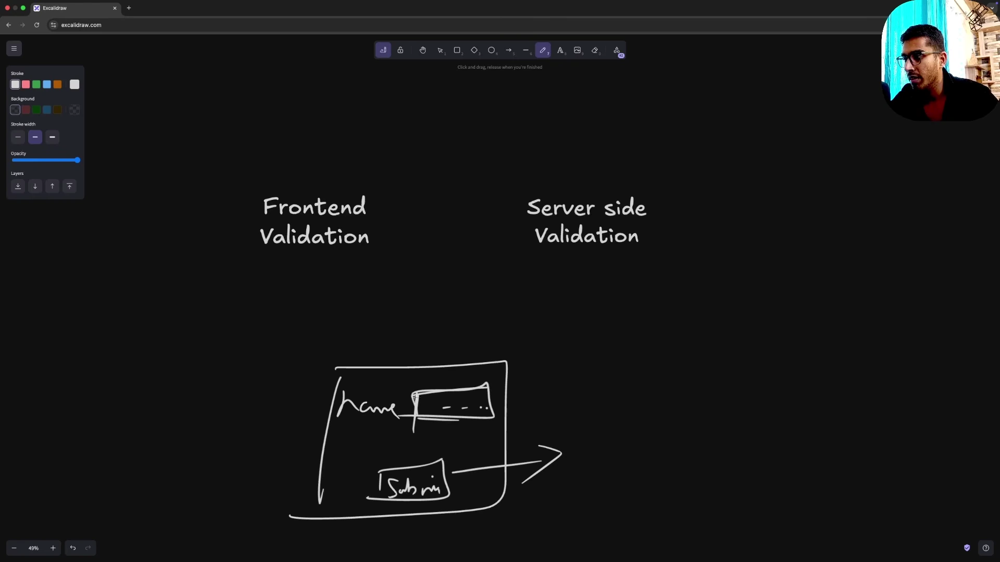

# Bản Chất Validation Và Transformation Trong Backend

* **Kênh:** Sriniously | **Thời lượng:** 42:47 | **Ngày:** 2025-01-12
* **Video:** https://www.youtube.com/watch?v=qedj_JjjL-U

---

## Thuật ngữ

| Thuật ngữ | Giải thích |
| :--- | :--- |
| Validation | Tiến trình kiểm tra dữ liệu đầu vào để bảo đảm cấu trúc, kiểu dữ liệu và giá trị thỏa mãn chính xác các ràng buộc hệ thống trước khi thực thi nghiệp vụ. |
| Transformation | Tiến trình biến đổi, chuẩn hóa hoặc ép kiểu dữ liệu từ dạng client gửi lên thành định dạng phù hợp với yêu cầu xử lý của Service Layer. |
| Syntactic Validation | Kiểm tra tính đúng đắn về mặt cú pháp định dạng của chuỗi dữ liệu như cấu trúc Email, số điện thoại hay chuỗi ngày tháng ISO. |
| Semantic Validation | Kiểm tra tính hợp lý về mặt ngữ nghĩa và logic đời thực của dữ liệu như ngày sinh không thể ở tương lai hay tuổi tác phải nằm trong khoảng sinh học. |
| Type Validation | Kiểm tra kiểu dữ liệu nguyên thủy của từng trường như String, Number, Boolean, Array hay lồng nhau trong JSON Object. |
| Fail-Fast Principle | Nguyên lý từ chối ngay lập tức tại Entry Point với HTTP Status 400 Bad Request khi dữ liệu không hợp lệ, ngăn ngừa lỗi tầng sâu. |
| Type Casting | Thao tác cưỡng bức chuyển đổi dữ liệu từ kiểu này sang kiểu khác như chuyển String thành Number đối với Query Parameter. |
| Data Sanitization | Tiến trình làm sạch dữ liệu như cắt bỏ khoảng trắng thừa với Trim, chuẩn hóa chữ thường chữ hoa với Lowercase để bảo đảm tính nhất quán lưu trữ. |

---

## Tổng luận chuyên đề

#### Vị trí của Pipeline trong kiến trúc phân tầng

Trong kiến trúc backend phân tầng tiêu chuẩn gồm Controller, Service và Repository:
- **Cổng chặn tại Controller:** Dữ liệu client gửi lên gồm JSON Body, Query String, Path Parameter phải đi qua Validation and Transformation Pipeline ngay tại Entry Point trước khi chuyển tiếp vào Service Layer.
- **Bảo vệ toàn vẹn dữ liệu Data Integrity:** Ngăn chặn dữ liệu rác, kiểu dữ liệu sai lệch đi sâu vào Service Layer hoặc làm sập câu lệnh SQL tại Repository Layer.
- **Phản hồi lỗi chuẩn mực:** Trả về mã lỗi `400 Bad Request` kèm thông báo chi tiết danh sách trường bị sai thay vì để database ném ngoại lệ gây ra lỗi `500 Internal Server Error`.

#### Ba lớp Validation cốt lõi

Việc xác thực dữ liệu được chia thành ba cấp độ kiểm tra chặt chẽ:
- **Type Validation:** Xác minh kiểu dữ liệu cơ bản như String, Number, Boolean, Array.
- **Syntactic Validation:** Xác minh cấu trúc cú pháp đặc thù như Email có `@` và domain, Số điện thoại đúng mã vùng, Ngày tháng đúng định dạng YYYY-MM-DD.
- **Semantic Validation:** Xác minh tính hợp lý về logic nghiệp vụ như Ngày sinh không được ở tương lai, Tuổi từ 1 đến 120, Mật khẩu xác nhận phải trùng khớp mật khẩu chính.

#### Bản chất ranh giới giữa Frontend và Backend Validation

Sự nhầm lẫn nguy hiểm nhất của lập trình viên là dựa dẫm vào validation phía frontend:
- **Frontend Validation phục vụ UX:** Mang lại trải nghiệm người dùng mượt mà, phản hồi ngay lập tức trên form để người dùng sửa lỗi mà không cần chờ gọi mạng.
- **Backend Validation phục vụ An ninh:** Đóng vai trò bức tường lửa bảo vệ toàn vẹn dữ liệu. Bất kỳ ai cũng có thể vượt qua frontend bằng cách gọi API trực tiếp qua cURL, Postman, Insomnia hoặc script tấn công.
- **Nguyên tắc bất di bất dịch:** Backend luôn phải giả định dữ liệu từ client là không đáng tin cậy theo nguyên tắc Zero Trust và bắt buộc phải xác thực độc lập 100%.

---

## Bóc tách chi tiết

### [[00:00](https://www.youtube.com/watch?v=qedj_JjjL-U&t=0s)] Kiến trúc phân tầng và vị trí của Controller

* **Chuỗi thực thi chuẩn:** Request HTTP đi vào Router -> Controller -> Service -> Repository -> Database.
* **Tách bạch trách nhiệm:** Controller quản lý giao thức HTTP gồm Status Code, Header, Request Format, Service chứa Business Logic thuần túy, Repository xử lý truy vấn dữ liệu.
* **Vị trí đặt Pipeline:** Pipeline xác thực và biến đổi dữ liệu được kích hoạt ngay đầu Controller trước khi bất kỳ hàm Service nào được gọi.

### [[03:00](https://www.youtube.com/watch?v=qedj_JjjL-U&t=180s)] Luồng di chuyển dữ liệu qua các tầng



* **Phân tích luồng nghiệp vụ:** Khi client gửi JSON payload, Controller tiếp nhận và chịu trách nhiệm bảo đảm dữ liệu đầu vào hoàn toàn hợp lệ trước khi bàn giao cho Service.
* **Tránh rò rỉ ngoại lệ:** Nếu không có chốt chặn này, dữ liệu sai kiểu sẽ đi xuyên qua Service và làm gãy câu lệnh SQL tại tầng Repository, dẫn tới crash hoặc lỗi `500 Internal Server Error`.

### [[06:20](https://www.youtube.com/watch?v=qedj_JjjL-U&t=380s)] Cổng chặn dữ liệu tại Entry Point



* **Tất cả các nguồn dữ liệu:** Không chỉ Request Body mà toàn bộ Query Parameters, Path Parameters và Headers đều phải đi qua pipeline kiểm tra.
* **Nguyên tắc Fail-Fast:** Khi một trường không thỏa mãn, ví dụ trường `name` bị thiếu hoặc vượt quá 100 ký tự, hệ thống ngắt chuỗi thực thi ngay lập tức và trả về lỗi 400 cùng lý do cụ thể.

### [[09:40](https://www.youtube.com/watch?v=qedj_JjjL-U&t=580s)] Hậu quả khi thiếu Validation tại Backend



* **Kịch bản thực tế:** Client gửi `{ "name": 0 }` thay vì một chuỗi String tên sách.
* **Sự cố phía Database:** Controller không kiểm tra, Service đẩy thẳng xuống Repository để chạy câu lệnh `INSERT INTO books (name) VALUES (0)`.
* **Database Constraint thất bại:** PostgreSQL định nghĩa cột `name` là kiểu `TEXT NOT NULL`. Thao tác insert số `0` bị từ chối, gây sập request với mã `500 Internal Server Error` và để lộ điểm yếu hệ thống.

### [[14:40](https://www.youtube.com/watch?v=qedj_JjjL-U&t=880s)] Minh họa Syntactic Validation qua Insomnia



* **Thử nghiệm gửi rỗng:** Gửi request rỗng tới `/api/valid/syntactic`. API trả về mảng thông báo lỗi chi tiết yêu cầu 3 trường: `email`, `phone`, `date`.
* **Cú pháp chuỗi:**
  - `email`: Phải tuân theo định dạng chuẩn chứa ký tự `@` và domain name.
  - `phone`: Phải thỏa mãn định dạng số điện thoại chuẩn kèm mã quốc gia.
  - `date`: Phải khớp với cấu trúc chuỗi ngày tháng chuẩn `YYYY-MM-DD`.

### [[17:30](https://www.youtube.com/watch?v=qedj_JjjL-U&t=1050s)] Phân loại các cấp độ Validation



* **Ba hình thái kiểm tra:**
  1. *Syntactic Validation:* Kiểm tra mẫu cấu trúc ký tự qua Regex pattern matching.
  2. *Semantic Validation:* Kiểm tra ý nghĩa dữ liệu trong ngữ cảnh thực tế đời sống.
  3. *Type Validation:* Kiểm tra kiểu dữ liệu nguyên thủy trong bộ nhớ.

### [[23:20](https://www.youtube.com/watch?v=qedj_JjjL-U&t=1400s)] Kỹ thuật Transformation và Type Casting



* **Vấn đề của Query Parameter:** Mọi giá trị trên Query String đều đi vào server dưới dạng chuỗi String thuần túy, ví dụ `?page=2&limit=20` sẽ được server đọc thành `page: "2"` và `limit: "20"`.
* **Ép kiểu trước khi validate:** Nếu schema đòi hỏi `page` phải là số lớn hơn 0, bước Transformation phải tiến hành Type Casting chuyển đổi chuỗi `"2"` thành số nguyên `2` trước khi chạy bộ kiểm tra nghiệp vụ.

### [[29:10](https://www.youtube.com/watch?v=qedj_JjjL-U&t=1750s)] Minh họa Semantic Validation thực tế



* **Tình huống ngày sinh:** Người dùng nhập `dateOfBirth: "2026-06-12"`. Mặc dù chuỗi thỏa mãn hoàn toàn cú pháp ngày tháng, nhưng về mặt ngữ nghĩa thì ngày sinh không thể ở tương lai.
* **Ràng buộc sinh học:** Người dùng nhập `age: 430`. Hệ thống từ chối với lỗi số tuổi vượt quá giới hạn sinh học hợp lý của con người từ 1 đến 120.

### [[32:30](https://www.youtube.com/watch?v=qedj_JjjL-U&t=1950s)] Kịch bản Validation phức tạp phụ thuộc



* **Ràng buộc tương quan giữa các trường:**
  - *Mật khẩu xác nhận:* Giá trị của `passwordConfirmation` bắt buộc phải khớp 100% với giá trị của `password`.
  - *Ràng buộc có điều kiện Conditional Validation:* Nếu trường `married: true`, thì trường `partner` trở thành bắt buộc; ngược lại nếu `married: false`, trường `partner` là tùy chọn.

### [[35:00](https://www.youtube.com/watch?v=qedj_JjjL-U&t=2100s)] Minh họa Data Transformation trong thực tế



* **Chuẩn hóa chuỗi Sanitization:** Client gửi email với chữ hoa chữ thường lộn xộn `tEsT@Example.Com`. Pipeline tự động chuyển về chữ thường toàn bộ `test@example.com` trước khi lưu vào cơ sở dữ liệu.
* **Chuẩn hóa số điện thoại:** Tự động chèn tiền tố dấu cộng `+` chuẩn quốc tế E.164 trước chuỗi số điện thoại do người dùng cung cấp.

### [[38:20](https://www.youtube.com/watch?v=qedj_JjjL-U&t=2300s)] Sự khác biệt giữa Frontend và Backend



* **Frontend Validation:** Chặn lỗi ngay tại trình duyệt để hiển thị thông báo đỏ trên form, tối ưu trải nghiệm người dùng UX và giảm tải số lượng request không cần thiết lên máy chủ.
* **Backend Validation:** Tuyệt đối không bao giờ tin tưởng frontend. Bắt buộc kiểm tra lại toàn bộ dữ liệu vì kẻ tấn công có thể bypass hoàn toàn giao diện web bằng cách gửi request trực tiếp qua Postman, cURL hoặc công cụ tự động.

---

## Trích dẫn then chốt

* [[00:00](https://www.youtube.com/watch?v=qedj_JjjL-U&t=0s)] "Validations and transformations are mostly related to data integrity and security — that's where they come into play."
* [[07:21](https://www.youtube.com/watch?v=qedj_JjjL-U&t=441s)] "Before we start executing business logic, before calling service methods, we want to make sure the structure of the data is in the exact format that we expect."
* [[10:21](https://www.youtube.com/watch?v=qedj_JjjL-U&t=621s)] "If we don't validate at the entry point, unexpected data reaches database queries and causes 500 Internal Server Errors, which is very poor user experience."
* [[23:41](https://www.youtube.com/watch?v=qedj_JjjL-U&t=1421s)] "All values in query parameters are strings by default. It is the server's responsibility to cast and transform this data into the expected types."
* [[37:23](https://www.youtube.com/watch?v=qedj_JjjL-U&t=2243s)] "Frontend validation is for UX and immediate user feedback. Backend validation is for security and data integrity. You can never replace backend validation with frontend validation."

---

## Lệnh & Công cụ

```javascript
const express = require('express');
const { z } = require('zod');
const app = express();
app.use(express.json());

// 1. Định nghĩa Schema kết hợp Validation & Transformation
const registerUserSchema = z.object({
  // Syntactic & Transformation: Trim khoảng trắng và chuyển chữ thường
  email: z.string().trim().toLowerCase().email({ message: "Invalid email address" }),
  
  // Type & Syntactic: Mật khẩu tối thiểu 8 ký tự
  password: z.string().min(8, { message: "Password must be at least 8 characters" }),
  passwordConfirmation: z.string(),
  
  // Semantic Validation: Ngày sinh không được ở tương lai
  dateOfBirth: z.string().refine((val) => new Date(val) < new Date(), {
    message: "Date of birth cannot be in the future",
  }),
  
  // Semantic Validation: Giới hạn tuổi sinh học
  age: z.number().int().min(1).max(120),
  
  // Conditional Validation
  married: z.boolean(),
  partner: z.string().optional(),
}).refine((data) => data.password === data.passwordConfirmation, {
  message: "Passwords do not match",
  path: ["passwordConfirmation"],
}).refine((data) => !data.married || (data.married && data.partner), {
  message: "Partner name is required when married is true",
  path: ["partner"],
});

// 2. Middleware Validation tổng quát
function validate(schema) {
  return (req, res, next) => {
    try {
      // Thực hiện ép kiểu và xác thực
      req.body = schema.parse(req.body);
      next();
    } catch (error) {
      if (error instanceof z.ZodError) {
        return res.status(400).json({
          status: "fail",
          errors: error.errors.map(e => ({ field: e.path.join('.'), message: e.message }))
        });
      }
      res.status(500).json({ error: "Internal server error" });
    }
  };
}

// 3. Đăng ký Route bảo vệ bởi Validation Pipeline
app.post('/api/users/register', validate(registerUserSchema), (req, res) => {
  res.status(200).json({ status: "success", data: req.body });
});
```

```bash
# 1. Thử nghiệm gửi dữ liệu rỗng (Kỳ vọng: 400 Bad Request)
curl -X POST http://localhost:3000/api/users/register \
  -H "Content-Type: application/json" \
  -d '{}'

# 2. Thử nghiệm ngày sinh ở tương lai (Semantic Error)
curl -X POST http://localhost:3000/api/users/register \
  -H "Content-Type: application/json" \
  -d '{
    "email": "USER@DOMAIN.COM",
    "password": "Password123",
    "passwordConfirmation": "Password123",
    "dateOfBirth": "2030-01-01",
    "age": 25,
    "married": false
  }'

# 3. Gửi payload hợp lệ (Dữ liệu email sẽ tự chuyển thành chữ thường)
curl -X POST http://localhost:3000/api/users/register \
  -H "Content-Type: application/json" \
  -d '{
    "email": "USER@DOMAIN.COM",
    "password": "Password123",
    "passwordConfirmation": "Password123",
    "dateOfBirth": "1998-05-20",
    "age": 27,
    "married": false
  }'
```

---

## Đánh đổi & Rủi ro

| Tiêu chí | Ưu điểm cốt lõi | Đánh đổi & Rủi ro tiềm ẩn | Biện pháp phòng ngừa |
| :--- | :--- | :--- | :--- |
| **Strict Validation** | Ngăn ngừa hoàn toàn dữ liệu bẩn và lỗi crash không mong muốn. | Tốn tài nguyên CPU khi xử lý các schema phức tạp với lượng traffic cực lớn. | Sử dụng các thư viện validate siêu tốc độ đã được benchmark như Zod hoặc TypeBox. |
| **Data Transformation** | Chuẩn hóa dữ liệu đồng nhất trước khi ghi vào kho lưu trữ. | Nguy cơ làm biến dạng dữ liệu gốc của người dùng nếu logic transform bị sai. | Lưu trữ bản sao nguyên thủy dưới dạng Raw Payload trong log kiểm toán khi cần đối soát. |
| **Fail-Fast tại Entry Point** | Tiết kiệm chi phí gọi mạng và tài nguyên database xuống mức tối thiểu. | Cần thiết kế mã lỗi và định dạng response nhất quán trên toàn bộ hệ thống API. | Xây dựng middleware chuẩn hóa cấu trúc lỗi `400 Bad Request` dạng RFC 7807. |
| **Frontend vs Backend** | Phân định rõ trách nhiệm giữa UX và An ninh hệ thống. | Tốn công sức duy trì đồng bộ schema giữa hai đội ngũ frontend và backend. | Áp dụng chia sẻ Schema dùng chung qua monorepo hoặc sinh mã TypeScript tự động. |
