# CS50x - Bài 0 - Scratch

* **Kênh:** CS50 | **Thời lượng:** 02:00:53 | **Ngày:** 2026-01-01
* **Video:** https://youtu.be/UuIEbpQms8o

---

## Thuật ngữ

| Thuật ngữ | Tiếng Anh | Giải thích |
| :--- | :--- | :--- |
| **Bit** | Binary Digit | Đơn vị thông tin cơ bản nhất của máy tính, chỉ nhận một trong hai trạng thái: 0 (tắt / mức điện áp thấp) hoặc 1 (bật / mức điện áp cao). |
| **Byte** | Byte | Nhóm gồm 8 bit liền kề, có thể biểu diễn 2^8 = 256 giá trị phân biệt (từ 0 đến 255). |
| **Hệ nhị phân** | Binary Number System | Hệ thống đếm cơ số 2 dựa trên các lũy thừa của 2 (1, 2, 4, 8, 16, 32, 64, 128...) để biểu diễn mọi con số và thông tin. |
| **Hệ đơn phân** | Unary Number System | Hệ thống đếm cơ số 1, biểu diễn số lượng bằng cách đếm các vạch hoặc ngón tay lặp lại. |
| **Bóng bán dẫn** | Transistor | Công tắc điện tử kích thước hiển vi bên trong chip máy tính, kiểm soát dòng điện để lưu giữ trạng thái 0 và 1. |
| **Bảng mã ASCII** | American Standard Code for Information Interchange | Bộ quy ước chuẩn 7-bit/8-bit ánh xạ các chữ cái, con số và ký hiệu điều khiển sang số nguyên từ 0 đến 127 (hoặc 255). |
| **Bảng mã Unicode** | Unicode | Chuẩn mã hóa mở rộng toàn cầu sử dụng tới 32 bit, bao phủ toàn bộ hệ ký tự chữ viết và biểu tượng cảm xúc (Emoji) của nhân loại. |
| **Điểm ảnh** | Pixel (Picture Element) | Đơn vị hình ảnh kỹ thuật số nhỏ nhất trên màn hình, được tổng hợp từ sự phối hợp của ba kênh màu Đỏ, Lục và Lam. |
| **Mô hình màu RGB** | Red Green Blue Color Model | Phương pháp phối màu cộng kỹ thuật số sử dụng 3 byte (24 bit), phân bổ 1 byte (0-255) cho mỗi kênh màu để tạo ra 16,777,216 màu sắc. |
| **Thuật toán** | Algorithm | Chuỗi chỉ thị hữu hạn, tuần tự và chính xác nhằm xử lý dữ liệu đầu vào (Input) để tạo ra kết quả đầu ra (Output). |
| **Tìm kiếm tuần tự** | Linear Search | Thuật toán duyệt từng phần tử từ đầu đến cuối danh sách; thời gian xử lý tăng tuyến tính theo kích thước dữ liệu O(n). |
| **Tìm kiếm nhị phân** | Binary Search | Thuật toán chia để trị áp dụng trên dữ liệu đã sắp xếp, liên tục loại bỏ một nửa dữ liệu sau mỗi bước so sánh; thời gian xử lý đạt O(log n). |
| **Mã giả** | Pseudocode | Bản mô tả thuật toán bằng ngôn ngữ tự nhiên có cấu trúc, giúp con người tư duy mạch lạc trước khi viết mã nguồn thực tế. |
| **Hàm** | Function | Khối lệnh có tên thực hiện một tác vụ cụ thể, có thể nhận đối số (Arguments), trả về giá trị hoặc gây ra hiệu ứng phụ (Side effect). |
| **Điều kiện** | Conditional | Cấu trúc điều khiển rẽ nhánh cho phép chương trình đưa ra quyết định thực thi dựa trên việc kiểm tra tính đúng sai của biểu thức logic. |
| **Biểu thức logic** | Boolean Expression | Biểu thức mệnh đề chỉ nhận một trong hai kết quả chân trị duy nhất: Đúng (True) hoặc Sai (False). |
| **Vòng lặp** | Loop | Cấu trúc cho phép thực thi lặp đi lặp lại một khối lệnh dựa trên số lần xác định hoặc theo một điều kiện dừng. |
| **Biến số** | Variable | Vùng nhớ lưu trữ giá trị có thể thay đổi linh hoạt trong suốt vòng đời của chương trình. |
| **Tính trừu tượng** | Abstraction | Nguyên lý thiết kế đóng gói sự phức tạp bên trong một định danh đơn giản, giúp tái sử dụng và giảm tải nhận thức cho lập trình viên. |
| **Lập trình sự kiện** | Event-driven Programming | Mô hình lập trình mà luồng điều khiển được định hướng bởi các sự kiện bên ngoài như nhấp chuột, nhấn phím hoặc tín hiệu phát sóng. |

---

## Tổng luận chuyên đề

### Bản chất dữ liệu

Mọi hệ thống tính toán kỹ thuật số đều hoạt động dựa trên mô hình hộp đen cơ bản: tiếp nhận Dữ liệu đầu vào (Input), xử lý theo chỉ thị, và xuất ra Kết quả đầu ra (Output). Về bản chất vật lý, máy tính chỉ là tập hợp của hàng tỷ bóng bán dẫn (Transistors) hoạt động như các công tắc đóng/ngắt mạch điện, tương ứng với hai trạng thái 0 (tắt) và 1 (bật).

Mỗi vị trí nhị phân được gọi là một **Bit**. Để biểu diễn các giá trị lớn hơn, máy tính gom nhóm các bit lại theo cơ số 2 với trọng số là các lũy thừa của 2:

$$\text{Giá trị thập phân} = \sum_{i=0}^{n-1} b_i \times 2^i$$

Một nhóm gồm 8 bit được chuẩn hóa thành 1 **Byte**, có khả năng biểu diễn các số nguyên không âm từ $0$ ($00000000_2$) đến $255$ ($11111111_2$). 

Từ nền tảng số học nhị phân, con người đặt ra các tầng quy ước giải mã:
1. **Chữ viết:** Chuẩn ASCII gán mỗi ký tự với một mã số nguyên (chữ cái `'A'` là 65, `'B'` là 66). Chuẩn Unicode mở rộng không gian địa chỉ lên 16-32 bit để biểu diễn mọi ngôn ngữ thế giới cùng các biểu tượng cảm xúc.
2. **Hình ảnh và Màu sắc:** Mô hình RGB dùng 3 byte (24 bit) cho mỗi điểm ảnh (Pixel), biểu diễn cường độ ánh sáng của ba kênh màu Đỏ (Red), Lục (Green) và Lam (Blue) từ 0 đến 255. Một bức ảnh là một ma trận hai chiều của các điểm ảnh này.
3. **Bối cảnh giải mã:** Chuỗi bit $01000001_2$ hoàn toàn không mang ý nghĩa nội tại độc lập. Nó chỉ trở thành con số 65, chữ cái `'A'`, hay một sắc thái màu sắc khi phần mềm áp dụng đúng bối cảnh định dạng tập tin.

### Thuật toán và hiệu năng

Thuật toán là công thức giải quyết bài toán. Xét bài toán tìm kiếm danh bạ điện thoại gồm $n$ trang đã được sắp xếp theo thứ tự bảng chữ cái:
- **Phương án 1 (Tìm kiếm từng trang):** Lật từng trang từ đầu đến cuối. Số bước tối đa bằng $n$. Khi danh bạ tăng lên gấp đôi ($2n$), số bước thực thi cũng tăng gấp đôi. Độ phức tạp là $O(n)$ (tuyến tính).
- **Phương án 2 (Tìm kiếm nhảy cóc 2 trang):** Lật mỗi lần 2 trang. Tốc độ nhanh gấp đôi nhưng đối mặt rủi ro bỏ sót mục tiêu, đòi hỏi phải lùi lại 1 bước khi vượt qua tên cần tìm. Độ phức tạp vẫn là $O(n/2) \sim O(n)$.
- **Phương án 3 (Chia để trị / Tìm kiếm nhị phân):** Mở ngay vào giữa danh bạ. So sánh tên mục tiêu với trang hiện tại. Nếu tên nằm ở nửa trước, xé bỏ nửa sau và ngược lại. Lặp lại quá trình này trên nửa còn lại.

Số bước tối đa của thuật toán chia để trị chỉ là:

$$\text{Số bước} = \log_2(n) + 1$$

Với một cuốn danh bạ chứa 4 tỷ người ($n = 4 \times 10^9$), tìm kiếm tuyến tính cần tới 4 tỷ lần kiểm tra, trong khi tìm kiếm nhị phân giải quyết hoàn tất chỉ trong tối đa 32 lần lật trang. Đây là khoảng cách khổng lồ giữa thuật toán tuyến tính và thuật toán hàm logarit.

### Cấu trúc mã giả

Mã giả (Pseudocode) là cầu nối giữa tư duy con người và mã máy tính. Một thuật toán hoàn chỉnh luôn được hợp thành từ bốn khối dựng nền tảng:
1. **Hàm (Functions / Verbs):** Các hành động hoặc tác vụ (ví dụ: *Pick up*, *Open to*, *Look at*, *Call*).
2. **Điều kiện (Conditionals):** Các điểm rẽ nhánh luồng thực thi (*If*, *Else if*, *Else*).
3. **Biểu thức logic (Boolean Expressions):** Các mệnh đề kiểm tra điều kiện trả về Đúng hoặc Sai (*person is on page*, *person is earlier in book*).
4. **Vòng lặp (Loops):** Cơ chế quay ngược luồng điều khiển về một chỉ thị trước đó (*Go back to line 3*).

### Môi trường Scratch

Scratch loại bỏ hoàn toàn các lỗi cú pháp gõ chữ (Syntax Errors) bằng cách trực quan hóa các cấu trúc mã thành các khối ghép xếp hình (Puzzle blocks). Scratch chia không gian làm việc thành ba khu vực cốt lõi:
- **Kho khối lệnh (Palette):** Phân loại theo màu sắc đại diện cho Chuyển động (Motion), Ngoại hình (Looks), Âm thanh (Sound), Sự kiện (Events), Điều khiển (Control), Cảm biến (Sensing), Phép toán (Operators) và Biến số (Variables).
- **Vùng kịch bản (Scripts Area):** Nơi kéo thả và lắp ráp các khối lệnh logic.
- **Sân khấu (Stage):** Tọa độ hiển thị 2D ($x, y$) nơi các nhân vật (Sprites) di chuyển và tương tác.

Thông qua Scratch, các nguyên lý kỹ thuật phần mềm nâng cao được truyền tải rõ ràng:
- **Lập trình hướng sự kiện:** Mọi kịch bản đều bắt đầu bằng một khối bắt sự kiện (như `when green flag clicked`, `when key pressed`).
- **Tương tác và Biến số:** Nhận dữ liệu đầu vào qua khối `ask ... and wait`, lưu trữ trong biến nội tại `answer`, và định dạng đầu ra qua hàm ghép chuỗi `join`.
- **Trừu tượng hóa:** Đóng gói một chuỗi thao tác phức tạp thành một khối tự tạo (Custom Block) có đối số đầu vào (Parameter), biến mã nguồn thành các mô-đun độc lập, tái sử dụng và dễ bảo trì.

---

## Bóc tách chi tiết

### [[00:00:00](https://youtu.be/UuIEbpQms8o?t=0s)] Khởi động khóa học

Bài giảng mở màn tại thính phòng Sanders Theatre của Đại học Harvard. Giảng viên David J. Malan giới thiệu CS50x là khóa học nhập môn về các doanh nghiệp trí tuệ của khoa học máy tính và nghệ thuật lập trình. Trên sân khấu bố trí một hàng bóng đèn Edison cổ điển cùng một chú vịt cao su khổng lồ màu vàng – biểu tượng của phương pháp gỡ lỗi kinh điển trong kỹ thuật phần mềm (Rubber Duck Debugging).

### [[00:02:24](https://youtu.be/UuIEbpQms8o?t=144s)] Làn sóng trí tuệ

David đề cập trực diện đến trí tuệ nhân tạo (Artificial Intelligence - AI). Làn sóng các mô hình ngôn ngữ lớn (LLMs) như ChatGPT đã và đang thay đổi căn bản cách con người tiếp cận công việc lập trình. Nhiều người lầm tưởng rằng sự xuất hiện của AI sẽ khiến việc học các nguyên lý cơ bản của khoa học máy tính trở nên lỗi thời.

Tuy nhiên, bài giảng khẳng định một nguyên lý cốt lõi: AI không loại bỏ lập trình viên, mà nó đóng vai trò như một bộ khuếch đại năng lực (Multiplier). Để sử dụng AI hiệu quả, lập trình viên cần hiểu sâu sắc bản chất vận hành bên dưới tầng máy móc để có thể đánh giá, định hướng và phát hiện sai sót của các mô hình sinh mã tự động.

### [[00:05:00](https://youtu.be/UuIEbpQms8o?t=300s)] Trợ lý giảng dạy

Khóa học giới thiệu công cụ `cs50.ai` – trợ lý giảng dạy AI được tinh chỉnh dựa trên phương pháp sư phạm gợi mở (Socratic Method). Không giống các công cụ sinh mã trực tiếp đưa ra lời giải hoàn chỉnh khiến sinh viên thụ động, trợ lý CS50 Duck được lập trình để đặt câu hỏi dẫn dắt, giải thích khái niệm từng bước và hướng dẫn sinh viên tự phát hiện lỗi sai trong tư duy lập trình.

### [[00:10:00](https://youtu.be/UuIEbpQms8o?t=600s)] Lời nhắc và mã

Mối quan hệ giữa việc viết lời nhắc (Prompting) và viết mã lệnh truyền thống được phân tích. Lời nhắc bằng ngôn ngữ tự nhiên có tính chất mơ hồ, phụ thuộc vào xác suất thống kê của mô hình. Trong khi đó, mã nguồn máy tính đòi hỏi tính chính xác tuyệt đối và tất định (Deterministic). Việc học tư duy lập trình từ nền tảng giúp người học rèn luyện khả năng phân rã bài toán lớn thành các bước xử lý logic vi mô, đây chính là kỹ năng tiên quyết để điều khiển các hệ thống AI cấp cao.

### [[00:14:12](https://youtu.be/UuIEbpQms8o?t=852s)] Bản chất thông tin

Khoa học máy tính không đơn thuần là việc sử dụng máy tính hay học cú pháp ngôn ngữ lập trình, mà là khoa học về **Xử lý thông tin và Giải quyết vấn đề (Problem Solving)**.

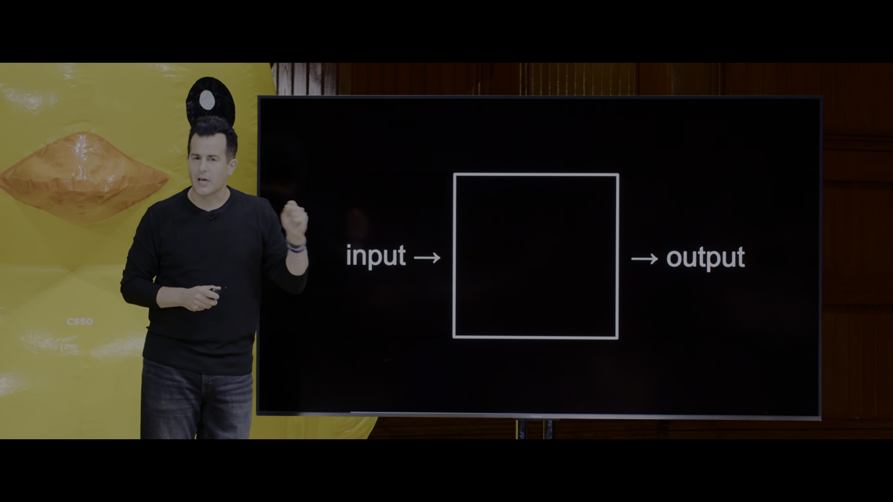

David trình chiếu sơ đồ kiến trúc nền tảng:
- **Đầu vào (Input):** Biểu diễn vấn đề cần giải quyết dưới dạng thông tin số hóa.
- **Hộp đen (The Box):** Thuật toán và hệ thống máy tính tiếp nhận và xử lý thông tin.
- **Đầu ra (Output):** Kết quả của quá trình giải quyết vấn đề.

Để giải quyết bất kỳ bài toán nào trong thế giới thực bằng máy tính, thách thức đầu tiên là: Làm thế nào để biểu diễn mọi dạng thông tin (con số, chữ viết, âm thanh, hình ảnh, video) chỉ bằng các tín hiệu điện tử?

### [[00:15:36](https://youtu.be/UuIEbpQms8o?t=936s)] Hệ đếm đơn phân

Cách thức đếm tự nhiên và trực quan nhất của loài người là hệ đơn phân (Unary / Base-1). Trong hệ đếm này, mỗi đơn vị được biểu diễn bằng một ngón tay hoặc một vạch thẳng:
- Giơ 1 ngón tay tương ứng với số 1.
- Giơ 2 ngón tay tương ứng với số 2.
- Giơ cả bàn tay 5 ngón tương ứng với số 5.

Hạn chế vật lý nghiêm trọng của hệ đơn phân là hiệu suất biểu diễn cực kỳ thấp: với 5 ngón tay trên một bàn tay, con người chỉ có thể đếm tối đa đến 5. Nếu muốn biểu diễn số 1,000, hệ thống đòi hỏi tới 1,000 ngón tay hoặc linh kiện vật lý riêng biệt.

### [[00:16:06](https://youtu.be/UuIEbpQms8o?t=966s)] Trạng thái bóng đèn

Để tối ưu hóa không gian biểu diễn, máy tính chuyển sang sử dụng hệ đếm nhị phân (Binary / Base-2). Thay vì mỗi ngón tay chỉ đóng vai trò là một đơn vị đếm cộng dồn, mỗi ngón tay (hoặc bóng đèn) được xem như một **Bit** (Binary Digit) độc lập có khả năng bật hoặc tắt.

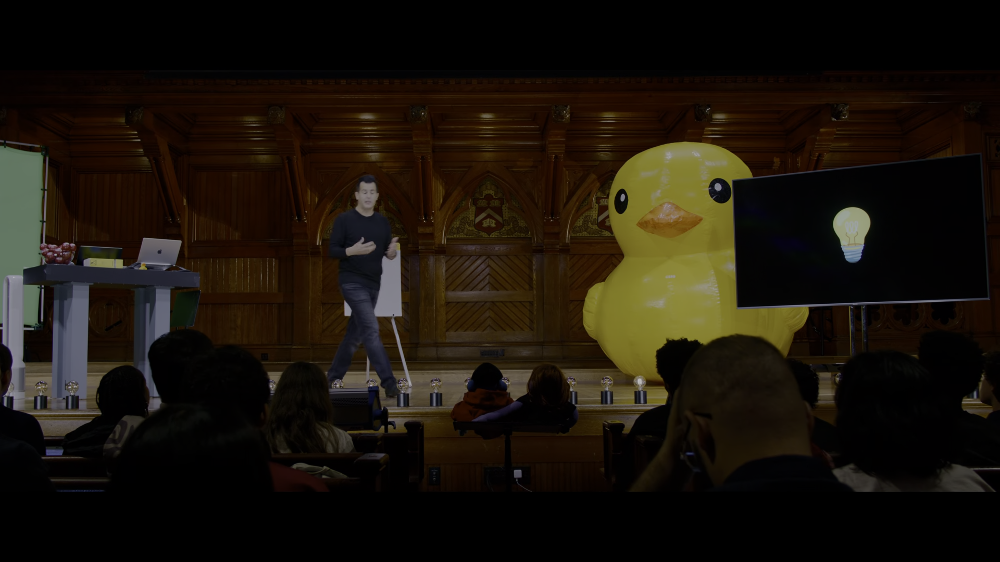

Hệ thống vật lý của máy tính lưu trữ bit thông qua điện áp:
- Mức điện áp 0V (không có dòng điện): Biểu diễn giá trị $0$.
- Mức điện áp dương (ví dụ 5V hoặc 3.3V, có dòng điện): Biểu diễn giá trị $1$.

Bằng cách quy ước hai trạng thái phân biệt rõ ràng này, máy tính đạt được độ tin cậy phần cứng tuyệt đối, triệt tiêu nguy cơ nhiễu tín hiệu điện trường vốn rất phổ biến nếu dùng các mức điện áp trung gian.

### [[00:19:11](https://youtu.be/UuIEbpQms8o?t=1151s)] Lũy thừa cơ số

Hệ thống đếm của con người thường dùng hệ thập phân (Base-10) vì chúng ta có 10 ngón tay. Trong hệ thập phân, mỗi hàng số đại diện cho một lũy thừa của 10:

$$123_{10} = (1 \times 10^2) + (2 \times 10^1) + (3 \times 10^0) = 100 + 20 + 3$$

Trong hệ nhị phân, mỗi hàng số đại diện cho một lũy thừa của 2, tính từ phải sang trái bắt đầu từ $2^0 = 1$, $2^1 = 2$, $2^2 = 4$, $2^3 = 8$...

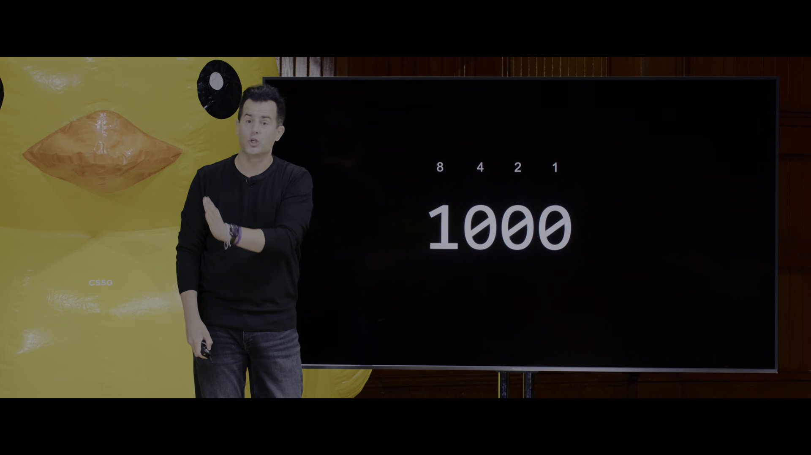

David chứng minh trên màn hình:
- Với 3 bit (ba vị trí có trọng số tương ứng là $4, 2, 1$):
  - $000_2 = (0 \times 4) + (0 \times 2) + (0 \times 1) = 0$
  - $001_2 = (0 \times 4) + (0 \times 2) + (1 \times 1) = 1$
  - $010_2 = (0 \times 4) + (1 \times 2) + (0 \times 1) = 2$
  - $011_2 = (0 \times 4) + (1 \times 2) + (1 \times 1) = 3$
  - $100_2 = (1 \times 4) + (0 \times 2) + (0 \times 1) = 4$
  - $101_2 = (1 \times 4) + (0 \times 2) + (1 \times 1) = 5$
  - $110_2 = (1 \times 4) + (1 \times 2) + (0 \times 1) = 6$
  - $111_2 = (1 \times 4) + (1 \times 2) + (1 \times 1) = 7$
- Khi thêm bit thứ tư có trọng số là $2^3 = 8$, mẫu số $1000_2$ đại diện cho con số 8.
- Quay trở lại bài toán bàn tay: Với 5 ngón tay trên một bàn tay, nếu mỗi ngón tay là một bit nhị phân, số lượng trạng thái có thể biểu diễn là $2^5 = 32$ trạng thái (đếm được từ 0 đến 31), thay vì chỉ đếm được đến 5 như hệ đơn phân.

### [[00:24:31](https://youtu.be/UuIEbpQms8o?t=1471s)] Giới hạn một byte

Chuẩn công nghiệp cơ bản nhất của máy tính là gom nhóm 8 bit thành 1 **Byte**. Trọng số của 8 bit từ phải sang trái lần lượt là:

$$2^7 = 128,\ 2^6 = 64,\ 2^5 = 32,\ 2^4 = 16,\ 2^3 = 8,\ 2^2 = 4,\ 2^1 = 2,\ 2^0 = 1$$

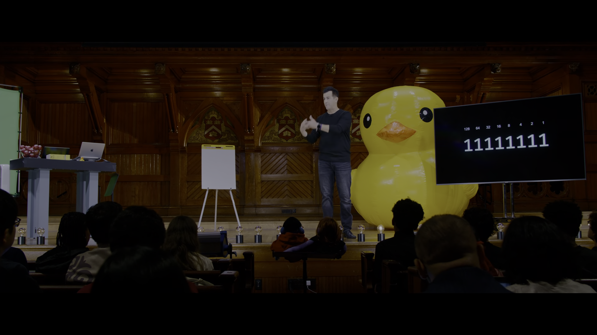

Khi cả 8 bit đều được bật lên mức 1 ($11111111_2$):

$$128 + 64 + 32 + 16 + 8 + 4 + 2 + 1 = 255$$

Một byte duy nhất có thể biểu diễn chính xác $2^8 = 256$ giá trị phân biệt, tương ứng với dải số nguyên không âm từ $0$ đến $255$. Nếu một chương trình cần lưu số 256 nhưng chỉ được cấp phát 8 bit, hiện tượng tràn số nguyên (Integer Overflow) sẽ xảy ra, giá trị sẽ bị lật ngược trở về 0.

### [[00:29:46](https://youtu.be/UuIEbpQms8o?t=1786s)] Biểu diễn chữ cái

Sau khi giải quyết việc lưu trữ số học, máy tính cần biểu diễn các ký tự chữ viết (A, B, C...). Do máy tính chỉ hiểu các con số nhị phân, các tổ chức kỹ thuật đã thiết lập một bảng ánh xạ chuẩn mang tên **ASCII** (American Standard Code for Information Interchange).

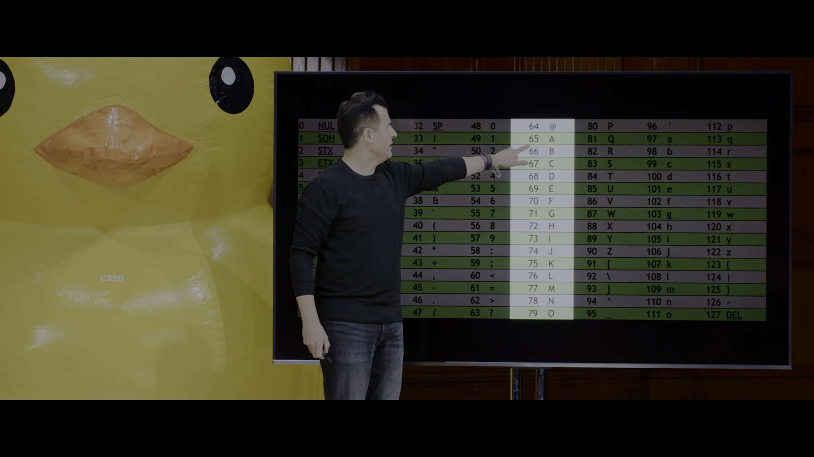

Quy ước chuẩn ASCII định nghĩa:
- Chữ cái in hoa `'A'` được gán số hiệu $65$.
- Chữ cái in hoa `'B'` được gán số hiệu $66$.
- Chữ cái in hoa `'C'` được gán số hiệu $67$...
- Chữ cái thường `'a'` được gán số hiệu $97$.
- Chữ cái thường `'b'` được gán số hiệu $98$...

Để lưu trữ ký tự `'A'` vào bộ nhớ máy tính, hệ thống chuyển đổi số 65 sang mã nhị phân 8-bit:

$$65 = 64 + 1 \implies 01000001_2$$

Khi lập trình viên gửi một email chứa chữ cái `'A'`, chuỗi bit $01000001$ thực chất là tín hiệu được truyền dẫn qua cáp quang hoặc sóng vô tuyến.

### [[00:34:21](https://youtu.be/UuIEbpQms8o?t=2061s)] Thử nghiệm ghép chữ

Để minh họa sống động cơ chế truyền tin bằng mã ASCII, David mời 8 sinh viên lên sân khấu, mỗi người cầm một tấm bảng đại diện cho một trọng số của byte: $128, 64, 32, 16, 8, 4, 2, 1$.

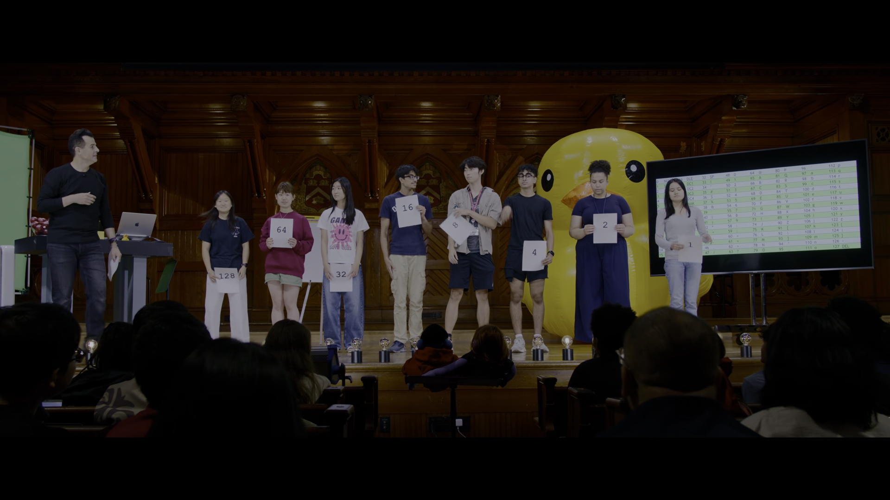

David đưa ra bài tập: Hãy biểu diễn từ tiếng Anh `"BOW"`:
1. **Ký tự `'B'`:** Mã ASCII là $66$. 
   - Phân tích: $66 = 64 + 2$.
   - Các sinh viên cầm bảng 64 và 2 giơ bảng lên (bit 1), các sinh viên còn lại hạ bảng xuống (bit 0).
   - Dãy nhị phân: $01000010_2$.
2. **Ký tự `'O'`:** Mã ASCII là $79$.
   - Phân tích: $79 = 64 + 8 + 4 + 2 + 1$.
   - Dãy nhị phân: $01001111_2$.
3. **Ký tự `'W'`:** Mã ASCII là $87$.
   - Phân tích: $87 = 64 + 16 + 4 + 2 + 1$.
   - Dãy nhị phân: $01010111_2$.

Toàn bộ thông điệp `"BOW"` được lưu trữ trong 3 byte (24 bit) liên tiếp:
`01000010 01001111 01010111`.

### [[00:40:52](https://youtu.be/UuIEbpQms8o?t=2452s)] Mở rộng biểu tượng

ASCII ban đầu chỉ sử dụng 7 bit (128 ký tự) hoặc mở rộng sang 8 bit (256 ký tự). Giới hạn 256 ký tự nhanh chóng bộc lộ sự thiếu hụt trầm trọng khi máy tính kết nối toàn cầu: nó chỉ đủ cho bảng chữ cái tiếng Anh cơ bản, hoàn toàn bất lực trước tiếng Việt có dấu, chữ tượng hình tiếng Trung, tiếng Nhật, tiếng Ả Rập hay tiếng Hy Lạp.


Hiệp hội Unicode (Unicode Consortium) ra đời để giải quyết vấn đề này. Chuẩn **Unicode** sử dụng không gian địa chỉ lên tới 16 bit, 24 bit và 32 bit, cho phép định danh hàng triệu ký tự khác nhau.

Bên cạnh chữ viết của mọi ngôn ngữ, Unicode còn định danh cả các biểu tượng cảm xúc (Emoji). Ví dụ biểu tượng kinh điển "Face with tears of joy" 😂 được gán mã Unicode chuẩn:
- Tên chuẩn: `FACE WITH TEARS OF JOY`
- Điểm mã (Code Point): `U+1F602`
- Giá trị thập phân tương ứng: $128,514$
- Biểu diễn nhị phân 32-bit: `00000000 00000001 11110110 00000010`

### [[00:44:57](https://youtu.be/UuIEbpQms8o?t=2697s)] Ba kênh màu gốc

Sau chữ viết, David chuyển sang phân tích cách máy tính hiển thị hình ảnh và màu sắc. Mọi màu sắc trên màn hình kỹ thuật số được tạo ra thông qua **Mô hình màu RGB** (Red, Green, Blue) dựa trên nguyên lý phối màu cộng ánh sáng.

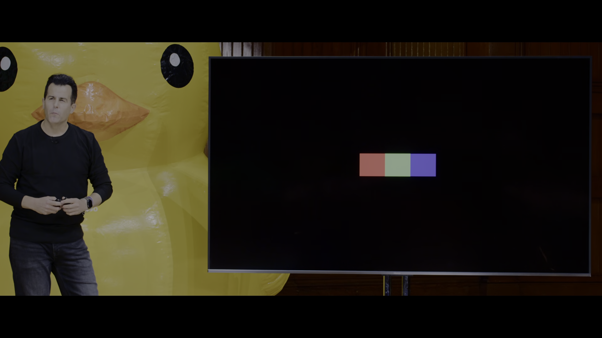

Mỗi điểm ảnh được lưu trữ bằng 3 byte (24 bit), trong đó mỗi byte quy định cường độ của một kênh màu trong thang giá trị từ $0$ (tắt hoàn toàn) đến $255$ (sáng cực đại):
- **Kênh Đỏ (Red):** 1 byte (0 đến 255)
- **Kênh Lục (Green):** 1 byte (0 đến 255)
- **Kênh Lam (Blue):** 1 byte (0 đến 255)

Tổng số màu sắc có thể tạo ra từ mô hình này là:

$$256 \times 256 \times 256 = 2^{24} = 16,777,216\ \text{màu (True Color)}$$

Các màu sắc cơ bản:
- Màu đen: `(0, 0, 0)` – cả ba đèn màu đều tắt.
- Màu trắng: `(255, 255, 255)` – cả ba đèn màu đều bật tối đa.
- Màu đỏ thuần: `(255, 0, 0)`.
- Màu vàng: Pha trộn giữa Đỏ tối đa và Lục tối đa `(255, 255, 0)`.

### [[00:47:50](https://youtu.be/UuIEbpQms8o?t=2870s)] Ma trận điểm ảnh

Mỗi hình ảnh kỹ thuật số là một ma trận hai chiều cấu thành từ hàng triệu **Điểm ảnh** (Pixels). Khi phóng to bức ảnh biểu tượng cảm xúc màu vàng, người xem có thể nhìn thấy cấu trúc các khối điểm ảnh vuông riêng lẻ.


Mỗi điểm ảnh vật lý trên màn hình phần cứng thực chất gồm 3 diode phát quang siêu nhỏ (sub-pixels): một đỏ, một lục, một lam đặt sát nhau. Khi mắt người nhìn từ khoảng cách thông thường, ba điểm sáng li ti này hòa trộn vào nhau, đánh lừa thị giác tạo thành cảm nhận về một màu sắc duy nhất.

Về mặt tính toán lưu trữ: Một bức ảnh có độ phân giải $1920 \times 1080$ chứa $2,073,600$ điểm ảnh. Do mỗi điểm ảnh cần 3 byte RGB, dung lượng thô chưa nén của bức ảnh là:

$$2,073,600 \times 3\ \text{bytes} \approx 6,220,800\ \text{bytes} \approx 6.22\ \text{MB}$$

### [[00:50:17](https://youtu.be/UuIEbpQms8o?t=3017s)] Quy ước giải mã

David đặt ra câu hỏi then chốt: Nếu tất cả dữ liệu (số học, ký tự ASCII, màu RGB) trong máy tính đều chỉ là các chuỗi bit nhị phân gồm các số 0 và 1, làm thế nào máy tính phân biệt được chuỗi `01000001` đang đại diện cho số 65, hay chữ cái `'A'`, hay một sắc thái màu đỏ?

Câu trả lời nằm ở **Bối cảnh (Context) và Định dạng tập tin (File Format)**:
- Bản thân chuỗi bit không mang ngữ nghĩa nội tại.
- Khi người dùng mở một tập tin văn bản (`.txt`), chương trình soạn thảo được lập trình để xem xét từng byte và tra cứu vào bảng mã ASCII/Unicode để hiển thị ký tự.
- Khi mở một tập tin hình ảnh (`.jpg`, `.png`), trình xem ảnh sẽ diễn giải các byte liên tiếp thành các bộ ba RGB để kích hoạt các điểm sáng trên màn hình.
- Khi mở một tập tin chương trình thực thi (`.exe`), bộ vi xử lý xem các byte đó là các chỉ thị mã máy (Opcode) cần thực thi.

Lập trình viên chính là người thiết kế và chỉ dẫn cho máy tính biết phải hiểu chuỗi nhị phân theo bối cảnh nào.

### [[00:55:23](https://youtu.be/UuIEbpQms8o?t=3323s)] Tìm kiếm tuần tự

Khi đã nắm vững cơ chế biểu diễn thông tin đầu vào và đầu ra, câu hỏi tiếp theo là: Làm thế nào để giải quyết vấn đề? Câu trả lời là **Thuật toán (Algorithms)**.

David lấy ra một cuốn danh bạ điện thoại dày cộp chứa hàng nghìn trang tên người được xếp theo thứ tự chữ cái A-Z, và đặt bài toán: Hãy tìm số điện thoại của một người tên là "Mike Smith".

- **Cách tiếp cận 1 (Tìm kiếm tuần tự - Linear Search):** 
  - Lật trang đầu tiên (vần A), tìm xem có Mike Smith không. Không có.
  - Lật trang thứ hai, kiểm tra. Không có.
  - Tiếp tục lật từng trang 3, 4, 5... cho đến hết cuốn sách.
- **Đánh giá:** Thuật toán này tuyệt đối chính xác (Correctness), chắc chắn sẽ tìm ra nếu tên có trong sách. Tuy nhiên, hiệu năng của nó rất kém. Nếu cuốn danh bạ có $n$ trang, trong trường hợp xấu nhất (Worst Case) khi tên nằm ở trang cuối cùng hoặc không có trong sách, thuật toán phải tốn đúng $n$ bước thực thi.

### [[00:58:31](https://youtu.be/UuIEbpQms8o?t=3511s)] Thao tác xé đôi

- **Cách tiếp cận 2 (Nhảy cóc 2 trang):** Lật mỗi lần 2 trang. Tốc độ nhanh gấp đôi ($n/2$ bước), nhưng có lỗ hổng logic: Mike Smith có thể bị kẹp giữa hai trang bị bỏ qua. Thuật toán đòi hỏi phải kiểm tra nếu vượt quá chữ S thì phải lật ngược lại 1 trang.
- **Cách tiếp cận 3 (Chia để trị / Tìm kiếm nhị phân - Divide and Conquer):**
  - Mở cuốn danh bạ ngay vào chính giữa (vần M).
  - So sánh: Chữ "Mike Smith" (vần S) nằm ở nửa trước hay nửa sau của chữ M?
  - Chữ S chắc chắn nằm ở nửa sau. Do danh bạ đã được sắp xếp, toàn bộ nửa đầu (từ A đến L) hoàn toàn vô dụng.
  - David thực hiện hành động biểu tượng nổi tiếng của CS50: **Xé đôi cuốn danh bạ và vứt bỏ hoàn toàn nửa đầu cuốn sách xuống sàn.**


Chỉ bằng một hành động so sánh duy nhất, kích thước bài toán lập tức giảm đi 50% (từ 1,000 trang xuống còn 500 trang). Lặp lại quy trình này trên nửa còn lại: mở vào giữa, so sánh, xé đôi vứt bỏ một nửa. Bài toán tiếp tục giảm từ 500 xuống 250, xuống 125, xuống 62... cho đến khi chỉ còn lại đúng một trang chứa tên cần tìm.

### [[01:02:05](https://youtu.be/UuIEbpQms8o?t=3725s)] So sánh hiệu năng

David trình chiếu biểu đồ so sánh sự tương quan giữa Thời gian giải quyết bài toán (Time to solve) và Kích thước dữ liệu đầu vào (Size of problem).

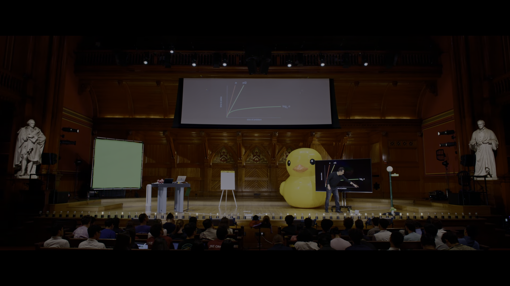

Phân tích toán học trên đồ thị:
1. **Đường thẳng đỏ dốc đứng ($n$):** Thuật toán tìm kiếm tuần tự từng trang một. Khi kích thước dữ liệu tăng từ 1,000 lên 2,000 trang, thời gian tăng gấp đôi.
2. **Đường thẳng cam ($n/2$):** Thuật toán lật 2 trang một lần. Dù nhanh gấp đôi về mặt hệ số thực tế, nhưng độ dốc vẫn là một đường thẳng tuyến tính. Về mặt tiệm cận, độ phức tạp vẫn cùng bậc $O(n)$.
3. **Đường cong xanh lá nằm ngang ($\log_2 n$):** Thuật toán tìm kiếm nhị phân chia để trị. Đường cong này tăng trưởng cực kỳ chậm khi kích thước bài toán bùng nổ.

Bảng so sánh số bước tối đa khi kích thước bài toán tăng:

| Kích thước danh bạ ($n$) | Tìm kiếm tuần tự ($n$) | Tìm kiếm nhị phân ($\approx \log_2 n$) |
| :--- | :--- | :--- |
| **1,000 trang** | 1,000 bước | 10 bước |
| **1,000,000 trang** | 1,000,000 bước | 20 bước |
| **1,000,000,000 trang** | 1,000,000,000 bước | 30 bước |
| **4,000,000,000 người** | 4,000,000,000 bước | 32 bước |

Đây là minh chứng rõ ràng nhất cho thấy: Lựa chọn cấu trúc thuật toán thông minh mang lại bước nhảy vọt về hiệu năng vượt xa việc nâng cấp phần cứng máy tính.

### [[01:04:45](https://youtu.be/UuIEbpQms8o?t=3885s)] Bản thảo mã giả

Để chuyển hóa thuật toán xé danh bạ thành dạng thức mà máy tính hoặc lập trình viên khác có thể thực thi chính xác, David viết ra bản **Mã giả (Pseudocode)** gồm 13 dòng chỉ thị bằng tiếng Anh có cấu trúc rõ ràng.

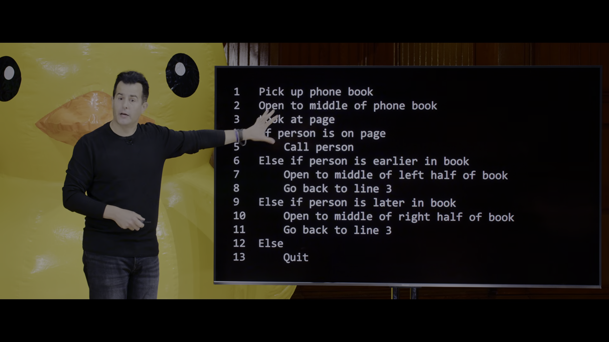

Chi tiết cấu trúc thuật toán:
```text
 1  Pick up phone book
 2  Open to middle of phone book
 3  Look at page
 4  If person is on page
 5      Call person
 6  Else if person is earlier in book
 7      Open to middle of left half of book
 8      Go back to line 3
 9  Else if person is later in book
10      Open to middle of right half of book
11      Go back to line 3
12  Else
13      Quit
```

Phân tích từng chỉ thị:
- **Dòng 1-3:** Khởi tạo trạng thái và thiết lập điểm neo đầu tiên.
- **Dòng 4-5:** Trường hợp cơ sở (Base Case) khi tìm thấy mục tiêu thành công: gọi điện thoại và kết thúc.
- **Dòng 6-8:** Rẽ nhánh điều kiện khi tên mục tiêu nằm ở nửa trước cuốn sách: dời con trỏ đến điểm giữa của nửa bên trái và quay ngược luồng điều khiển về dòng 3 để lặp lại việc kiểm tra trang mới.
- **Dòng 9-11:** Rẽ nhánh điều kiện khi tên mục tiêu nằm ở nửa sau: dời con trỏ đến điểm giữa của nửa bên phải và quay về dòng 3.
- **Dòng 12-13:** Xử lý trường hợp ngoại lệ (Edge Case): Khi cuốn sách đã bị xé nhỏ đến mức không còn trang nào để chia nhưng vẫn không thấy tên, chương trình phải dừng lại một cách duyên dáng (`Quit`), tránh rơi vào tình trạng treo hoặc tìm kiếm vô tận.

### [[01:09:09](https://youtu.be/UuIEbpQms8o?t=4147s)] Khối dựng lập trình

David chỉ ra rằng dù là mã giả tiếng Anh, hay ngôn ngữ trực quan Scratch, hay các ngôn ngữ lập trình chuyên nghiệp như C, Python, JavaScript, Java, mọi chương trình phần mềm trên thế giới đều được xây dựng từ bốn thành phần cốt lõi xuất hiện trong bản mã giả trên:
1. **Hàm (Functions):** Các động từ hoặc hành động thực thi công việc (`Pick up`, `Open to`, `Look at`, `Call`).
2. **Điều kiện (Conditionals):** Các từ khóa quyết định rẽ nhánh luồng chạy dựa trên tình huống (`If`, `Else if`, `Else`).
3. **Biểu thức logic (Boolean Expressions):** Các câu hỏi kiểm tra tính đúng sai đặt sau từ khóa điều kiện (`person is on page`, `person is earlier in book`). Đặt theo tên của nhà toán học George Boole, biểu thức này chỉ có hai kết quả: True hoặc False.
4. **Vòng lặp (Loops):** Chỉ thị quay ngược dòng thời gian thực thi (`Go back to line 3`), cho phép tái sử dụng đoạn mã mà không cần viết lặp lại hàng trăm lần.

### [[01:14:09](https://youtu.be/UuIEbpQms8o?t=4449s)] Bố cục không gian

Khóa học chuyển sang phần thực hành viết mã thực tế thông qua **Scratch** – môi trường lập trình trực quan kéo thả được phát triển bởi nhóm Lifelong Kindergarten tại MIT Media Lab.

Scratch phân tách không gian phát triển thành ba khu vực nghiệp vụ riêng biệt:
1. **Cột trái (Palette):** Chứa các khối lệnh xếp hình được mã hóa bằng màu sắc đặc trưng:
   - Màu xanh dương: Chuyển động (Motion).
   - Màu tím: Ngoại hình và hiển thị (Looks).
   - Màu hồng/tím nhạt: Âm thanh (Sound).
   - Màu vàng: Bắt sự kiện (Events).
   - Màu cam: Điều khiển vòng lặp và rẽ nhánh (Control).
   - Màu xanh lơ: Cảm biến và tương tác chuột/bàn phím (Sensing).
   - Màu xanh lá: Toán tử và phép so sánh logic (Operators).
   - Màu cam đậm: Biến số lưu trữ dữ liệu (Variables).
   - Màu đỏ sẫm: Khối tự tạo (My Blocks).
2. **Khu vực trung tâm (Scripts Area):** Bảng vẽ trống nơi lập trình viên kéo các khối lệnh từ cột trái sang và gắn kết chúng thành các ngăn kịch bản.
3. **Khu vực bên phải (Stage & Sprites):**
   - **Sân khấu (Stage):** Màn hình hiển thị kết quả trực quan theo hệ tọa độ Cartesian 2D, với gốc tọa độ $(0, 0)$ nằm ở chính giữa màn hình. Chiều ngang $x$ từ $-240$ đến $+240$, chiều dọc $y$ từ $-180$ đến $+180$.
   - **Bảng nhân vật (Sprite Pane):** Quản lý các đối tượng đồ họa độc lập (mặc định là chú mèo Scratch). Mỗi nhân vật sở hữu một kịch bản, trang phục (Costumes) và âm thanh riêng.

### [[01:18:15](https://youtu.be/UuIEbpQms8o?t=4695s)] Lời chào thế giới

David tiến hành xây dựng chương trình nhập môn truyền thống của mọi ngôn ngữ lập trình: `"Hello, World"`.

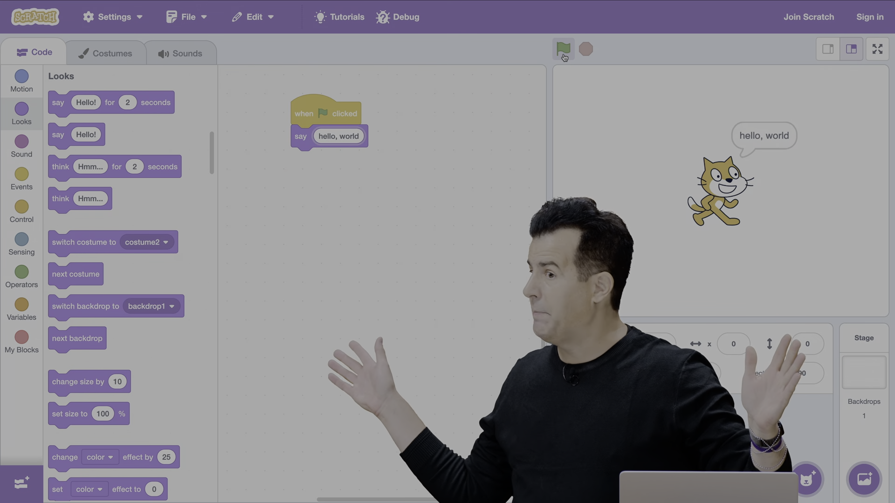

Cấu trúc kịch bản:
```scratch
when [green flag] clicked
say [hello, world]
```

Cơ chế thực thi:
1. Khối sự kiện `when green flag clicked` (màu vàng) đóng vai trò như điểm vào (Entry Point / hàm `main`) của chương trình. Khi người dùng nhấp vào biểu tượng lá cờ xanh phía trên sân khấu, Scratch sẽ kích hoạt toàn bộ các khối gắn liền bên dưới nó.
2. Khối lệnh `say [hello, world]` (màu tím) là một lời gọi hàm (Function Call). Chuỗi văn bản `"hello, world"` đóng vai trò là Đối số (Argument) truyền vào hàm.
3. Khi chạy, nhân vật chú mèo xuất hiện một bong bóng lời thoại dạng truyện tranh hiển thị dòng chữ `"hello, world"`.
4. Bong bóng này là một **Hiệu ứng phụ (Side Effect)** của hàm `say`: nó không trả về dữ liệu số học nào cho chương trình mà tác động trực tiếp lên giao diện người dùng.

### [[01:21:21](https://youtu.be/UuIEbpQms8o?t=4881s)] Khối nhận dữ liệu

Một chương trình chỉ nói `"hello, world"` là một chương trình tĩnh và thụ động. Để chương trình có tính tương tác thực sự, nó cần tiếp nhận Dữ liệu đầu vào (Input) từ người dùng đang ngồi trước bàn phím.

David mở mục Cảm biến (Sensing) và chọn khối lệnh:
```scratch
ask [What's your name?] and wait
```

Cơ chế hoạt động của khối `ask`:
- Nó hiển thị câu hỏi `"What's your name?"` trên sân khấu kèm theo một hộp nhập văn bản (Text Input Box) ở cạnh dưới màn hình.
- Từ khóa `and wait` tạm dừng toàn bộ luồng thực thi của kịch bản hiện tại cho đến khi người dùng gõ văn bản và bấm phím Enter hoặc nhấp dấu tích xanh.
- Toàn bộ chuỗi ký tự người dùng vừa nhập được tự động ghi đè vào một biến hệ thống tích hợp sẵn có tên là `answer`.

### [[01:25:01](https://youtu.be/UuIEbpQms8o?t=5101s)] Nối ghép chuỗi chữ

Làm thế nào để chú mèo nói lời chào cá nhân hóa kèm theo tên người dùng (ví dụ người dùng nhập `"David"` thì chú mèo nói `"hello, David"`)?

Nếu chỉ kéo khối `say [answer]`, chú mèo chỉ nói độc mỗi tên `"David"`. Nếu kéo khối `say [hello, answer]`, chú mèo sẽ nói nguyên văn chuỗi ký tự `"hello, answer"`.

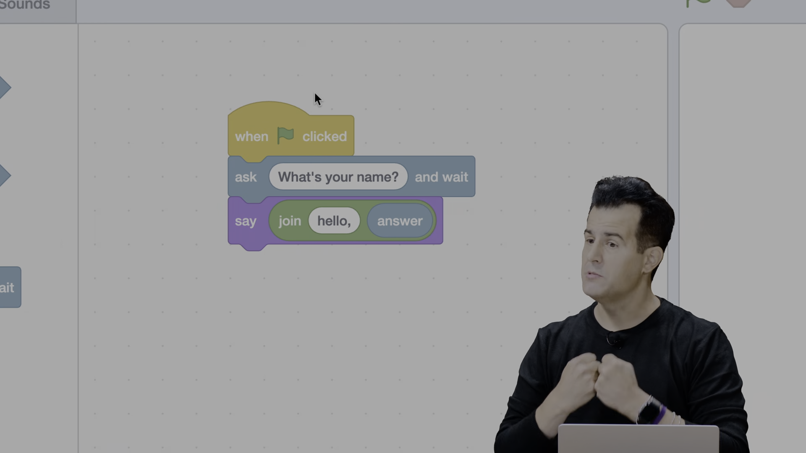

Giải pháp là kết hợp với khối toán tử **Ghép chuỗi (String Concatenation)**:
```scratch
when [green flag] clicked
ask [What's your name?] and wait
say (join [hello, ] (answer))
```

Phân tích luồng dữ liệu lồng nhau (Nesting / Composition):
- Khối `join` (màu xanh lá) là một hàm nhận vào hai đối số chuỗi và trả về một chuỗi kết hợp duy nhất.
- Đối số thứ nhất: Hằng chuỗi `"hello, "` (chú ý có dấu cách ở cuối để tránh dính chữ).
- Đối số thứ hai: Biến `answer` chứa tên người dùng nhập từ bàn phím.
- Giá trị trả về (Return Value) của hàm `join` trở thành đối số đầu vào cho khối hàm `say`.
- Đây chính là nguyên lý cấu thành hàm (Function Composition) căn bản trong toán học và khoa học máy tính: $f(g(x))$.

### [[01:30:20](https://youtu.be/UuIEbpQms8o?t=5420s)] Khối lặp cố định

David chuyển sang bài toán âm thanh: Làm thế nào để chú mèo kêu tiếng `"meow"` ba lần liên tiếp?

Cách viết ngây thơ ban đầu là xếp chồng các khối lệnh giống hệt nhau:
```scratch
when [green flag] clicked
start sound [Meow v]
wait [1] seconds
start sound [Meow v]
wait [1] seconds
start sound [Meow v]
wait [1] seconds
```

Cách tiếp cận này vi phạm nguyên tắc vàng của kỹ thuật phần mềm: **DRY (Don't Repeat Yourself - Đừng lặp lại chính mình)**. Nếu muốn chú mèo kêu 100 lần, lập trình viên sẽ phải kéo thả 200 khối lệnh thủ công, khiến mã nguồn dài dòng, khó đọc và cực kỳ dễ sinh lỗi.

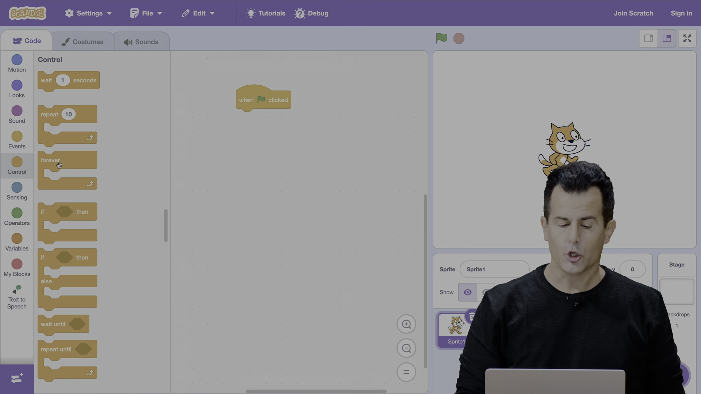

Giải pháp là sử dụng cấu trúc **Vòng lặp (Loop)** từ nhóm Control:
```scratch
when [green flag] clicked
repeat (3)
    start sound [Meow v]
    wait (1) seconds
```

Khối `repeat (3)` có hình dạng chữ C bao bọc lấy các khối lệnh bên trong:
- Biến đếm nội tại được khởi tạo bằng 0.
- Các lệnh trong thân vòng lặp được thực thi tuần tự: phát âm thanh và tạm dừng 1 giây.
- Sau mỗi lần chạy hết thân vòng lặp, biến đếm tăng thêm 1.
- Quá trình lặp dừng lại chính xác khi biến đếm đạt giá trị 3, luồng thực thi thoát ra khỏi khối C và đi tiếp xuống dưới.

### [[01:33:51](https://youtu.be/UuIEbpQms8o?t=5631s)] Khối tự định nghĩa

Mặc dù khối `repeat (3)` đã rút gọn mã, nhưng nếu trong một dự án trò chơi phức tạp, chú mèo cần kêu meow ở 10 tình huống khác nhau (khi bị nhấp chuột, khi chạm vào đồ ăn, khi hết giờ...), lập trình viên vẫn phải sao chép khối `repeat` đó đi khắp nơi.

Để giải quyết vấn đề này, David giới thiệu nguyên lý **Trừu tượng hóa (Abstraction)** thông qua tính năng `Make a Block` (Tạo khối mới) trong mục My Blocks.

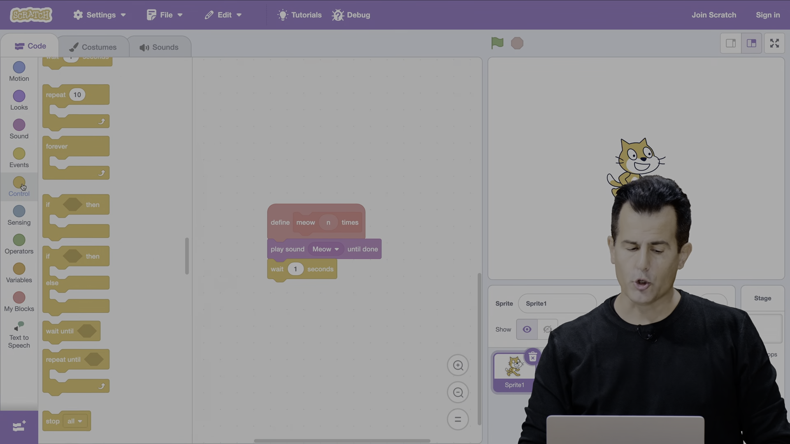

Quy trình thiết kế khối trừu tượng:
1. Định nghĩa khối hàm mới có tên là `meow` kèm một Tham số đầu vào (Parameter) kiểu số đặt tên là `n`:
```scratch
define meow (n)
repeat (n)
    start sound [Meow v]
    wait (1) seconds
```
2. Sử dụng khối hàm đã định nghĩa ở bất kỳ đâu trong chương trình chính:
```scratch
when [green flag] clicked
meow (3)
```

Ý nghĩa kỹ thuật:
- Khối `define` đóng vai trò là **Định nghĩa hàm (Function Definition)**, ẩn giấu toàn bộ chi tiết cài đặt lặp và chờ âm thanh phức tạp vào một góc riêng.
- Khối `meow (3)` là **Lời gọi hàm (Function Call)**, truyền giá trị `3` vào làm đối số cho tham số `n`.
- Nếu sau này lập trình viên muốn đổi tiếng mèo kêu từ 1 giây thành 0.5 giây, họ chỉ cần sửa duy nhất 1 dòng trong khối `define`, toàn bộ các vị trí gọi `meow` trong dự án sẽ tự động cập nhật theo.

### [[01:37:55](https://youtu.be/UuIEbpQms8o?t=5875s)] Khối bắt sự kiện

David chuyển sang minh họa cấu trúc **Điều kiện rẽ nhánh (Conditionals)**: Chú mèo chỉ được phép kêu khi con trỏ chuột chạm vào người nó.

David cố tình viết một đoạn mã sai thường gặp của người mới học:
```scratch
when [green flag] clicked
if <touching [mouse-pointer v]?> then
    start sound [Meow v]
```
Khi nhấp cờ xanh, chú mèo hoàn toàn im lặng dù người dùng di chuột chạm vào nó ngay sau đó. Lý do: Khối `if` chỉ được kiểm tra đúng duy nhất một phần triệu giây ngay tại thời điểm cờ xanh vừa được bấm. Khi đó chuột đang nằm ở vị trí cờ xanh, điều kiện là `False`, và chương trình kết thúc ngay lập tức.

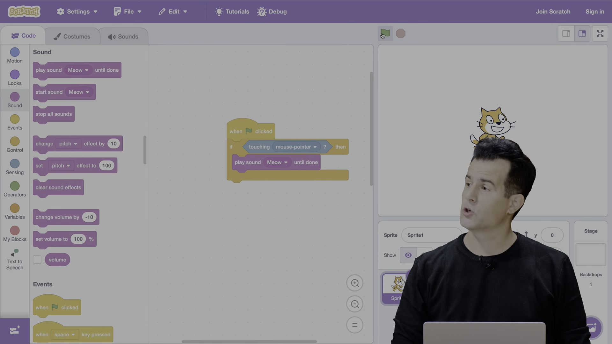

Để kiểm tra điều kiện liên tục trong suốt vòng đời của ứng dụng, lập trình viên phải lồng khối điều kiện bên trong một **Vòng lặp vô tận (Infinite Loop / Game Loop)**:
```scratch
when [green flag] clicked
forever
    if <touching [mouse-pointer v]?> then
        say [Meow!]
```

Vòng lặp `forever` giữ cho luồng kiểm tra chạy liên tục ở tần số làm tươi khung hình của Scratch (khoảng 30-60 lần/giây). Bất cứ tích tắc nào con trỏ chuột lướt qua nhân vật, biểu thức boolean `<touching [mouse-pointer]?>` lập tức chuyển thành `True`, kích hoạt khối lệnh `say [Meow!]`.

### [[01:40:05](https://youtu.be/UuIEbpQms8o?t=6005s)] Khởi tạo giao diện

David giới thiệu dự án trò chơi hoàn chỉnh đầu tiên mang tên **Oscartime** – dựa trên nhân vật rối Oscar the Grouch sống trong thùng rác trong chương trình Sesame Street.

Mục tiêu trò chơi: Các mẩu rác rơi ngẫu nhiên từ trên đỉnh màn hình xuống. Người chơi dùng chuột kéo thả các mẩu rác ném vào thùng rác của Oscar trước khi bài hát của Oscar kết thúc. Mỗi lần vứt rác trúng thùng, người chơi được cộng điểm.

Dự án gồm các thành phần đồ họa (Sprites):
- Nhân vật thùng rác `Oscar` nằm cố định cạnh cột đèn đường bên trái.
- Nhân vật mẩu rác `Trash` (tờ báo cũ hoặc mẩu giấy vụn) rơi tự do từ trên trời.
- Biến toàn cục `score` (điểm số) hiển thị ở góc trên sân khấu.

### [[01:44:31](https://youtu.be/UuIEbpQms8o?t=6250s)] Kéo thả vật thể

Để cho phép người chơi dùng chuột nhấp và kéo mẩu rác di chuyển tự do trên màn hình, Scratch cung cấp khối cấu hình chế độ kéo thả `set drag mode [draggable]`.

Đồng thời, mẩu rác cần có hành vi vật lý tự rơi xuống đáy màn hình:
```scratch
when [green flag] clicked
set drag mode [draggable v]
go to x: (pick random (-240) to (240)) y: (180)
forever
    change y by (-1)
```

Phân tích toán học tọa độ:
- Đỉnh màn hình có tọa độ $y = 180$.
- Hàm `pick random (-240) to (240)` chọn ngẫu nhiên một vị trí hoành độ $x$ trên toàn bộ chiều rộng màn hình.
- Vòng lặp `forever` liên tục giảm tọa độ $y$ đi 1 đơn vị sau mỗi chu kỳ (`change y by (-1)`), tạo ra hiệu ứng vật lý rơi với vận tốc đều từ trên xuống dưới.

### [[01:47:01](https://youtu.be/UuIEbpQms8o?t=6420s)] Cơ chế tính điểm

Làm thế nào để hệ thống biết mẩu rác đã được ném trúng vào thùng rác Oscar để cộng điểm và tái tạo mẩu rác mới?

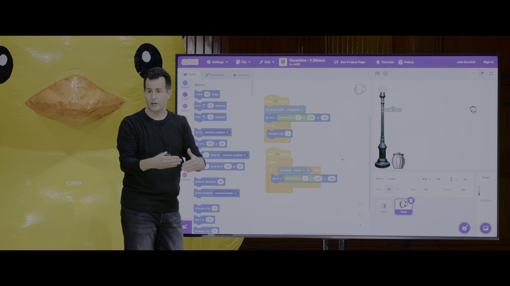

David thiết kế kịch bản xử lý va chạm độc lập (Collision Detection) trên nhân vật mẩu rác `Trash`:
```scratch
when [green flag] clicked
forever
    if <touching [Oscar v]?> then
        change [score v] by (1)
        go to x: (pick random (-240) to (240)) y: (180)
```

Cơ chế vận hành song song (Concurrency in Scratch):
- Trong cùng một nhân vật `Trash`, có hai ngăn kịch bản `when green flag clicked` chạy song song và độc lập với nhau.
- Ngăn thứ nhất chuyên trách việc điều khiển chuyển động rơi tự do theo trục $y$.
- Ngăn thứ hai chuyên trách việc giám sát va chạm với đối tượng `Oscar`.
- Khi điều kiện `<touching [Oscar]?>` thỏa mãn:
  1. Biến `score` tăng thêm 1 đơn vị.
  2. Mẩu rác được tái định vị (Teleport / Reset) ngay lập tức về một tọa độ ngẫu nhiên trên đỉnh màn hình ($y = 180$) để tiếp tục chu kỳ rơi mới.

### [[01:51:59](https://youtu.be/UuIEbpQms8o?t=6719s)] Điều khiển chuyển động

David trình chiếu dự án trò chơi phức tạp thứ hai mang tên **Ivy's Hardest Game** (mô phỏng trò chơi nổi tiếng *The World's Hardest Game*).

Trong trò chơi này, nhân vật người chơi là huy hiệu đại học Harvard (Harvard Crest) hình chiếc khiên đỏ. Nhiệm vụ của người chơi là dùng 4 phím mũi tên trên bàn phím điều khiển chiếc khiên đi qua một hành lang hẹp giữa hai bức tường di động thẳng đứng mà không được phép chạm vào tường.

Kịch bản điều khiển bàn phím được đóng gói gọn gàng thành một khối tự tạo:
```scratch
define listen for keyboard
if <key [up arrow v] pressed?> then
    change y by (1)
if <key [down arrow v] pressed?> then
    change y by (-1)
if <key [right arrow v] pressed?> then
    change x by (1)
if <key [left arrow v] pressed?> then
    change x by (-1)
```

Việc tách biệt hành vi lắng nghe bàn phím thành hàm `listen for keyboard` giúp chương trình chính có thể gọi hàm này liên tục bên trong vòng lặp game mà không làm rác kịch bản chính.

### [[01:56:01](https://youtu.be/UuIEbpQms8o?t=6850s)] Cảm biến va chạm

Thách thức kỹ thuật lớn nhất trong trò chơi này là: Làm thế nào để nhân vật khiên không bị xuyên qua hai bức tường thẳng đứng?

Nếu chỉ kiểm tra điều kiện chung `<touching [wall]?>` rồi đổi hướng, nhân vật rất dễ bị kẹt cứng bên trong tường ( hiện tượng dính hitbox). David trình bày giải pháp kỹ thuật phần mềm mẫu mực: **Kỹ thuật râu cảm biến (Feelers / Bounding Box Check)**.

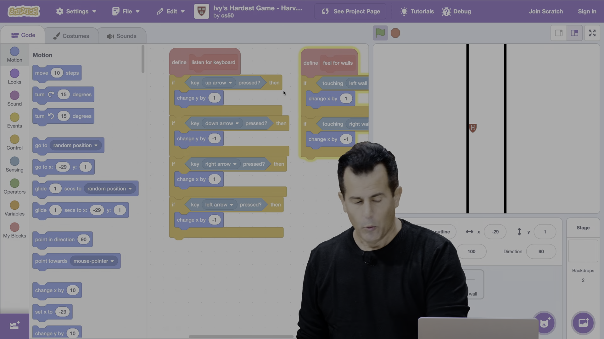

Chi tiết cài đặt khối `feel for walls`:
```scratch
define feel for walls
if <touching [left wall v]?> then
    change x by (1)
if <touching [right wall v]?> then
    change x by (-1)
```

Nguyên lý triệt tiêu lực đẩy vật lý:
- Nếu nhân vật di chuyển sang trái và mép trái của khiên vừa chạm vào `left wall`: Khối `feel for walls` lập tức phản hồi bằng cách đẩy nhân vật dịch chuyển ngược lại sang phải 1 đơn vị (`change x by (1)`), triệt tiêu chính xác bước di chuyển sang trái trước đó.
- Nếu nhân vật chạm vào `right wall`: Khối lệnh đẩy nhân vật lùi sang trái 1 đơn vị (`change x by (-1)`).
- Kết quả: Nhân vật tạo cảm giác va chạm cơ học hoàn hảo, bị chặn đứng ngay tại bề mặt bức tường mà không bao giờ bị lún sâu hay xuyên thấu qua vật thể.

Đây là minh chứng đỉnh cao cho thấy: Các khái niệm phần mềm trừu tượng (hàm, biến, điều kiện, tọa độ không gian) có thể kết hợp nhịp nhàng để giải quyết những bài toán tương tác vật lý phức tạp.

---

## Trích dẫn then chốt

* [[00:02:40](https://youtu.be/UuIEbpQms8o?t=160s)] *"Artificial intelligence is seemingly everywhere over the past few years, and it's been said that it's going to change programming. That's absolutely the case... But what's going to matter most is not just being able to prompt an AI, but understanding the foundations of computer science so you can guide it, verify it, and build on top of it."*
* [[00:14:15](https://youtu.be/UuIEbpQms8o?t=855s)] *"Computer science is really just the study of information. How do you represent it, and how do you process it to solve problems?"*
* [[00:36:20](https://youtu.be/UuIEbpQms8o?t=2180s)] *"At the end of the day, all the computer understands is zeros and ones. Everything else—numbers, letters, colors, sounds, videos—is just human conventions and abstractions layered on top."*
* [[01:03:15](https://youtu.be/UuIEbpQms8o?t=3795s)] *"With binary search, every time you double the size of the problem, you only add one more step. That's the power of logarithmic algorithms."*
* [[01:34:10](https://youtu.be/UuIEbpQms8o?t=5650s)] *"Abstraction is about taking something complex and giving it a simple name so you can use it again and again without worrying about how it works underneath."*

---

## Lệnh & Công cụ

### Chuyển đổi nhị phân

Công thức chuyển đổi một chuỗi nhị phân $n$-bit sang giá trị số thập phân:

$$\text{Decimal} = \sum_{i=0}^{n-1} b_i \times 2^i$$

Bảng tra cứu trọng số nhị phân chuẩn của 1 Byte (8 bit):

| Vị trí bit | $b_7$ | $b_6$ | $b_5$ | $b_4$ | $b_3$ | $b_2$ | $b_1$ | $b_0$ |
| :--- | :---: | :---: | :---: | :---: | :---: | :---: | :---: | :---: |
| **Lũy thừa** | $2^7$ | $2^6$ | $2^5$ | $2^4$ | $2^3$ | $2^2$ | $2^1$ | $2^0$ |
| **Trọng số** | **128** | **64** | **32** | **16** | **8** | **4** | **2** | **1** |

Ví dụ tính toán giá trị nhị phân `01001101`:

$$\text{Decimal} = 0(128) + 1(64) + 0(32) + 0(16) + 1(8) + 1(4) + 0(2) + 1(1) = 64 + 8 + 4 + 1 = 77$$

### Bảng mã ASCII

Quy tắc ghi nhớ nhanh các mốc mã ASCII thông dụng:
- `'0'` đến `'9'`: Giá trị $48$ đến $57$.
- `'A'` đến `'Z'`: Giá trị $65$ đến $90$.
- `'a'` đến `'z'`: Giá trị $97$ đến $122$.
- Dấu cách (Space): Giá trị $32$.
- Quy tắc chuyển chữ hoa sang chữ thường: Cộng thêm $32$ vào mã thập phân (tương đương với việc bật bit thứ 5: $b_5 = 1$).

### Tính toán dung lượng ảnh

Công thức tính dung lượng dữ liệu thô (chưa nén) của một hình ảnh kỹ thuật số hệ màu RGB 24-bit:

$$\text{Dung lượng (Bytes)} = \text{Chiều rộng (Pixels)} \times \text{Chiều cao (Pixels)} \times 3\ \text{bytes}$$

Ví dụ ảnh Full HD ($1920 \times 1080$):

$$\text{Dung lượng} = 1920 \times 1080 \times 3 = 6,220,800\ \text{bytes} \approx 5.93\ \text{MiB}$$

### Số bước tìm kiếm nhị phân

Công thức tính số bước tối đa để tìm kiếm một phần tử trong mảng đã sắp xếp có $n$ phần tử:

$$\text{Số bước tối đa} = \lfloor \log_2(n) \rfloor + 1$$

---

## Đánh đổi & Rủi ro

### Dung lượng bộ nhớ

* **Đánh đổi giữa ASCII và Unicode:**
  - *ASCII (1 byte/ký tự):* Tiết kiệm 50% đến 75% băng thông và dung lượng lưu trữ, xử lý mảng ký tự cực kỳ nhanh chóng do mỗi ký tự có độ dài cố định. Tuy nhiên, nó hoàn toàn bất lực trong việc hiển thị các ngôn ngữ quốc tế và biểu tượng đa văn hóa.
  - *Unicode (UTF-8 / UTF-16 / UTF-32, 1 đến 4 bytes/ký tự):* Bao phủ toàn bộ ngôn ngữ thế giới, nhưng kích thước dữ liệu văn bản phình to từ 2 đến 4 lần. Các chuỗi ký tự có độ dài biến thiên (Variable-length encoding), khiến thao tác nhảy đến ký tự thứ $k$ không còn là phép tính số học tức thời $O(1)$ mà đòi hỏi phải duyệt chuỗi từ đầu.

### Chi phí sắp xếp

* **Đánh đổi giữa Tìm kiếm tuần tự và Tìm kiếm nhị phân:**
  - *Tìm kiếm tuần tự $O(n)$:* Hoạt động tốt trên mọi loại dữ liệu thô chưa được sắp xếp. Thích hợp cho các tập dữ liệu nhỏ hoặc dữ liệu chỉ truy vấn một lần duy nhất.
  - *Tìm kiếm nhị phân $O(\log n)$:* Tốc độ truy vấn siêu tốc, nhưng bắt buộc dữ liệu phải được sắp xếp theo thứ tự từ trước. Chi phí sắp xếp dữ liệu (như QuickSort hoặc MergeSort) tốn tài nguyên ở mức $O(n \log n)$. Do đó, nếu dữ liệu liên tục bị chèn/xóa mới hoặc chỉ tìm kiếm một vài lần, chi phí sắp xếp ban đầu sẽ lớn hơn nhiều so với việc quét tuần tự.

### Nguy cơ tràn số

* **Rủi ro tràn số nguyên (Integer Overflow):**
  - Khi một giá trị số học vượt quá giới hạn biểu diễn của số bit được cấp phát, bit cao nhất bị tràn ra ngoài và giá trị bị lật ngược về cận dưới (ví dụ số có dấu 8-bit từ $+127$ nhảy vọt sang $-128$).
  - Trong lịch sử hàng không vũ trụ và tài chính, các sự cố tràn số từ 64-bit sang 16-bit hoặc 32-bit từng làm phá hủy tên lửa Ariane 5 và gây lỗi nghiêm trọng cho các hệ thống phần mềm nhúng.

### Bẫy vòng lặp vô tận

* **Rủi ro vòng lặp không điểm dừng:**
  - Trong mã giả hoặc mã nguồn thực tế, nếu các điều kiện rẽ nhánh không bao quát hết các trường hợp ngoại lệ hoặc chỉ thị quay lại (`Go back to line 3`) thiếu điều kiện dừng, chương trình sẽ rơi vào vòng lặp vô tận (Infinite Loop), chiếm dụng 100% tài nguyên CPU và làm treo hệ thống.
  - Mã giả bắt buộc phải có nhánh `Else -> Quit` để xử lý tình huống dữ liệu mục tiêu không tồn tại.

### Va chạm vật lý trò chơi

* **Hiện tượng lún và kẹt Hitbox:**
  - Trong lập trình trò chơi chuyển động bước rời rạc, nếu tốc độ di chuyển lớn hơn độ dày của vật cản, nhân vật có thể bị nhảy cóc xuyên qua tường ( hiện tượng Tunneling).
  - Sử dụng cảm biến va chạm đơn giản có thể khiến đối tượng bị dính chặt vào tường khi điều kiện va chạm liên tục trả về `True`. Giải pháp dùng các râu cảm biến tách biệt đa hướng (`feel for walls`) kết hợp triệt tiêu vận tốc ngược chiều là kỹ thuật bắt buộc để đảm bảo tính ổn định của mô phỏng vật lý.
