# CS50x - Lecture 0 - Scratch

* **Kênh:** CS50 | **Thời lượng:** 02:00:53 | **Ngày:** 2026-01-01
* **Video:** https://youtu.be/UuIEbpQms8o

---

## Thuật ngữ

| Thuật ngữ | Tiếng Anh | Giải thích |
| :--- | :--- | :--- |
| Bit | Binary Digit | Đơn vị thông tin cơ bản nhất trong điện toán, chỉ nhận một trong hai trạng thái giá trị là 0 hoặc 1. |
| Byte | Byte | Nhóm gồm 8 bit liền kề, đại diện cho 256 giá trị phân biệt (từ 0 đến 255). |
| Hệ nhị phân | Binary System (Base 2) | Hệ đếm cơ số 2 sử dụng các lũy thừa của 2 để định lượng giá trị thông qua hai ký hiệu 0 và 1. |
| Bảng mã ASCII | American Standard Code for Information Interchange | Chuẩn mã hóa ký tự gồm 7-bit hoặc 8-bit gán các số nguyên từ 0 đến 127 (hoặc 255) cho ký tự chữ cái, số và dấu câu. |
| Chuẩn Unicode | Universal Coded Character Set | Chuẩn công nghiệp quốc tế mở rộng mã hóa văn bản, hỗ trợ hàng triệu ký tự, biểu tượng và chữ viết toàn cầu bằng 16 đến 32 bit. |
| Điểm ảnh RGB | Red Green Blue Pixel | Mô hình màu cộng sử dụng 3 kênh màu (đỏ, xanh lục, xanh lam), mỗi kênh chiếm 1 byte (0-255) để tạo ra 16,7 triệu màu. |
| Thuật toán | Algorithm | Tập hợp hữu hạn các chỉ thị từng bước rõ ràng, chính xác nhằm giải quyết một bài toán cụ thể từ dữ liệu đầu vào thành kết quả đầu ra. |
| Mã giả | Pseudocode | Bản mô tả thuật toán bằng ngôn ngữ tự nhiên có cấu trúc, gần với mã lập trình nhưng độc lập với cú pháp của ngôn ngữ cụ thể. |
| Tìm kiếm nhị phân | Binary Search | Thuật toán tìm kiếm chia đôi trên tập dữ liệu đã sắp xếp, đạt độ phức tạp thời gian O(log n). |
| Trừu tượng hóa | Abstraction | Quá trình ẩn đi chi tiết cài đặt tầng thấp để cung cấp giao diện đơn giản, tổng quát hơn ở tầng cao. |
| Biến số | Variable | Ô nhớ được đặt tên dùng để lưu trữ dữ liệu có thể thay đổi trong quá trình thực thi chương trình. |
| Biểu thức logic | Boolean Expression | Biểu thức điều kiện chỉ trả về một trong hai giá trị chân lý: True hoặc False. |
| Giao diện lập trình | Application Programming Interface (API) | Tập hợp các quy ước và cơ chế cho phép các thành phần phần mềm giao tiếp và trao đổi dữ liệu với nhau. |
| Lời nhắc hệ thống | System Prompt | Tập chỉ thị nền tảng cung cấp cho mô hình ngôn ngữ lớn nhằm định hình phong cách, vai trò và giới hạn phản hồi. |

---

## Tổng luận chuyên đề

### Biểu diễn thông tin

Mọi dữ liệu số hóa trong máy tính đều quy về trạng thái vật lý bật/tắt (on/off) của bóng bán dẫn (transistor), tương đương với điện áp cao và thấp. Máy tính biểu diễn thông tin đa tầng dựa trên nguyên lý cơ số 2:
1. **Dữ liệu số:** Từng cột nhị phân biểu diễn trọng số lũy thừa của 2 ($2^0, 2^1, 2^2, 2^3...$). Một byte (8 bit) biểu diễn dải giá trị từ 0 ($00000000_2$) đến 255 ($11111111_2$).
2. **Ký tự và văn bản:** Gán ánh xạ số nguyên sang ký tự. Bảng mã ASCII sử dụng 1 byte gán cho các chữ cái tiếng Anh (chữ cái viết hoa 'A' là 65, chữ thường 'a' là 97, chênh lệch cố định đúng 32 đơn vị tức 1 bit tại vị trí $2^5$). Chuẩn Unicode mở rộng kích thước lên tới 32 bit để biểu diễn mọi ngôn ngữ nhân loại và biểu tượng cảm xúc.
3. **Hình ảnh và âm thanh:** Hình ảnh cấu thành từ lưới điểm ảnh (pixel). Mỗi điểm ảnh dùng mô hình RGB gồm 3 byte (1 byte Red, 1 byte Green, 1 byte Blue), tạo nên hơn 16,7 triệu tổ hợp màu sắc. Âm thanh và video là chuỗi điểm ảnh và mẫu biên độ sóng âm đo đạc theo trục thời gian.

### Thuật toán tìm kiếm

Bản chất của khoa học máy tính là giải quyết bài toán thông qua mô hình: Đầu vào (Input) -> Hộp đen xử lý (Thuật toán) -> Đầu ra (Output). Hiệu quả thuật toán được đo lường bằng số lượng thao tác cần thiết so với quy mô dữ liệu $n$:
- **Tìm kiếm tuần tự (Linear Search):** Lật từng trang sách từ đầu đến cuối. Số phép tính tỉ lệ thuận tuyến tính $O(n)$. Nếu kích thước dữ liệu tăng từ 1.000 lên 2.000, số bước tối đa tăng gấp đôi từ 1.000 lên 2.000.
- **Tìm kiếm nhị phân (Binary Search):** Mở vào chính giữa, so sánh và loại bỏ ngay lập tức 50% khối lượng dữ liệu thừa ở mỗi bước (chia để trị). Số phép tính tăng theo quy mô hàm logarit $O(\log_2 n)$. Với danh bạ 1.000 trang chỉ tốn tối đa 10 thao tác; khi tăng quy mô lên 2.000 trang, thuật toán chỉ tốn thêm đúng 1 thao tác duy nhất (11 bước).

### Trừu tượng hóa lệnh

Lập trình viên không thao tác thủ công ở mức điện áp hay dãy bit nhị phân mà làm việc trên các tầng trừu tượng tăng dần:
- Tầng vật lý: Transistor đóng/ngắt mạch điện.
- Tầng biểu diễn: Bit, Byte, số nguyên, bảng mã ký tự, mã màu.
- Tầng điều khiển: Hàm (Functions), biến (Variables), điều kiện (Conditionals), vòng lặp (Loops).
- Tầng giao tiếp: Lời gọi API, SDK, tích hợp mô hình trí tuệ nhân tạo.

### Lập trình khối

Ngôn ngữ Scratch trực quan hóa các khái niệm cốt lõi của khoa học máy tính thông qua các khối lệnh ghép hình học (puzzle blocks):
- **Khối sự kiện (Events):** Điểm khởi kích hoạt luồng điều khiển (ví dụ cờ xanh, nhận thông điệp phát sóng).
- **Khối hàm và tham số (Functions & Arguments):** Khối thực thi hành động nhận dữ liệu đầu vào qua các ô trắng hình elip.
- **Khối điều khiển (Control):** Khối rẽ nhánh kiểm tra chân lý logic (`if`, `if-else`) và khối lặp lặp lại hữu hạn (`repeat n`) hoặc lặp vô tận (`forever`).
- **Khối cảm biến và biến số (Sensing & Variables):** Nhận dữ liệu đầu vào từ người dùng hoặc trạng thái môi trường và lưu trữ giá trị vào bộ nhớ.
- **Khối tùy biến (Custom Blocks):** Cho phép đóng gói một chuỗi thao tác lặp lại thành một hàm trừu tượng có tên và tham số riêng.

---

## Bóc tách chi tiết

### Trí tuệ nhân tạo

Mở đầu bài giảng, David Malan minh họa sự chuyển dịch của lập trình hiện đại: trí tuệ nhân tạo không thay thế tư duy nền tảng mà đóng vai trò trợ lý đồng hành (co-pilot), giúp giải phóng lập trình viên khỏi nút thắt cổ chai về thời gian và triển khai tính năng nhanh chóng.

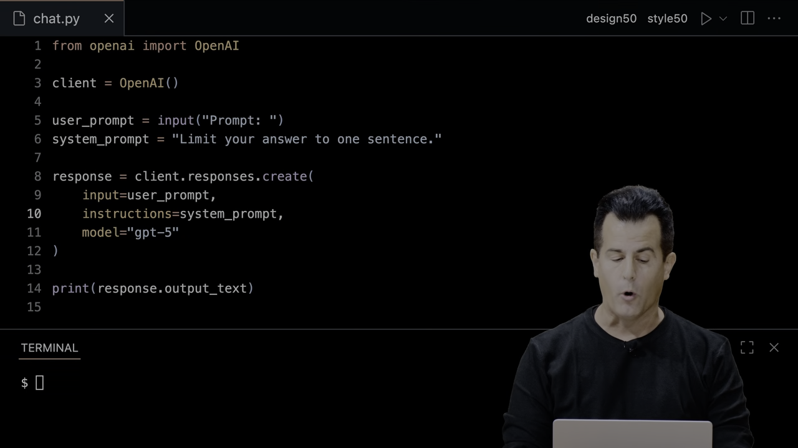

* **Thời điểm:** [11:15](https://youtu.be/UuIEbpQms8o?t=675s)
* **Phân tích kỹ thuật:**
  * Minh họa mã nguồn Python ngắn gọn (dưới 10 dòng lệnh) gọi thư viện `openai` để khởi tạo client giao tiếp API với mô hình ngôn ngữ lớn (LLM).
  * Khái niệm **User Prompt**: Biến số lưu chuỗi ký tự nhập trực tiếp từ người dùng thông qua hàm `input()`.
  * Khái niệm **System Prompt**: Chỉ thị định hình hành vi hệ thống được gắn kèm vào yêu cầu API (ví dụ: giới hạn câu trả lời trong đúng một câu ngắn hoặc giả lập nhân vật cụ thể).
  * Vai trò của lập trình viên: Dù có AI hỗ trợ sinh mã, lập trình viên vẫn là người làm chủ kiến trúc, điều khiển đầu vào và thẩm định tính đúng đắn của dữ liệu đầu ra.

### Khoa học máy tính

Khoa học máy tính không đơn thuần là việc học cú pháp của một ngôn ngữ lập trình cụ thể, mà là môn khoa học nghiên cứu về việc biểu diễn thông tin và tư duy tính toán (computational thinking) nhằm giải quyết bài toán thực tế.

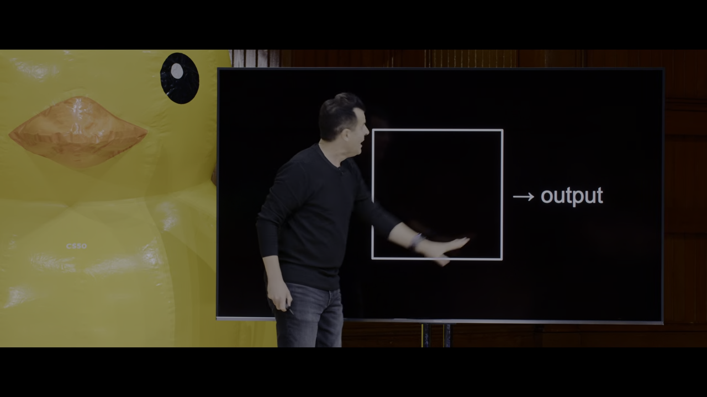

* **Thời điểm:** [15:05](https://youtu.be/UuIEbpQms8o?t=905s)
* **Phân tích kỹ thuật:**
  * **Đầu vào (Input):** Bài toán cần xử lý, được chuẩn hóa thành dạng dữ liệu số mà máy tính hiểu được.
  * **Hộp đen (Black Box):** Thuật toán xử lý hoặc chương trình máy tính tiếp nhận đầu vào, thực hiện các chỉ thị tuần tự, logic và rẽ nhánh.
  * **Đầu ra (Output):** Kết quả mong muốn hoặc giải pháp của bài toán ban đầu.
  * Mọi thiết bị tính toán từ máy chủ, máy tính xách tay đến điện thoại di động đều hoạt động dựa trên cơ chế chuẩn hóa dữ liệu đầu vào và đầu ra này.

### Hệ đếm nhị phân

Máy tính vận hành bằng dòng điện vật lý. Do đó, việc phân biệt hai trạng thái đóng/ngắt mạch (có điện hoặc không có điện) đơn giản và tin cậy hơn rất nhiều so với việc phân biệt 10 mức điện áp khác nhau của hệ thập phân.

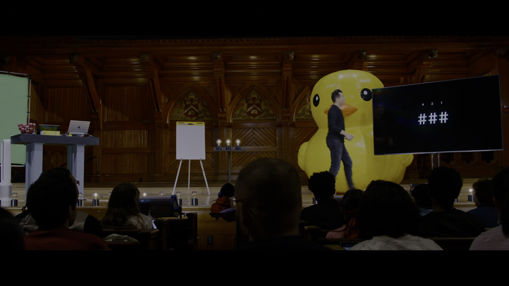

* **Thời điểm:** [24:30](https://youtu.be/UuIEbpQms8o?t=1470s)
* **Phân tích kỹ thuật:**
  * Minh họa vật lý bằng các bóng đèn đại diện cho các bit: Bóng đèn tắt = bit 0, bóng đèn sáng = bit 1.
  * Hệ cơ số 2 gán trọng số theo lũy thừa:
    $$\text{Giá trị} = (b_2 \times 2^2) + (b_1 \times 2^1) + (b_0 \times 2^0) = (b_2 \times 4) + (b_1 \times 2) + (b_0 \times 1)$$
  * Với 3 bóng đèn đều bật ($111_2$):
    $$4 \times 1 + 2 \times 1 + 1 \times 1 = 7$$
  * Hiện tượng tràn số (Overflow): Khi cần biểu diễn số 8, hệ thống bắt buộc phải bổ sung thêm bóng đèn/bit thứ tư ($1000_2$). Nếu phần cứng chỉ giới hạn đúng 3 bit, giá trị tiếp theo sau 7 sẽ bị tràn bộ nhớ và quay ngược trở lại 0 ($000_2$).

### Mã hóa ký tự

Để biểu diễn văn bản, các kỹ sư quy ước một bảng tra cứu chuẩn hóa gán từng ký tự chữ cái vào một số nguyên xác định. Chuẩn ASCII sử dụng 1 byte (ban đầu là 7 bit) để biểu diễn các ký tự cơ bản trong tiếng Anh.

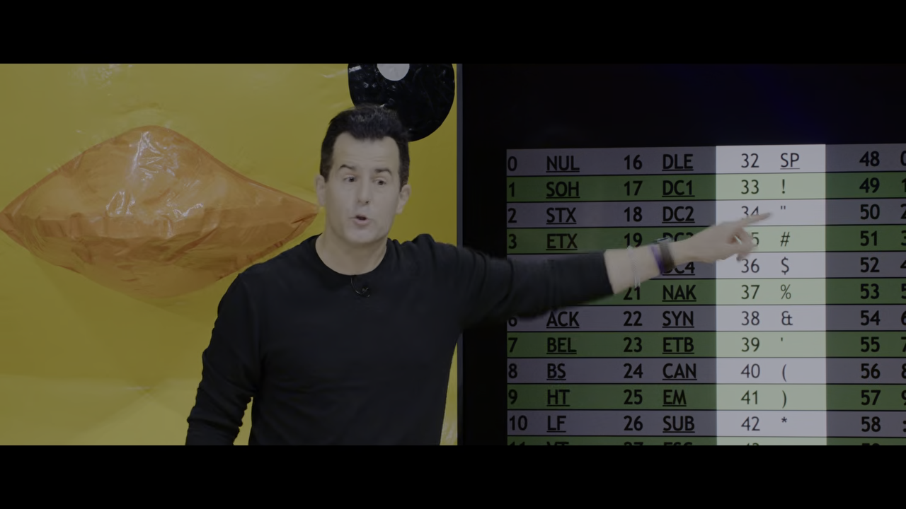

* **Thời điểm:** [34:30](https://youtu.be/UuIEbpQms8o?t=2070s)
* **Phân tích kỹ thuật:**
  * Chuỗi 3 byte nhị phân truyền nhận qua mạng:
    * Byte 1: $01001000_2 = 64 + 8 = 72 \rightarrow \text{'H'}$
    * Byte 2: $01001001_2 = 64 + 8 + 1 = 73 \rightarrow \text{'I'}$
    * Byte 3: $00100001_2 = 32 + 1 = 33 \rightarrow \text{'!'}$
  * Khi thiết bị nhận chuỗi 3 byte này trong ngữ cảnh ứng dụng tin nhắn văn bản, chương trình lập tức ánh xạ thành chuỗi `HI!`.
  * Quy tắc chuyển đổi hoa/thường: Chữ hoa 'A' (65) thành chữ thường 'a' (97) chênh lệch đúng 32 đơn vị. Máy tính chỉ cần đổi bit tại cột 32 ($2^5$) từ 0 thành 1 để chuyển đổi giữa hai trạng thái mà không cần tính toán phức tạp.

### Ký tự quốc tế

ASCII chỉ giới hạn trong 256 giá trị ($2^8$), không thể bao hàm các ngôn ngữ có dấu, chữ tượng hình phương Đông hoặc ký tự toán học. Tổ chức Unicode Consortium ra đời để thiết lập chuẩn số hóa toàn cầu.

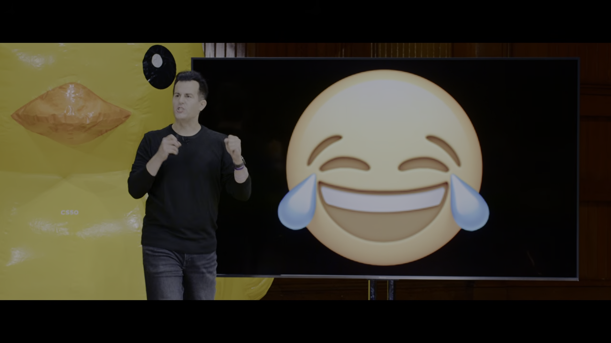

* **Thời điểm:** [44:20](https://youtu.be/UuIEbpQms8o?t=2660s)
* **Phân tích kỹ thuật:**
  * Unicode mở rộng không gian địa chỉ lên 16, 24 và 32 bit, cung cấp hơn 4 tỷ hoán vị mã hóa khả dĩ.
  * Biểu tượng cảm xúc (Emoji) bản chất là ký tự văn bản có điểm mã (Code Point) chuẩn hóa, không phải là tệp hình ảnh độc lập.
  * Minh họa mã nhị phân 32-bit của biểu tượng `Face with tears of joy`: Giá trị số nguyên là 4.036.991.106.
  * Tách bạch giữa dữ liệu và hiển thị: Chuẩn Unicode chỉ quy định mã định danh; các hệ điều hành (Apple iOS, Google Android, Windows, Telegram) tự vẽ bộ phông đồ họa (glyph) riêng tương ứng với mã số đó.

### Biểu diễn màu sắc

Hình ảnh kỹ thuật số là một ma trận điểm ảnh (pixel). Mỗi điểm ảnh được tạo thành từ việc phối trộn ba chùm ánh sáng cơ bản: Đỏ (Red), Xanh lục (Green) và Xanh lam (Blue).

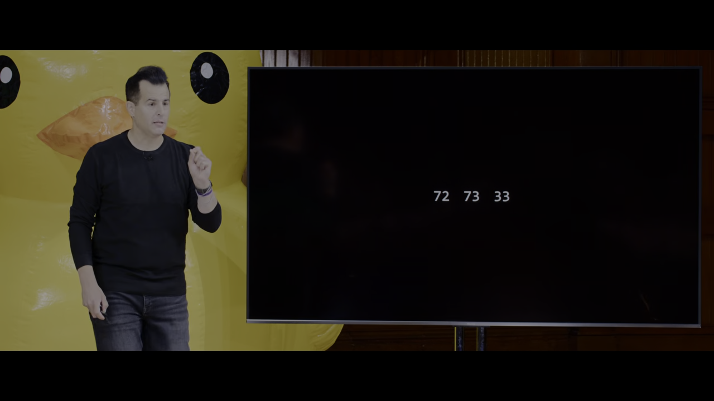

* **Thời điểm:** [47:30](https://youtu.be/UuIEbpQms8o?t=2850s)
* **Phân tích kỹ thuật:**
  * Mỗi kênh màu sử dụng 1 byte dữ liệu (giá trị từ 0 đến 255):
    * 0 đại diện cho cường độ ánh sáng tối hoàn toàn.
    * 255 đại diện cho cường độ ánh sáng bão hòa tối đa.
  * Điểm ảnh chuẩn 24-bit màu (True Color):
    $$\text{Tổng số màu} = 256 \times 256 \times 256 = 2^{24} \approx 16.777.216 \text{ màu sắc}$$
  * Quy tắc pha trộn màu:
    * $(255, 0, 0)$: Màu đỏ thuần túy.
    * $(0, 255, 0)$: Màu xanh lục thuần túy.
    * $(0, 0, 0)$: Màu đen (tắt hết ánh sáng).
    * $(255, 255, 255)$: Màu trắng (cộng gộp cực đại cả 3 nguồn sáng).

### Hiệu quả thuật toán

David Malan thực hiện thí nghiệm trực quan: tìm kiếm tên "John Harvard" trong cuốn danh bạ điện thoại dày hơn 1.000 trang bằng ba giải thuật khác nhau, sau đó dựng đồ thị so sánh hiệu quả tài nguyên.

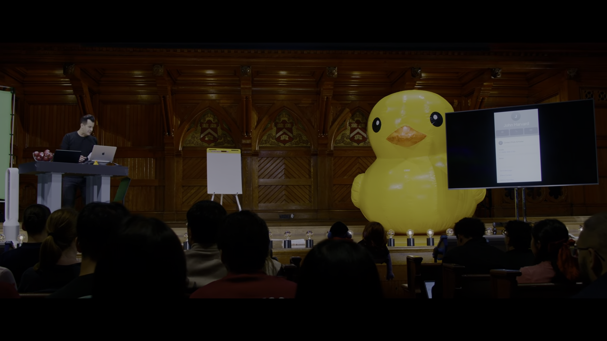

* **Thời điểm:** [1:01:30](https://youtu.be/UuIEbpQms8o?t=3690s)
* **Phân tích kỹ thuật:**
  * **Phương án 1 - Lật từng trang một:** Nếu danh bạ có $n$ trang, trường hợp xấu nhất tốn $n$ bước. Đường đồ thị dốc tuyến tính $O(n)$.
  * **Phương án 2 - Lật mỗi lần 2 trang:** Tốn tối đa $n/2$ bước. Đường đồ thị có hệ số góc nhỏ hơn nhưng vẫn là đường thẳng tuyến tính $O(n)$, đồng thời sinh ra lỗi sót phần tử (nếu tên nằm ở trang bị bỏ qua).
  * **Phương án 3 - Xé đôi cuốn sách (Chia để trị):** Mở vào giữa, xem tên, xé bỏ nửa cuốn sách không chứa kết quả. Số trang giảm theo cấp số nhân: $1000 \rightarrow 500 \rightarrow 250 \rightarrow 125 \rightarrow 62 \rightarrow 31 \rightarrow 16 \rightarrow 8 \rightarrow 4 \rightarrow 2 \rightarrow 1$.
  * Tối đa chỉ cần khoảng $\log_2(1000) \approx 10$ thao tác. Đường đồ thị nằm ngang tiệm cận, độ phức tạp $O(\log n)$.

### Thiết kế mã giả

Mã giả là công cụ trung gian giúp lập trình viên chuẩn hóa tư duy giải thuật bằng ngôn ngữ tự nhiên trước khi bắt tay viết mã nguồn thực tế.

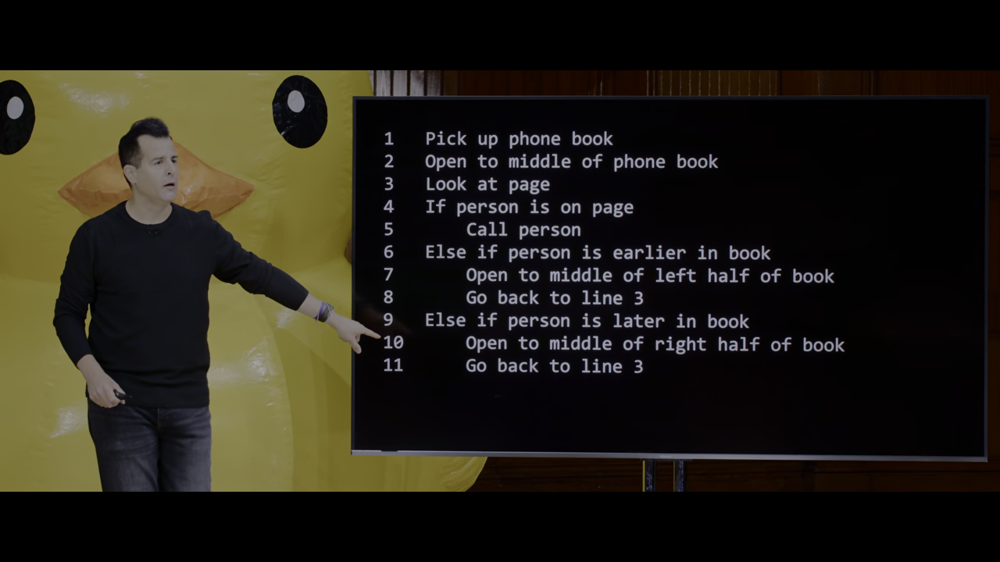

* **Thời điểm:** [1:08:00](https://youtu.be/UuIEbpQms8o?t=4080s)
* **Phân tích kỹ thuật:**
  * Thuật toán tìm kiếm nhị phân được chuẩn hóa thành các khối lệnh logic cơ bản:
    * **Hành động (Functions):** Nhặt sách, mở giữa trang, nhìn trang.
    * **Điều kiện rẽ nhánh (Conditionals):** `if` (nếu người cần tìm ở trang này), `else if` (nếu tên nằm ở nửa trước), `else if` (nếu tên nằm ở nửa sau), `else` (xử lý trường hợp biên khi không tìm thấy).
    * **Biểu thức logic (Boolean Expressions):** Kiểm tra tính đúng/sai của điều kiện so sánh chữ cái.
    * **Vòng lặp (Loops / Recursion):** Lặp lại quy trình mở và xé với nửa dữ liệu còn lại.
  * Tầm quan trọng của trường hợp biên (Edge Case): Nếu không xử lý nhánh `else` khi lật hết sách mà không thấy đối tượng, thuật toán sẽ rơi vào trạng thái treo hoặc vòng lặp vô tận.

### Chương trình đầu tiên

Bài học chuyển tiếp từ lý thuyết sang thực hành với môi trường lập trình Scratch do MIT phát triển, trực quan hóa cú pháp thành các khối ghép hình học.


* **Thời điểm:** [1:19:30](https://youtu.be/UuIEbpQms8o?t=4770s)
* **Phân tích kỹ thuật:**
  * **Khối sự kiện:** `when green flag clicked` đóng vai trò là hàm nhập điểm khởi đầu (tương tự như hàm `main()` trong ngôn ngữ C).
  * **Khối hàm hiển thị:** `say [Hello, world!]` nhận đối số truyền vào (argument/parameter) là chuỗi ký tự bên trong ô tròn màu trắng.
  * Mèo Scratch (Sprite) xuất hiện bóng thoại chứa nội dung chuỗi ký tự trên sân khấu (Stage).
  * Trạng thái duy trì: Vì không có chỉ thị xóa hoặc đổi trạng thái tiếp theo, bóng thoại sẽ hiển thị liên tục cho đến khi người dùng nhấn nút dừng màu đỏ.

### Biến và tương tác

Chương trình nâng cấp từ việc xuất chuỗi tĩnh sang tiếp nhận dữ liệu động từ bàn phím người dùng và lưu trữ vào biến tạm thời.

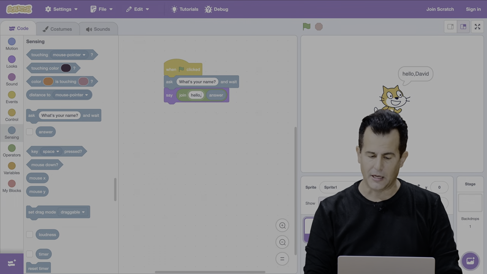

* **Thời điểm:** [1:27:00](https://youtu.be/UuIEbpQms8o?t=5220s)
* **Phân tích kỹ thuật:**
  * Khối cảm biến `ask [What's your name?] and wait`: Dừng luồng thực thi, mở ô nhập văn bản và chờ người dùng nhấn Enter.
  * Biến hệ thống `answer`: Lưu trữ giá trị trả về (Return Value) từ chuỗi bàn phím vừa nhập.
  * Khối toán tử chuỗi `join [hello, ] [answer]`: Thực hiện phép nối chuỗi (String Concatenation).
  * Lỗi hiển thị cơ bản (Aesthetic Bug): Cần chèn rõ ký tự khoảng trắng sau dấu phẩy trong chuỗi `"hello, "` để kết quả hiển thị không bị dính chữ (ví dụ `"hello, David"` thay vì `"hello,David"`).

### Trừu tượng hàm

Khi một hành vi lặp lại nhiều lần trong chương trình, việc sao chép thủ công các khối lệnh gây dư thừa mã và khó bảo trì. Lập trình viên sử dụng kỹ thuật trừu tượng hóa để tạo khối lệnh con riêng.

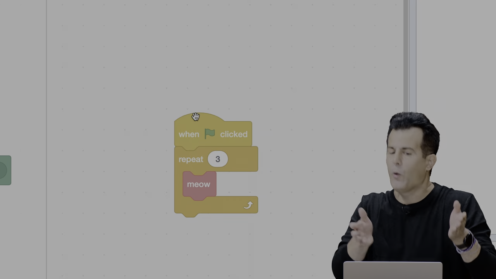

* **Thời điểm:** [1:35:30](https://youtu.be/UuIEbpQms8o?t=5730s)
* **Phân tích kỹ thuật:**
  * Sử dụng tính năng **Make a Block** trong Scratch để tạo hàm mới với tên gọi `meow`.
  * Khối định nghĩa `define meow (n)` tiếp nhận một đối số đầu vào kiểu số nguyên là `n`.
  * Bên trong phần thân hàm, sử dụng khối lặp `repeat (n)` kết hợp khối phát âm thanh và khối dừng một khoảng thời gian ngắn `wait 1 seconds` giữa mỗi lần kêu để tránh âm thanh bị đè lên nhau.
  * Chương trình chính ở tầng cao chỉ cần gọi khối `meow (3)`, ẩn giấu toàn bộ chi tiết cài đặt âm thanh và vòng lặp ở tầng thấp.

### Cấu trúc rẽ nhánh

Minh họa việc lập trình viên cho máy tính khả năng tự quyết định hành vi dựa trên việc kiểm tra trạng thái môi trường thông qua khối điều kiện lồng trong vòng lặp vô hạn.

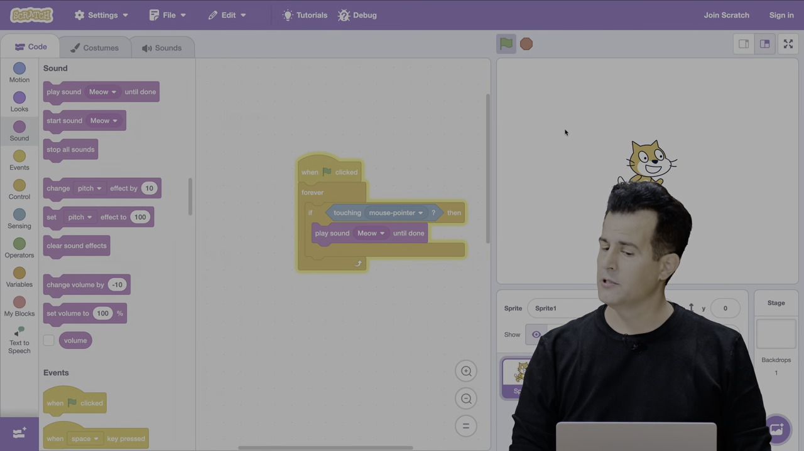

* **Thời điểm:** [1:39:15](https://youtu.be/UuIEbpQms8o?t=5955s)
* **Phân tích kỹ thuật:**
  * Khối vòng lặp vô tận `forever` đóng vai trò là vòng lặp sự kiện của trò chơi (Game Loop), duy trì việc lắng nghe liên tục.
  * Khối điều kiện `if <touching [mouse-pointer]?> then`:
    * Biểu thức logic hình lục giác `<touching [mouse-pointer]?>` trả về giá trị `true` khi người dùng rê chuột vào sprite chú mèo, ngược lại trả về `false`.
    * Khi điều kiện thỏa mãn, kích hoạt khối âm thanh `play sound [Meow] until done`.
  * Lưu ý logic: Nếu bỏ khối `forever` mà chỉ đặt `if` ngay dưới cờ xanh, chương trình chỉ kiểm tra đúng 1 mili-giây tại thời điểm bấm cờ rồi kết thúc ngay, khiến hành vi vuốt chuột sau đó hoàn toàn vô hiệu.

### Trò chơi thùng rác

Phân tích mã nguồn dự án Oscartime: trò chơi hứng rác rơi từ trên trời vào thùng rác Oscar trước khi bản nhạc nền kết thúc.

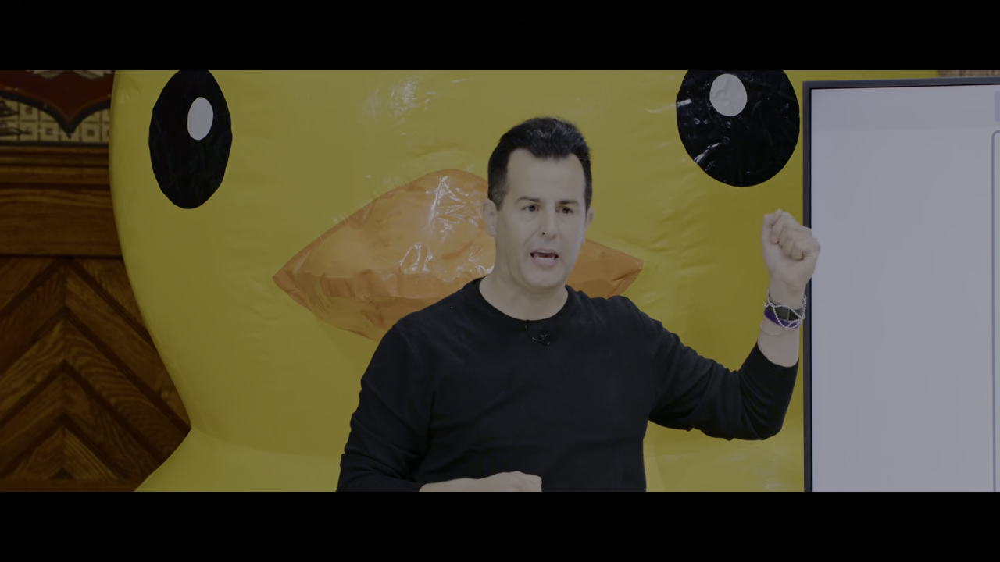

* **Thời điểm:** [1:43:30](https://youtu.be/UuIEbpQms8o?t=6210s)
* **Phân tích kỹ thuật:**
  * **Hệ tọa độ Cartesian 2D:** Sử dụng trục tọa độ $X$ (ngang) và $Y$ (dọc) để định vị và di chuyển rác rơi từ tọa độ ngẫu nhiên trên đỉnh màn hình xuống dưới đáy bằng cách giảm dần giá trị $Y$.
  * **Đổi trang phục (Costumes):** Thay đổi hình ảnh của nhân vật thùng rác khi rác rơi trúng để tạo hoạt họa mở/đóng nắp.
  * **Biến số điểm (Score Variable):** Khởi tạo `score = 0` khi bắt đầu; tăng biến lên 1 đơn vị mỗi khi phát hiện va chạm giữa rác và thùng.
  * **Phát sóng thông điệp (Broadcasting):** Cơ chế giao tiếp phi đồng bộ giữa các nhân vật khác nhau trên sân khấu để đồng bộ hóa âm thanh và kết thúc trò chơi.

### Xử lý va chạm

Phân tích dự án trò chơi "Ivy’s Hardest Game" do sinh viên khóa trước nộp bài, kết hợp toàn bộ các kỹ thuật: nhân vật người chơi, chướng ngại vật tuần tra và kẻ thù tự động bám đuổi.

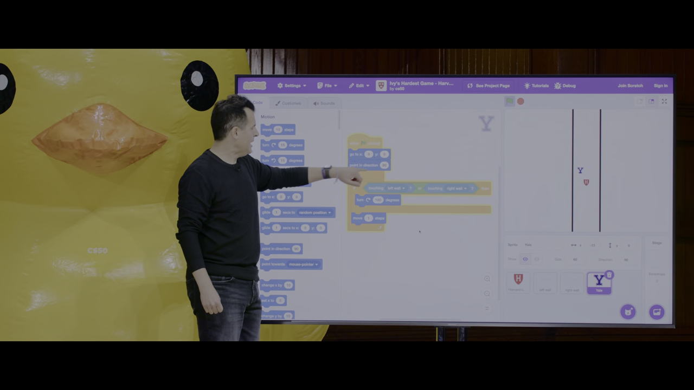

* **Thời điểm:** [1:54:45](https://youtu.be/UuIEbpQms8o?t=6885s)
* **Phân tích kỹ thuật:**
  * **Thuật toán phản xạ chướng ngại vật (Sprite Yale):**
    * Ban đầu hướng góc $90^\circ$ (sang phải) và bước từng bước.
    * Khối điều kiện kiểm tra biên: `if <touching [left wall] or touching [right wall]> then turn 180 degrees`.
    * Góc quay $180^\circ$ đảo ngược vectơ vận tốc, tạo cơ chế di chuyển tuần tra qua lại liên tục giữa hai bức tường.
  * **Thuật toán truy đuổi mục tiêu (Sprite MIT):**
    * Sử dụng lệnh `point towards [Harvard logo]` kết hợp với `move n steps`.
    * Kẻ thù luôn tính toán góc phương vị hướng về tọa độ người chơi ở mỗi chu kỳ lặp.
  * **Hiện tượng dao động rung lắc (Overshoot Glitch):** Nếu đặt bước di chuyển quá lớn ($n = 10$), sprite sẽ bước vượt qua tọa độ mục tiêu rồi quay đầu lại liên tục ở chu kỳ sau, tạo hiệu ứng giật rung ngoài ý muốn. Giải pháp kỹ thuật là giới hạn bước di chuyển nhỏ vừa phải ($n = 2$ hoặc $3$).

---

## Trích dẫn then chốt

* **[03:30](https://youtu.be/UuIEbpQms8o?t=210s):** "A class like this, CS50, has never been about teaching you how to program. That's actually one of the side effects of taking a class like this, but the overarching goal is to teach you how to think, how to take input and produce correct output and how to master these and other tools."
* **[14:48](https://youtu.be/UuIEbpQms8o?t=888s):** "What is computer science? Well, it's really just the study of information. How do you represent it? How do you process it? And very much germane to computer science is what the world calls computational thinking... it's about problem solving."
* **[18:35](https://youtu.be/UuIEbpQms8o?t=1115s):** "What's nice about binary, only using zeros and ones, is that it maps really nicely to the real world by like throwing a light switch on and off. You can represent information by just using a little bit of electricity or the lack thereof."
* **[30:25](https://youtu.be/UuIEbpQms8o?t=1825s):** "At the end of the day, if your entire canvas consists only of zeros and ones... we just need to agree what pattern of zeros and ones, and therefore what integer, shall be used to represent the letter A."
* **[61:25](https://youtu.be/UuIEbpQms8o?t=3685s):** "Whatever your constrained resource is — using the minimum amount of RAM, the fewest number of people, the least amount of money — solving a problem better is what algorithms are all about."

---

## Lệnh & Công cụ

### Mã nguồn mẫu

```python
from openai import OpenAI

# Khởi tạo client kết nối OpenAI API
client = OpenAI()

# Thiết lập chỉ thị hệ thống định hình hành vi
system_prompt = "Limit your answer to one sentence. Pretend you're a cat."

# Tiếp nhận câu hỏi trực tiếp từ người dùng qua terminal
user_prompt = input("Prompt: ")

# Gửi yêu cầu sinh phản hồi đến mô hình
response = client.responses.create(
    model="gpt-5",
    input=f"System: {system_prompt}\nUser: {user_prompt}"
)

# Xuất kết quả phản hồi ra màn hình
print(response.output.text)
```

### Lệnh thực thi

```bash
# Thực thi tệp mã nguồn Python
python chat.py
```

### Công thức nhị phân

1. **Chuyển đổi chuỗi nhị phân $k$-bit sang thập phân:**
   $$\text{Giá trị} = \sum_{i=0}^{k-1} b_i \times 2^i$$
2. **Số lượng trạng thái khả dĩ với $k$ bit:**
   $$N = 2^k$$
3. **Giá trị số nguyên dương cực đại biểu diễn được bằng $k$ bit không dấu:**
   $$\text{Max} = 2^k - 1$$
4. **Độ phức tạp số bước của tìm kiếm nhị phân với tập dữ liệu $n$ phần tử:**
   $$\text{Số bước tối đa} = \lfloor \log_2(n) \rfloor + 1$$

---

## Đánh đổi & Rủi ro

### Tràn số nguyên

* **Bản chất:** Giới hạn phần cứng và bộ nhớ quy định số bit tối đa cho một kiểu dữ liệu (ví dụ 8-bit, 32-bit hoặc 64-bit).
* **Rủi ro:** Khi giá trị vượt qua ngưỡng tối đa ($2^k - 1$), bit cao nhất bị mất hoặc tràn sang bit dấu, khiến giá trị bị lật ngược về 0 hoặc một số âm lớn, gây lỗi sai lệch nghiêm trọng trong các hệ thống tài chính, hàng không và định vị.

### Sai lệch hiển thị

* **Bản chất:** Chuẩn Unicode chỉ chuẩn hóa điểm mã danh định (Code Point) chứ không ấn định kiểu hiển thị đồ họa chi tiết (Glyph rendering).
* **Rủi ro:** Cùng một ký tự hoặc biểu tượng cảm xúc có thể mang sắc thái biểu cảm hoặc giao diện hoàn toàn khác nhau giữa iOS, Android và Windows, dẫn đến việc hiểu sai ngữ cảnh giao tiếp của người dùng.

### Đánh đổi thuật toán

* **Tìm kiếm tuyến tính ($O(n)$):**
  * Ưu điểm: Áp dụng được trên mọi tập dữ liệu thô, không đòi hỏi dữ liệu phải được sắp xếp trước.
  * Nhược điểm: Tốn kém thời gian và tài nguyên CPU khi kích thước dữ liệu $n$ tăng cao.
* **Tìm kiếm nhị phân ($O(\log n)$):**
  * Ưu điểm: Tốc độ truy xuất cực nhanh trên tập dữ liệu quy mô lớn.
  * Chi phí đánh đổi: Bắt buộc tập dữ liệu phải được sắp xếp theo trật tự cố định từ trước. Chi phí sắp xếp ban đầu thường là $O(n \log n)$, chỉ hiệu quả khi tần suất tìm kiếm nhiều lần bù đắp được chi phí sắp xếp một lần.

### Rủi ro dịch vụ

* **Bản chất:** Việc xây dựng ứng dụng dựa trên các mô hình trí tuệ nhân tạo đám mây (OpenAI, Gemini, Claude) phụ thuộc hoàn toàn vào dịch vụ bên ngoài qua mạng Internet.
* **Rủi ro:** Chi phí token tính theo lượt gọi, độ trễ mạng (Network Latency), nguy cơ ngừng dịch vụ ngoài ý muốn (Downtime) và hiện tượng ảo giác (Hallucination) đòi hỏi lập trình viên phải xây dựng cơ chế kiểm soát ngoại lệ và xác thực dữ liệu đầu ra nghiêm ngặt.
