# Cách Mạng Internet Hoạt Động

* **Kênh:** freeCodeCamp.org | **Thời lượng:** 01:42:42 | **Ngày:** 2021-08-02
* **Video:** https://youtu.be/zN8YNNHcaZc

---

## Thuật ngữ

| Thuật ngữ | Tiếng Anh | Giải thích bản chất |
| :--- | :--- | :--- |
| Bộ chuyển mạch | Switch | Thiết bị phần cứng tầng liên kết dữ liệu dùng để kết nối các máy tính trong cùng một mạng cục bộ qua cáp mạng vật lý, phân phối gói tin dựa trên địa chỉ đích. |
| Bộ định tuyến | Router | Thiết bị mạng chịu trách nhiệm chuyển tiếp các gói dữ liệu giữa các mạng khác nhau (giữa các mạng cục bộ hoặc ra mạng Internet toàn cầu). |
| Mạng cục bộ | Local Area Network (LAN) | Mạng máy tính kết nối các thiết bị trong một phạm vi địa lý giới hạn như văn phòng, tòa nhà hoặc hộ gia đình. |
| Mạng diện rộng | Wide Area Network (WAN) | Mạng máy tính quy mô lớn kết nối các mạng cục bộ độc lập nằm ở nhiều vị trí địa lý cách xa nhau. Mạng Internet là mạng diện rộng lớn nhất hành tinh. |
| Mạng khuôn viên | Campus Area Network (CAN) | Mạng kết nối trực tiếp các mạng cục bộ gần kề (khoảng cách ngắn như trong cùng một tòa nhà hoặc khuôn viên đại học) bằng cáp trực tiếp giữa các bộ chuyển mạch. |
| Gói dữ liệu | Packet | Đơn vị đóng gói dữ liệu cơ bản được truyền qua mạng máy tính, bao gồm phần dữ liệu thực tế và thông tin tiêu đề điều hướng. |
| Cổng mạng cục bộ | LAN Port | Cổng cắm chuẩn RJ-45 trên máy tính và thiết bị mạng dùng để kết nối cáp mạng vật lý. |
| Điểm truy cập | Access Point (AP) | Thiết bị phát sóng vô tuyến cho phép thiết bị đầu cuối kết nối vào mạng cục bộ qua sóng Wi-Fi thay cho cáp vật lý. |
| Bảng định tuyến | Routing Table | Cơ sở dữ liệu nội tại trên bộ định tuyến lưu trữ các quy tắc và tuyến đường tối ưu để chuyển tiếp gói dữ liệu đến đích. |
| Chuyển tiếp | Forwarding | Hành vi phần cứng của bộ định tuyến khi tiếp nhận gói tin từ một cổng vào và đẩy sang một cổng ra phù hợp dựa theo bảng định tuyến. |
| Kiểm soát tắc nghẽn | Congestion Control | Kỹ thuật định tuyến động nhằm phát hiện mật độ dữ liệu dày đặc trên một tuyến đường để chuyển hướng gói tin qua tuyến khác ít tải hơn. |
| Điểm lỗi đơn lẻ | Single Point of Failure (SPOF) | Lỗ hổng kiến trúc mạng khi toàn bộ hệ thống bị phụ thuộc vào một mắt xích duy nhất; nếu mắt xích này sụp đổ, toàn bộ mạng sẽ tê liệt. |
| Cân bằng tải | Load Balancing | Cơ chế phân bổ lưu lượng dữ liệu đồng đều qua nhiều nút xử lý hoặc tuyến cáp nhằm tối ưu hóa hiệu năng và phòng tránh quá tải. |
| Cáp quang biển | Submarine Fiber Optic Cable | Tuyến cáp quang bọc giáp đặt dưới đáy biển kết nối mạng lưới Internet xuyên lục địa, truyền dẫn dữ liệu bằng ánh sáng với độ suy hao tối thiểu. |
| Mạng riêng ảo | Virtual Private Network (VPN) | Công nghệ tạo lập kết nối bảo mật bằng đường hầm ảo mã hóa đi xuyên qua môi trường mạng Internet công cộng không tin cậy. |
| Đóng gói đường hầm | Tunneling | Kỹ thuật bọc toàn bộ gói tin dữ liệu nguyên bản vào bên trong một gói tin vận chuyển mới để đi qua mạng công cộng an toàn. |
| Mã hóa đầu cuối | End-to-End Encryption (E2EE) | Cơ chế mã hóa dữ liệu ngay tại máy gửi và chỉ giải mã tại máy nhận đích, khiến mọi nút trung gian trên đường truyền không thể đọc được nội dung. |
| Nhà cung cấp mạng | Internet Service Provider (ISP) | Doanh nghiệp viễn thông sở hữu hạ tầng định tuyến và truyền dẫn, cung cấp dịch vụ truy cập mạng Internet cho các tổ chức và cá nhân. |
| Điểm hiện diện | Point of Presence (POP) | Trạm hạ tầng cục bộ của nhà mạng chứa các tủ rack thiết bị định tuyến, chuyển mạch và máy chủ nhằm đấu nối các hộ thuê bao xung quanh. |
| Mạng trục chính | Internet Backbone | Hệ thống tuyến truyền dẫn cáp quang xuyên lục địa và các bộ định tuyến lõi dung lượng cực lớn kết nối các nhà mạng toàn cầu. |
| Điểm trao đổi | Internet Exchange Point (IXP) | Cơ sở hạ tầng vật lý trung lập nơi các nhà cung cấp dịch vụ mạng và nhà mạng trao đổi lưu lượng truy cập trực tiếp với nhau. |
| Đấu nối trực tiếp | Peering | Thỏa thuận và thiết lập liên kết trực tiếp giữa các công ty công nghệ lớn với nhà mạng địa phương để phân phối dữ liệu trực tiếp không qua trung gian. |

---

## Tổng luận chuyên đề

Mạng Internet bản chất là một "mạng của các mạng" (Network of Networks) với kiến trúc phân tán quy mô toàn cầu, bao gồm ba trụ cột hạ tầng chính:

### Hạ tầng phân tầng

1. **Phân tầng thiết bị nội bộ:** Mạng cục bộ (LAN) phục vụ giao tiếp giữa các máy tính gần nhau bằng bộ chuyển mạch (Switch) qua cáp đồng hoặc bộ phát sóng không dây (Access Point). Khi cần kết nối ra ngoài phạm vi mạng nội bộ hoặc giao tiếp với mạng khác, bắt buộc phải đi qua cửa ngõ bộ định tuyến (Router).
2. **Thiết bị tích hợp gia đình:** Bộ định tuyến gia đình (Home Router) là thiết bị tích hợp đa chức năng chứa cả bộ định tuyến, bộ chuyển mạch và điểm truy cập không dây trong một khối vỏ duy nhất, chỉ phù hợp cho quy mô hộ gia đình hoặc văn phòng nhỏ dưới hàng chục thiết bị.
3. **Phân tầng mạng diện rộng:** Khi cần kết nối các chi nhánh ở xa, doanh nghiệp có thể thiết lập mạng diện rộng (WAN) thông qua công nghệ đường hầm mã hóa VPN (Public WAN) để tối ưu chi phí, hoặc thuê tuyến cáp quang riêng biệt từ nhà mạng (Private WAN) để đạt độ an toàn tuyệt đối.

### Truyền dẫn phân tán

1. **Kiến trúc phi tập trung:** Internet loại bỏ hoàn toàn mô hình bộ định tuyến trung tâm duy nhất nhằm triệt tiêu điểm lỗi đơn lẻ (Single Point of Failure), giảm thiểu áp lực cổng vật lý và tối ưu hóa chiều dài dây cáp nối giữa các lục địa.
2. **Hạ tầng cáp ngầm đại dương:** 99% lưu lượng Internet quốc tế được truyền qua hơn 460 tuyến cáp quang ngầm dưới đáy biển với chiều dài lên đến hàng triệu kilomet. Cáp quang được sử dụng bắt buộc vì cáp đồng suy hao tín hiệu nghiêm trọng và phát sinh tỷ lệ lỗi quá cao ở khoảng cách xa.
3. **Định tuyến động thích ứng:** Quá trình chuyển tiếp gói tin (Forwarding) không cố định dựa trên số lượng nút mạng (hop count) mà phụ thuộc vào thuật toán tạo bảng định tuyến liên tục thích ứng với hiện tượng tắc nghẽn (Congestion Control) và sự cố đứt cáp vật lý.

### Hệ thống nhà mạng

1. **Mô hình phân cấp nhà mạng:** Mạng toàn cầu vận hành theo 3 cấp độ:
   - Nhà mạng địa phương (Local ISP): Quản lý các điểm hiện diện (POP) kết nối trực tiếp đến hộ gia đình và văn phòng trong một khu vực dân cư.
   - Nhà mạng khu vực (Regional ISP): Liên kết các nhà mạng địa phương trong phạm vi thành phố hoặc quốc gia.
   - Nhà mạng toàn cầu (Global ISP): Sở hữu các tuyến cáp quang xuyên lục địa và mạng trục chính (Internet Backbone).
2. **Kỹ thuật tối ưu hóa đường truyền:** Các tập đoàn công nghệ lớn như Google sử dụng mạng lưới máy chủ phân tán toàn cầu kết hợp kỹ thuật đấu nối trực tiếp (Peering) với các nhà mạng địa phương để loại bỏ các trạm trung gian, tăng tốc độ truyền tải nội dung đa phương tiện và giảm thiểu nguy cơ rò rỉ dữ liệu.

---

## Bóc tách chi tiết

### [[00:01:55](https://youtu.be/zN8YNNHcaZc?t=115s)] Bộ chuyển mạch

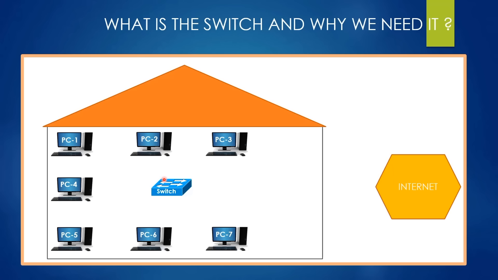

1. **Bối cảnh bài toán văn phòng:**
   - Trong một văn phòng có 7 máy tính cá nhân (PC1 đến PC7), mục tiêu đặt ra là các máy tính này phải gửi và nhận dữ liệu qua lại với nhau một cách thông suốt (ví dụ PC1 trao đổi với PC7, PC5 trao đổi với PC4).
   - Nếu không có thiết bị điều phối trung tâm, việc nối chéo dây trực tiếp giữa từng cặp máy tính sẽ tạo ra một mớ dây hỗn loạn và giới hạn cổng cắm trên card mạng của từng máy.

2. **Bản chất của bộ chuyển mạch:**
   - Bộ chuyển mạch (Switch) là thiết bị phần cứng được thiết kế để kết nối tất cả các máy tính trong cùng một không gian vật lý (văn phòng, phòng thí nghiệm, ngôi nhà).
   - Để giao tiếp, mỗi máy tính bắt buộc phải kết nối vật lý với Switch bằng dây cáp mạng. Loại cáp thông dụng nhất trong mạng nội bộ là cáp đồng sợi xoắn đôi chuẩn CAT5 hoặc CAT6 (với CAT là viết tắt của *Category*, trong đó CAT6 có băng thông và tốc độ cao hơn CAT5). Một số Switch doanh nghiệp cao cấp hỗ trợ cổng quang để cắm cáp sợi quang (Fiber Optic).
   - Quy tắc kỹ thuật cốt lõi: Switch thuần túy chỉ hoạt động với dây cáp vật lý. Switch không hỗ trợ giao tiếp không dây.

3. **So sánh với điểm truy cập không dây:**
   - Nếu văn phòng muốn kết nối không dùng dây, kỹ sư mạng phải triển khai thiết bị điểm truy cập không dây (Access Point - AP).
   - Bản chất chức năng: Cả Switch và Access Point đều có cùng mục tiêu là gắn kết các thiết bị trong cùng một môi trường vào một mạng duy nhất. Khác biệt nằm ở phương tiện truyền dẫn: Switch sử dụng cáp truyền tín hiệu điện/quang, còn Access Point sử dụng sóng vô tuyến Wi-Fi.

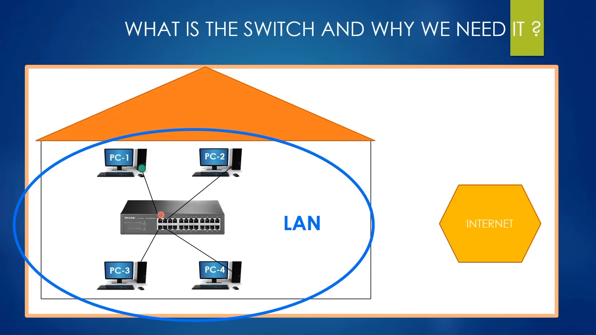

4. **Khái niệm mạng cục bộ:**
   - Tập hợp các thiết bị kết nối với nhau qua Switch trong một phạm vi không gian giới hạn tạo thành mạng cục bộ (Local Area Network - LAN). Mạng LAN không thể mở rộng giữa hai quốc gia cách nhau hàng nghìn kilomet bằng một Switch duy nhất.
   - Mọi ngôi nhà có thiết bị nối mạng hay văn phòng công ty đều là một mạng LAN riêng biệt.

5. **Cấu trúc cổng và luồng xử lý gói tin:**
   - Mặt sau của máy tính để bàn hoặc cạnh bên của máy tính xách tay luôn có cổng mạng cục bộ (LAN Port - chuẩn RJ-45). Trên Switch vật lý có từ 8, 16, 24 đến 48 cổng LAN Port tương ứng.
   - Khi PC1 muốn gửi một thông điệp (gói tin - packet / frame) đến PC4:
     - Gói tin xuất phát từ cổng LAN của PC1, truyền qua dây cáp mạng đến cổng số 1 của Switch.
     - Vi mạch phần cứng bên trong Switch tiếp nhận gói tin, bóc tách thông tin tiêu đề để đọc địa chỉ đích.
     - Switch xác định cổng vật lý nào đang cắm dây dẫn đến PC4 và đẩy gói tin trực tiếp ra duy nhất cổng đó đến PC4.
   - Giới hạn cốt tử: Switch chỉ có khả năng luân chuyển dữ liệu nội bộ trong cùng một mạng LAN. Switch hoàn toàn không có khả năng đưa dữ liệu ra ngoài Internet.

---

### [[00:13:16](https://youtu.be/zN8YNNHcaZc?t=796s)] Bộ định tuyến

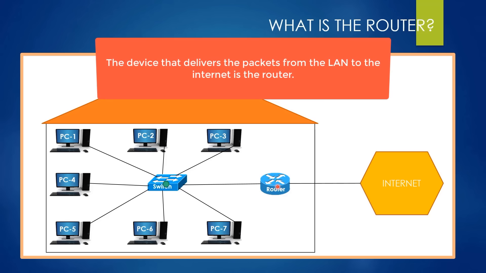

1. **Vai trò thiết yếu của bộ định tuyến:**
   - Để toàn bộ các máy tính trong mạng LAN văn phòng có thể truy cập được mạng toàn cầu, mạng bắt buộc phải có sự hiện diện của bộ định tuyến (Router).
   - Nếu không có Router, không một máy tính nào có thể kết nối ra thế giới bên ngoài. Router đóng vai trò như một cánh cổng (Gateway) kết nối giữa mạng nội bộ và mạng Internet công cộng.

2. **Mô hình kết nối vật lý:**
   - Kỹ sư mạng sử dụng một sợi cáp đồng kết nối từ một cổng LAN trên Switch sang cổng mạng nội bộ của Router.
   - Trên Router có một cổng giao tiếp mạng diện rộng (WAN Port) được cắm sợi cáp quang hoặc cáp truyền dẫn do nhà cung cấp dịch vụ Internet (ISP) kéo đến tòa nhà.

3. **Hành trình gói tin ra mạng ngoài:**
   - Trường hợp 1 (Nội bộ): Khi PC1 gửi gói tin cho PC5 (cùng trong mạng LAN), gói tin đi vào Switch, Switch nhận diện đích đến là PC5 và chuyển thẳng sang PC5. Router hoàn toàn không tham gia vào tiến trình này.
   - Trường hợp 2 (Ra Internet): Khi PC1 muốn tải dữ liệu từ một trang web trên Internet:
     - PC1 nhận thấy địa chỉ đích nằm ngoài mạng LAN, nó đóng gói và gửi gói tin tới Switch.
     - Switch đọc địa chỉ đích, nhận biết gói tin cần ra mạng ngoài nên chuyển gói tin tới Router.
     - Router phân tích gói tin, xử lý địa chỉ mạng và đẩy gói tin qua cổng WAN nối với đường cáp của nhà mạng ISP để đi vào không gian Internet toàn cầu.

---

### [[00:19:43](https://youtu.be/zN8YNNHcaZc?t=1183s)] Bản chất mạng

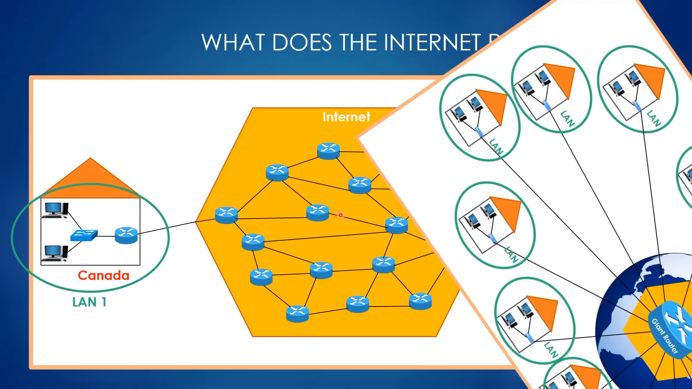

1. **Định nghĩa bản chất của Internet:**
   - Internet không phải là một thực thể trừu tượng trong không gian ảo. Về bản chất kỹ thuật, Internet là hạ tầng kết nối hàng triệu mạng cục bộ (LAN) trên khắp hành tinh lại với nhau.
   - Kết nối vào Internet thực chất là thiết lập khả năng gửi và nhận gói tin giữa máy tính của bạn với một máy tính hoặc máy chủ nằm ở bất kỳ đâu trên thế giới.

2. **Bản chất của bộ định tuyến gia đình:**
   - Trong môi trường thực tế tại nhà, người dùng thường chỉ thấy duy nhất một thiết bị hộp nhỏ phát sóng Wi-Fi có vài cổng cắm dây phía sau.
   - Thiết bị này được gọi là bộ định tuyến gia đình (Home Router). Đây là một thiết bị lai (combo device) tích hợp bên trong gồm:
     - 1 bo mạch Router chịu trách nhiệm định tuyến ra nhà mạng.
     - 1 bo mạch Switch nhỏ (thường 4 cổng LAN vàng) để nối dây nội bộ.
     - 1 khối Access Point phát sóng Wi-Fi không dây.
   - Thiết bị tích hợp này tiện lợi cho nhu cầu ít máy (dưới 10-15 thiết bị). Trong môi trường doanh nghiệp có hàng chục đến hàng trăm máy tính, Home Router sẽ quá tải ngay lập tức; khi đó bắt buộc phải tách riêng thành Switch doanh nghiệp chuyên dụng và Router biên độc lập.

3. **Bài toán phản chứng về bộ định tuyến trung tâm:**
   - Tác giả đặt ra câu hỏi kiến trúc: Tại sao nhân loại không dùng duy nhất một Router khổng lồ đặt tại trung tâm Trái Đất để nối tất cả thiết bị, mà phải phân tán hàng triệu Router khắp nơi?
   - Ba lý do kỹ thuật triệt tiêu mô hình tập trung:
     - **Giới hạn vật lý cổng cắm:** Một thiết bị không thể thiết kế đủ hàng tỷ cổng cắm vật lý cho mọi thiết bị trên Trái Đất.
     - **Điểm lỗi đơn lẻ (Single Point of Failure - SPOF):** Nếu một Router duy nhất đó bị chập điện, hỏng phần cứng hoặc gặp sự cố, toàn bộ mạng Internet của toàn nhân loại sẽ sụp đổ hoàn toàn trong tích tắc.
     - **Chiều dài dây cáp phi thực tế:** Máy tính ở Nam Cực, Châu Á hay Châu Mỹ đều phải kéo dây cáp dài hàng chục nghìn kilomet về một điểm trung tâm, tạo ra một khối lượng dây cáp khổng lồ không thể bảo trì và tín hiệu sẽ bị triệt tiêu hoàn toàn trên đường truyền.

---

### [[00:28:28](https://youtu.be/zN8YNNHcaZc?t=1708s)] Tuyến cáp biển

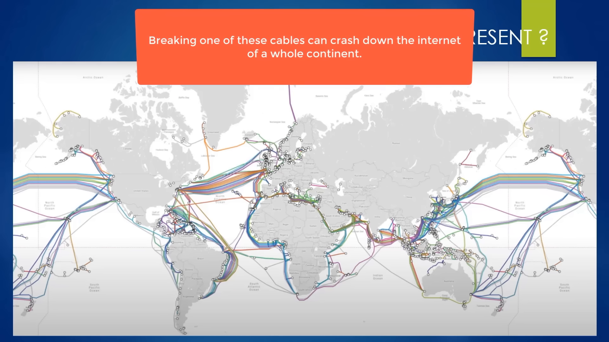

1. **Ưu thế của kiến trúc phân tán:**
   - Mạng lưới Router phân tán toàn cầu cho phép dây cáp nối giữa các Router lân cận có cự ly ngắn hơn rất nhiều.
   - Cơ chế cân bằng tải (Load Balancing) hoạt động trơn tru: Lưu lượng được phân bổ đều qua nhiều nhánh mạng.
   - Khả năng chống chịu lỗi (Fault Tolerance): Khi hàng chục bộ định tuyến ở một khu vực bị mất điện hoặc hỏng hóc, lưu lượng dữ liệu tự động được định tuyến vòng qua các Router khác, Internet toàn cầu vẫn vận hành ổn định.

2. **Hạ tầng cáp quang ngầm đại dương:**
   - 99% toàn bộ lưu lượng viễn thông và dữ liệu quốc tế giữa các lục địa được truyền tải thông qua 468 tuyến cáp ngầm đặt dưới đáy các đại dương.
   - Chiều dài của các tuyến cáp này dao động từ 131 km (kết nối giữa các đảo hoặc bờ biển hẹp) cho đến hơn 20.000 km (băng qua Thái Bình Dương hoặc Đại Tây Dương). Tổng chiều dài cáp biển vượt qua 1,2 triệu kilomet.
   - Toàn bộ cáp biển bắt buộc là cáp quang (Fiber Optic Cable) thay vì cáp đồng:
     - Tốc độ truyền tải tín hiệu quang đạt xấp xỉ tốc độ ánh sáng trong thủy tinh.
     - Độ suy hao tín hiệu quang cực thấp. Cáp đồng khi kéo dài trên vài trăm mét sẽ phát sinh suy hao điện trở cực lớn và tỷ lệ lỗi bit (Bit Error Rate) tăng vọt, không thể truyền tải qua đại dương.

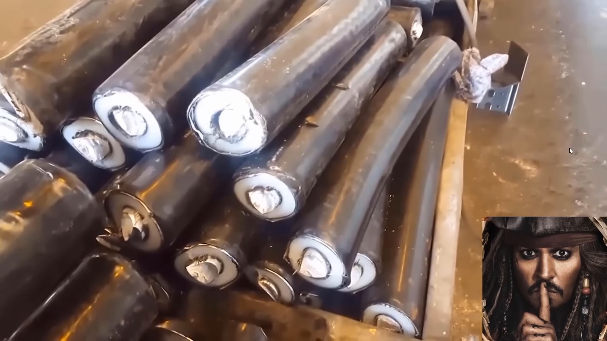

3. **Rủi ro vật lý và các bài học lịch sử:**
   - Mỗi năm thế giới ghi nhận gần 200 sự cố đứt hoặc hư hỏng cáp quang biển, phần lớn bắt nguồn từ mỏ neo tàu thuyền, hoạt động đánh bắt cá hoặc động đất dưới đáy biển.
   - **Sự cố tuyến cáp Bờ Tây Châu Phi (2018):** Tuyến cáp quang biển ACE dài 17.000 km chạy từ Pháp dọc theo bờ tây Châu Phi kết nối 22 quốc gia. Một tàu đánh cá đã vô tình cào rách tuyến cáp này ngoài khơi bờ biển Mauritania, khiến 10 quốc gia Châu Phi bị mất hoàn toàn kết nối Internet trong nhiều ngày.
   - **Vụ việc trộm cáp biển tại Đông Nam Á (2007):** Một nhóm cướp biển đã cắt trộm 11 km cáp quang ngầm nối giữa Thái Lan, Việt Nam và Hồng Kông đem về chia nhỏ bán phế liệu, gây tê liệt nghiêm trọng dung lượng truyền dẫn khu vực.

---

### [[00:35:27](https://youtu.be/zN8YNNHcaZc?t=2127s)] Chuyển tiếp gói

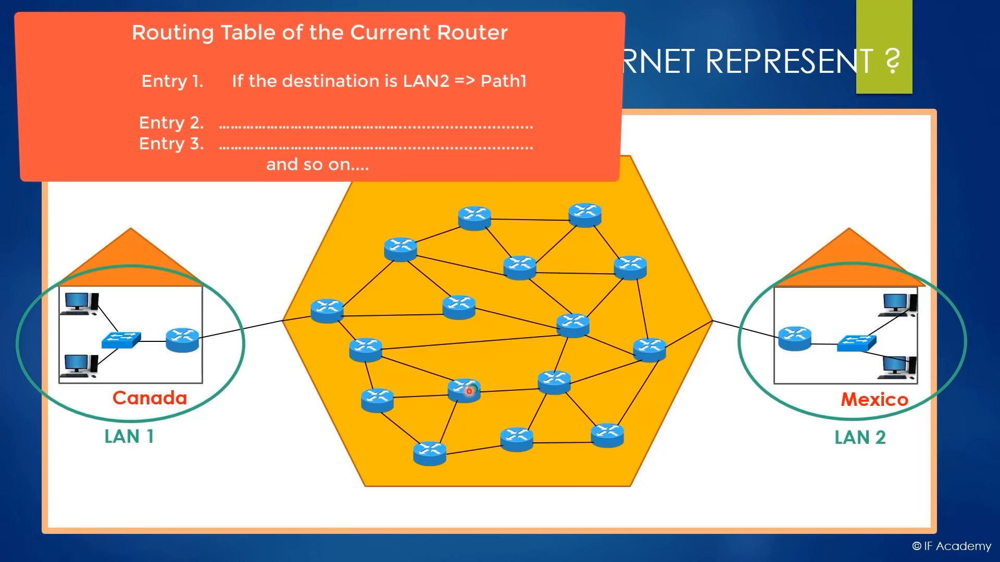

1. **Hành trình gói tin liên lục địa:**
   - Giả định máy tính trong LAN 1 (Châu Âu) gửi gói tin đến máy tính trong LAN 2 (Châu Á).
   - Gói tin rời máy tính -> đi qua Switch nội bộ -> đến Router biên của LAN 1.
   - Router biên nhận thấy địa chỉ IP đích không nằm trong dải mạng nội bộ, lập tức chuyển tiếp gói tin ra Router của nhà mạng trung gian.
   - Tại Router trung gian, có nhiều cổng ra vật lý dẫn đến các Router kế tiếp (Nhánh 1, Nhánh 2, Nhánh 3).

2. **Cơ chế vận hành của bảng định tuyến:**
   - Mỗi Router đều sở hữu một bộ vi xử lý riêng và một bảng cơ sở dữ liệu gọi là Bảng định tuyến (Routing Table).
   - Khi gói tin đến một cổng vào (Inbound Port), Router phân tích địa chỉ IP đích trong tiêu đề (Header).
   - Router tra cứu Bảng định tuyến để xác định cổng ra (Outbound Port) tối ưu nhất, hành động đẩy gói tin sang cổng ra được gọi là Chuyển tiếp (Forwarding).
   - Quy tắc bất biến: Router không bao giờ chuyển tiếp ngược gói tin trở lại chính cổng mà nó vừa đi vào.

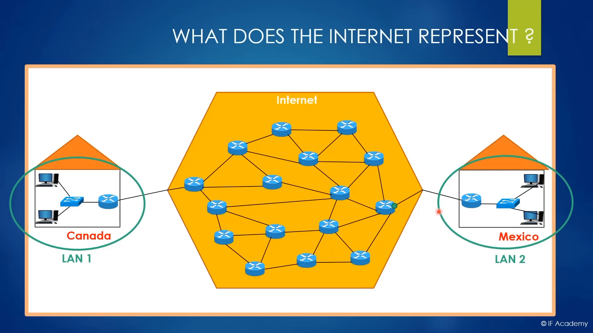

3. **Kiểm soát tắc nghẽn:**
   - Khi quan sát bằng mắt thường, tuyến đường đi qua ít nút mạng nhất (ví dụ Nhánh 2 chỉ qua 1 Router trung gian) có vẻ là ngắn nhất.
   - Tuy nhiên, bộ xử lý của Router chạy các thuật toán định tuyến động phức tạp liên tục đo lường mật độ dữ liệu và độ trễ trên từng tuyến liên kết.
   - Nếu Nhánh 2 đang chịu mật độ gói tin dày đặc (xảy ra nghẽn mạng), Router sẽ quyết định chuyển hướng gói tin qua Nhánh 3 dù tuyến này phải đi qua 2 hoặc 3 Router trung gian.
   - Hiện tượng này gọi là Kiểm soát tắc nghẽn (Congestion Control). Tuyến đường đi qua nhiều nút hơn nhưng có băng thông thông thoáng sẽ giúp gói tin đến đích nhanh hơn tuyến đường ngắn nhất nhưng đang bị nghẽn.
   - Toàn bộ quá trình định tuyến và truyền gói tin xuyên lục địa diễn ra trong vài phần chục mili-giây.

4. **Định nghĩa kinh điển về Internet:**
   - Trong sách giáo khoa kỹ thuật mạng, Internet được định nghĩa là "Mạng của các mạng" (Network of Networks).
   - Biểu tượng đám mây (Cloud) trong các sơ đồ mạng thường dùng để trừu tượng hóa hạ tầng mạng phức tạp ở giữa, nhưng bản chất thực sự của đám mây đó chính là hàng triệu Router và hàng triệu tuyến cáp quang liên kết hàng triệu mạng LAN lại với nhau.

---

### [[00:48:00](https://youtu.be/zN8YNNHcaZc?t=2880s)] Góc nhìn máy tính

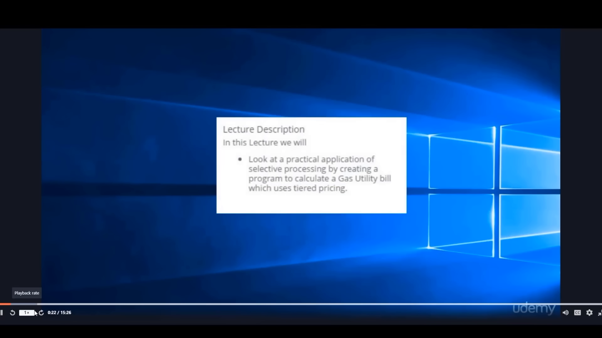

1. **Khái niệm kết nối Internet từ phía thiết bị đầu cuối:**
   - Đối với một máy tính độc lập tại nhà, "kết nối Internet" được định nghĩa chuẩn xác là: Máy tính đó có khả năng gửi đi các gói tin yêu cầu (Request Packets) ra mạng toàn cầu và nhận về các gói tin phản hồi (Response Packets) tương ứng.

2. **Cơ chế phân đoạn dữ liệu và truyền luồng:**
   - Khi người dùng truy cập một nền tảng học trực tuyến như Udemy và nhấp xem một video bài giảng:
     - Máy tính tạo một gói tin màu xanh (Request Packet) gửi qua Home Router ra Internet đến máy chủ của Udemy.
     - Máy chủ Udemy tiếp nhận và bắt đầu gửi trả nội dung video về máy tính.
   - Video không bao giờ được gửi nguyên vẹn trong một khối duy nhất. Máy chủ cắt nhỏ tệp video thành hàng nghìn gói dữ liệu nhỏ (Packet) và gửi liên tục từng phần. Cơ chế này gọi là Truyền luồng (Streaming).
   - Ý nghĩa thực tế: Nếu một video dài 1 tiếng có dung lượng 1 GB mà phải đợi tải hết 100% mới phát được, người dùng mạng chậm sẽ phải chờ hàng chục phút. Nhờ công nghệ Streaming, các gói tin đầu tiên vừa đến máy tính là trình phát đa phương tiện đã hiển thị hình ảnh ngay lập tức trong khi các gói tiếp theo tiếp tục được tải ngầm.

3. **Bản chất của máy chủ và cụm phân tán:**
   - Máy chủ (Server) về bản chất phần mềm không khác biệt máy tính thông thường; tuy nhiên về phần cứng, máy chủ được trang bị CPU đa nhân cực mạnh, dung lượng RAM lớn và cổng mạng băng thông khổng lồ để phục vụ hàng chục nghìn kết nối đồng thời.
   - Các nền tảng lớn không bao giờ đặt toàn bộ dữ liệu tại một máy chủ duy nhất. Họ xây dựng các cụm máy chủ phân tán (Distributed Servers / CDN) khắp các châu lục. Người dùng ở khu vực nào sẽ tự động kết nối đến cụm máy chủ gần nhất về khoảng cách địa lý nhằm tối ưu hóa độ trễ và triệt tiêu nguy cơ sập toàn hệ thống.

---

### [[00:55:10](https://youtu.be/zN8YNNHcaZc?t=3310s)] Mạng diện rộng

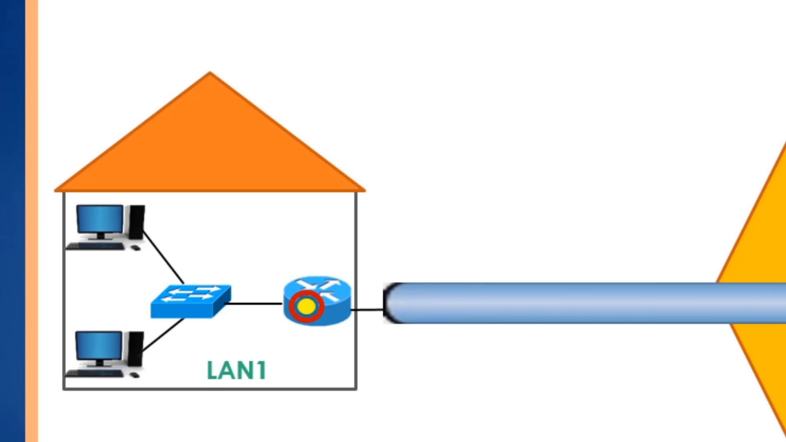

1. **Nhu cầu thiết lập mạng diện rộng cho doanh nghiệp:**
   - Một doanh nghiệp phát triển mở rộng hai văn phòng: Chi nhánh LAN 1 tại New York và Chi nhánh LAN 2 tại London. Ban giám đốc yêu cầu hai văn phòng phải làm việc chung trong một mạng như thể đang ngồi cùng một phòng.
   - Mạng diện rộng (WAN) là giải pháp kết nối hai hoặc nhiều mạng LAN độc lập ở khoảng cách địa lý xa xôi.

2. **Hiểm họa an ninh trên Internet công cộng:**
   - Dù cả LAN 1 và LAN 2 đều đã có kết nối Internet và có thể truyền dữ liệu cho nhau, việc gửi tài liệu nội bộ mật của doanh nghiệp thẳng qua môi trường Internet công cộng là cực kỳ nguy hiểm.
   - Mạng Internet là môi trường công cộng không thuộc sở hữu của ai, nơi các gói tin phải đi qua hàng chục Router trung gian của nhiều đơn vị khác nhau. Bất kỳ tin tặc (hacker) nào kiểm soát một nút mạng trên đường truyền đều có thể nghe lén, đọc trộm hoặc chỉnh sửa dữ liệu trên đường đi.

3. **Bản chất công nghệ đường hầm mạng riêng ảo:**
   - Để khắc phục, giải pháp kinh tế và phổ biến nhất là xây dựng mạng WAN dựa trên công nghệ mạng riêng ảo (Virtual Private Network - VPN).
   - VPN cung cấp tính năng cốt lõi là Đóng gói đường hầm (Tunneling). Đây không phải là một đường ống vật lý được đào dưới đất, mà là một cơ chế trừu tượng hóa luồng dữ liệu logic.
   - **Phép ẩn dụ phong bì thư:**
     - Nếu bạn gửi một lá thư viết tay cho bưu tá mà không bỏ vào phong bì, người bưu tá (tượng trưng cho mạng Internet công cộng) có thể đọc toàn bộ nội dung bức thư.
     - Nếu bạn bỏ lá thư vào trong một phong bì dán kín, người bưu tá chỉ nhìn thấy địa chỉ người nhận bên ngoài phong bì mà không thể đọc nội dung bên trong. Quá trình bọc gói tin gốc vào một gói tin vận chuyển bên ngoài chính là Tunneling.

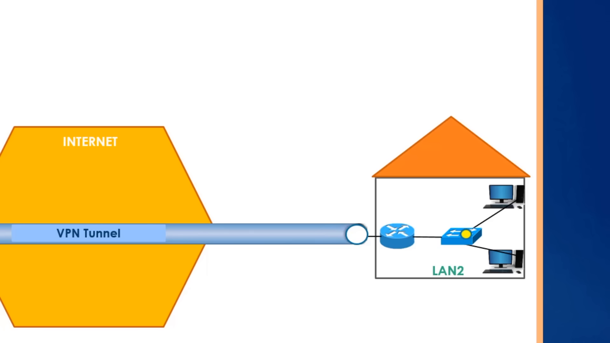

4. **Kết hợp đường hầm và mã hóa:**
   - Nếu chỉ đóng phong bì, kẻ xấu vẫn có thể xé phong bì để xem thư. Do đó, kỹ thuật bắt buộc phải kết hợp thêm Mã hóa (Encryption).
   - Toàn bộ gói tin gốc (màu vàng) được mã hóa bằng thuật toán mật mã trước khi bọc vào gói tin vận chuyển bên ngoài (màu đỏ).
   - Gói tin mã hóa di chuyển an toàn qua hàng loạt Router công cộng trên Internet. Khi đến Router biên của LAN 2 (Site-to-Site VPN), Router này bóc bỏ lớp vỏ ngoài, dùng khóa bí mật giải mã gói tin bên trong về định dạng gốc và phân phối vào đúng máy tính nhận.

5. **Mã hóa đầu cuối trong giao dịch hàng ngày:**
   - Khi người dùng cá nhân mua hàng trên Amazon và nhập thông tin thẻ tín dụng, dữ liệu không thể gửi dạng văn bản thuần (plain text) vì hacker có thể chặn bắt.
   - Giao thức mã hóa đầu cuối (End-to-End Encryption) được thiết lập trực tiếp giữa trình duyệt máy tính cá nhân và máy chủ thanh toán của trang web. Toàn bộ các bộ định tuyến trung gian của nhà mạng chỉ nhìn thấy chuỗi ký tự vô nghĩa đã được mã hóa.

---

### [[01:10:02](https://youtu.be/zN8YNNHcaZc?t=4202s)] Phân đoạn mạng

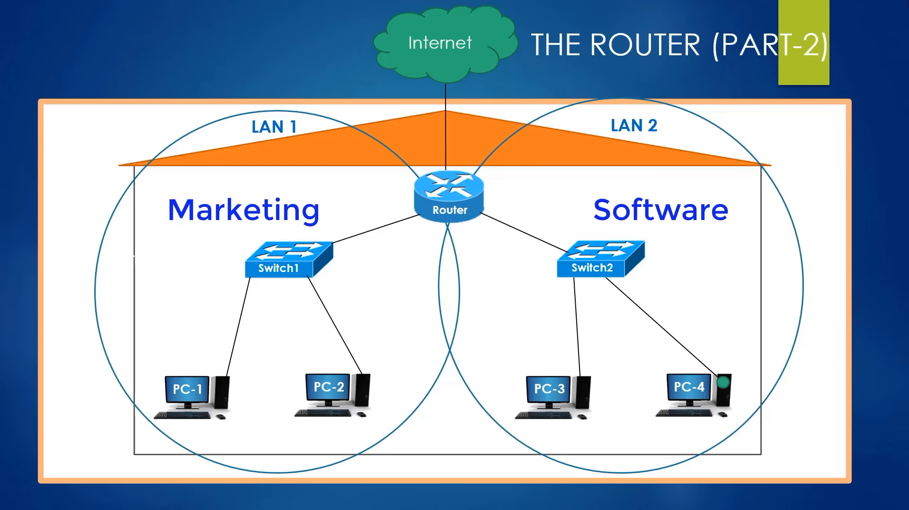

1. **Mạng khuôn viên và giới hạn khoảng cách:**
   - Giả sử một công ty có hai tòa nhà văn phòng nằm cách nhau chỉ 100 mét.
   - Trong cự ly cực ngắn này, kỹ sư mạng hoàn toàn có thể kéo một sợi cáp mạng nối thẳng Switch tòa nhà 1 sang Switch tòa nhà 2 để gộp chung thành một mạng LAN duy nhất. Mô hình này thường được gọi là Mạng khuôn viên (Campus Area Network - CAN), phổ biến trong các trường đại học hoặc cụm nhà xưởng.
   - Nếu cự ly vượt quá giới hạn suy hao của cáp vật lý (vài kilomet hoặc giữa hai thành phố), phương án nối dây trực tiếp giữa hai Switch bị vô hiệu hóa hoàn toàn.

2. **So sánh mạng diện rộng công cộng và mạng diện rộng dùng riêng:**
   - **Public WAN (WAN qua VPN):** Doanh nghiệp tận dụng đường truyền Internet công cộng có sẵn, thiết lập VPN mã hóa giữa hai đầu Router. Chi phí vận hành rất rẻ, độ an toàn cao nhưng vẫn phụ thuộc vào độ ổn định của đường truyền Internet công cộng.
   - **Private WAN (Tuyến cáp riêng biệt):** Doanh nghiệp chi trả khoản tiền lớn thuê riêng một đường truyền cáp vật lý chuyên dụng (Dedicated Leased Line) từ nhà mạng chỉ phục vụ riêng cho công ty. Gói tin không bao giờ đi vào mạng Internet công cộng. Độ bảo mật đạt mức tuyệt đối nhưng chi phí cực kỳ đắt đỏ, chỉ phù hợp cho ngân hàng hoặc tổ chức quân sự.

3. **Định nghĩa chuẩn xác nhất về bộ định tuyến:**
   - Xuyên suốt các bài học trước, Router thường được ví như thiết bị để kết nối ra Internet. Tuy nhiên định nghĩa kỹ thuật cốt lõi: Router là thiết bị dùng để kết nối các mạng khác nhau.
   - Các mạng này có thể nằm ở hai bán cầu Trái Đất, hoặc có thể nằm ngay trong cùng một văn phòng làm việc.

4. **Phân đoạn mạng trong cùng một văn phòng:**
   - Trong một công ty có 50 máy tính, người quản trị không nên để tất cả vào một mạng LAN duy nhất vì lưu lượng quảng bá (broadcast) sẽ gây nghẽn và rủi ro bảo mật nội bộ.
   - Kỹ sư mạng chia thành hai mạng LAN riêng biệt: LAN 1 dành cho phòng Marketing, LAN 2 dành cho phòng Lập trình (Software Engineering).
   - Router văn phòng được sử dụng làm trung gian:
     - 1 cổng cáp cắm vào Switch của LAN 1.
     - 1 cổng cáp cắm vào Switch của LAN 2.
     - 1 cổng cáp cắm vào đường truyền Internet của nhà mạng ISP.
   - Mỗi cổng trên Router đại diện cho một phân đoạn mạng hoàn toàn độc lập, đảm bảo trật tự phân tầng và an ninh dữ liệu nội bộ.

---

### [[01:17:26](https://youtu.be/zN8YNNHcaZc?t=4646s)] Cấp bậc nhà mạng

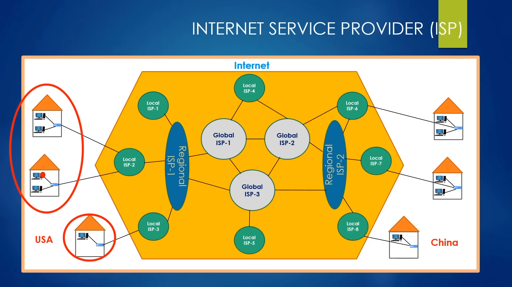

1. **Khái niệm nhà cung cấp dịch vụ mạng:**
   - Nhà cung cấp dịch vụ Internet (ISP) là các tập đoàn viễn thông sở hữu hạ tầng cáp truyền dẫn và hệ thống bộ định tuyến chịu trách nhiệm vận chuyển gói tin từ điểm này sang điểm khác.
   - Không cá nhân nào có thể tự kết nối trực tiếp vào mạng Internet mà không thông qua dịch vụ của một ISP.

2. **Trạm điểm hiện diện:**
   - Bước chân đầu tiên để một hộ gia đình kết nối Internet là nối dây cáp đến Điểm hiện diện (Point of Presence - POP) của nhà mạng địa phương (Local ISP).
   - POP là một cơ sở hạ tầng vật lý đặt tại trung tâm khu dân cư, bên trong chứa các tủ rack máy chủ, bộ chuyển mạch dung lượng cao và hàng loạt bộ định tuyến công nghiệp.
   - Một nhà mạng địa phương có thể sở hữu từ 1 đến nhiều trạm POP tùy thuộc vào quy mô mật độ dân cư của khu vực đó.

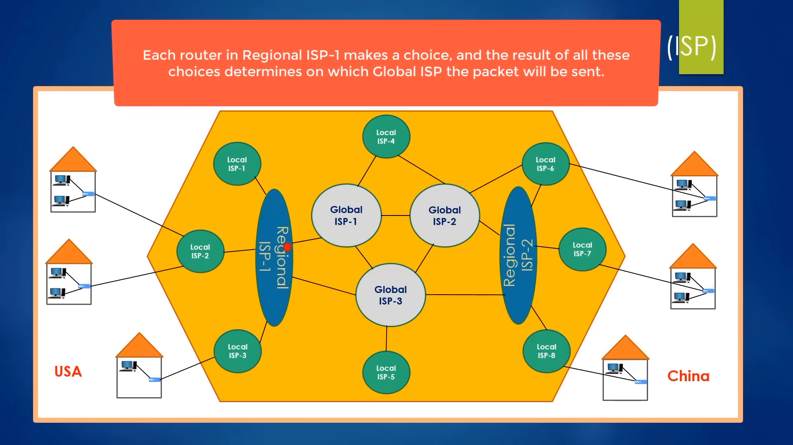

3. **Cấu trúc phân cấp hình chóp:**
   - **Nhà mạng địa phương (Local ISP):** Quản lý kết nối thuê bao của các hộ gia đình và văn phòng trong phạm vi một phường hoặc một quận. Khi hai máy tính trong cùng khu phố gửi dữ liệu cho nhau, gói tin chỉ cần đi qua các Router bên trong trạm POP của Local ISP là đến đích.
   - **Nhà mạng khu vực (Regional ISP):** Kết nối nhiều nhà mạng địa phương lại với nhau. Phạm vi quản lý trải dài trên quy mô một thành phố hoặc toàn bộ một quốc gia. Khi hai thuê bao ở hai thành phố khác nhau liên lạc, gói tin đi từ Local ISP 1 -> Regional ISP -> Local ISP 2.
   - **Nhà mạng toàn cầu (Global ISP):** Sở hữu hạ tầng mạng trục chính (Internet Backbone) và các tuyến cáp quang xuyên đại dương nối giữa các châu lục.
   - **Nguyên tắc phân tầng tránh mạng lưới rối (Mesh Complexity):** Các nhà mạng địa phương không đấu nối trực tiếp chéo cánh với nhau vì sẽ làm bùng nổ số lượng đường nối và độ phức tạp quản lý. Kiến trúc phân tầng hình chóp giúp tối giản hóa số lượng liên kết định tuyến.

4. **Ngoại lệ kết nối trực tiếp:**
   - Trong một số trường hợp đặc thù, một nhà mạng địa phương quy mô lớn có thể chi trả thêm chi phí để đấu nối một đường cáp trực tiếp lên thẳng Nhà mạng toàn cầu (Global ISP) mà không cần đi qua Nhà mạng khu vực, giúp giảm độ trễ tối đa cho khách hàng của họ.

---

### [[01:32:21](https://youtu.be/zN8YNNHcaZc?t=5541s)] Định tuyến thực tế

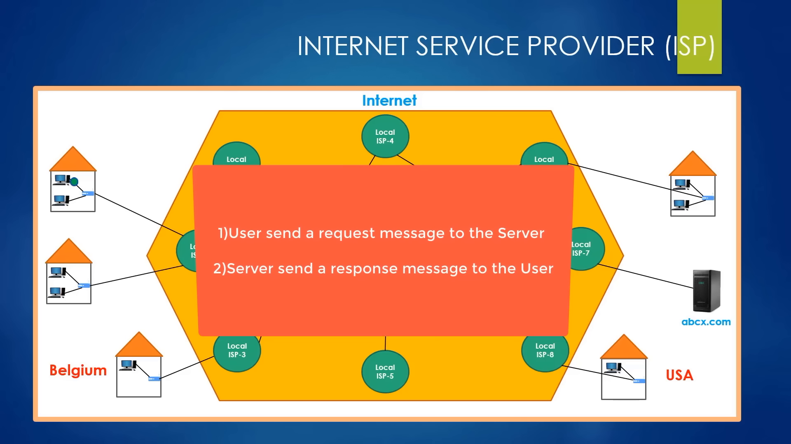

1. **Kịch bản truy cập trang web máy chủ đơn lẻ:**
   - Giả định người dùng tại Bỉ (Châu Âu) truy cập vào một trang web mới thành lập mang tên `abcx.com`. Do kinh phí hạn hẹp, chủ sở hữu trang web chỉ thuê duy nhất một máy chủ đặt tại Mỹ.
   - Hành trình gói tin yêu cầu (Request):
     - Gói tin rời máy tính tại Bỉ -> qua Local ISP -> qua Regional ISP -> qua Global ISP vượt Đại Tây Dương -> đến máy chủ của `abcx.com` tại Mỹ.
   - Hành trình gói tin phản hồi (Response):
     - Máy chủ tiếp nhận yêu cầu, trích xuất mã nguồn HTML, hình ảnh, video và đóng thành các gói tin phản hồi.
     - Các gói tin phản hồi được gửi ngược lại người dùng.
   - **Đặc tính động của đường đi:** Tuyến đường gói tin phản hồi đi về máy tính người dùng hoàn toàn có thể khác với tuyến đường gói tin yêu cầu đã đi trước đó. Các Router trung gian liên tục đưa ra quyết định độc lập tại thời điểm gói tin đến dựa trên tình trạng lưu lượng mạng tức thời.
   - Khi toàn bộ gói tin phản hồi đến máy tính, trình duyệt web giải mã mã nguồn HTML và hiển thị giao diện trang web hoàn chỉnh lên màn hình trong tích tắc vài trăm mili-giây.

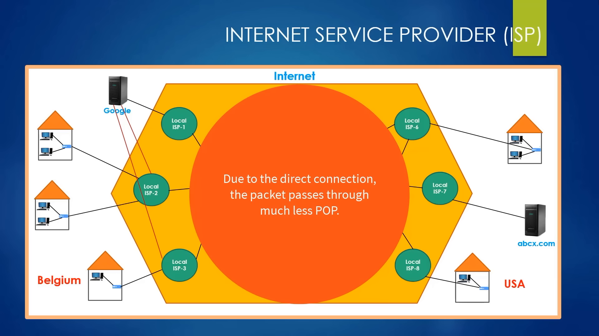

2. **Kỹ thuật đấu nối trực tiếp của các tập đoàn lớn:**
   - Đối với các dịch vụ khổng lồ như Google hoặc YouTube, lưu lượng người dùng truy cập là cực kỳ khủng khiếp. Nếu hàng tỷ người đều gửi gói tin qua hệ thống phân cấp nhà mạng truyền thống, mạng lưới Internet toàn cầu sẽ tắc nghẽn nghiêm trọng.
   - Google triển khai giải pháp kỹ thuật Đấu nối trực tiếp (Peering):
     - Google xây dựng các cụm máy chủ và trung tâm dữ liệu đặt rải rác gần các đô thị lớn trên toàn cầu.
     - Thay vì đẩy dữ liệu vòng vèo qua Nhà mạng khu vực và Nhà mạng toàn cầu, Google kéo cáp kết nối trực tiếp từ trung tâm dữ liệu của mình vào thẳng các trạm POP của Nhà mạng địa phương (Local ISP).
   - Lợi ích của Peering:
     - **Tốc độ và chất lượng:** Người xem video YouTube xem mượt mà không bị giật lag vì gói tin đi thẳng từ máy chủ Google sang Local ISP đến nhà người dùng, không phải qua các nút nghẽn trung gian.
     - **Bảo mật vượt trội:** Do số lượng trạm trung gian công cộng mà gói tin phải đi qua giảm xuống tối thiểu, nguy cơ bị can thiệp hoặc đánh cắp dữ liệu trên đường truyền gần như bị triệt tiêu.

3. **Mạng trục chính và điểm trao đổi lưu lượng:**
   - Liên minh các tuyến truyền dẫn dung lượng siêu lớn do các Nhà mạng toàn cầu vận hành được gọi là Mạng trục chính Internet (Internet Backbone).
   - Để các Nhà mạng toàn cầu đồng bộ và trao đổi lưu lượng qua lại với nhau một cách trung lập và bình đẳng, họ kết nối với nhau tại các cơ sở hạ tầng vật lý gọi là Điểm trao đổi Internet (Internet Exchange Point - IXP / IX).
   - Người dùng thông thường kết nối qua Local ISP có sẵn tại khu vực, nhưng về mặt kỹ thuật, bất kỳ tổ chức nào có đủ năng lực tài chính đều có thể ký hợp đồng kéo tuyến trực tiếp lên Regional ISP hoặc Global ISP theo nhu cầu.

---

## Trích dẫn then chốt

* [[00:44:48](https://youtu.be/zN8YNNHcaZc?t=2688s)] *"The internet is the network of the networks."* — Mạng Internet về bản chất kinh điển là mạng của các mạng, một hệ thống khổng lồ kết nối hàng triệu mạng cục bộ trên toàn thế giới lại với nhau.
* [[00:31:35](https://youtu.be/zN8YNNHcaZc?t=1895s)] *"99% of all international communication on the internet is provided by these 468 cable lines laid under the water."* — 99% toàn bộ liên lạc quốc tế trên Internet được truyền tải qua 468 tuyến cáp quang ngầm dưới đáy biển chứ không phải qua sóng vệ tinh không gian.
* [[01:14:50](https://youtu.be/zN8YNNHcaZc?t=4490s)] *"We use switches to create a LAN while we use routers to create a WAN."* — Chúng ta sử dụng bộ chuyển mạch để tạo lập một mạng cục bộ, trong khi chúng ta sử dụng bộ định tuyến để kiến tạo nên một mạng diện rộng.
* [[01:15:35](https://youtu.be/zN8YNNHcaZc?t=4535s)] *"The main task of the router is to connect different networks. That's it."* — Nhiệm vụ cốt lõi duy nhất của bộ định tuyến là kết nối các mạng khác nhau lại với nhau, bất kể các mạng đó cách nhau nửa vòng Trái Đất hay nằm trong cùng một văn phòng.
* [[01:37:30](https://youtu.be/zN8YNNHcaZc?t=5850s)] *"Peering is the technique which Google establishes a direct connection with an ISP to provide faster access to its servers."* — Đấu nối trực tiếp là kỹ thuật mà các tập đoàn công nghệ lớn thiết lập liên kết thẳng tới nhà mạng địa phương nhằm tối đa hóa tốc độ truy cập và bảo mật dữ liệu.

---

## Lệnh & Công cụ

### Dụng cụ chẩn đoán mạng

Khối lệnh kiểm tra và theo dõi đường truyền mạng trên máy trạm Linux / macOS:

```bash
# 1. Kiểm tra cấu hình card mạng và địa chỉ IP nội bộ
ip addr show || ifconfig

# 2. Xem cổng mạng và bảng định tuyến cục bộ trên máy tính
ip route show || netstat -rn

# 3. Kiểm tra độ trễ và mất gói đến thiết bị trong mạng LAN hoặc máy chủ Internet
ping -c 4 192.168.1.1
ping -c 4 8.8.8.8

# 4. Truy vết danh sách các bộ định tuyến trung gian (hop) trên đường truyền
traceroute -n google.com
# hoặc sử dụng công cụ mtr kết hợp ping và traceroute thời gian thực:
mtr --report google.com

# 5. Phân tích truy vấn phân giải tên miền thành địa chỉ IP
nslookup google.com
dig google.com +trace
```

### Công thức phân biệt thiết bị

* **Switch vs Access Point:** Cùng tạo mạng LAN; Switch dùng cáp vật lý, Access Point dùng sóng Wi-Fi.
* **Switch vs Router:** Switch liên kết thiết bị trong cùng 1 mạng; Router liên kết các mạng khác nhau.
* **Home Router:** Tích hợp cả Router + Switch + Access Point trong 1 thiết bị dân dụng.
* **Tunneling + Encryption:** Đóng gói đường hầm che giấu điểm đến nội bộ + Mã hóa bảo vệ nội dung dữ liệu trước sự dòm ngó trên mạng công cộng.

---

## Đánh đổi & Rủi ro

| Giải pháp kiến trúc | Lợi thế kỹ thuật | Sự đánh đổi & Rủi ro tiềm ẩn |
| :--- | :--- | :--- |
| **Kiến trúc phân tán (Distributed Topology)** | Triệt tiêu điểm lỗi đơn lẻ (SPOF), tối ưu chiều dài cáp, hỗ trợ cân bằng tải linh hoạt. | Độ phức tạp thuật toán định tuyến cực cao, khó kiểm soát đồng bộ trạng thái mạng toàn cầu. |
| **Cáp quang biển (Submarine Fiber)** | Tốc độ truyền tải ánh sáng cực cao, suy hao cực thấp trên khoảng cách hàng nghìn kilomet. | Rủi ro vật lý thường trực từ mỏ neo tàu cá, thiên tai động đất ngầm; chi phí sửa chữa đáy biển vô cùng đắt đỏ. |
| **Mạng diện rộng qua VPN (Public WAN)** | Chi phí triển khai thấp vì tận dụng hạ tầng Internet công cộng sẵn có; triển khai nhanh chóng. | Phụ thuộc vào độ trễ và độ ổn định của nhà mạng công cộng; tiềm ẩn nguy cơ bảo mật nếu cấu hình khóa mật mã sơ hở. |
| **Tuyến cáp thuê riêng (Private WAN)** | Băng thông cố định, độ trễ tối thiểu, dữ liệu cô lập 100% khỏi mạng Internet công cộng. | Chi phí thuê hạ tầng định kỳ cực kỳ đắt đỏ; thời gian triển khai kéo cáp vật lý kéo dài nhiều tháng. |
| **Đấu nối trực tiếp (Peering)** | Tốc độ truyền tải trực tiếp vượt trội, giảm tải cho mạng trục chính, tăng cường bảo mật. | Yêu cầu tiềm lực tài chính khổng lồ để đầu tư cụm máy chủ phân tán và thỏa thuận hạ tầng với từng nhà mạng viễn thông. |
