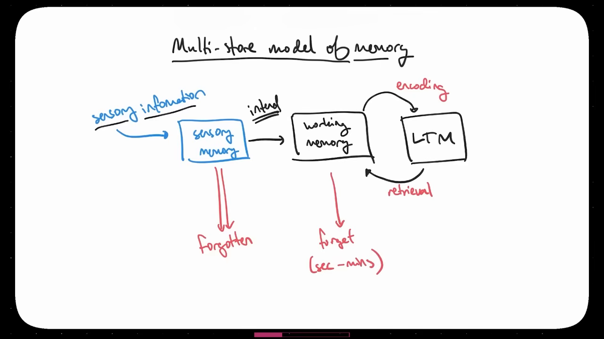
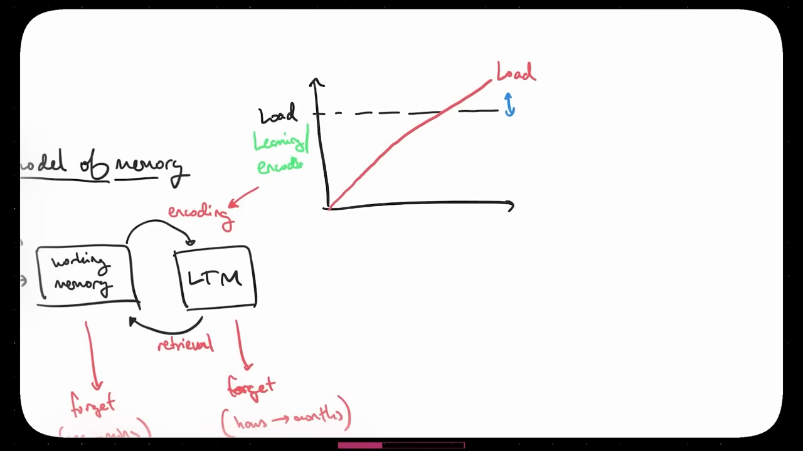
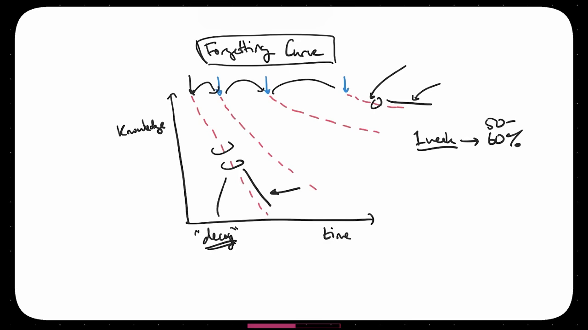
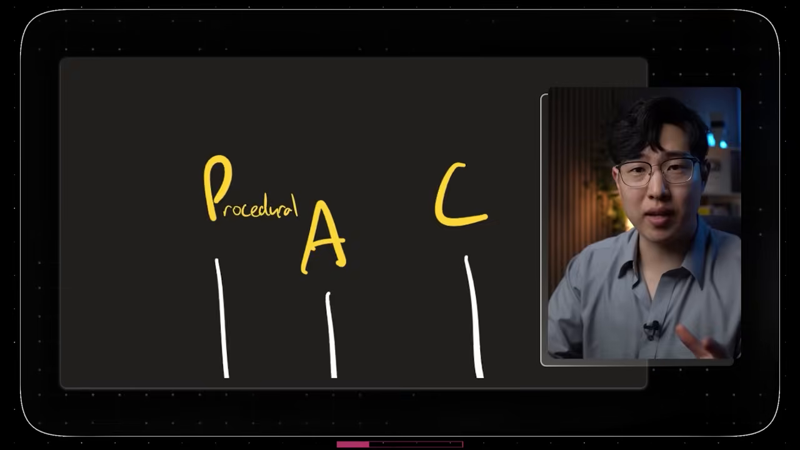
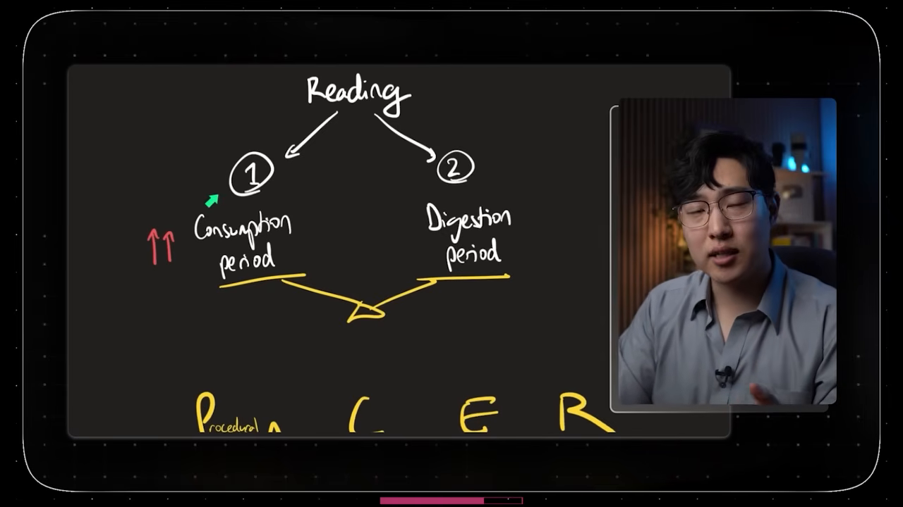
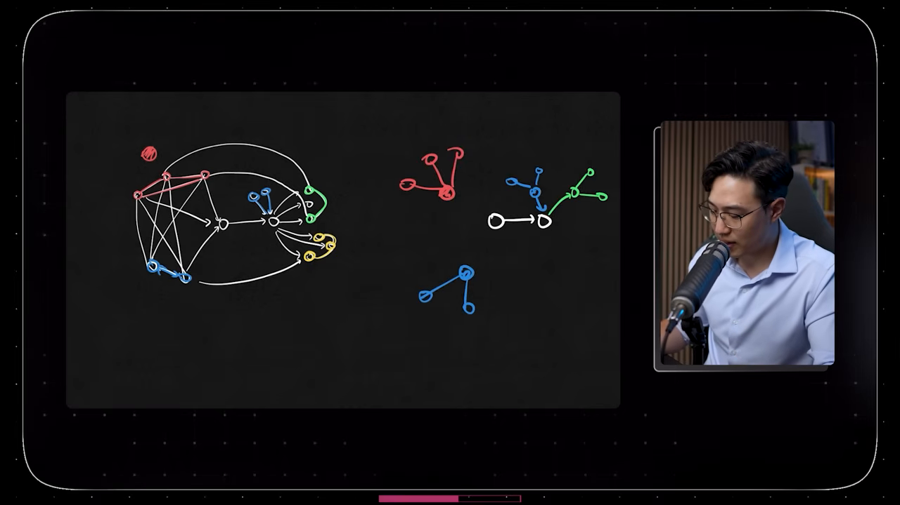
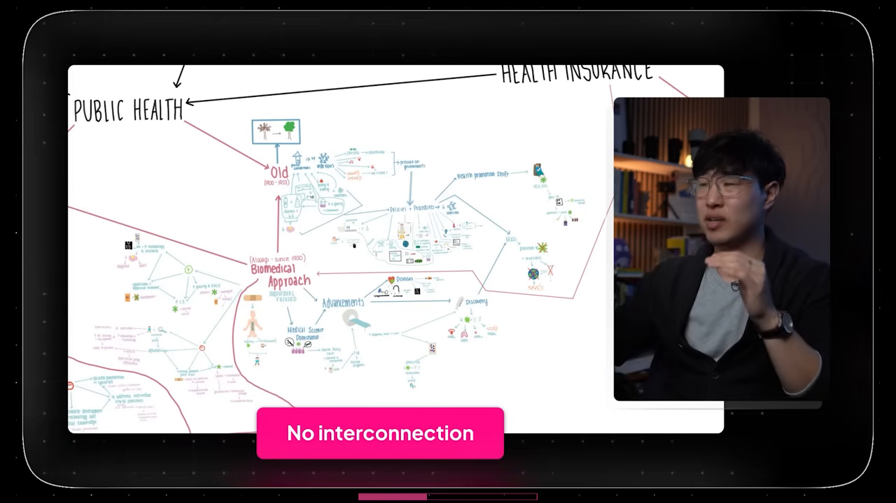
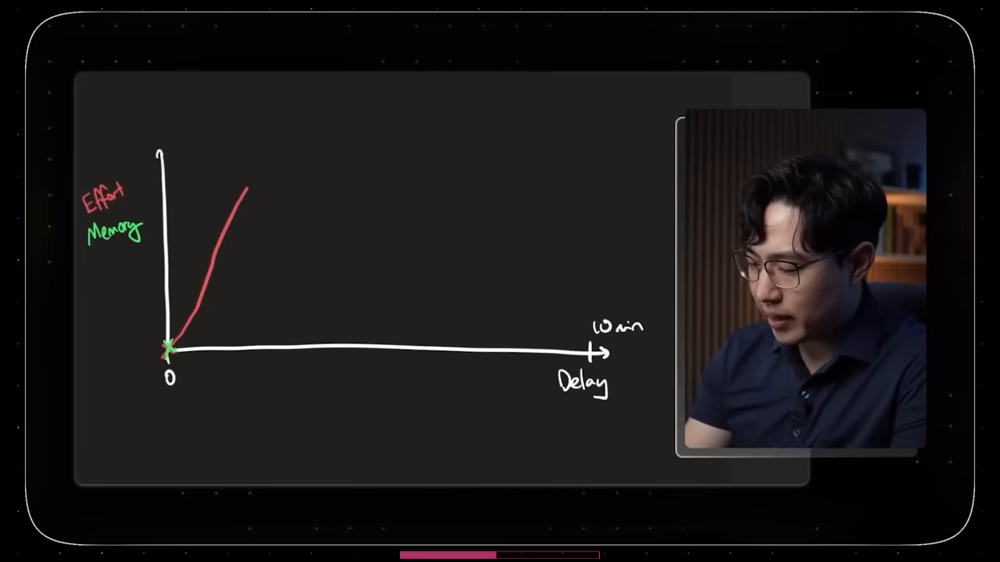
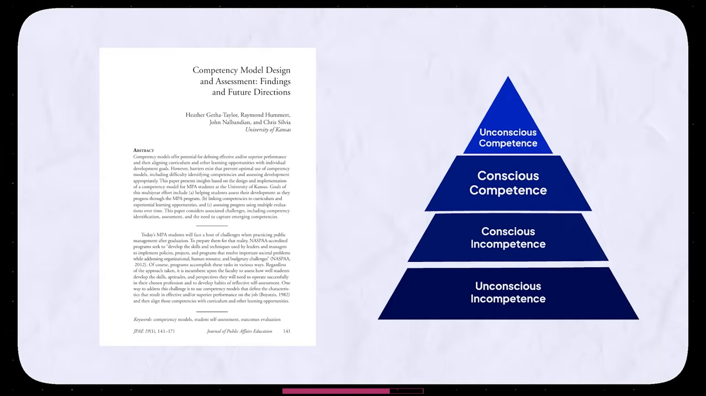

# Học Cách Học Trong 4 Giờ 54 Phút - Toàn Bộ Khóa Học

* **Kênh:** Justin Sung | **Thời lượng:** 04:54:53 | **Ngày:** 2026-03-16
* **Video:** https://youtu.be/waGRF_ZApfI

---

## Thuật ngữ

| Thuật ngữ | Tiếng Anh | Giải thích |
| :--- | :--- | :--- |
| Mã hóa | Encoding | Quá trình xử lý, cấu trúc hóa và đưa thông tin từ trí nhớ làm việc vào trí nhớ dài hạn. |
| Truy hồi | Retrieval | Quá trình gọi lại và kéo dữ liệu từ trí nhớ dài hạn trở lại trí nhớ làm việc để sử dụng hoặc kiểm tra. |
| Kỹ năng bổ trợ | Enablers | Các thói quen tự quản lý (quản lý thời gian, chống trì hoãn, tập trung) và kỹ năng phát triển (thử nghiệm, tự phản chiếu). |
| Trí nhớ làm việc | Working Memory | Vùng đệm xử lý thông tin ngắn hạn với dung lượng giới hạn, chỉ lưu giữ thông tin trong vài giây đến vài phút. |
| Trí nhớ dài hạn | Long-term Memory (LTM) | Hệ thống lưu trữ thông tin bền vững từ vài ngày, vài tháng đến trọn đời sau khi được mã hóa sâu sắc. |
| Tải trọng nhận thức | Cognitive Load | Lượng năng lượng tinh thần và tài nguyên tư duy mà não bộ phải huy động để xử lý một tác vụ học tập. |
| Xử lý sâu | Deep Processing | Cơ chế tư duy tập trung vào bản chất, sự tương đồng, khác biệt và mối quan hệ giữa các khái niệm thay vì ghi nhớ bề mặt. |
| Khung PACER | PACER Framework | Bộ phân loại 5 kiểu kiến thức: Quy trình (Procedural), Tương đồng (Analogical), Khái niệm (Conceptual), Trải nghiệm (Episodic), Quan hệ (Relational). |
| Khung GRIND | GRIND Framework | Quy trình 5 bước xây dựng sơ đồ tư duy: Nhóm (Grouping), Quan hệ (Relationships), Trọng tâm (Importance), Phi tuyến tính (Non-linear), Hướng dòng chảy (Direction). |
| Bốn tầng năng lực | 4 Stages of Competence | Mô hình tiến trình làm chủ kỹ năng: Vô thức bất tài -> Có ý thức bất tài -> Có ý thức thành thạo -> Vô thức thành thạo. |
| Ảo tưởng học tập | Illusion of Learning | Cảm giác sai lầm rằng bản thân đã hiểu sâu khi chỉ thực hiện các thao tác thụ động như đọc lướt, chép bài hàng loạt hoặc highlight. |
| Lặp lại ngắt quãng | Spaced Repetition | Kỹ thuật ôn tập ngắt quãng theo chu kỳ thời gian để củng cố vết hằn trí nhớ trước khi thông tin bị phân rã hoàn toàn. |
| Truy hồi chủ động | Active Recall | Hành động tự kiểm tra, kéo thông tin ra khỏi đầu mà không nhìn tài liệu để phát hiện lỗ hổng và củng cố liên kết thần kinh. |

---

## Tổng luận chuyên đề

### Bản chất của việc học

Học tập (Learning) và Học bài (Studying) là hai khái niệm hoàn toàn khác biệt. Học bài là những hành vi cơ học diễn ra trong thế giới vật lý: mở sách vở, lật trang giấy, dùng bút dạ quang highlight, chép lại bài giảng hoặc xem video. Ngược lại, học tập là quá trình nhận thức thần kinh diễn ra bên trong não bộ, nơi thông tin thô được tổ chức, liên kết và chuyển hóa thành mạng lưới tri thức bền vững trong trí nhớ dài hạn. Một phương pháp học bài có thể tốn 10 giờ nhưng chỉ đem lại 1 giờ học tập thực chất nếu quy trình đó kích hoạt tải trọng nhận thức quá thấp (học tập thụ động).

### Tam giác ba trụ cột

Năng lực học tập đỉnh cao được cấu thành từ ba trụ cột có thứ tự phát triển chặt chẽ:
1. **Kỹ năng bổ trợ (Enablers):** Nền tảng quản lý bản thân (chống trì hoãn, kỷ luật, quản lý thời gian) và kỹ năng phát triển (dám thử nghiệm kỹ thuật mới, tự phản chiếu đánh giá sai sót). Đây là điều kiện tiên quyết cần hoàn thiện trước tiên.
2. **Kỹ năng truy hồi (Retrieval):** Lưới an toàn giúp phát hiện lỗ hổng kiến thức, đo lường tốc độ phản xạ và củng cố vết hằn trí nhớ dài hạn thông qua flashcard, giải bài tập và tự kiểm tra.
3. **Kỹ năng mã hóa (Encoding):** Trụ cột tinh hoa quyết định tốc độ tiếp thu và độ sâu hiểu biết. Người có khả năng mã hóa xuất sắc gần như không tạo ra lỗ hổng kiến thức, hiểu thấu suốt ngay từ lần tiếp cận đầu tiên và không cần tốn hàng giờ cày cuốc lại bài cũ.

### Nghịch lý lặp lại ngắt quãng

Kỹ thuật truy hồi chủ động và lặp lại ngắt quãng (Active Recall & Spaced Repetition) đang bị thần thánh hóa một cách sai lệch. Nếu không có quá trình mã hóa chất lượng cao ở giai đoạn đầu, kiến thức đưa vào đầu chỉ là những mảnh vụn rời rạc không có ngữ cảnh. Khi đó, người học rơi vào cái bẫy "cày flashcard vô tận" (Anki grind): não bộ liên tục quên vì kiến thức nông cạn, buộc người học phải dành hàng giờ mỗi ngày để học lại những dữ kiện cô lập mà không thể áp dụng vào việc giải quyết vấn đề phức tạp.

### Chuyển đổi tư duy ghi chép

Ghi chép tuyến tính (viết tuần tự từng dòng, từng gạch đầu dòng từ trên xuống dưới) phản ánh cấu trúc bề mặt của tài liệu chứ không phản ánh mạng lưới tri thức trong não chuyên gia. Để học nhanh gấp nhiều lần, người học phải chuyển sang tư duy phi tuyến tính (Non-linear Thinking) với phương pháp lập sơ đồ khái niệm (Mind Mapping/GRIND) và kỹ thuật trì hoãn ghi chép (Delayed Note-taking) từ 5 đến 10 phút để ép não bộ tiêu hóa, phân loại và liên kết thông tin trước khi đặt bút.

---

## Bóc tách chi tiết

### [[00:01:14](https://youtu.be/waGRF_ZApfI?t=74s)] Ba trụ cột

Tiến trình học tập xuất phát từ nhận thức rằng nỗ lực học tập thực chất luôn đi kèm cảm giác khó chịu và mệt mỏi về mặt nhận thức. Việc học sâu đòi hỏi não bộ phải suy nghĩ liên tục ở cường độ cao, tương tự như việc chạy marathon đường trường: cảm giác khó khăn không biến mất, mà người học dần làm quen với cường độ đó.

Hệ thống học tập gồm 3 thành tố:
1. **Kỹ năng bổ trợ (Enablers):** Chia thành hai nhóm:
   - *Tự quản lý:* Ngăn ngừa trì hoãn, làm chủ sự tập trung, phân bổ quỹ thời gian.
   - *Kỹ năng phát triển:* Tinh thần thử nghiệm phương pháp mới không sợ sai và khả năng phản chiếu phản biện (Critical Reflection) để nhận diện lỗi sai sau mỗi chu trình học.
2. **Kỹ năng truy hồi (Retrieval):** Cơ chế kéo dữ liệu ra ngoài để kích hoạt quá trình củng cố trí nhớ và khoanh vùng các điểm mù nhận thức.
3. **Kỹ năng mã hóa (Encoding):** Cơ chế xử lý chiều sâu, đưa thông tin vào não bộ thành một cấu trúc liên kết chặt chẽ.

Thứ tự chuẩn hóa để phát triển năng lực học:
- **Bước 1:** Chuẩn hóa kỹ năng bổ trợ để duy trì kỷ luật và tạo môi trường học ổn định.
- **Bước 2:** Xây dựng hệ thống truy hồi để làm lưới an toàn bắt giữ các lỗ hổng kiến thức trước kỳ thi.
- **Bước 3:** Rèn luyện kỹ năng mã hóa để chuyển đổi hoàn toàn thói quen nhận thức thâm căn cố đế từ xử lý bề mặt sang xử lý sâu.

---

### [[00:14:29](https://youtu.be/waGRF_ZApfI?t=869s)] Giới hạn truy hồi

Tiến sĩ Justin Sung chia sẻ câu chuyện bản thân: Trong năm đầu đại học chuẩn bị vào trường y, ông học 20 tiếng mỗi ngày, chỉ ngủ 2-3 tiếng, thức trắng 77 tiếng liên tục và học hàng nghìn flashcard Anki. Dù đạt điểm cao và đỗ trường y, nhưng khi bước vào năm nhất trường y với khối lượng kiến thức tăng gấp đôi, chiến lược cày cuốc thời gian hoàn toàn sụp đổ. Không ai có thể tăng từ 20 tiếng lên 40 tiếng học một ngày.

Trong khi đó, những sinh viên xuất sắc nhất không dành hàng giờ cày flashcard trong thư viện mà vẫn đạt điểm tuyệt đối. Sự khác biệt nằm ở năng lực **xử lý sâu (Deep Processing)**: khả năng hiểu thấu đáo bản chất cấu trúc vấn đề ngay trong lần đọc đầu tiên.

---

### [[00:26:40](https://youtu.be/waGRF_ZApfI?t=1600s)] Trí nhớ đa tầng



Mô hình trí nhớ đa tầng (Multi-store Model of Memory) giải thích dòng chảy dữ liệu trong não bộ:
1. **Trí nhớ cảm giác (Sensory Memory):** Tiếp nhận thông tin thị giác, thính giác từ môi trường. Não bộ tiêu tốn 20% tổng năng lượng cơ thể khi nghỉ ngơi, do đó cơ chế sinh tồn buộc não phải tự động xóa bỏ 99% kích thích cảm giác không liên quan để tránh quá tải năng lượng.
2. **Trí nhớ làm việc (Working Memory):** Được ví như sảnh chờ khách sạn (Hotel Lobby). Dữ liệu chỉ có thể lưu lại tạm thời trong vài giây đến vài phút nếu không có sự chủ đích chú ý. Mọi thông tin muốn đưa vào trí nhớ dài hạn hay muốn lấy ra sử dụng đều bắt buộc phải đi qua sảnh chờ này.
3. **Trí nhớ dài hạn (Long-term Memory - LTM):** Nơi lưu trữ kiến thức bền vững qua nhiều tháng hoặc nhiều năm. 
   - Quá trình chuyển từ trí nhớ làm việc sang LTM gọi là **Mã hóa (Encoding)**.
   - Quá trình kéo dữ liệu từ LTM trở lại trí nhớ làm việc để trả lời câu hỏi gọi là **Truy hồi (Retrieval)**.

Quy tắc thùng nước: Không thể múc nước từ một thùng rỗng. Nếu khâu mã hóa ban đầu bị thủng lỗ chỗ, việc cố gắng truy hồi chỉ dẫn đến sự thất vọng và tốn thời gian học lại từ đầu.

---

### [[00:28:55](https://youtu.be/waGRF_ZApfI?t=1735s)] Tải trọng nhận thức



Mối quan hệ giữa tải trọng nhận thức và hiệu quả học tập:
- Khi tải trọng nhận thức ở mức thấp (đọc lướt, nghe giảng thụ động, tô màu highlight), não bộ hầu như không kích hoạt đường dẫn mã hóa, dẫn đến tỷ lệ quên gần như 100%. Cảm giác buồn ngủ và chán nản khi học là chỉ dấu sinh học cho thấy phương pháp đang dùng có tải trọng nhận thức quá thấp.
- Khi tải trọng nhận thức tăng lên, hiệu quả mã hóa và lượng tri thức dung nạp tăng tỷ lệ thuận. Dấu hiệu của tải trọng nhận thức cao là cảm giác bối rối tích cực, não bộ phải tự đặt câu hỏi: "Khái niệm này liên quan thế nào đến điều mình đã biết? Tại sao lại có cơ chế này? Điểm khác biệt là gì?".
- Tuy nhiên, tải trọng nhận thức có ngưỡng chịu đựng (Threshold). Nếu thông tin đưa vào quá ồ ạt vượt quá dung lượng trí nhớ làm việc, não bộ sẽ rơi vào trạng thái quá tải nhận thức, khiến đường cong học tập gãy khúc và sụt giảm nghiêm trọng.

---

### [[00:35:40](https://youtu.be/waGRF_ZApfI?t=2140s)] Đường cong quên



Đường cong quên Ebbinghaus thể hiện sự phân rã của kiến thức theo thời gian:
- Nếu chỉ học một lần, tốc độ phân rã kiến thức diễn ra theo phương thẳng đứng dốc đứng, mất từ 50% đến 80% nội dung chỉ sau vài ngày.
- Mỗi lần thực hiện truy hồi ngắt quãng đúng thời điểm (ngay khi kiến thức chuẩn bị rơi rụng), độ dốc của đường phân rã sẽ thoải dần ra. Sau 4 đến 5 lần lặp lại có chủ đích, tốc độ phân rã gần như đi ngang, biến kiến thức thành trí nhớ vĩnh viễn.
- Sai lầm chí mạng: Dùng lặp lại ngắt quãng để cố nhồi nhét những sự thật cô lập (Isolated Facts). Nếu không có khung xương liên kết, việc lặp lại chỉ tạo ra sự ghi nhớ vẹt tạm thời.

---

### [[00:54:50](https://youtu.be/waGRF_ZApfI?t=3290s)] Sai lầm flashcard

Flashcard truyền thống bộc lộ 3 nhược điểm lớn khi học kiến thức bậc cao:
1. **Cô lập hóa kiến thức (Atomization):** Cắt nhỏ một hệ thống phức tạp thành các thẻ câu hỏi - câu trả lời riêng lẻ, triệt tiêu hoàn toàn mối quan hệ nguyên nhân - kết quả giữa các thành phần.
2. **Ảo tưởng thông thạo (Illusion of Competence):** Trả lời đúng một mặt thẻ dựa vào việc nhận diện từ khóa bề mặt chứ không phải do hiểu thấu bản chất hệ thống.
3. **Gánh nặng số lượng (Volume Overload):** Tạo ra hàng nghìn thẻ học khiến người học kiệt sức và bỏ cuộc.

Giải pháp chuyển đổi:
- Chuyển từ **Thẻ sự thật (Fact Cards)** sang **Thẻ khái niệm quan hệ (Concept Cards)**: Thay vì hỏi định nghĩa đơn lẻ, câu hỏi trên thẻ phải yêu cầu so sánh, tìm điểm tương đồng hoặc dự đoán kết quả khi một biến số trong hệ thống thay đổi.
- **Học xen kẽ (Interleaving):** Xáo trộn các dạng bài tập và chủ đề khác nhau thay vì làm bài tập theo từng khối đồng nhất, buộc não bộ phải liên tục phân biệt và lựa chọn chiến lược giải quyết thích hợp.

---

### [[01:15:17](https://youtu.be/waGRF_ZApfI?t=4517s)] Bậc thang tư duy

Thang đo nhận thức Bloom và cấu trúc SOLO (Structure of Observed Learning Outcomes) xác định các bậc tư duy:
- **Tầng thấp (Ghi nhớ & Nhận diện):** Ghi nhớ sự kiện, thuật ngữ, định nghĩa. Đây là tầng hầu hết người học dừng lại khi dùng flashcard và highlight.
- **Tầng trung (Hiểu & Áp dụng):** Diễn giải bằng lời của mình, áp dụng công thức vào bài toán chuẩn.
- **Tầng cao (Phân tích, Đánh giá & Sáng tạo):** Tách cấu trúc hệ thống thành các khối thành phần, so sánh ưu nhược điểm, phê phán các giả định và tích hợp thành mô hình mới.

Học tập hiệu quả đòi hỏi người học phải leo lên tầng tư duy cao nhất ngay từ giai đoạn tiếp cận tài liệu đầu tiên, thay vì đợi đến khi "thuộc lòng hết" mới bắt đầu suy nghĩ.

---

### [[01:34:52](https://youtu.be/waGRF_ZApfI?t=5692s)] Khung mã hóa PACER



Khung PACER phân loại kiến thức thành 5 danh mục để áp dụng chiến lược mã hóa tối ưu:
1. **P - Thủ tục (Procedural):** Các quy trình từng bước, thuật toán, kỹ thuật thao tác. Cần mã hóa bằng sơ đồ dòng chảy (Flowchart) và thực hành lặp lại.
2. **A - Phép ẩn dụ (Analogical):** So sánh khái niệm trừu tượng mới với một trải nghiệm quen thuộc trong đời sống thực tế.
3. **C - Khái niệm (Conceptual):** Các nguyên lý cốt lõi, định lý, lý thuyết nền tảng. Cần mã hóa bằng cấu trúc phân cấp và bản đồ mạng lưới.
4. **E - Trải nghiệm (Episodic):** Các câu chuyện cụ thể, case study, sự kiện lịch sử, ví dụ thực tế.
5. **R - Quan hệ (Relational):** Mối liên kết động, chiều tác động, điều kiện tiên quyết giữa các thành phần trong hệ thống.

---

### [[01:54:10](https://youtu.be/waGRF_ZApfI?t=6850s)] Tiêu thụ và tiêu hóa



Học tập hiệu quả khi đọc sách hoặc xem bài giảng phải được phân tách thành hai giai đoạn rõ rệt:
1. **Giai đoạn tiêu thụ (Consumption Period):** Tiếp nhận thông tin qua thị giác hoặc thính giác. Giai đoạn này chỉ đóng vai trò thu thập nguyên liệu thô.
2. **Giai đoạn tiêu hóa (Digestion Period):** Tạm dừng việc đọc để não bộ tổ chức, phân loại, tìm quy luật và phê phán nội dung vừa tiếp nhận.

Hầu hết người học thất bại vì dành 95% thời gian để liên tục tiêu thụ (đọc hết trang này sang trang khác, xem hết video này sang video khác) mà không dành thời gian tiêu hóa. Tỷ lệ tối ưu của một người học xuất sắc là dành ít nhất 50% đến 70% tổng thời gian cho giai đoạn tiêu hóa.

---

### [[02:01:05](https://youtu.be/waGRF_ZApfI?t=7265s)] Phương pháp nấc thang

Phương pháp nấc thang (Ladder Method) xử lý tài liệu phức tạp qua 3 nấc:
- **Nấc 1 - Tổng quan thô:** Quét nhanh toàn bộ văn bản để xác định bức tranh toàn cảnh, ước lượng số lượng chủ đề lớn và thiết lập các "chiếc cốc" chứa thông tin.
- **Nấc 2 - Phân nhóm chi tiết:** Rót các dữ liệu con vào từng chiếc cốc tương ứng dựa trên tính chất tương đồng, loại bỏ hoàn toàn các chi tiết rườm rà.
- **Nấc 3 - Tinh chỉnh quan hệ:** Xác định mũi tên tương tác, sự đánh đổi và mối liên kết chéo giữa các cốc thông tin khác nhau.

---

### [[02:12:04](https://youtu.be/waGRF_ZApfI?t=7924s)] Mười hai quy tắc



Bản chất của tri thức trong não bộ chuyên gia không phải là một danh sách gạch đầu dòng tuyến tính, mà là một mạng lưới các nút (Nodes) được kết nối chặt chẽ theo từng cụm (Clusters):
- Tri thức chuyên sâu có mật độ kết nối dày đặc giữa các cụm. Khi một nút được kích hoạt, toàn bộ mạng lưới liên quan lập tức được truy xuất.
- Người học kém biến tài liệu thành các chuỗi gạch đầu dòng dài dặc. Khi mất đi một mắt xích, toàn bộ chuỗi suy luận sụp đổ hoàn toàn.
- Quy tắc cốt lõi: Luôn tìm kiếm các mẫu hình tương đồng (Shared Similarities) giữa các khái niệm tưởng chừng tách biệt để gom cụm và bắc cầu liên kết.

---

### [[02:39:30](https://youtu.be/waGRF_ZApfI?t=9570s)] Khung sơ đồ GRIND



Khung 5 bước xây dựng sơ đồ tư duy thực chiến (GRIND):
1. **G - Nhóm (Grouping):** Gom các dữ kiện có chung đặc tính vào cùng một khu vực không gian. Không viết lan man từng ý riêng rẽ.
2. **R - Quan hệ (Relationships):** Nối các đường liên kết thể hiện bản chất quan hệ (nhân quả, điều kiện, tương phản, bổ trợ).
3. **I - Trọng tâm (Importance):** Phân cấp độ ưu tiên rõ ràng bằng kích thước, vị trí và màu sắc để não bộ nhận diện ngay điểm cốt lõi.
4. **N - Phi tuyến tính (Non-linear):** Phá bỏ hoàn toàn lối tư duy đọc từ trên xuống dưới, bố trí các cụm tri thức theo mạng lưới đa chiều.
5. **D - Hướng dòng chảy (Direction):** Vẽ các mũi tên chỉ rõ hướng vận động của dữ liệu, quy trình ra quyết định hoặc chuỗi phản ứng sinh học/kỹ thuật.

---

### [[03:05:33](https://youtu.be/waGRF_ZApfI?t=11133s)] Trì hoãn ghi chép



Đồ thị đo lường nỗ lực tinh thần (Mental Effort) và độ sâu ghi nhớ (Retention) theo thời gian trì hoãn ghi chép:
- **Ghi chép tức thời (Độ trễ = 0 phút):** Vừa đọc/nghe vừa chép lại ngay lập tức. Nỗ lực tinh thần ở mức tối thiểu, não bộ hoạt động như máy photocopy cơ học. Độ sâu ghi nhớ và hiểu biết gần như bằng 0.
- **Ghi chép trì hoãn (Độ trễ = 5 - 10 phút):** Đọc hoặc nghe liên tục trong 5-10 phút mà không ghi một chữ nào. Trong thời gian này, trí nhớ làm việc bị kéo căng hết công suất để giữ thông tin và tìm kiếm ý nghĩa. Khi hết 10 phút mới bắt đầu tổng hợp lại lên sơ đồ, nỗ lực tinh thần và độ sâu hiểu biết vọt lên đỉnh cao nhất.

Cạm bẫy tâm lý: Ghi chép nhiều tạo ra ảo tưởng đang tiến bộ, nhưng thực chất đó chỉ là hành động trốn tránh việc suy nghĩ gian khổ.

---

### [[03:24:40](https://youtu.be/waGRF_ZApfI?t=12280s)] Phân cấp sơ đồ


Tiến trình tiến hóa của năng lực lập sơ đồ tư duy trải qua 4 cấp độ:
- **Cấp độ 0 (Ghi chép truyền thống):** Văn bản thẳng hàng, danh sách gạch đầu dòng, tô màu highlight.
- **Cấp độ 1 (Sơ đồ cành cây giả tạo):** Một vòng tròn lớn ở giữa trang giấy và các nhánh tỏa ra xung quanh. Bản chất từng nhánh vẫn là các câu văn tuyến tính dài dòng được uốn cong, không có mối quan hệ liên nhánh.
- **Cấp độ 2 (Phân cụm cấu trúc):** Xuất hiện các khối thông tin được gom nhóm rõ ràng, từ ngữ được tinh gọn thành từ khóa, bắt đầu có các đường nối giữa các nhánh lân cận.
- **Cấp độ 3 (Mạng lưới khái niệm động):** Cấu trúc mạng nhện hoàn chỉnh với đầy đủ các mối quan hệ đa chiều, thể hiện rõ dòng chảy logic, mức độ ưu tiên và sự đánh đổi của toàn bộ hệ thống.

---

### [[03:47:02](https://youtu.be/waGRF_ZApfI?t=13622s)] Bốn tầng năng lực



Tiến trình làm chủ bất kỳ kỹ năng phức tạp nào (học tập, lập trình, chẩn đoán y khoa, thiết kế hệ thống) đều tuân theo mô hình 4 tầng nhận thức:
1. **Vô thức bất tài (Unconscious Incompetence):** Người học không biết mình đang dùng phương pháp sai lầm, hoàn toàn tự tin vào các thói quen học vẹt kém hiệu quả.
2. **Có ý thức bất tài (Conscious Incompetence):** Bắt đầu nhận ra phương pháp cũ không hiệu quả, thấy rõ những thiếu sót của bản thân nhưng chưa thể thực hành thuần thục các kỹ thuật mới. Đây là giai đoạn gây nản lòng nhất.
3. **Có ý thức thành thạo (Conscious Competence):** Có thể áp dụng thành công các kỹ thuật xử lý sâu và sơ đồ tư duy nhưng đòi hỏi sự tập trung cao độ và nỗ lực tinh thần rất lớn. Thao tác vẫn còn chậm và gượng gạo.
4. **Vô thức thành thạo (Unconscious Competence):** Các mô hình tư duy sâu đã ăn sâu thành phản xạ tự nhiên. Người học tự động tổ chức thông tin thành mạng lưới tri thức mà không cần tốn nhiều năng lượng tinh thần.

---

### [[04:04:53](https://youtu.be/waGRF_ZApfI?t=14693s)] Bẫy quá tải lý thuyết


Minh họa chiếc bát thủy tinh đựng đầy những khối gỗ:
- Chiếc bát đại diện cho dung lượng hữu hạn của trí nhớ làm việc. Mỗi khối gỗ là một mẩu lý thuyết hoặc kỹ thuật học tập mới.
- Nếu người học liên tục nhồi nhét quá nhiều lý thuyết mới vào đầu trước khi những kỹ thuật cũ được rèn luyện thành thói quen phản xạ, chiếc bát sẽ tràn ngập, khiến não bộ tê liệt nhận thức (Theory Overload Trap).
- Nguyên tắc cân bằng: Chỉ nạp thêm lý thuyết mới khi các kỹ thuật đã học đã chuyển hóa thành thói quen vô thức, giải phóng không gian cho trí nhớ làm việc tiếp nhận dữ liệu tiếp theo.

---

### [[04:18:45](https://youtu.be/waGRF_ZApfI?t=15525s)] Học sâu thực chiến

Các nguyên tắc vàng dành cho chuyên gia và người đi làm khi học kỹ năng phức tạp trong môi trường thực tế:
1. **Viết ít lại (Write Less):** Con người không phải là máy photocopy. Chữ viết trên giấy không có giá trị nếu không được xử lý trong não bộ. Hãy giảm 80% lượng chữ ghi chép và tăng 80% thời gian tư duy.
2. **Học theo chu kỳ ngắn (Learn in Sprints):** Thay vì đọc liên tục hàng tuần, hãy học một lượng thông tin nhỏ, dừng lại để áp dụng, kiểm chứng thực tế và củng cố sâu sắc trước khi đọc tiếp.
3. **Chậm lại để đi nhanh (Go Slow to Go Fast):** Tốc độ lật trang sách không quyết định tốc độ học. Người học xuất sắc dành phần lớn thời gian để ngẫm nghĩ, đặt câu hỏi và phân loại. Sự chậm rãi có chủ đích ở khâu xử lý ban đầu giúp tiết kiệm hàng trăm giờ ôn tập về sau.
4. **Đồng nhất chuẩn mực tư duy (Bring Everything to the Table):** Không thể duy trì lối tư duy hời hợt trong công việc hàng ngày rồi kỳ vọng não bộ sẽ bừng sáng tư duy sâu khi bước vào phòng học. Mọi cuộc họp, cuộc hội thoại và dự án đều phải được tiếp cận với cùng một tiêu chuẩn phân tích, phân loại và đánh giá khắt khe.

---

## Trích dẫn then chốt

* [[00:03:00](https://youtu.be/waGRF_ZApfI?t=180s)] *"Nâng cao năng lực học tập không đồng nghĩa với việc biến việc học trở nên nhanh chóng và dễ dàng. Học tập chất lượng cao đòi hỏi tư duy cực kỳ gian khổ. Bạn dần làm quen với sự khó khăn đó tương tự như cách một vận động viên marathon làm quen với cự ly chạy dài."*
* [[00:20:00](https://youtu.be/waGRF_ZApfI?t=1200s)] *"Học bài và học tập là hai việc hoàn toàn khác nhau. Học bài là những hành động cơ học diễn ra ở thế giới vật lý bên ngoài. Còn học tập là quá trình nhận thức diễn ra bên trong não bộ khi tri thức được kết nối và lưu giữ thực chất."*
* [[00:27:30](https://youtu.be/waGRF_ZApfI?t=1650s)] *"Bạn không thể múc nước từ một chiếc thùng rỗng. Nếu khâu mã hóa ban đầu đầy rẫy lỗ thủng, bạn hoàn toàn không có gì trong trí nhớ dài hạn để truy hồi ngoài sự thất vọng."*
* [[03:20:50](https://youtu.be/waGRF_ZApfI?t=12050s)] *"Ghi chép quá nhiều tạo ra ảo tưởng học tập. Chúng ta cảm thấy mình đang tiến bộ khi tay viết liên tục, nhưng thực chất đó chỉ là hành vi xoa dịu tâm lý để trốn tránh việc tư duy gian khổ."*
* [[04:52:10](https://youtu.be/waGRF_ZApfI?t=17530s)] *"Đi chậm và làm bài bản ngay từ đầu chính là bí quyết giúp bạn học nhanh nhất. Khâu tiêu thụ thông tin chưa bao giờ là điểm nghẽn; điểm nghẽn thực sự luôn nằm ở năng lực xử lý và cấu trúc hóa tri thức trong não bạn."*

---

## Lệnh & Công cụ

### Quy trình mã hóa PACER

```text
[BƯỚC 1: TIẾP NHẬN TÀI LIỆU]
        │
        ▼
[BƯỚC 2: PHÂN LOẠI PACER]
  ├── P (Procedural)  ──> Chuyển thành Flowchart / Sơ đồ quy trình từng bước
  ├── A (Analogical)  ──> Xây dựng phép ẩn dụ đời thực & Phê phán giới hạn so sánh
  ├── C (Conceptual)  ──> Xác định nguyên lý nền tảng & Đặt vào sơ đồ phân cấp
  ├── E (Episodic)    ──> Trích xuất bài học cốt lõi từ câu chuyện / case study
  └── R (Relational)  ──> Vẽ mũi tên liên kết động, điều kiện tiên quyết, đánh đổi
```

### Quy trình lập sơ đồ GRIND

```text
[1. GROUPING]       Gom các khái niệm tương đồng thành các cụm không gian tách biệt
        │
        ▼
[2. RELATIONSHIPS]  Nối các đường liên kết thể hiện bản chất quan hệ giữa các khái niệm
        │
        ▼
[3. IMPORTANCE]     Làm nổi bật khái niệm trung tâm bằng kích thước, phân cấp trực quan
        │
        ▼
[4. NON-LINEAR]     Bố trí mạng lưới đa chiều, loại bỏ hoàn toàn các gạch đầu dòng
        │
        ▼
[5. DIRECTION]      Vẽ mũi tên chỉ rõ chiều dòng chảy của logic và quá trình ra quyết định
```

---

## Đánh đổi & Rủi ro

### Đánh đổi năng lượng thần kinh

Áp dụng phương pháp xử lý sâu và trì hoãn ghi chép đòi hỏi tiêu hao năng lượng glucose của não bộ gấp nhiều lần so với đọc thụ động. Người học sẽ cảm thấy mệt mỏi, căng thẳng và bối rối trong những tuần đầu chuyển đổi. Nếu không chuẩn bị tâm lý, người học rất dễ nản lòng và quay lại thói quen highlight hoặc chép bài truyền thống để tìm kiếm cảm giác an toàn giả tạo.

### Chi phí thời gian ban đầu

Trong giai đoạn đầu áp dụng sơ đồ GRIND và kỹ thuật nấc thang, tốc độ đọc một cuốn sách hoặc xử lý một bài giảng có thể chậm hơn 2 đến 3 lần so với cách đọc lướt thông thường. Sự đánh đổi này chỉ mang lại lợi nhuận vượt trội ở giai đoạn sau: người học ghi nhớ trọn đời, hiểu sâu sắc cấu trúc và không bao giờ phải bỏ ra hàng tuần để học lại kiến thức trước kỳ thi hay dự án.

### Rủi ro quá tải lý thuyết

Cố gắng áp dụng toàn bộ 12 quy tắc mã hóa cùng một lúc khi trí nhớ làm việc chưa thích nghi sẽ dẫn đến hiện tượng nghẽn mạch nhận thức. Chiến lược đúng đắn là rèn luyện từng kỹ thuật đơn lẻ (như kỹ thuật trì hoãn ghi chép 5 phút) cho đến khi thành thục, sau đó mới tích hợp thêm các thành phần tiếp theo của hệ thống.
