# GIẢI ĐỀ TOEIC THÁNG 10/26 [VIDEO 2]

* **Kênh:** Ms Thanh Toeic | **Thời lượng:** 1:34:08 | **Ngày:** 2026-10-08
* **Video:** https://www.youtube.com/watch?v=AeQMXm0ivuM

---

## Thuật ngữ

| Thuật ngữ | Giải thích |
| :--- | :--- |
| Part 5 | Phần thi hoàn thành câu gồm 30 câu hỏi trắc nghiệm kiểm tra ngữ pháp và từ vựng trong bài thi TOEIC Reading |
| Feasibility Study | Nghiên cứu tính khả thi của một dự án hoặc kế hoạch kinh doanh trước khi triển khai trên thị trường |
| Reduced Clause | Mệnh đề rút gọn lược bỏ đại từ quan hệ hoặc liên từ và chủ ngữ để chuyển động từ thành V-ing hoặc V3/Ved |
| Gerund | Danh động từ dạng V-ing có thể đóng vai trò tân ngữ cho giới từ và đồng thời nhận trực tiếp một Object phía sau |
| Transitive Verb | Ngoại động từ đòi hỏi bắt buộc phải có một hoặc nhiều tân ngữ trực tiếp theo sau |
| Inversion | Đảo ngữ đưa trợ động từ hoặc Had lên trước chủ ngữ để thay thế liên từ điều kiện If |
| Conditional Type 3 | Câu điều kiện loại 3 diễn tả giả định trái ngược với thực tế đã xảy ra trong quá khứ |
| Collocation | Cụm từ cố định thường đi liền với nhau theo thói quen ngôn ngữ chuẩn tự nhiên |

---

## Tổng luận chuyên đề

#### Mệnh đề rút gọn

Trong đề thi Part 5, kỹ thuật rút gọn mệnh đề xuất hiện ở ba hình thức cốt lõi:
1. **Rút gọn đại từ quan hệ đi với đại từ bất định:**
   * Cấu trúc gốc: `Anyone who + V_chính`
   * Cấu trúc rút gọn chủ động: `Anyone + V-ing` (ví dụ: `Anyone desiring...`)
   * Cấu trúc rút gọn bị động: `Anyone + V3/Ved`
   * Bẫy ngữ pháp: `Whoever` bắt buộc đóng vai trò chủ ngữ và theo sau trực tiếp bởi động từ chia thì (`Whoever + V_chính`), không đi với dạng phân từ rút gọn đứng lẻ.
2. **Rút gọn mệnh đề trạng ngữ chỉ thời gian:**
   * Khi hai mệnh đề có cùng chủ ngữ, mệnh đề trạng ngữ sau các liên từ như `when`, `while`, `once` có thể lược bỏ chủ ngữ và to be:
     `when it is inactive` $\rightarrow$ `when inactive`
   * Bẫy ngữ pháp: Nếu chọn các đáp án có động từ to be chia thì (`was inactive`, `is inactive`) mà không có chủ ngữ `it` đi kèm thì câu sẽ bị khuyết chủ ngữ.
3. **Rút gọn mệnh đề quan hệ giữ lại tính từ:**
   * Cấu trúc gốc: `finishes which are available` $\rightarrow$ rút gọn thành `finishes available`. Tính từ đứng sau danh từ bổ nghĩa do lược bỏ đại từ quan hệ và to be.

#### Phân tích từ loại

1. **Vị trí trạng từ bổ nghĩa cụm danh từ:**
   * Thành phần nằm giữa hai dấu phẩy là thông tin bổ trợ không làm thay đổi cấu trúc nòng cốt của câu.
   * Để nhấn mạnh hoặc bổ nghĩa cho toàn bộ một cụm danh từ phía sau (`the home of excellent cooks...`), sử dụng trạng từ (`remarkably`).
2. **Phân biệt Gerund và Noun sau giới từ:**
   * Sau giới từ (`about`), cả danh từ lẫn V-ing đều có thể xuất hiện về mặt hình thức.
   * Quy tắc phân định: Nếu ngay phía sau chỗ trống có một danh từ đóng vai trò tân ngữ trực tiếp (`operations`) mà không có giới từ `of` ngăn cách, bắt buộc phải chọn Gerund (`suspending`) vì ngoại động từ dạng V-ing mới có khả năng nhận tân ngữ trực tiếp. Nếu chọn Noun (`suspension`), bắt buộc phải có `of` (`suspension of operations`).
3. **Trật tự cụm danh từ tiêu chuẩn:**
   * Cấu trúc `Mạo từ + [Tính từ] + Danh từ`: Trước danh từ chính (`market`, `finishes`), vị trí chỗ trống ưu tiên chọn tính từ (`different`, `sizeable`).

#### Thì và cấu trúc đảo ngữ

1. **Phối hợp thì với By the time:**
   * Quy tắc quá khứ: `By the time + S + V(quá khứ đơn), S + had + V3/Ved (quá khứ hoàn thành)`.
   * Diễn tả một hành động đã hoàn tất trước một thời điểm hoặc một hành động khác trong quá khứ.
2. **Đảo ngữ câu điều kiện loại 3:**
   * Công thức: `Had + S + (not) + V3/Ved, S + would/could/might + have + V3/Ved`.
   * Chữ `Had` đứng đầu câu mang nghĩa "Nếu" thay thế cho `If`.
   * Quy tắc then chốt: Đảo ngữ chỉ thực hiện một lần ở mệnh đề điều kiện, mệnh đề chính ở vế sau giữ nguyên cấu trúc chuẩn `would have + V3/Ved`.

#### Hệ thống Collocation

* `conduct / carry out / implement / perform / execute a feasibility study`: Tiến hành nghiên cứu tính khả thi.
* `comparable to = similar to`: Tương đương, tương tự với.
* `secure a significant share`: Nắm giữ một thị phần đáng kể.
* `prior to = before = ahead of = in advance of`: Trước một mốc thời gian.
* `allow sb/sth to do sth`: Cho phép ai đó làm gì.

---

## Bóc tách chi tiết

### [[04:55](https://www.youtube.com/watch?v=AeQMXm0ivuM&t=295s)] Câu 116 Feasibility Study
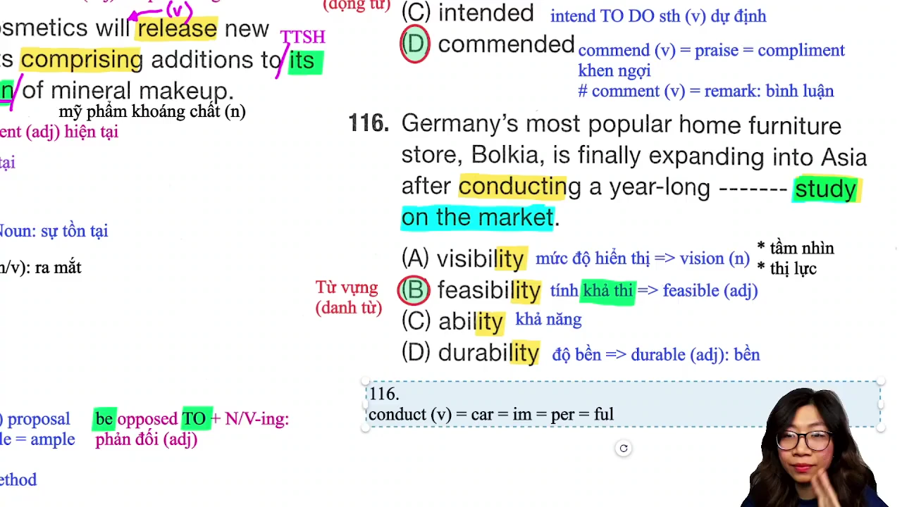

* **Đề bài:**
  > Germany's most popular home furniture store, Bolkia, is finally expanding into Asia after conducting a year-long ------ study on the market.
  > (A) visibility
  > (B) feasibility
  > (C) ability
  > (D) durability

* **Phân tích phương án:**
  * **(B) feasibility (Đúng):** `feasibility study` là Collocation chuẩn mang nghĩa nghiên cứu tính khả thi của một kế hoạch thâm nhập thị trường. Xuất phát từ tính từ `feasible`.
  * **(A) visibility (Sai):** Mức độ hiển thị, tầm nhìn. Không kết hợp với `study on the market` trong ngữ cảnh mở rộng kinh doanh quốc tế.
  * **(C) ability (Sai):** Khả năng, năng lực cá nhân.
  * **(D) durability (Sai):** Độ bền của vật liệu hoặc sản phẩm (xuất phát từ tính từ `durable`). Kế hoạch khảo sát kéo dài một năm (`year-long`) không thể là khảo sát độ bền thị trường.

* **Kiến thức mở rộng & Collocation:**
  * `conduct = carry out = implement = perform = execute = fulfill`: Tiến hành, thực hiện.
  * `feasible (adj)`: Khả thi.
  * `vision (n)`: Tầm nhìn hoặc thị lực.
  * `be opposed to + N/V-ing`: Phản đối cái gì.

* **Dịch nghĩa:**
  Cửa hàng đồ nội thất gia đình nổi tiếng nhất của Đức, Bolkia, cuối cùng cũng mở rộng sang Châu Á sau khi tiến hành nghiên cứu tính khả thi kéo dài một năm trên thị trường.

---

### [[13:48](https://www.youtube.com/watch?v=AeQMXm0ivuM&t=828s)] Câu 117 Rút gọn Mệnh đề Anyone
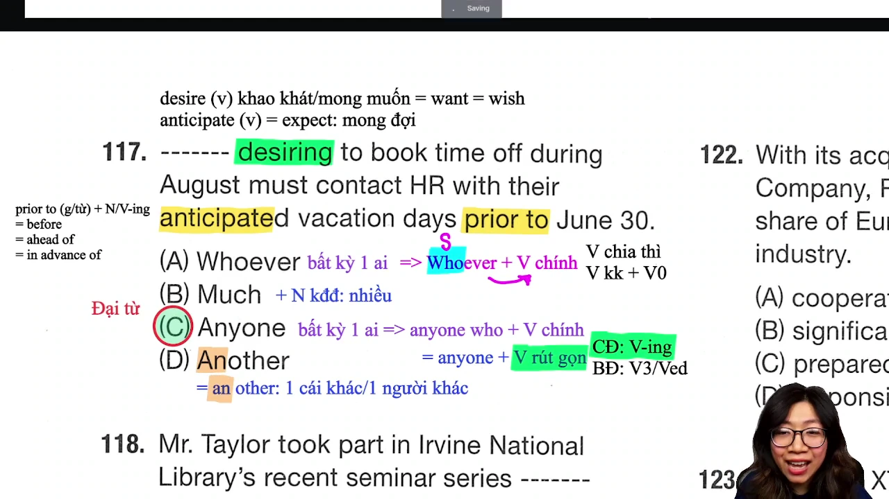

* **Đề bài:**
  > ------ desiring to book time off during August must contact HR with their anticipated vacation days prior to June 30.
  > (A) Whoever
  > (B) Much
  > (C) Anyone
  > (D) Another

* **Phân tích phương án:**
  * **(C) Anyone (Đúng):** Cấu trúc gốc `Anyone who desires...` được rút gọn chủ động thành `Anyone desiring...`. Đại từ bất định `Anyone` có thể đi kèm với phân từ rút gọn đóng vai trò cụm chủ ngữ cho động từ chính `must contact`.
  * **(A) Whoever (Sai):** `Whoever` đóng vai trò chủ ngữ của một mệnh đề danh ngữ, bắt buộc phải theo sau bởi một động từ chính chia thì (`Whoever + V_chính`). Vì phía sau chỗ trống là `desiring` (V-ing đóng vai trò phân từ, không phải động từ chính chia thì), `Whoever` không thể đứng ở đây.
  * **(B) Much (Sai):** Đi với danh từ không đếm được số nhiều mang nghĩa nhiều, không làm chủ ngữ chỉ người đi với `desiring`.
  * **(D) Another (Sai):** Đại từ chỉ một người khác hoặc một vật khác (`an + other`), không phù hợp logic câu thông báo nội bộ cho toàn thể nhân viên.

* **Kiến thức mở rộng & Collocation:**
  * `desire (v) = want = wish`: Mong muốn, khao khát.
  * `anticipate (v) = expect`: Dự kiến, mong đợi, kỳ vọng.
  * `prior to + N/V-ing = before = ahead of = in advance of`: Trước một thời điểm.
  * `book time off`: Đăng ký ngày nghỉ phép.

* **Dịch nghĩa:**
  Bất kỳ ai mong muốn đăng ký nghỉ phép trong tháng Tám phải liên hệ với bộ phận nhân sự cùng ngày nghỉ dự kiến của họ trước ngày 30 tháng Sáu.

---

### [[19:50](https://www.youtube.com/watch?v=AeQMXm0ivuM&t=1190s)] Câu 118 Động từ Commemorate
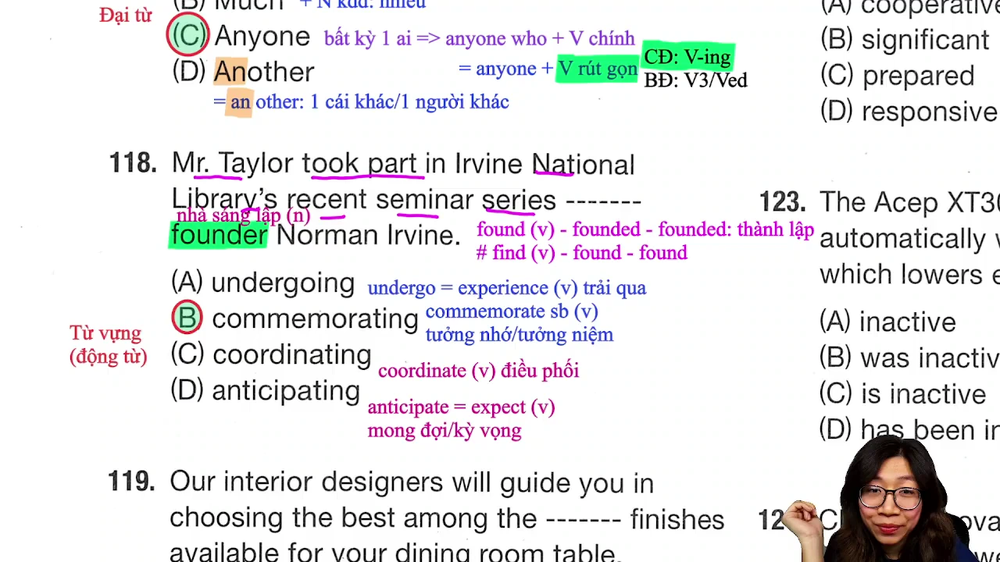

* **Đề bài:**
  > Mr. Taylor took part in Irvine National Library's recent seminar series ------- founder Norman Irvine.
  > (A) undergoing
  > (B) commemorating
  > (C) coordinating
  > (D) anticipating

* **Phân tích phương án:**
  * **(B) commemorating (Đúng):** `commemorate sb/sth` mang nghĩa tưởng nhớ, kỷ niệm hoặc tôn vinh một nhân vật lịch sử/người sáng lập. Sau chỗ trống là cụm danh từ chỉ người `founder Norman Irvine`.
  * **(A) undergoing (Sai):** `undergo = experience`: Trải qua (thường đi với khó khăn, phẫu thuật, quy trình thử nghiệm).
  * **(C) coordinating (Sai):** `coordinate`: Điều phối công việc hoặc chương trình, không dùng để tôn vinh cá nhân người sáng lập.
  * **(D) anticipating (Sai):** `anticipate = expect`: Mong đợi điều gì trong tương lai.

* **Kiến thức mở rộng & Collocation:**
  * `founder (n)`: Nhà sáng lập.
  * `found - founded - founded (v)`: Thành lập. Khác với `find - found - found (v)`: Tìm thấy.
  * `take part in = participate in = attend`: Tham gia vào.

* **Dịch nghĩa:**
  Ông Taylor đã tham gia vào chuỗi hội thảo gần đây của Thư viện Quốc gia Irvine nhằm tưởng nhớ nhà sáng lập Norman Irvine.

---

### [[26:23](https://www.youtube.com/watch?v=AeQMXm0ivuM&t=1583s)] Câu 119 Từ loại Different
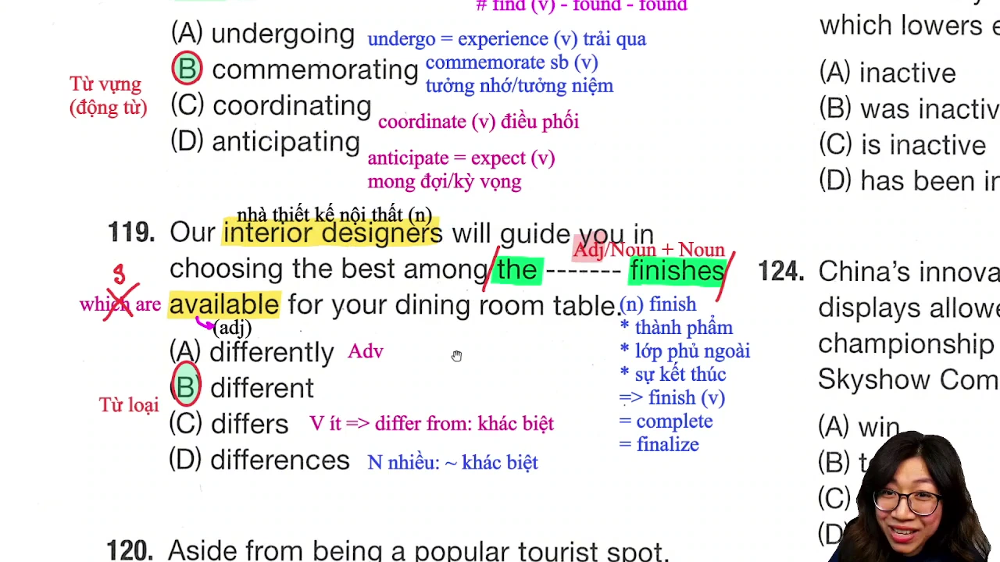

* **Đề bài:**
  > Our interior designers will guide you in choosing the best among the ------ finishes available for your dining room table.
  > (A) differently
  > (B) different
  > (C) differs
  > (D) differences

* **Phân tích phương án:**
  * **(B) different (Đúng):** Chỗ trống nằm trong cụm danh từ `the [Adj] finishes`. Trước danh từ `finishes` cần một tính từ để bổ nghĩa. `different` là tính từ.
  * **(A) differently (Sai):** Trạng từ kết thúc bằng đuôi `-ly`, không đứng trước danh từ để bổ nghĩa trực tiếp cho danh từ.
  * **(C) differs (Sai):** Động từ số ít chia ở thì hiện tại đơn (`differ from`).
  * **(D) differences (Sai):** Danh từ số nhiều chỉ các điểm khác biệt.

* **Kiến thức mở rộng & Collocation:**
  * `finish (n)`: Thành phẩm, lớp phủ hoàn thiện bề mặt đồ gỗ, vạch đích.
  * `finish (v) = complete = finalize`: Hoàn thành.
  * `finishes available`: Mệnh đề quan hệ rút gọn của `finishes which are available`.
  * `interior designer (n)`: Nhà thiết kế nội thất.

* **Dịch nghĩa:**
  Các nhà thiết kế nội thất của chúng tôi sẽ hướng dẫn bạn chọn ra thành phẩm tốt nhất trong số các lớp phủ bề mặt khác nhau có sẵn cho bàn ăn của bạn.

---

### [[33:36](https://www.youtube.com/watch?v=AeQMXm0ivuM&t=2016s)] Câu 120 Trạng từ Remarkably
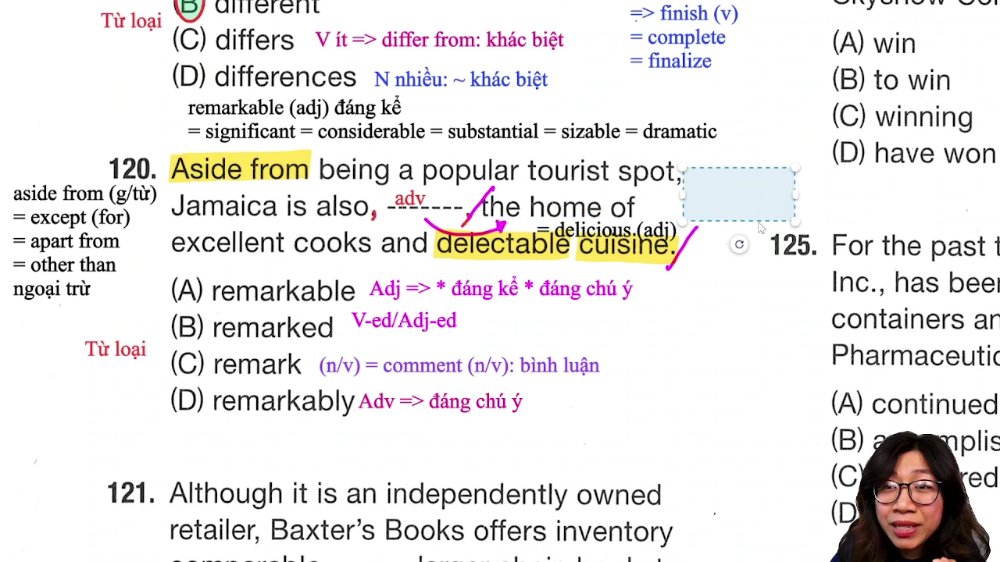

* **Đề bài:**
  > Aside from being a popular tourist spot, Jamaica is also, ------, the home of excellent cooks and delectable cuisine.
  > (A) remarkable
  > (B) remarked
  > (C) remark
  > (D) remarkably

* **Phân tích phương án:**
  * **(D) remarkably (Đúng):** Vị trí nằm kẹp giữa hai dấu phẩy đóng vai trò trạng từ bổ nghĩa cho toàn bộ cụm danh từ `the home of excellent cooks and delectable cuisine` ở phía sau. Mang nghĩa "một cách đáng chú ý".
  * **(A) remarkable (Sai):** Tính từ chỉ đứng ngay trước danh từ mà nó bổ nghĩa trực tiếp (ví dụ: `remarkable home`), không đứng tách rời giữa hai dấu phẩy trước mạo từ `the`.
  * **(B) remarked (Sai):** Động từ dạng quá khứ hoặc phân từ bị động.
  * **(C) remark (Sai):** Động từ nguyên mẫu hoặc danh từ chỉ lời nhận xét (`remark = comment`).

* **Kiến thức mở rộng & Collocation:**
  * `aside from + N/V-ing = except (for) = apart from = other than`: Ngoại trừ, bên cạnh.
  * `remarkable = significant = considerable = substantial = sizable = dramatic`: Đáng kể, đáng chú ý.
  * `delectable = delicious`: Thơm ngon.
  * `cuisine (n)`: Nền ẩm thực.

* **Dịch nghĩa:**
  Bên cạnh việc là một điểm đến du lịch nổi tiếng, Jamaica một cách đáng chú ý cũng là quê hương của những đầu bếp xuất sắc và nền ẩm thực thơm ngon.

---

### [[39:20](https://www.youtube.com/watch?v=AeQMXm0ivuM&t=2360s)] Câu 121 Cấu trúc Comparable to
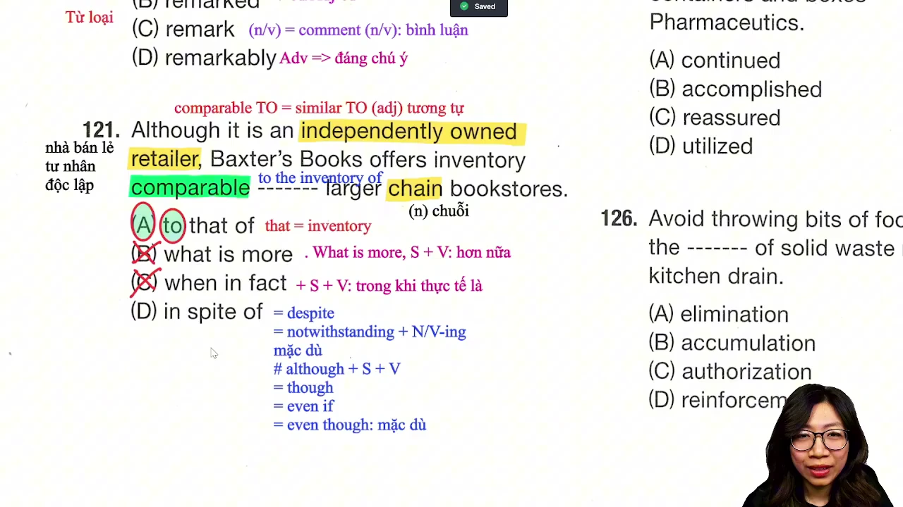

* **Đề bài:**
  > Although it is an independently owned retailer, Baxter's Books offers inventory comparable ------ larger chain bookstores.
  > (A) to that of
  > (B) what is more
  > (C) when in fact
  > (D) in spite of

* **Phân tích phương án:**
  * **(A) to that of (Đúng):** Tính từ `comparable` bắt buộc đi với giới từ `to` (`comparable to = similar to`). Đại từ `that` đại diện cho danh từ `inventory` phía trước để tránh lặp từ: `comparable to that of larger chain bookstores` = `comparable to the inventory of larger chain bookstores`.
  * **(B) what is more (Sai):** Liên từ liên kết mang nghĩa "hơn nữa", bắt buộc đứng giữa hai dấu phẩy/chấm và theo sau bởi một mệnh đề hoàn chỉnh (`what is more, S + V`).
  * **(C) when in fact (Sai):** Cụm liên từ mang nghĩa "trong khi thực tế là", đòi hỏi một mệnh đề (`S + V`) theo sau.
  * **(D) in spite of (Sai):** Giới từ mang nghĩa "mặc dù", không kết hợp với tính từ `comparable` đứng trước.

* **Kiến thức mở rộng & Collocation:**
  * `comparable to = similar to`: Tương đương với, tương tự như.
  * `independently owned retailer`: Nhà bán lẻ tư nhân độc lập.
  * `chain bookstore`: Chuỗi cửa hàng sách.
  * `in spite of = despite = notwithstanding + N/V-ing`: Mặc dù.

* **Dịch nghĩa:**
  Mặc dù là một nhà bán lẻ tư nhân độc lập, Baxter's Books cung cấp lượng hàng hóa tương đương với hàng hóa của các chuỗi nhà sách lớn hơn.

---

### [[48:24](https://www.youtube.com/watch?v=AeQMXm0ivuM&t=2904s)] Câu 122 Tính từ Significant
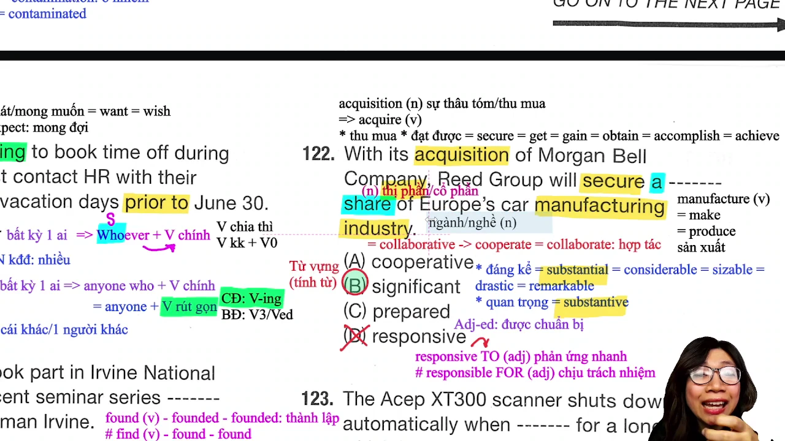

* **Đề bài:**
  > With its acquisition of Morgan Bell Company, Reed Group will secure a ------ share of Europe's car manufacturing industry.
  > (A) cooperative
  > (B) significant
  > (C) prepared
  > (D) responsive

* **Phân tích phương án:**
  * **(B) significant (Đúng):** `significant share` là Collocation kinh tế tiêu chuẩn chỉ "thị phần đáng kể". `significant` mang nghĩa đáng kể hoặc quan trọng.
  * **(A) cooperative (Sai):** Mang tính hợp tác (`cooperative = collaborative`), không dùng để miêu tả tỷ lệ phần trăm thị phần.
  * **(C) prepared (Sai):** Tính từ bị động chỉ trạng thái đã được chuẩn bị sẵn sàng.
  * **(D) responsive (Sai):** Phản ứng nhanh nhạy, đi với giới từ `to` (`responsive to`). Khác với `responsible for` (chịu trách nhiệm cho).

* **Kiến thức mở rộng & Collocation:**
  * `acquisition (n)`: Sự thâu tóm, mua lại doanh nghiệp $\rightarrow$ Động từ `acquire`: Thâu tóm, đạt được.
  * `secure (v) = get = gain = obtain = accomplish = achieve`: Đạt được, nắm giữ chắc chắn.
  * `significant = substantial = considerable = sizable = drastic = remarkable`: Đáng kể.
  * `substantive (adj)`: Quan trọng, có thực chất.
  * `manufacturing industry`: Ngành công nghiệp sản xuất.

* **Dịch nghĩa:**
  Với việc thâu tóm Công ty Morgan Bell, Tập đoàn Reed sẽ nắm giữ một thị phần đáng kể trong ngành sản xuất ô tô của Châu Âu.

---

### [[52:38](https://www.youtube.com/watch?v=AeQMXm0ivuM&t=3158s)] Câu 123 Rút gọn Mệnh đề Inactive
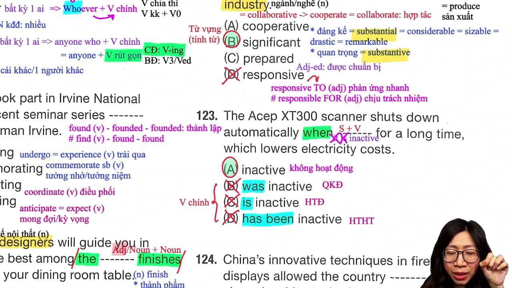

* **Đề bài:**
  > The Acep XT300 scanner shuts down automatically when ------ for a long time, which lowers electricity costs.
  > (A) inactive
  > (B) was inactive
  > (C) is inactive
  > (D) has been inactive

* **Phân tích phương án:**
  * **(A) inactive (Đúng):** Mệnh đề trạng ngữ chỉ thời gian rút gọn khi hai mệnh đề cùng chủ ngữ (`The scanner`): `when it is inactive` $\rightarrow$ rút gọn chủ ngữ `it` và to be `is`, chỉ giữ lại tính từ `inactive`.
  * **(B) was inactive (Sai):** Động từ chia ở quá khứ đơn nhưng thiếu chủ ngữ `it`. Hơn nữa mệnh đề chính đang chia ở hiện tại đơn (`shuts down`).
  * **(C) is inactive (Sai):** Động từ to be chia ở hiện tại đơn nhưng thiếu chủ ngữ `it`. Sau liên từ `when` nếu dùng động từ chia thì bắt buộc phải có chủ ngữ.
  * **(D) has been inactive (Sai):** Động từ chia ở hiện tại hoàn thành nhưng thiếu chủ ngữ.

* **Kiến thức mở rộng & Collocation:**
  * Quy tắc rút gọn sau liên từ: `when / while / once + Adj / V-ing / V3-Ved` (khi cùng chủ ngữ với mệnh đề chính).
  * `shut down`: Tắt máy, ngừng hoạt động.
  * `lower costs`: Giảm chi phí.

* **Dịch nghĩa:**
  Máy quét Acep XT300 tự động tắt khi không hoạt động trong một thời gian dài, điều này giúp giảm chi phí tiền điện.

---

### [[57:49](https://www.youtube.com/watch?v=AeQMXm0ivuM&t=3469s)] Câu 124 Cấu trúc Allow to Win
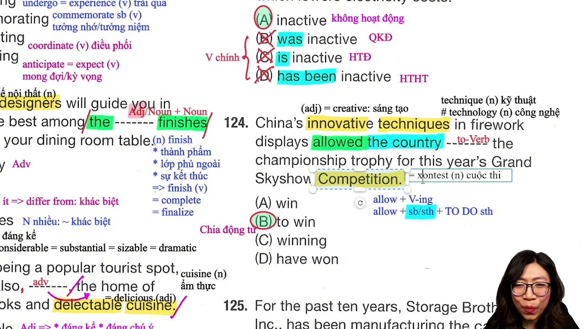

* **Đề bài:**
  > China's innovative techniques in firework displays allowed the country ------ the championship trophy for this year's Grand Skyshow Competition.
  > (A) win
  > (B) to win
  > (C) winning
  > (D) have won

* **Phân tích phương án:**
  * **(B) to win (Đúng):** Cấu trúc cố định `allow + Object + to V0` (cho phép ai/cái gì làm điều gì). Ở đây tân ngữ là `the country`.
  * **(A) win (Sai):** Động từ nguyên mẫu không to chỉ dùng sau động từ tri giác hoặc `let/make`.
  * **(C) winning (Sai):** `allow + V-ing` chỉ sử dụng khi không có tân ngữ trực tiếp đứng giữa (`allow doing sth`). Vì có tân ngữ `the country`, bắt buộc dùng `to win`.
  * **(D) have won (Sai):** Động từ nguyên mẫu hoàn thành, không phù hợp công thức `allow sb to do sth`.

* **Kiến thức mở rộng & Collocation:**
  * `innovative (adj) = creative`: Sáng tạo, đổi mới.
  * `technique (n)`: Kỹ thuật, phương pháp. Khác với `technology (n)`: Công nghệ.
  * `competition = contest (n)`: Cuộc thi.
  * `trophy (n)`: Cúp vô địch.

* **Dịch nghĩa:**
  Các kỹ thuật sáng tạo của Trung Quốc trong màn trình diễn pháo hoa đã cho phép quốc gia này giành được cúp vô địch cho Cuộc thi Grand Skyshow năm nay.

---

### [[1:03:23](https://www.youtube.com/watch?v=AeQMXm0ivuM&t=3803s)] Câu 125 Rút gọn Bị động Utilized
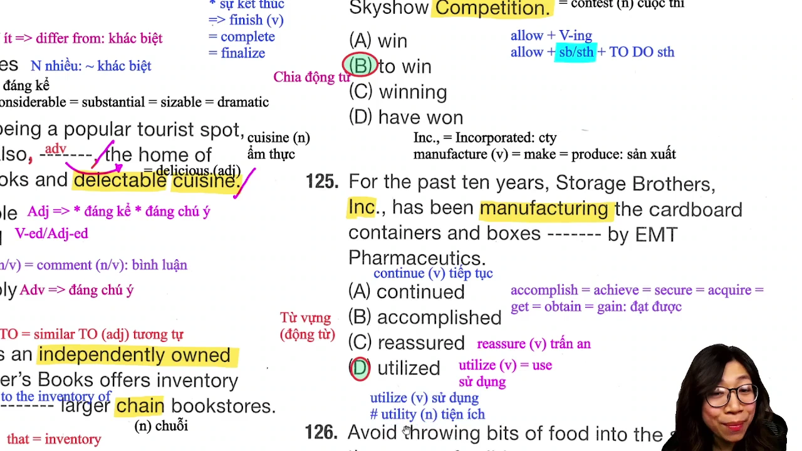

* **Đề bài:**
  > For the past ten years, Storage Brothers, Inc., has been manufacturing the cardboard containers and boxes ------ by EMT Pharmaceutics.
  > (A) continued
  > (B) accomplished
  > (C) reassured
  > (D) utilized

* **Phân tích phương án:**
  * **(D) utilized (Đúng):** Mệnh đề quan hệ rút gọn ở thể bị động `which are utilized by...` $\rightarrow$ giữ lại quá khứ phân từ `utilized` mang nghĩa "được sử dụng bởi". `utilize = use`.
  * **(A) continued (Sai):** Tiếp tục, không đi với ngữ cảnh thùng chứa được tiếp tục bởi công ty dược.
  * **(B) accomplished (Sai):** Đạt được, hoàn thành (`accomplish = achieve`), không kết hợp với danh từ thùng các-tông (`containers and boxes`).
  * **(C) reassured (Sai):** Trấn an tinh thần (dùng cho con người).

* **Kiến thức mở rộng & Collocation:**
  * `utilize (v) = use`: Tận dụng, sử dụng.
  * `utility (n)`: Tiện ích (điện, nước, khí đốt), ví dụ: `utility bill`.
  * `manufacture (v) = make = produce`: Sản xuất.
  * `cardboard container`: Thùng chứa bằng bìa cứng các-tông.

* **Dịch nghĩa:**
  Trong suốt mười năm qua, Công ty Storage Brothers đã sản xuất các thùng chứa và hộp bằng bìa cứng được sử dụng bởi EMT Pharmaceutics.

---

### [[1:11:15](https://www.youtube.com/watch?v=AeQMXm0ivuM&t=4275s)] Câu 126 Danh từ Accumulation
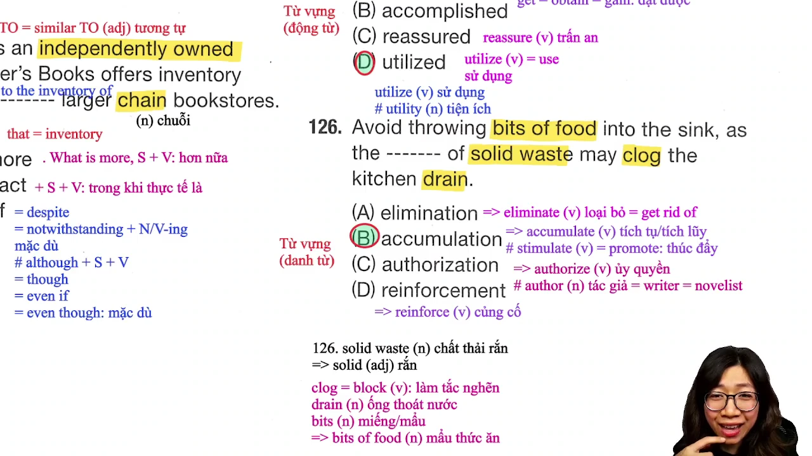

* **Đề bài:**
  > Avoid throwing bits of food into the sink, as the ------ of solid waste may clog the kitchen drain.
  > (A) elimination
  > (B) accumulation
  > (C) authorization
  > (D) reinforcement

* **Phân tích phương án:**
  * **(B) accumulation (Đúng):** Sự tích tụ, dồn ứ chất thải. `the accumulation of solid waste` tạo thành cụm danh từ chỉ nguyên nhân gây tắc cống. Xuất phát từ động từ `accumulate`.
  * **(A) elimination (Sai):** Sự loại bỏ (xuất phát từ động từ `eliminate = get rid of`). Loại bỏ chất thải không thể làm tắc cống.
  * **(C) authorization (Sai):** Sự cấp quyền, ủy quyền (xuất phát từ động từ `authorize`).
  * **(D) reinforcement (Sai):** Sự gia cố, củng cố (xuất phát từ động từ `reinforce`).

* **Kiến thức mở rộng & Collocation:**
  * `solid waste (n)`: Chất thải rắn.
  * `clog = block (v)`: Làm nghẽn, làm tắc.
  * `drain (n)`: Ống thoát nước.
  * `bits of food (n)`: Những mẩu thức ăn vụn thừa.
  * `accumulate (v)`: Tích tụ. Khác với `stimulate (v) = promote`: Kích thích, thúc đẩy.

* **Dịch nghĩa:**
  Tránh ném các mẩu thức ăn vào bồn rửa, vì sự tích tụ của chất thải rắn có thể làm tắc nghẽn ống thoát nước nhà bếp.

---

### [[1:17:39](https://www.youtube.com/watch?v=AeQMXm0ivuM&t=4659s)] Câu 127 Quá khứ Hoàn thành Had Begun
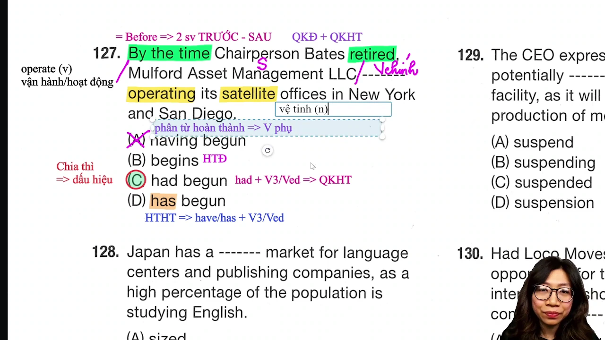

* **Đề bài:**
  > By the time Chairperson Bates retired, Mulford Asset Management LLC ------ operating its satellite offices in New York and San Diego.
  > (A) having begun
  > (B) begins
  > (C) had begun
  > (D) has begun

* **Phân tích phương án:**
  * **(C) had begun (Đúng):** Công thức phối hợp thì kinh điển với `By the time`: `By the time + S + V(quá khứ đơn), S + had + V3/Ved (quá khứ hoàn thành)`. Hành động mở văn phòng vận hành đã xảy ra và hoàn tất trước khi Chủ tịch Bates về hưu (`retired`).
  * **(A) having begun (Sai):** Dạng phân từ hoàn thành đóng vai trò động từ phụ, không thể làm động từ vị ngữ chính cho chủ ngữ `Mulford Asset Management LLC`.
  * **(B) begins (Sai):** Thì hiện tại đơn, mâu thuẫn thời gian quá khứ của `retired`.
  * **(D) has begun (Sai):** Thì hiện tại hoàn thành chỉ dùng khi mệnh đề sau `By the time` chia ở hiện tại đơn để diễn tả tương lai (`By the time + S + V_hiện_tại, S + will have + V3/Ved`).

* **Kiến thức mở rộng & Collocation:**
  * `satellite office (n)`: Văn phòng vệ tinh, văn phòng chi nhánh phụ.
  * `asset management`: Quản lý tài sản.
  * `operate (v)`: Vận hành, hoạt động.

* **Dịch nghĩa:**
  Vào thời điểm Chủ tịch Bates nghỉ hưu, Mulford Asset Management LLC đã bắt đầu vận hành các văn phòng vệ tinh của mình tại New York và San Diego.

---

### [[1:23:24](https://www.youtube.com/watch?v=AeQMXm0ivuM&t=5004s)] Câu 128 Tính từ Sizeable
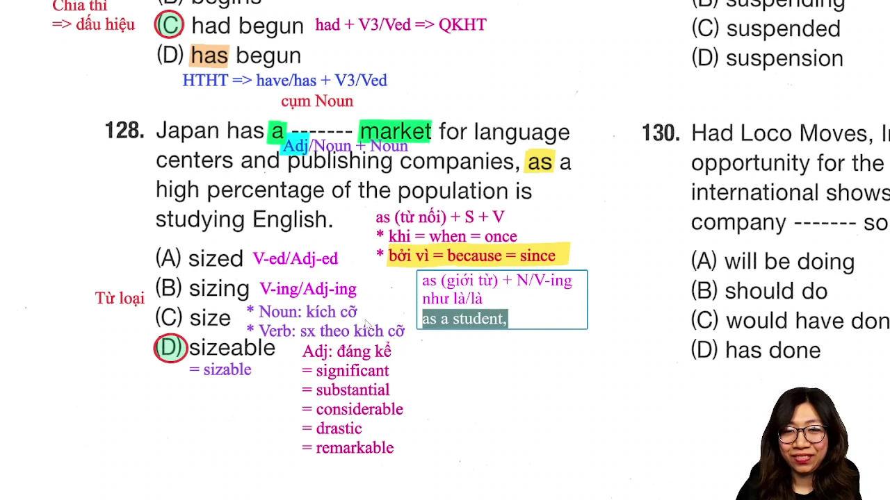

* **Đề bài:**
  > Japan has a ------ market for language centers and publishing companies, as a high percentage of the population is studying English.
  > (A) sized
  > (B) sizing
  > (C) size
  > (D) sizeable

* **Phân tích phương án:**
  * **(D) sizeable (Đúng):** Chỗ trống đứng giữa mạo từ `a` và danh từ `market`. Cần một tính từ bổ nghĩa cho danh từ. `sizeable` (hoặc `sizable`) là tính từ mang nghĩa "lớn, đáng kể".
  * **(A) sized (Sai):** Tính từ ghép thường đi kèm với trạng từ hoặc danh từ (ví dụ: `medium-sized`: cỡ vừa), không đứng một mình trước danh từ với nghĩa thị trường lớn.
  * **(B) sizing (Sai):** Danh động từ hoặc phân từ chỉ hành động phân cỡ.
  * **(C) size (Sai):** Danh từ chỉ kích cỡ hoặc động từ sắp xếp kích cỡ.

* **Kiến thức mở rộng & Collocation:**
  * `sizeable = sizable = significant = substantial = considerable = dramatic = remarkable`: Đáng kể, quy mô lớn.
  * `as (liên từ) = because = since`: Bởi vì.
  * `publishing company`: Công ty xuất bản.

* **Dịch nghĩa:**
  Nhật Bản có một thị trường đáng kể cho các trung tâm ngoại ngữ và công ty xuất bản, vì một tỷ lệ cao dân số đang học tiếng Anh.

---

### [[1:30:12](https://www.youtube.com/watch?v=AeQMXm0ivuM&t=5412s)] Câu 129 Phân biệt Suspending và Suspension
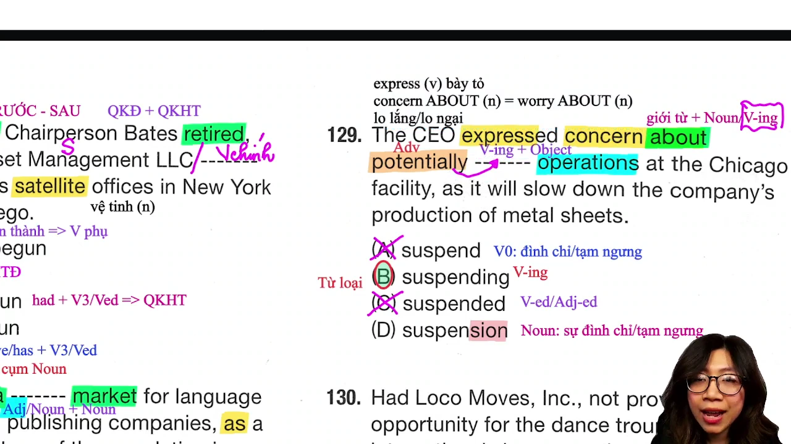

* **Đề bài:**
  > The CEO expressed concern about potentially ------ operations at the Chicago facility, as it will slow down the company's production of metal sheets.
  > (A) suspend
  > (B) suspending
  > (C) suspended
  > (D) suspension

* **Phân tích phương án:**
  * **(B) suspending (Đúng):** Phía sau chỗ trống có danh từ `operations` đóng vai trò là tân ngữ trực tiếp (`Object`). Sau giới từ `about`, ta cần một Gerund (danh động từ thêm `-ing`) để vừa làm bổ ngữ cho giới từ, vừa nhận trực tiếp một Object phía sau (`suspending operations`). Trạng từ `potentially` bổ nghĩa cho hành động `suspending`.
  * **(D) suspension (Sai - Bẫy điểm số cao):** `suspension` là danh từ thuần túy. Một danh từ không thể nhận một danh từ khác làm tân ngữ trực tiếp mà không có giới từ nối `of`. Nếu chọn `suspension`, câu bắt buộc phải viết là `suspension OF operations`.
  * **(A) suspend (Sai):** Động từ nguyên mẫu không to, không thể đứng sau giới từ `about`.
  * **(C) suspended (Sai):** Dạng phân từ quá khứ, không có cấu trúc bị động đi với tân ngữ trực tiếp phía sau.

* **Kiến thức mở rộng & Collocation:**
  * `express concern about = worry about`: Bày tỏ sự lo ngại về điều gì.
  * `suspend (v)`: Đình chỉ, tạm ngưng.
  * `production of metal sheets`: Quá trình sản xuất các tấm kim loại.

* **Dịch nghĩa:**
  Tổng giám đốc đã bày tỏ sự lo ngại về việc có khả năng tạm ngưng hoạt động tại cơ sở Chicago, vì điều đó sẽ làm chậm quá trình sản xuất các tấm kim loại của công ty.

---

### [[1:34:00](https://www.youtube.com/watch?v=AeQMXm0ivuM&t=5640s)] Câu 130 Đảo ngữ Had Loco Moves
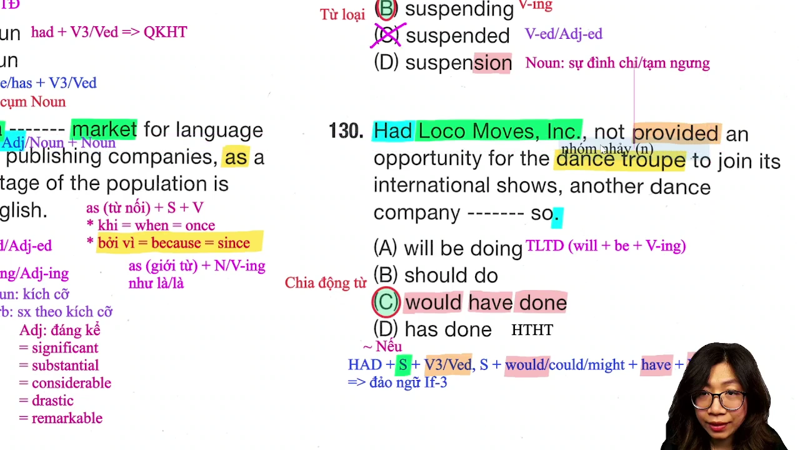

* **Đề bài:**
  > Had Loco Moves, Inc., not provided an opportunity for the dance troupe to join its international shows, another dance company ------- so.
  > (A) will be doing
  > (B) should do
  > (C) would have done
  > (D) has done

* **Phân tích phương án:**
  * **(C) would have done (Đúng):** Mệnh đề đầu là dạng đảo ngữ của câu điều kiện loại 3 (`Inversion of Conditional Type 3`): `Had + S + not + V3/Ved`. Mệnh đề chính giữ nguyên công thức chuẩn của câu điều kiện loại 3: `S + would have + V3/Ved` $\rightarrow$ `would have done`.
  * **(A) will be doing (Sai):** Thì tương lai tiếp diễn (`will be + V-ing`), không phù hợp với cấu trúc điều kiện loại 3.
  * **(B) should do (Sai):** Động từ khiếm khuyết đi với động từ nguyên mẫu chỉ lời khuyên hiện tại/tương lai.
  * **(D) has done (Sai):** Thì hiện tại hoàn thành.

* **Kiến thức mở rộng & Collocation:**
  * Công thức đảo ngữ điều kiện loại 3: `Had + S + (not) + V3/Ved, S + would/could/might + have + V3/Ved`.
  * Chữ `Had` đứng đầu câu mang nghĩa "Nếu", tương đương `If Loco Moves, Inc., had not provided...`.
  * `dance troupe (n)`: Đoàn múa, nhóm nhảy nghệ thuật.

* **Dịch nghĩa:**
  Nếu Loco Moves, Inc., không tạo cơ hội cho nhóm nhảy tham gia các buổi biểu diễn quốc tế của mình, thì một công ty vũ đạo khác đã làm điều đó.

---

## Trích dẫn then chốt

* [[08:35](https://www.youtube.com/watch?v=AeQMXm0ivuM&t=515s)] "Ôn kỹ tới đây luôn để mai mốt đi thi mình chỉ cần 5 giây hoặc 10 giây thôi là câu này xong: Anyone cộng động từ rút gọn, chủ động là V-ing, bị động là V3 hoặc Ved."
* [[21:40](https://www.youtube.com/watch?v=AeQMXm0ivuM&t=1300s)] "Comparable to là similar to, giống như trà sữa phải có topping vậy, gặp similar hay comparable là bắt buộc phải có giới từ to."
* [[27:30](https://www.youtube.com/watch?v=AeQMXm0ivuM&t=1650s)] "Từ vựng phản xạ là cô ghi mình ghi, cô đọc mình đọc, cô dịch mình dịch. Mình thấm từ từ vào người thì nó thành phản xạ tự nhiên, không cần chép chính tả mà nhớ rất dai."
* [[51:20](https://www.youtube.com/watch?v=AeQMXm0ivuM&t=3080s)] "Khi gặp When mà hai vế cùng chủ ngữ, người ta rút gọn chủ ngữ và to be đi, chỉ còn lại tính từ inactive thôi. Đừng chọn was hay is khi không có chủ ngữ it."
* [[1:31:05](https://www.youtube.com/watch?v=AeQMXm0ivuM&t=5465s)] "Sau giới từ về mặt hình thức danh từ hay V-ing đều được, nhưng phía sau có tân ngữ operations thì bắt buộc phải là V-ing suspending để nhận tân ngữ, danh từ suspension không bao giờ nhận trực tiếp tân ngữ mà không có of."

---

## Lệnh & Công cụ

#### Bảng công thức nhận diện nhanh

```text
[CÔNG THỨC 1: ĐẠI TỪ BẤT ĐỊNH & RÚT GỌN]
Whoever + V_chính (chia thì hoặc khiếm khuyết)
Anyone + who + V_chính = Anyone + V-ing (chủ động) / V3-Ved (bị động)

[CÔNG THỨC 2: PHỐI HỢP THÌ VỚI BY THE TIME]
By the time + S + V(quá khứ đơn), S + had + V3/Ved (quá khứ hoàn thành)
By the time + S + V(hiện tại đơn), S + will have + V3/Ved (tương lai hoàn thành)

[CÔNG THỨC 3: ĐẢO NGỮ ĐIỀU KIỆN LOẠI 3]
Had + S + (not) + V3/Ved, S + would/could/might + have + V3/Ved

[CÔNG THỨC 4: GERUND VS NOUN SAU GIỚI TỪ]
Preposition + V-ing + Object (ngoại động từ nhận trực tiếp tân ngữ)
Preposition + Noun + of + Object (danh từ thuần túy bắt buộc có giới từ 'of')

[CÔNG THỨC 5: CẤU TRÚC ALLOW]
allow + Object + to V0 (cho phép ai làm gì)
allow + V-ing (cho phép làm gì khi không có tân ngữ đứng giữa)
```

---

## Đánh đổi & Rủi ro

* **Bẫy dịch nghĩa từng từ thay vì xét chức năng ngữ pháp:**
  Trong câu 117 (`Whoever` vs `Anyone`), nếu chỉ dịch nghĩa tiếng Việt là "bất kỳ ai" thì cả hai phương án đều hợp lý về mặt ngữ nghĩa. Tuy nhiên, `Whoever` yêu cầu theo sau là động từ chia thì hoàn chỉnh, trong khi `desiring` là dạng phân từ. Thí sinh dịch nghĩa mà không phân tích cấu trúc sẽ mất điểm.
* **Bẫy danh từ thuần túy thay vì Gerund trong bài toán tân ngữ trực tiếp:**
  Ở câu 129, thí sinh thường có thói quen máy móc "sau giới từ chọn danh từ" nên vội vàng chọn `suspension`. Rủi ro ở đây là bỏ qua sự tồn tại của tân ngữ `operations` ngay sau chỗ trống. Ngoại động từ dạng Gerund (`suspending`) mới có năng lực mang tân ngữ mà không cần giới từ liên kết.
* **Điểm mù trong mệnh đề thời gian rút gọn:**
  Ở câu 123 (`when ------ for a long time`), thí sinh thường thấy cấu trúc quen thuộc nên chọn `is inactive` hoặc `was inactive`. Cần nhớ rằng liên từ `when` đòi hỏi một mệnh đề đầy đủ `S + V`, nếu chọn động từ chia thì mà thiếu đại từ chủ ngữ `it` thì câu bị lỗi ngữ pháp nghiêm trọng. Lựa chọn an toàn và chính xác duy nhất là tính từ rút gọn `inactive`.
* **Đánh đổi thời gian làm bài ở Part 5:**
  Mỗi câu hỏi Part 5 chỉ nên hoàn thành trong từ 10 đến 25 giây. Việc nhận diện ngay các Collocation cố định như `feasibility study`, `comparable to`, `significant share`, `express concern about` giúp tiết kiệm từ 5 đến 7 phút cho toàn bộ phần đọc, dành thời gian cho Part 7 đoạn văn dài.
