# GIẢI ĐỀ TOEIC THÁNG 10/26 [VIDEO 1]

* **Kênh:** Ms Thanh Toeic | **Thời lượng:** 1:35:21 | **Ngày:** 2026-10-07
* **Video:** https://www.youtube.com/watch?v=QdBR37h5HGs

---

## Thuật ngữ
| Thuật ngữ | Giải thích |
| :--- | :--- |
| <!-- Thuật ngữ 1 --> | <!-- Giải thích ngắn gọn bản chất kỹ thuật --> |
| <!-- Thuật ngữ 2 --> | <!-- Giải thích ngắn gọn bản chất kỹ thuật --> |

## Tổng luận chuyên đề
<!-- Tầng 1: Đọc nhanh 5 phút nắm 100% tinh hoa, phân loại theo 3-4 chuyên đề lớn kèm công thức và quy tắc vàng -->

## Bóc tách chi tiết
### [[7:18](https://www.youtube.com/watch?v=QdBR37h5HGs&t=438s)] Phân Đoạn 1
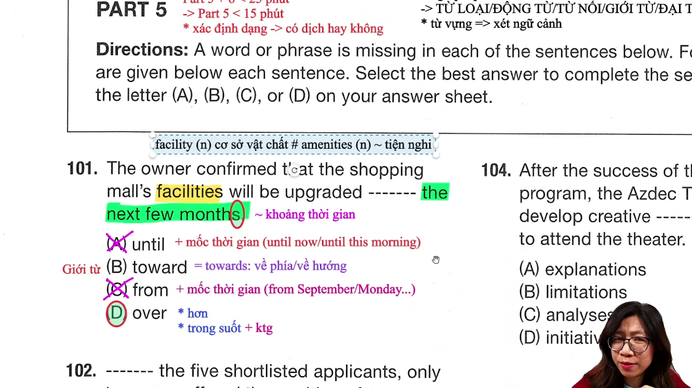

<!-- Phân tích chi tiết: đề bài / thao tác dòng lệnh, cơ chế vận hành, mở rộng kiến thức -->

### [[13:09](https://www.youtube.com/watch?v=QdBR37h5HGs&t=789s)] Phân Đoạn 2
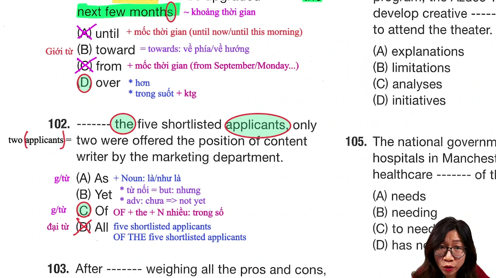

<!-- Phân tích chi tiết: đề bài / thao tác dòng lệnh, cơ chế vận hành, mở rộng kiến thức -->

### [[21:14](https://www.youtube.com/watch?v=QdBR37h5HGs&t=1274s)] Phân Đoạn 3
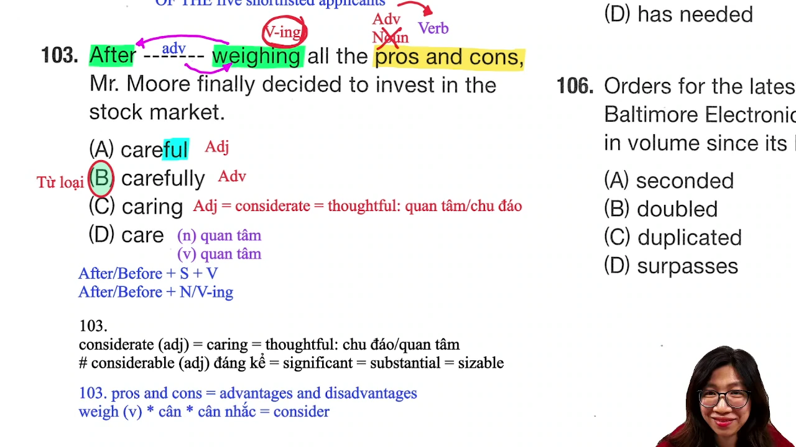

<!-- Phân tích chi tiết: đề bài / thao tác dòng lệnh, cơ chế vận hành, mở rộng kiến thức -->

### [[27:03](https://www.youtube.com/watch?v=QdBR37h5HGs&t=1623s)] Phân Đoạn 4
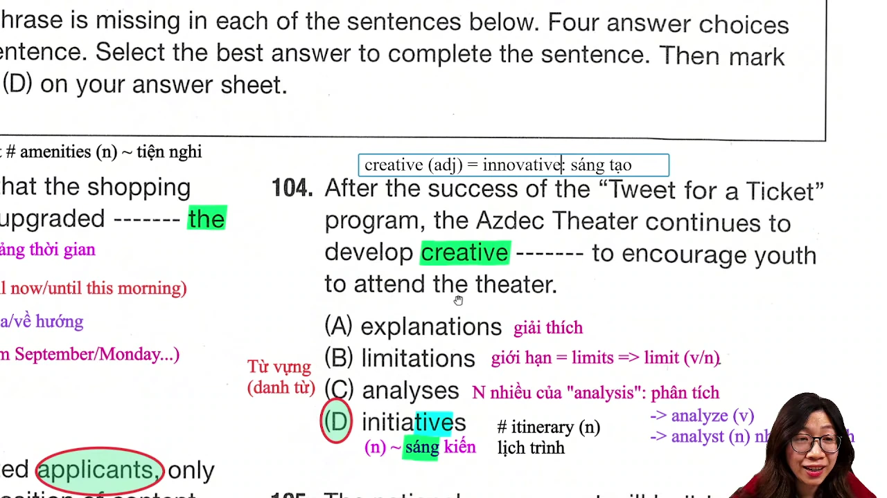

<!-- Phân tích chi tiết: đề bài / thao tác dòng lệnh, cơ chế vận hành, mở rộng kiến thức -->

### [[30:15](https://www.youtube.com/watch?v=QdBR37h5HGs&t=1815s)] Phân Đoạn 5
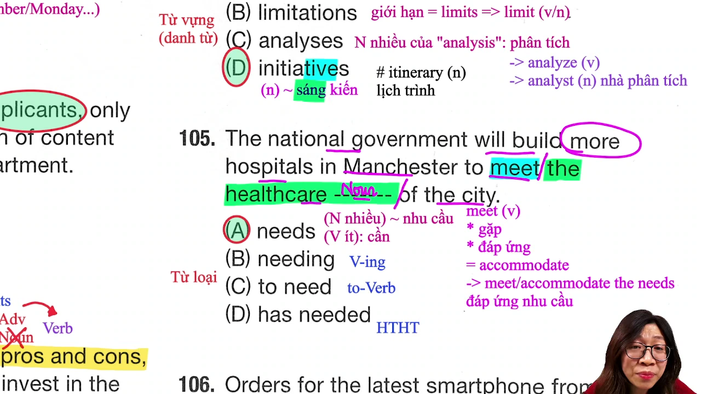

<!-- Phân tích chi tiết: đề bài / thao tác dòng lệnh, cơ chế vận hành, mở rộng kiến thức -->

### [[37:14](https://www.youtube.com/watch?v=QdBR37h5HGs&t=2234s)] Phân Đoạn 6
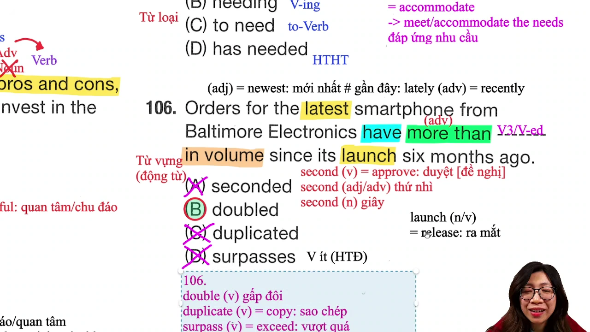

<!-- Phân tích chi tiết: đề bài / thao tác dòng lệnh, cơ chế vận hành, mở rộng kiến thức -->

### [[42:56](https://www.youtube.com/watch?v=QdBR37h5HGs&t=2576s)] Phân Đoạn 7
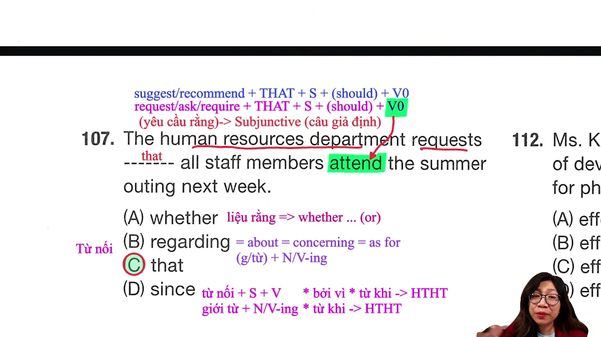

<!-- Phân tích chi tiết: đề bài / thao tác dòng lệnh, cơ chế vận hành, mở rộng kiến thức -->

### [[46:34](https://www.youtube.com/watch?v=QdBR37h5HGs&t=2794s)] Phân Đoạn 8
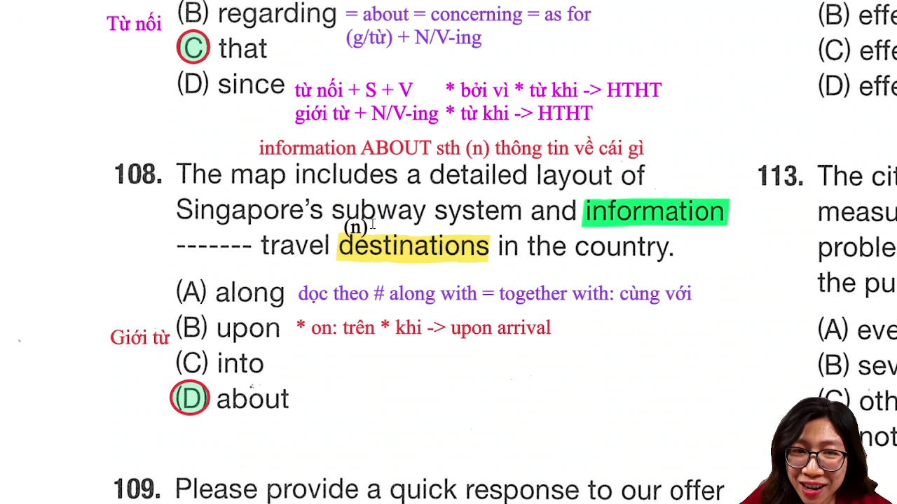

<!-- Phân tích chi tiết: đề bài / thao tác dòng lệnh, cơ chế vận hành, mở rộng kiến thức -->

### [[52:04](https://www.youtube.com/watch?v=QdBR37h5HGs&t=3124s)] Phân Đoạn 9
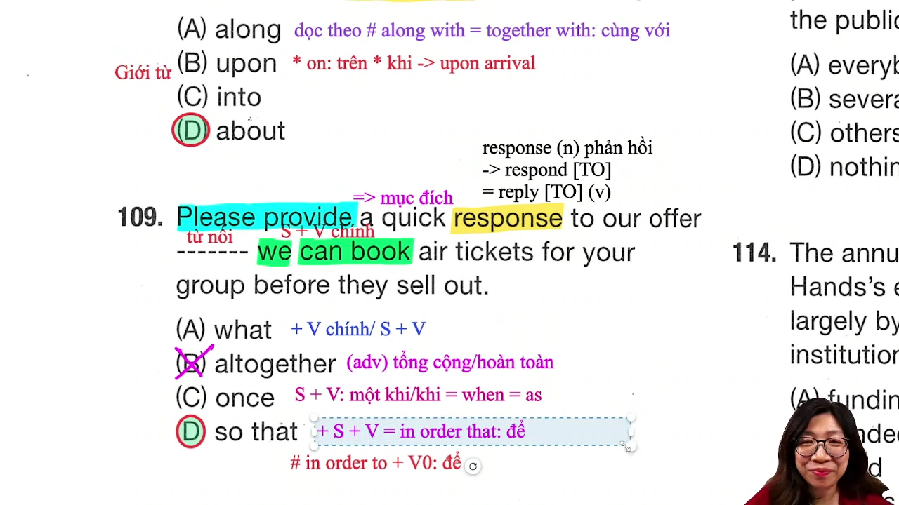

<!-- Phân tích chi tiết: đề bài / thao tác dòng lệnh, cơ chế vận hành, mở rộng kiến thức -->

### [[59:00](https://www.youtube.com/watch?v=QdBR37h5HGs&t=3540s)] Phân Đoạn 10


<!-- Phân tích chi tiết: đề bài / thao tác dòng lệnh, cơ chế vận hành, mở rộng kiến thức -->

### [[1:04:52](https://www.youtube.com/watch?v=QdBR37h5HGs&t=3892s)] Phân Đoạn 11
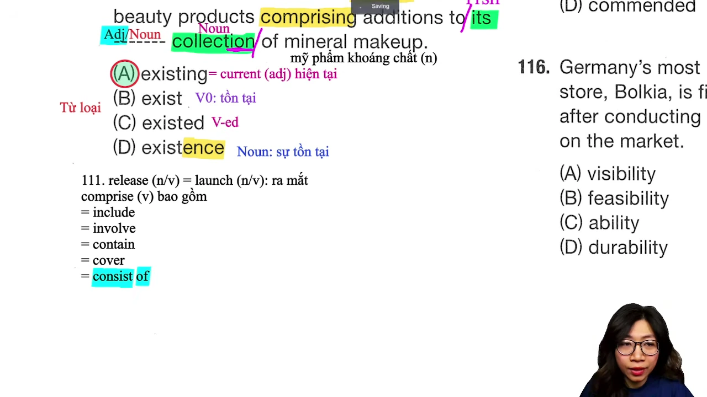

<!-- Phân tích chi tiết: đề bài / thao tác dòng lệnh, cơ chế vận hành, mở rộng kiến thức -->

### [[1:13:00](https://www.youtube.com/watch?v=QdBR37h5HGs&t=4380s)] Phân Đoạn 12
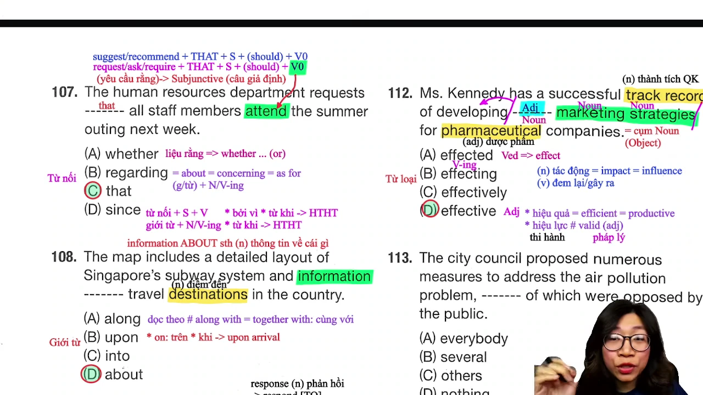

<!-- Phân tích chi tiết: đề bài / thao tác dòng lệnh, cơ chế vận hành, mở rộng kiến thức -->

### [[1:23:50](https://www.youtube.com/watch?v=QdBR37h5HGs&t=5030s)] Phân Đoạn 13
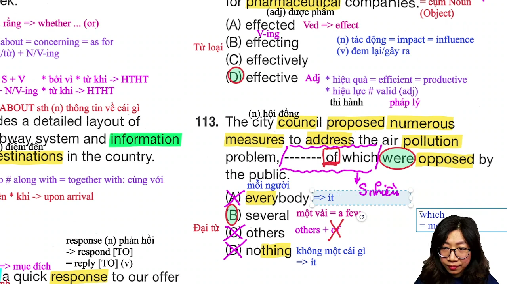

<!-- Phân tích chi tiết: đề bài / thao tác dòng lệnh, cơ chế vận hành, mở rộng kiến thức -->

### [[1:30:39](https://www.youtube.com/watch?v=QdBR37h5HGs&t=5439s)] Phân Đoạn 14
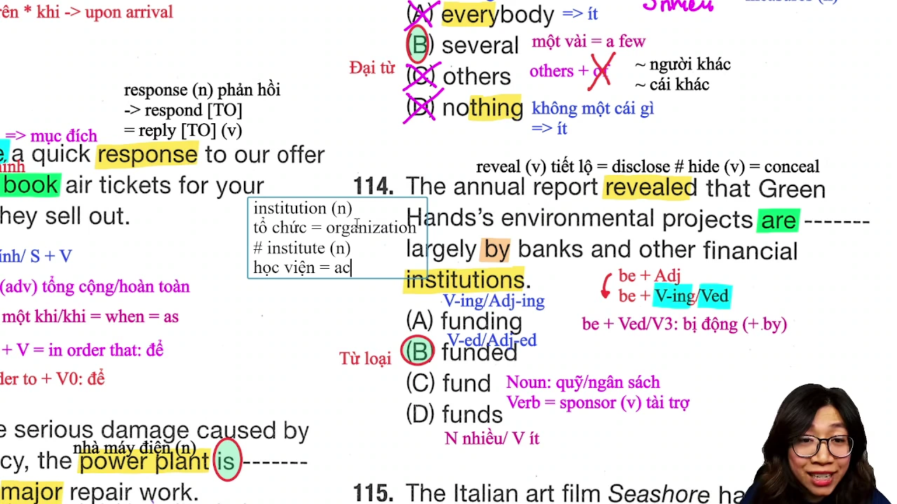

<!-- Phân tích chi tiết: đề bài / thao tác dòng lệnh, cơ chế vận hành, mở rộng kiến thức -->

### [[1:35:10](https://www.youtube.com/watch?v=QdBR37h5HGs&t=5710s)] Phân Đoạn 15


<!-- Phân tích chi tiết: đề bài / thao tác dòng lệnh, cơ chế vận hành, mở rộng kiến thức -->

## Trích dẫn then chốt
* [[00:00](https://www.youtube.com/watch?v=QdBR37h5HGs)] <!-- Câu phát biểu đắt giá 1 từ transcript -->
* [[00:00](https://www.youtube.com/watch?v=QdBR37h5HGs)] <!-- Câu phát biểu đắt giá 2 từ transcript -->

## Lệnh & Công cụ
<!-- Khối lệnh CLI, công cụ phần mềm hoặc công thức do CHÍNH BÀI GIẢNG / TÁC GIẢ đề cập -->
```bash
# Các câu lệnh thực thi trong bài giảng
```

## Đánh đổi & Rủi ro
<!-- Đánh đổi tài nguyên, chi phí token, điểm mù và nguy cơ thực tế -->
