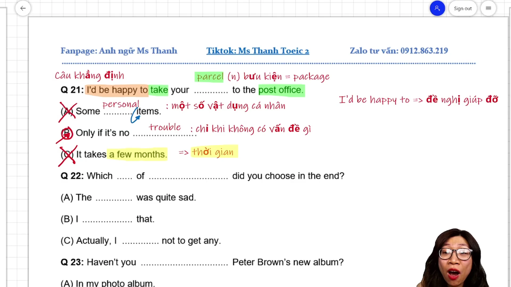
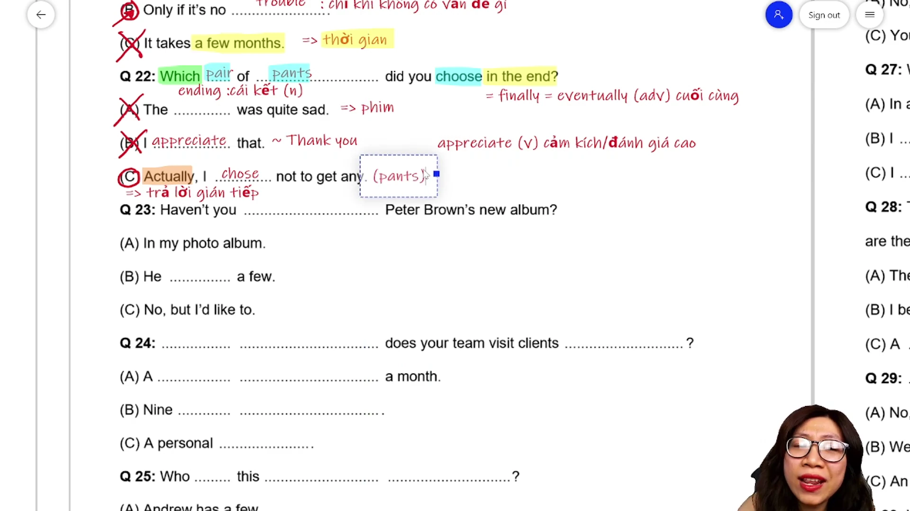
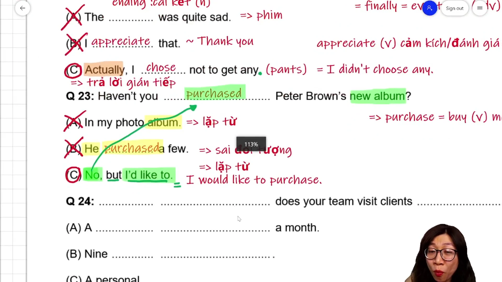
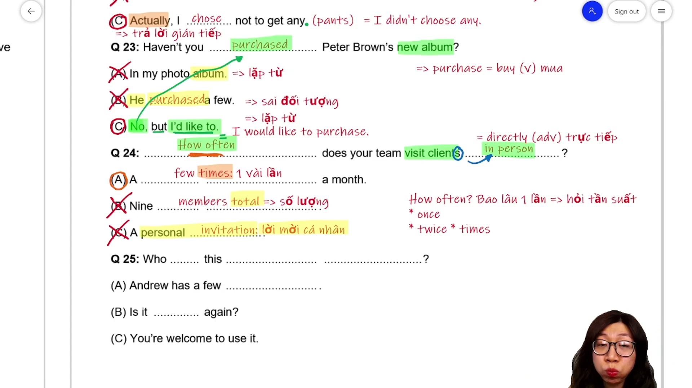
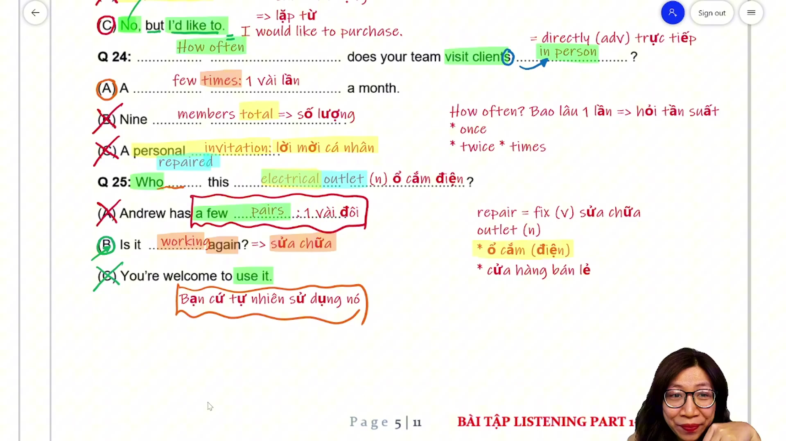
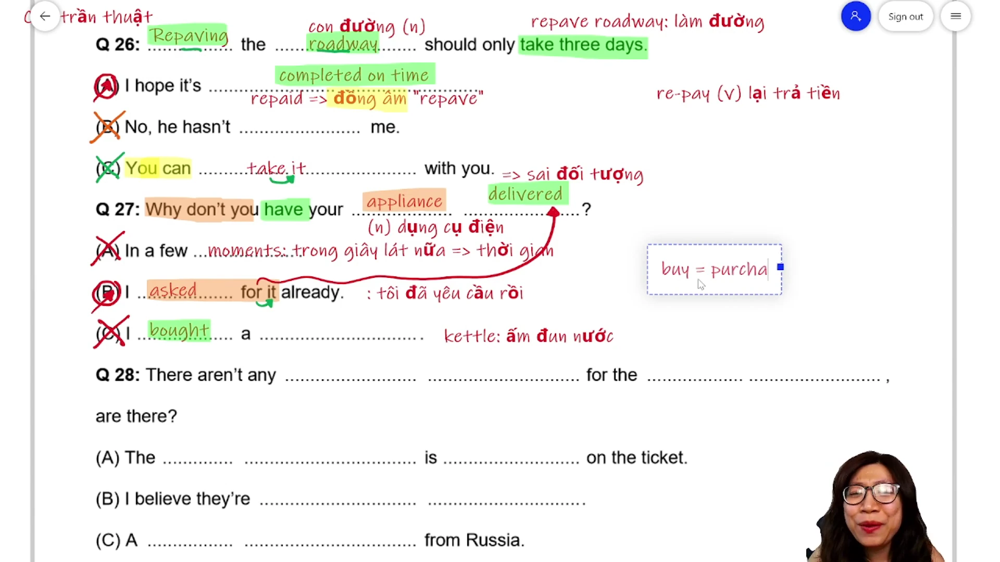
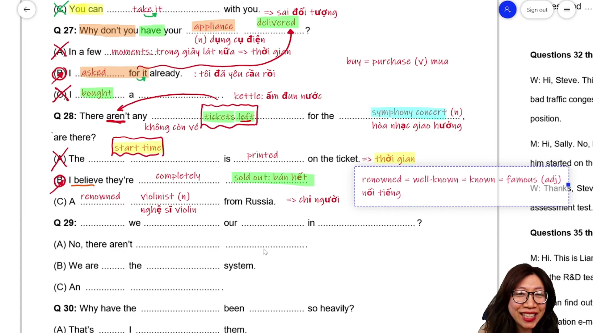
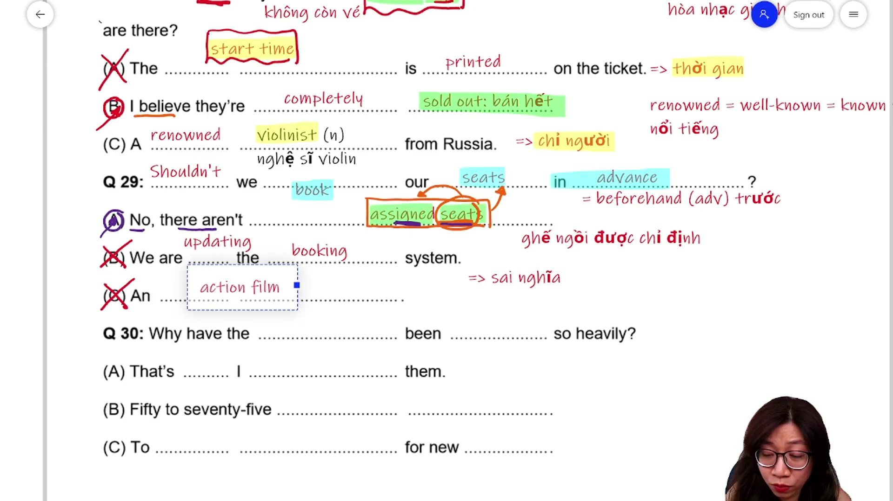
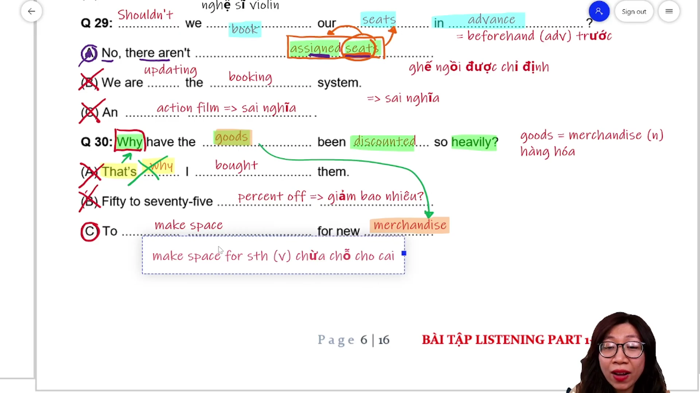
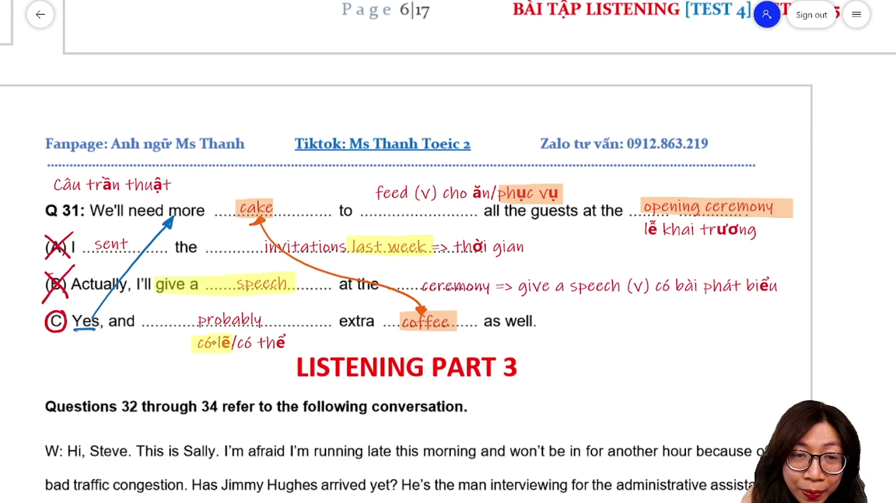

# MAX ĐIỂM LISTENING PART 2 [VIDEO 2]

* **Kênh:** Ms Thanh Toeic | **Thời lượng:** 56:59 | **Ngày:** 2026-10-08
* **Video:** https://www.youtube.com/watch?v=Y6D_Fv6J_Ss

---

## Thuật ngữ

| Thuật ngữ | Giải thích |
| :--- | :--- |
| Part 2 | Phần thi hỏi đáp gồm 25 câu hỏi với 3 phương án lựa chọn A, B, C trong bài thi TOEIC Listening |
| Indirect Response | Câu trả lời gián tiếp không trực tiếp nói có hoặc không mà đưa ra ngữ cảnh hoặc thông tin phụ |
| Same-sounding Trap | Bẫy từ đồng âm hoặc phát âm tương tự từ trong câu hỏi nhằm gây nhiễu thí sinh |
| Tag Question | Câu hỏi đuôi dùng để xác nhận thông tin với mệnh đề chính phủ định hoặc khẳng định |
| Negative Question | Câu hỏi phủ định bắt đầu bằng Haven't, Shouldn't, Won't để thăm dò hoặc đưa ra lời gợi ý |
| Statement | Câu trần thuật đưa ra thông tin hoặc tình huống thực tế đòi hỏi phản hồi tự nhiên |
| Causative Form | Thể nhờ bảo với cấu trúc have something done miêu tả việc thuê hoặc nhờ ai làm việc gì |
| Collocation | Cụm từ cố định thường đi liền với nhau theo thói quen ngôn ngữ bản xứ |

---

## Tổng luận chuyên đề

#### Chiến thuật câu trả lời gián tiếp

1. **Bản chất câu trả lời gián tiếp trong dải câu 21 đến 31:**
   * Càng về cuối Part 2 (từ câu 21 đến 31), tần suất các câu trả lời gián tiếp (`Indirect Response`) càng tăng cao, chiếm tới hơn 60% số câu hỏi.
   * Thí sinh không thể dựa vào các câu trả lời trực tiếp kiểu `Yes/No` hoặc trả lời thẳng vào từ để hỏi (`Where` $\rightarrow$ nơi chốn, `When` $\rightarrow$ thời gian).
   * Dấu hiệu nhận diện câu trả lời gián tiếp: Thường bắt đầu bằng các từ chuyển tiếp tự nhiên như `Actually`, `I believe`, `Only if...`, hoặc đặt lại câu hỏi ngược (`Is it working again?`).

#### Các bẫy âm thanh kinh điển

1. **Bẫy từ lặp lại và bẫy phát âm gần giống:**
   * **Bẫy lặp từ hoàn toàn:** Câu hỏi xuất hiện từ `album`, đáp án sai cố tình lặp lại `photo album`. Câu hỏi xuất hiện `tickets`, đáp án sai lặp lại `on the ticket`.
   * **Bẫy từ phát âm gần giống (`Same-sounding Trap`):**
     * `repave` (trải lại mặt đường) $\rightarrow$ bẫy từ `repaid` (hoàn tiền).
     * `repaired` (sửa chữa) $\rightarrow$ bẫy từ `pairs` (đôi/cặp).
     * `in person` (gặp trực tiếp) $\rightarrow$ bẫy từ `personal invitation` (lời mời cá nhân).
     * `in the end` (cuối cùng) $\rightarrow$ bẫy từ `the ending` (kết thúc phim).
     * `take` (mang/cầm đi) $\rightarrow$ bẫy từ `takes a few months` (mất thời gian).
2. **Quy tắc vàng Part 2:** Phương án nào chứa từ lặp lại hoặc phát âm gần giống với câu hỏi thì có đến 85-90% xác suất là phương án bẫy gây nhiễu.

#### Kỹ thuật xử lý câu trần thuật

1. **Đặc trưng câu trần thuật Statement:**
   * Không có từ để hỏi (`Wh-questions`) hay trợ động từ đảo ngữ. Người nói chỉ đưa ra một thông tin, một phàn nàn hoặc một nhận định.
   * Cách phản hồi đúng: Bày tỏ cảm xúc (`I hope...`), bổ sung thông tin liên quan logic (`Yes, and probably extra coffee as well`), hoặc đưa ra giải pháp xử lý.

#### Phân tích cấu trúc nhờ bảo bị động

* Cấu trúc `have + Object (vật) + V3/Ved`: Nhờ hoặc thuê ai làm việc gì đối với đồ vật.
* Ví dụ: `have your appliance delivered` (thuê người giao thiết bị đến nhà).

---

## Bóc tách chi tiết

### [[04:15](https://www.youtube.com/watch?v=Y6D_Fv6J_Ss&t=255s)] Câu 21 Lời đề nghị Parcel


* **Đề bài:**
  > Q 21: I'd be happy to take your parcel to the post office.
  > (A) Some personal items.
  > (B) Only if it's no trouble.
  > (C) It takes a few months.

* **Phân tích phương án:**
  * **(B) Only if it's no trouble (Đúng):** Lời đáp lịch sự đối với một lời đề nghị giúp đỡ (`I'd be happy to...`). Mang nghĩa "Chỉ nhận lời nếu việc đó không gây phiền hà cho bạn".
  * **(A) Some personal items (Sai):** Cụm danh từ rời rạc miêu tả đồ dùng cá nhân, không liên quan đến việc phản hồi lời đề nghị giúp mang bưu kiện.
  * **(C) It takes a few months (Sai):** Bẫy lặp động từ `take/takes`. Phương án này dùng để trả lời câu hỏi về khoảng thời gian `How long does it take?`.

* **Kiến thức mở rộng & Collocation:**
  * `I'd be happy to + V0`: Tôi rất sẵn lòng giúp làm điều gì (cấu trúc đưa ra lời đề nghị giúp đỡ).
  * `parcel (n) = package`: Bưu kiện, gói hàng.
  * `post office`: Bưu điện.
  * `trouble (n)`: Sự phiền toái, rắc rối.

* **Dịch nghĩa:**
  * Câu nói: Tôi rất sẵn lòng mang bưu kiện của bạn đến bưu điện.
  * (A) Một số đồ dùng cá nhân.
  * (B) Chỉ khi điều đó không gây phiền cho bạn.
  * (C) Nó mất vài tháng.

---

### [[08:33](https://www.youtube.com/watch?v=Y6D_Fv6J_Ss&t=513s)] Câu 22 Câu hỏi Which Pants


* **Đề bài:**
  > Q 22: Which pair of pants did you choose in the end?
  > (A) The ending was quite sad.
  > (B) I appreciate that.
  > (C) Actually, I chose not to get any.

* **Phân tích phương án:**
  * **(C) Actually, I chose not to get any (Đúng):** Câu trả lời gián tiếp điển hình (`Actually...`). Người nói không chọn cái nào trong số các phương án lựa chọn, tương đương `I didn't choose any pants`.
  * **(A) The ending was quite sad (Sai):** Bẫy từ phát âm gần giống: dùng `ending` (phim buồn) để đánh lừa cụm `in the end` (cuối cùng).
  * **(B) I appreciate that (Sai):** Lời cảm ơn lịch sự (`appreciate = thank you`), dùng để đáp lại sự giúp đỡ hoặc khen ngợi, không trả lời câu hỏi lựa chọn `Which`.

* **Kiến thức mở rộng & Collocation:**
  * `pair of pants`: Chiếc quần dài.
  * `in the end = finally = eventually`: Cuối cùng thì. Khác với `ending (n)`: Cái kết của một bộ phim hoặc câu chuyện.
  * `appreciate (v)`: Cảm kích, đánh giá cao.

* **Dịch nghĩa:**
  * Câu hỏi: Cuối cùng bạn đã chọn chiếc quần nào?
  * (A) Đoạn kết phim khá là buồn.
  * (B) Tôi rất cảm kích điều đó.
  * (C) Thật ra thì tôi quyết định không mua chiếc nào cả.

---

### [[12:19](https://www.youtube.com/watch?v=Y6D_Fv6J_Ss&t=739s)] Câu 23 Câu hỏi Phủ định Album


* **Đề bài:**
  > Q 23: Haven't you purchased Peter Brown's new album?
  > (A) In my photo album.
  > (B) He purchased a few.
  > (C) No, but I'd like to.

* **Phân tích phương án:**
  * **(C) No, but I'd like to (Đúng):** Phản hồi tự nhiên cho câu hỏi phủ định hiện tại hoàn thành `Haven't you...?`. `I'd like to` là dạng rút gọn của `I would like to purchase Peter Brown's new album`.
  * **(A) In my photo album (Sai):** Bẫy lặp từ `album`. Câu hỏi nói về album âm nhạc mới ra mắt của ca sĩ, phương án bẫy dùng album ảnh gia đình.
  * **(B) He purchased a few (Sai):** Bẫy lặp động từ `purchased` và sai chủ ngữ đối tượng (câu hỏi hỏi `you`, đáp án trả lời `He`).

* **Kiến thức mở rộng & Collocation:**
  * `purchase (v) = buy`: Mua hàng.
  * `would like to + V0`: Mong muốn làm gì.
  * `photo album`: Cuốn album ảnh lưu niệm.

* **Dịch nghĩa:**
  * Câu hỏi: Chẳng phải bạn đã mua album mới của Peter Brown rồi sao?
  * (A) Trong cuốn album ảnh của tôi.
  * (B) Anh ấy đã mua một vài cái.
  * (C) Chưa, nhưng tôi rất muốn mua.

---

### [[17:07](https://www.youtube.com/watch?v=Y6D_Fv6J_Ss&t=1027s)] Câu 24 Câu hỏi How Often


* **Đề bài:**
  > Q 24: How often does your team visit clients in person?
  > (A) A few times a month.
  > (B) Nine members total.
  > (C) A personal invitation.

* **Phân tích phương án:**
  * **(A) A few times a month (Đúng):** Trả lời chính xác cho câu hỏi tần suất `How often` bằng cụm chỉ số lần: `a few times a month` (vài lần mỗi tháng).
  * **(B) Nine members total (Sai):** Trả lời cho câu hỏi số lượng thành viên `How many members are on your team?`.
  * **(C) A personal invitation (Sai):** Bẫy từ phát âm tương tự: dùng `personal` (cá nhân) để gài thí sinh nghe nhầm cụm `in person` (trực tiếp mặt đối mặt).

* **Kiến thức mở rộng & Collocation:**
  * `How often`: Hỏi về tần suất (câu trả lời thường chứa: `once, twice, ... times, every week, daily`).
  * `in person = directly`: Trực tiếp gặp mặt, đích thân.
  * `personal invitation`: Lời mời mang tính riêng tư cá nhân.
  * `client (n) = customer`: Khách hàng.

* **Dịch nghĩa:**
  * Câu hỏi: Đội ngũ của bạn gặp trực tiếp khách hàng với tần suất bao lâu một lần?
  * (A) Vài lần một tháng.
  * (B) Tổng cộng có chín thành viên.
  * (C) Một lời mời cá nhân.

---

### [[22:40](https://www.youtube.com/watch?v=Y6D_Fv6J_Ss&t=1360s)] Câu 25 Câu hỏi Who Repaired


* **Đề bài:**
  > Q 25: Who repaired this electrical outlet?
  > (A) Andrew has a few pairs.
  > (B) Is it working again?
  > (C) You're welcome to use it.

* **Phân tích phương án:**
  * **(B) Is it working again? (Đúng):** Phản hồi bằng một câu hỏi ngược lại (`Indirect Question`). Khi được hỏi ai đã sửa ổ cắm điện, người nghe ngạc nhiên hỏi lại: "Nó hoạt động lại rồi à?".
  * **(A) Andrew has a few pairs (Sai):** Bẫy đồng âm: từ `pairs` (đôi/cặp) phát âm gần giống âm đuôi của động từ `repaired`.
  * **(C) You're welcome to use it (Sai):** Lời mời sử dụng tự nhiên ("Bạn cứ tự nhiên dùng nó"), không trả lời câu hỏi ai là người đã sửa chữa.

* **Kiến thức mở rộng & Collocation:**
  * `repair (v) = fix`: Sửa chữa thiết bị hỏng.
  * `electrical outlet (n)`: Ổ cắm điện trên tường.
  * Phân biệt: `outlet (n)` còn mang nghĩa cửa hàng bán lẻ chính hãng (`retail outlet`).
  * `work (v)`: Hoạt động tốt, vận hành bình thường.

* **Dịch nghĩa:**
  * Câu hỏi: Ai đã sửa ổ cắm điện này vậy?
  * (A) Andrew có vài đôi.
  * (B) Nó hoạt động lại được rồi à?
  * (C) Bạn cứ tự nhiên sử dụng nó nhé.

---

### [[27:28](https://www.youtube.com/watch?v=Y6D_Fv6J_Ss&t=1648s)] Câu 26 Câu trần thuật Repaving


* **Đề bài:**
  > Q 26: Repaving the roadway should only take three days.
  > (A) I hope it's completed on time.
  > (B) No, he hasn't repaid me.
  > (C) You can take it with you.

* **Phân tích phương án:**
  * **(A) I hope it's completed on time (Đúng):** Phản hồi đồng tình và bày tỏ sự hy vọng cho câu trần thuật về tiến độ làm đường ("Tôi hy vọng nó được hoàn thành đúng hạn").
  * **(B) No, he hasn't repaid me (Sai):** Bẫy đồng âm rất tinh vi: từ `repaid` (trả lại tiền) phát âm gần giống `repave` (trải lại nhựa đường). Hơn nữa, câu trần thuật không thể trả lời bằng `No, he hasn't...`.
  * **(C) You can take it with you (Sai):** Bẫy lặp động từ `take` (cầm theo cái gì) và sai hoàn toàn về ngữ cảnh sửa đường.

* **Kiến thức mở rộng & Collocation:**
  * `repave (v)`: Trải lại mặt đường bằng nhựa đường.
  * `roadway (n)`: Lòng đường, mặt đường cho xe chạy.
  * `on time = punctual`: Đúng giờ, đúng hạn.
  * `repay (v)`: Trả lại tiền nợ.

* **Dịch nghĩa:**
  * Câu nói: Việc trải lại mặt đường chắc chỉ mất khoảng ba ngày thôi.
  * (A) Tôi hy vọng nó sẽ được hoàn thành đúng tiến độ.
  * (B) Không, anh ấy vẫn chưa trả tiền cho tôi.
  * (C) Bạn có thể mang nó theo bên mình.

---

### [[31:32](https://www.youtube.com/watch?v=Y6D_Fv6J_Ss&t=1892s)] Câu 27 Nhờ bảo Appliance Delivered


* **Đề bài:**
  > Q 27: Why don't you have your appliance delivered?
  > (A) In a few moments.
  > (B) I asked for it already.
  > (C) I bought a kettle.

* **Phân tích phương án:**
  * **(B) I asked for it already (Đúng):** Phản hồi thông báo rằng việc giao hàng đã được yêu cầu trước đó rồi (`asked for it already = requested delivery already`).
  * **(A) In a few moments (Sai):** Trả lời câu hỏi về thời gian (`When`), mang nghĩa "trong vài khoảnh khắc nữa".
  * **(C) I bought a kettle (Sai):** Bẫy liên tưởng từ vựng liên quan: nhắc đến thiết bị điện `appliance` thì đáp án đưa ra `kettle` (ấm đun nước) nhưng không trả lời câu hỏi tại sao không giao hàng.

* **Kiến thức mở rộng & Collocation:**
  * Cấu trúc nhờ bảo bị động: `have + something + V3/Ved`: Thuê/nhờ ai làm việc gì cho đồ vật của mình (`have your appliance delivered`).
  * `appliance (n)`: Thiết bị gia dụng.
  * `deliver (v)`: Giao hàng $\rightarrow$ Danh từ: `delivery`.
  * `already (adv)`: Đã... rồi (dấu hiệu hành động hoàn tất).

* **Dịch nghĩa:**
  * Câu hỏi: Sao bạn không thuê người giao thiết bị đến tận nơi?
  * (A) Trong chốc lát nữa thôi.
  * (B) Tôi đã yêu cầu dịch vụ giao hàng rồi.
  * (C) Tôi đã mua một chiếc ấm đun nước.

---

### [[38:13](https://www.youtube.com/watch?v=Y6D_Fv6J_Ss&t=2293s)] Câu 28 Câu hỏi đuôi Symphony


* **Đề bài:**
  > Q 28: There aren't any tickets left for the symphony concert, are there?
  > (A) The start time is printed on the ticket.
  > (B) I believe they're completely sold out.
  > (C) A renowned violinist from Russia.

* **Phân tích phương án:**
  * **(B) I believe they're completely sold out (Đúng):** Xác nhận thông tin của câu hỏi đuôi phủ định: "Tôi tin là chúng đã bán hết sạch rồi" (`they = tickets`, `sold out = no tickets left`).
  * **(A) The start time is printed on the ticket (Sai):** Bẫy lặp từ `ticket` và chuyển hướng sang thông tin giờ bắt đầu in trên vé.
  * **(B) A renowned violinist from Russia (Sai):** Cụm danh từ chỉ người nổi tiếng, dùng để trả lời cho câu hỏi `Who is performing?`.

* **Kiến thức mở rộng & Collocation:**
  * `tickets left`: Số vé còn sót lại.
  * `symphony concert`: Buổi hòa nhạc giao hưởng.
  * `sold out`: Bán hết sạch vé/hàng hóa.
  * `renowned = well-known = famous`: Nổi tiếng, lừng danh.
  * `violinist (n)`: Nghệ sĩ vĩ cầm.

* **Dịch nghĩa:**
  * Câu hỏi: Không còn chiếc vé nào cho buổi hòa nhạc giao hưởng đúng không?
  * (A) Giờ bắt đầu được in trên vé.
  * (B) Tôi tin là chúng đã được bán hết sạch rồi.
  * (C) Một nghệ sĩ vĩ cầm nổi tiếng đến từ Nga.

---

### [[44:11](https://www.youtube.com/watch?v=Y6D_Fv6J_Ss&t=2651s)] Câu 29 Câu hỏi Phủ định Seats


* **Đề bài:**
  > Q 29: Shouldn't we book our seats in advance?
  > (A) No, there aren't assigned seats.
  > (B) We are updating the booking system.
  > (C) An action film.

* **Phân tích phương án:**
  * **(A) No, there aren't assigned seats (Đúng):** Giải thích lý do tại sao không cần đặt chỗ trước: "Không cần, vì ở đây không có chỗ ngồi chỉ định trước" (`assigned seats`). Thí sinh hiểu bản chất logic câu sẽ chọn ngay.
  * **(B) We are updating the booking system (Sai):** Bẫy lặp từ: dùng `booking system` từ động từ `book` trong câu hỏi nhưng nói về việc nâng cấp hệ thống kỹ thuật nội bộ, không liên quan đến quyết định đặt vé của hai người.
  * **(C) An action film (Sai):** Danh từ lạc đề chỉ thể loại phim hành động.

* **Kiến thức mở rộng & Collocation:**
  * `book (v) = reserve`: Đặt chỗ trước, đặt vé.
  * `in advance = beforehand`: Trước một thời điểm.
  * `assigned seats`: Ghế ngồi được phân bổ/chỉ định sẵn số ghế.
  * `action film`: Phim hành động.

* **Dịch nghĩa:**
  * Câu hỏi: Chẳng phải chúng ta nên đặt chỗ trước hay sao?
  * (A) Không cần, ở đây không chia ghế ngồi cố định đâu.
  * (B) Chúng tôi đang cập nhật hệ thống đặt chỗ.
  * (C) Một bộ phim hành động.

---

### [[48:13](https://www.youtube.com/watch?v=Y6D_Fv6J_Ss&t=2893s)] Câu 30 Câu hỏi Why Discounted


* **Đề bài:**
  > Q 30: Why have the goods been discounted so heavily?
  > (A) That's why I bought them.
  > (B) Fifty to seventy-five percent off.
  > (C) To make space for new merchandise.

* **Phân tích phương án:**
  * **(C) To make space for new merchandise (Đúng):** Trả lời trực tiếp lý do cho câu hỏi `Why` bằng cấu trúc chỉ mục đích `To + V0`: "Để chừa chỗ cho các mặt hàng mới nhập về" (`merchandise = goods`).
  * **(A) That's why I bought them (Sai):** Bẫy lặp từ `why` và thể hiện cảm xúc cá nhân của người mua ("Đó là lý do tôi mua chúng"), không giải thích nguyên nhân của cửa hàng.
  * **(B) Fifty to seventy-five percent off (Sai):** Trả lời cho câu hỏi mức độ giảm giá là bao nhiêu phần trăm (`How much of a discount?`), không trả lời lý do `Why`.

* **Kiến thức mở rộng & Collocation:**
  * `goods (n) = merchandise = items = products`: Hàng hóa.
  * `discount heavily`: Giảm giá rất sâu, giảm giá mạnh.
  * `make space for sth`: Nhường chỗ, dọn chỗ trống cho cái gì.
  * `percent off`: Tỷ lệ phần trăm giảm giá.

* **Dịch nghĩa:**
  * Câu hỏi: Tại sao hàng hóa lại được giảm giá sâu như vậy?
  * (A) Đó chính là lý do vì sao tôi đã mua chúng.
  * (B) Giảm từ năm mươi đến bảy mươi lăm phần trăm.
  * (C) Để dọn chỗ cho các lô hàng mới.

---

### [[53:10](https://www.youtube.com/watch?v=Y6D_Fv6J_Ss&t=3190s)] Câu 31 Câu trần thuật Cake


* **Đề bài:**
  > Q 31: We'll need more cake to feed all the guests at the opening ceremony.
  > (A) I sent the invitations last week.
  > (B) Actually, I'll give a speech at the ceremony.
  > (C) Yes, and probably extra coffee as well.

* **Phân tích phương án:**
  * **(C) Yes, and probably extra coffee as well (Đúng):** Đồng tình với nhận định của câu trần thuật và bổ sung thêm nhu cầu đồ uống đi kèm với bánh: "Đúng vậy, và có lẽ chúng ta cũng cần thêm cả cà phê nữa" (`cake` liên kết tự nhiên với `coffee`).
  * **(A) I sent the invitations last week (Sai):** Trả lời câu hỏi về thời điểm gửi thiệp mời (`When did you send invitations?`).
  * **(B) Actually, I'll give a speech at the ceremony (Sai):** Bẫy lặp từ `ceremony` và chuyển sang chủ đề phát biểu cá nhân không liên quan đến việc chuẩn bị tiệc ăn nhẹ.

* **Kiến thức mở rộng & Collocation:**
  * `feed (v)`: Cho ăn, phục vụ đồ ăn cho khách.
  * `opening ceremony`: Lễ khai trương, khánh thành.
  * `give a speech = make a speech`: Phát biểu trước đám đông.
  * `extra (adj)`: Bổ sung thêm, nhiều hơn dự tính.
  * `as well = too = also`: Cũng vậy.

* **Dịch nghĩa:**
  * Câu nói: Chúng ta sẽ cần thêm bánh ngọt để phục vụ tất cả khách mời tại lễ khai trương.
  * (A) Tôi đã gửi thiệp mời từ tuần trước rồi.
  * (B) Thật ra thì tôi sẽ có một bài phát biểu tại buổi lễ.
  * (C) Đúng rồi, và có lẽ chúng ta cũng cần thêm cả cà phê nữa đấy.

---

## Trích dẫn then chốt

* [[04:19](https://www.youtube.com/watch?v=Y6D_Fv6J_Ss&t=259s)] "Lời đề nghị giúp đỡ I'd be happy to mang bưu kiện thì người ta sẽ đáp lại rất lịch sự là Only if it's no trouble - chỉ khi điều đó không làm phiền bạn thôi."
* [[08:19](https://www.youtube.com/watch?v=Y6D_Fv6J_Ss&t=499s)] "Câu hỏi Which pair of pants người ta trả lời bằng Actually, I chose not to get any. Không chọn cái nào hết chính là kiểu trả lời gián tiếp điển hình của Part 2."
* [[22:49](https://www.youtube.com/watch?v=Y6D_Fv6J_Ss&t=1369s)] "Càng gần câu 31 thì câu hỏi càng khó và đáp án càng gián tiếp. Người ta hỏi ai sửa ổ cắm điện thì người kia ngạc nhiên hỏi ngược lại là Is it working again."
* [[27:30](https://www.youtube.com/watch?v=Y6D_Fv6J_Ss&t=1650s)] "Bẫy đồng âm cực kỳ tinh vi: repave là làm lại đường thì người ta gài từ repaid là trả tiền để mình nghe nhầm. Tuyệt đối không chọn từ phát âm na ná."
* [[53:10](https://www.youtube.com/watch?v=Y6D_Fv6J_Ss&t=3190s)] "Trong câu trần thuật về tiệc, nhắc tới cake thì người ta liên kết logic với coffee. Đồ ăn thức uống đi chung với nhau là đáp án tự nhiên nhất."

---

## Lệnh & Công cụ

#### Bảng công thức nhận diện phản xạ Part 2

```text
[CÔNG THỨC 1: LỜI ĐỀ NGHỊ GIÚP ĐỠ]
Offer: I'd be happy to + V0 / Let me + V0 / Would you like me to + V0
Response: Only if it's no trouble / That would be great / Thank you so much

[CÔNG THỨC 2: CÂU TRẢ LỜI GIÁN TIẾP CHUYỂN TIẾP]
Actually, I chose not to... (từ chối lựa chọn)
I haven't decided yet / It depends on... / Let me check...

[CÔNG THỨC 3: CÂU HỎI TẦN SUẤT HOW OFTEN]
How often + do/does/did + S + V0?
-> once / twice / a few times a week / monthly / every other day

[CÔNG THỨC 4: THỂ NHỜ BẢO BỊ ĐỘNG]
have / get + Object (vật) + V3/Ved (nhờ ai làm việc gì cho đồ vật)
Why don't you have your appliance delivered? -> I asked for it already.

[CÔNG THỨC 5: PHẢN ỨNG VỚI CÂU TRẦN THUẬT STATEMENT]
Statement: Đưa ra thông tin hoặc nhu cầu thực tế
Response: Đồng tình + bổ sung thông tin liên quan (Yes, and probably extra coffee as well)
```

---

## Đánh đổi & Rủi ro

* **Bẫy chọn từ đồng âm hoặc lặp lại khi không nghe kịp toàn bộ câu:**
  Thí sinh bị mất tập trung thường cố bám vào một từ nghe rõ nhất (như `repave`, `repaired`, `album`, `ticket`) và có xu hướng chọn ngay đáp án phát ra âm thanh tương tự (`repaid`, `pairs`, `photo album`, `printed on the ticket`). Rủi ro ở đây là 90% các từ lặp âm là bẫy được cài cắm có chủ đích.
* **Điểm mù câu hỏi phủ định và câu hỏi đuôi:**
  Ở các câu hỏi như `Haven't you purchased...?` hay `There aren't any tickets left, are there?`, thí sinh người Việt thường bị bối rối giữa cách trả lời `Yes/No` theo kiểu dịch tư duy tiếng Việt. Cần nhớ rằng trong tiếng Anh, `No` luôn mang nghĩa là chưa/không có thật sự, bất kể câu hỏi ở dạng khẳng định hay phủ định.
* **Đánh đổi giữa dịch nghĩa chi tiết và bắt nhịp câu hỏi:**
  Mỗi câu Part 2 chỉ có khoảng 5 giây nghỉ giữa các câu. Nếu thí sinh cố gắng dịch toàn bộ từng từ sang tiếng Việt, não bộ sẽ bị quá tải và bỏ lỡ hoàn toàn câu hỏi kế tiếp. Chiến thuật tối ưu là nghe nhận diện dạng câu (Wh-question, Yes/No, Negative, Statement) và loại trừ ngay các đáp án bẫy âm thanh.
