# Giải Thích Di Chuyển Cơ Sở Dữ Liệu

* **Kênh:** Software Developer Diaries | **Thời lượng:** 00:26:50 | **Ngày:** 2025-04-07
* **Video:** https://youtu.be/mMsZPZKNc4g

---

## Thuật ngữ

| Thuật ngữ | Tiếng Anh | Giải thích bản chất |
| :--- | :--- | :--- |
| Di chuyển lược đồ | Schema Migration | Quá trình thay đổi cấu trúc của cơ sở dữ liệu một cách tuần tự và có kiểm soát phiên bản (thêm, sửa, xóa bảng, cột, chỉ mục, ràng buộc toàn vẹn). |
| Di chuyển dữ liệu | Data Migration | Quá trình trích xuất, chuyển đổi và nạp toàn bộ dữ liệu thực tế từ hệ thống cơ sở dữ liệu này sang một hệ thống cơ sở dữ liệu khác. |
| Bảng siêu dữ liệu | Meta Table (SequelizeMeta) | Bảng đặc biệt do công cụ di chuyển tự động tạo trong cơ sở dữ liệu để ghi lại lịch sử các tệp di chuyển đã được thực thi thành công. |
| Hàm tiến và lùi | Up and Down Methods | Hai hàm bắt buộc trong một tệp di chuyển; `up` chứa câu lệnh áp dụng thay đổi mới vào cơ sở dữ liệu, `down` chứa câu lệnh hoàn tác chính xác thay đổi đó. |
| Tiến trình phi trạng thái | Stateless Application | Kiến trúc ứng dụng (như backend API) không lưu giữ trạng thái lâu dài trên bộ nhớ cục bộ, có thể khởi tạo hoặc xóa bỏ bất kỳ lúc nào mà không mất mát dữ liệu. |
| Tiến trình có trạng thái | Stateful Application | Hệ thống (như cơ sở dữ liệu) lưu trữ dữ liệu bền vững theo thời gian, đòi hỏi quy trình bảo toàn nghiêm ngặt và không thể tùy tiện khởi động lại như ứng dụng không trạng thái. |
| Khóa cơ sở dữ liệu | Database Lock | Cơ chế đồng bộ hóa ngăn chặn nhiều phiên làm việc hoặc nhiều phiên bản ứng dụng cùng can thiệp sửa đổi cấu trúc dữ liệu tại cùng một thời điểm. |
| Tiến trình khởi tạo | Init Container | Vùng chứa đặc thù trong Kubernetes Pod chạy và hoàn tất thành công trước khi các vùng chứa ứng dụng chính được phép khởi động. |
| Tác vụ định kỳ | Kubernetes Job | Bộ điều khiển tải trong Kubernetes tạo ra một hoặc nhiều Pod thực thi tác vụ chuyên biệt (như chạy di chuyển dữ liệu) cho đến khi hoàn tất thành công. |
| DDL giao dịch | Transactional DDL | Khả năng thực thi các câu lệnh thay đổi định nghĩa dữ liệu (như `CREATE`, `ALTER`) bên trong một giao dịch cơ sở dữ liệu (Transaction), cho phép hoàn tác (Rollback) toàn bộ nếu xảy ra lỗi giữa chừng. |
| Vùng chứa kiểm thử | TestContainers | Thư viện hỗ trợ khởi tạo các dịch vụ thực tế (như MySQL, PostgreSQL) trong vùng chứa Docker phục vụ việc chạy kiểm thử tích hợp tự động trong CI/CD. |
| Tương thích ngược | Backward Compatibility | Nguyên tắc thiết kế thay đổi cấu trúc dữ liệu sao cho các phiên bản mã nguồn ứng dụng cũ vẫn tiếp tục hoạt động bình thường mà không phát sinh lỗi. |
| Khung nhìn | View | Bảng ảo trong cơ sở dữ liệu được định nghĩa bằng một truy vấn SQL; đóng vai trò như một bí danh cấu trúc giúp che giấu các thay đổi lược đồ bên dưới. |

---

## Tổng luận chuyên đề

Di chuyển cơ sở dữ liệu (Database Migration) là phương pháp quản lý phiên bản mã nguồn cho cấu trúc dữ liệu (Version Control for Database Schema), giải quyết bài toán đồng bộ hóa trạng thái giữa môi trường phát triển cục bộ và máy chủ sản xuất:

### Bản chất di chuyển

1. **Phân biệt hai khái niệm:**
   - Di chuyển lược đồ (Schema Migration): Các thay đổi vi mô, gia tăng diễn ra liên tục hàng ngày trong vòng đời phát triển phần mềm (thêm cột, sửa kiểu dữ liệu, đánh chỉ mục).
   - Di chuyển dữ liệu (Data Migration): Chiến dịch quy mô lớn di dời toàn bộ dữ liệu giữa hai hệ quản trị cơ sở dữ liệu (từ hệ thống cũ sang hệ thống mới), tần suất xuất hiện rất hiếm.
2. **Cơ chế lịch sử tuần tự:**
   - Hoạt động tương tự như hệ thống quản lý phiên bản Git: Mỗi thay đổi lược đồ được lưu trữ trong một tệp mã nguồn độc lập có gắn dấu thời gian.
   - Bảng `SequelizeMeta` đóng vai trò như cây lịch sử Commit trong Git; công cụ đối chiếu danh sách tệp trên ổ đĩa với các bản ghi trong bảng này để chỉ chạy các tệp chưa từng được áp dụng.

### Kiến trúc phân tách

1. **Phi trạng thái đối đầu có trạng thái:**
   - Ứng dụng Backend API là thành phần phi trạng thái (Stateless), có thể đóng gói vào Docker và tự động co giãn (Auto-scaling) hàng chục bản sao.
   - Cơ sở dữ liệu là thành phần có trạng thái (Stateful), hiếm khi bị xóa bỏ hay tạo lại tùy tiện.
2. **Nguy cơ chạy song song:**
   - Nếu nhúng lệnh di chuyển vào sự kiện khởi động ứng dụng (`sequelize.sync` hoặc chạy lệnh trong mã API), khi nhiều bản sao ứng dụng cùng khởi động đồng thời, chúng sẽ tranh chấp tài nguyên (Race Condition) và gây xung đột làm hỏng dữ liệu.
3. **Mô hình cô lập chuẩn mực:**
   - Tách biệt hoàn toàn tiến trình di chuyển ra khỏi vòng đời ứng dụng chính.
   - Trong môi trường Docker Compose: Sử dụng thuộc tính `depends_on` với một vùng chứa dịch vụ chạy di chuyển riêng biệt.
   - Trong môi trường Kubernetes: Triển khai Kubernetes Job hoặc Init Container để đảm bảo việc di chuyển lược đồ kết thúc thành công 100% trước khi Pod ứng dụng tiếp nhận lưu lượng truy cập.

### Kỹ thuật an toàn

1. **Tính nguyên tử của DDL:**
   - Ưu tiên sử dụng các hệ quản trị cơ sở dữ liệu hỗ trợ DDL Giao dịch (như PostgreSQL). Nếu quá trình di chuyển gặp lỗi ở giữa, toàn bộ thay đổi sẽ được Rollback về trạng thái ban đầu, tránh để lại trạng thái dở dang.
2. **Chiến lược tương thích ngược:**
   - Áp dụng mẫu thiết kế Mở rộng và Thu hẹp (Expand and Contract Pattern):
     - Không bao giờ thêm cột mới bắt buộc (`NOT NULL`) mà không có giá trị mặc định (`DEFAULT`). Luôn đặt cột mới là `NULLABLE` trong giai đoạn đầu.
     - Khi đổi tên cột: Thêm cột mới song song, ghi dữ liệu vào cả hai cột, phát hành cảnh báo phản đối (Deprecation Warning), sau khi tất cả dịch vụ cập nhật mới tiến hành xóa cột cũ.
     - Sử dụng Khung nhìn (Database View) làm lớp đệm bí danh nhằm chuyển tiếp truy vấn trong suốt.

---

## Bóc tách chi tiết

### [[00:00:17](https://youtu.be/mMsZPZKNc4g?t=17s)] Phân loại di chuyển

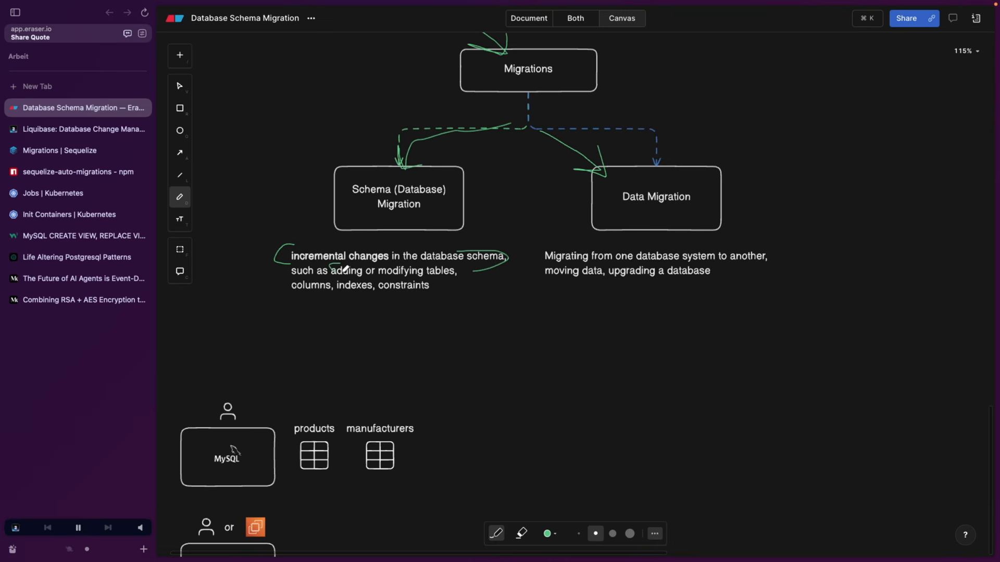

1. **Khái niệm di chuyển lược đồ:**
   - Di chuyển lược đồ (Schema Migration) là sự thay đổi gia tăng (incremental change) diễn ra trực tiếp trên cấu trúc của cơ sở dữ liệu.
   - Các thao tác điển hình bao gồm: Tạo mới một bảng (`CREATE TABLE`), thêm một cột mới vào bảng hiện có (`ADD COLUMN`), chỉnh sửa kiểu dữ liệu của cột (`MODIFY COLUMN`), thiết lập chỉ mục tìm kiếm (`ADD INDEX`) hoặc bổ sung các ràng buộc toàn vẹn khóa ngoại (`ADD CONSTRAINT`).
   - Đây là công việc diễn ra hàng ngày, gắn liền với từng tính năng mới trong quy trình phát triển phần mềm của kỹ sư.

2. **Khái niệm di chuyển dữ liệu:**
   - Di chuyển dữ liệu (Data Migration) là hành vi trích xuất toàn bộ dữ liệu đang có từ một hệ cơ sở dữ liệu thứ nhất (DB 1) và nạp sang một hệ cơ sở dữ liệu thứ hai (DB 2).
   - Kịch bản này thường xảy ra khi doanh nghiệp nâng cấp phiên bản hệ quản trị cơ sở dữ liệu lớn (ví dụ chuyển từ MySQL 5.7 lên MySQL 8.0), hoặc chuyển đổi nền tảng lưu trữ (từ cơ sở dữ liệu tự quản sang dịch vụ đám mây như AWS RDS / Aurora).
   - Quá trình này phức tạp, tốn kém tài nguyên và chỉ diễn ra theo các mốc thời gian lớn của dự án. Trong ngữ cảnh giao tiếp hàng ngày của lập trình viên, khi nhắc đến "migration", 99% đều ám chỉ "schema migration".

---

### [[00:01:33](https://youtu.be/mMsZPZKNc4g?t=93s)] Cơ chế lược đồ

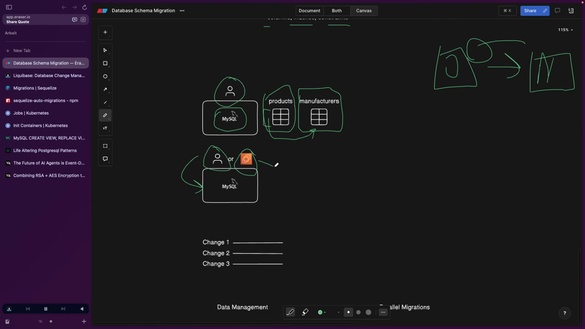

1. **Kịch bản thực tế khi chưa có công cụ di chuyển:**
   - Lập trình viên chạy ứng dụng và cơ sở dữ liệu MySQL cục bộ trên máy tính cá nhân. Trong cơ sở dữ liệu có bảng `products`.
   - Khi phát triển tính năng mới, lập trình viên tạo thêm bảng `manufacturers` và bổ sung thêm cột `manufacturer_id` vào bảng `products` để tạo liên kết khóa ngoại.
   - Thách thức xuất hiện: Trong nhóm có một đồng nghiệp khác cũng đang chạy dự án tương tự trên máy cục bộ, đồng thời hệ thống còn có một máy chủ chạy môi trường thử nghiệm (EC2 instance).
   - Nếu làm thủ công, lập trình viên phải nhắn tin cho đồng nghiệp yêu cầu chạy lệnh SQL tạo bảng, hoặc phải đăng nhập SSH vào máy chủ EC2 để gõ từng dòng lệnh bằng tay.

2. **Hệ quả của quy trình thủ công:**
   - Con người rất dễ quên hoặc bỏ sót các thuộc tính kỹ thuật quan trọng (ví dụ thuộc tính `NOT NULL`, giá trị `DEFAULT`, bảng mã ký tự `UTF8MB4`).
   - Kết quả dẫn đến hiện tượng trôi dạt cấu hình (Configuration Drift): Cơ sở dữ liệu ở máy cục bộ và máy chủ sản xuất có cấu trúc khác nhau, gây ra lỗi nghiêm trọng khi triển khai mã nguồn mới.

3. **Mô hình tương tự hệ thống quản lý phiên bản Git:**
   - Tệp di chuyển (Migration File) chính là bản ghi lịch sử của từng thay đổi cấu trúc, được sắp xếp chồng lên nhau theo trình tự thời gian giống như các Commit trong Git.
   - Tất cả các tệp này được lưu trữ trong kho mã nguồn chung. Bất kỳ lập trình viên nào hoặc máy chủ CI/CD nào chỉ cần kích hoạt một lệnh duy nhất là toàn bộ lịch sử thay đổi sẽ được áp dụng tự động, bảo đảm 100% tính nhất quán.

4. **Các công cụ phổ biến:**
   - **Liquibase:** Công cụ cấp doanh nghiệp mạnh mẽ hỗ trợ hầu hết mọi hệ quản trị cơ sở dữ liệu và ngôn ngữ lập trình, nhưng phiên bản nâng cao có tính phí.
   - **Sequelize:** Thư viện ánh xạ quan hệ đối tượng (ORM) phổ biến trong hệ sinh thái Node.js/JavaScript, tích hợp sẵn công cụ dòng lệnh `sequelize-cli` hỗ trợ quản lý di chuyển lược đồ miễn phí.

---

### [[00:03:31](https://youtu.be/mMsZPZKNc4g?t=211s)] Thiết lập môi trường

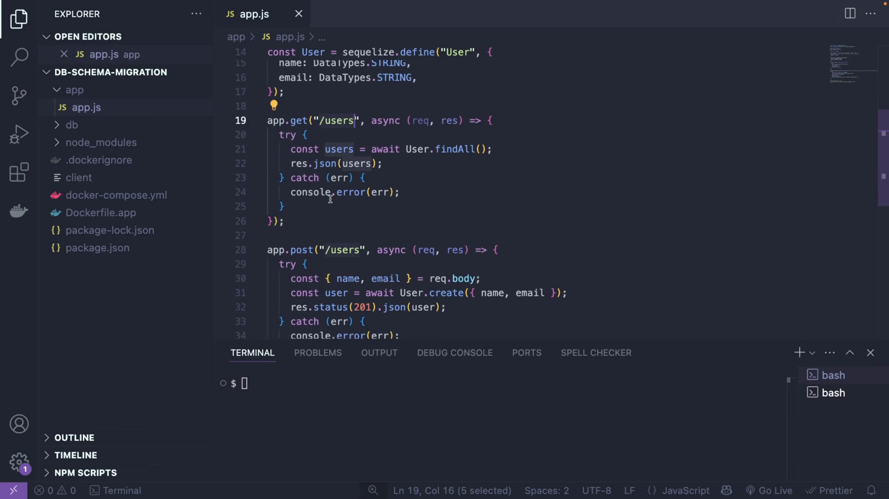

1. **Kiến trúc ứng dụng mẫu:**
   - Ứng dụng Backend xây dựng bằng Node.js và Express, kết nối cơ sở dữ liệu MySQL thông qua thư viện Sequelize.
   - Thay vì phải viết các câu truy vấn SQL thô (`SELECT * FROM users`), Sequelize cung cấp các phương thức đối tượng:
     - `User.findAll()` tương đương với câu truy vấn `SELECT`.
     - `User.create({ name, email })` tương đương với câu lệnh `INSERT INTO`.

2. **Tổ chức thư mục cơ sở dữ liệu:**
   - Khi khởi tạo Sequelize CLI (`npx sequelize-cli init`), hệ thống tự động sinh ra cấu trúc 4 thư mục tiêu chuẩn:
     - `config/`: Chứa tệp `config.json` định nghĩa thông tin kết nối (tài khoản, mật khẩu, máy chủ, tên cơ sở dữ liệu) cho từng môi trường: `development`, `test`, `production`.
     - `models/`: Định nghĩa các mô hình dữ liệu ánh xạ trực tiếp đến các bảng trong cơ sở dữ liệu.
     - `migrations/`: Chứa các tệp kịch bản thay đổi lược đồ theo thời gian.
     - `seeders/`: Chứa các kịch bản nạp dữ liệu mẫu ban đầu phục vụ phát triển cục bộ.

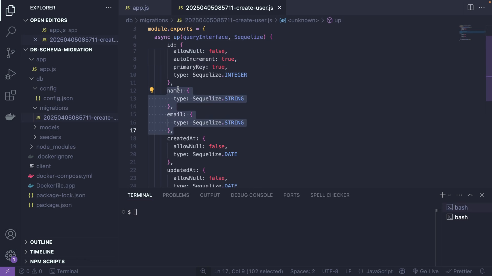

3. **Quy tắc hàm tiến và hàm lùi:**
   - Mỗi tệp di chuyển của Sequelize xuất ra một đối tượng chứa hai hàm bắt buộc:
     - Hàm `up(queryInterface, Sequelize)`: Được gọi khi chạy lệnh di chuyển, thực thi hành động áp dụng thay đổi (ví dụ: `createTable`, `addColumn`).
     - Hàm `down(queryInterface, Sequelize)`: Được gọi khi cần hoàn tác di chuyển, thực thi hành động đảo ngược chính xác thao tác của hàm `up` (ví dụ: `dropTable`, `removeColumn`).

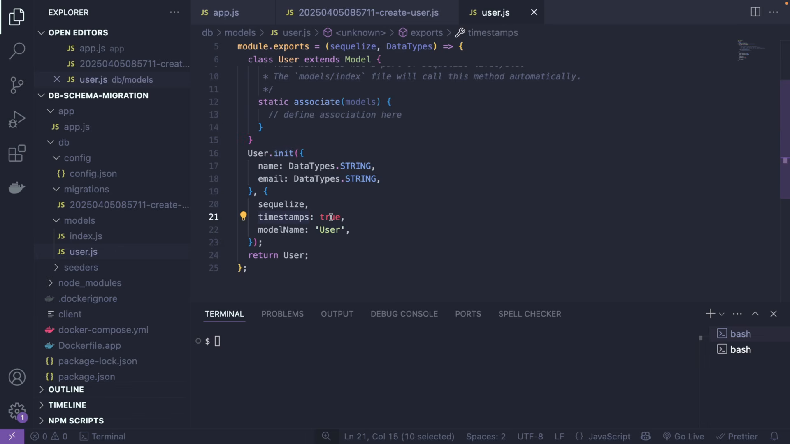

4. **Cấu hình vùng chứa với Docker Compose:**
   - Tệp `docker-compose.yml` điều phối hai dịch vụ độc lập:
     - Dịch vụ `db`: Sử dụng hình ảnh chính thức `mysql:8`, thiết lập cổng kết nối `3306` cùng các biến môi trường cấu hình mật khẩu gốc (`MYSQL_ROOT_PASSWORD`) và tên cơ sở dữ liệu (`MYSQL_DATABASE: test_db`).
     - Dịch vụ `app`: Đóng gói ứng dụng Node.js chạy phiên bản `node:22-alpine`, lắng nghe trên cổng `3000` và nhận các biến môi trường kết nối sang dịch vụ `db`.

---

### [[00:08:34](https://youtu.be/mMsZPZKNc4g?t=514s)] Thực thi di chuyển

1. **Khởi tạo dữ liệu ban đầu:**
   - Hệ thống khởi động thành công với Docker Compose. Trong cơ sở dữ liệu ban đầu có bảng `users` chứa 1 bản ghi: người dùng `Jesse Pinkman` (chỉ gồm `name`, `email`, `createdAt`, `updatedAt`).

2. **Quy trình tạo tệp di chuyển mới:**
   - Yêu cầu nghiệp vụ: Cần bổ sung thêm trường tuổi (`age`) vào bảng `users`.
   - Bước 1: Khai báo trường mới trong tệp mô hình `models/user.js`:
     ```javascript
     age: {
       type: DataTypes.INTEGER,
       allowNull: true
     }
     ```
   - Bước 2: Tạo tệp di chuyển thông qua dòng lệnh:
     ```bash
     npx sequelize-cli migration:generate --name add_age_to_users
     ```
   - Công cụ tạo ra một tệp mới có định dạng dấu thời gian: `migrations/<TIMESTAMP>-add_age_to_users.js`.

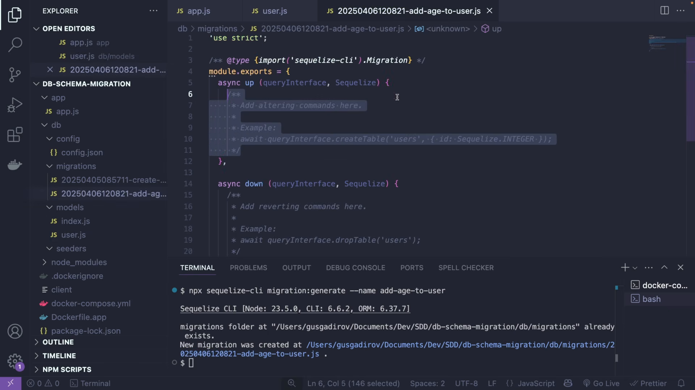

3. **Cấu trúc mã nguồn di chuyển:**
   - Đoạn mã chi tiết bên trong tệp di chuyển:
     ```javascript
     'use strict';

     module.exports = {
       async up (queryInterface, Sequelize) {
         await queryInterface.addColumn('users', 'age', {
           type: Sequelize.INTEGER,
           allowNull: true
         });
       },

       async down (queryInterface, Sequelize) {
         await queryInterface.removeColumn('users', 'age');
       }
     };
     ```
   - Điểm kỹ thuật then chốt: Cột mới bắt buộc phải đặt `allowNull: true`. Nếu đặt `allowNull: false` mà không có giá trị mặc định, câu lệnh sẽ thất bại ngay lập tức vì bản ghi cũ (`Jesse Pinkman`) chưa từng có giá trị tuổi.

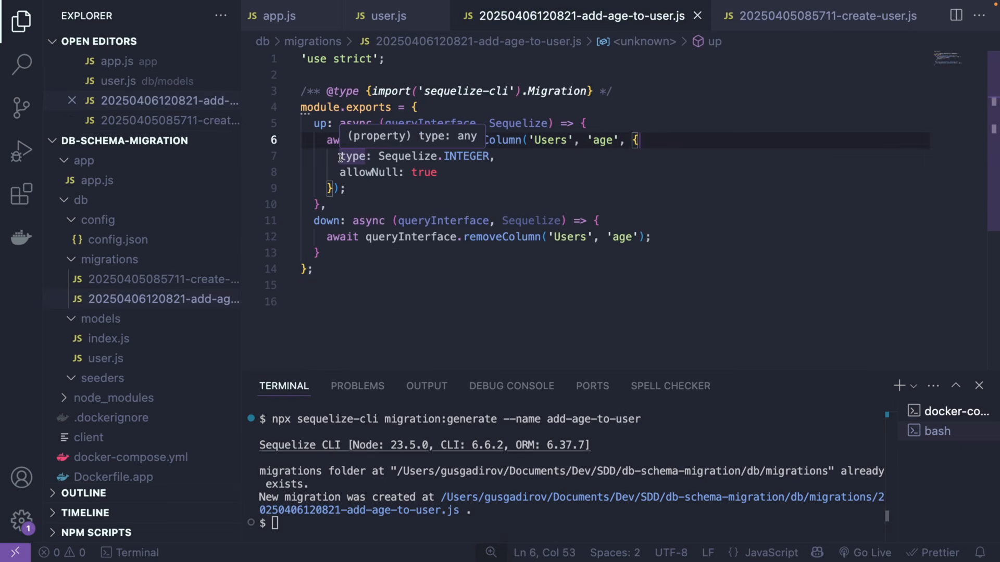

4. **Áp dụng thay đổi vào cơ sở dữ liệu:**
   - Chạy lệnh di chuyển từ terminal:
     ```bash
     npx sequelize-cli db:migrate
     ```
   - Đầu ra ghi nhận: Kết nối thành công tới môi trường `development`, áp dụng tệp `<TIMESTAMP>-add_age_to_users.js` thành công.
   - Bảng `users` trong MySQL ngay lập tức xuất hiện thêm cột `age`, bản ghi cũ có giá trị `age = NULL`.

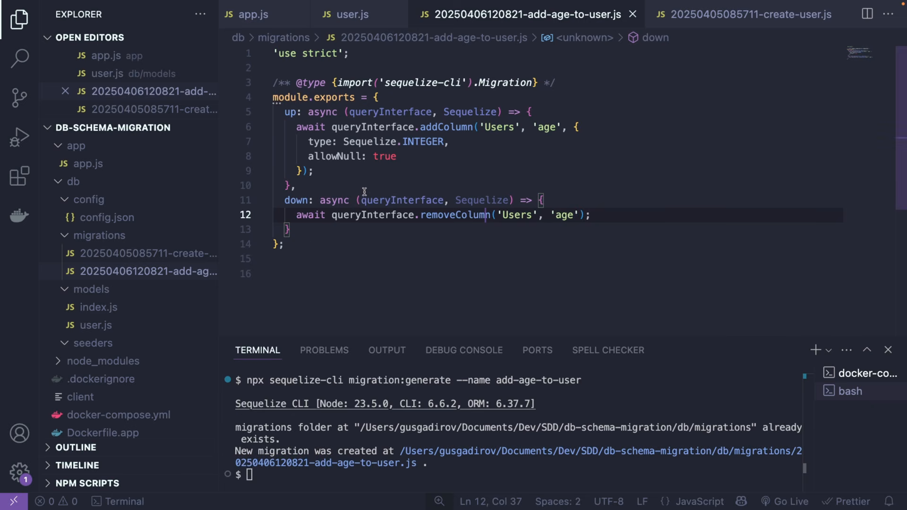

5. **Vai trò của bảng siêu dữ liệu `SequelizeMeta`:**
   - Trong cơ sở dữ liệu xuất hiện một bảng hệ thống mang tên `SequelizeMeta`.
   - Cấu trúc bảng này cực kỳ đơn giản: Chỉ gồm một cột duy nhất `name` kiểu chuỗi lưu tên các tệp di chuyển đã chạy thành công.
   - Khi chạy lệnh `db:migrate`, công cụ thực hiện thuật toán đối chiếu:
     - Lấy danh sách toàn bộ các tệp `.js` có trong thư mục `migrations/`.
     - Lấy danh sách tên tệp đã có trong bảng `SequelizeMeta`.
     - Chỉ thực thi những tệp xuất hiện trong thư mục nhưng chưa có tên trong bảng `SequelizeMeta`.
   - Nếu chạy lại lệnh `db:migrate` lần thứ hai, hệ thống thông báo `No migrations were executed, database schema was already up to date` và dừng lại mà không thực hiện hành động thừa.

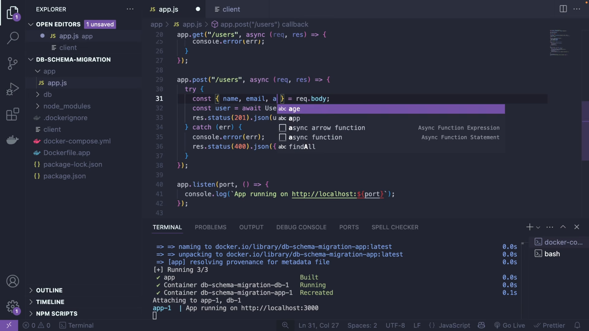

6. **Kiểm thử tích hợp qua API:**
   - Cập nhật mã nguồn API để tiếp nhận trường `age` từ thân yêu cầu (`req.body`).
   - Gửi yêu cầu HTTP POST tạo người dùng mới:
     - Dữ liệu gửi: `name: "Walter White"`, `email: "heisenberg@gmail.com"`, `age: 50`.
     - Phản hồi HTTP 201 Created thành công.
   - Gửi yêu cầu HTTP GET lấy danh sách người dùng:
     - Bản ghi 1: `Jesse Pinkman`, `age: null` (bảo toàn tính toàn vẹn dữ liệu cũ).
     - Bản ghi 2: `Walter White`, `age: 50` (tiếp nhận dữ liệu mới trơn tru).

---

### [[00:14:43](https://youtu.be/mMsZPZKNc4g?t=883s)] Chiến lược nâng cao

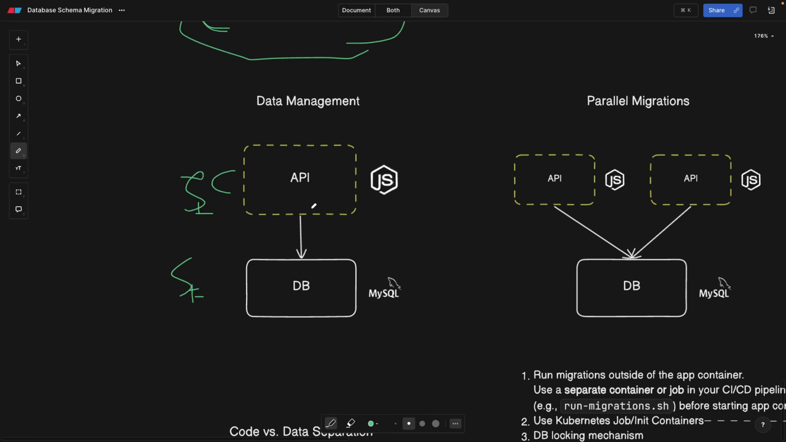

1. **Quản lý dữ liệu trong kiến trúc phần mềm:**
   - Các vùng chứa ứng dụng Backend API là thành phần phi trạng thái (Stateless). Chúng có thể bị phá hủy, tạo lại hoặc mở rộng thành hàng chục bản sao bất cứ lúc nào.
   - Cơ sở dữ liệu là thành phần có trạng thái (Stateful). Trong môi trường sản xuất thực tế, cơ sở dữ liệu là một thực thể độc lập bền vững (thường chạy trên cụm máy chủ chuyên dụng hoặc dịch vụ như AWS RDS) và không bao giờ bị xóa bỏ theo vòng đời của ứng dụng.

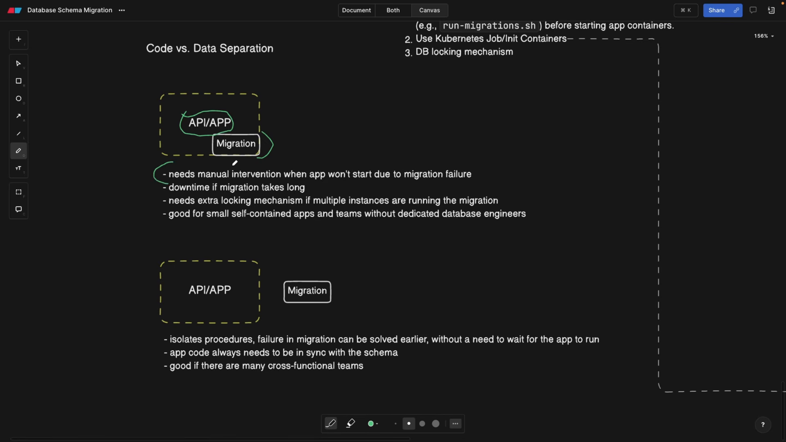

2. **Hai trường phái triển khai di chuyển:**
   - **Trường phái 1: Nhúng trực tiếp vào mã ứng dụng (Embedded Migration):**
     - Sử dụng hàm đồng bộ của thư viện (như `sequelize.sync()`) kích hoạt ngay khi tệp `app.js` khởi chạy.
     - *Ưu điểm:* Tiện lợi, đơn giản cho dự án nhỏ, nhóm phát triển không có kỹ sư cơ sở dữ liệu chuyên trách.
     - *Nhược điểm:* Nếu tệp di chuyển chạy quá lâu hoặc gặp lỗi cú pháp, toàn bộ ứng dụng Backend sẽ bị treo và không bao giờ khởi động được.
   - **Trường phái 2: Tách biệt hoàn toàn khỏi ứng dụng (Separated Migration):**
     - Tác vụ di chuyển được đóng gói thành một tiến trình độc lập trong đường ống CI/CD hoặc chạy thủ công trước khi phát hành ứng dụng.
     - *Ưu điểm:* Cô lập rủi ro; nếu di chuyển thất bại thì ứng dụng cũ vẫn tiếp tục chạy phục vụ người dùng; phù hợp cho các hệ thống lớn có nhiều nhóm phát triển cùng làm việc trên một cơ sở dữ liệu.

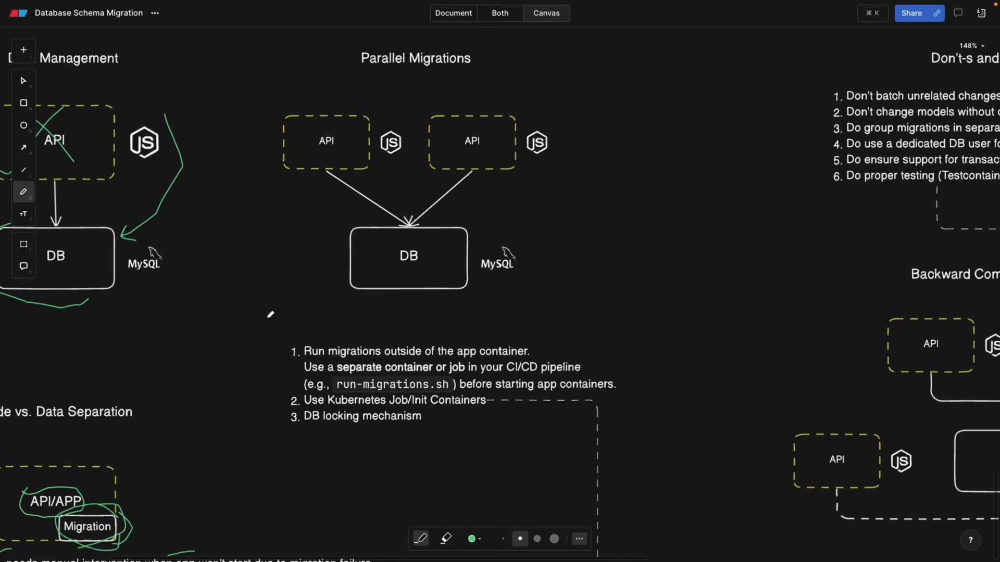

3. **Hiểm họa khi mở rộng song song:**
   - Trong kiến trúc đám mây có cơ chế tự động co giãn (Auto-scaling), khi có bản cập nhật mới, 2 hoặc nhiều phiên bản ứng dụng (Instance A và Instance B) sẽ cùng khởi động tại một thời điểm.
   - Nếu cả hai đều cấu hình chạy di chuyển lúc khởi động, cả hai sẽ cùng đọc bảng `SequelizeMeta`, thấy chưa có bản ghi mới và cùng gửi lệnh `ALTER TABLE` vào cơ sở dữ liệu.
   - Hiện tượng tranh chấp tài nguyên (Race Condition) xảy ra làm hỏng bảng dữ liệu, khóa chết hệ thống hoặc gây lỗi nghiêm trọng.

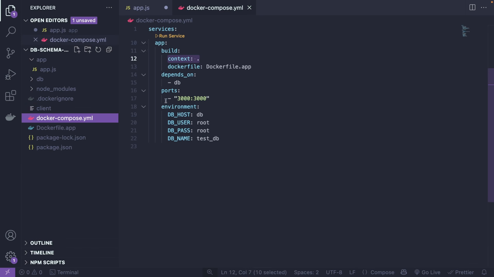

4. **Giải pháp vùng chứa chuyên trách trong Docker:**
   - Trong Docker Compose, tạo thêm một dịch vụ trung gian chuyên chạy di chuyển (ví dụ: `migration-service`).
   - Cấu hình luồng thực thi thông qua thuộc tính `depends_on`:
     1. Khởi động dịch vụ cơ sở dữ liệu `db`.
     2. Khởi động dịch vụ `migration-service` chạy lệnh `db:migrate` và kết thúc sau khi hoàn tất.
     3. Khởi động dịch vụ `app` chỉ sau khi `migration-service` đã chạy thành công.

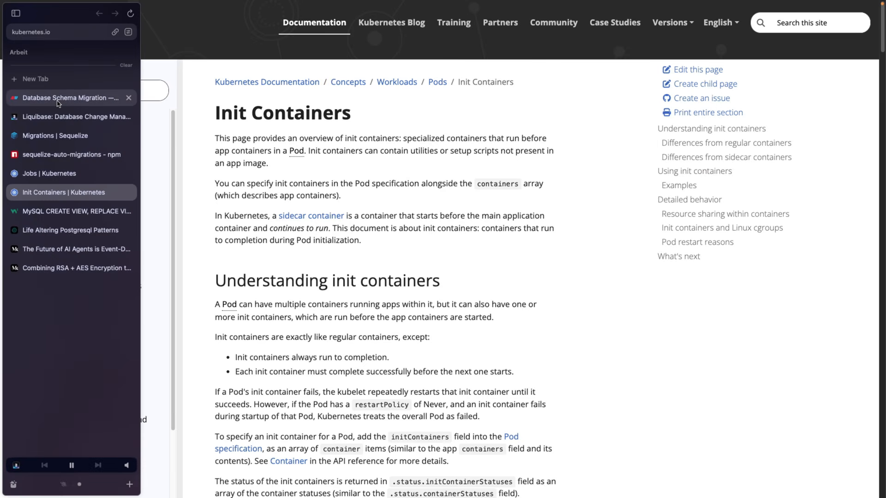

5. **Giải pháp cấp độ Kubernetes:**
   - **Init Containers:** Thích hợp khi ứng dụng chỉ có 1 Pod duy nhất. Init Container sẽ chạy lệnh di chuyển trước khi vùng chứa chính khởi động. Tuy nhiên nếu triển khai nhiều bản sao (Replicas), rủi ro xung đột vẫn tồn tại vì mỗi Pod đều có Init Container riêng.
   - **Kubernetes Jobs (Khuyến nghị chuẩn mực):** Khởi tạo một đối tượng Job độc lập trong tệp kê khai triển khai. Kubernetes đảm bảo Job này tạo Pod chạy lệnh di chuyển hoàn tất thành công 100% rồi mới kích hoạt bản cập nhật luân phiên (Rolling Update) cho các Pod ứng dụng chính.
   - **Khóa cấp cơ sở dữ liệu (Database Locking):** Các công cụ chuyên nghiệp sẽ tạo một khóa vật lý trong bảng khóa hệ thống; nút nào giành được khóa trước sẽ thực thi di chuyển, các nút còn lại phải đợi hoặc bỏ qua nếu khóa đang bị giữ.

---

### [[00:21:10](https://youtu.be/mMsZPZKNc4g?t=1270s)] Quy tắc chuẩn mực

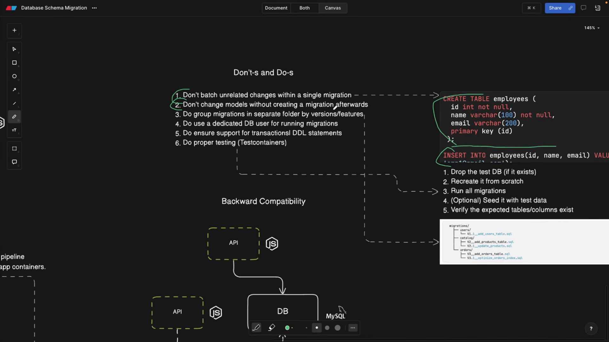

1. **Những điều tuyệt đối không nên làm:**
   - **Không gộp nhiều thay đổi không liên quan vào một tệp di chuyển:** Không bao giờ vừa tạo bảng mới (`CREATE TABLE employees`) lại vừa chèn dữ liệu (`INSERT INTO employees`) trong cùng một tệp. Nếu một thao tác phía sau lỗi, việc hoàn tác (Rollback) sẽ cực kỳ phức tạp và dễ phát sinh lỗi dở dang.
   - **Không sửa đổi mô hình mà quên tạo tệp di chuyển:** Sửa tệp mô hình trong mã nguồn Backend nhưng không tạo tệp di chuyển tương ứng sẽ khiến mã nguồn đòi hỏi các trường dữ liệu mà cơ sở dữ liệu thực tế chưa hề có.

2. **Những quy tắc bắt buộc phải tuân thủ:**
   - **Phân nhóm tệp di chuyển:** Khi dự án lớn có hàng trăm tệp di chuyển, cần tổ chức phân chia thư mục theo phiên bản (`v1`, `v2`) hoặc theo miền nghiệp vụ (`users`, `orders`, `catalog`).
   - **Sử dụng tài khoản cơ sở dữ liệu chuyên biệt:** Không dùng tài khoản kết nối của ứng dụng thường ngày để chạy di chuyển. Phải cấp một tài khoản riêng có quyền thay đổi định nghĩa dữ liệu (DDL privileges).
   - **Bảo đảm hỗ trợ DDL Giao dịch:** Ưu tiên cơ sở dữ liệu hỗ trợ Transactional DDL (như PostgreSQL). Khi có sự cố, toàn bộ giao dịch thay đổi cấu trúc sẽ được hoàn tác sạch sẽ, không để lại rác trong cơ sở dữ liệu.

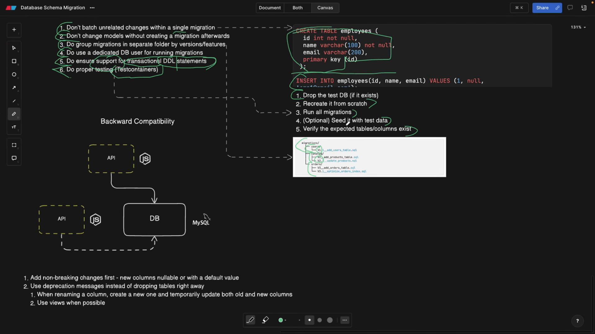

3. **Kiểm thử tự động với TestContainers:**
   - Trong đường ống tích hợp liên tục (CI/CD), quy trình kiểm thử di chuyển chuẩn mực gồm 5 bước:
     1. Khởi tạo một phiên bản cơ sở dữ liệu sạch hoàn toàn bên trong vùng chứa Docker thông qua TestContainers.
     2. Xóa sạch mọi cấu trúc hiện có nếu có (`DROP DATABASE`).
     3. Thực thi toàn bộ danh sách tệp di chuyển từ đầu đến cuối (`Run All Migrations`).
     4. Nạp dữ liệu kiểm thử giả định (`Seed Data`).
     5. Viết mã kiểm tra xác nhận (Assertion) rằng các bảng và cột mong muốn đã tồn tại với đầy đủ kiểu dữ liệu và ràng buộc.

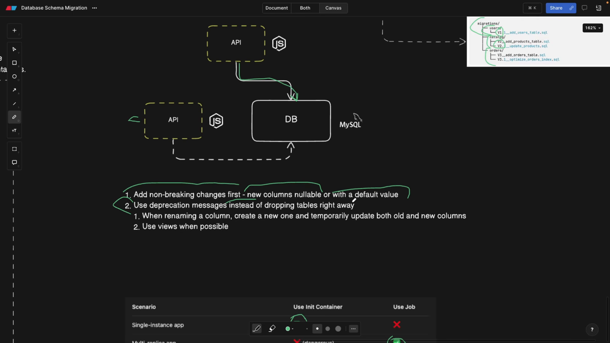

4. **Chiến lược tương thích ngược:**
   - **Mẫu thiết kế Mở rộng và Thu hẹp (Expand and Contract Pattern):**
     - Khi đổi tên cột (ví dụ từ `name` sang `fullName`):
       - Bước 1 (Mở rộng): Thêm cột mới `fullName` (chấp nhận null).
       - Bước 2: Cập nhật mã ứng dụng để ghi đồng thời vào cả hai cột `name` và `fullName`.
       - Bước 3: Di chuyển dữ liệu cũ từ `name` sang `fullName`.
       - Bước 4: Phát hành cảnh báo phản đối (Deprecation Warning) trên API cho các đối tác tích hợp.
       - Bước 5 (Thu hẹp): Sau khi tất cả hệ thống đã chuyển sang dùng `fullName`, tạo một tệp di chuyển mới để xóa cột cũ `name`.
   - **Sử dụng Khung nhìn làm bí danh chuyển tiếp:**
     - Nếu cần đổi tên bảng hoặc cấu trúc mà không muốn làm hỏng các ứng dụng cũ đang truy vấn: Tạo một Khung nhìn (Database View) với tên cũ trỏ vào bảng mới.
     - Ví dụ: `CREATE VIEW customers AS SELECT id, full_name AS name FROM new_customers;`. Ứng dụng cũ truy vấn vào `customers` vẫn nhận về đúng định dạng mong đợi mà không cần sửa một dòng mã nào.

---

## Trích dẫn then chốt

* [[00:03:00](https://youtu.be/mMsZPZKNc4g?t=180s)] *"Migrations are basically incremental changes and actually it very much reminds me of a Git or version control."* — Bản chất của các tệp di chuyển là những thay đổi gia tăng tuần tự, hoạt động hệt như hệ thống quản lý phiên bản Git dành riêng cho cơ sở dữ liệu.
* [[00:15:10](https://youtu.be/mMsZPZKNc4g?t=910s)] *"Our APIs can be torn down and created anytime, they are stateless. But our databases are stateful."* — Các dịch vụ ứng dụng là phi trạng thái có thể bị hủy và tái tạo bất cứ lúc nào, trong khi cơ sở dữ liệu là thực thể có trạng thái đòi hỏi sự bảo toàn tuyệt đối.
* [[00:18:20](https://youtu.be/mMsZPZKNc4g?t=1100s)] *"If you have multiple instances and autoscaling, how are we going to make sure that two applications don't run the migration at the same time and hurt each other?"* — Khi hệ thống tự động co giãn với nhiều bản sao, bắt buộc phải có cơ chế ngăn chặn việc nhiều tiến trình cùng chạy di chuyển đồng thời gây xung đột dữ liệu.
* [[00:22:10](https://youtu.be/mMsZPZKNc4g?t=1330s)] *"Don't batch unrelated changes within a single migration because if you pile up a lot of code, it's going to be really difficult to revert them."* — Tuyệt đối không gộp các thay đổi không liên quan vào cùng một tệp di chuyển, bởi vì khi xảy ra lỗi sẽ rất khó khăn để hoàn tác chính xác.
* [[00:25:05](https://youtu.be/mMsZPZKNc4g?t=1505s)] *"Make sure you add non-breaking changes first. For example, if you want to create a new column, make sure that the new column is nullable."* — Luôn ưu tiên phát hành các thay đổi không gây gián đoạn trước; bất kỳ cột dữ liệu mới nào được bổ sung phải luôn chấp nhận giá trị rỗng hoặc có giá trị mặc định.

---

## Lệnh & Công cụ

### Dòng lệnh Sequelize CLI

Khối lệnh thao tác di chuyển cơ sở dữ liệu với Node.js và Sequelize:

```bash
# 1. Khởi tạo cấu trúc thư mục di chuyển chuẩn
npx sequelize-cli init

# 2. Tạo một tệp di chuyển mới có dấu thời gian
npx sequelize-cli migration:generate --name add_age_to_users

# 3. Thực thi toàn bộ các tệp di chuyển chưa chạy
npx sequelize-cli db:migrate

# 4. Hoàn tác tệp di chuyển gần nhất vừa được áp dụng
npx sequelize-cli db:migrate:undo

# 5. Hoàn tác toàn bộ mọi di chuyển về trạng thái ban đầu
npx sequelize-cli db:migrate:undo:all

# 6. Kiểm tra trạng thái các tệp di chuyển so với cơ sở dữ liệu
npx sequelize-cli db:migrate:status
```

### Cấu hình Docker Compose mẫu

Mẫu cấu hình tách biệt dịch vụ chạy di chuyển bằng thuộc tính phụ thuộc:

```yaml
version: '3.8'

services:
  db:
    image: mysql:8
    environment:
      MYSQL_ROOT_PASSWORD: secretpassword
      MYSQL_DATABASE: test_db
    ports:
      - "3306:3306"

  migration:
    build: .
    command: npx sequelize-cli db:migrate
    environment:
      DB_HOST: db
    depends_on:
      db:
        condition: service_healthy

  app:
    build: .
    command: npm start
    ports:
      - "3000:3000"
    environment:
      DB_HOST: db
    depends_on:
      migration:
        condition: service_completed_successfully
```

---

## Đánh đổi & Rủi ro

| Phương án kiến trúc | Lợi ích đạt được | Sự đánh đổi & Rủi ro tiềm ẩn |
| :--- | :--- | :--- |
| **Nhúng di chuyển vào ứng dụng (Embedded)** | Đơn giản, triển khai nhanh, không đòi hỏi cấu hình đường ống CI/CD phức tạp. | Ứng dụng bị treo không khởi động được nếu di chuyển lỗi; nguy cơ xung đột khóa khi mở rộng đa bản sao. |
| **Tách biệt tác vụ (Kubernetes Job / CI/CD)** | Cô lập hoàn toàn rủi ro, bảo vệ ứng dụng chính, tương thích tuyệt đối với kiến trúc Auto-scaling. | Đòi hỏi hạ tầng DevOps phức tạp, tăng thời gian phát hành phần mềm trong đường ống triển khai. |
| **Mở rộng và Thu hẹp (Expand & Contract)** | Hệ thống đạt trạng thái không thời gian chết (Zero-downtime), tương thích ngược tuyệt đối giữa các phiên bản. | Đòi hỏi phát hành nhiều phiên bản trung gian, duy trì mã nguồn kép xử lý hai trường dữ liệu song song trong một thời gian. |
| **DDL Giao dịch (Transactional DDL)** | Đảm bảo tính nguyên tử (Atomicity); tự động hoàn tác sạch sẽ nếu gặp lỗi giữa chừng. | Giới hạn hệ quản trị cơ sở dữ liệu (PostgreSQL hỗ trợ rất tốt, MySQL bị hạn chế vì nhiều lệnh DDL tự động kích hoạt ngầm lệnh COMMIT). |
| **Kiểm thử với TestContainers** | Phát hiện 100% lỗi cú pháp và xung đột dữ liệu trên môi trường thực tế trước khi lên Production. | Tăng thời gian thực thi của đường ống CI/CD (mỗi lần chạy phải kéo ảnh Docker và dựng cơ sở dữ liệu từ đầu). |
