# Khóa Học Git Và GitHub Nền Tảng

* **Kênh:** freeCodeCamp.org (Giảng viên: Gwen Faraday) | **Thời lượng:** 01:08:30 | **Ngày:** 2020-05-28
* **Video:** https://youtu.be/RGOj5yH7evk

---

## Thuật ngữ

| Thuật ngữ | Tiếng Anh | Giải thích |
| :--- | :--- | :--- |
| Hệ thống kiểm soát phiên bản | Version Control System (VCS) | Phần mềm ghi lại lịch sử thay đổi của tệp mã nguồn theo thời gian, cho phép so sánh, truy vết lỗi và phục hồi về trạng thái bất kỳ. |
| Phân tán | Distributed | Mô hình kiến trúc trong đó mỗi máy trạm lưu giữ toàn bộ bản sao lịch sử kho mã, không phụ thuộc tuyệt đối vào máy chủ trung tâm. |
| Kho lưu trữ | Repository (Repo) | Thư mục chứa toàn bộ tệp nguồn của dự án cùng thư mục ẩn `.git` quản lý toàn bộ cây lịch sử commit, nhánh và cấu hình. |
| Thư mục làm việc | Working Directory | Thư mục vật lý trên ổ đĩa nơi lập trình viên trực tiếp mở, chỉnh sửa mã nguồn trước khi đánh dấu thay đổi. |
| Vùng đệm chuẩn bị | Staging Area (Index) | Tầng trung gian lưu vết những thay đổi đã sẵn sàng để đóng gói thành một commit chính thức. |
| Điểm lưu vết | Commit | Một ảnh chụp (snapshot) toàn bộ trạng thái dự án tại một thời điểm, được gắn mã băm SHA duy nhất và kèm thông điệp mô tả. |
| Con trỏ trạng thái | HEAD | Con trỏ tham chiếu trỏ tới commit hoặc nhánh hiện hành mà thư mục làm việc đang đồng bộ. |
| Nhánh | Branch | Một con trỏ nhẹ di động trỏ tới một chuỗi commit độc lập, cho phép phát triển tính năng song song mà không ảnh hưởng nhánh chính. |
| Kho từ xa | Remote Repository | Bản sao kho mã được lưu trữ trên nền tảng đám mây (như GitHub, GitLab) dùng để phối hợp nhóm. |
| Sao chép kho | Clone | Thao tác tải toàn bộ mã nguồn, cấu hình và lịch sử commit của một kho từ xa về máy trạm cục bộ. |
| Đẩy mã | Push | Truyền các commit cục bộ lên kho từ xa để cập nhật nhánh tương ứng. |
| Kéo mã | Pull | Lấy các commit mới từ kho từ xa về máy trạm và tự động hợp nhất vào nhánh hiện hành (`fetch` + `merge`). |
| Hợp nhất | Merge | Phép tích hợp lịch sử và nội dung thay đổi từ hai nhánh khác nhau thành một luồng commit thống nhất. |
| Xung đột hợp nhất | Merge Conflict | Tình trạng xảy ra khi hai nhánh cùng sửa đổi cùng một dòng trên cùng một tệp, khiến Git không thể tự động quyết định và yêu cầu con người can thiệp. |
| Yêu cầu kéo | Pull Request (PR) | Cơ chế trên nền tảng GitHub cho phép nhà phát triển đề xuất trộn các commit từ nhánh của mình vào nhánh dự án chung kèm bình luận phản biện. |
| Khóa định danh SSH | SSH Key Pair | Cặp khóa mật mã bất đối xứng (khóa riêng tư bí mật trên máy và khóa công khai tải lên GitHub) phục vụ xác thực bảo mật không cần mật khẩu. |
| Rẽ nhánh kho | Fork | Bản sao hoàn chỉnh độc lập của một kho mã công khai thuộc sở hữu người khác về tài khoản cá nhân, cho phép tự do chỉnh sửa và mở PR đóng góp. |

---

## Tổng luận chuyên đề

### 1. Kiến trúc ba trạng thái cốt lõi của Git
Git không lưu trữ tệp dưới dạng các bản vá chênh lệch dòng (deltas) như các hệ thống VCS đời cũ (CVS, SVN), mà quản lý dữ liệu dưới dạng tập hợp các ảnh chụp (snapshots). Một tệp mã trong máy trạm cục bộ luôn luân chuyển qua ba vùng logic:
* **Thư mục làm việc (Working Directory):** Không gian tệp thực tế trên ổ cứng. Các thay đổi tại đây mang trạng thái `untracked` (chưa được theo dõi) hoặc `modified` (đã chỉnh sửa nhưng chưa lưu).
* **Vùng dàn dựng (Staging Area / Index):** Vùng đệm đánh dấu các thay đổi được lựa chọn để chuẩn bị đóng gói. Tệp chuyển sang trạng thái `staged`.
* **Kho lưu trữ (Repository / `.git`):** Cơ sở dữ liệu đối tượng chứa các commit vĩnh viễn mang trạng thái `committed`. Mỗi commit có cây thư mục hoàn chỉnh, mã tác giả, dấu thời gian và con trỏ trỏ về commit cha.

### 2. Mô hình phối hợp giữa máy trạm và nền tảng đám mây
Chu trình phát triển phần mềm hiện đại là sự kết hợp giữa công cụ dòng lệnh Git trên máy trạm và hạ tầng quản lý máy chủ GitHub:
* Máy trạm xử lý nhanh chóng, ngoại tuyến, kiểm soát chi tiết từng dòng mã qua terminal và trình soạn thảo.
* GitHub đóng vai trò điểm kết nối trung tâm, cung cấp kiểm soát truy cập, đánh giá chất lượng mã nguồn (Code Review) thông qua Pull Request, và theo dõi các vấn đề (Issues).
* Cơ chế xác thực an toàn thông qua khóa SSH (thuật toán RSA/Ed25519) thiết lập đường hầm mã hóa bảo vệ toàn bộ thao tác nạp và tải mã.

### 3. Chiến lược phân nhánh và cô lập môi trường
Phân nhánh trong Git là thao tác cực kỳ nhẹ (chỉ tạo một tệp văn bản nhỏ 41 byte chứa mã SHA commit). Quy tắc vàng trong làm việc nhóm:
* Không bao giờ phát triển tính năng trực tiếp trên nhánh chính (`master` hoặc `main`).
* Mỗi tính năng, bản sửa lỗi phải được phát triển trên một nhánh riêng biệt (`feature branch`).
* Sử dụng Pull Request để tiến hành phản biện chéo trước khi hợp nhất.
* Luôn cập nhật nhánh chính cục bộ bằng `git pull` trước khi cắt nhánh mới để tránh xung đột mã nguồn.

---

## Bóc tách chi tiết

### [[00:00:00](https://youtu.be/RGOj5yH7evk?t=0s)] Giới thiệu tổng quan
Bài giảng được thiết kế dành cho lập trình viên mới bắt đầu, định hình toàn diện tư duy và thao tác thực hành từ con số không đối với hệ thống kiểm soát phiên bản Git và nền tảng cộng tác GitHub. Mục tiêu bao trùm là giúp người học tự tin thao tác lệnh dòng lệnh trên terminal, tích hợp trình soạn thảo mã nguồn VS Code và làm chủ quy trình làm việc nhóm chuyên nghiệp.

### [[00:01:10](https://youtu.be/RGOj5yH7evk?t=70s)] Bản chất Git
Git là hệ thống kiểm soát phiên bản mã nguồn mở, miễn phí và phân tán được phát minh bởi Linus Torvalds vào năm 2005. Điểm khác biệt mấu chốt của Git so với các hệ thống tập trung là mỗi lập trình viên khi sao chép dự án đều sở hữu một máy chủ Git hoàn chỉnh trên máy cá nhân, cho phép thực hiện commit, tạo nhánh, duyệt lịch sử hoàn toàn ngoại tuyến mà không cần kết nối mạng.

### [[00:01:30](https://youtu.be/RGOj5yH7evk?t=90s)] Hệ thống quản lý
Kiểm soát phiên bản giải quyết bài toán quản lý sự thay đổi của mã nguồn theo thời gian. Thay vì lưu trữ thủ công các thư mục dự án với các tên gọi rời rạc như `project_v1`, `project_final`, `project_final_final`, Git ghi nhận sự tiến hóa của mã nguồn một cách có cấu trúc. Nếu một bản cập nhật làm phát sinh lỗi nghiêm trọng trên môi trường chạy thử, hệ thống cho phép đối chiếu chính xác dòng mã bị thay đổi và phục hồi mã nguồn về trạng thái ổn định trước đó trong chớp mắt.

### [[00:02:10](https://youtu.be/RGOj5yH7evk?t=130s)] Thuật ngữ nền tảng
Giảng viên làm rõ từng khái niệm hệ thống trước khi bắt tay vào thao tác lệnh:
* **Thư mục (Directory / Folder):** Thư mục chứa mã nguồn trên hệ điều hành.
* **Dòng lệnh (Terminal / Command Line):** Giao diện văn bản thuần túy dùng để gửi chỉ thị trực tiếp đến hệ điều hành mà không thông qua giao diện đồ họa.
* **Giao diện dòng lệnh (CLI):** Công cụ phần mềm nhận lệnh dưới dạng các chuỗi ký tự văn bản.
* **Kho mã (Repository):** Không gian lưu trữ dự án được Git theo dõi.
* **Kho cục bộ (Local Repository):** Nằm trực tiếp trên máy tính cá nhân.
* **Kho từ xa (Remote Repository):** Lưu trữ trên máy chủ mạng như GitHub.
* **Nhánh chính (Master / Main):** Nhánh phát triển mặc định đại diện cho dòng mã sản phẩm.

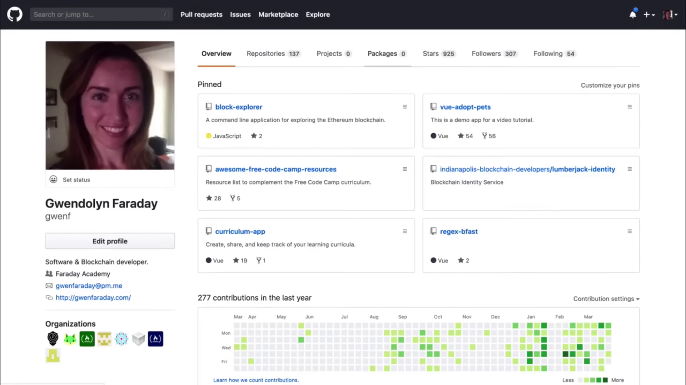

### [[00:05:20](https://youtu.be/RGOj5yH7evk?t=320s)] Lệnh điều khiển
Tổng hợp các lệnh trụ cột của Git điều khiển vòng đời mã nguồn:
* `git clone <url>`: Tải toàn bộ kho mã từ xa về máy tính.
* `git status`: Hiển thị trạng thái các tệp trong thư mục làm việc và vùng đệm.
* `git add <tệp>`: Chuyển thay đổi từ thư mục làm việc vào vùng đệm dàn dựng (staging area).
* `git commit -m "<nội_dung>"`: Ghi lại ảnh chụp các thay đổi đã dàn dựng vào kho cục bộ.
* `git push`: Đẩy các commit từ kho cục bộ lên kho từ xa.
* `git pull`: Lấy và tích hợp các thay đổi từ kho từ xa về máy trạm.
* `git branch`: Quản lý danh sách các nhánh, tạo nhánh mới hoặc xóa nhánh.
* `git checkout`: Chuyển đổi qua lại giữa các nhánh hoặc khôi phục trạng thái tệp tin.
* `git merge`: Hợp nhất nội dung của một nhánh khác vào nhánh hiện tại.

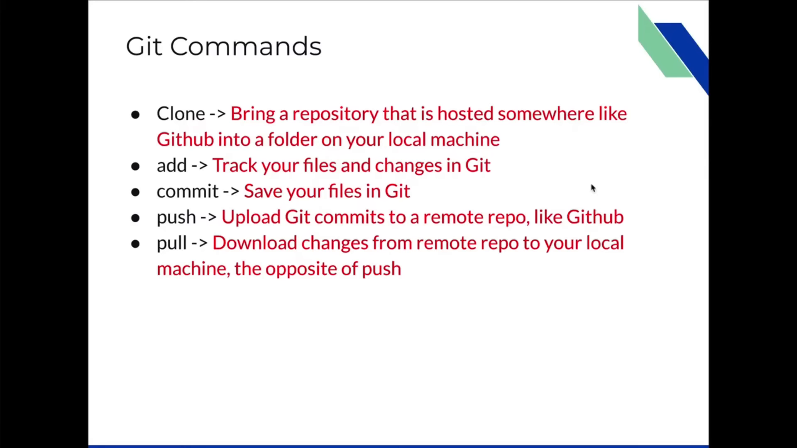

### [[00:07:05](https://youtu.be/RGOj5yH7evk?t=425s)] Đăng ký tài khoản
GitHub là dịch vụ lưu trữ dựa trên nền tảng đám mây quản lý các kho lưu trữ Git, cung cấp giao diện đồ họa, công cụ cộng tác nhóm và kiểm soát quyền truy cập. Giảng viên hướng dẫn đăng ký tài khoản mới trên GitHub thông qua email xác thực và cấu hình tài khoản cá nhân.

### [[00:09:20](https://youtu.be/RGOj5yH7evk?t=560s)] Khởi tạo kho từ xa
Thao tác tạo một kho lưu trữ mới trên giao diện web GitHub:
1. Nhấn nút tạo kho mới (`New Repository`).
2. Đặt tên kho lưu trữ (ví dụ: `my-first-repo`).
3. Chọn chế độ hiển thị: Công khai (`Public`) để cộng đồng có thể xem, hoặc Riêng tư (`Private`) để giới hạn quyền truy cập.
4. Tích chọn khởi tạo kèm tệp `README.md` để tài liệu hóa dự án ban đầu.
5. Sau khi tạo thành công, giao diện hiển thị cấu trúc tệp ban đầu với một commit khởi tạo trên nhánh `master`.

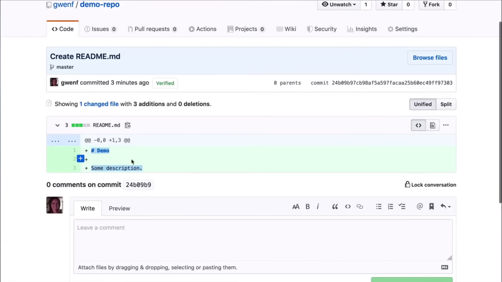

### [[00:11:32](https://youtu.be/RGOj5yH7evk?t=692s)] Kiểm tra máy trạm
Trước khi làm việc với Git trên máy tính, lập trình viên cần xác minh công cụ đã được cài đặt trong môi trường terminal:
```bash
git --version
```
Nếu hệ thống trả về thông tin phiên bản (ví dụ `git version 2.x.x`), Git đã sẵn sàng. Trên hệ điều hành macOS và Linux, Git thường được tích hợp sẵn hoặc đi kèm các gói công cụ phát triển phần mềm (Command Line Tools).

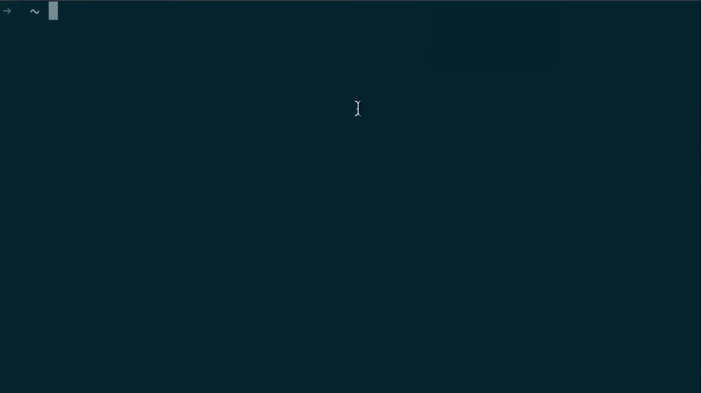

### [[00:11:54](https://youtu.be/RGOj5yH7evk?t=714s)] Cài đặt hệ thống
Nếu máy trạm chưa có Git, người dùng Windows có thể tải gói cài đặt chính thức `Git for Windows` để nhận kèm công cụ dòng lệnh Git Bash. Giảng viên tham chiếu tài liệu hướng dẫn chuẩn hóa của Atlassian để người học thiết lập đúng biến môi trường hệ thống.

### [[00:12:48](https://youtu.be/RGOj5yH7evk?t=768s)] Lựa chọn trình soạn
Mặc dù mọi trình soạn thảo văn bản thuần túy đều có thể dùng để lập trình, việc lựa chọn một IDE hiện đại như Visual Studio Code (VS Code) giúp gia tăng hiệu năng rõ rệt nhờ hệ thống highlight cú pháp, quản lý cây thư mục và tích hợp sẵn terminal cũng như giao diện trực quan hóa các thay đổi mã nguồn của Git.

### [[00:13:30](https://youtu.be/RGOj5yH7evk?t=810s)] Không gian làm việc
Giảng viên mở thư mục làm việc rỗng trong VS Code và kích hoạt terminal tích hợp (`Terminal -> New Terminal` hoặc tổ hợp phím tắt `` Ctrl+` `` / `` Cmd+` ``). Terminal tích hợp này tự động định vị đường dẫn làm việc ngay tại gốc thư mục của dự án, loại bỏ thao tác chuyển thư mục thủ công.

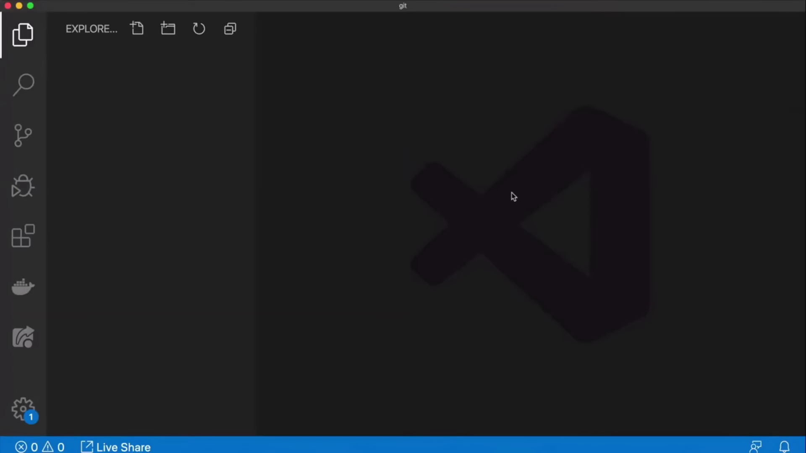

### [[00:14:30](https://youtu.be/RGOj5yH7evk?t=870s)] Sao chép mã nguồn
Để lấy kho mã đã khởi tạo trên GitHub về máy tính cá nhân:
1. Trên giao diện GitHub của kho lưu trữ, nhấn nút màu xanh `Code` và sao chép đường dẫn kho mã (định dạng HTTPS hoặc SSH).
2. Tại terminal trong VS Code, thực thi lệnh sao chép:
```bash
git clone https://github.com/gwenf/my-first-repo.git
```
3. Sau khi tiến trình tải hoàn tất, một thư mục mới mang tên `my-first-repo` xuất hiện.
4. Lập trình viên di chuyển vào bên trong thư mục này để bắt đầu làm việc:
```bash
cd my-first-repo
```

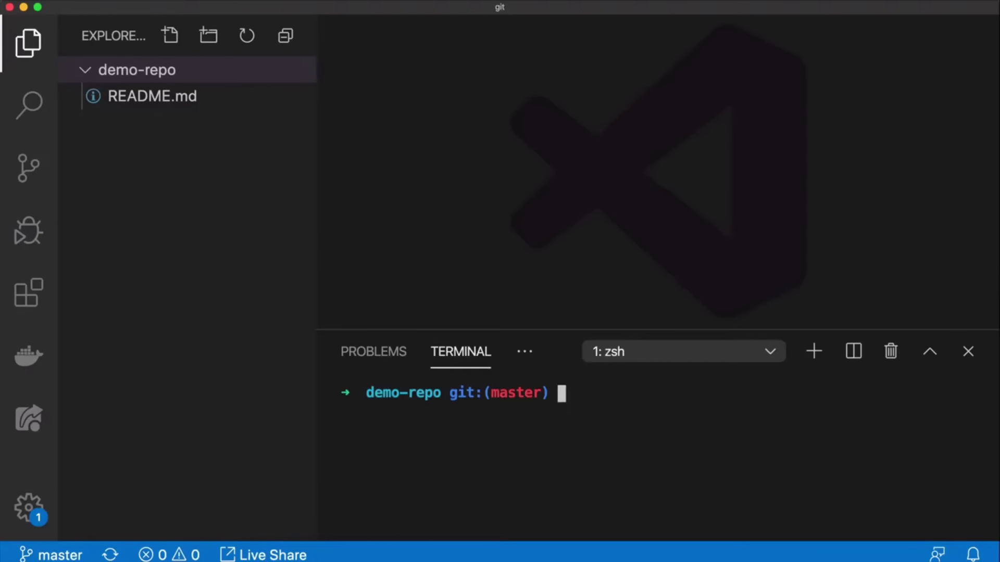

### [[00:17:30](https://youtu.be/RGOj5yH7evk?t=1050s)] Kiểm tra trạng thái
Sau khi mở tệp `README.md` trong VS Code và gõ thêm nội dung văn bản mới, tệp này xuất hiện ký hiệu chữ `M` (Modified) màu vàng trên thanh điều hướng bên trái. Chạy lệnh:
```bash
git status
```
Đầu ra terminal hiển thị dòng chữ màu đỏ:
```text
Changes not staged for commit:
  (use "git add <file>..." to update what will be committed)
  (use "git restore <file>..." to discard changes in working directory)
	modified:   README.md
```
Điều này biểu thị tệp đã bị thay đổi trong Working Directory nhưng Git chưa đưa tệp vào hàng đợi chuẩn bị đóng gói.

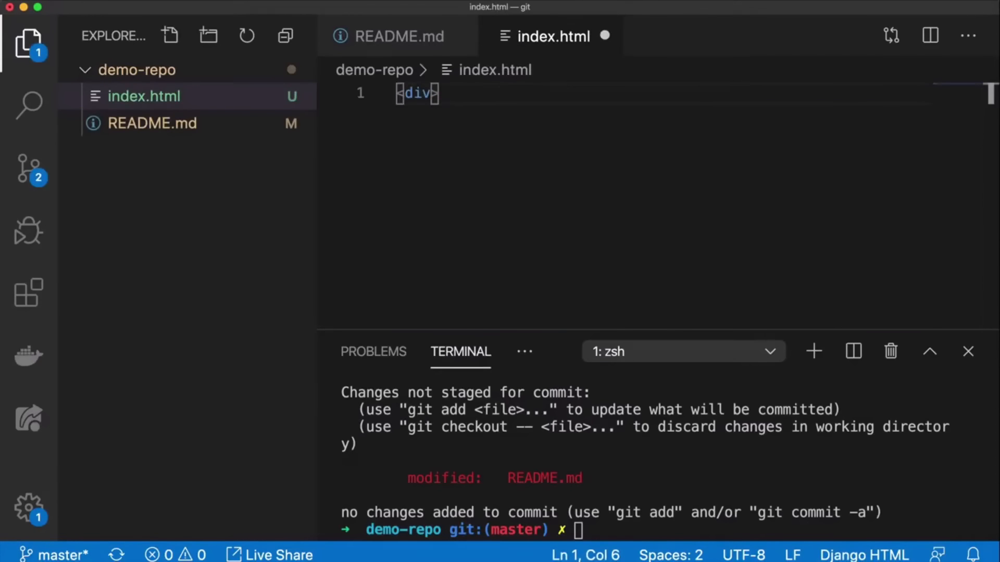

### [[00:18:15](https://youtu.be/RGOj5yH7evk?t=1095s)] Vùng đệm thay đổi
Để chỉ định các tệp cần lưu vết, lập trình viên sử dụng lệnh `git add`:
```bash
git add README.md
```
Nếu muốn đưa tất cả các tệp có thay đổi trong thư mục hiện hành vào vùng dàn dựng, có thể dùng:
```bash
git add .
```
Khi kiểm tra lại bằng `git status`, tên tệp `README.md` chuyển sang màu xanh lá cây dưới mục `Changes to be committed`, xác nhận tệp đã nằm an toàn trong Staging Area (Index).

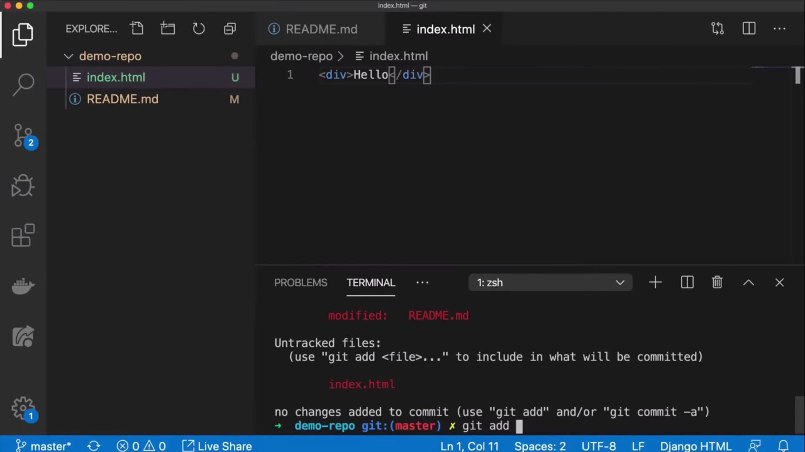

### [[00:19:15](https://youtu.be/RGOj5yH7evk?t=1155s)] Đóng gói thay đổi
Thực hiện lưu vết vĩnh viễn trạng thái đã dàn dựng vào cơ sở dữ liệu lịch sử cục bộ bằng lệnh `commit` kèm cờ `-m` (message):
```bash
git commit -m "update readme"
```
Mỗi commit bắt buộc phải có thông điệp mô tả mục đích của sự thay đổi. Sau khi chạy lệnh, Git hiển thị thông tin tóm tắt gồm mã băm ngắn gọn, số lượng tệp thay đổi, số dòng thêm mới (`insertions`) và số dòng bị xóa bỏ (`deletions`). Cây làm việc trở về trạng thái sạch (`working tree clean`).

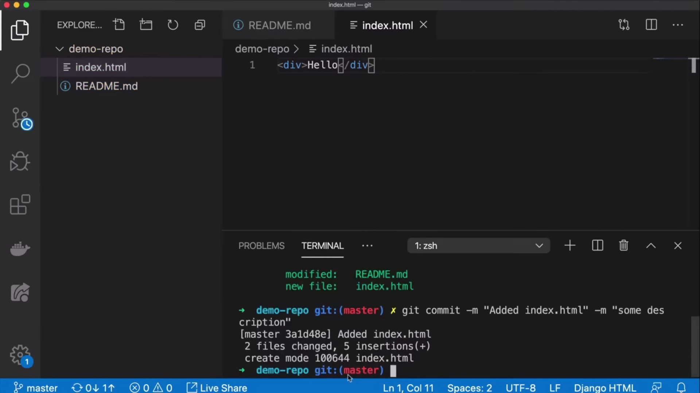

### [[00:20:20](https://youtu.be/RGOj5yH7evk?t=1220s)] Cơ chế đẩy mã
Lệnh `git push` có nhiệm vụ truyền tải các commit mới được tạo từ kho lưu trữ cục bộ lên kho lưu trữ từ xa trên GitHub. Tuy nhiên, trước khi đẩy được mã, máy tính của lập trình viên phải chứng minh quyền sở hữu tài khoản GitHub để ngăn chặn việc sửa đổi trái phép.

### [[00:20:30](https://youtu.be/RGOj5yH7evk?t=1230s)] Cấu hình định danh
Trước khi tương tác với kho mã, mỗi máy trạm cần thiết lập danh tính tác giả cho các commit:
```bash
git config --global user.name "Your Name"
git config --global user.email "your_email@example.com"
```
Thông tin này sẽ được gắn cố định vào siêu dữ liệu (metadata) của từng commit do máy trạm tạo ra.

### [[00:22:30](https://youtu.be/RGOj5yH7evk?t=1350s)] Tạo khóa bảo mật
Để xác thực an toàn giữa máy trạm và GitHub mà không cần nhập mật khẩu mỗi lần đẩy mã, giải pháp chuẩn công nghiệp là sử dụng cặp khóa SSH. Quy trình sinh khóa trên terminal:
```bash
ssh-keygen -t rsa -b 4096 -C "your_email@example.com"
```
Hệ thống sẽ hỏi vị trí lưu khóa (mặc định tại thư mục ẩn `~/.ssh/id_rsa`) và mật khẩu bảo vệ khóa (passphrase). Quá trình sinh ra hai tệp:
* `id_rsa`: Khóa riêng tư (Private Key) - **tuyệt đối giữ bí mật trên máy cá nhân**.
* `id_rsa.pub`: Khóa công khai (Public Key) - dùng để tải lên máy chủ GitHub.

### [[00:24:40](https://youtu.be/RGOj5yH7evk?t=1480s)] Kết nối khóa công
Thao tác nạp khóa công khai vào tài khoản GitHub:
1. Đọc nội dung khóa công khai trên terminal:
```bash
cat ~/.ssh/id_rsa.pub
```
2. Sao chép toàn bộ chuỗi văn bản bắt đầu bằng `ssh-rsa` kết thúc bằng địa chỉ email.
3. Truy cập GitHub: `Settings -> SSH and GPG keys -> New SSH key`.
4. Đặt tiêu đề gợi nhớ cho thiết bị (Title) và dán toàn bộ chuỗi khóa vào ô Key, sau đó nhấn `Add SSH key`.

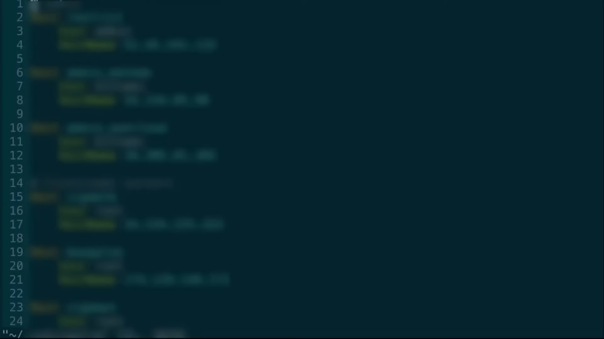

### [[00:25:25](https://youtu.be/RGOj5yH7evk?t=1525s)] Đẩy mã lần đầu
Sau khi kết nối khóa bảo mật thành công, thực hiện đẩy các commit lên nhánh chính của kho từ xa:
```bash
git push origin master
```
Ở đây:
* `origin`: Tên định danh đại diện cho đường dẫn URL của kho từ xa (được Git tự động thiết lập khi chạy `clone`).
* `master`: Tên của nhánh đích trên kho từ xa cần nhận các commit.

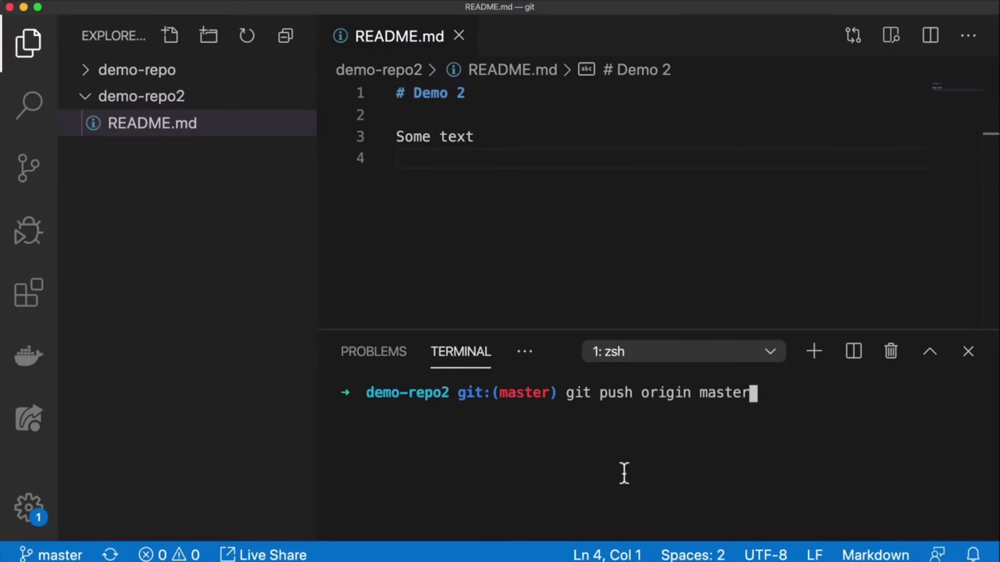

### [[00:27:30](https://youtu.be/RGOj5yH7evk?t=1650s)] Thiết lập nguồn từ xa
Trong trường hợp dự án được khởi tạo từ máy cục bộ mà chưa liên kết với GitHub, lập trình viên có thể kiểm tra và gán thủ công địa chỉ máy chủ từ xa:
```bash
git remote -v
git remote add origin git@github.com:gwenf/my-first-repo.git
```
Lệnh `git remote -v` hiển thị hai đường dẫn: đường dẫn lấy dữ liệu (`fetch`) và đường dẫn nạp dữ liệu (`push`).

### [[00:30:21](https://youtu.be/RGOj5yH7evk?t=1821s)] Ôn tập luồng chuẩn
Giảng viên tổng kết chu trình chuẩn mực khi cập nhật mã nguồn trên máy trạm:
1. Lập trình, sửa đổi tệp trong thư mục làm việc.
2. Kiểm tra trạng thái bằng `git status`.
3. Đưa các tệp vào vùng đệm bằng `git add <tệp>` hoặc `git add .`.
4. Đóng gói vào lịch sử bằng `git commit -m "<mô_tả>"`.
5. Đẩy lên máy chủ bằng `git push origin master`.

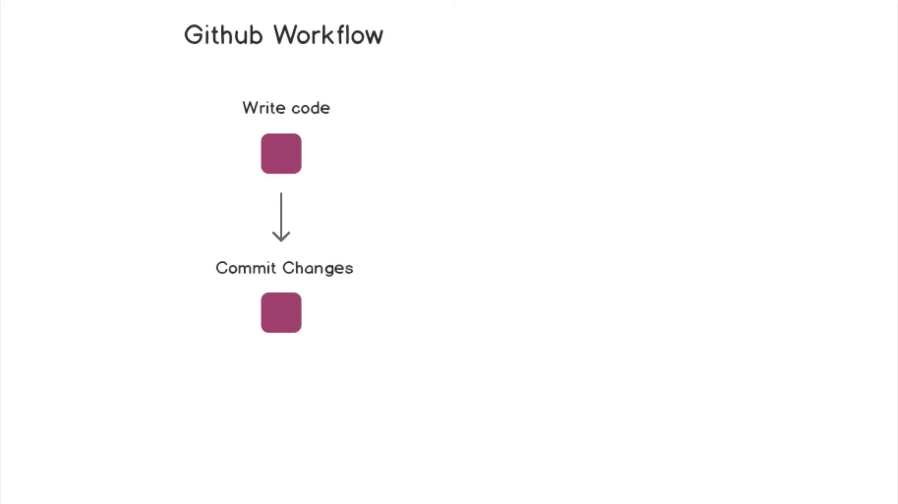

### [[00:31:40](https://youtu.be/RGOj5yH7evk?t=1900s)] So sánh hai luồng
So sánh sự khác biệt giữa hai phương thức làm việc:
* **Chỉnh sửa trực tiếp trên giao diện web GitHub:** Tiện lợi cho việc sửa lỗi chính tả hoặc tài liệu nhỏ. Thay đổi được commit trực tiếp trên máy chủ đám mây mà không cần chạy `push`. Tuy nhiên không thể chạy thử mã nguồn hay kiểm thử tự động trên máy.
* **Lập trình cục bộ qua IDE:** Phương thức chuẩn mực trong phát triển phần mềm. Cho phép chạy thử ứng dụng, dùng các công cụ linter, unit test, sau đó mới đóng gói và đẩy lên kho trung tâm.

### [[00:32:42](https://youtu.be/RGOj5yH7evk?t=1962s)] Bản chất phân nhánh
Phân nhánh (`Branching`) là tính năng mạnh mẽ nhất của Git, cho phép các lập trình viên rẽ nhánh khỏi luồng phát triển chính (`master`) để thử nghiệm tính năng mới hoặc sửa lỗi mà không làm gián đoạn mã nguồn ổn định đang chạy. Các nhánh tồn tại độc lập: các commit thực hiện trên nhánh tính năng hoàn toàn không hiển thị trên nhánh chính cho đến khi thao tác hợp nhất diễn ra.

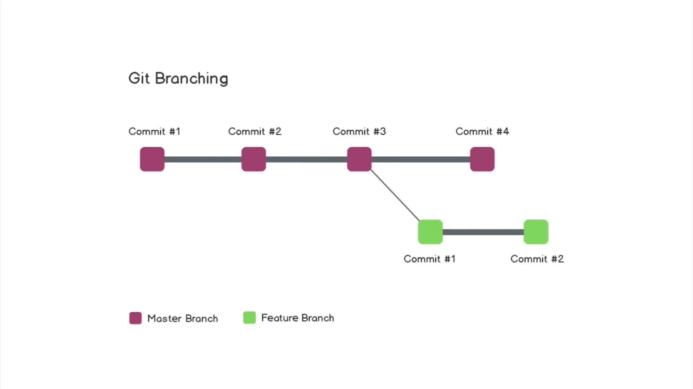

### [[00:36:00](https://youtu.be/RGOj5yH7evk?t=2160s)] Tạo nhánh tính năng
Để xem danh sách các nhánh hiện có trong dự án:
```bash
git branch
```
Dấu sao `*` màu xanh đặt cạnh tên nhánh chỉ ra nhánh hiện hành mà con trỏ HEAD đang trỏ tới.
Để tạo một nhánh mới và chuyển ngay sang nhánh đó, sử dụng lệnh:
```bash
git checkout -b feature-a
```
Cờ `-b` chỉ thị cho Git tạo nhánh mới mang tên `feature-a` rồi lập tức chuyển con trỏ HEAD sang nhánh này.

### [[00:38:20](https://youtu.be/RGOj5yH7evk?t=2300s)] Sửa đổi trên nhánh
Giảng viên mở tệp `README.md` khi đang đứng trên nhánh `feature-a` và bổ sung thêm các dòng mô tả mới. Lúc này, nếu chuyển ngược lại nhánh chính bằng `git checkout master`, nội dung vừa thêm sẽ lập tức biến mất khỏi tệp trên màn hình VS Code vì nó chỉ tồn tại trên nhánh `feature-a`. Chuyển lại nhánh `feature-a` bằng:
```bash
git checkout feature-a
```
Nội dung sửa đổi lập tức xuất hiện trở lại nguyên vẹn.

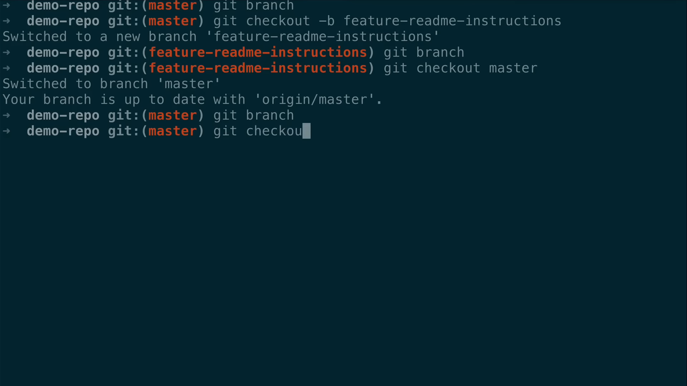

### [[00:40:40](https://youtu.be/RGOj5yH7evk?t=2440s)] Đóng gói nhánh con
Sau khi hoàn tất công việc trên nhánh tính năng, tiến hành lưu vết các thay đổi:
```bash
git add README.md
git commit -m "add feature a description"
```
Lúc này commit mới này chỉ thuộc về nhánh `feature-a`. Nhánh `master` vẫn hoàn toàn sạch sẽ và giữ nguyên trạng thái trước đó.

### [[00:42:30](https://youtu.be/RGOj5yH7evk?t=2550s)] Đẩy nhánh độc lập
Để chia sẻ nhánh tính năng lên GitHub phục vụ việc đánh giá mã nguồn, chạy lệnh đẩy mã kèm tên nhánh con:
```bash
git push origin feature-a
```
Git sẽ tạo một nhánh tương ứng trên GitHub và tải toàn bộ các commit của nhánh `feature-a` lên kho từ xa.

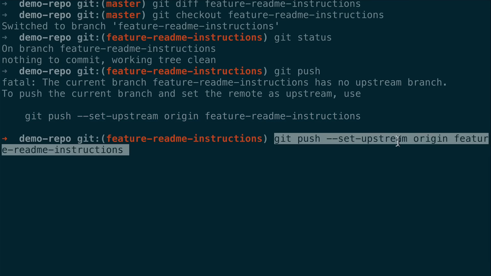

### [[00:44:40](https://youtu.be/RGOj5yH7evk?t=2680s)] Mở yêu cầu kéo
Khi truy cập lại GitHub, hệ thống tự động phát hiện nhánh mới vừa được đẩy và hiển thị nút nổi bật màu vàng: `Compare & pull request`.
1. Nhấn `Compare & pull request`.
2. Kiểm tra nhánh nguồn (`compare: feature-a`) và nhánh đích cần nhập vào (`base: master`).
3. Điền tiêu đề và mô tả giải thích chi tiết mục đích của tính năng.
4. Cuộn xuống xem bảng so sánh chênh lệch mã (`diff`) để rà soát lại toàn bộ dòng mã thêm/bớt.
5. Nhấn `Create pull request`.

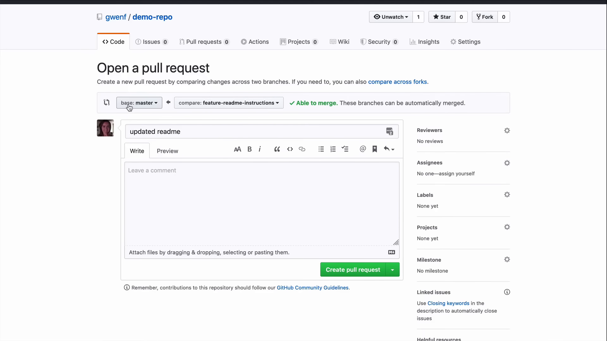

### [[00:46:30](https://youtu.be/RGOj5yH7evk?t=2790s)] Đánh giá mã nguồn
Giao diện Pull Request cho phép các thành viên trong nhóm kỹ thuật:
* Đọc từng dòng thay đổi trong mục `Files changed`.
* Bình luận trực tiếp vào từng dòng mã cụ thể để yêu cầu sửa đổi, tối ưu thuật toán hoặc thảo luận kiến trúc.
* Kiểm tra xem các bài kiểm thử tự động (CI/CD) có chạy thành công hay không trước khi quyết định đưa vào sản phẩm.

### [[00:47:50](https://youtu.be/RGOj5yH7evk?t=2870s)] Hợp nhất nhánh chính
Khi mọi phản biện hoàn tất và không có xung đột, người quản trị tiến hành hợp nhất bằng cách nhấn nút `Merge pull request` trên GitHub và xác nhận `Confirm merge`. Toàn bộ commit từ nhánh `feature-a` chính thức hòa vào dòng thời gian của nhánh `master` trên máy chủ GitHub.

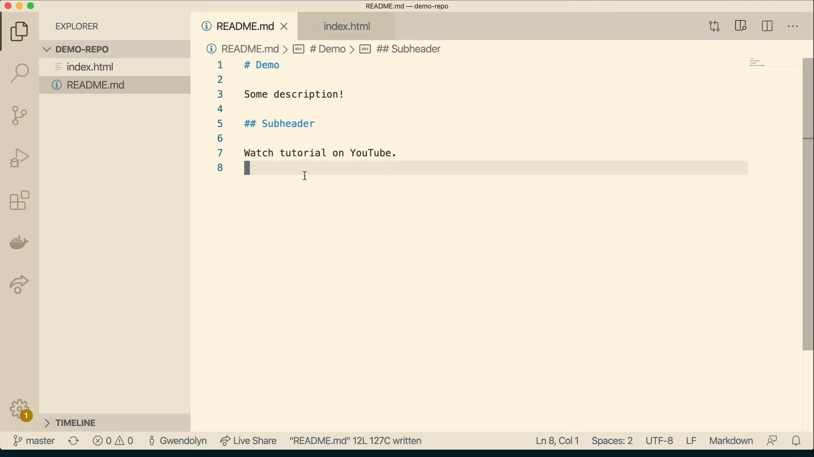

### [[00:48:30](https://youtu.be/RGOj5yH7evk?t=2910s)] Đồng bộ máy trạm
Sau khi hợp nhất trên GitHub, nhánh `master` trên máy trạm cục bộ vẫn đang ở trạng thái cũ. Lập trình viên bắt buộc phải kéo các commit mới về máy trạm:
```bash
git checkout master
git pull origin master
```
Git tải các commit hợp nhất về và cập nhật thư mục làm việc cục bộ tương ứng với trạng thái mới nhất trên GitHub.


### [[00:49:30](https://youtu.be/RGOj5yH7evk?t=2970s)] Dọn dẹp nhánh rác
Khi nhánh tính năng đã được hợp nhất thành công vào nhánh chính, việc giữ lại nhánh đó sẽ gây rác không gian làm việc. Xóa nhánh cục bộ bằng lệnh:
```bash
git branch -d feature-a
```
Cờ `-d` (viết tắt của delete) kiểm tra an toàn: nếu nhánh chưa được hợp nhất, Git sẽ cảnh báo ngăn chặn việc vô tình xóa mất công sức lập trình. Để ép xóa một nhánh chưa hợp nhất, lập trình viên sử dụng cờ in hoa `-D`.

### [[00:52:00](https://youtu.be/RGOj5yH7evk?t=3120s)] Bản chất xung đột
Xung đột hợp nhất (`Merge Conflict`) xảy ra khi hai người cùng sửa đổi cùng một dòng trên cùng một tệp ở hai nhánh khác nhau và cùng cố gắng hợp nhất vào nhánh chính. Khi đó, Git không thể đoán biết dòng mã nào là dòng mã đúng cần giữ lại, do đó hệ thống dừng tiến trình hợp nhất và chèn các dấu phân cách xung đột vào thẳng nội dung tệp:
```text
<<<<<<< HEAD
Nội dung của nhánh hiện tại đang đứng
=======
Nội dung của nhánh đang được trộn vào
>>>>>>> feature-b
```

### [[00:54:20](https://youtu.be/RGOj5yH7evk?t=3260s)] Gỡ rối xung đột
VS Code hỗ trợ trực quan hóa xung đột với các nút bấm tiện ích:
* `Accept Current Change`: Giữ lại mã của nhánh hiện tại (`HEAD`).
* `Accept Incoming Change`: Giữ lại mã của nhánh sắp trộn vào.
* `Accept Both Changes`: Giữ lại cả hai đoạn mã.
Lập trình viên cũng có thể tự xóa thủ công các dòng đánh dấu `<<<<<<<`, `=======`, `>>>>>>>` và sửa nội dung tệp thành dạng hoàn chỉnh nhất. Sau khi xử lý xong, chạy lệnh để xác nhận:
```bash
git add README.md
git commit -m "resolve merge conflict"
```

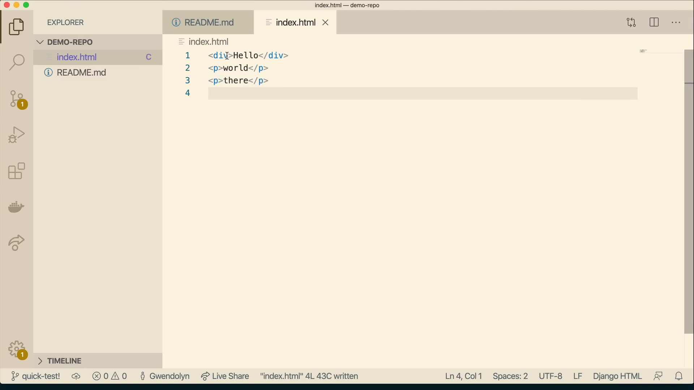

### [[00:56:30](https://youtu.be/RGOj5yH7evk?t=3390s)] Hủy bỏ thay đổi
Khi vô tình chỉnh sửa một tệp nhưng chưa đưa vào Staging Area và muốn khôi phục về trạng thái sạch ban đầu:
```bash
git checkout -- <tên_tệp>
```
*(Trong các phiên bản Git mới hơn, câu lệnh tương đương là `git restore <tên_tệp>`)*. Toàn bộ các thay đổi chưa lưu trên tệp đó sẽ bị hủy bỏ vĩnh viễn và đồng bộ lại theo commit gần nhất.

### [[00:58:20](https://youtu.be/RGOj5yH7evk?t=3500s)] Rút khỏi hàng đợi
Nếu lỡ chạy lệnh `git add` đưa tệp vào Staging Area nhưng muốn rút tệp ra lại Working Directory để tiếp tục sửa tiếp mà không commit ngay:
```bash
git reset HEAD <tên_tệp>
```
Lệnh này đưa tệp từ trạng thái `staged` (màu xanh) trở lại trạng thái `modified` (màu đỏ) mà không làm mất nội dung code đã viết.

### [[00:59:30](https://youtu.be/RGOj5yH7evk?t=3570s)] Tua ngược lịch sử
Để xem lịch sử các commit đã thực hiện:
```bash
git log
```
Nếu muốn hủy bỏ commit vừa tạo gần nhất:
```bash
git reset --soft HEAD~1
```
* Cờ `--soft`: Giữ nguyên toàn bộ mã nguồn của commit đó trong Staging Area, cho phép chỉnh sửa lại thông điệp hoặc thêm tệp trước khi commit lại.
* Cờ `--hard`: Hủy bỏ vĩnh viễn commit và xóa sạch toàn bộ mã nguồn trong thư mục làm việc trở về đúng trạng thái của commit chỉ định (cần hết sức thận trọng khi sử dụng).

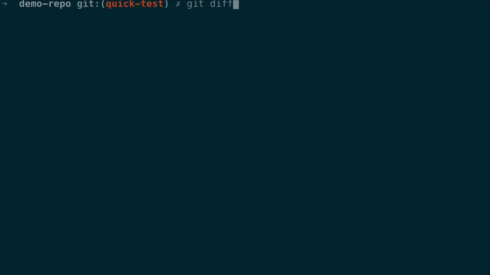

### [[01:01:50](https://youtu.be/RGOj5yH7evk?t=3710s)] Rẽ nhánh kho nguồn
Khi muốn đóng góp cho một dự án mã nguồn mở công khai (ví dụ kho mã `vuejs/vue`) mà bản thân không có quyền đẩy trực tiếp (`write access`), lập trình viên sử dụng tính năng **Fork**:
1. Truy cập trang GitHub của dự án mục tiêu.
2. Nhấn nút `Fork` ở góc trên bên phải màn hình.
3. GitHub tạo ra một bản sao hoàn chỉnh của kho mã đó dưới tên tài khoản cá nhân (ví dụ `your-username/vue`).

### [[01:03:40](https://youtu.be/RGOj5yH7evk?t=3820s)] Luồng đóng góp mở
Tại kho mã cá nhân đã Fork, lập trình viên có toàn quyền đọc, ghi và quản lý:
1. Sao chép kho Fork về máy tính cá nhân: `git clone <url_fork>`.
2. Tạo nhánh tính năng mới: `git checkout -b fix-typo`.
3. Chỉnh sửa, chạy thử nghiệm, đóng gói commit và đẩy lên kho Fork: `git push origin fix-typo`.
4. Trên giao diện GitHub của kho Fork, nhấn `New Pull Request`.
5. Đặt kho gốc làm đích (`base repository: vuejs/vue`, `base: dev`) và nhánh trên kho Fork làm nguồn so sánh (`head repository: your-username/vue`, `compare: fix-typo`).
6. Nhóm bảo trì của dự án gốc sẽ đánh giá mã nguồn và tiến hành tích hợp nếu đạt tiêu chuẩn chất lượng.

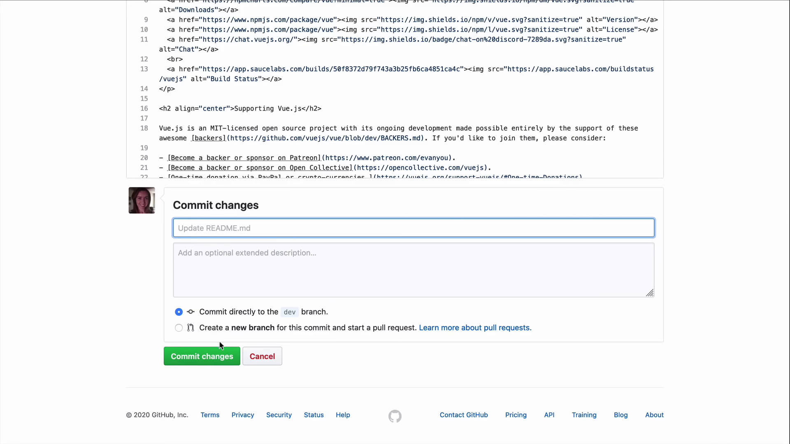

### [[01:06:00](https://youtu.be/RGOj5yH7evk?t=3960s)] Mô hình đa môi trường
Trong các dự án quy mô doanh nghiệp hoặc mã nguồn mở lớn, nhánh `master` không phải là nơi duy nhất để tích hợp. Các tổ chức thường duy trì hệ thống nhánh môi trường cố định:
* `dev`: Nhánh tích hợp liên tục cho các tính năng đang phát triển hàng ngày. Mọi tính năng con đều hợp nhất vào đây trước.
* `staging`: Môi trường kiểm thử tiền phát hành (Pre-production) mô phỏng chính xác dữ liệu thực tế.
* `master` / `main`: Đại diện cho mã nguồn phiên bản sản phẩm chính thức (`production-ready`).
Các nhánh tính năng sau khi được hợp nhất vào `dev` sẽ được xóa bỏ, trong khi các nhánh môi trường cố định (`dev`, `staging`, `master`) được duy trì vĩnh viễn suốt vòng đời dự án.

### [[01:07:55](https://youtu.be/RGOj5yH7evk?t=4075s)] Lời khuyên kết thúc
Giảng viên tổng kết rằng việc làm chủ Git và GitHub đòi hỏi sự rèn luyện liên tục thông qua các thao tác thực hành dự án thực tế. Việc hiểu rõ bản chất của các tầng dữ liệu (Working Directory, Staging, Repository) và cơ chế phân nhánh sẽ giúp lập trình viên tránh được tối đa các sai sót mất mã và tự tin cộng tác trong bất kỳ đội ngũ kỹ thuật chuyên nghiệp nào.

---

## Trích dẫn then chốt

* [[00:01:10](https://youtu.be/RGOj5yH7evk?t=70s)] "Git is what we call a version control system that is free and open source, and it's the most widely used version control system in development today."
* [[00:20:30](https://youtu.be/RGOj5yH7evk?t=1230s)] "In order to push them to GitHub under your account, you're going to have to prove to GitHub that you are the owner of your account."
* [[00:34:10](https://youtu.be/RGOj5yH7evk?t=2050s)] "Each individual branch has no way of knowing what commits or what changes have been made to any other branch. Each branch is only keeping track of what changes are made on its own branch."
* [[00:48:41](https://youtu.be/RGOj5yH7evk?t=2921s)] "You don't really reuse branches that you've already merged into your master branch, so you delete them from GitHub and from your local machine."
* [[01:04:45](https://youtu.be/RGOj5yH7evk?t=3885s)] "Me having my own fork allows me full reign, full access, full control of CRUD operations... and then I will create a PR against the original repository."

---

## Lệnh & Công cụ

### Thiết lập danh tính ban đầu
```bash
# Cấu hình tên tác giả hiển thị trên toàn hệ thống
git config --global user.name "Tên Của Bạn"

# Cấu hình email gắn liền với tài khoản GitHub
git config --global user.email "email@example.com"

# Liệt kê toàn bộ cấu hình hiện tại
git config --list
```

### Khởi tạo và kết nối kho mã
```bash
# Khởi tạo một kho Git mới trong thư mục hiện tại
git init

# Sao chép kho mã từ máy chủ GitHub về máy trạm
git clone https://github.com/username/repo-name.git

# Kiểm tra danh sách đường dẫn máy chủ từ xa
git remote -v

# Thêm liên kết kho từ xa với tên định danh mặc định origin
git remote add origin git@github.com:username/repo-name.git
```

### Vòng lặp đóng gói và đẩy mã
```bash
# Kiểm tra trạng thái tệp tin và vùng đệm
git status

# Đưa một tệp cụ thể vào vùng đệm
git add index.js

# Đưa toàn bộ tệp có thay đổi vào vùng đệm
git add .

# Đóng gói thay đổi kèm thông điệp mô tả
git commit -m "feat: implement user authentication flow"

# Đẩy các commit lên nhánh chỉ định trên kho từ xa
git push origin master

# Đồng bộ commit mới từ kho từ xa về nhánh hiện hành
git pull origin master
```

### Quản lý phân nhánh và chuyển đổi
```bash
# Liệt kê tất cả các nhánh cục bộ
git branch

# Tạo nhánh mới và chuyển ngay sang nhánh vừa tạo
git checkout -b feature/login-page

# Chuyển đổi qua lại giữa các nhánh có sẵn
git checkout master

# Hợp nhất nhánh tính năng vào nhánh hiện hành
git merge feature/login-page

# Xóa nhánh an toàn sau khi đã hợp nhất
git branch -d feature/login-page

# Ép xóa nhánh ngay cả khi chưa hợp nhất
git branch -D feature/experimental
```

### Xử lý hoàn tác và cứu hộ dữ liệu
```bash
# Hủy bỏ chỉnh sửa chưa dàn dựng của một tệp cụ thể
git checkout -- <tệp>
# (Lệnh tương đương trên Git phiên bản mới: git restore <tệp>)

# Rút tệp đã dàn dựng ra khỏi Staging Area
git reset HEAD <tệp>

# Xem lịch sử các commit ngắn gọn trên một dòng
git log --oneline -n 5

# Hủy commit gần nhất nhưng giữ nguyên mã trong Staging Area
git reset --soft HEAD~1

# Hủy commit và xóa sạch toàn bộ mã chưa lưu (hết sức thận trọng)
git reset --hard HEAD~1
```

### Quản lý xác thực khóa bảo mật
```bash
# Tạo cặp khóa SSH chuẩn RSA 4096-bit
ssh-keygen -t rsa -b 4096 -C "email@example.com"

# Hiển thị nội dung khóa công khai để sao chép lên GitHub
cat ~/.ssh/id_rsa.pub

# Kiểm tra kết nối xác thực đến máy chủ GitHub
ssh -T git@github.com
```

---

## Đánh đổi & Rủi ro

### 1. Đánh đổi giữa giao diện đồ họa và giao diện dòng lệnh
* **Giao diện đồ họa (GUI / VS Code Sync):** Trực quan, dễ sử dụng cho người mới, tiện thao tác xem chênh lệch dòng (`diff`) và giải quyết xung đột trực quan. Tuy nhiên, GUI che giấu các cơ chế vận hành ngầm của Git, dễ gây nhầm lẫn khi gặp các trạng thái phức tạp (như Detached HEAD, rebase fail) và làm chậm thao tác đối với các tác vụ tự động hóa.
* **Giao diện dòng lệnh (CLI):** Cung cấp toàn quyền kiểm soát tuyệt đối, chính xác 100% từng cờ tham số, tốc độ thực thi nhanh và là tiêu chuẩn bắt buộc khi làm việc trên các máy chủ từ xa qua SSH hoặc trong đường ống CI/CD. Đòi hỏi người học phải ghi nhớ cú pháp và tư duy phân luồng.

### 2. Nguy cơ mất mát mã nguồn từ lệnh hoàn tác
* Lệnh `git checkout -- <tệp>` hoặc `git restore <tệp>` sẽ xóa sổ vĩnh viễn các dòng mã chưa được commit mà không có cơ chế hoàn tác. Nếu chưa từng chạy `git add`, dữ liệu đó không hề tồn tại trong cơ sở dữ liệu đối tượng của Git và không thể khôi phục bằng `reflog`.
* Lệnh `git reset --hard` phá hủy toàn bộ công sức chưa commit trong thư mục làm việc và tua ngược con trỏ nhánh. Luôn ưu tiên dùng `git reset --soft` hoặc `git stash` để cất giữ mã tạm thời trước khi can thiệp sâu vào lịch sử commit.

### 3. Rủi ro đẩy tệp nhạy cảm lên kho công khai
* Thói quen lạm dụng `git add .` mà không cấu hình tệp `.gitignore` là nguyên nhân phổ biến nhất dẫn đến việc rò rỉ khóa bảo mật (API keys, tệp cấu hình `.env`, chứng chỉ khóa riêng tư `id_rsa`).
* Khi một tệp nhạy cảm đã bị commit và đẩy lên GitHub, ngay cả khi thực hiện commit mới để xóa tệp đó, tệp vẫn tồn tại vĩnh viễn trong toàn bộ lịch sử commit trước đó. Cần phải sử dụng các công cụ làm sạch lịch sử chuyên sâu như `git-filter-repo` hoặc BFG Repo-Cleaner kết hợp thu hồi và tạo mới toàn bộ các khóa bảo mật bị lộ.

### 4. Rủi ro xung đột nhánh khi phát triển dài hạn
* Một nhánh tính năng tồn tại quá lâu mà không liên tục kéo mã mới từ nhánh `master` (`git pull origin master`) sẽ dẫn đến hiện tượng trôi dạt ngữ cảnh mã nguồn (code drift). Khi hợp nhất sau nhiều tuần, số lượng xung đột mã nguồn sẽ bùng nổ, gây rủi ro phá vỡ tính toàn vẹn của ứng dụng khi con người giải quyết xung đột thủ công.
* Giải pháp tối ưu: Giữ các nhánh tính năng ngắn hạn (tuổi thọ 1-2 ngày), chia nhỏ tính năng thành nhiều đợt commit và tích hợp liên tục vào nhánh chính thông qua quy trình Pull Request.
