# Cách Netflix Dùng Java - Bản 2026

* **Kênh:** Java | **Thời lượng:** 00:52:38 | **Ngày:** 2026-04-12
* **Video:** https://youtu.be/ucJTPda_zx0

---

## Thuật ngữ

| Thuật ngữ | Tiếng Anh | Giải thích |
| :--- | :--- | :--- |
| Cổng đồ thị liên kết | Federated GraphQL Gateway | Điểm tiếp nhận truy vấn tập trung, phân rã và tổng hợp dữ liệu từ nhiều dịch vụ đồ thị con độc lập. |
| Dịch vụ đồ thị miền | DGS (Domain Graph Service) | Khung làm việc GraphQL trên nền Spring Boot do Netflix phát triển và mở mã nguồn. |
| Lộ trình lát đá | Paved Road | Bộ tiêu chuẩn kỹ thuật, thư viện và công cụ được chuẩn hóa toàn diện nhằm tối ưu năng suất kỹ sư tại Netflix. |
| Bộ gom rác thế hệ Z | Generational ZGC | Cơ chế thu gom rác đa thế hệ độ trễ cực thấp (< 1ms) tích hợp trong các bản JDK hiện đại. |
| Tạm dừng toàn phần | Stop-The-World (STW) | Trạng thái máy ảo JVM đóng băng toàn bộ luồng ứng dụng để hoàn tất chu trình dọn dẹp bộ nhớ heap. |
| Lỗi giao tiếp tiến trình | IPC Client Errors | Các lỗi quá hạn (timeout) hoặc gián đoạn kết nối giữa các dịch vụ vi mô nội bộ trong cụm. |
| Luồng ảo | Virtual Threads | Luồng thực thi siêu nhẹ do máy ảo JVM quản lý (Project Loom), không ánh xạ 1:1 với luồng hệ điều hành. |
| Luồng mang | Carrier Thread | Luồng vật lý của hệ điều hành chịu trách nhiệm chuyên chở và thực thi các luồng ảo bên trên. |
| Ghim luồng | Thread Pinning | Hiện tượng luồng ảo bị gắn chặt vào luồng mang (khi gặp khối `synchronized`), làm cạn kiệt nhóm luồng nền. |
| Lan truyền ngữ cảnh | Context Propagation | Kỹ thuật truyền dữ liệu bảo mật, định danh phiên và vết giám sát từ luồng cha sang các luồng con. |
| Giá trị theo phạm vi | Scoped Values | Cơ chế chia sẻ dữ liệu bất biến trong một nhánh xử lý cục bộ nhằm thay thế biến cục bộ của luồng. |
| Tác tử tự động ngầm | Claude Code Headless | Chế độ thực thi dòng lệnh tự trị của Claude Code dưới dạng tiến trình hàng loạt không cần người can thiệp. |
| Công cụ đổi mã luật | OpenRewrite | Bộ công cụ phân tích cú pháp tĩnh và tự động chuyển đổi mã nguồn theo các quy tắc xác định. |
| Quy trình tác tử | Agentic Workflow | Mô hình tích hợp mô hình ngôn ngữ lớn vào hệ thống mà lập trình viên vẫn kiểm soát cấu trúc điều phối. |

---

## Tổng luận chuyên đề

### Kiến trúc phân tầng

Netflix chia tách rõ ràng hai luồng kiến trúc độc lập trong hệ thống:
1. **Luồng khám phá (Discovery):** Phục vụ trải nghiệm chọn phim trên giao diện người dùng. Mỗi yêu cầu duyệt nội dung kích hoạt truy vấn GraphQL lớn tới Cổng đồ thị liên kết (Federated GraphQL Gateway). Cổng giải mã cấu trúc liên kết và phân phối truy vấn đến các dịch vụ đồ thị miền (DGS) như hiển thị danh mục (LOLOMO), thông tin phim (Movie), ảnh bìa (Images). Các DGS tiếp tục gọi các dịch vụ vi mô nghiệp vụ phía sau thông qua giao thức gRPC trên nền kho dữ liệu phân tán (EVCache, Cassandra). Toàn bộ lớp này chạy hoàn toàn trên Java và Spring Boot.
2. **Luồng phân phối dòng phát (Content Delivery):** Khi người dùng nhấn nút phát video, hệ thống chuyển hướng sang kiến trúc mạng lưới Open Connect. Các thiết bị lưu trữ chuyên dụng đặt trực tiếp tại tủ mạng của các nhà cung cấp dịch vụ mạng (ISP) địa phương để cấp phát dòng bit video với độ trễ thấp nhất. Toàn bộ phần mềm quản trị, giám sát và điều hướng của Open Connect đều được phát triển bằng Java và Spring Boot.

### Chuẩn hóa nền tảng

Với quy mô 3.000 đến 4.000 dịch vụ vi mô Java, Netflix kiên định duy trì chiến lược "Lộ trình lát đá" (Paved Road):
* Chuẩn hóa toàn bộ ngăn xếp công nghệ xoay quanh Spring Boot, đảm bảo cấu hình bảo mật, phân tích vết giám sát (tracing), và đăng ký định tuyến được đóng gói đồng nhất.
* Chuyển dịch chiến lược nâng cấp phiên bản lớn: Nếu đợt chuyển đổi từ Spring Boot 2 lên 3 sử dụng phương pháp xác định (chuyển đổi bytecode bằng plugin Gradle và OpenRewrite), thì đợt nâng cấp từ Spring Boot 3 lên 4 được tự động hóa hàng loạt bằng quy trình tác tử Claude Code chạy ngầm với các điểm kiểm tra trạng thái (checkpointing) độc lập.

### Tối ưu bộ gom

Netflix chuyển đổi hoàn toàn cấu hình mặc định của JVM sang Generational ZGC trên nền JDK 21+:
* Phá vỡ nhận định truyền thống rằng bộ gom rác độ trễ thấp sẽ gây lãng phí chu kỳ xử lý (CPU) và không phù hợp với các ứng dụng có thông lượng lớn.
* Dữ liệu giám sát thực tế chứng minh: Loại bỏ hiện tượng tạm dừng toàn phần (STW) kéo giảm ngay lập tức tỷ lệ lỗi giao tiếp tiến trình (IPC Client Errors), loại bỏ chuỗi thử lại yêu cầu (retries) gây nghẽn mạng cục bộ, và cho phép máy chủ vận hành ổn định ở ngưỡng tải CPU cao hơn.

### Làm chủ luồng ảo

Quá trình triển khai luồng ảo (Virtual Threads) tại Netflix trải qua hai giai đoạn then chốt:
* **Khắc phục ghim luồng:** Tạm ngưng áp dụng rộng rãi trên JDK 21 do hiện tượng ghim luồng khi chạm các khối mã đồng bộ hóa cũ (`synchronized`), và tái kích hoạt thành công trên JDK 25 sau khi lõi JVM xử lý triệt để hạn chế này.
* **Bảo toàn lan truyền ngữ cảnh:** Xây dựng cầu nối tùy biến cho cơ chế đồng quy có cấu trúc (`StructuredTaskScope`) thông qua bộ tạo luồng chuyên biệt (`ContextAwareThreadFactory`) kết hợp thư viện sao chụp ngữ cảnh Micrometer để khắc phục điểm mù của biến cục bộ luồng (`ThreadLocal`).

### Tác tử doanh nghiệp

Netflix triển khai trí tuệ nhân tạo vào hệ sinh thái Java theo tư duy công kỹ nghệ khắt khe:
* Ưu tiên áp dụng mô hình "Quy trình tác tử" (Agentic Workflow) thay vì thả nổi cho tác tử tự trị dạng hộp đen: mã nguồn Java giữ quyền kiểm soát luồng nghiệp vụ, công cụ Spring AI đảm nhận việc gọi mô hình và tích hợp công cụ (MCP/Skills).
* Hiện thực hóa qua công cụ giám sát khởi động hệ thống (Startup Profiler): AI tự động phân tích dữ liệu hiệu năng của từng Spring Bean, đọc mã nguồn các thư viện gây tắc nghẽn, và xuất báo cáo khuyến nghị giải pháp xử lý bất đồng bộ cho kỹ sư.

---

## Bóc tách chi tiết

### Phân luồng kiến trúc

Hệ thống truyền phát nội dung phục vụ hàng trăm triệu người dùng trên toàn cầu với tính chất đa vùng (multi-region) và khả năng chịu lỗi cao.

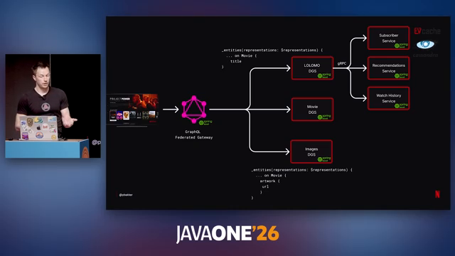

Kiến trúc nghiệp vụ gồm hai phân vùng rõ rệt:
1. **Lớp dịch vụ khám phá (Discovery Backend):**
   * Người dùng tương tác từ ứng dụng (TV, điện thoại, máy tính) gửi truy vấn về Cổng đồ thị liên kết.
   * Cổng phân rã truy vấn dựa trên đặc tả GraphQL Federation và phân phối song song tới các DGS:
     * DGS hiển thị danh mục (`LOLOMO DGS`): tổng hợp danh sách hàng phim theo thói quen người dùng.
     * DGS thông tin tác phẩm (`Movie DGS`): truy xuất chi tiết tiêu đề, diễn viên, bản quyền.
     * DGS tư liệu hình ảnh (`Images DGS`): giải quyết đường dẫn ảnh bìa, tỷ lệ khung hình.
   * Các DGS giao tiếp với các dịch vụ chuyên biệt tầng sâu qua gRPC (`Subscriber Service`, `Recommendations Service`, `Watch History Service`), kết nối tới EVCache và Cassandra.
2. **Hạ tầng phân phối dòng phát (Open Connect):**
   * Máy chủ phân phối nội dung đặt phân tán tại hạ tầng các nhà mạng đối tác.
   * Phần mềm điều khiển, lập lịch dòng phát và giám sát dung lượng đường truyền được viết hoàn toàn bằng Java và Spring Boot.

### Con đường chuẩn hóa

Netflix trả lời bài toán lựa chọn công nghệ giữa Java, Rust, C++ và Python:

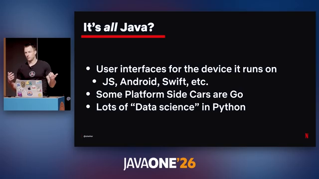

* **Cân bằng ba yếu tố cốt lõi:** Java đem lại sự dung hòa tối ưu giữa hiệu năng chạy thực tế (Runtime Performance), năng suất lập trình viên (Developer Productivity) và khả năng bảo trì hệ thống lâu dài (Maintainability).
* **So sánh thực tiễn:**
  * So với Rust/C++: Dù Rust kiểm soát bộ nhớ chi tiết nhưng độ phức tạp trong bảo trì và chi phí phát triển quá cao trên quy mô hàng nghìn kỹ sư.
  * So với Python: Python có năng suất ban đầu tốt nhưng chịu thiệt thòi lớn về tốc độ thực thi tải nặng và khó duy trì cấu trúc khi hệ thống mở rộng do thiếu định kiểu tĩnh.

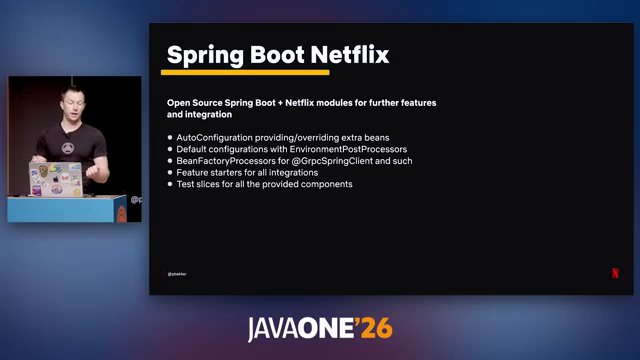

* Khái niệm "Lộ trình lát đá" định hình cách tiếp cận cho 3.000 - 4.000 dịch vụ nội bộ. Khi nhóm kỹ sư tạo mới một dự án theo chuẩn này, toàn bộ thành phần liên kết hệ sinh thái Netflix (đăng ký định tuyến Eureka, phân tán vết Mantis/Atlas, xác thực danh tính) được kích hoạt tự động.

### Phương pháp kiểm thử

Cách tiếp cận kiểm thử tích hợp liên tầng tại Netflix loại bỏ việc sử dụng các chú thích kiểm thử cục bộ:

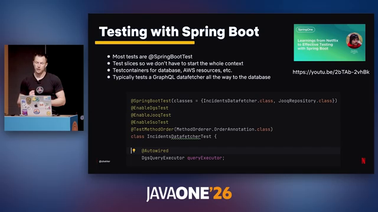

* Hạn chế của các chú thích phân lớp hẹp (`@WebMvcTest`, `@DataJpaTest`): Chỉ cô lập kiểm tra được một tầng duy nhất trong khi yêu cầu kiểm thử thực tế đòi hỏi kiểm tra xuyên suốt từ tầng nhận dữ liệu GraphQL xuống tận tầng lưu trữ dữ liệu cho từng thành phần nghiệp vụ riêng lẻ.
* Giải pháp tối ưu: Sử dụng `@SpringBootTest` kết hợp cấu hình thành phần tối giản thông qua thuộc tính `classes = {...}` để nạp đúng các bean cần thiết, hạn chế khởi động toàn bộ ngữ cảnh giúp bài kiểm thử chạy xong trong khoảng 1 giây.

### Tự động nâng cấp

Việc nâng cấp định kỳ các khung làm việc mã nguồn mở là bắt buộc để ngăn chặn nợ kỹ thuật tồn đọng.

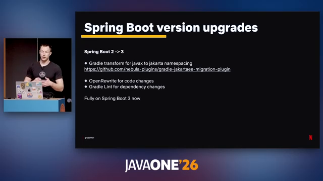

1. **Giai đoạn Spring Boot 2 lên 3:**
   * Thách thức lớn nhất là sự dịch chuyển gói từ `javax.*` sang `jakarta.*`. Xảy ra bài toán "con gà - quả trứng": ứng dụng không thể nâng cấp nếu thư viện phụ thuộc chưa nâng cấp, và thư viện không thể nâng cấp nếu ứng dụng chưa sẵn sàng.
   * Giải pháp: Xây dựng một plugin biến đổi bytecode tự động tích hợp trong Gradle khi phân giải gói (artifact resolution), tự động hoán đổi không gian tên `javax` sang `jakarta` mà không cần viết lại mã nguồn thư viện bên thứ ba.
   * Kết hợp OpenRewrite và Gradle Lint để tự động xử lý phần lớn mã nguồn và tệp cấu hình đóng gói.

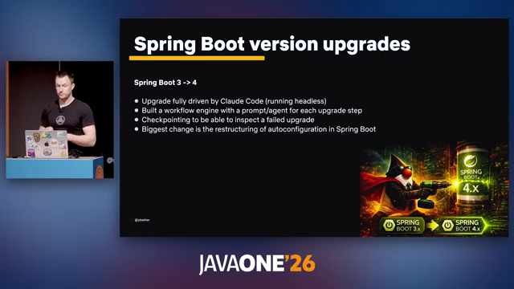

2. **Giai đoạn Spring Boot 3 lên 4:**
   * Thay đổi lớn nhất nằm ở việc tái cấu trúc cơ chế tự động cấu hình (Autoconfiguration).
   * Netflix triển khai công cụ tác tử tự động hóa ngầm dựa trên Claude Code:
     * Chạy tiến trình xử lý hàng loạt trên máy chủ mà không đòi hỏi từng kỹ sư phải thao tác thủ công.
     * Xây dựng động cơ quy trình chia nhỏ bài toán: mỗi bước chuyển đổi mã là một câu lệnh chỉ thị riêng biệt gửi tới một tác tử độc lập.
     * Cơ chế điểm kiểm tra trạng thái (Checkpointing): nếu tiến trình nâng cấp gặp sự cố hoặc bài kiểm thử thất bại, toàn bộ lịch sử ngữ cảnh trao đổi của tác tử cùng trạng thái mã nguồn Git được lưu vết để kỹ sư nền tảng trực tiếp thanh tra.

### Đồ thị phân tán

DGS Framework do Netflix xây dựng và mở mã nguồn từ năm 2020 hiện đã hợp nhất sâu với hệ sinh thái Spring for GraphQL.

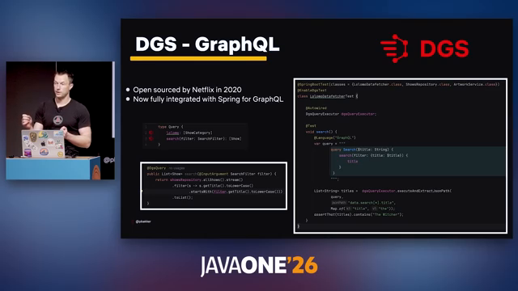

* Bản chất của GraphQL là làm việc xoay quanh lược đồ dữ liệu tĩnh (schema) thay vì phương thức gọi từ xa. Mô hình liên kết cho phép chia nhỏ một đồ thị dữ liệu khổng lồ cho từng nhóm dịch vụ đảm trách độc lập.
* Khung kiểm thử của DGS cho phép giả lập truy vấn GraphQL trực tiếp thông qua `DgsQueryExecutor` với tốc độ phản hồi cực nhanh mà không cần khởi tạo giao diện mạng servlet.

### Chuyển đổi bộ gom

Động lực chuyển dịch sang Generational ZGC xuất phát từ quy mô máy chủ có dung lượng bộ nhớ lớn tại Netflix.

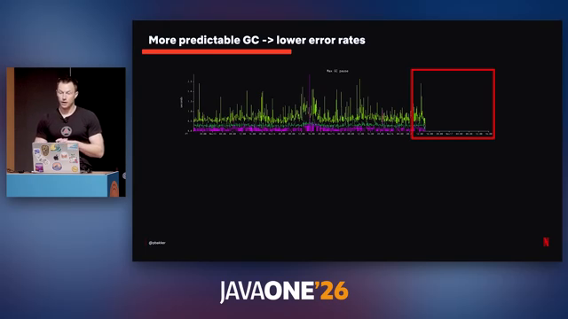

* Trước đây với bộ gom rác G1, các máy chủ bộ nhớ lớn định kỳ gặp các pha tạm dừng toàn phần kéo dài từ 1 đến 2 giây. Trong kiến trúc microservice phụ thuộc sâu với cấu hình thời gian chờ khắt khe, việc một nút mạng dừng 1 giây sẽ gây ra hàng loạt lỗi quá hạn trên các dịch vụ gọi đến.

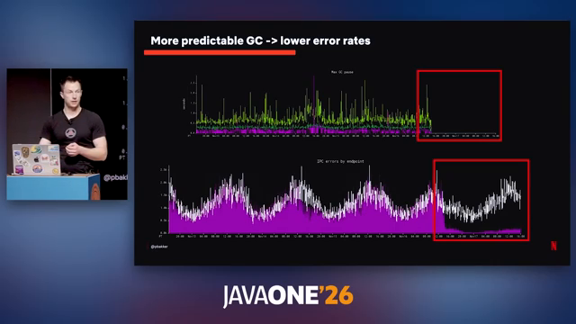

* **Biểu đồ thực tế:**
  * Biểu đồ phía trên (Thời gian dừng GC lớn nhất - Max GC pause): Ngay thời điểm bật Generational ZGC (đánh dấu khung đỏ), biểu đồ đường gãy dừng lại hoàn toàn và rớt về mức 0 giây.
  * Biểu đồ phía dưới (Tỷ lệ lỗi giao tiếp IPC - vạch tím): Các lỗi quá hạn giữa các dịch vụ suy giảm đột ngột và duy trì ở mức tối thiểu.
* **Hệ quả vận hành:** Ít lỗi phía máy khách đồng nghĩa với việc triệt tiêu các đợt phát lại yêu cầu gây bão lưu lượng, giảm độ trễ tổng thể và cho phép máy chủ hoạt động ổn định ở ngưỡng chiếm dụng CPU cao hơn trước.

### Khắc phục ghim luồng

Luồng ảo đem lại lợi thế lớn cho các tác vụ nghẽn vào-ra (I/O bound), nhưng đòi hỏi khắc phục hai cạm bẫy thực thi:

* **Sự cố ghim luồng trên JDK 21:** Khi luồng ảo chạy qua một khối hoặc phương thức sử dụng từ khóa `synchronized`, luồng ảo bị ghim chặt vào luồng mang của hệ điều hành. Nếu xảy ra nghẽn I/O tại thời điểm này, luồng mang bị giữ cứng, dẫn tới tắc nghẽn toàn bộ nhóm luồng máy chủ và gây treo tiến trình (Deadlock). Netflix buộc phải hoãn áp dụng rộng rãi trên JDK 21 cho đến khi JDK 25 chính thức gỡ bỏ hiện tượng này trong máy ảo.

### Lan truyền ngữ cảnh

Các khung làm việc kinh điển trong hệ sinh thái Java (Spring Security, Micrometer Tracing) lưu trữ thông tin nhận diện người dùng và định danh vết truy vết trong biến cục bộ luồng (`ThreadLocal`).

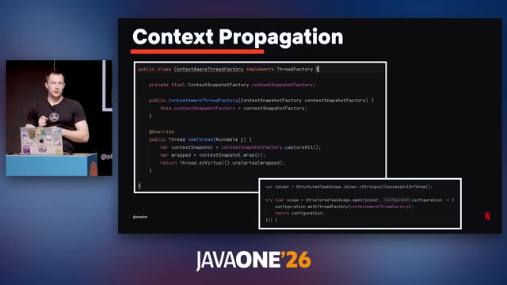

* Khi chia nhánh công việc bằng cơ chế đồng quy có cấu trúc (`StructuredTaskScope.open()` và `scope.fork()`), luồng ảo mới sinh ra không tự động sao chép các biến `ThreadLocal` của luồng cha, làm cho các yêu cầu gọi tiếp theo (`RestClient`) bị từ chối xác thực hoặc mất hoàn toàn thông tin giám sát.
* Cơ chế giá trị theo phạm vi (`Scoped Values`) mới của Java tuy ưu việt nhưng chưa có cầu nối tương thích ngược hoàn chỉnh với các thư viện hiện hữu.
* **Giải pháp thực chiến tại Netflix:** Sử dụng bộ tạo luồng tùy biến `ContextAwareThreadFactory` tích hợp `ContextSnapshotFactory` của Micrometer để bao đóng tác vụ (`Runnable`) trước khi trao cho luồng ảo:

```java
public class ContextAwareThreadFactory implements ThreadFactory {
    private final ContextSnapshotFactory contextSnapshotFactory;

    public ContextAwareThreadFactory(ContextSnapshotFactory contextSnapshotFactory) {
        this.contextSnapshotFactory = contextSnapshotFactory;
    }

    @Override
    public Thread newThread(Runnable r) {
        var contextSnapshot = contextSnapshotFactory.captureAll();
        var wrapped = contextSnapshot.wrap(r);
        return Thread.ofVirtual().unstarted(wrapped);
    }
}
```

Khi sử dụng với `StructuredTaskScope`:

```java
var joiner = StructuredTaskScope.Joiner.<String>allSuccessfulOrThrow();
try (var scope = StructuredTaskScope.open(joiner, configuration -> {
    configuration.withThreadFactory(contextAwareThreadFactory);
    return configuration;
})) {
    // Luồng ảo được phân nhánh an toàn với đầy đủ ngữ cảnh bảo mật và giám sát
}
```

### Quy trình tác tử

Chiến lược triển khai mô hình ngôn ngữ lớn vào các dịch vụ phần mềm doanh nghiệp được phân loại theo dải điều khiển:

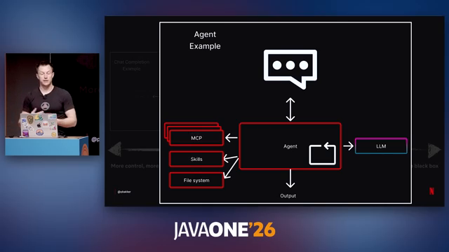

* **Bổ sung gọi đơn giản (Chat Completion):** Dịch vụ Spring truyền thống gọi mô hình để tóm tắt văn bản hoặc trích xuất dữ liệu thô.
* **Quy trình tác tử (Agentic Workflow):** Kỹ sư lập trình trực tiếp quy định các chặng luân chuyển dữ liệu, điều phối luồng rẽ nhánh, phối hợp song song nhiều mô hình, và sử dụng Spring AI để kết nối các công cụ nghiệp vụ hoặc giao thức bối cảnh máy tính (MCP).
* **Tác tử hộp đen tự trị (Autonomous Agent):** Mô hình tự quyết định toàn bộ chuỗi hành động và tự kích hoạt công cụ (như Claude Code hay Codex), phù hợp với việc tự động sửa mã hơn là nhúng trực tiếp vào dịch vụ lõi.

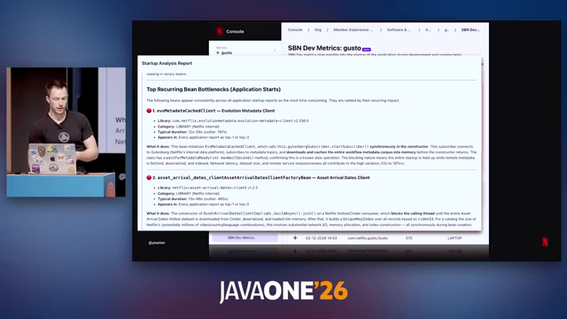

* **Ứng dụng Startup Profiler tại Netflix:**
  * Thu thập dữ liệu thời gian khởi tạo của từng Spring Bean lưu trữ trong cơ sở dữ liệu.
  * Quy trình tác tử kích hoạt việc phân tích dữ liệu trắc đồ, tự động tìm kiếm kho mã nguồn của thư viện gây nghẽn, phân tích đoạn mã thực thi chặn (blocking) trong hàm khởi tạo, và xuất bản khuyến nghị tối ưu hóa trực tiếp cho đội ngũ phát triển.

### So sánh ngôn ngữ

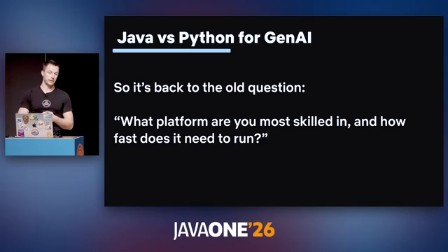

* Hai năm trước, Python chiếm ưu thế nhờ tốc độ ra đời của các thư viện tích hợp. Tuy nhiên, ở thời điểm hiện tại, hệ sinh thái Java với Spring AI và LangChain4j đã đuổi kịp hoàn toàn về mặt tính năng.
* Khi bài toán chỉ xoay quanh việc ứng dụng mô hình (không phải huấn luyện mô hình nền tảng), JVM đem lại lợi thế vượt trội về hiệu năng vận hành tải cao, tính an toàn kiểu dữ liệu, và khả năng tận dụng triệt để năng lực sẵn có của lực lượng kỹ sư Java.

### Hỏi đáp kỹ thuật

* **Cấu hình ZGC cho tác vụ xử lý hàng loạt:** ZGC được chọn làm mặc định vì phù hợp với đa số dịch vụ trực tuyến. Tuy nhiên, các tác vụ tính toán nặng không nhạy cảm với độ trễ tạm dừng vẫn được nhóm vận hành tinh chỉnh và kiểm tra hiệu năng riêng biệt để tối ưu chu kỳ CPU.
* **Lý do dùng tác tử AI thay cho luật OpenRewrite:** Việc viết luật OpenRewrite để bao quát toàn bộ các trường hợp đặc biệt (corner cases) rất tốn kém thời gian kỹ sư. Tác tử AI thể hiện độ linh hoạt vượt trội trong việc xử lý các ngữ cảnh biến đổi phức tạp với chi phí thiết lập thấp hơn nhiều.
* **Can thiệp Bytecode qua Java Agent cho luồng:** Netflix từng thử nghiệm giải pháp dùng Java Agent can thiệp lớp luồng nền nhưng đánh giá phương án này quá rủi ro và khó kiểm soát so với việc dùng bao đóng bộ tạo luồng trong khuôn khổ khung làm việc.

---

## Trích dẫn then chốt

* "Đối với chúng tôi, Java là sự đánh đổi tốt nhất giữa hiệu năng thực thi, năng suất kỹ sư và khả năng duy trì hệ thống lâu dài." — [08:20](https://youtu.be/ucJTPda_zx0?t=500)
* "Đối với Spring Boot 4, chúng tôi quyết định điều phối toàn bộ việc nâng cấp hoàn toàn qua Claude Code chạy ngầm ở quy mô tiến trình hàng loạt." — [21:24](https://youtu.be/ucJTPda_zx0?t=1284)
* "Thời điểm chuyển sang ZGC, đồ thị thời gian dừng rớt thẳng về mức 0 và tỷ lệ lỗi IPC cũng lập tức sụt giảm mạnh mẽ." — [32:55](https://youtu.be/ucJTPda_zx0?t=1975)
* "Việc phân nhánh tác vụ sinh ra luồng ảo mới nhưng không sao chép biến cục bộ luồng, khiến các lệnh gọi sau đó gãy đổ âm thầm vì thiếu hoàn toàn ngữ cảnh bảo mật." — [37:25](https://youtu.be/ucJTPda_zx0?t=2245)
* "Khi nói về việc ứng dụng trí tuệ nhân tạo vào dịch vụ, máy ảo JVM chính là mảnh đất cực kỳ màu mỡ và bền vững để xây dựng hệ thống quy mô lớn." — [49:15](https://youtu.be/ucJTPda_zx0?t=2955)

---

## Lệnh & Công cụ

### Tham số máy ảo

Kích hoạt bộ gom rác thế hệ Z trên máy ảo OpenJDK 21 trở lên:

```bash
java -XX:+UseZGC -XX:+ZGenerational -jar application.jar
```

### Bộ tạo luồng

Mẫu cấu hình bảo toàn ngữ cảnh bảo mật và vết giám sát cho luồng ảo:

```java
ContextSnapshotFactory snapshotFactory = ContextSnapshotFactory.builder().build();
ThreadFactory virtualFactory = Thread.ofVirtual().name("vt-worker-", 0).factory();

ThreadFactory contextAwareFactory = task -> {
    var snapshot = snapshotFactory.captureAll();
    return virtualFactory.newThread(snapshot.wrap(task));
};
```

### Kiểm thử đồ thị

Kiểm thử cô lập phân đoạn GraphQL DGS không cần khởi động toàn bộ servlet container:

```java
@SpringBootTest(classes = {MyDataFetcher.class, ShowsRepository.class})
@EnableDgsTest
class ShowDataFetcherTest {
    @Autowired
    DgsQueryExecutor dgsQueryExecutor;

    @Test
    void testShowsQuery() {
        List<String> titles = dgsQueryExecutor.executeAndExtractJsonPath(
            "query { shows { title } }", "data.shows[*].title");
        assertThat(titles).isNotEmpty();
    }
}
```

---

## Đánh đổi & Rủi ro

| Thành phần | Đánh đổi chấp nhận | Rủi ro tiềm ẩn | Biện pháp giảm thiểu |
| :--- | :--- | :--- | :--- |
| Generational ZGC | Tốn thêm chu kỳ CPU cho các tác vụ gom rác song song | Thâm hụt CPU trên các máy chủ có năng lực tính toán hạn chế | Đo đạc dung lượng trắc đồ chi tiết trước khi triển khai các dịch vụ tính toán hàng loạt |
| Luồng ảo (Virtual Threads) | Bỏ qua cơ chế luồng hệ điều hành để tăng số lượng luồng | Mất dấu vết bảo mật và giám sát do biến cục bộ luồng không được kế thừa | Bắt buộc đóng gói qua `ContextSnapshotFactory` của Micrometer |
| Nâng cấp bằng AI Agent | Chấp nhận chi phí token cho các tác tử chạy nền | Sinh mã không tối ưu hoặc phá vỡ cấu hình ẩn | Thiết lập quy trình kiểm tra trạng thái (Checkpointing) và chạy kiểm thử tự động toàn diện |
| Chuẩn hóa Paved Road | Hạn chế tính linh hoạt trong việc tự chọn công cụ của kỹ sư | Nguy cơ phụ thuộc cứng vào ngăn xếp nội bộ | Duy trì các kênh mở mã nguồn và theo sát các chuẩn công nghiệp quốc tế |
