# Xây Dựng Ứng Dụng Spring Boot Đầu Tiên

* **Kênh:** Devtiro | **Thời lượng:** 02:34:54 | **Ngày:** 2024-04-12
* **Video:** https://youtu.be/M2U4_t_PSRM?si=EcGkXyCrUMKSm6ZE

---

## Thuật ngữ

| Thuật ngữ | Tiếng Anh | Giải thích |
| :--- | :--- | :--- |
| Đảo ngược Điều khiển | Inversion of Control (IoC) | Nguyên lý kiến trúc chuyển giao toàn bộ quyền kiểm soát vòng đời, cấu hình và khởi tạo đối tượng từ lập trình viên sang framework (IoC Container) đảm nhiệm. |
| Tiêm Phụ thuộc | Dependency Injection (DI) | Cơ chế cụ thể của IoC, trong đó Spring tự động cung cấp các đối tượng phụ thuộc thông qua constructor injection thay vì để lớp tự khởi tạo bằng toán tử `new`. |
| Bean Spring | Spring Bean | Các đối tượng Java được khởi tạo, quản lý vòng đời và ghép nối tự động bên trong Spring IoC Container. |
| Đối tượng Chuyển giao Dữ liệu | Data Transfer Object (DTO) | Đối tượng chuyên biệt dùng để truyền nhận dữ liệu qua mạng HTTP giữa Controller và Client, cô lập hoàn toàn cấu trúc bảng dữ liệu nội bộ với bên ngoài. |
| Thực thể | Entity | Lớp đối tượng Java được ánh xạ trực tiếp với bảng cơ sở dữ liệu quan hệ thông qua Hibernate/JPA bằng annotation `@Entity`. |
| Bản ghi Bất biến | Java Record | Cú pháp lớp bất biến hiện đại của Java (từ Java 14+), tự động tạo constructor, trường `final`, hàm truy xuất (getter không có tiền tố `get`), `equals()`, `hashCode()` và `toString()`. |
| Kho Lưu trữ Dữ liệu | Repository | Tầng trừu tượng hóa truy cập dữ liệu, kế thừa từ `JpaRepository` để sở hữu sẵn các phương thức CRUD mà không cần viết câu lệnh SQL thủ công. |
| Máy chủ Nhúng | Embedded Servlet Container | Máy chủ web (mặc định Apache Tomcat trong `spring-boot-starter-web`) được tích hợp thẳng vào file JAR thực thi, loại bỏ sự phụ thuộc vào máy chủ triển khai bên ngoài. |
| Xử lý Ngoại lệ Toàn cục | Global Exception Handler | Cơ chế can thiệp tập trung bằng `@RestControllerAdvice` và `@ExceptionHandler` để bắt các Exception ném ra từ bất kỳ Controller nào và chuyển đổi thành phản hồi HTTP JSON đồng nhất. |
| Bộ Bao gói Maven | Maven Wrapper | Tập lệnh (`mvnw`, `mvnw.cmd`) đi kèm mã nguồn dự án, cho phép tải tự động và thực thi đúng phiên bản Maven được chỉ định mà không yêu cầu máy cài đặt Maven trước. |

---

## Tổng luận chuyên đề

### 1. Kiến trúc Đa tầng Phân lập
Mô hình tổ chức ứng dụng tuân thủ nguyên lý thiết kế phân tách trách nhiệm (Separation of Concerns), đảm bảo tính độc lập và khả năng kiểm thử cao:
- **Tầng Giao diện Điều khiển (Presentation Layer - `TaskController`)**: Tiếp nhận các yêu cầu HTTP, kiểm tra tính hợp lệ của dữ liệu đầu vào qua `@Valid`, điều phối dữ liệu qua Mapper và trả về phản hồi chuẩn thông qua `ResponseEntity`. Tuyệt đối không để rò rỉ lớp Entity ra tầng này.
- **Tầng Chuyển đổi Dữ liệu (Transformation Layer - `TaskMapper`)**: Đảm nhiệm ánh xạ hai chiều giữa các DTO của tầng giao tiếp mạng và các đối tượng nội bộ của tầng dịch vụ/thực thể. Tách biệt này giúp sửa đổi cấu trúc API mà không làm xáo trộn cơ sở dữ liệu và ngược lại.
- **Tầng Nghiệp vụ (Service Layer - `TaskService`, `TaskServiceImpl`)**: Chứa toàn bộ logic xử lý, luật nghiệp vụ và kiểm tra trạng thái tồn tại của dữ liệu. Tuân thủ nguyên lý lập trình theo trừu tượng hóa (program to interfaces, not concretions).
- **Tầng Dữ liệu (Persistence Layer - `TaskRepository`)**: Giao tiếp trực tiếp với cơ sở dữ liệu quan hệ thông qua Spring Data JPA, quản lý các thao tác CRUD và truy vấn có sắp xếp.

### 2. Mô hình Hóa Miền Nghiệp vụ
Thiết kế dữ liệu tập trung vào tính bảo mật, toàn vẹn và khả năng kiểm tra vết:
- **Định danh Toàn cầu (UUID)**: Sử dụng khóa chính kiểu `UUID` sinh ngẫu nhiên thay cho số nguyên tự tăng (`Long/Integer`). Điều này triệt tiêu nguy cơ tấn công dự đoán tuần tự (enumeration attack) và sẵn sàng cho kiến trúc cơ sở dữ liệu phân tán.
- **Tính Bất biến của Khóa chính và Trường Audit**: Khóa chính `id` và trường thời gian tạo `created` được khóa không cho phép sửa đổi trong cơ sở dữ liệu (`updatable = false`).
- **Thời gian Lưu vết (Audit Timestamp)**: Quản lý thời điểm tạo lập (`created`) và chỉnh sửa gần nhất (`updated`) bằng kiểu `Instant` (ghi nhận độ chính xác nano giây theo giờ chuẩn UTC), giúp theo dõi lịch sử chỉnh sửa bản ghi minh bạch.
- **Chuẩn hóa Kiểu Liệt kê (Enums)**: Đóng gói trạng thái (`TaskStatus`: `OPEN`, `CLOSED`) và mức độ ưu tiên (`TaskPriority`: `HIGH`, `MEDIUM`, `LOW`) dưới dạng Java Enum, lưu trữ dạng chuỗi văn bản trong database (`@Enumerated(EnumType.STRING)`) để thuận tiện theo dõi dữ liệu trực quan.

### 3. Chuẩn hóa Giao diện RESTful và Quản trị Lỗi
Xây dựng API nhất quán, an toàn và dễ tích hợp:
- **Quy tắc Định tuyến**: Sử dụng danh từ số nhiều cho tài nguyên (`/api/v1/tasks`), biểu diễn hành động qua các phương thức HTTP chuẩn (`GET`, `POST`, `PUT`, `DELETE`).
- **Mã Trạng thái HTTP Chuẩn mực**:
  - `POST`: Trả về `201 Created` kèm payload đối tượng đã tạo.
  - `GET`: Trả về `200 OK` kèm mảng danh sách đối tượng.
  - `PUT`: Trả về `200 OK` kèm đối tượng sau cập nhật.
  - `DELETE`: Trả về `204 No Content` với thân phản hồi rỗng.
- **Bảo mật Thông tin Lỗi**: Khi xảy ra lỗi không tìm thấy tài nguyên (`TaskNotFoundException`) hoặc dữ liệu đầu vào không hợp lệ (`MethodArgumentNotValidException`), hệ thống chỉ trả về mã `400 Bad Request` kèm thông điệp lỗi có kiểm soát trong `ErrorDto`, tuyệt đối không phơi bày dấu vết ngăn xếp (stack trace) hay thông tin nhạy cảm của máy chủ ra client.

---

## Bóc tách chi tiết

### [[00:00:00](https://youtu.be/M2U4_t_PSRM?t=0s)] Giới thiệu Tổng quan

Giới thiệu mục tiêu khóa học: xây dựng hoàn chỉnh ứng dụng quản lý công việc (Task Application) sử dụng Java hiện đại và framework Spring Boot. Khóa học giải thích song song cả lý thuyết nền tảng (Apache Maven, Spring Framework, Dependency Injection, RESTful API, DTO Pattern) lẫn thực hành lập trình thực tế từng dòng lệnh.

### [[00:02:12](https://youtu.be/M2U4_t_PSRM?t=132s)] Yêu cầu Dự án

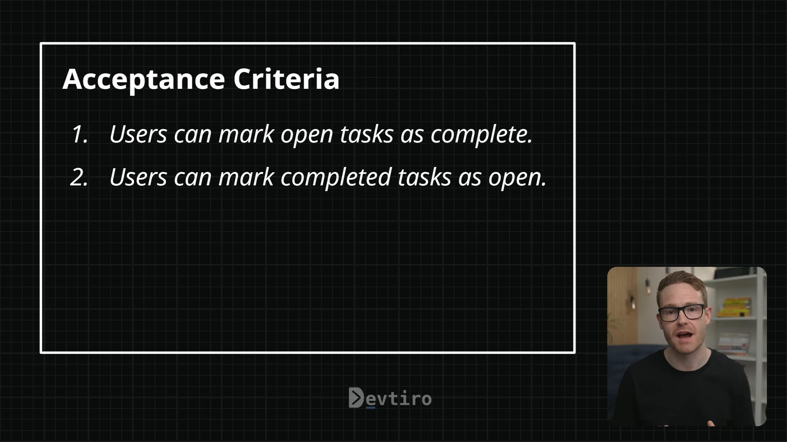

Phân tích bản mô tả yêu cầu kỹ thuật (Project Brief) của ứng dụng quản lý công việc:
- **Tạo mới công việc (Create Task)**: Cho phép người dùng nhập tiêu đề, mô tả, ngày hết hạn và độ ưu tiên.
- **Xem danh sách công việc (List Tasks)**: Hiển thị toàn bộ công việc theo thứ tự thời gian tạo, phân biệt giữa việc đang mở và việc đã hoàn tất.
- **Cập nhật công việc (Update Task)**: Cho phép chỉnh sửa thông tin chi tiết và chuyển đổi trạng thái công việc.
- **Đánh dấu hoàn thành (Mark Completed)**: Thao tác nhanh chuyển trạng thái từ mở (`OPEN`) sang hoàn thành (`CLOSED`).
- **Xóa công việc (Delete Task)**: Loại bỏ hoàn toàn công việc khỏi hệ thống khi không còn nhu cầu.

### [[00:08:44](https://youtu.be/M2U4_t_PSRM?t=524s)] Tổng quan Giao diện

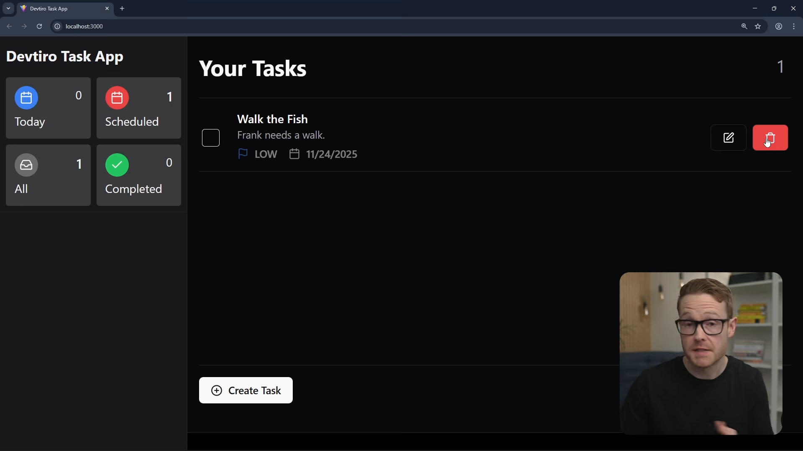

Khảo sát giao diện người dùng mẫu chạy trên trình duyệt:
- **Bảng điều khiển trạng thái**: Khối thống kê trên cùng hiển thị số lượng công việc theo từng nhóm (Tổng số việc, Đang mở, Đã hoàn thành).
- **Danh sách công việc**: Danh sách hiển thị theo thẻ dọc, phân biệt màu sắc dựa trên mức độ ưu tiên (`HIGH`, `MEDIUM`, `LOW`).
- **Hộp thoại tương tác (Modal Dialogs)**:
  - Form tạo mới và chỉnh sửa công việc với các trường nhập liệu tương ứng.
  - Hộp thoại cảnh báo xác nhận xóa tài nguyên nhằm ngăn chặn việc xóa nhầm dữ liệu.
- **Tương tác trực tiếp**: Thao tác click vào biểu tượng ô đánh dấu (checkbox) để chuyển đổi trạng thái tức thì giữa `OPEN` và `CLOSED`.

### [[00:12:00](https://youtu.be/M2U4_t_PSRM?t=720s)] Mô hình Miền Nghiệp vụ

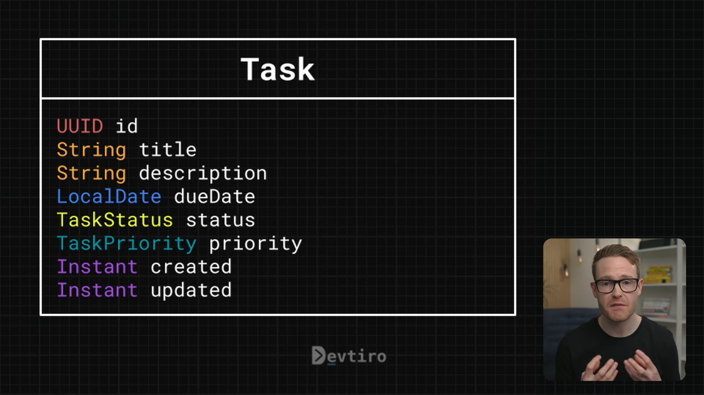

Đặc tả chi tiết từng thuộc tính trong mô hình miền đối tượng `Task`:
- `id`: Kiểu `UUID` (128-bit), đảm bảo tính duy nhất trên toàn cầu mà không phụ thuộc vào bộ sinh ID tuần tự của cơ sở dữ liệu.
- `title`: Kiểu `String`, tiêu đề ngắn gọn của công việc.
- `description`: Kiểu `String`, nội dung mô tả chi tiết công việc.
- `dueDate`: Kiểu `LocalDate`, ghi nhận hạn chót hoàn thành (chỉ lưu ngày, không lưu giờ).
- `status`: Kiểu `TaskStatus` (giá trị gồm `OPEN` hoặc `CLOSED`).
- `priority`: Kiểu `TaskPriority` (giá trị gồm `HIGH`, `MEDIUM`, `LOW`).
- `created`: Kiểu `Instant`, ghi nhận thời điểm tạo lập bản ghi theo chuẩn thời gian phối hợp quốc tế UTC.
- `updated`: Kiểu `Instant`, ghi nhận thời điểm chỉnh sửa thông tin gần nhất.

### [[00:17:07](https://youtu.be/M2U4_t_PSRM?t=1027s)] Kiến trúc Hệ thống

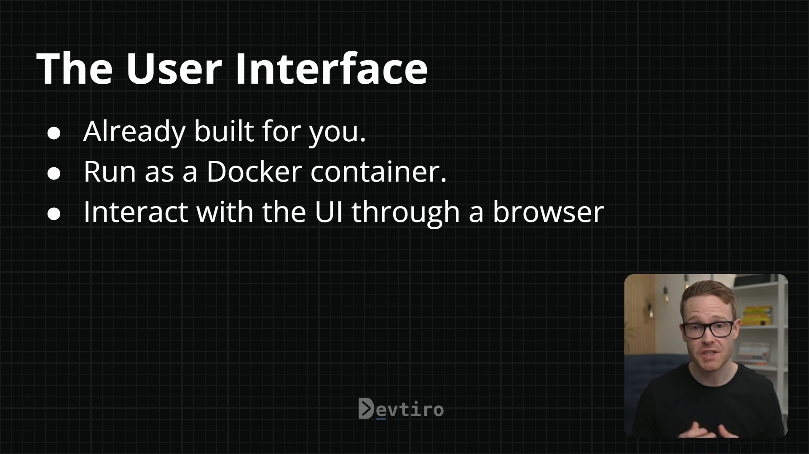

Phân tích mô hình kiến trúc hai thành phần độc lập:
- **Giao diện Người dùng (User Interface)**: Được đóng gói sẵn trong một Docker container, chạy trên cổng `3000`. Ứng dụng client tương tác với máy chủ bằng các cuộc gọi HTTP REST API bất đồng bộ.
- **Máy chủ Backend (Spring Boot Application)**: Ứng dụng Java Spring Boot phát triển trong IntelliJ IDEA, chạy trên cổng `8080`, xử lý toàn bộ logic nghiệp vụ, quản lý trạng thái và lưu trữ dữ liệu vào cơ sở dữ liệu quan hệ.

### [[00:19:28](https://youtu.be/M2U4_t_PSRM?t=1168s)] Đặc tả REST API

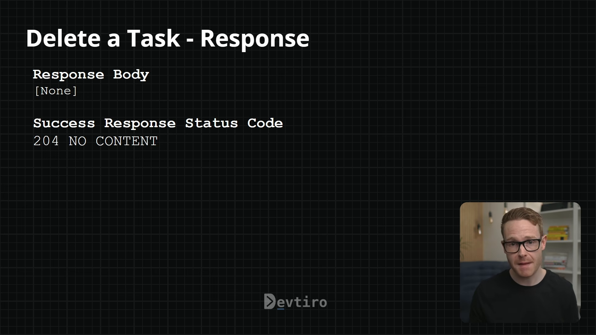

Phân tích sâu nguyên lý REST (Representational State Transfer) và mô hình Request/Response trên nền tảng HTTP:
- **Tài nguyên Web (Web Resource)**: Đối tượng `Task` được biểu diễn dưới dạng tài liệu JSON truyền tải qua mạng.
- **Quy ước Endpoint**:
  - `POST /api/v1/tasks`: Tiếp nhận JSON payload không chứa `id`, tự động gán trạng thái `OPEN` và trả về `201 Created` kèm thực thể đầy đủ vừa tạo.
  - `GET /api/v1/tasks`: Trả về mảng danh sách công việc dạng JSON với mã `200 OK`.
  - `PUT /api/v1/tasks/{id}`: Tiếp nhận ID trên đường dẫn URL cùng JSON payload cập nhật, trả về `200 OK` kèm đối tượng sau khi lưu.
  - `DELETE /api/v1/tasks/{id}`: Tiếp nhận ID cần xóa, trả về phản hồi rỗng với mã `204 No Content`.
- **Chuẩn hóa Phản hồi Lỗi**: Mọi ngoại lệ nghiệp vụ và lỗi xác thực dữ liệu đều được chuẩn hóa về định dạng JSON chung:
  ```json
  {
    "status": 400,
    "message": "Chi tiết lỗi vi phạm",
    "timestamp": "2024-04-12T10:00:00Z"
  }
  ```

### [[00:33:01](https://youtu.be/M2U4_t_PSRM?t=1981s)] Khởi tạo Dự án

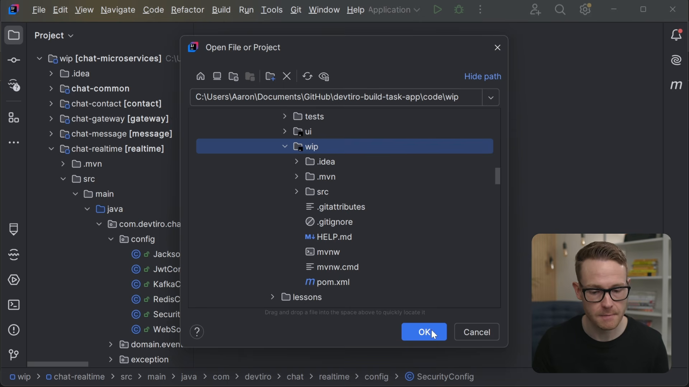

Thiết lập cấu trúc dự án từ Spring Initializr và nạp vào IntelliJ IDEA:
- **Phiên bản Java & Framework**: Sử dụng Java phiên bản mới cùng Spring Boot 3+.
- **Phụ thuộc Maven (Dependencies)**:
  - `spring-boot-starter-web`: Cung cấp thư viện xây dựng RESTful API và máy chủ Tomcat nhúng.
  - `spring-boot-starter-data-jpa`: Tích hợp Hibernate và Spring Data JPA cho tầng truy cập dữ liệu.
  - `spring-boot-starter-validation`: Hỗ trợ kiểm tra hợp lệ dữ liệu đầu vào thông qua Hibernate Validator (`@NotNull`, `@NotBlank`).
  - H2 Database (in-memory) phục vụ lưu trữ dữ liệu kiểm thử nhanh trong quá trình phát triển.
- Khảo sát cấu trúc thư mục chuẩn của Maven: mã nguồn đặt tại `src/main/java`, tài nguyên cấu hình tại `src/main/resources`.

### [[00:40:21](https://youtu.be/M2U4_t_PSRM?t=2421s)] Khởi chạy Giao diện

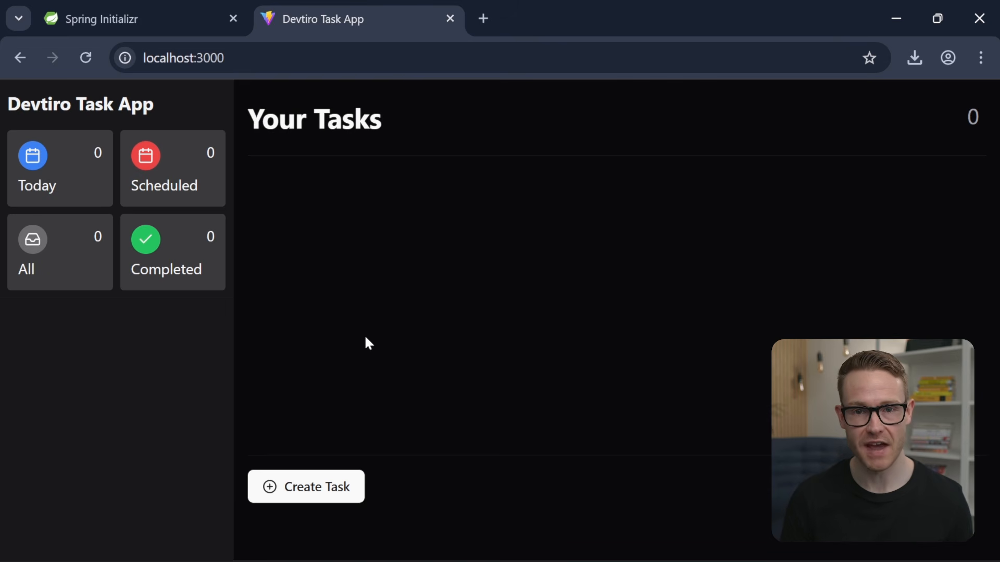

Quy trình kích hoạt giao diện người dùng bằng Docker Compose:
- Chạy lệnh kích hoạt trong terminal:
  ```bash
  docker compose up -d
  ```
- Kiểm tra trạng thái vùng chứa bằng lệnh `docker ps` để đảm bảo container đang hoạt động bình thường trên cổng `3000`.
- Mở trình duyệt tại `http://localhost:3000` để xác nhận giao diện sẵn sàng kết nối với API backend cổng `8080`.

### [[00:43:44](https://youtu.be/M2U4_t_PSRM?t=2624s)] Thực hành Apache Maven

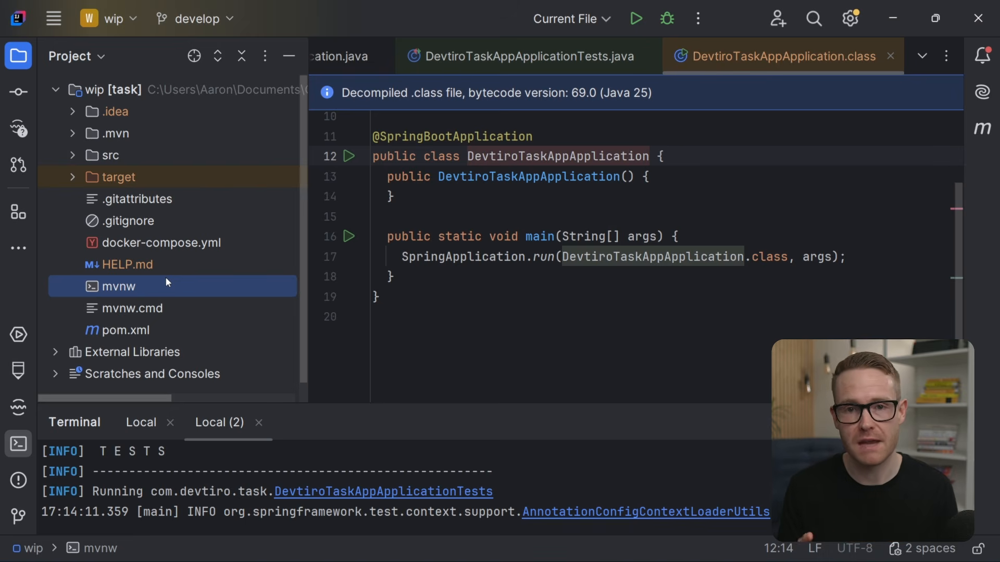

Chuyên đề đào tạo toàn diện về công cụ xây dựng Apache Maven:
- **Bản chất của Maven**: Công cụ dòng lệnh quản lý vòng đời xây dựng (build lifecycle) và quản lý phụ thuộc (dependency management) cho ứng dụng Java.
- **Tập tin `pom.xml` (Project Object Model)**: Khai báo tọa độ dự án (`groupId`, `artifactId`, `version`), phiên bản Java đích và danh sách các thư viện bên thứ ba.
- **Kho lưu trữ (Repositories)**: Phân biệt kho lưu trữ trung tâm từ xa (Maven Central) và kho lưu trữ cục bộ trên máy lập trình viên (`~/.m2/repository`).
- **Vòng đời Xây dựng (Build Lifecycles)**:
  - Vòng đời mặc định (`default`): Gồm các pha tuần tự `validate` -> `compile` -> `test` -> `package` -> `verify` -> `install` -> `deploy`.
  - Vòng đời dọn dẹp (`clean`): Xóa bỏ toàn bộ thư mục `target/` sinh ra từ các lần build trước.
- **Pha (Phases) và Mục tiêu Plugin (Plugin Goals)**: Mỗi pha trong vòng đời liên kết với một hoặc nhiều goal của plugin cụ thể (ví dụ: `maven-compiler-plugin:compile`, `maven-surefire-plugin:test`).
- **Cơ chế Maven Wrapper (`mvnw` / `mvnw.cmd`)**: Script nhúng trong dự án cho phép bất kỳ máy nào cũng có thể build dự án đúng phiên bản Maven quy định mà không cần cài đặt Maven toàn cục. Chạy thử lệnh:
  ```bash
  ./mvnw clean test
  ```

### [[00:57:18](https://youtu.be/M2U4_t_PSRM?t=3438s)] Cơ chế Spring Framework

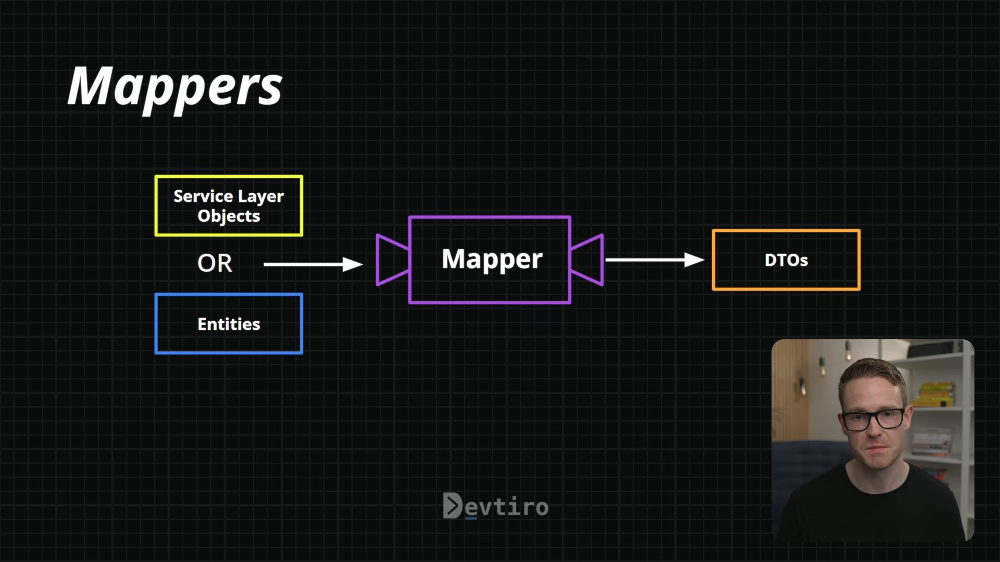

Phân tích chuyên sâu nền tảng Spring Framework và Spring Boot:
- **So sánh Spring Framework vs. Spring Boot**:
  - Spring Framework cung cấp các tính năng cốt lõi: IoC Container, Dependency Injection, trừu tượng hóa giao dịch, mô hình MVC.
  - Spring Boot giải quyết bài toán phức tạp trong cấu hình: cung cấp cơ chế tự động cấu hình (Auto-configuration), gói phụ thuộc khởi đầu (Starter Dependencies), và máy chủ web nhúng sẵn (Embedded Tomcat).
- **Nguyên lý Dependency Injection (DI)**: Thay vì một lớp tự khởi tạo các đối tượng phụ thuộc bằng từ khóa `new` (gây ràng buộc chặt), IoC Container sẽ chịu trách nhiệm khởi tạo và tiêm (inject) các phụ thuộc vào thông qua constructor.
- **Thành phần và Bean (Components & Beans)**:
  - `@Component`: Annotation tổng quát đánh dấu một lớp là Spring Bean.
  - `@Service`: Đánh dấu bean thuộc tầng nghiệp vụ logic.
  - `@Repository`: Đánh dấu bean thuộc tầng truy cập dữ liệu, tự động kích hoạt dịch chuyển ngoại lệ cơ sở dữ liệu sang phân loại của Spring Data.
  - `@RestController`: Kết hợp giữa `@Controller` và `@ResponseBody`, đánh dấu bean thuộc tầng xử lý web API trả về JSON.
- **Mô hình DTO Pattern và Mapper**: Giải thích lý do không bao giờ được trả trực tiếp Entity ra bên ngoài mạng:
  - Ngăn chặn lộ các cột bảo mật hoặc cấu trúc bảng dữ liệu.
  - Tránh lỗi vòng lặp tuần tự hóa vô tận (Infinite recursion) khi các thực thể có quan hệ hai chiều.
  - Tách rời tốc độ thay đổi của tầng API và tầng lưu trữ.

### [[01:14:17](https://youtu.be/M2U4_t_PSRM?t=4457s)] Định nghĩa Kiểu Liệt kê

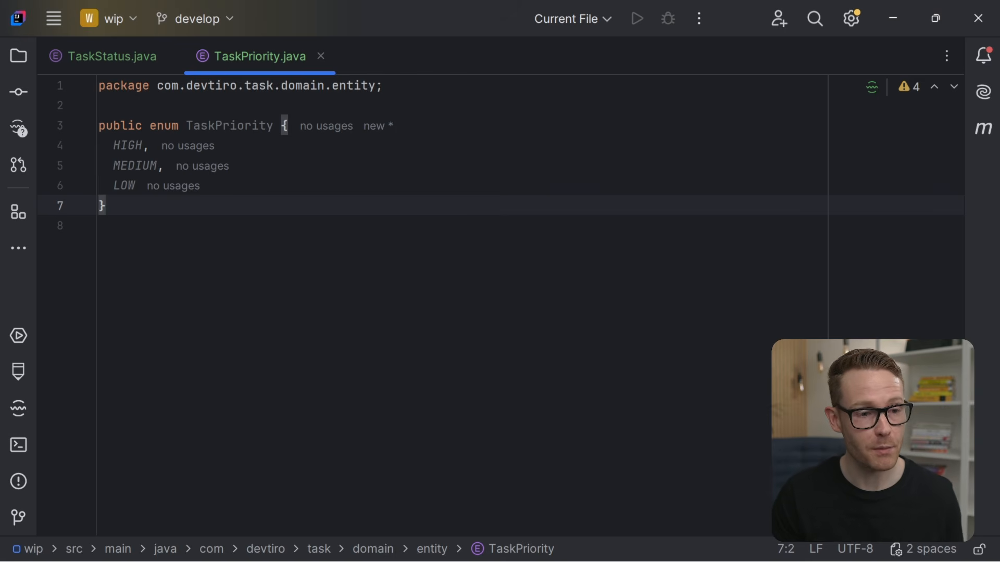

Tạo gói `domain` và xây dựng hai lớp Enum chuẩn hóa miền nghiệp vụ:
- Lớp `TaskStatus`:
  ```java
  public enum TaskStatus {
      OPEN,
      CLOSED
  }
  ```
- Lớp `TaskPriority`:
  ```java
  public enum TaskPriority {
      HIGH,
      MEDIUM,
      LOW
  }
  ```

### [[01:17:07](https://youtu.be/M2U4_t_PSRM?t=4627s)] Xây dựng Thực thể Dữ liệu

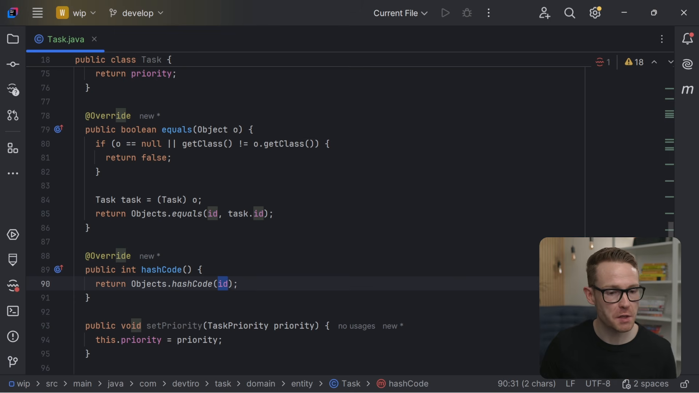

Xây dựng lớp thực thể `Task` trong gói `domain.entity` với đầy đủ các cấu hình JPA chi tiết:
- Đánh dấu `@Entity` và định danh bảng bằng `@Table(name = "tasks")`.
- Cấu hình khóa chính tự sinh UUID:
  ```java
  @Id
  @GeneratedValue(strategy = GenerationType.UUID)
  @Column(name = "id", updatable = false, nullable = false)
  private UUID id;
  ```
- Cấu hình các cột dữ liệu nghiệp vụ:
  ```java
  @Column(name = "title", nullable = false)
  private String title;

  @Column(name = "description")
  private String description;

  @Column(name = "due_date")
  private LocalDate dueDate;

  @Enumerated(EnumType.STRING)
  @Column(name = "status", nullable = false)
  private TaskStatus status;

  @Enumerated(EnumType.STRING)
  @Column(name = "priority", nullable = false)
  private TaskPriority priority;

  @Column(name = "created", nullable = false, updatable = false)
  private Instant created;

  @Column(name = "updated", nullable = false)
  private Instant updated;
  ```
- Sinh các hàm tạo (No-args constructor, All-args constructor), hệ thống getter/setter cho toàn bộ các trường.
- Triển khai phương thức `equals()` và `hashCode()` chỉ dựa trên duy nhất trường `id` để đảm bảo tính nhất quán của thực thể khi đưa vào các tập hợp (Set/Map) của Hibernate session.
- Sinh phương thức `toString()` hỗ trợ việc ghi log theo dõi.

### [[01:26:35](https://youtu.be/M2U4_t_PSRM?t=5195s)] Định nghĩa Kho Lưu trữ

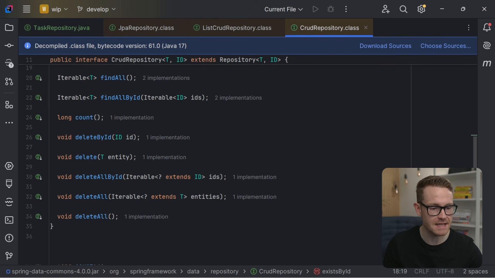

Tạo interface `TaskRepository` trong gói `repository`:
```java
@Repository
public interface TaskRepository extends JpaRepository<Task, UUID> {
}
```
Phân tích cây phả hệ giao diện của Spring Data JPA: `JpaRepository` kế thừa từ `ListCrudRepository`, `PagingAndSortingRepository` và `Repository`. Nhờ đó, ứng dụng sở hữu sẵn toàn bộ các thao tác: `save()`, `findById()`, `findAll()`, `deleteById()`, `count()`, `existsById()` hoàn toàn tự động trong thời gian chạy (runtime proxy).

### [[01:28:50](https://youtu.be/M2U4_t_PSRM?t=5330s)] Bản ghi Yêu cầu Dịch vụ

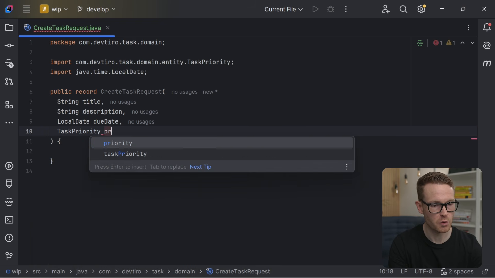

Tạo Java Record `CreateTaskRequest` trong gói `domain`:
```java
public record CreateTaskRequest(
    String title,
    String description,
    LocalDate dueDate,
    TaskPriority priority
) {}
```
Phân tích: Ở bước tạo mới, người dùng không cần truyền `status` (mặc định luôn là `OPEN`), cũng không cần truyền `id`, `created` hay `updated` vì những trường này thuộc trách nhiệm khởi tạo tự động của hệ thống.

### [[01:30:49](https://youtu.be/M2U4_t_PSRM?t=5449s)] Phương thức Dịch vụ Tạo mới

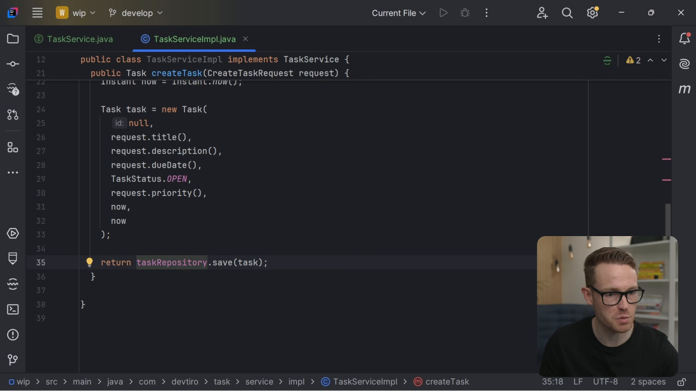

Thiết kế tầng dịch vụ theo nguyên lý phân tách interface và implementation:
- Định nghĩa giao diện `TaskService`:
  ```java
  public interface TaskService {
      Task createTask(CreateTaskRequest request);
  }
  ```
- Triển khai lớp `TaskServiceImpl` trong gói `service.impl`:
  ```java
  @Service
  public class TaskServiceImpl implements TaskService {
      private final TaskRepository taskRepository;

      public TaskServiceImpl(TaskRepository taskRepository) {
          this.taskRepository = taskRepository;
      }

      @Override
      public Task createTask(CreateTaskRequest request) {
          Instant now = Instant.now();
          Task task = new Task(
              null,
              request.title(),
              request.description(),
              request.dueDate(),
              TaskStatus.OPEN,
              request.priority(),
              now,
              now
          );
          return taskRepository.save(task);
      }
  }
  ```
- Sử dụng constructor injection để tiêm `TaskRepository`, đảm bảo tính minh bạch của các phụ thuộc và hỗ trợ viết unit test dễ dàng với mock repository.

### [[01:38:18](https://youtu.be/M2U4_t_PSRM?t=5898s)] Chuyển đổi Dữ liệu và Ánh xạ


Xây dựng lớp DTO và cơ chế chuyển đổi dữ liệu trong gói `domain.dto` và `mapper`:
- Tạo `CreateTaskRequestDto` tích hợp Bean Validation:
  ```java
  public record CreateTaskRequestDto(
      @NotBlank(message = "Tiêu đề không được để trống")
      String title,

      String description,
      LocalDate dueDate,

      @NotNull(message = "Mức độ ưu tiên bắt buộc phải có")
      TaskPriority priority
  ) {}
  ```
- Tạo `TaskDto` trả về phản hồi:
  ```java
  public record TaskDto(
      UUID id,
      String title,
      String description,
      LocalDate dueDate,
      TaskPriority priority,
      TaskStatus status
  ) {}
  ```
- Định nghĩa giao diện `TaskMapper`:
  ```java
  public interface TaskMapper {
      CreateTaskRequest fromDto(CreateTaskRequestDto dto);
      TaskDto toDto(Task task);
  }
  ```
- Triển khai `TaskMapperImpl` với annotation `@Component`. Giải thích lý do viết mapper thủ công: giúp người học nắm vững chính xác cơ chế chuyển dịch từng trường dữ liệu trước khi tiếp cận các thư viện tự động hóa như MapStruct.

### [[01:50:53](https://youtu.be/M2U4_t_PSRM?t=6653s)] Điểm cuối Tạo mới Công việc

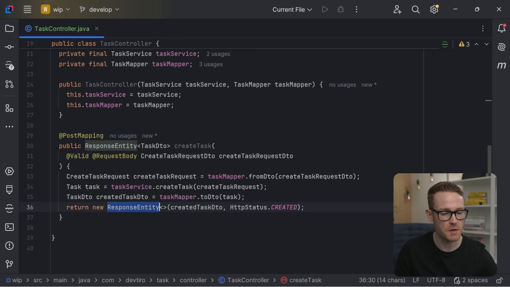

Xây dựng lớp `TaskController` trong gói `controller`:
```java
@RestController
@RequestMapping(path = "/api/v1/tasks")
public class TaskController {
    private final TaskService taskService;
    private final TaskMapper taskMapper;

    public TaskController(TaskService taskService, TaskMapper taskMapper) {
        this.taskService = taskService;
        this.taskMapper = taskMapper;
    }

    @PostMapping
    public ResponseEntity<TaskDto> createTask(
        @Valid @RequestBody CreateTaskRequestDto dto
    ) {
        CreateTaskRequest request = taskMapper.fromDto(dto);
        Task createdTask = taskService.createTask(request);
        TaskDto responseDto = taskMapper.toDto(createdTask);
        return new ResponseEntity<>(responseDto, HttpStatus.CREATED);
    }
}
```
Phân tích:
- `@RestController` thông báo lớp này xử lý các yêu cầu web và tự động chuyển đổi giá trị trả về thành JSON.
- `@Valid` kích hoạt công cụ kiểm tra tính hợp lệ của `CreateTaskRequestDto` trước khi đi vào thân hàm.
- Trả về mã phản hồi HTTP `201 Created` thay vì `200 OK` mặc định nhằm tuân thủ đúng chuẩn REST cho thao tác tạo mới tài nguyên.

### [[01:57:45](https://youtu.be/M2U4_t_PSRM?t=7065s)] Xử lý Ngoại lệ Toàn cục

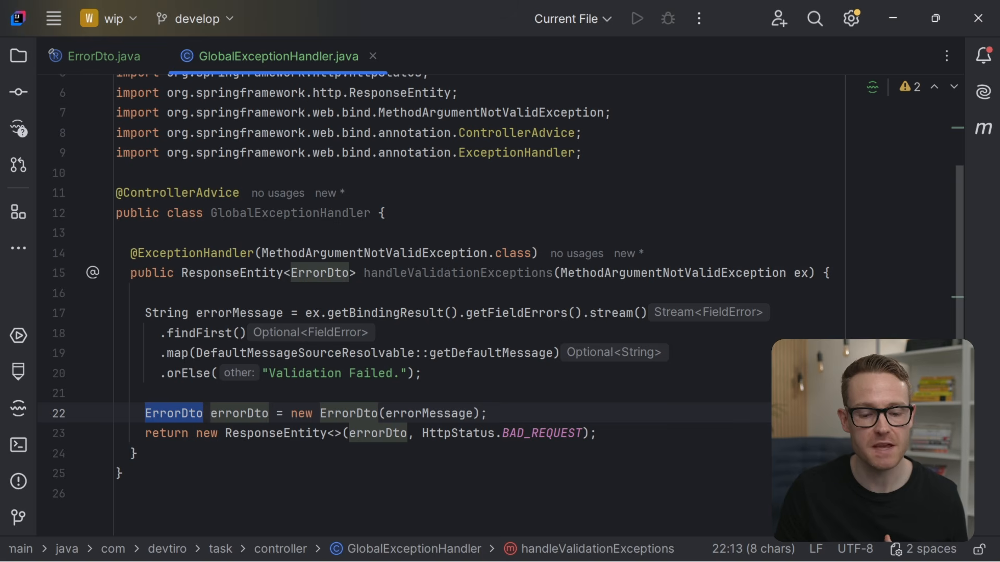

Xây dựng hệ thống quản lý lỗi tập trung:
- Định nghĩa DTO phản hồi lỗi `ErrorDto`:
  ```java
  public record ErrorDto(String error) {}
  ```
- Xây dựng lớp xử lý ngoại lệ `GlobalExceptionHandler`:
  ```java
  @RestControllerAdvice
  public class GlobalExceptionHandler {

      @ExceptionHandler(MethodArgumentNotValidException.class)
      public ResponseEntity<ErrorDto> handleValidationExceptions(
          MethodArgumentNotValidException ex
      ) {
          String errorMessage = ex.getBindingResult()
              .getFieldErrors()
              .stream()
              .findFirst()
              .map(fieldError -> fieldError.getDefaultMessage())
              .orElse("Dữ liệu đầu vào không hợp lệ");

          ErrorDto errorDto = new ErrorDto(errorMessage);
          return new ResponseEntity<>(errorDto, HttpStatus.BAD_REQUEST);
      }
  }
  ```
- Cơ chế stream giúp trích xuất lỗi kiểm tra đầu tiên trả về cho client một cách gãy gọn, thiết lập mã HTTP phản hồi là `400 Bad Request`.

### [[02:02:07](https://youtu.be/M2U4_t_PSRM?t=7327s)] Kiểm thử Giao diện Tạo mới

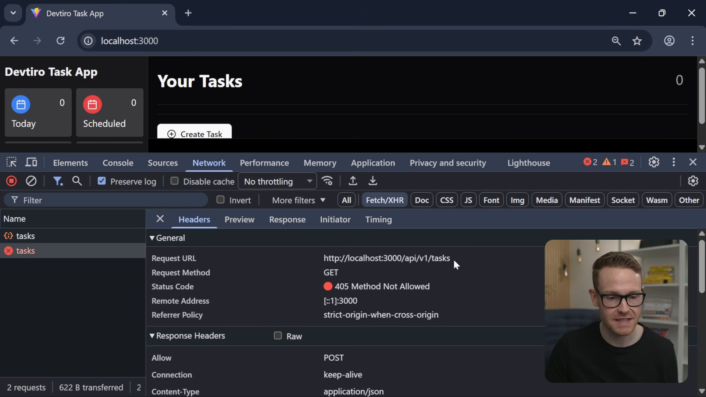

Khởi động ứng dụng Spring Boot và tiến hành kiểm thử trên trình duyệt tại `http://localhost:3000`:
- Thao tác trên giao diện: Mở form tạo mới, nhập thông tin công việc mẫu (ví dụ: "Walk the dog", ghi chú "Rex needs a walk", chọn ngày hết hạn và mức ưu tiên trung bình).
- Kiểm tra qua công cụ DevTools Network:
  - Gửi yêu cầu HTTP `POST` đến `/api/v1/tasks`.
  - Phản hồi nhận về mã `201 Created` kèm payload JSON chứa chuỗi UUID vừa sinh.
  - Kiểm tra trường hợp để trống trường tiêu đề: Hệ thống chặn lại và trả về lỗi `400 Bad Request` cùng thông báo từ Bean Validation.
- Ghi nhận yêu cầu tiếp theo gọi `GET /api/v1/tasks` bị lỗi `405 Method Not Allowed`, do endpoint liệt kê chưa được triển khai.

### [[02:05:19](https://youtu.be/M2U4_t_PSRM?t=7519s)] Phương thức Dịch vụ Liệt kê

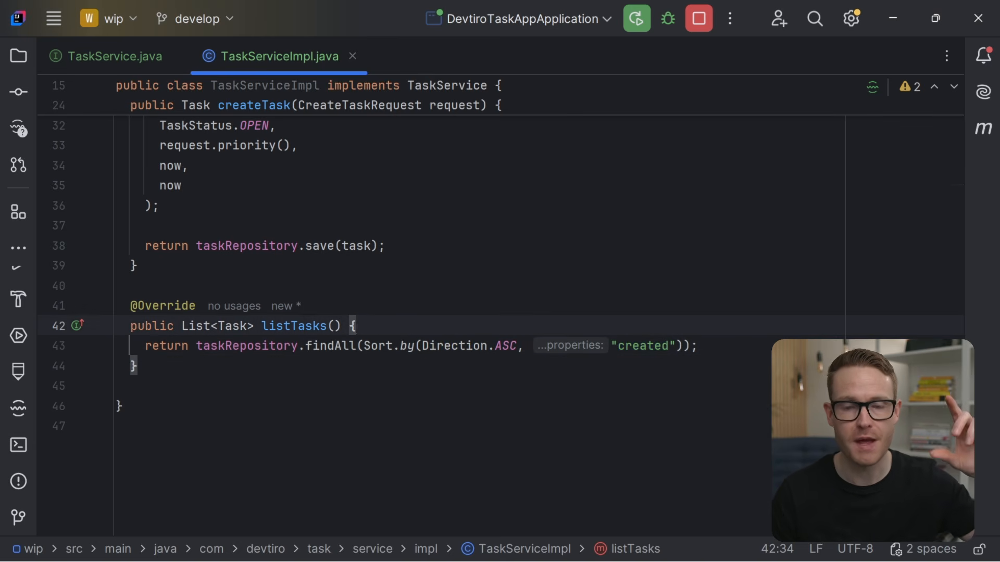

Bổ sung phương thức truy vấn danh sách có sắp xếp vào tầng dịch vụ:
- Bổ sung vào interface `TaskService`:
  ```java
  List<Task> listTasks();
  ```
- Triển khai trong `TaskServiceImpl`:
  ```java
  @Override
  public List<Task> listTasks() {
      return taskRepository.findAll(Sort.by(Sort.Direction.ASC, "created"));
  }
  ```
- Sử dụng đối tượng `Sort` của Spring Data JPA để sắp xếp danh sách theo thứ tự thời gian tạo tăng dần (`ASC`), giúp các công việc cũ xuất hiện ở trên và công việc mới tạo nằm ở cuối danh sách.

### [[02:07:53](https://youtu.be/M2U4_t_PSRM?t=7673s)] Điểm cuối Liệt kê Công việc

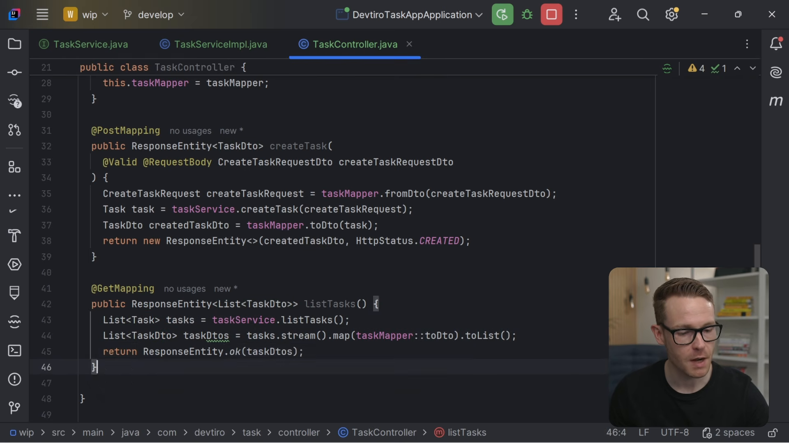

Thêm endpoint truy vấn vào `TaskController`:
```java
@GetMapping
public ResponseEntity<List<TaskDto>> listTasks() {
    List<Task> tasks = taskService.listTasks();
    List<TaskDto> taskDtos = tasks.stream()
        .map(taskMapper::toDto)
        .toList();
    return ResponseEntity.ok(taskDtos);
}
```
Phân tích: Sử dụng cú pháp rút gọn `ResponseEntity.ok(...)` tương đương mã `200 OK`. Toàn bộ danh sách thực thể `Task` được ánh xạ sang `TaskDto` qua luồng Java Stream trước khi gửi ra ngoài client.

### [[02:10:06](https://youtu.be/M2U4_t_PSRM?t=7806s)] Kiểm thử Giao diện Liệt kê

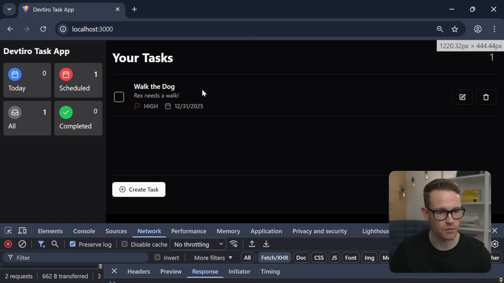

Khởi động lại ứng dụng và thực hiện kiểm thử trên giao diện:
- Tạo mới một công việc và theo dõi danh sách hiển thị tức thì trên màn hình chính.
- Kiểm tra tab Network: Yêu cầu `GET /api/v1/tasks` phản hồi thành công mã `200 OK` với mảng JSON chứa đầy đủ các thuộc tính của công việc vừa tạo.
- Giao diện người dùng render chính xác thẻ công việc với tên, ngày hạn, nhãn trạng thái và màu sắc biểu thị độ ưu tiên.

### [[02:11:58](https://youtu.be/M2U4_t_PSRM?t=7918s)] Bản ghi Cập nhật Dịch vụ

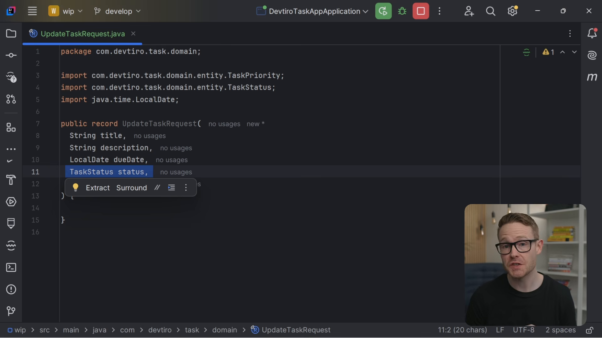

Định nghĩa Java Record `UpdateTaskRequest` trong gói `domain`:
```java
public record UpdateTaskRequest(
    String title,
    String description,
    LocalDate dueDate,
    TaskStatus status,
    TaskPriority priority
) {}
```
So sánh điểm khác biệt then chốt giữa `CreateTaskRequest` và `UpdateTaskRequest`: Bản ghi cập nhật cho phép truyền thêm trường `status` (`TaskStatus`), trao quyền cho client thay đổi trạng thái công việc (chuyển từ `OPEN` sang `CLOSED` và ngược lại).

### [[02:13:26](https://youtu.be/M2U4_t_PSRM?t=8006s)] Ngoại lệ Không Tìm thấy

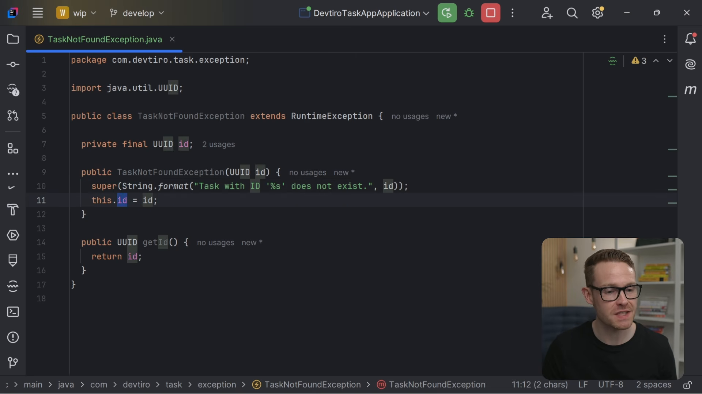

Xây dựng ngoại lệ nghiệp vụ tùy chỉnh `TaskNotFoundException` trong gói `domain.exception`:
```java
public class TaskNotFoundException extends RuntimeException {
    private final UUID id;

    public TaskNotFoundException(UUID id) {
        super("Không tìm thấy công việc với mã định danh: " + id);
        this.id = id;
    }

    public UUID getId() {
        return id;
    }
}
```
Thiết kế kế thừa từ `RuntimeException` (Unchecked Exception), lưu trữ mã `UUID` để bộ xử lý ngoại lệ toàn cục có thể trích xuất chính xác thông tin phục vụ thông báo lỗi cho người dùng.

### [[02:16:11](https://youtu.be/M2U4_t_PSRM?t=8171s)] Phương thức Dịch vụ Cập nhật

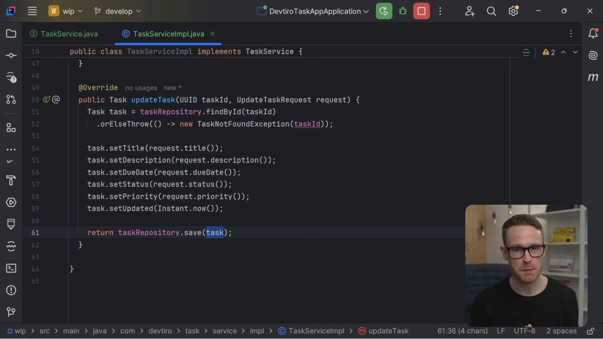

Triển khai logic cập nhật trong `TaskServiceImpl`:
```java
@Override
public Task updateTask(UUID id, UpdateTaskRequest request) {
    Task existingTask = taskRepository.findById(id)
        .orElseThrow(() -> new TaskNotFoundException(id));

    existingTask.setTitle(request.title());
    existingTask.setDescription(request.description());
    existingTask.setDueDate(request.dueDate());
    existingTask.setStatus(request.status());
    existingTask.setPriority(request.priority());
    existingTask.setUpdated(Instant.now());

    return taskRepository.save(existingTask);
}
```
Phân tích quy trình xử lý:
1. Tra cứu bản ghi trong cơ sở dữ liệu qua `taskRepository.findById(id)`.
2. Nếu không tìm thấy, lập tức kích hoạt ngoại lệ `TaskNotFoundException(id)`.
3. Nếu tồn tại, cập nhật từng trường dữ liệu từ bản ghi yêu cầu vào thực thể.
4. Cập nhật trường vết thời gian `updated` bằng mốc thời gian hiện tại (`Instant.now()`).
5. Gọi `taskRepository.save(existingTask)` để ghi nhận thay đổi xuống cơ sở dữ liệu và trả về thực thể hoàn chỉnh.

### [[02:19:38](https://youtu.be/M2U4_t_PSRM?t=8378s)] Ánh xạ Cập nhật Dữ liệu


Xây dựng DTO nhận dữ liệu cập nhật và mở rộng lớp ánh xạ:
- Tạo `UpdateTaskRequestDto` tích hợp xác thực dữ liệu:
  ```java
  public record UpdateTaskRequestDto(
      @NotBlank(message = "Tiêu đề không được để trống")
      String title,

      String description,
      LocalDate dueDate,

      @NotNull(message = "Trạng thái công việc bắt buộc phải có")
      TaskStatus status,

      @NotNull(message = "Mức độ ưu tiên bắt buộc phải có")
      TaskPriority priority
  ) {}
  ```
- Bổ sung phương thức vào giao diện `TaskMapper`:
  ```java
  UpdateTaskRequest fromDto(UpdateTaskRequestDto dto);
  ```
- Triển khai trong `TaskMapperImpl`: Ánh xạ các trường từ `UpdateTaskRequestDto` sang đối tượng `UpdateTaskRequest`.

### [[02:23:30](https://youtu.be/M2U4_t_PSRM?t=8610s)] Điểm cuối Cập nhật Công việc

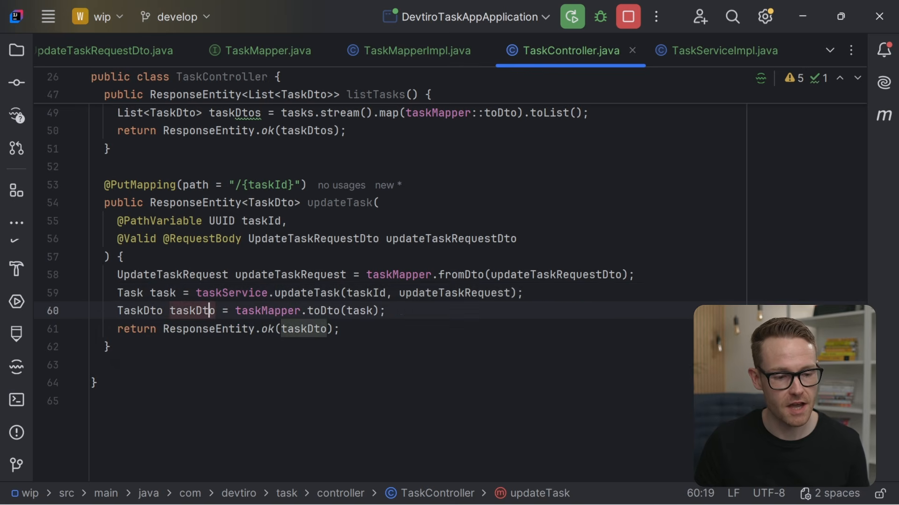

Bổ sung endpoint cập nhật tài nguyên vào `TaskController`:
```java
@PutMapping(path = "/{id}")
public ResponseEntity<TaskDto> updateTask(
    @PathVariable("id") UUID id,
    @Valid @RequestBody UpdateTaskRequestDto dto
) {
    UpdateTaskRequest request = taskMapper.fromDto(dto);
    Task updatedTask = taskService.updateTask(id, request);
    TaskDto responseDto = taskMapper.toDto(updatedTask);
    return ResponseEntity.ok(responseDto);
}
```
Phân tích:
- `@PutMapping(path = "/{id}")`: Định tuyến phương thức HTTP PUT với biến đường dẫn `{id}`.
- `@PathVariable("id") UUID id`: Tự động ép kiểu chuỗi định danh từ URL sang kiểu `UUID`.
- `@Valid @RequestBody`: Nhận và kiểm tra tính toàn vẹn của payload cập nhật trước khi gọi xuống tầng dịch vụ.

### [[02:27:30](https://youtu.be/M2U4_t_PSRM?t=8850s)] Xử lý Lỗi Cập nhật

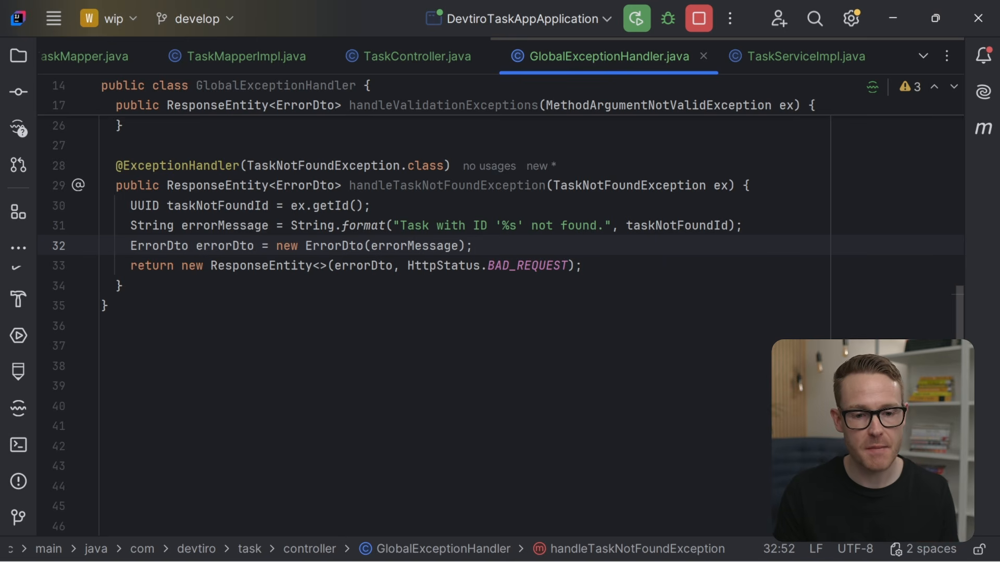

Mở rộng `GlobalExceptionHandler` để bắt ngoại lệ `TaskNotFoundException`:
```java
@ExceptionHandler(TaskNotFoundException.class)
public ResponseEntity<ErrorDto> handleTaskNotFoundException(
    TaskNotFoundException ex
) {
    String errorMessage = "Không tìm thấy công việc với mã ID: " + ex.getId();
    ErrorDto errorDto = new ErrorDto(errorMessage);
    return new ResponseEntity<>(errorDto, HttpStatus.BAD_REQUEST);
}
```
Phân tích thiết kế bảo mật: Không truyền trực tiếp thông báo lỗi nội bộ của Exception ra client mà chủ động định dạng thông điệp lỗi rõ ràng chỉ sử dụng mã ID tài nguyên, tránh nguy cơ rò rỉ cấu trúc hệ thống hoặc chi tiết nhạy cảm của server.

### [[02:29:52](https://youtu.be/M2U4_t_PSRM?t=8992s)] Kiểm thử Giao diện Cập nhật

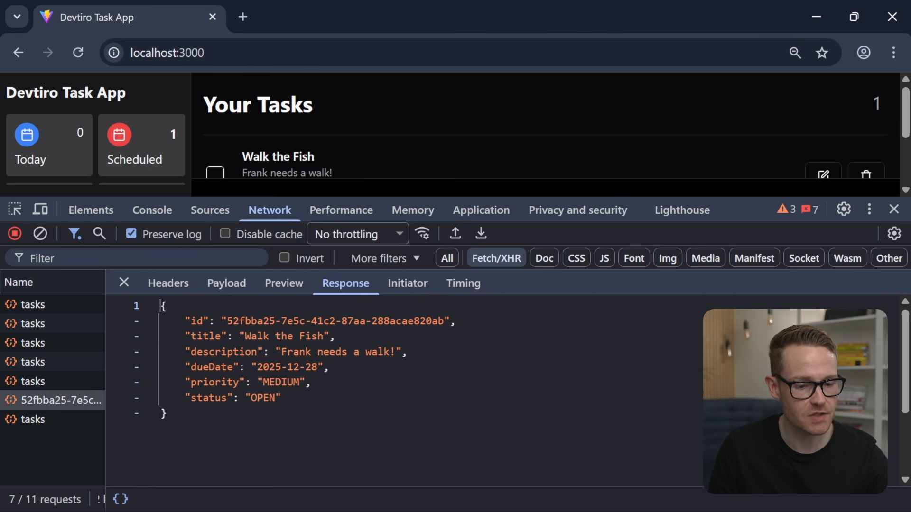

Thực hiện kiểm thử tính năng cập nhật trên giao diện người dùng:
- Mở modal chỉnh sửa một công việc có sẵn: sửa đổi nội dung mô tả, thay đổi ngày hết hạn và chọn chuyển đổi trạng thái hoàn thành.
- Tab Network ghi nhận:
  - Yêu cầu `PUT /api/v1/tasks/{id}` với payload cập nhật hoàn chỉnh.
  - Phản hồi trả về mã `200 OK` kèm dữ liệu đối tượng mới.
- Thao tác click vào biểu tượng ô đánh dấu hoàn thành: Gửi yêu cầu cập nhật chuyển `status` sang `CLOSED`, thẻ công việc được gạch ngang và bộ đếm số lượng công việc hoàn thành tăng lên tương ứng.

### [[02:31:55](https://youtu.be/M2U4_t_PSRM?t=9115s)] Phương thức Dịch vụ Xóa

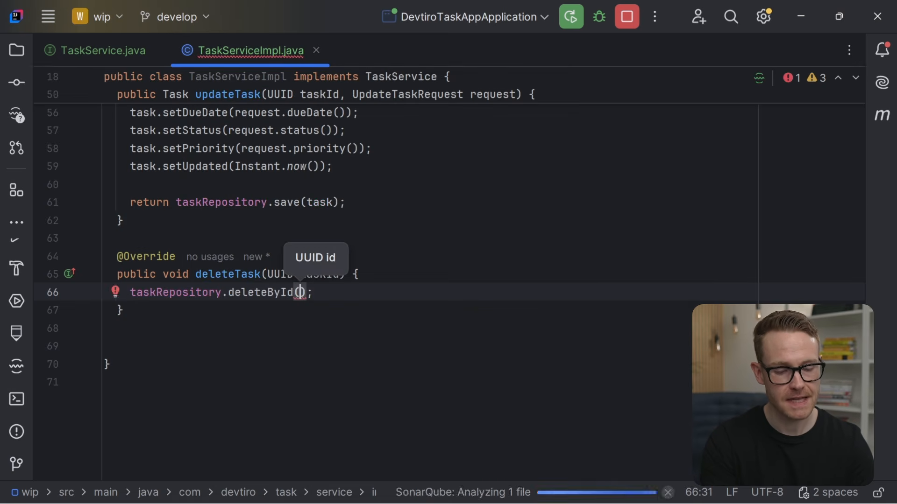

Triển khai tính năng xóa công việc:
- Khai báo phương thức trong interface `TaskService`:
  ```java
  void deleteTask(UUID id);
  ```
- Triển khai trong `TaskServiceImpl`:
  ```java
  @Override
  public void deleteTask(UUID id) {
      taskRepository.deleteById(id);
  }
  ```
- Bổ sung endpoint xóa vào `TaskController`:
  ```java
  @DeleteMapping(path = "/{id}")
  public ResponseEntity<Void> deleteTask(@PathVariable("id") UUID id) {
      taskService.deleteTask(id);
      return ResponseEntity.noContent().build();
  }
  ```
- Phân tích: Sử dụng phương thức HTTP `DELETE`, gọi `taskRepository.deleteById(id)`. Phản hồi trả về `ResponseEntity.noContent().build()` với mã HTTP `204 No Content` và thân phản hồi rỗng theo đúng quy chuẩn REST.

### [[02:33:18](https://youtu.be/M2U4_t_PSRM?t=9198s)] Kiểm thử Giao diện Xóa

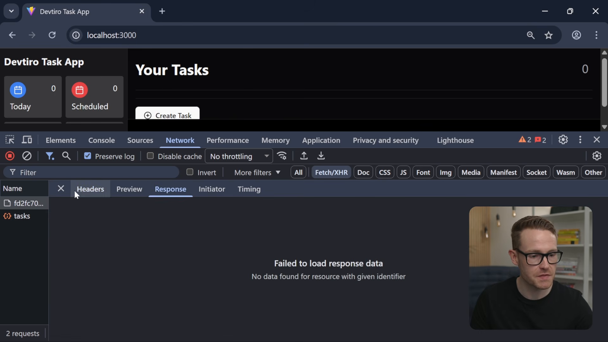

Kiểm thử tính năng xóa trên giao diện:
- Nhấp vào nút xóa của một thẻ công việc; giao diện hiển thị hộp thoại cảnh báo xác nhận xóa.
- Bấm xác nhận xóa:
  - Tab Network ghi nhận yêu cầu `DELETE /api/v1/tasks/{id}`.
  - Phản hồi trả về thành công mã `204 No Content`.
- Thẻ công việc lập tức được gỡ bỏ khỏi màn hình giao diện người dùng và bộ đếm số lượng công việc giảm đi chính xác.

### [[02:34:37](https://youtu.be/M2U4_t_PSRM?t=9277s)] Tổng kết Khóa học

Tổng kết toàn bộ chuỗi kiến trúc đã hoàn thiện: Xây dựng thành công ứng dụng CRUD hoàn chỉnh với Java và Spring Boot theo mô hình đa tầng, tích hợp JPA/Hibernate, Bean Validation, xử lý ngoại lệ tập trung, DTO Pattern và kiểm thử tương tác trực tiếp với giao diện người dùng.

---

## Trích dẫn then chốt

* "Spring Framework cung cấp các giải pháp IoC và Dependency Injection cốt lõi, trong khi Spring Boot bổ sung các cơ chế cấu hình tự động cho những bài toán kỹ thuật phổ biến nhất của nhà phát triển." — [01:13:40](https://youtu.be/M2U4_t_PSRM?t=4420s)
* "Sử dụng UUID thay vì số nguyên tự tăng mang lại khả năng định danh duy nhất trên phạm vi toàn cầu và ngăn chặn triệt để nguy cơ người dùng bên ngoài đoán được ID của các bản ghi dữ liệu khác." — [00:15:30](https://youtu.be/M2U4_t_PSRM?t=930s)
* "Mô hình DTO cho phép chúng ta tách biệt hoàn toàn mô hình dữ liệu mạng khỏi mô hình cơ sở dữ liệu nội bộ, bảo vệ cấu trúc hệ thống khỏi nguy cơ rò rỉ thông tin không mong muốn." — [01:12:10](https://youtu.be/M2U4_t_PSRM?t=4330s)
* "Chúng tôi chủ động tránh đưa trực tiếp thông điệp ngoại lệ nội bộ của hệ thống ra ngoài client nhằm ngăn chặn việc lộ lọt cấu trúc hạ tầng hoặc dữ liệu nhạy cảm." — [02:29:30](https://youtu.be/M2U4_t_PSRM?t=8970s)

---

## Lệnh & Công cụ

### Quản trị Dự án Maven & Docker

```bash
# Kiểm tra phiên bản các công cụ môi trường
mvn -version
docker --version
docker compose version

# Khởi chạy giao diện người dùng frontend bằng Docker Compose
docker compose up -d

# Biên dịch và chạy toàn bộ kiểm thử đơn vị qua Maven Wrapper
./mvnw clean test

# Đóng gói file JAR thực thi (bỏ qua kiểm thử)
./mvnw clean package -DskipTests

# Khởi chạy ứng dụng Spring Boot từ file JAR đã đóng gói
java -jar target/task-app-0.0.1-SNAPSHOT.jar
```

### Các Annotation Cốt lõi của Spring Boot

```java
// Khai báo Controller và Endpoint RESTful
@RestController
@RequestMapping(path = "/api/v1/tasks")

// Khai báo Tiêm Phụ thuộc qua Constructor cho tầng Service
@Service
public class TaskServiceImpl implements TaskService {
    private final TaskRepository taskRepository;

    public TaskServiceImpl(TaskRepository taskRepository) {
        this.taskRepository = taskRepository;
    }
}

// Khai báo Quản lý Lỗi Toàn cục
@RestControllerAdvice
public class GlobalExceptionHandler {
    @ExceptionHandler(MethodArgumentNotValidException.class)
    public ResponseEntity<ErrorDto> handleValidationExceptions(MethodArgumentNotValidException ex) {
        // Trích xuất lỗi và trả về HTTP 400 Bad Request
    }
}
```

---

## Đánh đổi & Rủi ro

| Giải pháp | Lợi ích | Đánh đổi / Rủi ro tiềm ẩn |
| :--- | :--- | :--- |
| **Sử dụng UUID làm Khóa chính** | Độc lập phân tán giữa nhiều dịch vụ, không làm lộ thứ tự tạo lập, ngăn chặn tấn công dò quét tuần tự (enumeration attack). | Kích thước khóa chính lớn hơn (128-bit so với 64-bit của Long), gây phân mảnh chỉ mục (B-Tree index fragmentation) trong cơ sở dữ liệu khi dữ liệu tăng lớn nếu không dùng UUID tuần tự (UUIDv7). |
| **Tách biệt DTO và Entity** | Ngăn chặn rò rỉ dữ liệu bảng nội bộ, giải quyết triệt để lỗi tuần hoàn JSON khi tuần tự hóa (serialization). | Tăng khối lượng mã nguồn mẫu (boilerplate code) và chi phí bảo trì các lớp ánh xạ khi cấu hình thêm bớt trường dữ liệu. |
| **Viết Mapper Thủ công** | Minh bạch 100% logic ánh xạ, dễ dàng debug từng dòng lệnh và không phụ thuộc vào thư viện bên ngoài. | Tốn công viết mã thủ công; có thể cân nhắc chuyển sang thư viện như MapStruct khi dự án mở rộng quy mô nhiều đối tượng. |
| **Xóa Trực tiếp (Hard Delete)** | Giải phóng triệt để dung lượng cơ sở dữ liệu, câu lệnh xử lý ngắn gọn (`deleteById`). | Mất vĩnh viễn dữ liệu không thể hoàn tác; trong các hệ thống doanh nghiệp thực tế, giải pháp Xóa mềm (Soft Delete) thường được ưu tiên để giữ tính toàn vẹn audit. |
