# Lập Trình Java Toàn Diện Cho Người Mới Bắt Đầu

* **Kênh:** Programming with Mosh | **Thời lượng:** 02:30:48 | **Ngày:** 2019-07-15
* **Video:** https://youtu.be/eIrMbAQSU34

---

## Thuật ngữ

| Thuật ngữ | Tiếng Anh | Giải thích |
| :--- | :--- | :--- |
| Máy ảo Java | Java Virtual Machine (JVM) | Phần mềm thực thi mã nhị phân trung gian (bytecode), chuyển đổi thành mã máy bản địa của từng hệ điều hành. |
| Bộ phát triển Java | Java Development Kit (JDK) | Bộ công cụ phát triển phần mềm gồm trình biên dịch (`javac`), thư viện chuẩn và môi trường thực thi (JRE). |
| Mã nhị phân trung gian | Bytecode | Tập lệnh độc lập nền tảng được biên dịch từ mã nguồn `.java` thành tệp `.class`. |
| Kiểu dữ liệu nguyên thủy | Primitive Types | Các kiểu dữ liệu lưu trữ trực tiếp giá trị trên ngăn xếp (stack), quản lý giá trị đơn giản (số, ký tự, luận lý). |
| Kiểu dữ liệu tham chiếu | Reference Types | Các kiểu dữ liệu trỏ tới đối tượng lưu trữ trên bộ nhớ đống (heap), biến chỉ lưu địa chỉ ô nhớ. |
| Ngăn xếp bộ nhớ | Stack Memory | Vùng bộ nhớ truy xuất nhanh, tự động dọn dẹp khi hàm kết thúc, chuyên lưu biến cục bộ và kiểu nguyên thủy. |
| Bộ nhớ đống | Heap Memory | Vùng bộ nhớ động dùng để cấp phát các đối tượng phức tạp, được thu hồi bởi bộ gom rác (Garbage Collector). |
| Tính bất biến | Immutability | Đặc tính của đối tượng không thể thay đổi trạng thái sau khi khởi tạo (ví dụ: lớp `String` trong Java). |
| Ép kiểu ngầm định | Implicit Casting (Widening) | Cơ chế chuyển đổi kiểu dữ liệu tự động sang kiểu có kích thước bộ nhớ lớn hơn mà không làm mất mát dữ liệu. |
| Ép kiểu tường minh | Explicit Casting (Narrowing) | Kỹ thuật cưỡng chế chuyển đổi kiểu dữ liệu lớn sang nhỏ, có nguy cơ tràn số hoặc mất mát phần thập phân. |
| Đọc dòng vào | Scanner | Lớp tiện ích trong gói `java.util` hỗ trợ phân tích và đọc dữ liệu từ bàn phím hoặc dòng nhập chuẩn. |
| Rút ngắn điều kiện | Short-Circuit Evaluation | Cơ chế dừng đánh giá biểu thức logic ngay khi kết quả tổng thể đã được xác định (`&&` gặp false, `||` gặp true). |

---

## Tổng luận chuyên đề

### Kiến trúc thực thi Java

Nguyên lý then chốt làm nên sự phổ biến của Java là "Viết một lần, chạy mọi nơi" (Write Once, Run Anywhere - WORA):
1. **Biên dịch độc lập nền tảng:** Lập trình viên viết mã nguồn trong các tệp `.java`. Trình biên dịch Java (`javac`) biên dịch mã nguồn thành mã nhị phân trung gian (bytecode) lưu trong tệp `.class`. Bytecode hoàn toàn độc lập với phần cứng và hệ điều hành.
2. **Thực thi qua máy ảo JVM:** Mỗi hệ điều hành (Windows, macOS, Linux) cài đặt một phiên bản JVM riêng. JVM nạp mã bytecode và chuyển dịch theo thời gian thực thành mã máy bản địa (native machine code) tương ứng của hệ điều hành đó.

### Mô hình quản lý bộ nhớ

Java phân định rõ ràng hai cơ chế lưu trữ dữ liệu trong bộ nhớ RAM:
* **Kiểu nguyên thủy (Primitive Types):** Gồm 8 kiểu (`byte`, `short`, `int`, `long`, `float`, `double`, `char`, `boolean`). Giá trị được lưu trực tiếp tại vị trí biến được khai báo trên ngăn xếp (Stack). Khi gán một biến nguyên thủy cho biến khác, Java tạo ra một bản sao giá trị hoàn toàn độc lập. Thay đổi biến này không ảnh hưởng biến kia.
* **Kiểu tham chiếu (Reference Types):** Các lớp đối tượng (ví dụ: `Date`, `String`, mảng, lớp tự tạo). Đối tượng thực tế được cấp phát trên bộ nhớ đống (Heap) bằng toán tử `new`. Biến khai báo trên Stack chỉ lưu trữ địa chỉ ô nhớ (con trỏ tham chiếu) trỏ tới đối tượng trên Heap. Khi gán hai biến tham chiếu cho nhau, cả hai biến cùng trỏ vào một vùng nhớ chung. Thay đổi dữ liệu qua một biến sẽ phản ánh ngay lập tức trên biến còn lại.

### Cấu trúc điều khiển luồng

Hệ thống điều khiển luồng trong Java phân chia thành ba nhóm trụ cột:
* **Rẽ nhánh điều kiện:** Câu lệnh `if-else` phục vụ các điều kiện logic phức tạp kết hợp toán tử quan hệ và logic; toán tử ba ngôi (`ternary`) tối ưu hóa việc gán giá trị một dòng; câu lệnh `switch` tối ưu hóa so sánh đẳng thức trên kiểu số nguyên, ký tự hoặc chuỗi.
* **Vòng lặp:** Vòng lặp `for` tối ưu cho các tác vụ biết trước số lần lặp; vòng lặp `while` phục vụ các điều kiện dừng phụ thuộc vào dữ liệu đầu vào không đoán trước; vòng lặp `for-each` cung cấp cú pháp duyệt mảng một chiều tiện lợi mà không cần chỉ số.
* **Kiểm soát vòng lặp:** Lệnh `break` lập tức nhảy khỏi vòng lặp gần nhất; lệnh `continue` bỏ qua phần còn lại của lần lặp hiện tại và chuyển sang lần lặp kế tiếp.

---

## Bóc tách chi tiết

### [[03:59](https://youtu.be/eIrMbAQSU34?t=239s)] Giải phẫu chương trình

Mosh Hamedani phân tích cấu trúc giải phẫu tối thiểu của một chương trình Java hướng đối tượng:

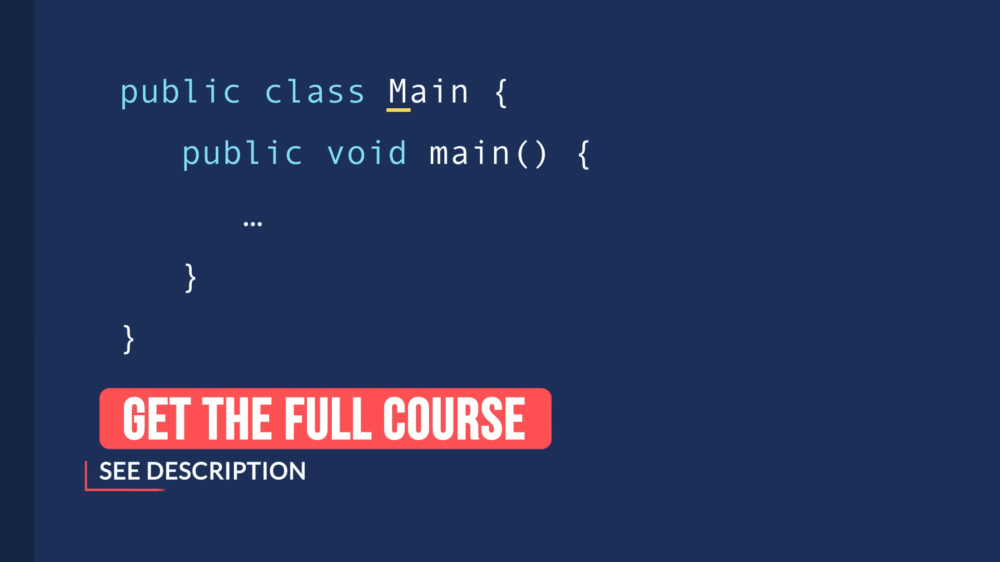

1. **Lớp (Class):** Khối xây dựng cơ bản của ứng dụng. Mọi dòng mã lệnh Java đều bắt buộc phải nằm bên trong một lớp. Tên lớp quy ước viết theo chuẩn PascalCase (viết hoa chữ cái đầu mỗi từ, ví dụ: `Main`, `OrderService`).
2. **Phương thức (Method):** Khối lệnh thực thi nhiệm vụ cụ thể, quy ước viết theo chuẩn camelCase (viết thường chữ cái đầu, ví dụ: `main`, `processPayment`).
3. **Quy ước truy cập và kiểu trả về:**
   * `public`: Công khai, cho phép các thành phần bên ngoài gói truy cập.
   * `static`: Thuộc tính tĩnh, cho phép gọi trực tiếp thông qua tên lớp mà không cần khởi tạo đối tượng.
   * `void`: Phương thức không trả về bất kỳ giá trị nào.
4. **Phương thức khởi nhập (Entry Point):**
   ```java
   public class Main {
       public static void main(String[] args) {
           // Điểm bắt đầu thực thi của mọi ứng dụng Java độc lập
       }
   }
   ```
   Hàm `main` nhận vào tham số `String[] args` chứa các đối số dòng lệnh truyền từ bên ngoài.

### [[08:41](https://youtu.be/eIrMbAQSU34?t=521s)] Chương trình đầu tiên

Xây dựng và thực thi chương trình Java đầu tiên trong IntelliJ IDEA:

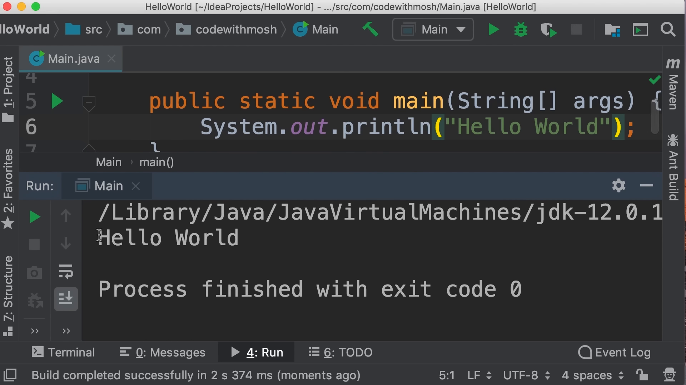

1. Triển khai lệnh in chuỗi ra dòng xuất chuẩn:
   ```java
   package com.codewithmosh;

   public class Main {
       public static void main(String[] args) {
           System.out.println("Hello World");
       }
   }
   ```
2. Phân tích các thành phần:
   * `package com.codewithmosh;`: Tuyên bố gói mã nguồn nhằm tổ chức không gian tên (namespace) tránh xung đột tên lớp.
   * `System`: Lớp hệ thống thuộc gói `java.lang`.
   * `out`: Biến tĩnh thuộc kiểu `PrintStream` đại diện cho dòng xuất chuẩn (Console).
   * `println()`: Phương thức in dữ liệu kèm theo dấu xuống dòng.

### [[16:29](https://youtu.be/eIrMbAQSU34?t=989s)] Chu trình thực thi

Cơ chế dịch chuyển từ mã nguồn bậc cao sang mã máy thông qua trung gian máy ảo JVM:

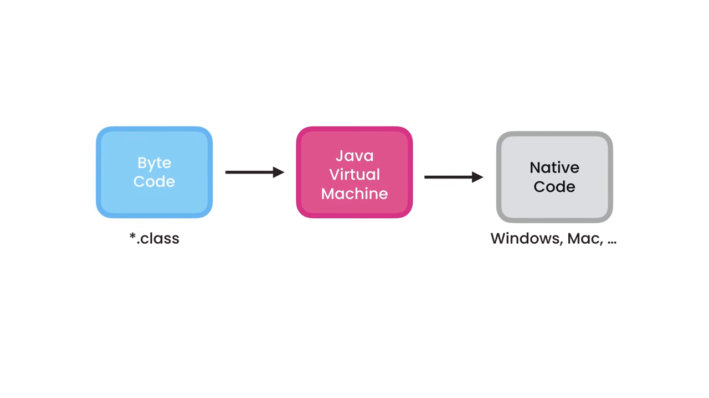

1. **Biên dịch:**
   * Mã nguồn `Main.java` được đưa qua trình biên dịch `javac`:
     ```bash
     javac Main.java
     ```
   * Trình biên dịch sinh ra tệp `Main.class` chứa mã nhị phân trung gian (Java Bytecode).
2. **Thực thi:**
   * Máy ảo Java (`java`) nạp tệp `Main.class`:
     ```bash
     java Main
     ```
   * JVM đảm nhận việc chuyển đổi các lệnh bytecode thành các chỉ thị CPU bản địa (Native Machine Code) của kiến trúc phần cứng hiện tại (x86, ARM) và thực thi.

### [[29:07](https://youtu.be/eIrMbAQSU34?t=1747s)] Kiểu dữ liệu nguyên thủy

Java cung cấp 8 kiểu dữ liệu nguyên thủy để biểu diễn số, ký tự và trạng thái logic:

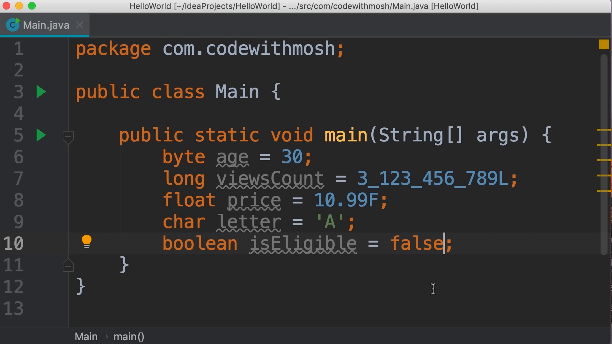

Bảng thông số kỹ thuật bộ nhớ:

| Kiểu | Kích thước | Khoảng giá trị lưu trữ | Cú pháp khởi tạo mẫu |
| :--- | :--- | :--- | :--- |
| `byte` | 1 byte (8 bits) | -128 đến 127 | `byte age = 30;` |
| `short` | 2 bytes (16 bits) | -32,768 đến 32,767 | `short count = 1000;` |
| `int` | 4 bytes (32 bits) | -2 tỷ đến 2 tỷ | `int viewsCount = 123_456_789;` |
| `long` | 8 bytes (64 bits) | -9 nghìn tỷ tỷ đến 9 nghìn tỷ tỷ | `long views = 3_123_456_789L;` |
| `float` | 4 bytes (32 bits) | Số thực dấu phẩy động 6-7 chữ số | `float price = 10.99F;` |
| `double` | 8 bytes (64 bits) | Số thực độ chính xác kép 15 chữ số | `double total = 99.99;` |
| `char` | 2 bytes (16 bits) | Ký tự Unicode đơn (đặt trong nháy đơn) | `char letter = 'A';` |
| `boolean` | 1 byte | `true` hoặc `false` | `boolean isEligible = true;` |

*Lưu ý quan trọng:* Số nguyên mặc định trong Java được hiểu là `int`, do đó khi gán số vượt quá 2 tỷ cho kiểu `long`, bắt buộc phải thêm hậu tố `L` hoặc `l`. Tương tự, số thực mặc định là `double`, nên kiểu `float` bắt buộc phải gắn hậu tố `F` hoặc `f`. Dấu gạch dưới `_` được dùng để phân cách hàng nghìn giúp dễ đọc mà không ảnh hưởng giá trị số.

### [[34:27](https://youtu.be/eIrMbAQSU34?t=2067s)] Kiểu dữ liệu tham chiếu

Kiểu dữ liệu tham chiếu dùng để lưu trữ các đối tượng phức tạp có trạng thái và hành vi:

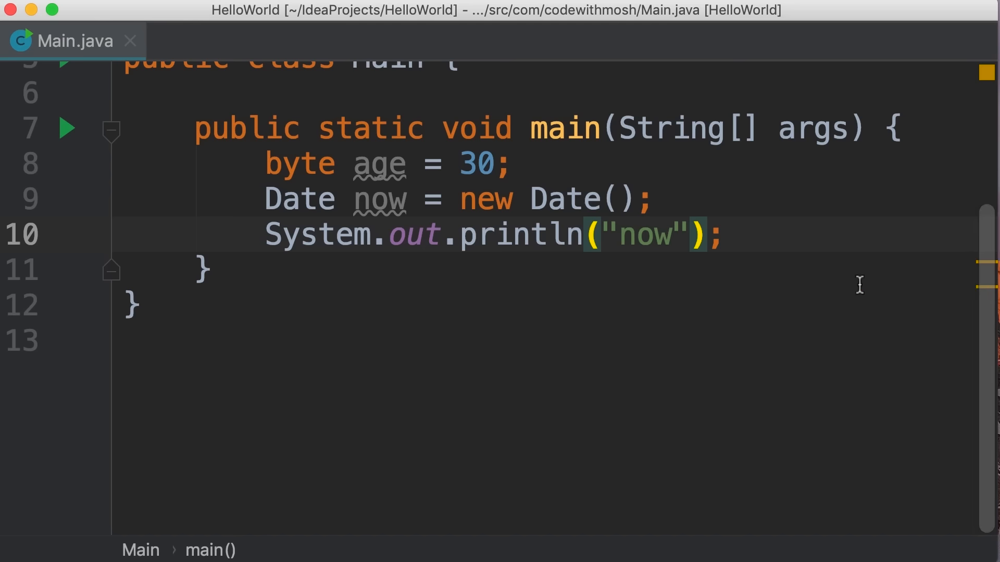

1. Cú pháp khởi tạo đối tượng bằng toán tử `new`:
   ```java
   import java.util.Date;

   public class Main {
       public static void main(String[] args) {
           byte age = 30;
           Date now = new Date();
           System.out.println(now);
       }
   }
   ```
2. Phân tích vận hành:
   * Biến `now` là một thể hiện (instance) của lớp `Date`.
   * Toán tử `new` cấp phát một vùng nhớ mới trên bộ nhớ đống (Heap) để chứa đối tượng `Date`, sau đó trả về địa chỉ ô nhớ gán cho biến `now`.
   * Các đối tượng tham chiếu sở hữu các thành phần trường dữ liệu và phương thức thao tác có thể truy xuất qua toán tử chấm (`now.getTime()`).

### [[39:15](https://youtu.be/eIrMbAQSU34?t=2355s)] So sánh cơ chế bộ nhớ

Phân tích sự khác biệt căn bản giữa việc sao chép giá trị nguyên thủy và sao chép tham chiếu đối tượng:

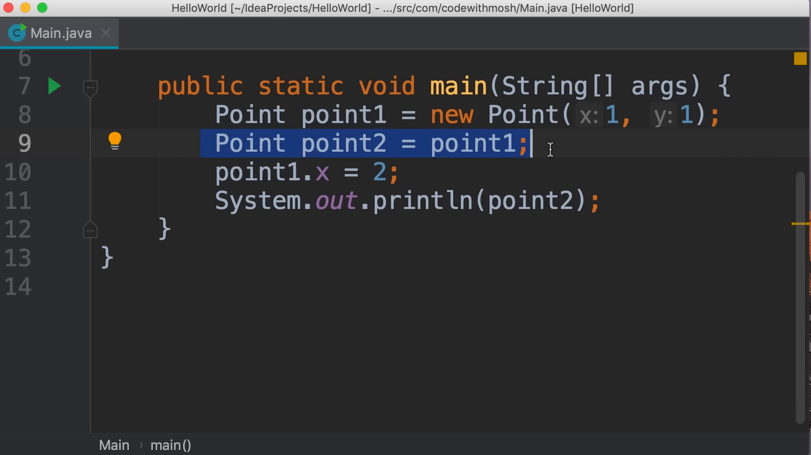

1. **Với kiểu nguyên thủy (sao chép theo giá trị):**
   ```java
   byte x = 1;
   byte y = x;
   x = 2;
   System.out.println(y); // In ra 1 (y hoàn toàn độc lập với x)
   ```
2. **Với kiểu tham chiếu (sao chép theo địa chỉ con trỏ):**
   ```java
   import java.awt.Point;

   public class Main {
       public static void main(String[] args) {
           Point point1 = new Point(1, 1);
           Point point2 = point1;
           point1.x = 2;
           System.out.println(point2); // In ra java.awt.Point[x=2,y=1]
       }
   }
   ```
   Cả `point1` và `point2` cùng lưu một địa chỉ ô nhớ trỏ tới duy nhất một đối tượng `Point` trên Heap. Mọi thao tác biến đổi thuộc tính thông qua `point1` đều làm thay đổi dữ liệu mà `point2` đang tham chiếu tới.

### [[43:39](https://youtu.be/eIrMbAQSU34?t=2619s)] Thao tác chuỗi

Lớp `String` trong Java là một kiểu tham chiếu đặc biệt sở hữu tính bất biến (Immutability):

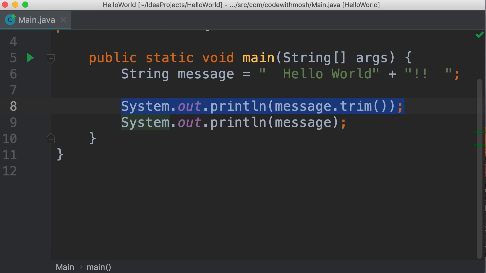

1. Khởi tạo chuỗi bằng cú pháp rút gọn (String Literal):
   ```java
   String message = "Hello World" + "!!";
   ```
2. Các phương thức xử lý chuỗi thông dụng:
   * `message.endsWith("!!")`: Kiểm tra chuỗi kết thúc (trả về `true`).
   * `message.startsWith("H")`: Kiểm tra chuỗi bắt đầu (trả về `true`).
   * `message.length()`: Trả về độ dài chuỗi ký tự.
   * `message.indexOf("e")`: Tìm chỉ số xuất hiện đầu tiên của ký tự/chuỗi con (trả về `1`, nếu không tìm thấy trả về `-1`).
   * `message.replace("!", "*")`: Thay thế ký tự. *Lưu ý:* Do tính bất biến, hàm `replace` không thay đổi chuỗi `message` gốc mà sinh ra và trả về một chuỗi `String` hoàn toàn mới trong bộ nhớ.
   * `message.toLowerCase()` và `message.toUpperCase()`: Chuyển đổi định dạng chữ.
   * `message.trim()`: Loại bỏ khoảng trắng thừa ở hai đầu chuỗi.

### [[50:42](https://youtu.be/eIrMbAQSU34?t=3042s)] Ký tự thoát

Sử dụng ký tự thoát (`\`) để chèn các ký tự đặc biệt vào chuỗi văn bản:
* `\"`: Chèn dấu nháy kép vào chuỗi (`"Hello \"Mosh\""`).
* `\\`: Chèn dấu gạch chéo ngược (`"c:\\Windows\\..."`).
* `\n`: Xuống dòng mới (Newline).
* `\t`: Thụt đầu dòng (Tab).

### [[53:22](https://youtu.be/eIrMbAQSU34?t=3202s)] Mảng một chiều

Mảng trong Java là một kiểu tham chiếu lưu trữ tập hợp các phần tử cùng kiểu dữ liệu với kích thước cố định:

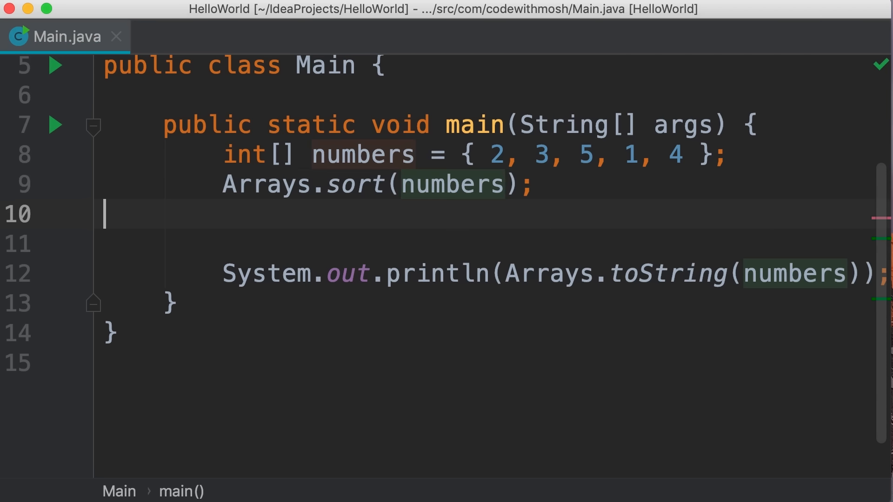

1. Khởi tạo mảng có độ dài xác định:
   ```java
   int[] numbers = new int[5];
   numbers[0] = 1;
   numbers[1] = 2;
   ```
2. Khởi tạo mảng biết trước phần tử:
   ```java
   int[] numbers = { 2, 3, 5, 1, 4 };
   ```
3. Thao tác trên mảng thông qua lớp tiện ích `java.util.Arrays`:
   * `System.out.println(numbers)`: Chỉ in ra định danh địa chỉ băm ô nhớ của mảng (ví dụ: `[I@1b6d3586`).
   * `Arrays.toString(numbers)`: Chuyển toàn bộ phần tử trong mảng thành chuỗi hiển thị `[1, 2, 3, 4, 5]`.
   * `Arrays.sort(numbers)`: Sắp xếp các phần tử trong mảng theo thứ tự tăng dần trực tiếp.
   * `numbers.length`: Thuộc tính lấy độ dài mảng (mảng trong Java không thể tự động co giãn kích thước sau khi khởi tạo).

### [[58:47](https://youtu.be/eIrMbAQSU34?t=3527s)] Mảng đa chiều

Sử dụng mảng đa chiều để biểu diễn ma trận hoặc bảng dữ liệu:

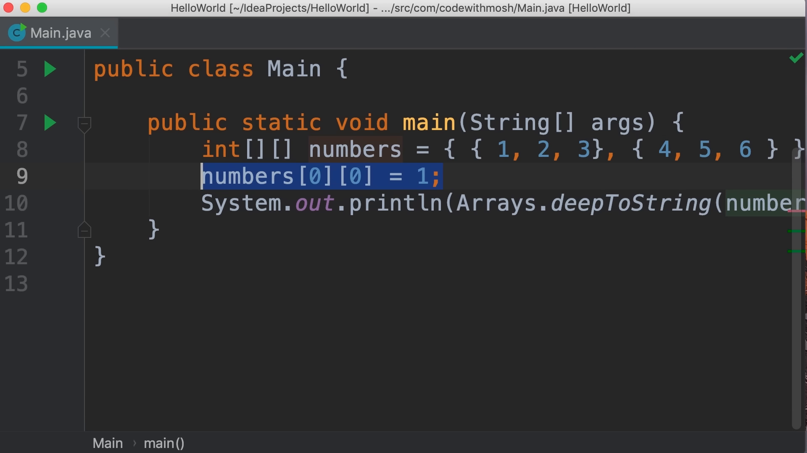

1. Cú pháp khai báo và khởi tạo ma trận 2x3:
   ```java
   import java.util.Arrays;

   public class Main {
       public static void main(String[] args) {
           int[][] numbers = { { 1, 2, 3 }, { 4, 5, 6 } };
           System.out.println(Arrays.deepToString(numbers));
       }
   }
   ```
2. *Lưu ý kỹ thuật:* Đối với mảng đa chiều, phương thức `Arrays.toString()` chỉ in ra địa chỉ băm của các mảng con. Bắt buộc phải sử dụng `Arrays.deepToString()` để duyệt đệ quy và hiển thị trọn vẹn giá trị các phần tử bên trong.

### [[61:23](https://youtu.be/eIrMbAQSU34?t=3683s)] Hằng số

Sử dụng từ khóa `final` để khai báo biến bất biến (hằng số):
```java
final float PI = 3.14F;
```
Quy ước đặt tên hằng số trong Java là viết hoa toàn bộ các ký tự, phân cách bằng dấu gạch dưới (UPPER_SNAKE_CASE). Mọi thao tác gán lại giá trị cho biến `final` sẽ bị trình biên dịch chặn lại ngay tại thời điểm biên dịch.

### [[63:15](https://youtu.be/eIrMbAQSU34?t=3795s)] Biểu thức số học

Các toán tử số học cơ bản: `+`, `-`, `*`, `/`, `%` (chia lấy phần dư).
* Phép chia số nguyên:
  ```java
  int result = 10 / 3; // Kết quả là 3 (phần thập phân bị cắt bỏ hoàn toàn)
  double accurate = (double) 10 / (double) 3; // Kết quả là 3.3333333333333335
  ```
* Toán tử tăng giảm:
  * Tiền tố (`++x`): Tăng giá trị của `x` lên 1 trước rồi mới sử dụng trong biểu thức.
  * Hậu tố (`x++`): Sử dụng giá trị hiện tại của `x` trong biểu thức trước rồi mới tăng `x` lên 1.
* Thứ tự ưu tiên toán tử: Dấu ngoặc đơn `()` -> Nhân/Chia `*`, `/` -> Cộng/Trừ `+`, `-`.

### [[68:40](https://youtu.be/eIrMbAQSU34?t=4120s)] Chuyển đổi và ép kiểu

Cơ chế chuyển đổi kiểu dữ liệu giữa các số và phân tích chuỗi văn bản:

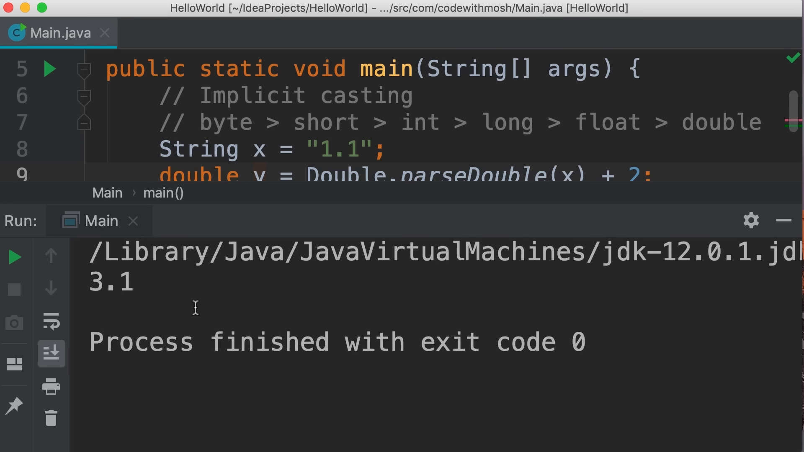

1. **Ép kiểu ngầm định (Implicit Casting):**
   * Xảy ra tự động khi chuyển từ kiểu có kích thước nhỏ sang kiểu lớn hơn mà không làm mất mát thông tin:
     `byte` -> `short` -> `int` -> `long` -> `float` -> `double`
     ```java
     short x = 1;
     int y = x + 2; // x tự động được nâng cấp lên kiểu int trước khi cộng
     ```
2. **Ép kiểu tường minh (Explicit Casting):**
   * Bắt buộc sử dụng cú pháp `(targetType)` khi chuyển từ kiểu lớn sang kiểu nhỏ hơn:
     ```java
     double x = 1.1;
     int y = (int) x + 2; // x bị cắt bỏ phần thập phân còn 1, y = 3
     ```
3. **Phân tích kiểu từ chuỗi văn bản (Parsing):**
   * Ép kiểu thông thường không áp dụng được giữa chuỗi `String` và số. Phải sử dụng các lớp bao bọc (Wrapper Classes):
     ```java
     String x = "1";
     int y = Integer.parseInt(x) + 2; // y = 3
     double z = Double.parseDouble("1.1"); // z = 1.1
     ```

### [[79:50](https://youtu.be/eIrMbAQSU34?t=4790s)] Định dạng số liệu

Sử dụng lớp trừu tượng `java.text.NumberFormat` để định dạng tiền tệ hoặc tỷ lệ phần trăm theo chuẩn quốc tế:

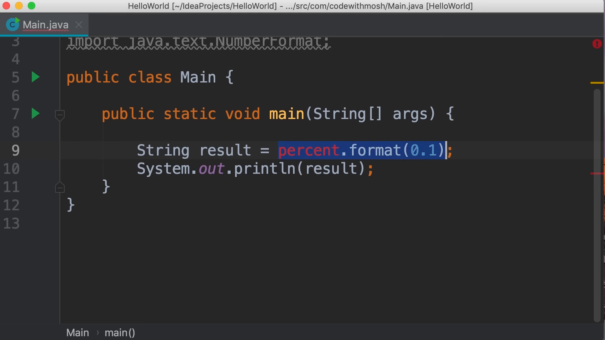

1. Định dạng tiền tệ:
   ```java
   import java.text.NumberFormat;

   NumberFormat currency = NumberFormat.getCurrencyInstance();
   String result = currency.format(1234567.891);
   System.out.println(result); // In ra: $1,234,567.89 (theo chuẩn Locale của máy)
   ```
2. Định dạng phần trăm kết hợp chuỗi phương thức (Method Chaining):
   ```java
   String percent = NumberFormat.getPercentInstance().format(0.1);
   System.out.println(percent); // In ra: 10%
   ```

### [[85:40](https://youtu.be/eIrMbAQSU34?t=5140s)] Nhập xuất bàn phím

Đọc dữ liệu người dùng nhập từ bàn phím thông qua lớp `java.util.Scanner`:

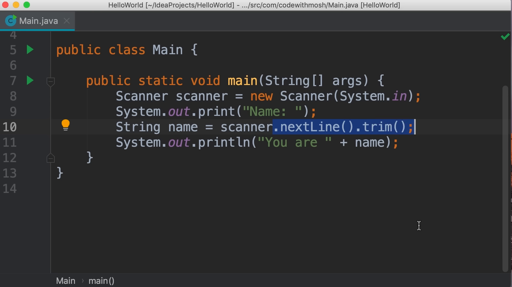

1. Đọc số nguyên:
   ```java
   Scanner scanner = new Scanner(System.in);
   System.out.print("Age: ");
   byte age = scanner.nextByte();
   System.out.println("You are " + age);
   ```
2. Phân biệt `scanner.next()` và `scanner.nextLine()` khi đọc chuỗi:
   * `scanner.next()`: Chỉ đọc chuỗi ký tự đầu tiên cho đến khi gặp khoảng trắng (Tokens). Nếu người dùng nhập `"Mosh Hamedani"`, nó chỉ lấy `"Mosh"`.
   * `scanner.nextLine()`: Đọc toàn bộ chuỗi ký tự trên dòng nhập cho đến khi gặp phím Enter (kèm phương thức `trim()` để gọt khoảng trắng thừa).

### [[92:55](https://youtu.be/eIrMbAQSU34?t=5575s)] Dự án: Máy tính khoản vay

Hiện thực công thức toán tài chính tính tiền trả góp hàng tháng cho khoản vay mua nhà (Mortgage):

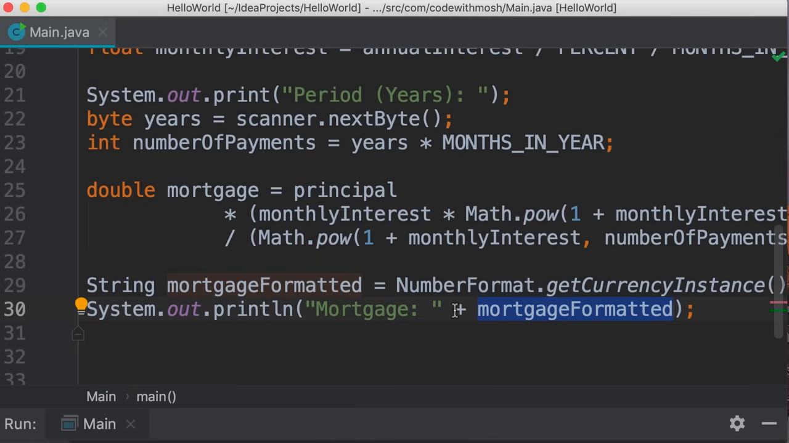

**Công thức toán học:**
$$M = P \times \frac{r(1 + r)^n}{(1 + r)^n - 1}$$
* $M$: Khoản tiền trả góp hàng tháng (Mortgage).
* $P$: Số tiền vay gốc (Principal).
* $r$: Lãi suất hàng tháng (Lãi suất hàng năm chia cho 100 rồi chia cho 12 tháng).
* $n$: Tổng số tháng phải trả (Số năm nhân với 12 tháng).

**Mã nguồn hoàn chỉnh phiên bản 1:**
```java
package com.codewithmosh;

import java.text.NumberFormat;
import java.util.Scanner;

public class Main {
    public static void main(String[] args) {
        final byte MONTHS_IN_YEAR = 12;
        final byte PERCENT = 100;

        Scanner scanner = new Scanner(System.in);

        System.out.print("Principal: ");
        int principal = scanner.nextInt();

        System.out.print("Annual Interest Rate: ");
        float annualInterest = scanner.nextFloat();
        float monthlyInterest = annualInterest / PERCENT / MONTHS_IN_YEAR;

        System.out.print("Period (Years): ");
        byte years = scanner.nextByte();
        int numberOfPayments = years * MONTHS_IN_YEAR;

        double mortgage = principal
                * (monthlyInterest * Math.pow(1 + monthlyInterest, numberOfPayments))
                / (Math.pow(1 + monthlyInterest, numberOfPayments) - 1);

        String mortgageFormatted = NumberFormat.getCurrencyInstance().format(mortgage);
        System.out.println("Mortgage: " + mortgageFormatted);
    }
}
```

### [[101:16](https://youtu.be/eIrMbAQSU34?t=6076s)] Toán tử luận lý

Kết hợp nhiều điều kiện logic bằng các toán tử `&&` (VÀ), `||` (HOẶC) và `!` (PHỦ ĐỊNH):

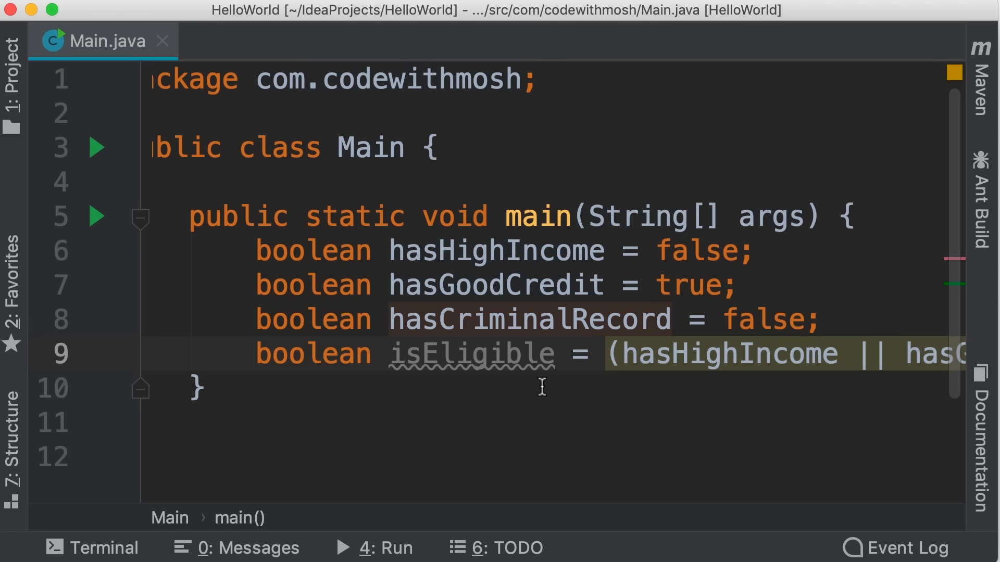

1. Cơ chế rút ngắn điều kiện (Short-Circuit Evaluation):
   * Trong biểu thức `A && B`: Nếu `A` nhận giá trị `false`, Java lập tức kết luận cả biểu thức là `false` mà không cần duyệt kiểm tra `B`.
   * Trong biểu thức `A || B`: Nếu `A` nhận giá trị `true`, Java lập tức kết luận biểu thức là `true`.
2. Thứ tự ưu tiên: Phủ định `!` được tính trước, kế tiếp là phép toán so sánh quan hệ, tiếp theo là phép VÀ `&&`, và cuối cùng là phép HOẶC `||`.

### [[110:18](https://youtu.be/eIrMbAQSU34?t=6618s)] Đơn giản hóa điều kiện

Quy tắc viết mã sạch (Clean Code) khi xử lý các cấu trúc rẽ nhánh trả về boolean:

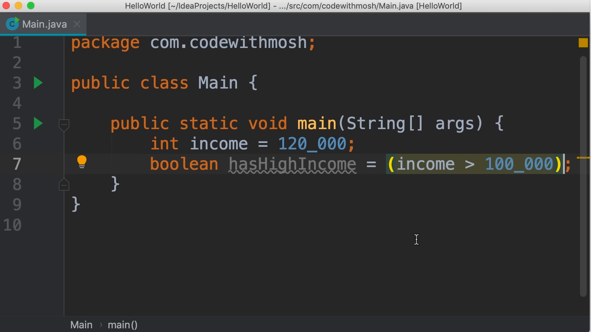

* **Cách viết nghiệp dư ban đầu:**
  ```java
  int income = 120_000;
  boolean hasHighIncome;
  if (income > 100_000)
      hasHighIncome = true;
  else
      hasHighIncome = false;
  ```
* **Cách viết chuẩn hóa tối ưu:**
  ```java
  int income = 120_000;
  boolean hasHighIncome = (income > 100_000);
  ```
  Biểu thức so sánh `(income > 100_000)` bản thân nó đã trả về giá trị kiểu `boolean`, do đó gán trực tiếp kết quả vào biến mà không cần sử dụng bất kỳ khối lệnh `if-else` nào.

### [[113:47](https://youtu.be/eIrMbAQSU34?t=6827s)] Toán tử ba ngôi

Sử dụng toán tử điều kiện ba ngôi (`? :`) để thu gọn câu lệnh gán:

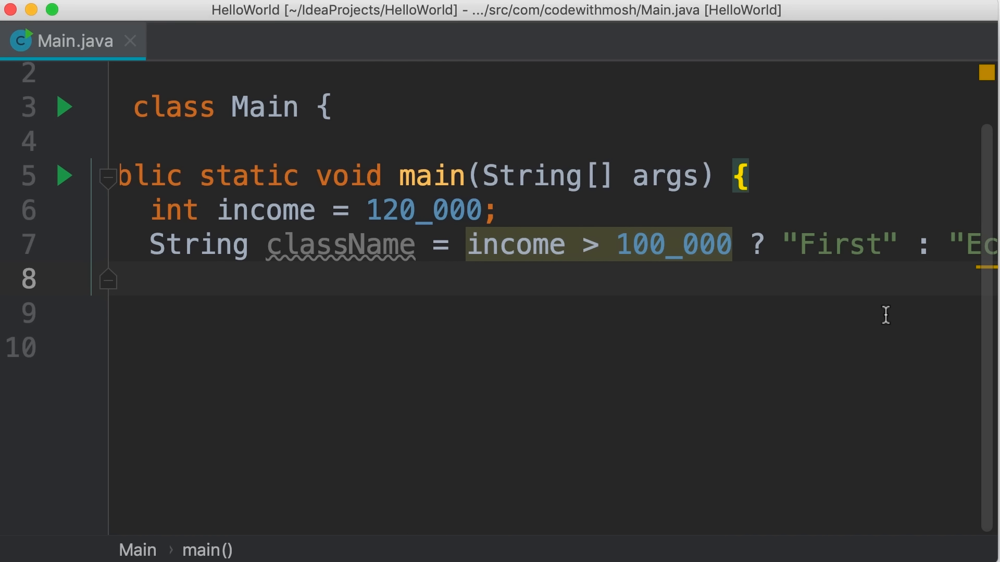

```java
int income = 120_000;
String className = (income > 100_000) ? "First" : "Economy";
```
Cú pháp: `biểu_thức_điều_kiện ? giá_trị_nếu_đúng : giá_trị_nếu_sai;`

### [[116:16](https://youtu.be/eIrMbAQSU34?t=6976s)] Cấu trúc rẽ nhánh Switch

Sử dụng câu lệnh `switch` khi cần so sánh bình đẳng một biến đơn lẻ với nhiều giá trị xác định:

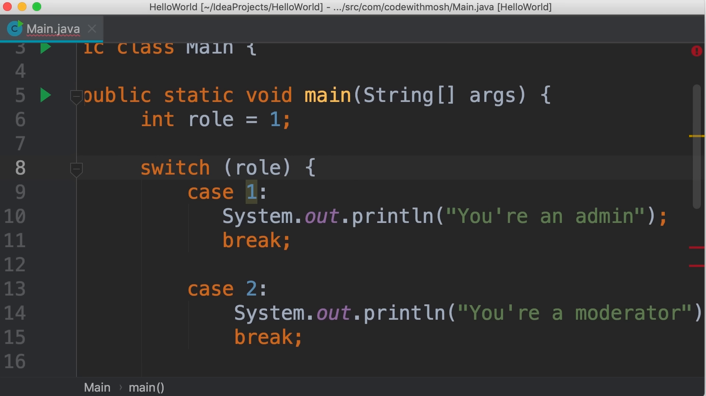

```java
String role = "admin";

switch (role) {
    case "admin":
        System.out.println("You're an admin");
        break;
    case "moderator":
        System.out.println("You're a moderator");
        break;
    default:
        System.out.println("You're a guest");
}
```
*Lưu ý cốt tử:* Bắt buộc phải có từ khóa `break` ở cuối mỗi nhánh `case`. Nếu thiếu `break`, luồng thực thi sẽ tiếp tục rơi xuống và thực hiện tất cả các nhánh lệnh bên dưới bất chấp điều kiện (hiện tượng Fall-through).

### [[120:07](https://youtu.be/eIrMbAQSU34?t=7207s)] Bài tập: Thuật toán FizzBuzz

Bài tập kiểm tra tư duy lập trình kinh điển FizzBuzz:
* Nếu số chia hết cho 5: in `"Fizz"`.
* Nếu số chia hết cho 3: in `"Buzz"`.
* Nếu số chia hết cho cả 5 và 3: in `"FizzBuzz"`.
* Các trường hợp còn lại: in lại chính số đó.

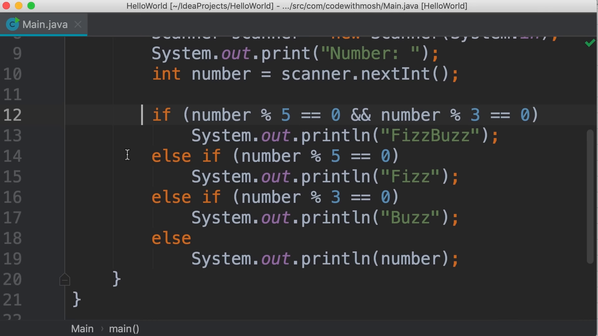

**Mã nguồn tối ưu xử lý thứ tự ưu tiên:**
```java
package com.codewithmosh;

import java.util.Scanner;

public class Main {
    public static void main(String[] args) {
        Scanner scanner = new Scanner(System.in);
        System.out.print("Number: ");
        int number = scanner.nextInt();

        if (number % 5 == 0 && number % 3 == 0)
            System.out.println("FizzBuzz");
        else if (number % 5 == 0)
            System.out.println("Fizz");
        else if (number % 3 == 0)
            System.out.println("Buzz");
        else
            System.out.println(number);
    }
}
```
*Quy tắc logic:* Điều kiện cụ thể và hẹp nhất (`number % 5 == 0 && number % 3 == 0` hoặc `number % 15 == 0`) bắt buộc phải được đặt lên đầu tiên. Nếu đặt điều kiện chia hết cho 5 hoặc 3 lên trước, các số như 15 sẽ bị nuốt vào nhánh đầu và không bao giờ chạm được tới nhánh `"FizzBuzz"`.

### [[129:53](https://youtu.be/eIrMbAQSU34?t=7793s)] Vòng lặp kiểm tra trước

Vận hành vòng lặp `while` khi số lần lặp phụ thuộc hoàn toàn vào hành vi người dùng:

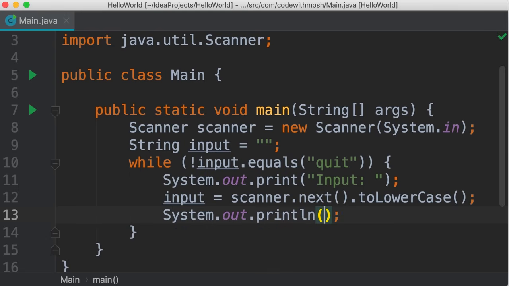

```java
package com.codewithmosh;

import java.util.Scanner;

public class Main {
    public static void main(String[] args) {
        Scanner scanner = new Scanner(System.in);
        String input = "";

        while (!input.equals("quit")) {
            System.out.print("Input: ");
            input = scanner.next().toLowerCase();
            if (input.equals("pass"))
                continue;
            if (input.equals("quit"))
                break;
            System.out.println(input);
        }
    }
}
```
*Lưu ý kỹ thuật:*
* Tuyệt đối không dùng toán tử so sánh `input != "quit"` vì toán tử `!=` so sánh địa chỉ ô nhớ của hai chuỗi tham chiếu. Bắt buộc phải sử dụng phương thức `!input.equals("quit")` để so sánh nội dung ký tự.
* Tạo đối tượng `Scanner` bên ngoài vòng lặp để tránh việc khởi tạo và cấp phát lãng phí nhiều đối tượng không cần thiết.

### [[138:52](https://youtu.be/eIrMbAQSU34?t=8332s)] Vòng lặp từng phần tử

Sử dụng vòng lặp `for-each` để duyệt qua toàn bộ các phần tử trong một mảng hoặc bộ sưu tập:

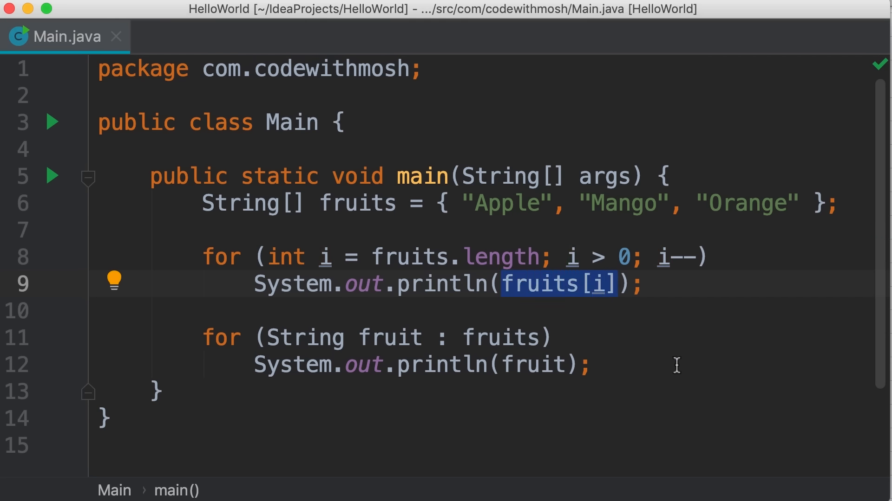

```java
String[] fruits = { "Apple", "Mango", "Orange" };

for (String fruit : fruits)
    System.out.println(fruit);
```
*Đánh đổi:* Vòng lặp `for-each` giúp mã nguồn gọn gàng, nhưng không cung cấp chỉ số index của phần tử và chỉ có thể duyệt xuôi từ đầu đến cuối mảng. Khi cần chỉ số hoặc duyệt ngược, bắt buộc phải dùng vòng lặp `for` truyền thống.

### [[143:27](https://youtu.be/eIrMbAQSU34?t=8607s)] Hoàn thiện ứng dụng tính vay

Tái cấu trúc và nâng cấp ứng dụng tính toán khoản vay Mortgage Calculator với cơ chế kiểm soát dữ liệu đầu vào (Input Validation) bằng vòng lặp vô hạn `while (true)`:

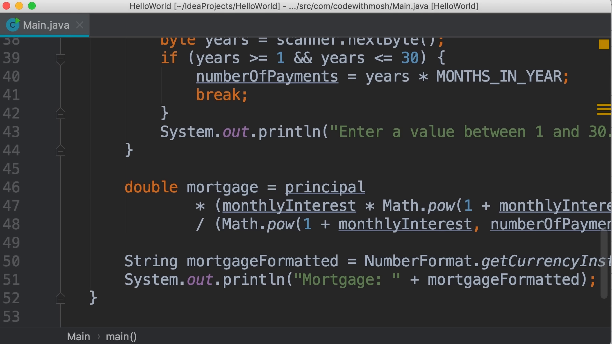

**Mã nguồn hoàn chỉnh phiên bản 2 (Bảo vệ lỗi nhập liệu):**
```java
package com.codewithmosh;

import java.text.NumberFormat;
import java.util.Scanner;

public class Main {
    public static void main(String[] args) {
        final byte MONTHS_IN_YEAR = 12;
        final byte PERCENT = 100;

        int principal = 0;
        float monthlyInterest = 0;
        int numberOfPayments = 0;

        Scanner scanner = new Scanner(System.in);

        // Kiểm tra tiền vay gốc: $1,000 - $1,000,000
        while (true) {
            System.out.print("Principal ($1K - $1M): ");
            principal = scanner.nextInt();
            if (principal >= 1000 && principal <= 1_000_000)
                break;
            System.out.println("Enter a number between 1,000 and 1,000,000.");
        }

        // Kiểm tra lãi suất năm: > 0 và <= 30%
        while (true) {
            System.out.print("Annual Interest Rate: ");
            float annualInterest = scanner.nextFloat();
            if (annualInterest > 0 && annualInterest <= 30) {
                monthlyInterest = annualInterest / PERCENT / MONTHS_IN_YEAR;
                break;
            }
            System.out.println("Enter a value greater than 0 and less than or equal to 30.");
        }

        // Kiểm tra thời hạn vay: 1 - 30 năm
        while (true) {
            System.out.print("Period (Years): ");
            byte years = scanner.nextByte();
            if (years >= 1 && years <= 30) {
                numberOfPayments = years * MONTHS_IN_YEAR;
                break;
            }
            System.out.println("Enter a value between 1 and 30.");
        }

        // Tính toán công thức
        double mortgage = principal
                * (monthlyInterest * Math.pow(1 + monthlyInterest, numberOfPayments))
                / (Math.pow(1 + monthlyInterest, numberOfPayments) - 1);

        String mortgageFormatted = NumberFormat.getCurrencyInstance().format(mortgage);
        System.out.println("Mortgage: " + mortgageFormatted);
    }
}
```

---

## Trích dẫn then chốt

* [[16:48](https://youtu.be/eIrMbAQSU34?t=1008s)] *"Java source code is compiled into Java Bytecode, which is platform-independent. The Java Virtual Machine then translates that bytecode into machine code for the underlying platform."*
  (Mã nguồn Java được biên dịch thành Java Bytecode độc lập với nền tảng. Sau đó, Máy ảo Java chuyển dịch mã bytecode đó thành mã máy tương thích với hệ điều hành bên dưới.)

* [[41:20](https://youtu.be/eIrMbAQSU34?t=2480s)] *"Primitive types are copied by their value, completely independent of each other. Reference types are copied by their reference, pointing to the exact same object on the heap."*
  (Các kiểu dữ liệu nguyên thủy được sao chép theo giá trị, hoàn toàn độc lập với nhau. Các kiểu dữ liệu tham chiếu được sao chép theo tham chiếu, cùng trỏ tới chính xác một đối tượng duy nhất trên bộ nhớ đống.)

* [[46:15](https://youtu.be/eIrMbAQSU34?t=2775s)] *"Strings in Java are immutable. Any method that appears to modify a string actually creates and returns a brand new string object in memory."*
  (Chuỗi văn bản trong Java là bất biến. Bất kỳ phương thức nào có vẻ như làm biến đổi chuỗi thực chất đều tạo mới và trả về một đối tượng chuỗi hoàn toàn độc lập trong bộ nhớ.)

* [[132:15](https://youtu.be/eIrMbAQSU34?t=7935s)] *"Never use the equality operator (==) to compare reference types like strings, because it compares memory addresses. Always use the equals() method to compare their contents."*
  (Tuyệt đối không sử dụng toán tử so sánh bằng (==) để so sánh các kiểu dữ liệu tham chiếu như chuỗi, bởi vì nó so sánh địa chỉ ô nhớ. Luôn luôn sử dụng phương thức equals() để so sánh nội dung của chúng.)

* [[149:30](https://youtu.be/eIrMbAQSU34?t=8970s)] *"Any fool can write code that a computer can understand. Good programmers write code that humans can understand."*
  (Bất kỳ kẻ ngốc nào cũng có thể viết ra đoạn mã mà máy tính hiểu được. Lập trình viên giỏi là người viết ra đoạn mã mà con người có thể thấu hiểu.)

---

## Lệnh & Công cụ

### Lệnh biên dịch dòng lệnh

```bash
# Biên dịch tệp mã nguồn Java thành tệp Bytecode .class
javac Main.java

# Thực thi tệp Bytecode thông qua máy ảo JVM
java Main

# Biên dịch toàn bộ gói mã nguồn
javac com/codewithmosh/*.java
```

### Bảng tra cứu Scanner thông dụng

```java
Scanner scanner = new Scanner(System.in);

byte b = scanner.nextByte();       // Đọc số kiểu byte
int i = scanner.nextInt();         // Đọc số kiểu int
double d = scanner.nextDouble();   // Đọc số thực kiểu double
String s = scanner.next();         // Đọc từ đơn đầu tiên
String line = scanner.nextLine();  // Đọc nguyên dòng văn bản
```

---

## Đánh đổi & Rủi ro

| Thành phần kỹ thuật | Lợi ích mang lại | Rủi ro tiềm ẩn | Biện pháp kiểm soát |
| :--- | :--- | :--- | :--- |
| **Kiểu tham chiếu (Reference)** | Quản lý dữ liệu phức tạp linh hoạt, truyền đối tượng qua hàm không tốn chi phí copy toàn bộ bộ nhớ. | Tác dụng phụ ngoài ý muốn (Side Effects) khi nhiều biến cùng thay đổi chung một đối tượng trên Heap. | Áp dụng nguyên lý đóng gói (Encapsulation), sử dụng các đối tượng bất biến (Immutable Objects) hoặc clone dữ liệu khi cần. |
| **Tính bất biến của String** | An toàn luồng (Thread-safe), tối ưu bộ nhớ thông qua String Constant Pool. | Tạo ra rác bộ nhớ lớn nếu nối chuỗi liên tục trong vòng lặp lớn bằng toán tử `+`. | Sử dụng `StringBuilder` hoặc `StringBuffer` khi thực hiện các tác vụ nối chuỗi phức tạp trong vòng lặp. |
| **Ép kiểu tường minh** | Chuyển đổi dữ liệu linh hoạt khi cần tính toán giữa các kiểu khác nhau. | Mất mát dữ liệu (Data Loss) do cắt phần thập phân hoặc tràn số (Integer Overflow) nếu số lớn ép về kiểu nhỏ. | Luôn kiểm tra khoảng giá trị của biến trước khi thực hiện ép kiểu thu hẹp (Narrowing Primitive Conversion). |
| **Vòng lặp vô hạn `while(true)`** | Kiểm tra và chặn dữ liệu nhập sai cho đến khi người dùng nhập đúng chuẩn. | Dễ dẫn đến treo ứng dụng vĩnh viễn (Infinite Loop) nếu không thiết lập điểm thoát `break` chính xác. | Đảm bảo mọi nhánh điều kiện thỏa mãn đều chứa lệnh `break` hoặc điều kiện thoát rõ ràng. |
