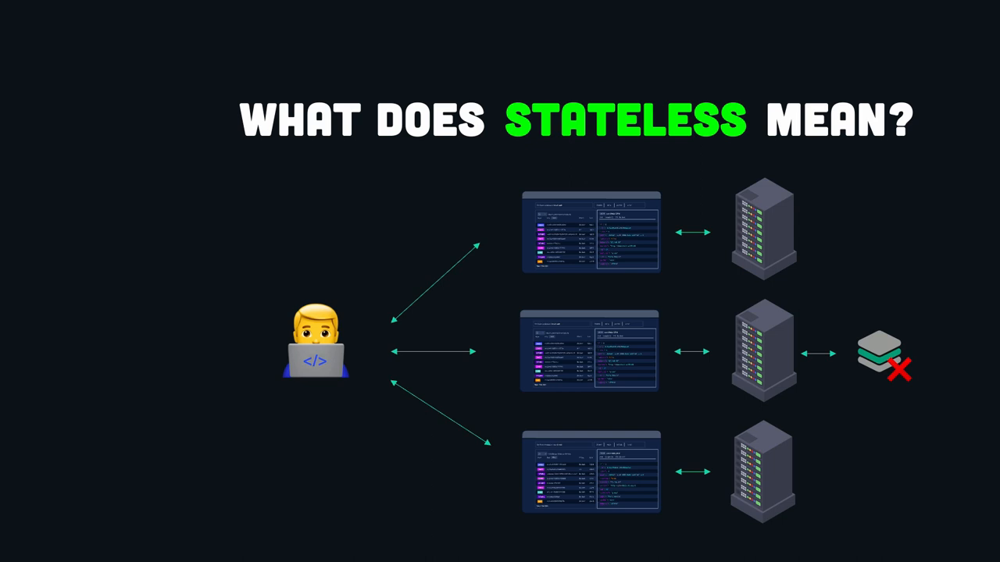
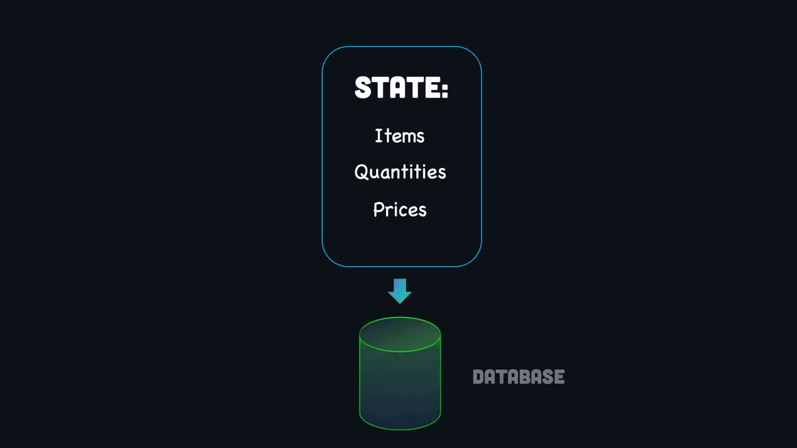
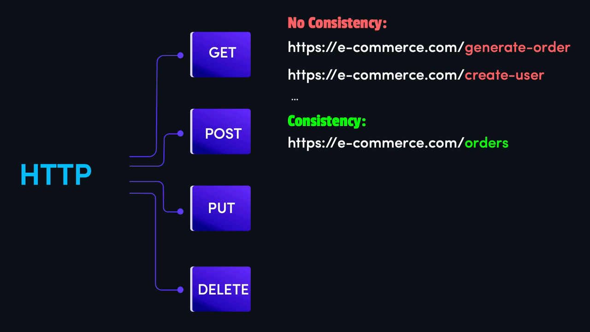
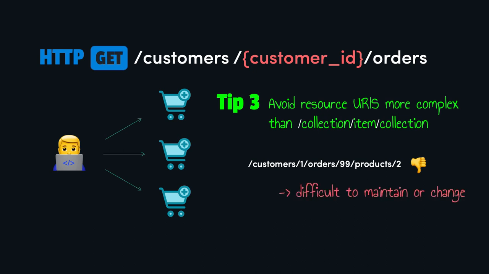
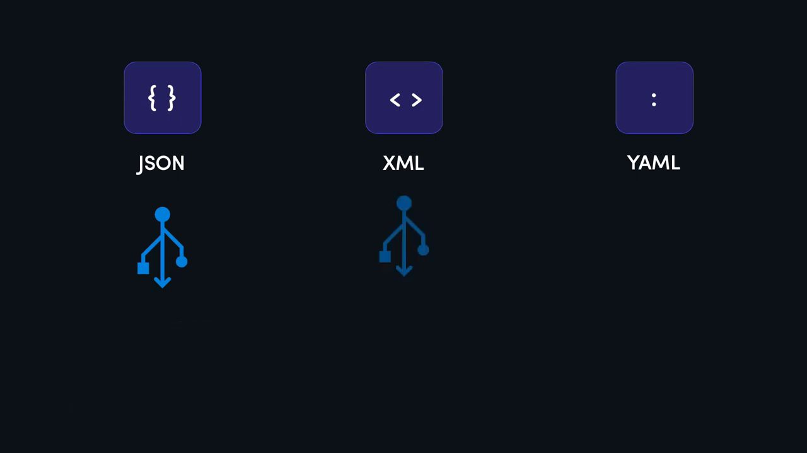
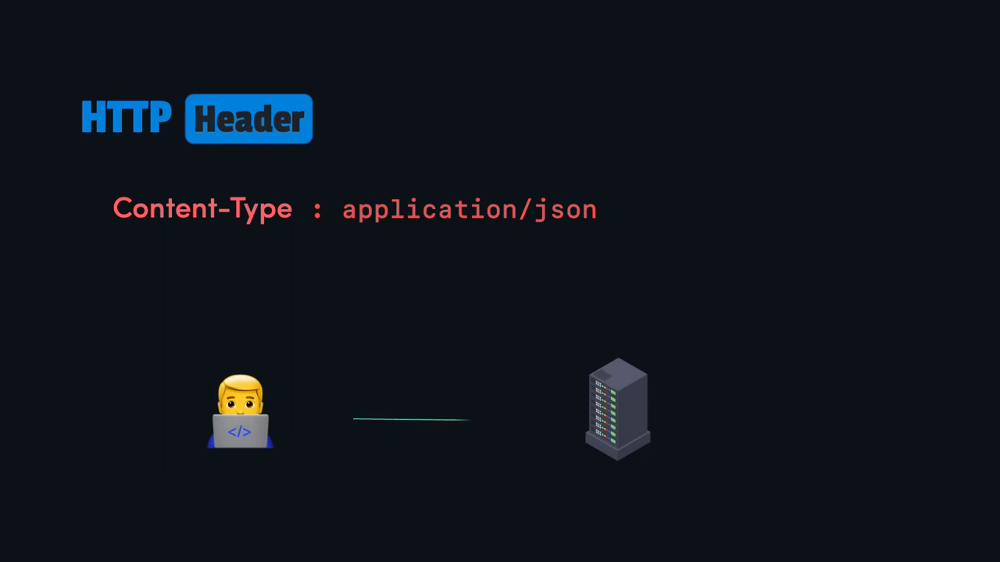
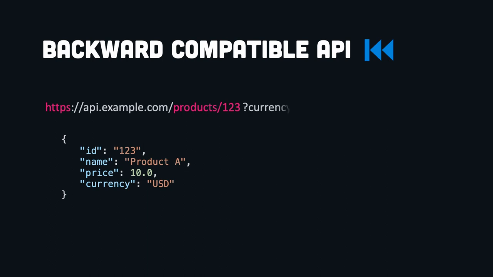
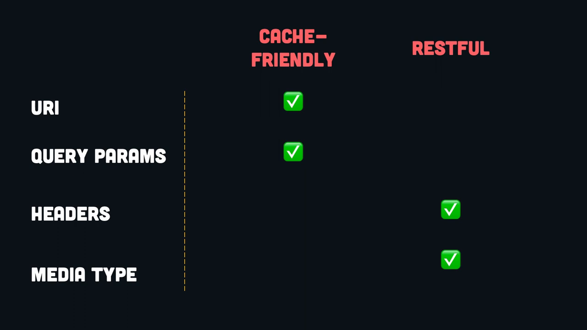
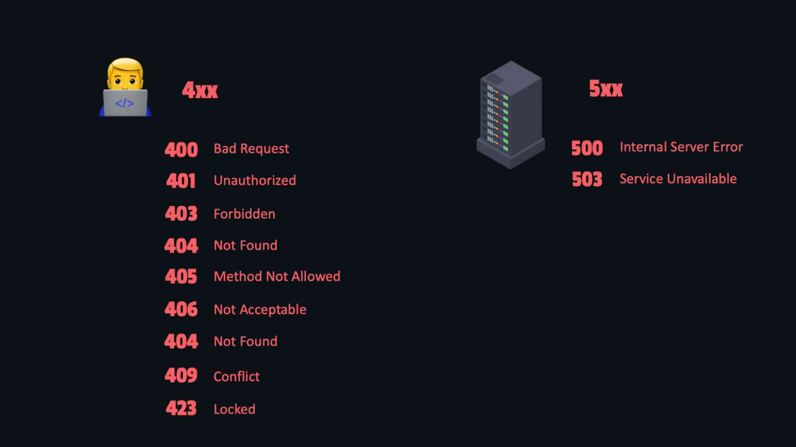
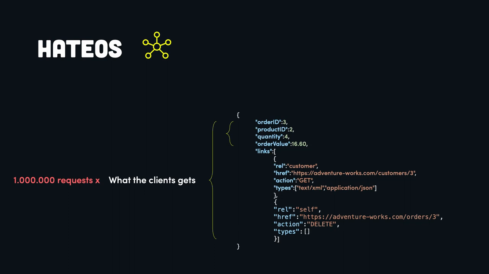

# Thực Hành Tốt Nhất Thiết Kế REST API

* **Kênh:** Code with Lucian | **Thời lượng:** 00:15:50 | **Ngày:** 2024-03-20
* **Video:** https://youtu.be/1Wl-rtew1_E

---

## Thuật ngữ

| Thuật ngữ | Tiếng Anh | Giải thích |
| :--- | :--- | :--- |
| Phi trạng thái | Statelessness | Ràng buộc kiến trúc yêu cầu mỗi request từ client phải chứa toàn bộ thông tin cần thiết; server không lưu giữ session state giữa các request. |
| Có trạng thái | Stateful | Kiến trúc trong đó server lưu giữ phiên làm việc hoặc ngữ cảnh của client trong bộ nhớ nội bộ. |
| Tài nguyên | Resource | Bất kỳ thực thể dữ liệu nào mà API quản lý và cho phép thao tác (ví dụ: customers, orders, products). |
| Bộ từ vựng HTTP | HTTP Verbs / Methods | Các phương thức giao thức chuẩn (GET, POST, PUT, PATCH, DELETE) đại diện cho hành động thao tác dữ liệu. |
| Tương thích ngược | Backward Compatibility | Khả năng hệ thống phiên bản mới tiếp tục hoạt động trơn tru với các client cũ mà không làm gãy đổ ứng dụng. |
| Đánh phiên bản | API Versioning | Chiến lược quản lý các thay đổi phá vỡ tương thích (breaking changes) thông qua URI, Query Param, Header hoặc Content Negotiation. |
| Liên kết siêu phương tiện | HATEOAS | Ràng buộc kiến trúc bổ sung siêu liên kết vào payload phản hồi để client tự khám phá các hành động tiếp theo của tài nguyên. |
| Đàm phán nội dung | Content Negotiation | Cơ chế client và server thỏa thuận định dạng dữ liệu truyền tải thông qua các tiêu đề HTTP (Accept, Content-Type). |

---

## Tổng luận chuyên đề

### Bản chất của kiến trúc REST

REST (Representational State Transfer) không phải là một giao thức hay chuẩn kỹ thuật bắt buộc, mà là một tập hợp các ràng buộc kiến trúc được thiết kế nhằm tối ưu hóa tính mở rộng, tính độc lập và hiệu năng trong hệ thống phân tán. Trọng tâm của một REST API chuẩn mực xoay quanh việc định danh tài nguyên (Resources) bằng danh từ, giao phó toàn bộ hành động (Actions) cho phương thức giao thức HTTP, và triệt tiêu trạng thái phiên (Session State) trên cụm máy chủ xử lý logic.

### Ba nguyên tắc thiết kế cốt lõi

1. **Ràng buộc phi trạng thái (Stateless Constraint):** Máy chủ không bao giờ lưu trữ trạng thái người dùng trong bộ nhớ RAM hoặc session nội bộ. Toàn bộ ngữ cảnh (phiên đăng nhập, giỏ hàng, tiến trình) phải được chuyển giao ra cơ sở dữ liệu dùng chung (Database/Redis) hoặc đóng gói đầy đủ trong từng request gửi đi từ phía client. Nhờ đó, bộ cân bằng tải (Load Balancer) có thể định tuyến bất kỳ request nào đến bất kỳ máy chủ backend nào mà không gây lỗi lệch pha dữ liệu.
2. **Tách bạch tài nguyên và hành động (Noun vs Verb Separation):** URI chỉ đại diện cho tài nguyên thực thể (ví dụ `/orders`, `/customers`), tuyệt đối không chứa động từ chỉ hành vi (như `/create-order`, `/delete-user`). Hành động tác động lên tài nguyên được đảm nhiệm hoàn toàn bởi các phương thức HTTP chuẩn:
   - `GET`: Truy xuất dữ liệu (an toàn và bất biến).
   - `POST`: Tạo mới tài nguyên trong tập hợp.
   - `PUT`: Cập nhật toàn bộ hoặc thay thế tài nguyên.
   - `PATCH`: Cập nhật cục bộ một phần tài nguyên.
   - `DELETE`: Xóa tài nguyên.
3. **Giới hạn độ sâu phân cấp URI (URI Nesting Depth):** Hạn chế tối đa việc lồng ghép tài nguyên quá 2 cấp phân cấp (`/collection/{id}/sub-collection`). Các chuỗi lồng ghép sâu (như `/customers/1/orders/99/products/2`) gây khó khăn nghiêm trọng cho việc bảo trì, làm phức tạp hóa bộ định tuyến và dễ dẫn đến thắt cổ chai hiệu năng.

### Quản lý phiên bản và tương thích ngược

Bất kỳ API thực tế nào cũng phải tiến hóa theo yêu cầu nghiệp vụ. Quy tắc vàng đầu tiên là luôn duy trì tương thích ngược (Backward Compatibility): cho phép bổ sung trường dữ liệu mới vào phản hồi JSON mà không xóa bỏ hoặc đổi tên trường cũ. Khi phát sinh thay đổi phá vỡ tương thích (Breaking Changes), cần áp dụng một trong bốn chiến lược đánh phiên bản: đường dẫn URI (phổ biến nhất, thân thiện với bộ nhớ đệm), tham số truy vấn (Query Parameter), tiêu đề tùy chỉnh (Custom Header) hoặc đàm phán kiểu phương tiện (Media Type).

---

## Bóc tách chi tiết

### [[00:00:52](https://youtu.be/1Wl-rtew1_E?t=52s)] Kiến trúc phi trạng thái



Khái niệm phi trạng thái (Statelessness) trong môi trường hệ thống phân tán:
- Trong một kiến trúc nhiều máy chủ (Multiple Server Nodes) đứng sau bộ cân bằng tải, nếu server lưu session state của client cục bộ trên RAM, client bắt buộc phải gắn chặt với duy nhất server đó (Sticky Sessions). Khi server đó sập hoặc quá tải, toàn bộ phiên làm việc của người dùng bị hủy hoại.
- Một API phi trạng thái thực sự giải quyết vấn đề này bằng cách quy định: Server không duy trì bất kỳ trạng thái nào giữa các lần gọi của client. Mỗi request gửi lên từ client phải chứa trọn vẹn mọi thông tin nhận thực, tham số ngữ cảnh và dữ liệu cần thiết để server thực thi độc lập.
- Lợi ích kỹ thuật vượt trội của thiết kế phi trạng thái:
  - **Khả năng mở rộng ngang (Horizontal Scalability):** Hệ thống có thể tăng giảm số lượng node máy chủ backend tức thời tùy theo tải mà không cần đồng bộ phiên.
  - **Tối ưu hóa bộ nhớ đệm (Caching):** Dữ liệu phản hồi có thể được lưu đệm dễ dàng trên proxy, CDN hoặc client do không phụ thuộc vào trạng thái phiên ẩn.
  - **Khả năng phục hồi sự cố (Fault Tolerance):** Nếu một node máy chủ gặp sự cố giữa chừng, bộ cân bằng tải chỉ cần chuyển hướng request tiếp theo sang node khác mà không làm gián đoạn trải nghiệm người dùng.

---

### [[00:02:29](https://youtu.be/1Wl-rtew1_E?t=149s)] Tách rời trạng thái



Bài toán thực tế: Các ứng dụng phức tạp (như giỏ hàng thương mại điện tử, quy trình thanh toán đa bước) vốn có bản chất lưu giữ trạng thái (Stateful) xuyên suốt nhiều bước thao tác. Làm thế nào để vừa duy trì tính phi trạng thái của REST API vừa hỗ trợ nghiệp vụ có trạng thái?

Giải pháp kiến trúc:
1. **Lưu trữ trạng thái phía Client:** Client tự quản lý dữ liệu giỏ hàng (danh sách ID sản phẩm, số lượng) và đính kèm toàn bộ dữ liệu này vào từng request gửi lên server khi cần tính toán.
2. **Lưu trữ trạng thái bên ngoài (External State Store):** Server nhận dữ liệu và đẩy trạng thái vào một tầng lưu trữ chuyên biệt dùng chung độc lập với mã nguồn backend:
   - Cơ sở dữ liệu quan hệ hoặc tài liệu (PostgreSQL, MongoDB).
   - Bộ nhớ đệm phân tán tốc độ cao (Redis Cluster).
3. **Cơ chế vận hành:** Máy chủ backend hoàn toàn "vô cảm" với trạng thái nội bộ. Mỗi khi nhận request có chứa định danh phiên hoặc giỏ hàng, bất kỳ server nào cũng chỉ việc kéo trạng thái tương ứng từ Redis/Database lên, xử lý logic, cập nhật lại tầng lưu trữ ngoài và trả kết quả về client.

---

### [[00:04:37](https://youtu.be/1Wl-rtew1_E?t=277s)] Định danh tài nguyên



Sai lầm phổ biến nhất trong thiết kế API là nhồi nhét động từ vào đường dẫn URI, tạo ra sự phân mảnh và thiếu nhất quán nghiêm trọng:
- Thiết kế phi REST (Chống mẫu):
  - `GET https://e-commerce.com/generate-order`
  - `POST https://e-commerce.com/create-user`
  - `POST https://e-commerce.com/update-user-status`
  - `GET https://e-commerce.com/delete-product?id=10`
- Thiết kế chuẩn mực (RESTful Design):
  - Sử dụng **danh từ số nhiều** đại diện cho tập hợp tài nguyên (Collections).
  - Sử dụng **bộ từ vựng HTTP** để chỉ định hành vi mong muốn thực thi lên tài nguyên đó.

Bảng ánh xạ chuẩn tắc:

| Thao tác nghiệp vụ | Phương thức HTTP | URI chuẩn | Ý nghĩa |
| :--- | :--- | :--- | :--- |
| Lấy danh sách đơn hàng | `GET` | `/orders` | Truy xuất toàn bộ tập hợp orders |
| Tạo đơn hàng mới | `POST` | `/orders` | Thêm một phần tử mới vào tập hợp orders |
| Xem chi tiết một đơn hàng | `GET` | `/orders/{id}` | Truy xuất phần tử cụ thể theo định danh `{id}` |
| Cập nhật toàn bộ đơn hàng | `PUT` | `/orders/{id}` | Thay thế hoàn toàn bản ghi `{id}` bằng payload mới |
| Cập nhật trạng thái đơn | `PATCH` | `/orders/{id}` | Chỉ sửa đổi một vài trường (ví dụ trường `status`) |
| Hủy/Xóa đơn hàng | `DELETE` | `/orders/{id}` | Xóa bỏ bản ghi `{id}` khỏi hệ thống |

---

### [[00:06:50](https://youtu.be/1Wl-rtew1_E?t=410s)] Giới hạn lồng ghép



Quy tắc cấu trúc hóa quan hệ cha - con giữa các tài nguyên:
- Được phép lồng ghép tối đa **2 cấp độ quan hệ**:
  - Mẫu chuẩn: `/collection/{item_id}/sub-collection`
  - Ví dụ hợp lệ: `GET /customers/{customer_id}/orders` (lấy danh sách đơn hàng thuộc về một khách hàng cụ thể).
- Chống mẫu lồng ghép sâu (Deep Nesting Anti-pattern):
  - Đường dẫn vi phạm: `GET /customers/1/orders/99/products/2`
  - Tác hại kỹ thuật:
    - Đường dẫn cồng kềnh, khó đọc và cực kỳ khó duy trì khi cấu trúc nghiệp vụ thay đổi.
    - Tạo sự phụ thuộc ngầm (Coupling) không cần thiết giữa thực thể customer, order và product.
    - Khiến các bộ định tuyến (Routers) và lớp phân quyền (Authorization Middleware) phải kiểm tra quyền chéo qua 3 cấp độ thực thể, làm sụt giảm hiệu năng.
- Giải pháp chuẩn hóa: Làm phẳng đường dẫn (Flatten URIs).
  - Nếu cần xem chi tiết một sản phẩm, gọi trực tiếp: `GET /products/2`.
  - Nếu cần lọc sản phẩm theo đơn hàng, sử dụng tham số truy vấn: `GET /products?order_id=99`.

---

### [[00:07:52](https://youtu.be/1Wl-rtew1_E?t=472s)] Định dạng phản hồi



Nguyên tắc xử lý định dạng dữ liệu trong REST API hiện đại:
- Tuyệt đối không trả về chuỗi văn bản thô (Plain Text) như chuỗi thông báo `"OK"`, `"Error occurred"`. Plain text khiến client không thể phân tích cú pháp (parse) cấu trúc một cách lập trình được.
- Lựa chọn định dạng tuần tự hóa (Serialization Format):
  - **JSON (JavaScript Object Notation):** Tiêu chuẩn vàng được khuyến nghị sử dụng mặc định. Nhẹ, dễ đọc, hỗ trợ gốc trên hầu hết ngôn ngữ lập trình và thư viện mạng.
  - **XML:** Phù hợp với các hệ thống tài chính kế thừa (Legacy Systems) hoặc khi cần kiểm tra tính hợp lệ bằng schema phức tạp (XSD). Nhược điểm là cú pháp cồng kềnh, tốn băng thông.
  - **YAML:** Dễ đọc hơn cho con người, thường dùng cho cấu hình hệ thống nhưng ít được hỗ trợ trực tiếp và thiếu tính phổ quát trong API trao đổi dữ liệu so với JSON.



Quy tắc tiêu đề HTTP Header bắt buộc:
- Mọi phản hồi JSON phải đi kèm tiêu đề xác thực nội dung: `Content-Type: application/json`.
- Tác dụng kỹ thuật: Thông báo dứt khoát cho client hoặc trình phân tích mạng biết cách xử lý luồng dữ liệu byte nhận về. Nếu không có header này, client có thể hiểu sai thành `text/plain` hoặc `text/html`, gây lỗi sập ứng dụng khi gọi `JSON.parse()`.

---

### [[00:09:35](https://youtu.be/1Wl-rtew1_E?t=575s)] Quản lý phiên bản



Thay đổi trong API là điều không thể tránh khỏi. Để không gây gián đoạn hệ thống, cần phân loại rõ ràng tính chất của sự thay đổi:
1. **Thay đổi không phá vỡ (Non-breaking Change):**
   - Bổ sung trường mới vào đối tượng JSON (ví dụ thêm trường `"currency": "USD"` vào phản hồi sản phẩm).
   - Bổ sung tham số truy vấn tùy chọn (Optional Query Parameters).
   - Thêm endpoint tài nguyên mới.
   - *Yêu cầu:* Phải luôn viết mã nguồn client theo nguyên tắc chịu lỗi (Robustness Principle), bỏ qua các trường lạ không nhận diện được thay vì báo lỗi cú pháp.
2. **Thay đổi phá vỡ tương thích (Breaking Change):**
   - Đổi tên hoặc xóa bỏ một trường dữ liệu đã có.
   - Đổi kiểu dữ liệu của một trường (từ số sang chuỗi, từ mảng sang đối tượng).
   - Bắt buộc truyền thêm tham số mới trên endpoint cũ.
   - Thay đổi cấu trúc phản hồi lỗi.



Khi bắt buộc phải thực hiện Breaking Change, áp dụng một trong 4 chiến lược đánh phiên bản:

| Chiến lược | Ví dụ triển khai | Thân thiện Caching | Chuẩn REST | Đánh giá thực tế |
| :--- | :--- | :---: | :---: | :--- |
| **Đường dẫn URI** | `/v1/products`, `/v2/products` | Có | Không | **Khuyến nghị sử dụng.** Cực kỳ trực quan, dễ thử nghiệm trên trình duyệt, các proxy và CDN lưu cache độc lập tự nhiên. |
| **Tham số truy vấn** | `/products?version=2` | Có | Không | Dễ triển khai nhưng làm rối bộ lọc query thông thường; mặc định dễ bị nhầm lẫn giữa phiên bản và tham số lọc. |
| **Tiêu đề tùy chỉnh** | `X-API-Version: 2` | Không | Có | Giữ URI sạch sẽ nhưng bắt buộc cấu hình proxy CDN phức tạp (phải thêm header vào `Vary`), khó kiểm tra nhanh trên browser. |
| **Kiểu phương tiện** | `Accept: application/vnd.company.v2+json` | Không | Có | Đúng chuẩn RESTful nhất theo lý thuyết đàm phán nội dung nhưng cực kỳ phức tạp để triển khai, tài liệu hóa và kiểm thử. |

---

### [[00:12:38](https://youtu.be/1Wl-rtew1_E?t=758s)] Xử lý ngoại lệ



Không bao giờ để ngoại lệ chưa bắt (Unhandled Exceptions) văng trực tiếp ra ngoài màn hình client dưới dạng stack trace hoặc phản hồi HTML lỗi của web server:
- Lộ lỗ hổng bảo mật: Stack trace tiết lộ cấu trúc thư mục, phiên bản framework và thông tin nội bộ của máy chủ.
- Luôn bọc toàn bộ ngoại lệ trong khối xử lý lỗi tập trung (Global Exception Handler) và trả về đối tượng JSON chuẩn hóa kèm mã HTTP Status Code chính xác.

Bảng phân loại mã trạng thái lỗi bắt buộc phải phân định rõ:

| Nhóm mã | Mã trạng thái | Tên chuẩn | Ngữ cảnh sử dụng |
| :--- | :--- | :--- | :--- |
| **4xx (Lỗi từ phía Client)** | `400` | Bad Request | Dữ liệu gửi lên sai định dạng cú pháp JSON hoặc thiếu trường bắt buộc |
| | `401` | Unauthorized | Thiếu thông tin xác thực (chưa đăng nhập, thiếu token) |
| | `403` | Forbidden | Đã xác thực nhưng không có quyền truy cập tài nguyên |
| | `404` | Not Found | Tài nguyên yêu cầu không tồn tại trong hệ thống |
| | `405` | Method Not Allowed | Tài nguyên có tồn tại nhưng không hỗ trợ phương thức HTTP gọi tới |
| | `409` | Conflict | Xung đột trạng thái (ví dụ cố tạo tài khoản với email đã tồn tại) |
| | `422` | Unprocessable Entity | Cú pháp JSON đúng nhưng vi phạm quy tắc nghiệp vụ |
| **5xx (Lỗi từ phía Server)** | `500` | Internal Server Error | Lỗi sập hệ thống không mong muốn xảy ra bên trong logic backend |
| | `503` | Service Unavailable | Máy chủ đang quá tải hoặc tạm thời bảo trì hệ thống |

---

### [[00:14:26](https://youtu.be/1Wl-rtew1_E?t=866s)] Đánh đổi liên kết động



Khái niệm HATEOAS (Hypermedia As The Engine Of Application State):
- Cấp độ cao nhất trong mô hình trưởng thành Richardson (Maturity Model). Trong phản hồi JSON của một tài nguyên, server tự động đính kèm danh sách các siêu liên kết (Hyperlinks) chỉ rõ các hành động và tài nguyên kế tiếp mà client có thể tương tác.
- Ví dụ phản hồi có HATEOAS:
```json
{
  "orderID": 3,
  "productID": 2,
  "quantity": 4,
  "orderValue": 16.60,
  "links": [
    {
      "rel": "customer",
      "href": "https://adventure-works.com/customers/3",
      "action": "GET",
      "types": ["application/json"]
    },
    {
      "rel": "self",
      "href": "https://adventure-works.com/orders/3",
      "action": "DELETE",
      "types": []
    }
  ]
}
```

Phân tích đánh đổi kỹ thuật (Trade-offs):
- **Ưu điểm:** Khả năng tự khám phá (Discoverability) cao, giảm thiểu việc client phải fix cứng (hardcode) các đường dẫn API trong mã nguồn.
- **Nhược điểm & Chi phí thực tế:**
  - **Phình to kích thước dữ liệu (Payload Overhead):** Một mảng liên kết chiếm dung lượng đáng kể. Trong hệ thống xử lý hàng triệu hoặc hàng tỷ request mỗi ngày, lượng dữ liệu dư thừa này gây tốn kém chi phí băng thông mạng khổng lồ.
  - **Độ phức tạp mã nguồn (Code Complexity):** Cả backend (tạo liên kết động theo quyền hạn người dùng) lẫn frontend (đọc và phân giải mảng links) đều phải gánh thêm tầng xử lý logic phức tạp.
- **Khuyến nghị thực tế:** Đối với hầu hết các hệ thống API thương mại và nội bộ hiện đại, HATEOAS thường không đáng để đánh đổi tài nguyên; tài liệu hóa API bằng OpenAPI/Swagger là giải pháp thực tế và tiết kiệm hơn nhiều.

---

## Trích dẫn then chốt

* [[00:01:01](https://youtu.be/1Wl-rtew1_E?t=61s)] *"Trong một môi trường phân tán, phi trạng thái đồng nghĩa với việc máy chủ không lưu giữ bất kỳ trạng thái phiên nào với client. Mỗi request gửi lên từ client đều phải tự cung cấp trọn vẹn mọi thông tin cần thiết."*
* [[00:04:51](https://youtu.be/1Wl-rtew1_E?t=291s)] *"Chúng ta thiết kế endpoint dựa trên tài nguyên chứ không phải hành động, bởi vì chính giao thức HTTP đã cung cấp sẵn bộ từ vựng hành động thông qua các phương thức GET, POST, PUT, PATCH và DELETE."*
* [[00:06:50](https://youtu.be/1Wl-rtew1_E?t=410s)] *"Tránh xa những URI tài nguyên phức tạp hơn hai cấp độ phân cấp. Những đường dẫn lồng ghép sâu chỉ mang lại ác mộng bảo trì và khó khăn trong việc mở rộng."*
* [[00:13:07](https://youtu.be/1Wl-rtew1_E?t=787s)] *"Đừng bao giờ để lộ lỗi chưa bọc ra ngoài màn hình client. Hãy bắt lấy ngoại lệ, bọc nó trong một payload JSON rõ ràng và gán đúng mã trạng thái HTTP."*
* [[00:15:27](https://youtu.be/1Wl-rtew1_E?t=927s)] *"Hãy nhân dung lượng của mảng liên kết HATEOAS với một triệu request gửi đến mỗi ngày. Bạn sẽ hiểu ngay tại sao phần lớn các hệ thống thực tế từ chối triển khai siêu liên kết này."*

---

## Lệnh & Công cụ

### Cấu trúc phản hồi lỗi chuẩn RFC 7807

```json
{
  "type": "https://api.example.com/errors/resource-not-found",
  "title": "Tài nguyên không tìm thấy",
  "status": 404,
  "detail": "Không tìm thấy khách hàng có ID là 1024 trong hệ thống.",
  "instance": "/customers/1024/orders",
  "timestamp": "2026-10-10T18:24:00Z"
}
```

### Bảng tra cứu phương thức HTTP

```text
[HTTP METHOD MATRIX]
┌─────────┬──────────────┬───────────────┬─────────────────────────────────┐
│ METHOD  │ IDEMPOTENT?  │ SAFE (READ)?  │ MỤC ĐÍCH NGHIỆP VỤ              │
├─────────┼──────────────┼───────────────┼─────────────────────────────────┤
│ GET     │ YES          │ YES           │ Đọc dữ liệu tài nguyên          │
│ POST    │ NO           │ NO            │ Tạo mới tài nguyên trong tập hợp│
│ PUT     │ YES          │ NO            │ Ghi đè toàn bộ tài nguyên       │
│ PATCH   │ NO           │ NO            │ Cập nhật cục bộ một phần        │
│ DELETE  │ YES          │ NO            │ Xóa bỏ tài nguyên               │
└─────────┴──────────────┴───────────────┴─────────────────────────────────┘
```

---

## Đánh đổi & Rủi ro

### Đánh đổi phi trạng thái và độ trễ mạng

Để đạt được tính phi trạng thái tuyệt đối, client bắt buộc phải gửi kèm thông tin định danh và ngữ cảnh trong mọi request, hoặc server phải liên tục truy vấn Redis/Database ngoài để phục hồi trạng thái. Điều này làm tăng nhẹ kích thước gói tin mạng và độ trễ truy vấn cơ sở dữ liệu so với việc lưu trực tiếp phiên trên bộ nhớ RAM của một server đơn lẻ. Tuy nhiên, đây là sự đánh đổi bắt buộc để đạt được khả năng mở rộng quy mô hàng trăm nghìn người dùng.

### Rủi ro lựa chọn chiến lược đánh phiên bản

Lựa chọn đánh phiên bản qua Custom Header hoặc Media Type tạo ra một rủi ro lớn đối với hạ tầng bộ nhớ đệm (Caching Infrastructure). Nếu đội ngũ kỹ sư hạ tầng không cấu hình chính xác tiêu đề phản hồi `Vary: X-API-Version`, các máy chủ proxy hoặc mạng phân phối nội dung (CDN) có thể trả nhầm phản hồi đệm của phiên bản v1 cho một client đang yêu cầu phiên bản v2, dẫn đến lỗi xử lý dữ liệu hàng loạt.

### Bẫy lý thuyết HATEOAS

Theo đuổi sự hoàn hảo của lý thuyết REST cấp độ 3 với HATEOAS khi không có nhu cầu thực tế sẽ gây lãng phí tài nguyên phát triển khổng lồ. Chi phí băng thông tăng vọt do payload phình to và gánh nặng bảo trì mã nguồn giữa client - server thường vượt xa lợi ích tự khám phá mà nó mang lại. Hầu hết các tổ chức công nghệ hàng đầu hiện nay chọn dừng lại ở cấp độ RESTful thực dụng (sử dụng URI tài nguyên, phương thức HTTP chuẩn và JSON có cấu trúc).
