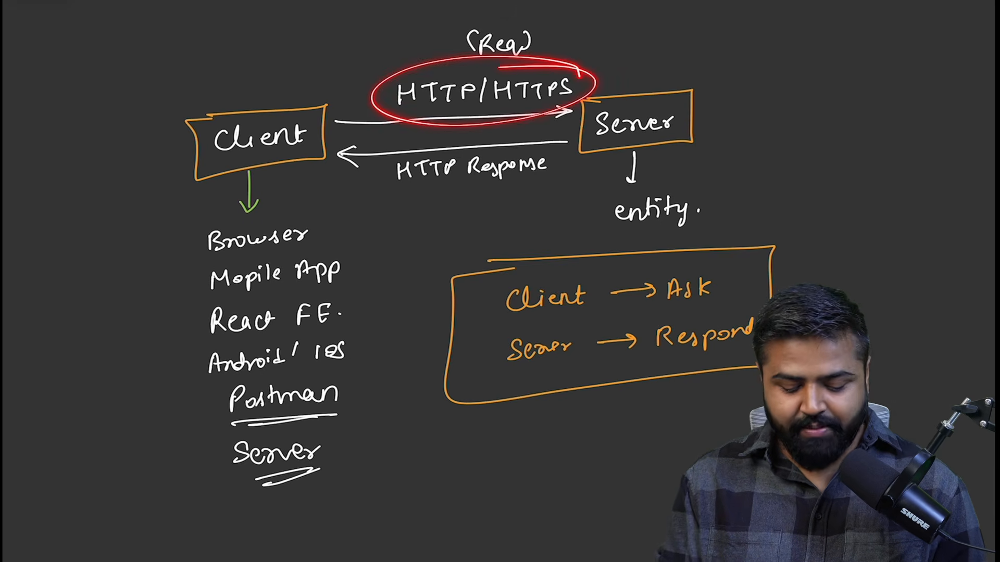
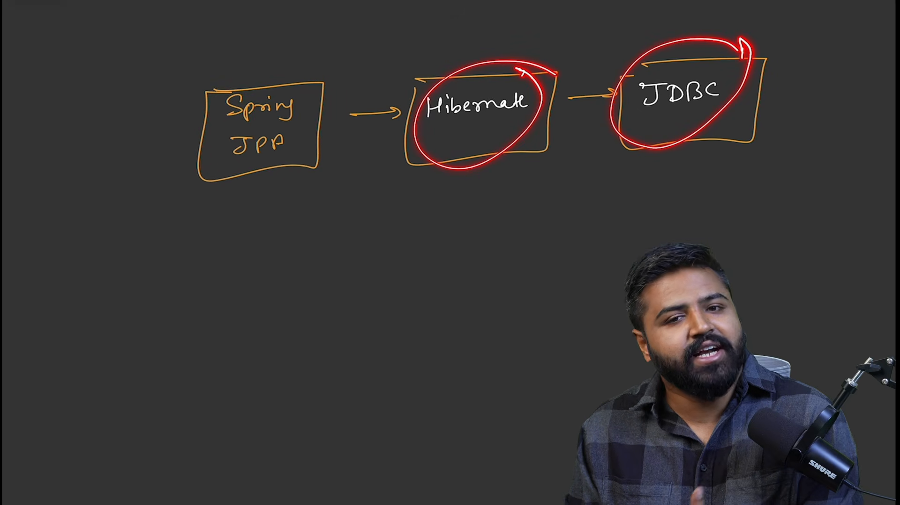
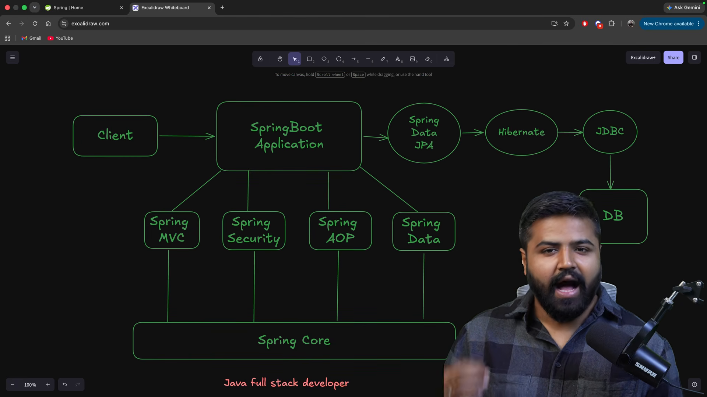

# Tổng quan Spring Boot và Spring Framework

* **Kênh:** Bouali Ali | **Thời lượng:** 00:43:41 | **Ngày:** 2026-03-01
* **Video:** https://www.youtube.com/watch?v=Q04sTEwC7Kg

---

## Thuật ngữ

| Thuật ngữ | Tiếng Anh | Giải thích |
| :--- | :--- | :--- |
| Kiến trúc Khách - Chủ | Client-Server Architecture | Mô hình mạng phân chia tác vụ giữa bên yêu cầu tài nguyên (Client) và bên cung cấp tài nguyên (Server) |
| Giao thức truyền siêu văn bản | HTTP / HTTPS | Giao thức truyền thông phi trạng thái tầng ứng dụng trên nền tảng TCP/IP |
| Cổng giao tiếp mạng | Socket | Điểm cuối (Endpoint) hai chiều phục vụ truyền nhận dữ liệu giữa hai tiến trình qua mạng |
| Khối xử lý máy chủ | Servlet | Thành phần Java phía máy chủ nhận và phản hồi các yêu cầu web động |
| Vỏ bọc máy chủ | Servlet Container | Môi trường quản lý vòng đời Servlet (như Apache Tomcat, Jetty) tiếp nhận kết nối TCP và điều phối luồng |
| Điều phối đảo ngược | Inversion of Control (IoC) | Nguyên lý thiết kế chuyển quyền kiểm soát khởi tạo và quản lý đối tượng cho khung làm việc (Framework) |
| Tiêm phụ thuộc | Dependency Injection (DI) | Kỹ thuật truyền đối tượng phụ thuộc vào lớp tiêu thụ thay vì để lớp tự khởi tạo |
| Khung làm việc Spring | Spring Framework | Hệ sinh thái phần mềm toàn diện hỗ trợ phát triển ứng dụng Java doanh nghiệp |
| Trừu tượng hóa dữ liệu | Spring Data | Tầng tiện ích đồng nhất hóa cách truy cập CSDL quan hệ và phi quan hệ (JPA, JDBC, R2DBC) |

---

## Tổng luận chuyên đề

### Tiến hóa ứng dụng web

Lịch sử phát triển ứng dụng web trên nền tảng Java trải qua 4 giai đoạn tiến hóa then chốt:

1. **Mạng cấp thấp (Java Socket):** Nhà phát triển phải tự quản lý từng luồng TCP thô, bắt tay kết nối, tự phân tích cú pháp chuỗi ký tự HTTP Header và Body. Điểm yếu là tốn tài nguyên luồng, dễ rò rỉ bộ nhớ và không thể mở rộng quy mô.
2. **Tiêu chuẩn hóa (Servlet & Servlet Container):** Servlet Container (như Tomcat) giải phóng lập trình viên khỏi việc xử lý socket mạng thô, chuyển đổi dữ liệu HTTP thành đối tượng chuẩn `HttpServletRequest` và `HttpServletResponse`.
3. **Mô hình MVC linh hoạt (Spring Framework):** Loại bỏ việc cấu hình thủ công từng Servlet riêng lẻ bằng cơ chế `DispatcherServlet` duy nhất (Front Controller Pattern), tích hợp IoC/DI để phân tách lớp nghiệp vụ (Service), tầng dữ liệu (Repository) và tầng hiển thị (Controller).
4. **Cấu hình tự động (Spring Boot):** Nhúng trực tiếp Tomcat vào ứng dụng dạng mã nhị phân JAR độc lập, tự động phát hiện thư viện trên classpath để khởi tạo cấu hình ngầm định, giảm thiểu 90% tệp cấu hình XML rườm rà.

### Kiến trúc tổng thể Spring

Kiến trúc hệ sinh thái Spring được xây dựng thành các phân tầng đồng tâm:
- **Tầng lõi (Spring Core):** Động cơ IoC Container chịu trách nhiệm quản lý vùng nhớ và vòng đời của các Spring Bean, kết hợp bộ máy tiêm phụ thuộc DI.
- **Tầng web (Spring MVC):** Tiếp nhận yêu cầu HTTP qua luồng lọc (Filter), phân phối vào Controller, xử lý chuyển đổi dữ liệu DTO và trả về JSON/HTML.
- **Tầng dữ liệu (Spring Data & Transactions):** Bao bọc JDBC và Hibernate/JPA, quản lý giao dịch tự động qua `@Transactional`.
- **Tầng bảo mật và tích hợp (Spring Security & Cloud):** Kiểm soát xác thực, phân quyền và điều phối cấu hình phân tán.

---

## Bóc tách chi tiết

### Mô hình giao tiếp mạng



Hệ thống mạng hiện đại vận hành dựa trên cơ chế phân định rõ vai trò giữa Client (trình duyệt, ứng dụng di động, hệ thống bên thứ ba) và Server (máy chủ lưu trữ tài nguyên và logic xử lý):
- **Phân tách trách nhiệm:** Client chỉ tập trung hiển thị giao diện và thu thập hành vi người dùng; Server tập trung vào tính toàn vẹn dữ liệu, xác thực quyền hạn và xử lý logic nghiệp vụ.
- **Tính phi trạng thái:** Mỗi yêu cầu gửi đi từ Client độc lập hoàn toàn, Server không bắt buộc phải lưu giữ kết nối mở liên tục sau khi phản hồi đã hoàn tất.

### Cấu trúc thông điệp mạng


Toàn bộ thông tin trao đổi qua mạng internet dựa trên giao thức HTTP chạy trên cổng 80 (hoặc HTTPS mã hóa qua TLS chạy trên cổng 443). Dữ liệu được chia thành hai luồng độc lập:


1. **Gói tin yêu cầu (HTTP Request):**
   - **Request Line:** Chứa phương thức HTTP (`GET`, `POST`, `PUT`, `DELETE`), đường dẫn tài nguyên (URI) và phiên bản giao thức (`HTTP/1.1`).
   - **Request Headers:** Các cặp khóa-giá trị chứa siêu dữ liệu: `Host`, `User-Agent`, `Accept`, `Authorization`, `Content-Type`.
   - **Request Body:** Phần thân chứa tải trọng dữ liệu (thường là JSON hoặc XML) khi gửi các thao tác tạo mới hoặc cập nhật.


2. **Gói tin phản hồi (HTTP Response):**
   - **Status Line:** Chứa phiên bản HTTP, mã trạng thái (Status Code: `200 OK`, `400 Bad Request`, `401 Unauthorized`, `404 Not Found`, `500 Internal Server Error`).
   - **Response Headers:** Cung cấp thông tin môi trường máy chủ, kiểu dữ liệu trả về (`Content-Type: application/json`), độ dài nội dung (`Content-Length`).
   - **Response Body:** Dữ liệu kết quả thực tế được gửi về cho Client giải mã.

### Hạn chế mạng cấp thấp


Nếu xây dựng ứng dụng máy chủ chỉ bằng thư viện Java Socket thuần (`java.net.ServerSocket`):
- **Phải tự phân giải chuỗi ký tự:** Dữ liệu nhận từ socket là luồng byte nhị phân. Lập trình viên phải viết thuật toán cắt chuỗi để tìm ra đâu là URL, đâu là Header, đâu là Body.
- **Nghẽn kết nối đa luồng:** Mỗi kết nối Client đến phải được cấp phát một `Thread` riêng. Khi số lượng người dùng vượt quá vài trăm, hệ thống nhanh chóng cạn kiệt bộ nhớ bộ đệm ngăn xếp (Stack Memory) và làm sập máy ảo Java (JVM).
- **Thiếu chuẩn hóa:** Không có cơ chế vòng đời đồng nhất cho các dịch vụ nghiệp vụ khác nhau.

### Máy chủ vỏ bọc Servlet


Servlet Container giải quyết triệt để bài toán tầng socket:
- **Bộ đệm luồng tối ưu (Thread Pool):** Tái sử dụng các luồng thực thi có sẵn, ngăn ngừa tình trạng tạo luồng vô hạn làm cạn kiệt tài nguyên hệ thống.
- **Trừu tượng hóa đối tượng:** Biến đổi luồng byte thô thành cặp đối tượng Java trực quan: `HttpServletRequest` và `HttpServletResponse`.
- **Quản lý vòng đời chuẩn:** Cung cấp ba giai đoạn thực thi cố định cho mỗi thành phần xử lý: khởi tạo (`init`), phục vụ (`service`), và giải phóng (`destroy`).

### Hệ sinh thái tầng dữ liệu



Quá trình tương tác cơ sở dữ liệu trong Java được chuẩn hóa qua các lớp từ thấp đến cao:
- **JDBC thuần:** Yêu cầu mở kết nối thủ công, viết câu lệnh SQL thô và tự lặp qua `ResultSet` để trích xuất từng cột vào thuộc tính Java. Dễ xảy ra lỗi sai tên cột và rò rỉ kết nối (`Connection Leak`).
- **Hibernate & JPA:** Chuyển đổi đối tượng - bảng quan hệ (ORM), tự động ánh xạ thuộc tính đối tượng Java thành bản ghi bảng CSDL, giảm thiểu viết SQL thủ công.
- **Spring Data JPA:** Cung cấp giao diện `JpaRepository` với các phương thức CRUD dựng sẵn (`findAll`, `save`, `deleteById`), tự động sinh mã thực thi lúc chạy mà không cần viết lớp hiện thực.

### Kiến trúc tổng thể nền tảng



Mô hình phân tầng hoàn chỉnh của ứng dụng Spring hiện đại:
1. **Client Tier:** Trình duyệt hoặc ứng dụng di động gửi yêu cầu HTTP/JSON.
2. **Web Tier:** Tiếp nhận yêu cầu, bảo vệ bằng bộ lọc an ninh (Filter Chain), phân phối tới `@RestController`.
3. **Business Logic Tier:** Tầng `@Service` đảm nhận các thuật toán nghiệp vụ cốt lõi, áp dụng nguyên lý IoC và tiêm phụ thuộc `@Autowired`.
4. **Data Access Tier:** Tầng `@Repository` thực thi các câu truy vấn qua Spring Data JPA và Hibernate.
5. **Database Tier:** Cơ sở dữ liệu quan hệ (PostgreSQL, MySQL) hoặc phi quan hệ (MongoDB, Redis) lưu trữ dữ liệu bền vững.

---

## Trích dẫn then chốt

* "Mục tiêu cốt lõi của Spring Framework không phải là viết lại Java, mà là giải phóng kỹ sư khỏi gánh nặng xử lý hạ tầng kỹ thuật lặp đi lặp lại để tập trung vào logic nghiệp vụ." [21:24](https://www.youtube.com/watch?v=Q04sTEwC7Kg&t=1284s)
* "Một ứng dụng web chuẩn mực không bao giờ trực tiếp quản lý kết nối socket; đó là nhiệm vụ của Servlet Container." [29:14](https://www.youtube.com/watch?v=Q04sTEwC7Kg&t=1754s)
* "Spring IoC Container đảo ngược quyền kiểm soát: thay vì đối tượng tự tạo ra phụ thuộc của mình, Container sẽ tiêm chính xác những gì đối tượng cần." [34:51](https://www.youtube.com/watch?v=Q04sTEwC7Kg&t=2091s)
* "Spring Data loại bỏ hoàn toàn các đoạn mã khung lặp đi lặp lại của JDBC, cho phép truy vấn dữ liệu chỉ bằng việc khai báo chữ ký phương thức." [38:36](https://www.youtube.com/watch?v=Q04sTEwC7Kg&t=2316s)

---

## Lệnh & Công cụ

### Cấu trúc thông điệp HTTP

```http
POST /api/v1/students HTTP/1.1
Host: localhost:8080
Content-Type: application/json
Accept: application/json
Authorization: Bearer <token>

{
  "firstname": "John",
  "lastname": "Doe",
  "email": "john.doe@example.com"
}
```

### Khởi tạo dự án Spring Boot

```bash
# Tạo nhanh dự án Spring Boot qua curl và trạm Spring Initializr
curl https://start.spring.io/starter.tgz \
  -d dependencies=web,data-jpa,mysql \
  -d type=maven-project \
  -d language=java \
  -d bootVersion=3.4.0 \
  -d baseDir=demo-app | tar -xzvf -
```

---

## Đánh đổi & Rủi ro

### Chi phí trừu tượng hóa
- **Độ phức tạp gỡ lỗi:** Cơ chế tiêm phụ thuộc và tạo proxy động (Dynamic Proxy) của Spring khiến vết ngăn xếp ngoại lệ (Stack Trace) trở nên rất dài, gây khó khăn cho việc định vị dòng lỗi thực tế.
- **Thời gian khởi động (Startup Latency):** Cơ chế quét thành phần (Component Scanning) và phân tích chú thích (Reflection) làm tăng thời gian khởi động ứng dụng so với viết mã Java thuần.

### Rủi ro cấu hình tự động
- **Thiếu kiểm soát ngầm định:** Tính năng Auto-Configuration của Spring Boot có thể tự động nạp các bean hoặc nguồn dữ liệu không mong muốn nếu cấu hình classpath không được kiểm soát chặt chẽ.
- **Tiêu tốn bộ nhớ vùng nhớ đệm:** Ứng dụng Spring Boot đóng gói sẵn máy chủ Tomcat nhúng đòi hỏi dung lượng bộ nhớ tối thiểu cao hơn so với các giải pháp siêu nhẹ (Lightweight Frameworks).
