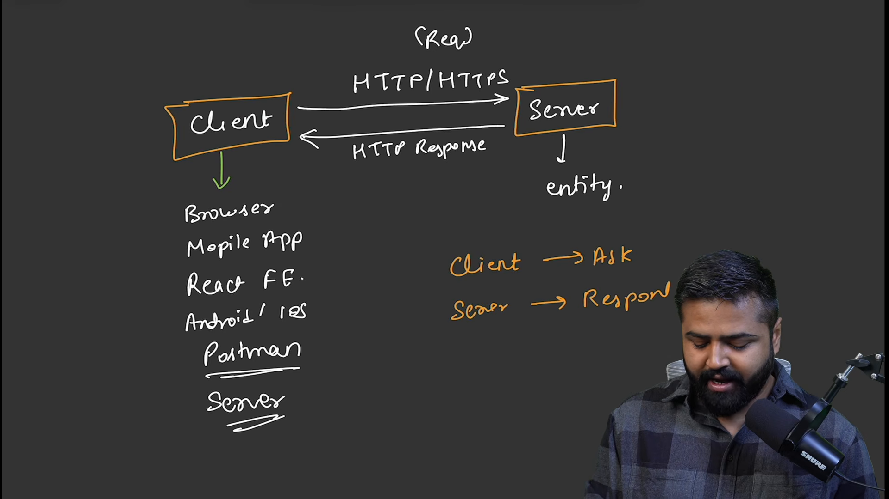
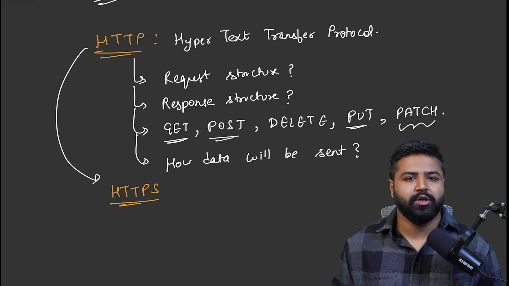
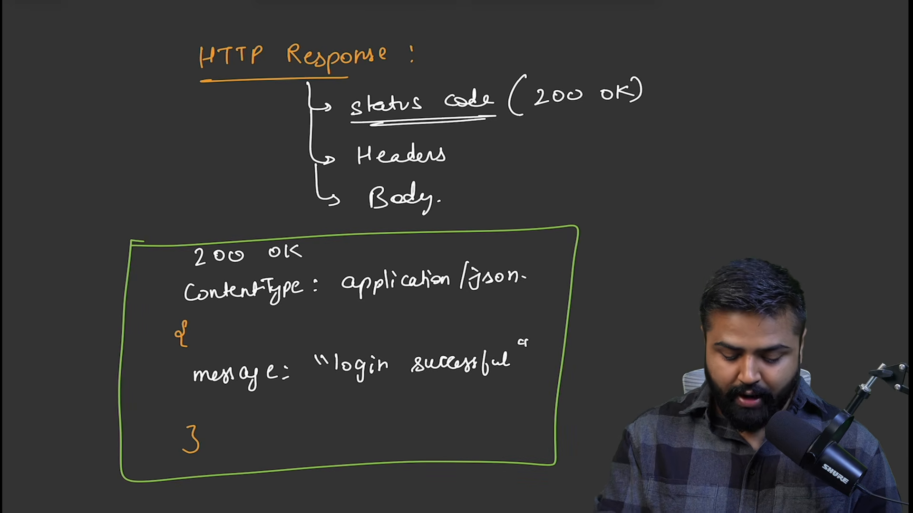
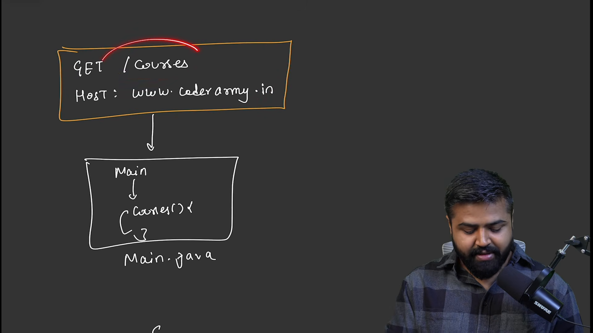
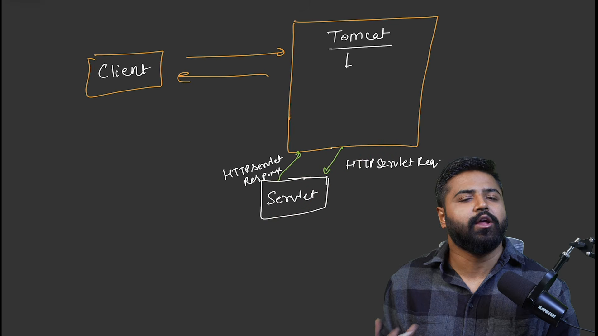
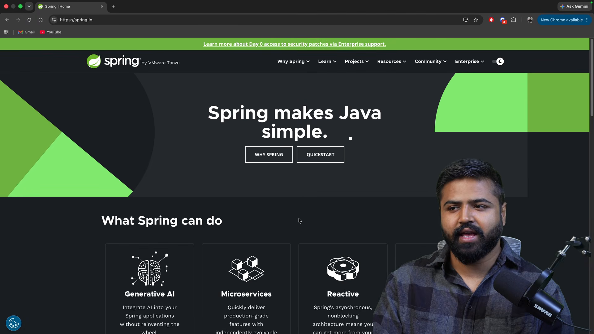
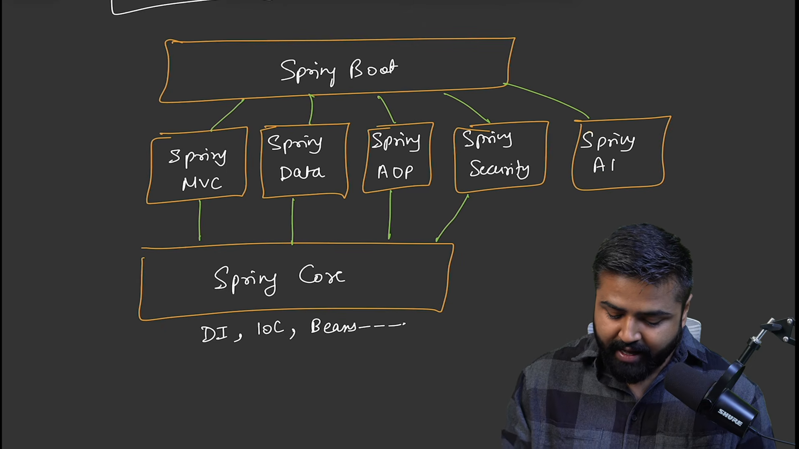
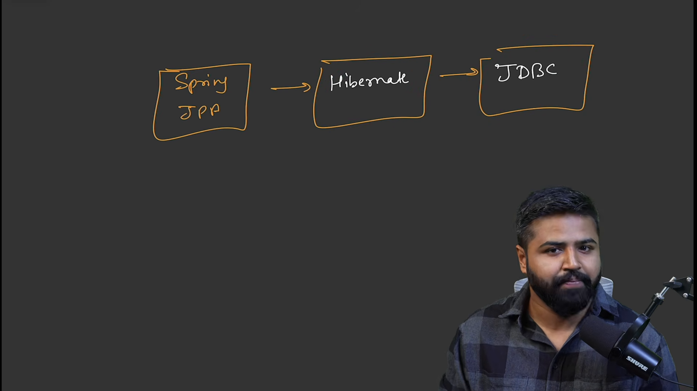

# Spring Boot & Spring Framework Full Course

* **Kênh:** Coder Army | **Thời lượng:** 00:43:41 | **Ngày:** 2026-06-15
* **Video:** https://youtu.be/Q04sTEwC7Kg

---

## Thuật ngữ

| Thuật ngữ | Tiếng Anh | Giải thích |
| :--- | :--- | :--- |
| Kiến trúc Khách - Chủ | Client-Server Architecture | Mô hình mạng phân tán phân tách giữa bên yêu cầu dịch vụ (Client) và bên cung cấp tài nguyên, xử lý nghiệp vụ (Server). |
| Giao thức Truyền tải Siêu văn bản | HTTP (HyperText Transfer Protocol) | Giao thức truyền thông phi trạng thái tầng ứng dụng, định nghĩa chuẩn định dạng bản tin request và response qua giao vận TCP. |
| HTTP An toàn | HTTPS (HTTP Secure) | Giao thức HTTP được bọc trong tầng mã hóa TLS/SSL nhằm bảo mật tính toàn vẹn và chống nghe lén dữ liệu trên đường truyền. |
| Mã phản hồi trạng thái | HTTP Status Code | Mã số 3 chữ số do server trả về để báo hiệu kết quả xử lý của request (2xx thành công, 4xx lỗi client, 5xx lỗi server). |
| Ổ cắm mạng | Socket / ServerSocket | Giao diện lập trình mạng cấp thấp trên nền TCP/IP của hệ điều hành, cho phép truyền nhận luồng dữ liệu byte thô. |
| Bộ chứa Servlet | Servlet Container (Web Container) | Môi trường runtime trong JVM (như Apache Tomcat) quản lý vòng đời Servlet, lắng nghe cổng mạng và ánh xạ request tới Servlet xử lý. |
| Lập trình Web Java chuẩn | Java Servlet | Giao diện chuẩn (API) trong Java Enterprise giúp tiếp nhận request HTTP, xử lý logic nghiệp vụ và xuất HTTP response tương ứng. |
| Đảo ngược Điều khiển | IoC (Inversion of Control) | Nguyên lý thiết kế chuyển quyền khởi tạo và quản lý vòng đời đối tượng từ mã nguồn lập trình viên sang cho framework đảm nhiệm. |
| Tiêm phụ thuộc | Dependency Injection (DI) | Cơ chế triển khai IoC, trong đó container tự động truyền các đối tượng phụ thuộc vào class thay vì class tự khởi tạo bằng toán tử `new`. |
| Thành phần quản lý | Bean | Đối tượng Java được khởi tạo, lắp ráp và quản lý trọn vẹn vòng đời bởi Spring IoC Container. |
| Bộ khung phát triển Spring | Spring Framework | Khung làm việc nguồn mở toàn diện cho Java dựa trên kiến trúc Spring Core (IoC, DI) giúp giảm bớt sự phụ thuộc chặt chẽ giữa các tầng logic. |
| Khởi tạo nhanh Spring | Spring Boot | Dự án mở rộng của Spring giải quyết sự phức tạp cấu hình thông qua cơ chế tự động cấu hình (Auto-configuration) và máy chủ nhúng sẵn. |
| Ánh xạ Đối tượng - Quan hệ | ORM (Object-Relational Mapping) | Kỹ thuật ánh xạ cấu trúc bảng trong cơ sở dữ liệu quan hệ sang các đối tượng class trong ngôn ngữ lập trình hướng đối tượng. |
| Kết nối Cơ sở dữ liệu Java | JDBC (Java Database Connectivity) | API nền tảng cấp thấp của Java cho phép thực thi trực tiếp các câu truy vấn SQL thô tới cơ sở dữ liệu quan hệ. |
| Giao diện bền vững Java | JPA (Jakarta Persistence API) | Đặc tả tiêu chuẩn của Java định nghĩa tập hợp các quy tắc chuẩn cho kỹ thuật ORM (Hibernate đóng vai trò là bản triển khai thực tế). |

---

## Tổng luận chuyên đề

### 1. Bản chất giao tiếp mạng và giao thức HTTP
- Mọi ứng dụng web vận hành trên nguyên lý Khách - Chủ (Client-Server): Client (trình duyệt, ứng dụng di động) gửi yêu cầu (Request), Server tiếp nhận và gửi dữ liệu phản hồi (Response).
- HTTP đóng vai trò như ngôn ngữ chuẩn hóa chung: Định dạng bản tin bao gồm Request Line (Method + URI + Protocol), Headers (Metadata) và Body (Payload).
- Bản chất HTTPS: Tích hợp chứng chỉ TLS/SSL để mã hóa đối xứng/bất đối xứng đường truyền mạng, ngăn chặn hoàn toàn nguy cơ nghe lén (sniffing) và giả mạo gói tin (tampering) so với HTTP thô truyền tải văn bản thuần (plain text).

### 2. Sự bế tắc của Java thuần và cuộc cách mạng Servlet Container
- Điểm nghẽn khi chỉ dùng Core Java: Lớp `ServerSocket` và `Socket` trong gói `java.net` chỉ lắng nghe cổng mạng và đọc/ghi dòng byte thô (`InputStream`/`OutputStream`). Lập trình viên phải tự bóc tách chuỗi HTTP thủ công, tự xây dựng bộ phân luồng đa nhiệm (`Thread/ThreadPool`), tự duy trì tiến trình chạy ngầm và tự ánh xạ endpoint.
- Giải pháp Servlet & Tomcat: Servlet Container (Apache Tomcat) xuất hiện từ năm 1997 trong Java EE, đảm nhận hoàn toàn việc lắng nghe cổng mạng, phân luồng kết nối và phân tích cú pháp HTTP sang hai đối tượng chuẩn hóa: `HttpServletRequest` và `HttpServletResponse`.

### 3. Tiến hóa kiến trúc: Từ Servlet thô đến Spring Ecosystem
- Hạn chế của kiến trúc Servlet truyền thống: Code logic dính chặt (tightly coupled), phụ thuộc phức tạp vào khởi tạo thủ công (`new Service()`), khó kiểm thử tự động và khó bảo trì khi ứng dụng phình to quy mô doanh nghiệp.
- Spring Framework giải phóng mã nguồn: Đưa vào hai nguyên lý cột mốc là Inversion of Control (IoC) và Dependency Injection (DI), biến các đối tượng thành Spring Beans được quản lý độc lập, tách rời hoàn toàn vòng đời khởi tạo khỏi logic nghiệp vụ.
- Hệ sinh thái Spring phân tầng hiện đại:
  1. **Spring Core:** Trái tim IoC Container và DI engine.
  2. **Spring MVC:** Tầng Web điều phối Request/Response dựa trên DispatcherServlet.
  3. **Spring Data:** Chuẩn hóa giao tiếp cơ sở dữ liệu (từ JDBC thô -> Hibernate ORM -> Spring Data JPA).
  4. **Spring Boot:** Bọc ngoài toàn bộ hệ thống bằng cơ chế Auto-configuration và máy chủ nhúng (Embedded Tomcat), xóa bỏ hoàn toàn hàng trăm dòng cấu hình XML rườm rà.

---

## Bóc tách chi tiết

### [[00:01:38](https://youtu.be/Q04sTEwC7Kg?t=98s)] Kiến trúc Khách - Chủ



- **Nguyên lý hoạt động:**
  - Người dùng truy cập trình duyệt (Client), gõ địa chỉ trang web (ví dụ: `www.amazon.in` hoặc `coderarmy.in`).
  - Trình duyệt đóng vai trò máy khách gửi một yêu cầu mạng qua Internet tới máy chủ lưu trữ (Server).
  - Server tiếp nhận yêu cầu, xử lý và gửi ngược lại dữ liệu phản hồi (HTML, CSS, JavaScript hoặc JSON) để trình duyệt dựng giao diện cho người dùng.
- **Bản chất phần cứng và định danh mạng:**
  - Máy chủ thực chất là một máy tính cấu hình cao hoạt động liên tục 24/7, không tắt nguồn, được gắn một địa chỉ IP cố định trên Internet.
  - Mỗi máy chủ có thể chạy nhiều ứng dụng khác nhau phân biệt qua các cổng mạng (Port) riêng biệt.

### [[00:06:33](https://youtu.be/Q04sTEwC7Kg?t=393s)] Giao thức mạng



- **Tại sao cần chuẩn giao thức:**
  - Client và Server do các bên khác nhau phát triển (ví dụ: trình duyệt Chrome/Safari chạy trên Windows/macOS/iOS, còn Server chạy Linux). Cả hai bên bắt buộc phải thống nhất một quy chuẩn chung để diễn giải dữ liệu, đó là HyperText Transfer Protocol (HTTP).
- **So sánh HTTP và HTTPS:**
  - **HTTP:** Dữ liệu truyền đi dưới dạng văn bản thuần không mã hóa (Plain Text). Kẻ xấu ở giữa đường truyền (Man-in-the-Middle) có thể đọc trọn vẹn mật khẩu, thông tin thẻ ngân hàng hoặc dữ liệu cá nhân.
  - **HTTPS (HTTP Secure):** Toàn bộ dữ liệu được mã hóa bằng chứng chỉ số và giao thức bảo mật TLS/SSL. Ngay cả khi tin tặc chặn bắt được gói tin, nội dung đọc được chỉ là các khối dữ liệu mã hóa ngẫu nhiên không thể giải mã.

### [[00:08:52](https://youtu.be/Q04sTEwC7Kg?t=532s)] Cấu trúc yêu cầu


Bản tin HTTP Request được cấu tạo chặt chẽ từ 3 phần chính:

```http
POST /login HTTP/1.1
Host: www.coderarmy.in
Content-Type: application/json
User-Agent: Mozilla/5.0

{
  "email": "user@coderarmy.in",
  "password": "securepassword123"
}
```

- **Dòng khởi đầu (Request Line):**
  - **Phương thức (HTTP Method):** Xác định hành động mong muốn.
    - `GET`: Yêu cầu truy xuất dữ liệu từ máy chủ (không đính kèm body).
    - `POST`: Gửi dữ liệu mới lên máy chủ để tạo bản ghi hoặc xác thực.
    - `PUT` / `PATCH`: Cập nhật toàn phần hoặc một phần tài nguyên sẵn có.
    - `DELETE`: Xóa tài nguyên tương ứng trên máy chủ.
  - **Đường dẫn (Path/URI):** Xác định tài nguyên cụ thể cần truy cập, ví dụ `/login`, `/courses`, `/users`.
  - **Phiên bản giao thức:** Ví dụ `HTTP/1.1`.
- **Phần đầu yêu cầu (Headers):**
  - Chứa thông tin siêu dữ liệu (Metadata) mô tả yêu cầu:
    - `Host`: Tên miền đích (`www.coderarmy.in`).
    - `Content-Type`: Định dạng nội dung gửi lên (`application/json`, `application/x-www-form-urlencoded`).
    - `Authorization`: Mã thông báo xác thực (Bearer Token, JWT).
    - `User-Agent`: Thông tin hệ điều hành và trình duyệt của client.
- **Thân yêu cầu (Body / Payload):**
  - Phần chứa dữ liệu thực tế gửi lên khi thực hiện các thao tác `POST`, `PUT`. Với phương thức `GET`, phần thân này được để trống.

### [[00:13:29](https://youtu.be/Q04sTEwC7Kg?t=809s)] Cấu trúc phản hồi



Server tiếp nhận yêu cầu và đóng gói phản hồi theo cấu trúc chuẩn:

```http
HTTP/1.1 200 OK
Content-Type: application/json
Date: Mon, 15 Jun 2026 12:00:00 GMT

{
  "status": "success",
  "message": "User logged in successfully",
  "token": "eyJhbGciOiJIUzI1NiIsInR5cCI6IkpXVCJ9..."
}
```

- **Mã trạng thái (HTTP Status Code):**
  - Phân loại theo đầu số chuẩn:
    - `2xx (Success):` Thao tác xử lý thành công (`200 OK`, `201 Created`).
    - `3xx (Redirection):` Tài nguyên đã chuyển hướng tới địa chỉ khác.
    - `4xx (Client Error):` Lỗi xuất phát từ phía client (`400 Bad Request` sai cú pháp dữ liệu, `401 Unauthorized` thiếu quyền, `403 Forbidden` bị từ chối, `404 Not Found` không tìm thấy tài nguyên).
    - `5xx (Server Error):` Lỗi xảy ra nội bộ tại máy chủ (`500 Internal Server Error`, `502 Bad Gateway`, `503 Service Unavailable`).
- **Phần đầu phản hồi (Response Headers):**
  - Cung cấp thông tin môi trường trả về: `Content-Type` báo cho Client biết định dạng dữ liệu (ví dụ: `application/json` hay `text/html`), kích thước dữ liệu `Content-Length`, cấu hình cache `Cache-Control`.
- **Thân phản hồi (Response Body):**
  - Dữ liệu trả về để client hiển thị: Chuỗi JSON chứa thông tin kết quả hoặc tệp HTML dùng dựng giao diện.

### [[00:15:02](https://youtu.be/Q04sTEwC7Kg?t=902s)] Giới hạn Java cơ bản



- **Mô hình thực thi truyền thống của Core Java:**
  - Lập trình viên viết mã nguồn trong tệp `Main.java` với hàm kinh điển `public static void main(String[] args)`.
  - Trình biên dịch `javac` chuyển mã nguồn thành bytecode `Main.class`.
  - Máy ảo Java (`java Main`) nạp bytecode vào bộ nhớ JVM, chạy tuần tự từ dòng đầu tiên đến dòng cuối cùng của hàm `main` rồi tự động giải phóng tài nguyên và kết thúc tiến trình.
- **Mâu thuẫn căn bản đối với bài toán Web Application:**
  - Trang web không phải là một đoạn mã chạy xong rồi tắt. Một máy chủ web bắt buộc phải chạy vô tận (Infinite Lifecycle), luôn trong trạng thái sẵn sàng lắng nghe ở một cổng mạng xác định bất kể ngày đêm.
  - Core Java với hàm `main` tuyến tính không có sẵn cơ chế duy trì trạng thái lắng nghe liên tục cho nhiều người dùng đồng thời nếu không can thiệp lập trình cấp thấp.

### [[00:21:24](https://youtu.be/Q04sTEwC7Kg?t=1284s)] Bế tắc lập trình mạng


Khi cố gắng xây dựng máy chủ web chỉ bằng thư viện mạng chuẩn của Core Java (`java.net`), lập trình viên vấp phải các rào cản kỹ thuật nghiêm trọng:

```java
// Mã nguồn minh họa socket cấp thấp trong Java thuần
ServerSocket serverSocket = new ServerSocket(8080);
while (true) {
    Socket clientSocket = serverSocket.accept(); // Chặn luồng đợi client
    InputStream input = clientSocket.getInputStream();
    OutputStream output = clientSocket.getOutputStream();
    // Bắt buộc tự đọc từng byte, tự tách Header, Method, URI
}
```

- **Các điểm nghẽn cốt tử:**
  1. **Không hiểu giao thức HTTP:** Lớp `ServerSocket` và `Socket` chỉ truyền nhận các luồng byte thô (`InputStream`, `OutputStream`). Nó hoàn toàn không có ý niệm về `GET`, `POST`, Headers hay JSON body.
  2. **Thao tác bóc tách chuỗi thủ công (Manual Parsing):** Lập trình viên phải tự viết thuật toán đọc chuỗi byte, tách từng ký tự xuống dòng `\r\n` để tìm Request Line và Headers.
  3. **Tự quản lý đa luồng (Manual Threading):** Lệnh `accept()` là lệnh chặn (blocking). Nếu không tạo thủ công luồng mới (`new Thread()`) cho mỗi kết nối, toàn bộ hệ thống sẽ bị treo khi có một client thứ hai gửi yêu cầu đến.
  4. **Tự ánh xạ thủ công (Manual URL Routing):** Phải viết hàng chục khối `if-else` so khớp chuỗi đường dẫn URI để gọi đúng hàm xử lý.

### [[00:29:14](https://youtu.be/Q04sTEwC7Kg?t=1754s)] Đột phá Servlet Container



Năm 1997, Java Enterprise Edition (Java EE) giới thiệu kiến trúc **Servlet & Servlet Container**:

- **Vai trò của Servlet Container (Ví dụ: Apache Tomcat):**
  - Chạy ngầm liên tục bên trong JVM, chiếm giữ cổng mạng (ví dụ: port 8080) và lắng nghe mọi kết nối TCP đến.
  - Quản lý sẵn hồ chứa luồng (ThreadPool), tự động giao việc cho các luồng rảnh rỗi mà không cần lập trình viên can thiệp.
  - Tự động phân giải các byte mạng thô thành đối tượng `HttpServletRequest` và chuẩn bị sẵn đối tượng ghi kết quả `HttpServletResponse`.
- **Vai trò của Java Servlet:**
  - Là một lớp Java kế thừa `HttpServlet`, triển khai các phương thức nghiệp vụ như `doGet()`, `doPost()`.
  - Servlet Container dựa vào tệp cấu hình triển khai (`web.xml`) hoặc annotation để ánh xạ: khi client gọi `/courses`, Tomcat sẽ gọi đúng phương thức của `CourseServlet`.
- **Hạn chế xuất hiện khi mở rộng:**
  - Dù giải quyết được tầng mạng, Servlet vẫn khiến ứng dụng doanh nghiệp bị dính chặt (Tightly Coupled). Lập trình viên phải tự quản lý khởi tạo các đối tượng nghiệp vụ, dẫn tới sự phụ thuộc chéo khó gỡ và mã nguồn khó viết Unit Test.

### [[00:33:11](https://youtu.be/Q04sTEwC7Kg?t=1991s)] Giải pháp Spring Framework



- **Sự ra đời của Spring:**
  - Nhằm giải quyết sự cồng kềnh, phức tạp và tình trạng liên kết cứng (tight coupling) của Java EE truyền thống.
  - Tách rời mã nguồn khỏi các phụ thuộc phần cứng/môi trường bằng cách đưa vào nguyên lý **Đảo ngược Điều khiển (IoC)** và **Tiêm phụ thuộc (Dependency Injection - DI)**.
- **Triết lý thiết kế Loose Coupling:**
  - Các lớp nghiệp vụ không tự tạo đối tượng phụ thuộc bằng từ khóa `new`.
  - Spring Container đảm nhiệm việc tạo đối tượng (Bean), quản lý vòng đời và tự động tiêm đối tượng cần thiết vào nơi sử dụng.
- **Không chỉ dừng lại ở Web:**
  - Spring không chỉ là một web framework đơn lẻ mà là một nền tảng toàn diện hỗ trợ:
    - Ứng dụng tích hợp trí tuệ nhân tạo (Spring AI).
    - Ứng dụng đám mây (Spring Cloud) và hệ thống vi dịch vụ (Microservices).
    - Ứng dụng phản ứng bất đồng bộ (Reactive Applications).
    - Xử lý dữ liệu hàng loạt theo lô (Batch Processing) và phi máy chủ (Serverless).

### [[00:34:51](https://youtu.be/Q04sTEwC7Kg?t=2091s)] Hệ sinh thái Spring



Hệ sinh thái Spring được thiết kế dạng khối module phân tầng:

- **Spring Core:** Tầng nền móng cung cấp IoC Container, DI, Bean Factory và ApplicationContext. Mọi module khác đều kế thừa từ Spring Core.
- **Spring MVC:** Framework xây dựng web dựa trên mô hình Model-View-Controller. Bản chất bên dưới vẫn chạy trên Servlet chuẩn, nhưng được chuẩn hóa qua kiến trúc trung tâm `DispatcherServlet`.
- **Spring Security:** Module bảo mật cung cấp cơ chế xác thực (Authentication), phân quyền (Authorization) và phòng chống tấn công mạng (CSRF, XSS).
- **Spring AOP (Aspect-Oriented Programming):** Lập trình hướng khía cạnh, cho phép tách biệt các tác vụ xuyên suốt (cross-cutting concerns) như ghi log, quản lý transaction, đo lường hiệu năng ra khỏi mã nghiệp vụ chính.
- **Spring Boot:** Lớp tự động hóa tối cao phủ lên toàn bộ hệ sinh thái Spring:
  - Tự động cấu hình (Auto-Configuration) dựa trên các thư viện có trong classpath.
  - Tích hợp máy chủ Servlet nhúng (Embedded Tomcat/Jetty), chỉ cần chạy lệnh là có ngay ứng dụng web độc lập dạng file JAR mà không cần cài đặt Tomcat bên ngoài.

### [[00:38:36](https://youtu.be/Q04sTEwC7Kg?t=2316s)] Tiến hóa tầng dữ liệu



Quá trình tiến hóa trong phương thức giao tiếp cơ sở dữ liệu của lập trình Java:

1. **Giai đoạn JDBC (Java Database Connectivity):**
   - Lập trình viên tự viết câu lệnh SQL thô trong chuỗi Java, tự mở và đóng kết nối `Connection`, tự duyệt kết quả từ `ResultSet` và ép kiểu thủ công sang biến Java. Dẫn đến trùng lặp mã (Boilerplate code) và dễ lỗi cú pháp thời điểm chạy (runtime error).
2. **Giai đoạn Hibernate (ORM - Object Relational Mapping):**
   - Cho phép định nghĩa bảng cơ sở dữ liệu thành các Class Java (Entity). Hibernate tự động dịch các thao tác trên Object sang các câu lệnh SQL tương ứng mà lập trình viên không cần viết SQL thô.
3. **Giai đoạn JPA (Jakarta Persistence API) & Spring Data JPA:**
   - JPA là chuẩn đặc tả chung (Interface Specification), Hibernate là bản hiện thực cụ thể bên dưới.
   - Spring Data JPA nâng tầm trừu tượng hóa: Lập trình viên chỉ cần khai báo interface kế thừa `JpaRepository`, Spring sẽ tự động sinh ra mã truy vấn CRUD và tìm kiếm nâng cao mà không cần viết dù chỉ một dòng code triển khai.

### [[00:40:52](https://youtu.be/Q04sTEwC7Kg?t=2452s)] Kiến trúc tổng thể


- **Luồng dữ liệu hoàn chỉnh từ đầu đến cuối:**
  1. Client gửi HTTP Request đến cổng mạng của máy chủ.
  2. Máy chủ nhúng (Embedded Tomcat) nhận kết nối và chuyển gói tin tới module Spring MVC (`DispatcherServlet`).
  3. Module Spring Security kiểm tra thông tin phân quyền và tính hợp lệ của token.
  4. Spring MVC gọi tới lớp Controller, Controller điều phối qua Service Layer được điều khiển bởi Spring Core (IoC/DI).
  5. Khi cần thao tác dữ liệu, Service gọi tới tầng Repository (Spring Data JPA).
  6. Spring Data JPA thông qua Hibernate chuyển đổi thao tác đối tượng thành lệnh SQL chạy qua driver JDBC xuống Database vật lý.
- **Mô hình triển khai ứng dụng:**
  - **Khối thống nhất (Monolithic Architecture):** Toàn bộ các chức năng (quản lý người dùng, khóa học, thanh toán) gom chung trong một ứng dụng Spring Boot duy nhất.
  - **Kiến trúc Vi dịch vụ (Microservices Architecture):** Tách ứng dụng thành nhiều dịch vụ Spring Boot độc lập hoạt động song song (User Service, Order Service, Payment Service), giao tiếp với nhau qua API HTTP/REST hoặc hàng đợi tin nhắn (Message Broker).

---

## Trích dẫn then chốt

- [00:06:50](https://youtu.be/Q04sTEwC7Kg?t=410): *"HTTP không là gì khác ngoài một ngôn ngữ chuẩn chung để Client và Server có thể hiểu được định dạng trao đổi thông tin của nhau một cách nhất quán."*
- [00:20:20](https://youtu.be/Q04sTEwC7Kg?t=1220): *"Website không phải là một chương trình chạy xong hàm main rồi kết thúc, mà là một hệ thống lắng nghe liên tục không ngừng nghỉ."*
- [00:27:53](https://youtu.be/Q04sTEwC7Kg?t=1673): *"Core Java với thư viện java.net chỉ nhìn thấy luồng byte thô. Nó hoàn toàn không hiểu HTTP Request là gì nếu bạn không tự viết mã phân tích cú pháp."*
- [00:33:15](https://youtu.be/Q04sTEwC7Kg?t=1995): *"Spring Framework ra đời chính là để giải quyết bài toán liên kết cứng (tight coupling) khi các ứng dụng nền Servlet mở rộng quy mô lớn."*
- [00:34:40](https://youtu.be/Q04sTEwC7Kg?t=2080): *"Gọi Spring là một framework là chưa đủ, chính xác hơn Spring là cả một hệ sinh thái giúp Java trở nên đơn giản, hiện đại và đạt năng suất tối đa."*

---

## Lệnh & Công cụ

### 1. Cấu trúc bản tin HTTP thô mô phỏng

```http
### Gửi yêu cầu đăng nhập
POST /api/v1/auth/login HTTP/1.1
Host: localhost:8080
Content-Type: application/json
Accept: application/json

{
  "username": "coderarmy",
  "password": "Password@123"
}

### Phản hồi từ máy chủ
HTTP/1.1 200 OK
Content-Type: application/json;charset=UTF-8

{
  "accessToken": "ey...",
  "tokenType": "Bearer",
  "expiresIn": 3600
}
```

### 2. Mô hình phân tầng kiến trúc Spring Boot

```
               [ Client Browser / Mobile App ]
                              │
                    HTTP Request / JSON
                              ▼
            [ Embedded Tomcat / Servlet Container ]
                              │
                   [ Spring MVC / Security ]
                              │
                    [ IoC / Spring Core ]
                   (Controller -> Service)
                              │
                    [ Spring Data JPA ]
                              │
                        [ Hibernate ]
                              │
                          [ JDBC ]
                              │
                     [ Database (MySQL) ]
```

---

## Đánh đổi & Rủi ro

| Giải pháp kiến trúc | Lợi ích đạt được | Đánh đổi & Nguy cơ tiềm ẩn |
| :--- | :--- | :--- |
| Core Java Sockets (`java.net`) | Tốc độ tối đa, kiểm soát 100% dòng byte, không tốn tài nguyên trừu tượng hóa. | Chi phí viết mã khổng lồ; dễ dính lỗi rò rỉ luồng (thread leak); không có bảo mật và định tuyến chuẩn. |
| Java Servlet thuần (`javax.servlet`) | Được Tomcat quản lý đa luồng và bóc tách HTTP chuẩn hóa, nhẹ hơn framework. | Cấu hình XML phức tạp; mã nguồn nghiệp vụ bị dính cứng (tight coupling); khó kiểm thử đơn vị độc lập. |
| Spring Framework (Core & MVC) | Tách rời hoàn toàn phụ thuộc (Loose coupling); dễ mở rộng quy mô doanh nghiệp; bảo mật tích hợp. | Đường cong học tập ban đầu dốc; số lượng khái niệm trừu tượng nhiều (Bean, Lifecycle, Scope). |
| Spring Boot Auto-Configuration | Khởi chạy dự án trong vài giây; cấu hình mặc định thông minh; máy chủ Tomcat nhúng sẵn. | Nguy cơ "hộp đen" ma thuật (Magic behind the scenes) nếu lập trình viên không hiểu rõ kiến trúc Servlet và Spring Core bên dưới. |
| Spring Data JPA / Hibernate | Xóa bỏ hoàn toàn mã truy vấn SQL thủ công; tự động ánh xạ quan hệ đối tượng. | Nguy cơ truy vấn N+1 làm suy giảm hiệu năng cơ sở dữ liệu nếu không tối ưu cơ chế nạp (Lazy/Eager Fetching). |
