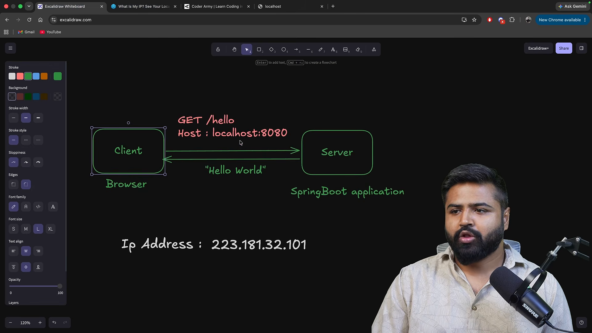
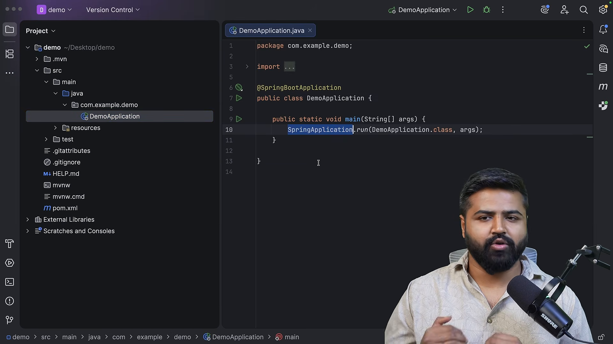
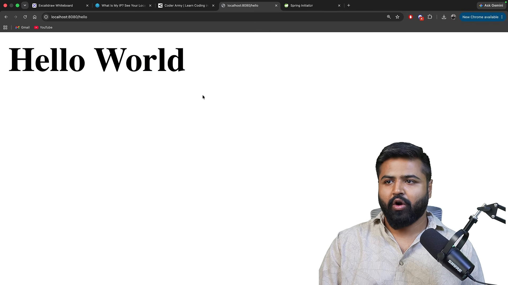
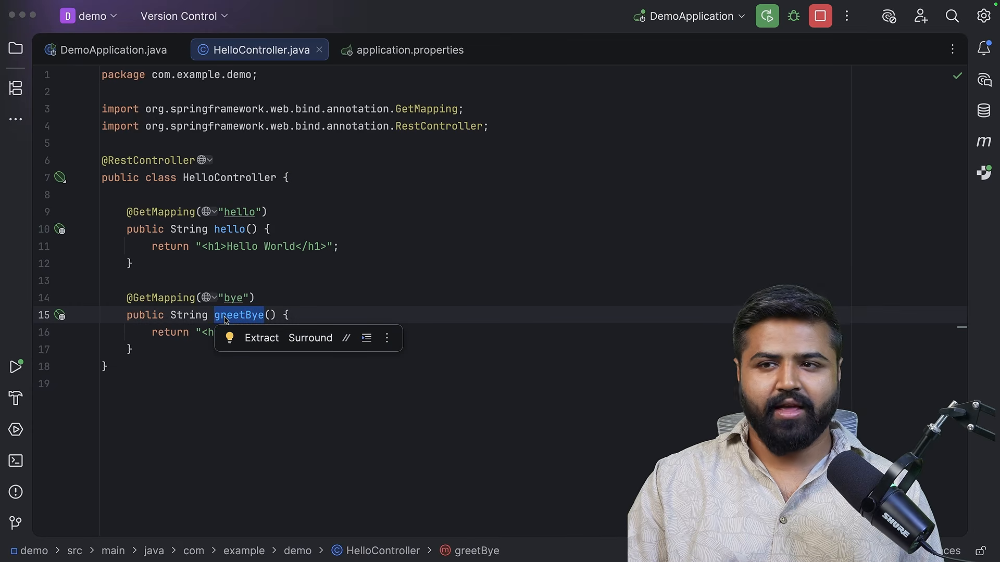

# Xây dựng ứng dụng Spring Boot đầu tiên

* **Kênh:** Bouali Ali | **Thời lượng:** 00:31:12 | **Ngày:** 2026-03-02
* **Video:** https://www.youtube.com/watch?v=PVreyET_Q6I

---

## Thuật ngữ

| Thuật ngữ | Tiếng Anh | Giải thích |
| :--- | :--- | :--- |
| Địa chỉ mạng | IP Address | Định danh số gán cho mỗi thiết bị tham gia vào mạng máy tính theo giao thức liên mạng |
| Cổng dịch vụ | Port Number | Điểm cuối logic (16-bit) phân biệt các tiến trình và dịch vụ mạng chạy trên cùng một máy chủ vật lý |
| Công cụ khởi tạo Spring | Spring Initializr | Dịch vụ web hỗ trợ tạo khung dự án Spring Boot với các phụ thuộc định sẵn |
| Tệp cấu hình dự án | pom.xml | Tệp mô hình đối tượng dự án của Maven định nghĩa phụ thuộc, phiên bản và quy trình đóng gói |
| Máy chủ nhúng | Embedded Tomcat | Máy chủ ứng dụng được tích hợp trực tiếp vào tệp nhị phân JAR thay vì triển khai ra ngoài |
| Điểm cuối giao diện lập trình | REST Endpoint | Đường dẫn URI cụ thể tiếp nhận yêu cầu và trả về tài nguyên thông qua các phương thức HTTP chuẩn |
| Bộ điều khiển dịch vụ | @RestController | Chú thích đánh dấu lớp tiếp nhận yêu cầu web và tự động chuyển đổi giá trị trả về thành thân HTTP (JSON/văn bản) |
| Ánh xạ yêu cầu đọc | @GetMapping | Chú thích liên kết đường dẫn HTTP GET tới một phương thức xử lý cụ thể trong Controller |

---

## Tổng luận chuyên đề

### Cơ chế định danh mạng

Một gói tin mạng di chuyển từ máy khách đến đúng ứng dụng máy chủ dựa trên hai yếu tố kết hợp:
1. **Địa chỉ IP (IP Address):** Dẫn hướng gói tin đến đúng máy tính vật lý hoặc máy chủ ảo trong hệ thống mạng toàn cầu (tương tự địa chỉ tòa nhà).
2. **Cổng dịch vụ (Port Number):** Định vị chính xác tiến trình phần mềm đang lắng nghe trong máy tính đó (tương tự số phòng trong tòa nhà). Ví dụ: Cổng 80 dành cho HTTP, cổng 443 cho HTTPS, cổng 3306 cho MySQL và cổng mặc định 8080 cho Spring Boot.

### Chu trình khởi chạy Spring Boot

Quá trình từ lúc kích hoạt phương thức `main` đến khi ứng dụng sẵn sàng nhận kết nối:
1. Kích hoạt `SpringApplication.run(Application.class, args)`.
2. Tạo lập môi trường ứng dụng và nạp tệp cấu hình `application.properties`.
3. Quét các thành phần trong gói mã nguồn (Component Scanning).
4. Khởi động máy chủ web nhúng (Embedded Tomcat) trên cổng cấu hình (mặc định 8080).
5. Đăng ký các bộ điều khiển (`@RestController`) và ánh xạ đường dẫn URL (`@GetMapping`) vào bộ nhớ điều phối `DispatcherServlet`.

---

## Bóc tách chi tiết

### Định vị dịch vụ mạng



Nguyên lý truyền thông giữa máy khách và máy chủ:
- Khi một máy tính chạy đồng thời nhiều chương trình máy chủ (như web server, database server, cache server), tất cả đều dùng chung một địa chỉ IP duy nhất (ví dụ: `192.168.1.15` hoặc `127.0.0.1` đối với môi trường cục bộ).
- Cổng dịch vụ (`Port`) là số nguyên từ 0 đến 65535, giúp hệ điều hành chuyển tiếp các gói tin mạng đến đúng ứng dụng đích mà không bị xung đột.
- Khi hai ứng dụng cố gắng mở cùng một cổng trên cùng một địa chỉ IP, hệ điều hành sẽ báo lỗi xung đột cổng (`Port already in use`).

### Thiết lập dự án


Thiết lập ứng dụng chuẩn thông qua giao diện Spring Initializr:
- **Hệ thống quản lý bản dựng:** Maven (định dạng tệp XML khai báo cấu trúc dự án chuẩn).
- **Ngôn ngữ lập trình:** Java (phiên bản LTS như Java 17 hoặc Java 21).
- **Phiên bản nền tảng:** Spring Boot 3.x ổn định (tránh các bản dựng SNAPSHOT hoặc Milestone trong môi trường sản xuất).
- **Tọa độ dự án (Project Metadata):**
  - Group: Định danh định dạng tên miền đảo ngược của tổ chức (ví dụ: `com.coderarmy`).
  - Artifact: Tên mô-đun ứng dụng (ví dụ: `first-spring-boot-app`).
  - Packaging: Jar (đóng gói toàn bộ mã nguồn cùng máy chủ nhúng).
- **Phụ thuộc khởi tạo (Dependencies):** Thêm `Spring Web` để tích hợp máy chủ Tomcat nhúng và thư viện Spring MVC.

### Cấu trúc dự án Maven



Dự án sau khi giải nén sở hữu cấu trúc thư mục quy chuẩn:
- `src/main/java/`: Chứa toàn bộ mã nguồn ứng dụng Java. Lớp khởi chạy chứa phương thức `main` đặt tại gói gốc để bộ quét thành phần tìm thấy các lớp con.
- `src/main/resources/`: Chứa các tài nguyên phi mã nguồn, đặc biệt là `application.properties` để cấu hình cổng, chuỗi kết nối và thông số hoạt động.
- `src/test/java/`: Chứa các mã kiểm thử đơn vị và tích hợp.
- `pom.xml`: Khai báo phần tử cha `spring-boot-starter-parent` nhằm thừa kế quản lý phiên bản cho toàn bộ thư viện con.

### Xây dựng điểm cuối đầu tiên



Để phục vụ một yêu cầu web động:
- Khai báo một lớp Java và gắn chú thích `@RestController`. Chú thích này kết hợp giữa `@Controller` và `@ResponseBody`, báo hiệu cho Spring rằng dữ liệu trả về từ các phương thức sẽ được ghi trực tiếp vào thân gói tin HTTP chứ không phải điều hướng sang trang giao diện HTML.
- Tạo phương thức xử lý và gắn chú thích `@GetMapping("/hello")`. Khi máy khách gửi yêu cầu `GET` đến `http://localhost:8080/hello`, Spring tự động điều phối đến phương thức này và gửi chuỗi `"Hello World"` về trình duyệt.

### Mở rộng điểm cuối và đổi cổng



Các kỹ thuật điều chỉnh và mở rộng nhanh:
- **Đổi cổng máy chủ:** Trong tệp `src/main/resources/application.properties`, thêm dòng cấu hình `server.port=8081`. Khi khởi động lại, Tomcat sẽ chuyển từ lắng nghe trên cổng 8080 sang cổng 8081.
- **Thêm điểm cuối mới:** Khai báo thêm phương thức với `@GetMapping("/bye")` trả về `"Goodbye"`. Spring MVC quản lý danh mục ánh xạ URL trong bộ nhớ và chuyển tiếp chính xác theo từng định tuyến.

---

## Trích dẫn then chốt

* "Địa chỉ IP dẫn đường đến ngôi nhà, còn số cổng là chìa khóa mở đúng căn phòng bên trong ngôi nhà đó." [02:19](https://www.youtube.com/watch?v=PVreyET_Q6I&t=139s)
* "Spring Initializr không làm phép thuật nào cả, nó chỉ đơn giản là tạo ra bộ khung thư mục chuẩn và tệp pom.xml chứa các phụ thuộc chúng ta yêu cầu." [11:14](https://www.youtube.com/watch?v=PVreyET_Q6I&t=674s)
* "Nếu chỉ học cách gõ @RestController mà không hiểu bản chất luồng thực thi bên trong, bạn sẽ hoàn toàn bất lực khi gặp lỗi lúc chạy." [28:51](https://www.youtube.com/watch?v=PVreyET_Q6I&t=1731s)

---

## Lệnh & Công cụ

### Mã nguồn điểm cuối mẫu

```java
package com.coderarmy.firstapp;

import org.springframework.web.bind.annotation.GetMapping;
import org.springframework.web.bind.annotation.RestController;

@RestController
public class HelloController {

    @GetMapping("/hello")
    public String sayHello() {
        return "Hello World from Spring Boot!";
    }

    @GetMapping("/bye")
    public String sayBye() {
        return "Goodbye and see you soon!";
    }
}
```

### Cấu hình cổng ứng dụng

```properties
# src/main/resources/application.properties
server.port=8081
```

### Kiểm tra điểm cuối từ dòng lệnh

```bash
# Kiểm tra điểm cuối /hello
curl -i http://localhost:8081/hello

# Kiểm tra điểm cuối /bye
curl -i http://localhost:8081/bye
```

---

## Đánh đổi & Rủi ro

### Đóng gói máy chủ nhúng
- **Kích thước tệp tin lớn:** Việc nhúng máy chủ Tomcat trực tiếp vào tệp JAR khiến kích thước bản dựng tăng lên 20-40 MB ngay cả đối với dự án chỉ có vài dòng mã.
- **Tiêu thụ tài nguyên nền:** Mỗi tiến trình Spring Boot chạy một phiên bản Tomcat độc lập, làm tăng dung lượng RAM tiêu thụ khi triển khai nhiều dịch vụ nhỏ trên cùng một máy chủ.

### Điểm mù của cơ chế tự động hóa
- **Nguy cơ phụ thuộc hộp đen:** Nhà phát triển dễ lầm tưởng ứng dụng hoạt động kỳ diệu mà không nắm rõ vai trò của `DispatcherServlet`, cơ chế ánh xạ `HandlerMapping` và vòng đời các thành phần bên dưới.
- **Khó khăn khi xử lý xung đột cổng:** Trong môi trường triển khai thực tế hoặc môi trường kiểm thử CI/CD, xung đột cổng dịch vụ cố định là lỗi thường xuyên xảy ra nếu không áp dụng cấu hình cổng động (`server.port=0`).
