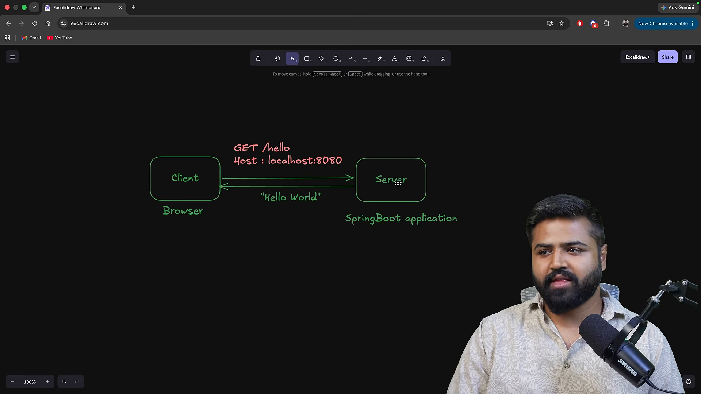
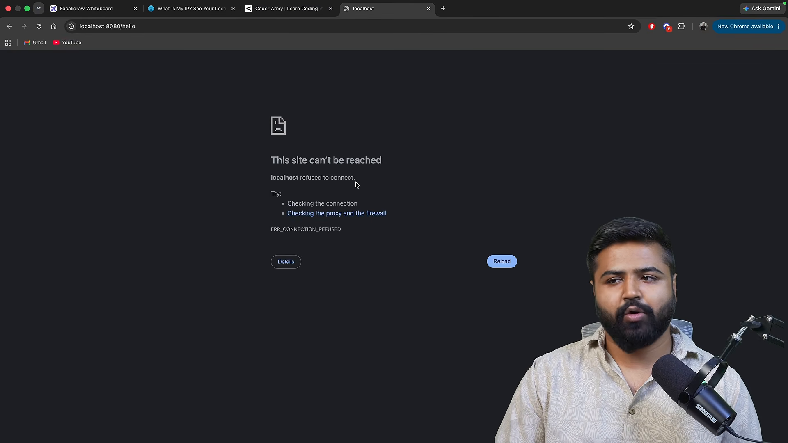
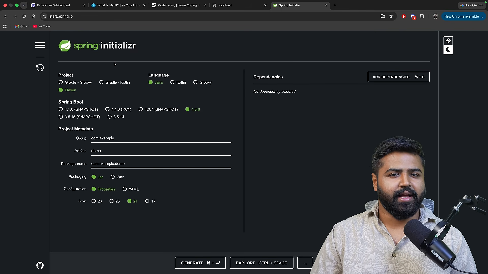
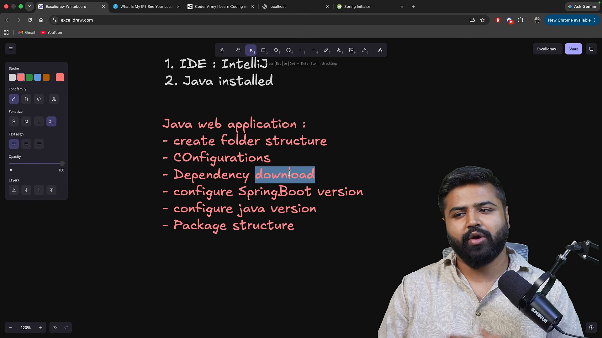
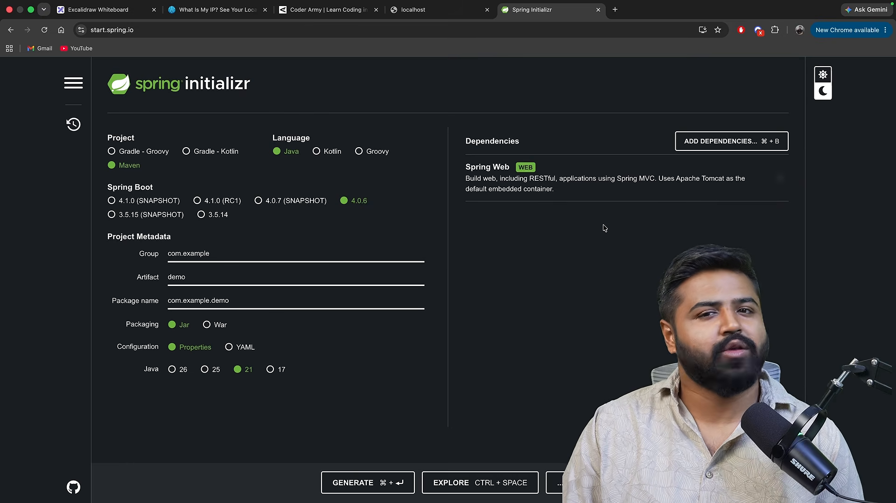
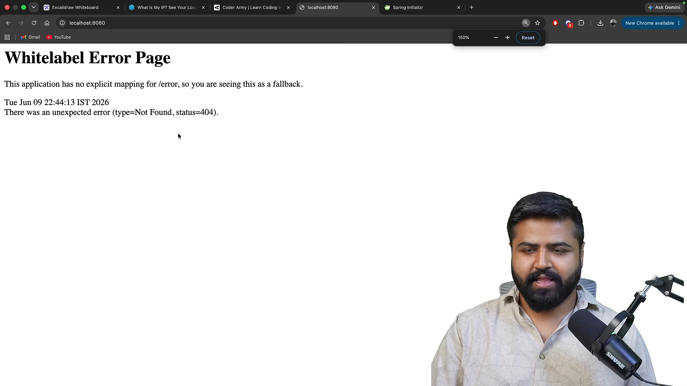
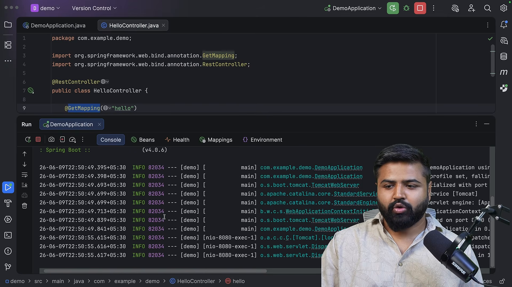
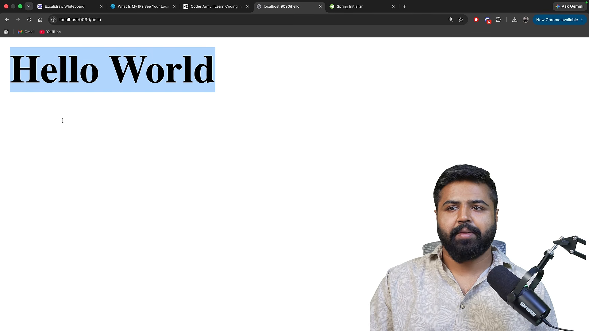
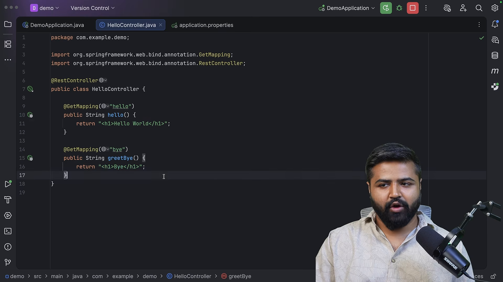

# Build Your First Spring Boot Application | REST API

* **Kênh:** Coder Army | **Thời lượng:** 00:31:12 | **Ngày:** 2026-06-16
* **Video:** https://youtu.be/PVreyET_Q6I

---

## Thuật ngữ

| Thuật ngữ | Tiếng Anh | Giải thích |
| :--- | :--- | :--- |
| Giao thức Internet | IP (Internet Protocol) Address | Chuỗi định danh số duy nhất gán cho mỗi thiết bị tham gia mạng máy tính để định tuyến gói tin trên Internet. |
| Cổng mạng | Port Number | Số hiệu logic (0 đến 65535) gắn liền với tiến trình ứng dụng đang chạy trên hệ điều hành để phân kênh dữ liệu mạng. |
| Máy chủ cục bộ | Localhost / Loopback | Tên miền trỏ trực tiếp về chính máy tính hiện tại, tương ứng với địa chỉ IPv4 `127.0.0.1`. |
| Hệ thống phân giải tên miền | DNS (Domain Name System) | Dịch vụ mạng chuyển đổi tên miền dạng chuỗi ký tự (như `coderarmy.in`) thành địa chỉ IP tương ứng để máy khách gửi gói tin. |
| Công cụ khởi tạo Spring | Spring Initializr | Dịch vụ web trực tuyến (`start.spring.io`) tạo sẵn khung dự án (scaffolding) với các cấu hình và dependencies chuẩn hóa. |
| Công cụ quản lý dự án | Build Tool (Maven / Gradle) | Phần mềm tự động hóa việc tải thư viện phụ thuộc (dependencies), biên dịch mã nguồn và đóng gói ứng dụng (JAR/WAR). |
| Định danh nhóm & sản phẩm | GroupId & ArtifactId | Chuỗi định danh của Maven: `groupId` phản ánh tổ chức/tên miền đảo ngược, `artifactId` là tên riêng của module dự án. |
| Điểm cuối giao diện lập trình | API Endpoint | Đường dẫn URI cụ thể trên máy chủ mà client gửi HTTP Request đến để kích hoạt logic nghiệp vụ. |
| Bộ điều khiển REST | RestController | Annotation của Spring (`@RestController`) đánh dấu class xử lý HTTP Request và tự động serialize kết quả trả về sang JSON hoặc chuỗi văn bản. |
| Ánh xạ yêu cầu GET | GetMapping | Annotation (`@GetMapping`) ánh xạ phương thức HTTP GET tại một URI cụ thể vào hàm xử lý Java tương ứng. |
| Máy chủ nhúng | Embedded Server | Máy chủ web (như Apache Tomcat) được đóng gói trực tiếp bên trong tệp JAR của ứng dụng thay vì phải cài đặt riêng biệt trên hệ điều hành. |
| Tệp cấu hình ứng dụng | Application Properties | Tệp cấu hình trung tâm (`application.properties` hoặc `application.yml`) để tùy biến các thông số hệ thống của Spring Boot (như cổng mạng `server.port`). |

---

## Tổng luận chuyên đề

### 1. Cơ chế định danh mạng: Phối hợp IP Address và Port Number
- **Địa chỉ IP:** Đóng vai trò như địa chỉ nhà của một thiết bị trên Internet. Client cần IP để tìm đến đúng máy tính của Server (thông qua phân giải DNS). Khi phát triển cục bộ, địa chỉ loopback `127.0.0.1` (`localhost`) được dùng để trỏ vào chính máy đang thực thi.
- **Cổng mạng (Port):** Một máy tính có thể chạy hàng trăm ứng dụng khác nhau (Web server, MySQL, IDE, Game). Port đóng vai trò như "số phòng" bên trong tòa nhà. Khi gói tin IP đến máy chủ, hệ điều hành dựa vào số Port (ví dụ `8080`) để chuyển tiếp gói tin tới đúng tiến trình ứng dụng đang lắng nghe.

### 2. Chuẩn hóa khởi tạo dự án với Spring Initializr và Maven
- Khi lập trình web Java truyền thống, việc tự tải từng file JAR thư viện, xử lý xung đột phiên bản và thiết lập cấu hình máy chủ tốn rất nhiều thời gian và dễ phát sinh lỗi.
- Spring Initializr (`start.spring.io`) tự động hóa toàn bộ: Lựa chọn Project Type (Maven), Ngôn ngữ (Java), Phiên bản Spring Boot ổn định, Group, Artifact và Dependencies (trọng tâm là `Spring Web`).
- `Spring Web` cung cấp bộ đôi cốt lõi: Framework Spring MVC và máy chủ nhúng Embedded Tomcat, sẵn sàng tiếp nhận HTTP request ngay khi tải về mà không cần cấu hình thêm.

### 3. Vòng đời xử lý của một REST Endpoint
- Khởi tạo controller bằng annotation `@RestController` để báo hiệu cho Spring IoC Container quản lý class này như một cổng đón nhận API.
- Định tuyến hành động bằng `@GetMapping("/endpoint")`: Khai báo phương thức xử lý cho yêu cầu GET tại URI chỉ định.
- Cơ chế thực thi bên dưới:
  1. Embedded Tomcat lắng nghe cổng mạng (mặc định `8080`).
  2. Khi người dùng truy cập `http://localhost:8080/hello`, Tomcat tiếp nhận kết nối TCP và chuyển giao HTTP request cho Spring.
  3. Spring MVC điều phối request tới phương thức tương ứng trong `@RestController`.
  4. Chuỗi kết quả trả về từ hàm Java được ghi thẳng vào thân HTTP Response gửi ngược lại trình duyệt.

---

## Bóc tách chi tiết

### [[00:00:46](https://youtu.be/PVreyET_Q6I?t=46s)] Luồng dữ liệu



- **Tổng quan luồng giao tiếp:**
  - Client (trình duyệt) gửi yêu cầu HTTP Request đến ứng dụng Spring Boot.
  - Ứng dụng Spring Boot đang chạy và lắng nghe trên một cổng mạng xác định (ví dụ mặc định: port `8080`).
  - Sau khi tiếp nhận, ứng dụng thực thi đoạn mã logic tương ứng và trả về phản hồi HTTP Response (chuỗi văn bản hoặc HTML) để hiển thị lên màn hình client.

### [[00:02:19](https://youtu.be/PVreyET_Q6I?t=139s)] Địa chỉ IP



- **Bản chất của IP và vai trò DNS:**
  - Mọi thiết bị kết nối mạng đều được cấp phát một địa chỉ IP (IPv4 có dạng 4 octet số như `192.168.1.1` hoặc IPv6).
  - Khi người dùng gõ tên miền `www.coderarmy.in`, trình duyệt truy vấn máy chủ DNS (Domain Name System) để phân giải tên miền sang địa chỉ IP thực tế của máy chủ.
- **Localhost và Loopback IP:**
  - Khi phát triển trên máy cá nhân, client và server cùng nằm trên một thiết bị.
  - Địa chỉ đặc biệt `127.0.0.1` được định nghĩa là địa chỉ loopback, với tên định danh tương ứng là `localhost`.
- **Cơ chế phân tách cổng mạng (Port):**
  - Địa chỉ IP chỉ xác định được chiếc máy tính đích. Nếu máy tính đó chạy đồng thời nhiều chương trình mạng (ví dụ vừa chạy Zoom, Spotify, vừa chạy Server), IP không thể biết gói tin thuộc về ai.
  - Số Port (0 - 65535) giúp hệ điều hành phân phối dữ liệu vào đúng ứng dụng. Cổng HTTP chuẩn của web là `80`, HTTPS là `443`, và cổng mặc định của Spring Boot là `8080`.

### [[00:10:22](https://youtu.be/PVreyET_Q6I?t=622s)] Yêu cầu chuẩn bị

- **Môi trường bắt buộc trước khi lập trình:**
  - Cài đặt Java Development Kit (JDK) trên máy: phiên bản hiện đại (Java 17, 21 hoặc mới hơn).
  - Cài đặt môi trường phát triển tích hợp (IDE): IntelliJ IDEA (Community hoặc Ultimate), Eclipse, hoặc VS Code có Java Extension Pack.

### [[00:11:14](https://youtu.be/PVreyET_Q6I?t=674s)] Công cụ khởi tạo



- Giảng viên truy cập trang web chính thức [start.spring.io](https://start.spring.io).
- Đây là công cụ web giúp sinh mã khung (bootstrap/scaffolding) cho các dự án Spring Boot, tích hợp sẵn các thiết lập tối ưu chuẩn công nghiệp.

### [[00:11:39](https://youtu.be/PVreyET_Q6I?t=699s)] Thiết lập dự án



- **Các thông số cấu hình quan trọng trên Spring Initializr:**
  - **Project:** Chọn `Maven` (công cụ build phổ biến, dễ quản lý dependencies qua file XML).
  - **Language:** Chọn `Java`.
  - **Spring Boot Version:** Chọn phiên bản ổn định (tránh các bản SNAPSHOT hoặc Milestone đang trong quá trình thử nghiệm).
  - **Project Metadata:**
    - `Group`: Tên định danh tổ chức (ví dụ: `com.example` hoặc `in.coderarmy`).
    - `Artifact`: Tên mã nguồn dự án (ví dụ: `demo` hoặc `first-app`).
    - `Name`: Tên hiển thị của dự án.
    - `Package name`: Gói Java gốc, tự động kết hợp từ Group + Artifact (`com.example.demo`).
    - `Packaging`: Chọn `Jar` (đóng gói dạng file thực thi độc lập).
    - `Java Version`: Chọn phiên bản tương ứng với JDK đã cài trên máy (ví dụ Java 17 hoặc 21).

### [[00:14:20](https://youtu.be/PVreyET_Q6I?t=860s)] Tải mã nguồn



- **Thêm Dependency trọng tâm:**
  - Bấm `Add Dependencies` và tìm kiếm `Spring Web`.
  - Giảng viên giải thích mô tả của Spring Web: *"Build web, including RESTful, applications using Spring MVC. Uses Apache Tomcat as the default embedded container."*
  - Nhấn nút **GENERATE** (hoặc phím tắt `Ctrl + Enter`) để tải về tệp tin nén `.zip`.

### [[00:18:16](https://youtu.be/PVreyET_Q6I?t=1096s)] Cấu trúc thư mục


Giải nén và mở dự án trong IntelliJ IDEA. Cấu trúc thư mục chuẩn của Maven bao gồm:

```
demo/
├── pom.xml                               # Tệp cấu hình Maven (dependencies, plugins)
├── src/
│   ├── main/
│   │   ├── java/
│   │   │   └── com/example/demo/
│   │   │       └── DemoApplication.java # Class chính chứa hàm main khởi động
│   │   └── resources/
│   │       ├── application.properties   # Tệp cấu hình các thông số hệ thống
│   │       ├── static/                  # Chứa file tĩnh (css, js, images)
│   │       └── templates/               # Chứa template giao diện (Thymeleaf, HTML)
│   └── test/                            # Thư mục chứa Unit test
```

Class khởi động mặc định:

```java
package com.example.demo;

import org.springframework.boot.SpringApplication;
import org.springframework.boot.autoconfigure.SpringBootApplication;

@SpringBootApplication
public class DemoApplication {
    public static void main(String[] args) {
        SpringApplication.run(DemoApplication.class, args);
    }
}
```

### [[00:19:33](https://youtu.be/PVreyET_Q6I?t=1173s)] Khởi chạy console



- **Thử nghiệm in ra console:**
  - Thêm câu lệnh `System.out.println("Hello World");` vào sau dòng `SpringApplication.run()`.
  - Chạy hàm `main`: Ứng dụng khởi động thành công và dòng chữ in ra cửa sổ terminal.
- **Quan sát Log hệ thống:**
  - Dòng log hiển thị: `Tomcat started on port 8080 (http) with context path '/'`.
  - Điều này chứng minh Tomcat đã tự động khởi động ngầm và chiếm giữ cổng mạng `8080`.
  - Khi mở trình duyệt truy cập `http://localhost:8080`, màn hình trả về trang lỗi `Whitelabel Error Page (404 Not Found)` do ứng dụng chưa khai báo bất kỳ đường dẫn xử lý nào.

### [[00:21:20](https://youtu.be/PVreyET_Q6I?t=1280s)] Viết điểm cuối


Tạo một class mới có tên `HelloController.java` trong cùng package `com.example.demo`:

```java
package com.example.demo;

import org.springframework.web.bind.annotation.GetMapping;
import org.springframework.web.bind.annotation.RestController;

@RestController
public class HelloController {

    @GetMapping("/hello")
    public String sayHello() {
        return "Hello World";
    }

    // Hỗ trợ trả về cả thẻ định dạng HTML
    @GetMapping("/hello-html")
    public String sayHelloHtml() {
        return "<h1>Hello World</h1>";
    }
}
```

- **Ý nghĩa các annotation:**
  - `@RestController`: Đánh dấu cho Spring biết đây là lớp Controller xử lý các yêu cầu web API, sẵn sàng trả về dữ liệu thô.
  - `@GetMapping("/hello")`: Khai báo rằng khi có yêu cầu HTTP GET gửi đến đường dẫn `/hello`, phương thức `sayHello()` sẽ được tự động kích hoạt.
- **Kiểm thử trên trình duyệt:**
  - Khởi động lại ứng dụng.
  - Truy cập `http://localhost:8080/hello` trên trình duyệt: Chuỗi `"Hello World"` lập tức hiển thị trên màn hình.

### [[00:26:02](https://youtu.be/PVreyET_Q6I?t=1562s)] Câu hỏi chưa đáp



- Giảng viên đặt ra các câu hỏi cốt lõi đằng sau sự tiện lợi của Spring Boot:
  1. *Ai là người khởi động Tomcat server?* -> Do tệp thư viện `spring-boot-starter-web` tự động cấu hình và nhúng sẵn.
  2. *Làm cách nào Spring liên kết đường dẫn `/hello` với phương thức `sayHello()`?* -> Thông qua cơ chế phản chiếu (Reflection) và bộ điều phối `DispatcherServlet` của Spring MVC.
  3. *Tại sao chỉ cần thêm annotation là mọi thứ tự vận hành?* -> Cơ chế quét thành phần (Component Scanning) và Dependency Injection của Spring IoC.

### [[00:27:17](https://youtu.be/PVreyET_Q6I?t=1637s)] Đổi cổng mạng



- Mở tệp `src/main/resources/application.properties`.
- Khai báo thông số cấu hình đổi cổng:
  ```properties
  server.port=9090
  ```
- Khởi động lại ứng dụng:
  - Log xác nhận: `Tomcat started on port 9090 (http)`.
  - Lúc này, truy cập cổng cũ `http://localhost:8080/hello` sẽ nhận thông báo lỗi kết nối `This site can't be reached`.
  - Bắt buộc phải truy cập qua cổng mới: `http://localhost:9090/hello`.

### [[00:27:54](https://youtu.be/PVreyET_Q6I?t=1674s)] Thêm điểm cuối



Bổ sung thêm endpoint thứ hai vào `HelloController`:

```java
@GetMapping("/bye")
public String greetBye() {
    return "Bye";
}
```

- **Nguyên lý ánh xạ độc lập:** Tên phương thức (`greetBye`) không nhất thiết phải trùng với chuỗi đường dẫn URI (`/bye`). Spring MVC chỉ quan tâm tới giá trị được khai báo bên trong annotation `@GetMapping`.
- Khởi động lại ứng dụng và truy cập `http://localhost:9090/bye`: Màn hình hiển thị nội dung `"Bye"`.

### [[00:28:51](https://youtu.be/PVreyET_Q6I?t=1731s)] Động lực học sâu


- **Tại sao không thể chỉ học mẹo dùng Spring Boot:**
  - Nếu chỉ dừng lại ở việc gõ theo các annotation (`@RestController`, `@GetMapping`), lập trình viên sẽ hoàn toàn bất lực khi gặp sự cố hiệu năng, lỗi rò rỉ bộ nhớ, xung đột Bean hoặc khi cần tùy biến các luồng xử lý nâng cao.
  - Phải hiểu thấu đáo kiến trúc bên dưới: Tomcat hoạt động ra sao, Servlet Container quản lý Request/Response thế nào, và Spring Core (IoC, DI) lắp ráp các đối tượng ra sao. Đó là nền tảng cốt lõi của khóa học để trở thành một Java Full Stack / Backend Engineer thực thụ.

---

## Trích dẫn then chốt

- [00:06:13](https://youtu.be/PVreyET_Q6I?t=373): *"Địa chỉ IP chỉ giúp gói tin tìm đến cánh cổng của ngôi nhà, còn số Port mới là thứ chỉ dẫn gói tin vào đúng căn phòng của ứng dụng đang chờ."*
- [00:24:51](https://youtu.be/PVreyET_Q6I?t=1491): *"Nhìn xem chúng ta viết ít dòng mã đến mức nào để có một web server hoàn chỉnh: chỉ cần một file Java, một phương thức và hai annotation là xong."*
- [00:26:44](https://youtu.be/PVreyET_Q6I?t=1604): *"Spring Boot làm mọi thứ trông có vẻ như phép thuật, nhưng công việc của chúng ta trong toàn bộ chuỗi bài giảng này là bóc tách từng lớp ma thuật đó để thấy rõ bản chất vận hành."*
- [00:29:52](https://youtu.be/PVreyET_Q6I?t=1792): *"Nếu bạn chỉ học cú pháp Spring Boot bề nổi, khi hệ thống gặp lỗi thực tế bạn sẽ không thể biết được vấn đề nằm ở tầng mạng, tầng Tomcat, tầng Spring MVC hay tầng logic nghiệp vụ."*

---

## Lệnh & Công cụ

### 1. Cấu hình tệp phụ thuộc `pom.xml` cốt lõi

```xml
<dependencies>
    <!-- Starter trọng tâm cung cấp REST API và Embedded Tomcat -->
    <dependency>
        <groupId>org.springframework.boot</groupId>
        <artifactId>spring-boot-starter-web</artifactId>
    </dependency>

    <!-- Thư viện hỗ trợ viết kiểm thử -->
    <dependency>
        <groupId>org.springframework.boot</groupId>
        <artifactId>spring-boot-starter-test</artifactId>
        <scope>test</scope>
    </dependency>
</dependencies>
```

### 2. Tùy biến tham số hệ thống trong `application.properties`

```properties
# Cấu hình đổi cổng lắng nghe của Embedded Tomcat
server.port=9090

# Cấu hình context path (tiền tố URL gốc nếu cần)
# server.servlet.context-path=/api
```

### 3. Kiểm tra cổng mạng đang hoạt động trên hệ điều hành

```bash
# Xem ứng dụng nào đang chiếm dụng cổng 8080 hoặc 9090 trên Linux
ss -tulpn | grep -E '8080|9090'
# Hoặc sử dụng lsof
lsof -i :9090
```

---

## Đánh đổi & Rủi ro

| Quyết định kỹ thuật | Ưu điểm thực tế | Đánh đổi & Thách thức |
| :--- | :--- | :--- |
| Sử dụng Spring Initializr | Tạo khung dự án chuẩn hóa chỉ trong vài giây; tránh xung đột phiên bản dependencies. | Phụ thuộc vào kết nối mạng; người mới dễ xem nhẹ việc hiểu cấu trúc file cấu hình build `pom.xml`. |
| Máy chủ nhúng (Embedded Tomcat) | Đóng gói tất cả thành 1 file JAR duy nhất (`java -jar app.jar`); triển khai CI/CD và Docker siêu gọn nhẹ. | Không thể chia sẻ một máy chủ Tomcat cho nhiều ứng dụng riêng biệt; tốn thêm RAM cho từng container chạy độc lập. |
| Sử dụng `@RestController` | Tự động tuần tự hóa (serialize) chuỗi/đối tượng sang HTTP response mà không cần cấu hình View Resolver. | Nếu cần dựng giao diện server-side rendering (JSP/Thymeleaf) thì phải dùng `@Controller` thay vì `@RestController`. |
| Cấu hình qua `application.properties` | Đơn giản, trực quan, ghi đè thông số hệ thống nhanh chóng mà không cần biên dịch lại mã nguồn. | Cấu hình dạng phẳng (flat) dễ bị dài và rối mắt đối với các hệ thống phân tán lớn (ưu tiên chuyển sang file `.yml` khi có cấu trúc lồng nhau). |
