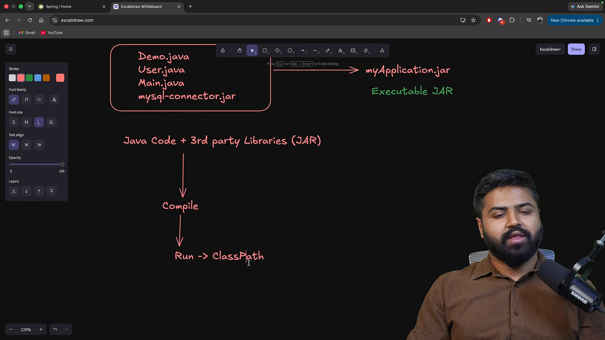
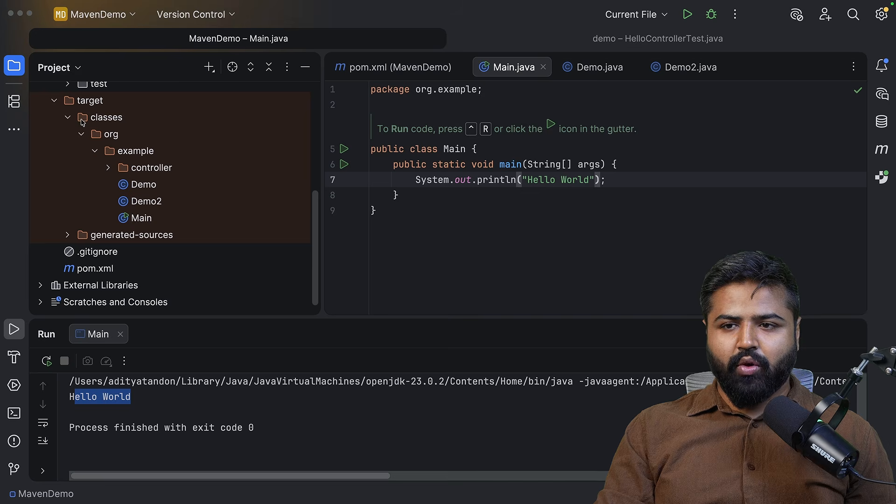
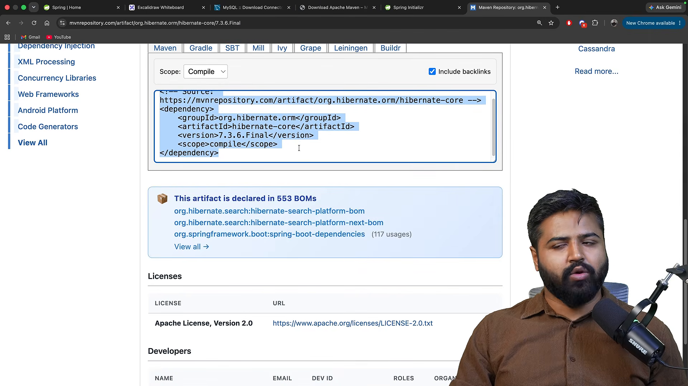
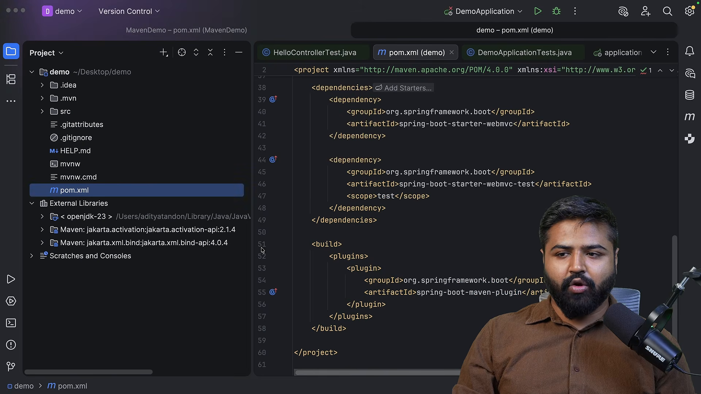
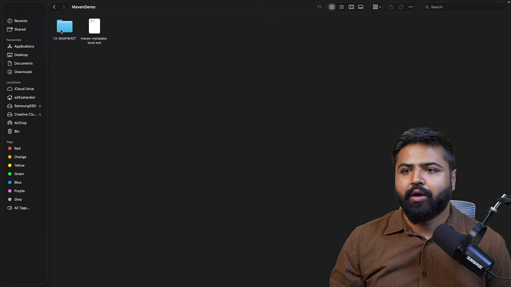

# Quản trị dự án với Apache Maven

* **Kênh:** Bouali Ali | **Thời lượng:** 01:28:24 | **Ngày:** 2026-03-03
* **Video:** https://www.youtube.com/watch?v=N2EXGMJVwUU

---

## Thuật ngữ

| Thuật ngữ | Tiếng Anh | Giải thích |
| :--- | :--- | :--- |
| Tệp lưu trữ Java | JAR (Java Archive) | Tệp nén định dạng zip chứa mã bytecode (.class), tài nguyên và siêu dữ liệu manifest của Java |
| Thư viện | Library | Tập hợp các lớp và phương thức tái sử dụng được cung cấp cho ứng dụng khác gọi đến |
| Mô hình đối tượng dự án | POM (Project Object Model) | Tệp XML cốt lõi khai báo cấu hình, phụ thuộc, phần bổ trợ và quy tắc đóng gói của Maven |
| Kho lưu trữ cục bộ | Local Repository | Thư mục trên máy trạm (`~/.m2/repository`) lưu trữ các tệp JAR đã tải về từ kho trung tâm |
| Kho lưu trữ trung tâm | Central Repository | Máy chủ lưu trữ công khai của hệ sinh thái Maven (Maven Central) chứa hàng triệu thư viện Java |
| Vòng đời bản dựng | Build Lifecycle | Chuỗi các giai đoạn định sẵn (validate, compile, test, package, install, deploy) để tự động hóa xây dựng phần mềm |
| Phụ thuộc gián tiếp | Transitive Dependency | Hiện tượng một thư viện A kéo theo thư viện B và C mà thư viện đó cần để hoạt động |
| Mẫu khung dự án | Archetype | Mẫu dựng sẵn giúp khởi tạo nhanh cấu trúc thư mục và tệp pom.xml theo từng loại ứng dụng |

---

## Tổng luận chuyên đề

### Bản chất quản trị dự án

Trước khi có công cụ quản trị tự động như Maven, quy trình phát triển Java gặp ba trở ngại nghiêm trọng:
1. **Tải thủ công thư viện:** Lập trình viên phải tự tìm kiếm tệp JAR trên internet, tải về máy và cấu hình biến môi trường `CLASSPATH` bằng tay.
2. **Xung đột phụ thuộc ngầm:** Thư viện A yêu cầu thư viện B phiên bản 1.0, trong khi thư viện C yêu cầu thư viện B phiên bản 2.0. Việc quản lý thủ công dẫn đến lỗi xung đột địa ngục JAR (JAR Hell) lúc chạy.
3. **Quy trình đóng gói phân mảnh:** Mỗi nhà phát triển tự biên dịch bằng lệnh `javac` và đóng gói bằng lệnh `jar`, không có tiêu chuẩn chung cho việc chạy kiểm thử hay tự động hóa trên máy chủ CI/CD.

### Cơ chế ba tầng kho lưu trữ

Maven giải quyết bài toán phụ thuộc thông qua mô hình đồng bộ bộ đệm ba tầng:
- **Tầng 1: Kho cục bộ (Local Repo):** Nằm tại thư mục `~/.m2/repository`. Khi dự án cần một phụ thuộc, Maven kiểm tra tại đây trước tiên. Nếu có sẵn, tệp được liên kết ngay lập tức mà không tốn băng thông mạng.
- **Tầng 2: Kho nội bộ doanh nghiệp (Remote/Company Repo):** Các máy chủ nội bộ (như Nexus, Artifactory) đóng vai trò trung gian lưu trữ các thư viện riêng của công ty hoặc làm proxy đệm.
- **Tầng 3: Kho trung tâm toàn cầu (Central Repo):** Nguồn dữ liệu mở toàn cầu của Maven, tải về tự động khi kho cục bộ chưa có bản sao lưu.

---

## Bóc tách chi tiết

### Khác biệt thư viện và ứng dụng



Bản chất của việc đóng gói phần mềm Java:
- **Ứng dụng độc lập (Application):** Là chương trình có điểm nhập luồng thực thi chính (`public static void main(String[] args)`). Ứng dụng có thể chạy trực tiếp từ dòng lệnh hoặc khởi chạy dưới dạng máy chủ.
- **Thư viện tái sử dụng (Library):** Không nhất thiết phải có phương thức `main`. Thư viện chỉ chứa các lớp logic, hàm tiện ích được đóng gói lại thành tệp `.jar` để các ứng dụng khác khai báo và triệu gọi lại mã nguồn.
- Maven đóng vai trò công cụ xây dựng đa năng: vừa biên dịch được thư viện độc lập, vừa đóng gói được ứng dụng hoàn chỉnh.

### Cấu trúc và thư mục đích



Maven áp dụng nguyên lý "Quy ước hơn cấu hình" (Convention over Configuration):
- `src/main/java`: Thư mục chuẩn bắt buộc chứa mã nguồn Java nghiệp vụ.
- `src/main/resources`: Chứa các tệp cấu hình (properties, yml, xml).
- `src/test/java`: Chứa các ca kiểm thử tự động.
- Khi thực thi lệnh `mvn compile`, Maven tạo ra thư mục `target/`.
- `target/classes/`: Chứa toàn bộ các tệp mã máy ảo `.class` sau khi biên dịch. Thư mục này hoàn toàn là sản phẩm phụ, có thể xóa sạch bất kỳ lúc nào bằng lệnh `mvn clean` mà không làm mất mã nguồn gốc.

### Cơ chế kéo phụ thuộc



Cơ chế định danh tọa độ (Coordinates) trong `pom.xml`:
- Mỗi thư viện trên thế giới được định vị duy nhất bằng bộ ba thông số (GAV):
  - `groupId`: Tên miền đảo ngược của tổ chức phát hành (ví dụ: `org.springframework.boot`).
  - `artifactId`: Tên định danh của mô-đun thư viện cụ thể (ví dụ: `spring-boot-starter-web`).
  - `version`: Phiên bản phát hành chính xác (ví dụ: `3.4.0`).
- Khi khai báo trong khối `<dependencies>`, Maven tự động tính toán cây phụ thuộc gián tiếp, tải trọn gói các thư viện liên quan và gắn trực tiếp vào đường dẫn biên dịch.

### Chu trình luân chuyển kho dữ liệu



Quy trình tìm kiếm và lưu trữ tệp JAR:
1. Maven đọc định danh tọa độ từ `pom.xml`.
2. Truy vấn thư mục người dùng: `~/.m2/repository/<group_path>/<artifact>/<version>/`.
3. Nếu tệp JAR đã tồn tại, Maven gắn ngay vào classpath dự án.
4. Nếu chưa có, Maven gửi yêu cầu HTTP đến kho trung tâm (repo.maven.apache.org), tải tệp JAR về lưu vào kho cục bộ để dùng lại cho tất cả các dự án sau này trên cùng máy tính, sau đó mới tiến hành biên dịch.

### Vòng đời xây dựng phần mềm



Ba vòng đời tiêu chuẩn độc lập của Maven:
1. **Clean Lifecycle:** Chịu trách nhiệm dọn dẹp các tệp tạm của lần dựng trước (`pre-clean`, `clean`, `post-clean`).
2. **Default (Build) Lifecycle:** Vòng đời chính gồm các pha tuần tự:
   - `validate`: Xác thực tính hợp lệ của cấu trúc dự án và thông tin trong pom.xml.
   - `compile`: Biên dịch mã nguồn tại `src/main/java` sang `target/classes`.
   - `test`: Chạy các bộ kiểm thử đơn vị trong `src/test/java`.
   - `package`: Đóng gói mã biên dịch thành tệp JAR hoặc WAR.
   - `verify`: Kiểm tra tính toàn vẹn của gói đóng gói.
   - `install`: Sao chép tệp JAR vừa đóng gói vào kho cục bộ `~/.m2` để các dự án khác trên cùng máy có thể tái sử dụng.
   - `deploy`: Đẩy tệp đóng gói lên máy chủ kho lưu trữ từ xa của doanh nghiệp.
3. **Site Lifecycle:** Tạo tài liệu báo cáo web tự động cho dự án (`site`, `site-deploy`).

---

## Trích dẫn then chốt

* "Tệp JAR về bản chất chỉ là một tệp nén ZIP chứa các tệp .class đã biên dịch cùng một tệp manifest mô tả siêu dữ liệu." [00:44](https://www.youtube.com/watch?v=N2EXGMJVwUU&t=44s)
* "Quy ước hơn cấu hình nghĩa là nếu bạn đặt mã nguồn đúng thư mục chuẩn của Maven, bạn không cần viết bất kỳ dòng cấu hình biên dịch nào." [21:17](https://www.youtube.com/watch?v=N2EXGMJVwUU&t=1277s)
* "Kho lưu trữ cục bộ ~/.m2 đóng vai trò bộ đệm tối thượng: bạn chỉ tải một phiên bản thư viện đúng một lần duy nhất cho toàn bộ các dự án trên máy tính." [61:05](https://www.youtube.com/watch?v=N2EXGMJVwUU&t=3665s)
* "Khi bạn gọi một pha trong vòng đời Maven, toàn bộ các pha tiền nhiệm đứng trước nó đều tự động được kích hoạt theo đúng thứ tự." [71:47](https://www.youtube.com/watch?v=N2EXGMJVwUU&t=4307s)

---

## Lệnh & Công cụ

### Cấu trúc tệp pom.xml chuẩn

```xml
<project xmlns="http://maven.apache.org/POM/4.0.0"
         xmlns:xsi="http://www.w3.org/2001/XMLSchema-instance"
         xsi:schemaLocation="http://maven.apache.org/POM/4.0.0 
         https://maven.apache.org/xsd/maven-4.0.0.xsd">
    <modelVersion>4.0.0</modelVersion>

    <groupId>com.coderarmy</groupId>
    <artifactId>maven-mastery</artifactId>
    <version>1.0.0</version>
    <packaging>jar</packaging>

    <properties>
        <maven.compiler.source>17</maven.compiler.source>
        <maven.compiler.target>17</maven.compiler.target>
        <project.build.sourceEncoding>UTF-8</project.build.sourceEncoding>
    </properties>

    <dependencies>
        <dependency>
            <groupId>org.projectlombok</groupId>
            <artifactId>lombok</artifactId>
            <version>1.18.30</version>
            <scope>provided</scope>
        </dependency>
    </dependencies>
</project>
```

### Các lệnh thực thi cốt lõi

```bash
# Xóa sạch thư mục target cũ
mvn clean

# Biên dịch mã nguồn nghiệp vụ
mvn compile

# Chạy kiểm thử đơn vị
mvn test

# Đóng gói dự án thành tệp JAR (tự động chạy compile và test trước)
mvn package

# Đóng gói bỏ qua bước chạy kiểm thử
mvn package -DskipTests

# Cài đặt tệp JAR vào kho lưu trữ cục bộ ~/.m2
mvn install

# Phân tích cây phụ thuộc để tìm xung đột
mvn dependency:tree
```

---

## Đánh đổi & Rủi ro

### Đánh đổi hiệu năng và lưu trữ
- **Phình to ổ đĩa cục bộ:** Thư mục `~/.m2/repository` lưu trữ vĩnh viễn tất cả các phiên bản tệp JAR từng tải về, có thể chiếm hàng chục Gigabyte dung lượng ổ cứng nếu không được dọn dẹp định kỳ.
- **Thời gian phân giải phụ thuộc:** Khi chạy lệnh trên môi trường mới hoặc máy chủ CI/CD chưa có bộ đệm, pha phân giải phụ thuộc từ internet làm kéo dài thời gian đóng gói.

### Rủi ro an ninh chuỗi cung ứng
- **Tấn công đầu độc phụ thuộc (Dependency Poisoning):** Việc kéo tự động các phụ thuộc gián tiếp từ bên thứ ba tiềm ẩn rủi ro nạp mã độc hại vào ứng dụng nếu kho lưu trữ bị tấn công.
- **Xung đột phiên bản ngầm định:** Các thư viện bắc cầu có thể âm thầm ghi đè phiên bản của nhau theo quy tắc ưu tiên khoảng cách gần nhất trong cây phụ thuộc, dẫn đến lỗi bất tương thích nhị phân (`NoSuchMethodError`) lúc chạy.
