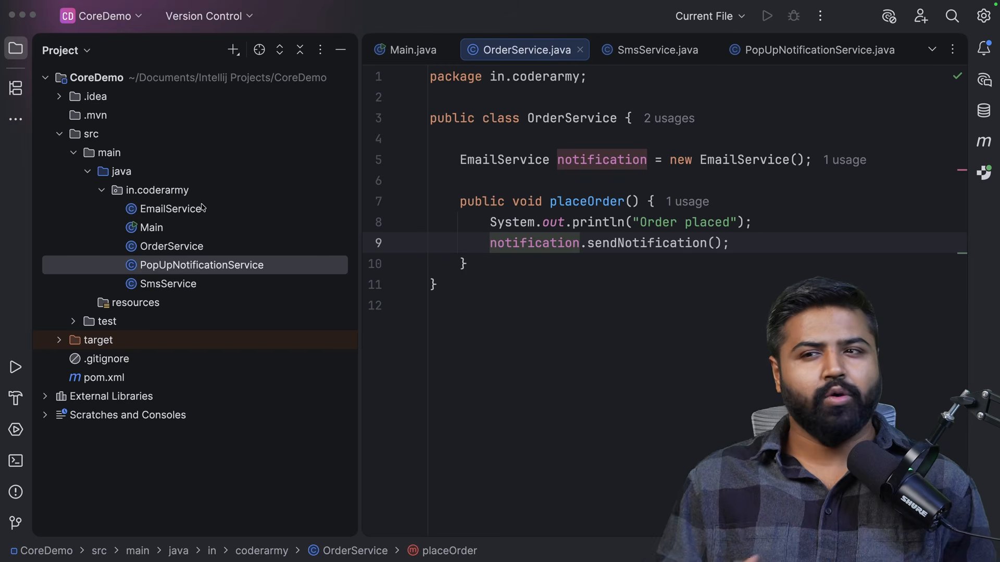
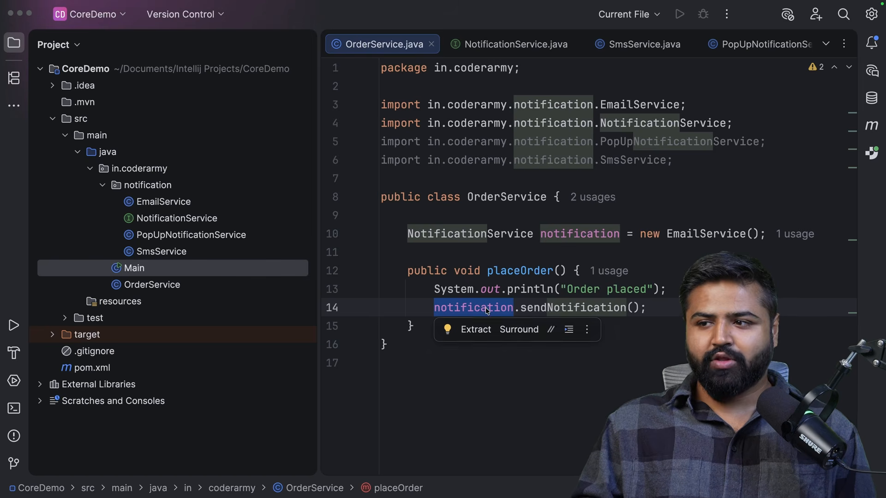
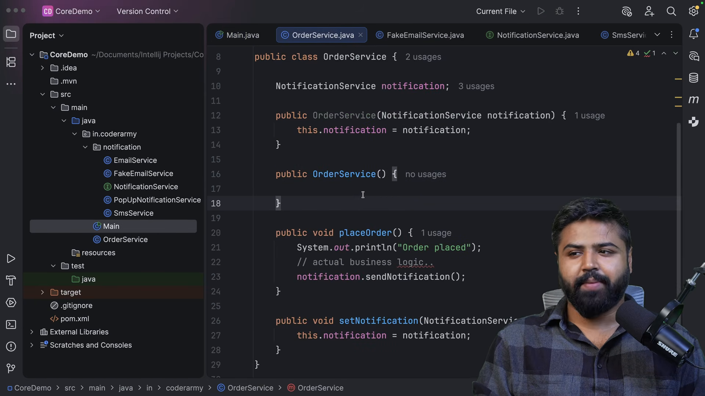
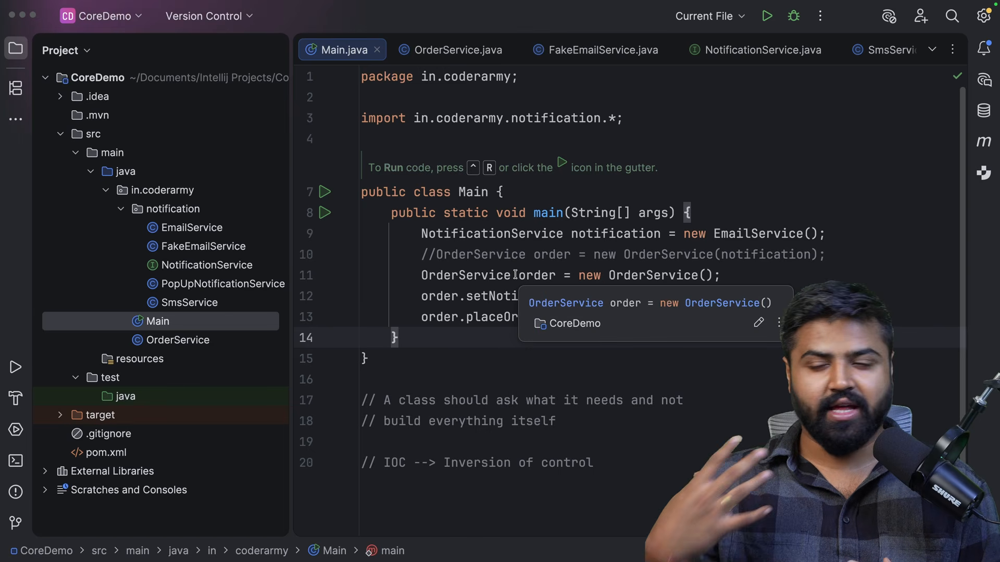
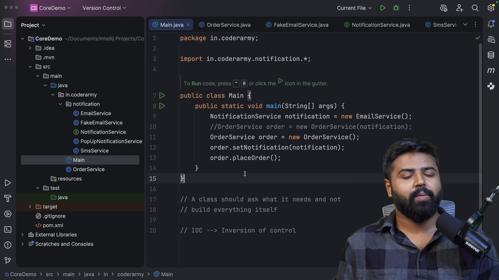

# Tiêm phụ thuộc và điều phối đảo ngược

* **Kênh:** Bouali Ali | **Thời lượng:** 00:39:37 | **Ngày:** 2026-03-04
* **Video:** https://www.youtube.com/watch?v=dT10m_5POfs

---

## Thuật ngữ

| Thuật ngữ | Tiếng Anh | Giải thích |
| :--- | :--- | :--- |
| Liên kết chặt chẽ | Tight Coupling | Mức độ phụ thuộc cao giữa các lớp khi một lớp trực tiếp khởi tạo thể hiện của lớp khác bằng từ khóa `new` |
| Liên kết lỏng lẻo | Loose Coupling | Thiết kế giảm thiểu sự phụ thuộc trực tiếp bằng cách giao tiếp qua giao diện trừu tượng (Interface) |
| Tiêm phụ thuộc | Dependency Injection (DI) | Mẫu thiết kế trong đó các đối tượng phụ thuộc được cung cấp từ bên ngoài vào lớp tiêu thụ |
| Điều phối đảo ngược | Inversion of Control (IoC) | Nguyên lý kiến trúc chuyển quyền kiểm soát luồng chương trình và khởi tạo đối tượng từ mã lập trình sang khung làm việc |
| Thùng chứa điều phối | IoC Container | Thành phần cốt lõi của Spring chịu trách nhiệm khởi tạo, cấu hình và kết nối các đối tượng (Bean) lại với nhau |
| Giao diện trừu tượng | Interface | Hợp đồng định nghĩa chữ ký phương thức mà không chứa mã thực thi chi tiết |

---

## Tổng luận chuyên đề

### Bản chất liên kết lỏng

Trong kiến trúc hướng đối tượng, mức độ liên kết giữa các lớp quyết định khả năng bảo trì và kiểm thử của phần mềm:
- **Thiết kế liên kết chặt (Tightly Coupled):** Khi lớp `Car` trực tiếp viết `Engine engine = new PetrolEngine();`, lớp `Car` bị gắn chặt vĩnh viễn với động cơ xăng. Muốn đổi sang động cơ điện `ElectricEngine`, lập trình viên bắt buộc phải sửa đổi mã nguồn của lớp `Car`, vi phạm nguyên lý Mở - Đóng (Open/Closed Principle) của SOLID.
- **Thiết kế liên kết lỏng (Loosely Coupled):** Lớp `Car` chỉ phụ thuộc vào giao diện `Engine`. Bất kỳ lớp nào hiện thực giao diện này (`PetrolEngine`, `DieselEngine`, `ElectricEngine`) đều có thể hoạt động mà không cần sửa đổi dù chỉ một dòng mã trong lớp `Car`.

### Mối quan hệ giữa DI và IoC

- **IoC là triết lý (Principle):** Trả lời câu hỏi *"Ai nắm quyền kiểm soát?"*. Theo cách lập trình truyền thống, lập trình viên nắm quyền tạo đối tượng qua từ khóa `new`. Trong mô hình IoC, quyền này được bàn giao hoàn toàn cho bộ điều khiển trung tâm (Spring Framework).
- **DI là kỹ thuật hiện thực (Design Pattern):** Là phương thức cụ thể để đạt được IoC. Thay vì đối tượng tự với tay ra ngoài để tạo phụ thuộc, đối tượng chỉ cần mở hàm tạo (Constructor) hoặc phương thức thiết lập (Setter) để thùng chứa "tiêm" phụ thuộc vào.

---

## Bóc tách chi tiết

### Khuyết tật liên kết chặt



Ví dụ thực tế về liên kết chặt chẽ trong mã nguồn:
- Xét hệ thống gồm lớp `Car` và lớp `PetrolEngine`. Lớp `Car` tự khởi tạo thể hiện bên trong trường dữ liệu hoặc hàm tạo: `this.engine = new PetrolEngine();`.
- Hậu quả kỹ thuật:
  1. Không thể viết kiểm thử đơn vị độc lập: Muốn kiểm thử logic của `Car`, buộc phải khởi tạo luôn một động cơ thật, không thể giả lập (`Mock`).
  2. Khả năng mở rộng bằng 0: Khi nghiệp vụ yêu cầu bổ sung dòng xe chạy điện, ta phải nhân bản lớp xe hoặc viết hàng loạt câu lệnh rẽ nhánh `if-else` phức tạp bên trong lớp `Car`.

### Trừu tượng hóa qua giao diện



Giải pháp tách rời phụ thuộc qua Interface:
- Khai báo một hợp đồng chung `interface Engine` với phương thức `void start()`.
- Các lớp động cơ cụ thể hiện thực hợp đồng: `class PetrolEngine implements Engine` và `class ElectricEngine implements Engine`.
- Trong lớp `Car`, trường dữ liệu được khai báo dưới dạng giao diện: `private Engine engine;`.
- Giờ đây, lớp `Car` hoàn toàn không quan tâm bên dưới là động cơ xăng hay điện, miễn là đối tượng đó tuân thủ đúng hợp đồng `Engine`.

### Ba hình thức tiêm phụ thuộc



Các kỹ thuật truyền phụ thuộc từ bên ngoài vào lớp:
1. **Tiêm qua hàm tạo (Constructor Injection - Khuyên dùng):** Phụ thuộc được truyền qua tham số của hàm khởi tạo. Đảm bảo đối tượng luôn ở trạng thái hoàn chỉnh hợp lệ ngay khi vừa sinh ra và hỗ trợ tính bất biến (`final`).
2. **Tiêm qua phương thức thiết lập (Setter Injection):** Phù hợp cho các phụ thuộc tùy chọn (Optional Dependencies) có thể thay đổi trong quá trình chạy.
3. **Tiêm qua trường dữ liệu (Field Injection):** Sử dụng `@Autowired` trực tiếp trên trường thuộc tính. Tiện lợi nhưng gây khó khăn khi viết kiểm thử thuần không có Spring context.

### Bản chất đảo ngược quyền kiểm soát



Quy tắc Hollywood: *"Đừng gọi cho chúng tôi, chúng tôi sẽ gọi cho bạn"* (Don't call us, we'll call you):
- Lập trình truyền thống: Mã của bạn kiểm soát toàn bộ luồng, chủ động gọi đến thư viện và tự tạo thể hiện.
- Mô hình IoC: Bộ khung trung gian (IoC Container) nắm quyền điều phối vòng đời chương trình. Khung làm việc sẽ tự động phân giải cây phụ thuộc và gọi ngược lại mã của bạn vào thời điểm thích hợp.

### Vai trò của thùng chứa Spring



Nếu tự thực hiện DI thủ công (Manual Dependency Injection):
- Lập trình viên vẫn phải tự viết hàm `main` để khởi tạo hàng chục đối tượng và truyền vào nhau:
  ```java
  Engine engine = new PetrolEngine();
  Transmission trans = new AutomaticTransmission();
  Car car = new Car(engine, trans);
  ```
- Khi ứng dụng có hàng trăm lớp với cây phụ thuộc nhiều tầng, việc quản lý thủ công này sẽ gây sụp đổ cấu trúc mã nguồn.
- **Giải pháp của Spring:** Spring IoC Container đóng vai trò nhà máy tự động quét mã nguồn, khởi tạo các đối tượng và tự động liên kết chúng lại mà lập trình viên không cần viết bất kỳ dòng mã khởi tạo thủ công nào.

---

## Trích dẫn then chốt

* "Liên kết chặt chẽ khiến mã nguồn của bạn trở nên giòn vụn: thay đổi ở một lớp sẽ làm đổ vỡ hàng loạt lớp khác trong hệ thống." [09:40](https://www.youtube.com/watch?v=dT10m_5POfs&t=580s)
* "Giao diện Interface là lớp đệm bảo vệ, cho phép các thành phần giao tiếp với nhau mà không cần biết chi tiết triển khai cụ thể của nhau." [16:57](https://www.youtube.com/watch?v=dT10m_5POfs&t=1017s)
* "Dependency Injection chỉ là một công cụ thực thi cụ thể, còn Inversion of Control là triết lý thiết kế đứng sau nó." [34:25](https://www.youtube.com/watch?v=dT10m_5POfs&t=2065s)
* "Spring Container giống như người điều phối dàn nhạc: nó quyết định đối tượng nào được sinh ra, vào thời điểm nào và kết nối với ai." [36:12](https://www.youtube.com/watch?v=dT10m_5POfs&t=2172s)

---

## Lệnh & Công cụ

### So sánh mã nguồn liên kết chặt và lỏng

```java
// 1. LIÊN KẾT CHẶT (Tightly Coupled - Xấu)
public class Car {
    private PetrolEngine engine;

    public Car() {
        this.engine = new PetrolEngine(); // Tự khởi tạo đối tượng cụ thể
    }
}

// 2. LIÊN KẾT LỎNG VỚI TIÊM PHỤ THUỘC (Loosely Coupled - Tốt)
public interface Engine {
    void start();
}

public class PetrolEngine implements Engine {
    @Override
    public void start() {
        System.out.println("Petrol engine starting...");
    }
}

public class ElectricEngine implements Engine {
    @Override
    public void start() {
        System.out.println("Electric engine starting silently...");
    }
}

public class Car {
    private final Engine engine;

    // Tiêm phụ thuộc qua Constructor
    public Car(Engine engine) {
        this.engine = engine;
    }

    public void drive() {
        this.engine.start();
    }
}
```

---

## Đánh đổi & Rủi ro

### Đánh đổi trong thiết kế
- **Tăng số lượng tệp mã nguồn:** Việc tách lớp ra các giao diện Interface làm gia tăng số lượng tệp và cấu trúc dự án, có thể gây cảm giác cồng kềnh đối với các ứng dụng nghiệp vụ nhỏ.
- **Mức độ gián tiếp:** Việc không thể tra cứu trực tiếp lớp triển khai cụ thể bằng một cú nhấp chuột đòi hỏi lập trình viên phải quen thuộc với việc điều hướng qua các lớp hiện thực trong môi trường IDE.

### Rủi ro vận hành
- **Lỗi thiếu phụ thuộc lúc chạy:** Nếu một phụ thuộc không được cung cấp hoặc cấu hình sai trong thùng chứa IoC, lỗi chỉ bộc lộ khi ứng dụng khởi chạy (`NoSuchBeanDefinitionException`) thay vì được cảnh báo ngay tại thời điểm biên dịch.
- **Nguy cơ phụ thuộc vòng lặp:** Khi lớp A yêu cầu lớp B và lớp B đồng thời yêu cầu lớp A, cơ chế tiêm hàm tạo sẽ phát sinh lỗi nghẽn vòng lặp (`Circular Dependency`), đòi hỏi kỹ thuật cấu hình lười (`@Lazy`) để xử lý.
