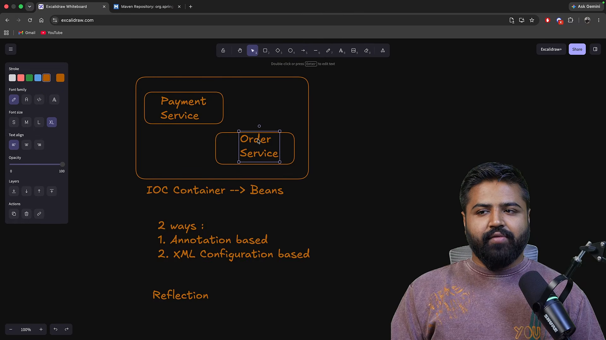
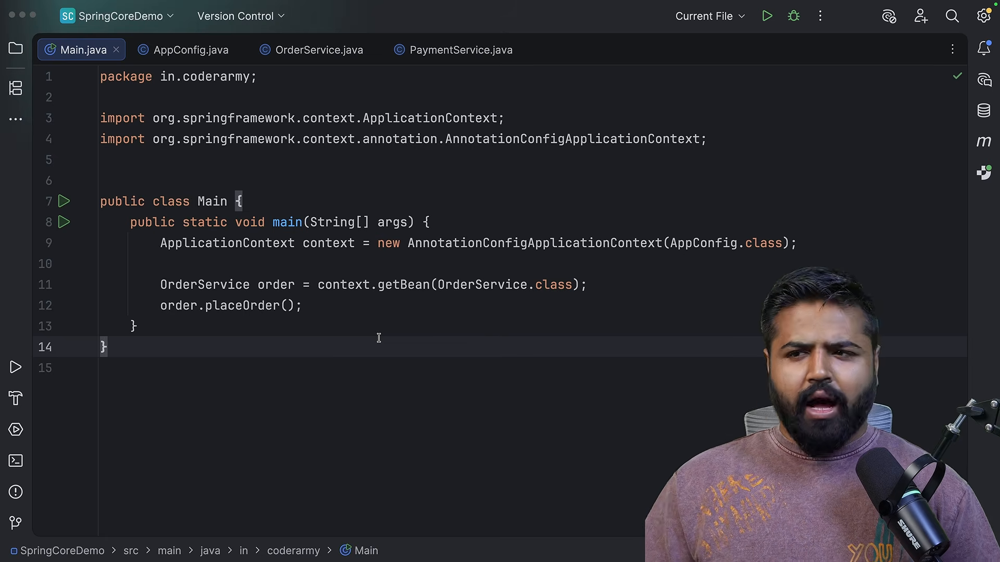
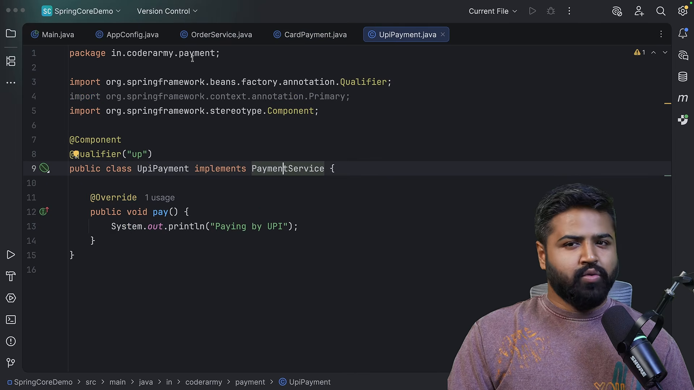
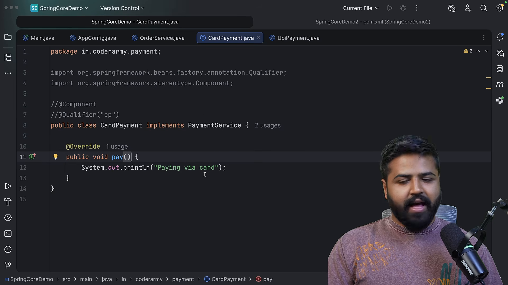
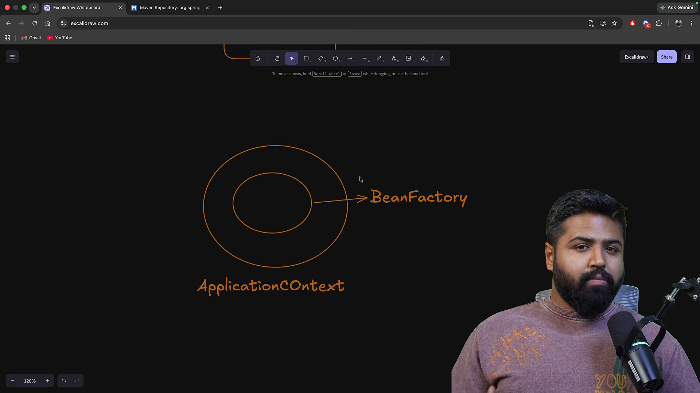

# Thùng chứa điều phối và quản trị Bean

* **Kênh:** Bouali Ali | **Thời lượng:** 01:34:46 | **Ngày:** 2026-03-05
* **Video:** https://www.youtube.com/watch?v=Az9tIgCdaRU

---

## Thuật ngữ

| Thuật ngữ | Tiếng Anh | Giải thích |
| :--- | :--- | :--- |
| Đối tượng quản lý | Spring Bean | Thể hiện đối tượng được tạo lập, lắp ráp và quản lý trọn vòng đời bởi Spring IoC Container |
| Chú thích thành phần | @Component | Đánh dấu một lớp là một Bean do Spring tự động phát hiện và đăng ký vào thùng chứa |
| Tiêm tự động | @Autowired | Hướng dẫn Spring tự động tìm kiếm Bean tương thích trên thùng chứa để tiêm vào vị trí yêu cầu |
| Chú thích ưu tiên | @Primary | Chỉ định Bean mặc định được ưu tiên tiêm khi có nhiều Bean cùng hiện thực một Interface |
| Định danh Bean | @Qualifier | Xác định chính xác tên của Bean cần tiêm để giải quyết triệt để tính mơ hồ khi có nhiều ứng viên |
| Chú thích khởi tạo | @Bean | Đặt trên phương thức trong lớp cấu hình `@Configuration` để trả về một Bean tự định nghĩa |
| Ngữ cảnh ứng dụng | ApplicationContext | Giao diện thùng chứa IoC nâng cao của Spring kế thừa từ BeanFactory, hỗ trợ sự kiện, AOP và khởi tạo sớm |
| Xưởng đối tượng | BeanFactory | Giao diện thùng chứa IoC mức cơ bản nhất của Spring, hỗ trợ cấu hình và khởi tạo lười (Lazy) |

---

## Tổng luận chuyên đề

### Hai phương pháp đăng ký Bean

Spring cung cấp hai trường phái đăng ký đối tượng vào thùng chứa:
1. **Quét thành phần tự động (Stereotype Annotation - `@Component`):**
   - Đặt trực tiếp trên khai báo lớp mà bạn nắm quyền sửa đổi mã nguồn.
   - Thích hợp cho các lớp nghiệp vụ trong dự án (`@Service`, `@Repository`, `@RestController`).
   - Hạn chế: Hoàn toàn bất lực khi cần đăng ký các lớp nằm trong thư viện bên thứ ba (vì mã nguồn đã được đóng gói thành tệp `.jar` chỉ đọc).
2. **Cấu hình tường minh qua mã (Java-based Configuration - `@Bean`):**
   - Đặt trên phương thức trả về đối tượng bên trong lớp gắn chú thích `@Configuration`.
   - Cho phép tùy biến quy trình khởi tạo, truyền tham số cấu hình phức tạp và đăng ký các lớp từ thư viện bên ngoài (ví dụ: `RestTemplate`, `ObjectMapper`, `DataSource`).

### Chiến lược giải quyết mơ hồ

Khi một Interface có nhiều hơn một lớp triển khai được đăng ký làm Bean, Spring sẽ ném ngoại lệ `NoUniqueBeanDefinitionException` vì không biết chọn Bean nào. Có hai giải pháp:
- **`@Primary`:** Giải pháp ưu tiên ngầm định. Định đoạt Bean mặc định được chọn nếu người tiêu thụ không chỉ định rõ ràng.
- **`@Qualifier("beanName")`:** Giải pháp chỉ định tuyệt đối. Có mức ưu tiên cao hơn `@Primary`, ép buộc thùng chứa phải tiêm đúng Bean mang định danh cụ thể.

---

## Bóc tách chi tiết

### Khởi tạo ngữ cảnh thùng chứa



Cơ chế vận hành của Spring IoC:
- Ứng dụng nạp thư viện `spring-context` vào `pom.xml`.
- Sử dụng `AnnotationConfigApplicationContext` để quét các gói mã nguồn định sẵn.
- Thùng chứa sử dụng cơ chế phản chiếu Java (Reflection API) để đọc siêu dữ liệu chú thích, tự động gọi hàm tạo mặc định của các lớp gắn `@Component` và lưu trữ các thể hiện vào một bản đồ bộ nhớ nội bộ (`ConcurrentHashMap`).

### Ưu việt của tiêm qua hàm tạo



So sánh giữa ba cách tiêm phụ thuộc:
- **Tiêm qua trường (Field Injection với `@Autowired` trên field):** Tạo mã nguồn ngắn gọn nhưng vi phạm tính đóng gói, không thể khai báo biến `final`, che giấu các phụ thuộc ẩn và đòi hỏi môi trường Spring khi viết bài kiểm thử đơn vị.
- **Tiêm qua hàm tạo (Constructor Injection):**
  - Cho phép gắn từ khóa `final` để đảm bảo tính bất biến của đối tượng.
  - Ngăn ngừa tình trạng đối tượng được khởi tạo ở trạng thái dở dang (NullPointerException).
  - Từ phiên bản Spring 4.3 trở lên, nếu lớp chỉ có một hàm tạo duy nhất, lập trình viên không cần gắn từ khóa `@Autowired`.

### Xử lý xung đột đa triển khai



Tình huống đa hình:
- Interface `PaymentService` có hai lớp hiện thực đều gắn `@Component`: `CreditCardPayment` và `PaypalPayment`.
- Khi lớp `OrderService` yêu cầu tiêm `PaymentService`, Spring phát hiện có 2 ứng viên hợp lệ và dừng khởi động ứng dụng.
- **Cơ chế xử lý:**
  - Nếu đánh dấu `@Primary` trên `CreditCardPayment`, Spring tự động chọn lớp này.
  - Nếu tại `OrderService` khai báo `@Qualifier("paypalPayment")`, Spring bỏ qua `@Primary` và tiêm chính xác `PaypalPayment`.

### Tùy biến đối tượng ngoại vi



Đăng ký đối tượng khi không sở hữu mã nguồn:
- Khi muốn đưa đối tượng từ thư viện ngoài (như `com.fasterxml.jackson.databind.ObjectMapper`) vào thùng chứa Spring:
  ```java
  @Configuration
  public class AppConfig {
      @Bean
      public ObjectMapper objectMapper() {
          ObjectMapper mapper = new ObjectMapper();
          mapper.configure(DeserializationFeature.FAIL_ON_UNKNOWN_PROPERTIES, false);
          return mapper;
      }
  }
  ```
- Tên phương thức mặc định trở thành tên của Bean trong thùng chứa (`objectMapper`).

### So sánh hai cấp độ thùng chứa



Khác biệt cấu trúc giữa `BeanFactory` và `ApplicationContext`:
- **BeanFactory:**
  - Là tầng giao diện cốt lõi tối thiểu.
  - Áp dụng cơ chế nạp lười (Lazy Loading): Chỉ khởi tạo Bean khi phương thức `getBean()` được gọi trực tiếp.
  - Phù hợp cho các thiết bị nhúng cực kỳ khan hiếm bộ nhớ.
- **ApplicationContext:**
  - Kế thừa toàn bộ tính năng của `BeanFactory` và bổ sung:
    * Khởi tạo sớm (Eager Loading): Tạo toàn bộ Bean Singleton ngay lúc ứng dụng khởi động để phát hiện lỗi cấu hình sớm.
    * Tích hợp cơ chế xuất bản sự kiện (ApplicationEventPublisher).
    * Hỗ trợ đa ngôn ngữ quốc tế hóa (MessageSource).
    * Tích hợp sẵn bộ xử lý AOP.
  - Là lựa chọn mặc định cho toàn bộ các ứng dụng Spring hiện đại.

---

## Trích dẫn then chốt

* "Thùng chứa IoC về bản chất là một xưởng sản xuất và một cuốn danh bạ: nó nắm giữ bản đồ thể hiện của toàn bộ các đối tượng trong ứng dụng của bạn." [05:30](https://www.youtube.com/watch?v=Az9tIgCdaRU&t=330s)
* "Đừng bao giờ dùng Field Injection trong mã nguồn chuyên nghiệp; hãy luôn dùng Constructor Injection để bảo vệ tính toàn vẹn của đối tượng." [35:40](https://www.youtube.com/watch?v=Az9tIgCdaRU&t=2140s)
* "Bạn không thể gắn @Component lên một lớp của thư viện bên thứ ba vì bạn không thể mở tệp .class ra để sửa mã; đó là lý do @Bean ra đời." [61:18](https://www.youtube.com/watch?v=Az9tIgCdaRU&t=3678s)
* "ApplicationContext khởi tạo sớm mọi Bean Singleton ngay lúc khởi động để bảo đảm ứng dụng không bao giờ bị sập giữa chừng vì lỗi thiếu cấu hình." [93:12](https://www.youtube.com/watch?v=Az9tIgCdaRU&t=5592s)

---

## Lệnh & Công cụ

### Triển khai tiêm hàm tạo kết hợp Qualifier

```java
public interface NotificationService {
    void send(String message);
}

@Component("emailService")
public class EmailNotificationService implements NotificationService {
    @Override
    public void send(String message) {
        System.out.println("Gửi email: " + message);
    }
}

@Component("smsService")
@Primary
public class SmsNotificationService implements NotificationService {
    @Override
    public void send(String message) {
        System.out.println("Gửi tin nhắn SMS: " + message);
    }
}

@Component
public class UserService {
    private final NotificationService notificationService;

    // Tiêm qua Constructor với chỉ định Qualifier rõ ràng
    public UserService(@Qualifier("emailService") NotificationService notificationService) {
        this.notificationService = notificationService;
    }

    public void registerUser(String username) {
        notificationService.send("Chào mừng " + username);
    }
}
```

### Cấu hình lớp ngoại vi qua @Configuration

```java
@Configuration
public class ThirdPartyConfig {

    @Bean(name = "customHttpClient")
    public HttpClient httpClient() {
        return HttpClient.newBuilder()
                .connectTimeout(Duration.ofSeconds(10))
                .build();
    }
}
```

---

## Đánh đổi & Rủi ro

### Đánh đổi khởi tạo sớm
- **Thời gian khởi động tăng:** `ApplicationContext` khởi tạo toàn bộ Bean Singleton ngay lập tức, dẫn đến thời gian khởi động lâu hơn khi dự án phình to hàng trăm Bean.
- **Chi phí tiêu thụ RAM:** Các Bean ít khi dùng tới vẫn được cấp phát vùng nhớ cố định ngay từ đầu.

### Rủi ro lạm dụng Qualifier
- **Mất tính linh hoạt:** Việc gắn cứng chuỗi ký tự tên Bean trong `@Qualifier("emailService")` tạo ra sự phụ thuộc gián tiếp vào tên lớp, dễ phát sinh lỗi lúc chạy nếu tên Bean bị đổi mà không cập nhật đồng bộ chuỗi ký tự.
- **Nguy cơ nhầm lẫn cấu hình:** Khi cả `@Primary` và `@Qualifier` cùng tồn tại rải rác trên nhiều lớp cấu hình, việc truy vết Bean nào thực sự được tiêm vào ứng dụng trở nên phức tạp.
