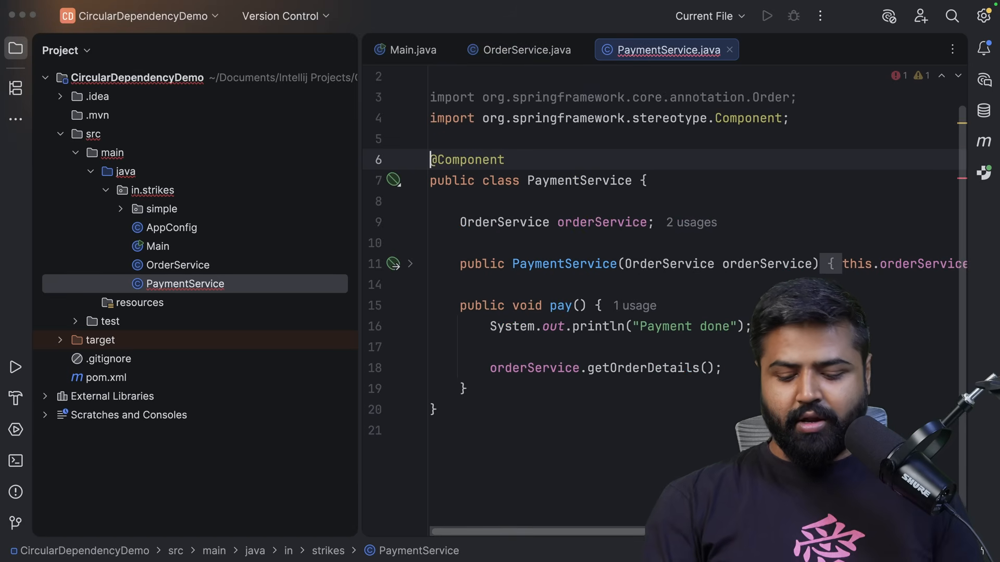
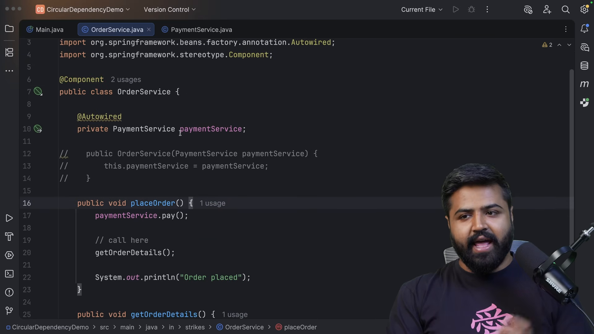
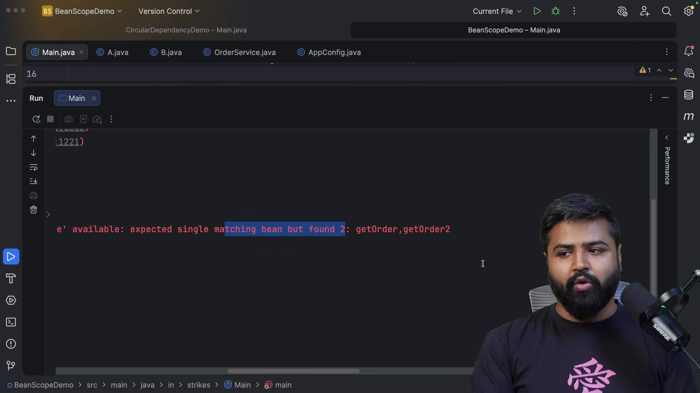
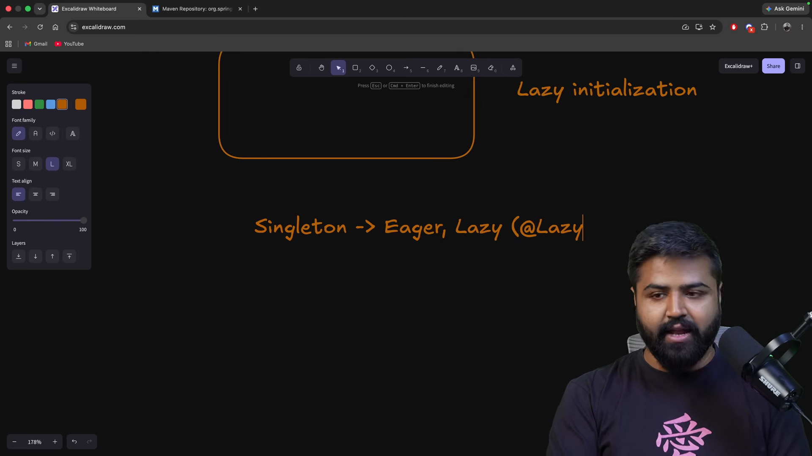
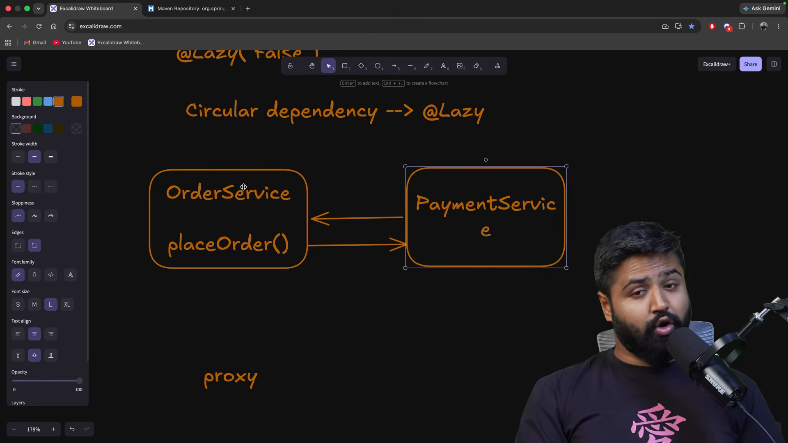

# Phụ thuộc vòng lặp và phạm vi Bean

* **Kênh:** Bouali Ali | **Thời lượng:** 01:22:42 | **Ngày:** 2026-03-06
* **Video:** https://www.youtube.com/watch?v=ass8cR52Cf8

---

## Thuật ngữ

| Thuật ngữ | Tiếng Anh | Giải thích |
| :--- | :--- | :--- |
| Phụ thuộc vòng lặp | Circular Dependency | Hiện tượng hai hay nhiều Bean phụ thuộc lẫn nhau tạo thành một chu trình khép kín (A cần B, B cần A) |
| Phạm vi đơn thể | Singleton Scope | Mặc định của Spring: chỉ duy nhất một thể hiện của Bean được tạo lập và dùng chung trong toàn bộ thùng chứa IoC |
| Phạm vi nguyên mẫu | Prototype Scope | Mỗi lần yêu cầu Bean (`getBean()` hoặc tiêm phụ thuộc), Spring sẽ khởi tạo một thể hiện hoàn toàn mới |
| Khởi tạo sớm | Eager Initialization | Tạo lập Bean ngay khi thùng chứa `ApplicationContext` khởi động |
| Khởi tạo lười | Lazy Initialization (@Lazy) | Trì hoãn việc tạo lập Bean cho đến khi thể hiện đó thực sự được gọi đến lần đầu tiên |
| Đối tượng ủy nhiệm | Dynamic Proxy | Đối tượng giả lập đại diện cho thể hiện thật, được Spring tiêm vào trước nhằm phá vỡ bế tắc khởi tạo |

---

## Tổng luận chuyên đề

### Bản chất phụ thuộc vòng

Trong kiến trúc hướng đối tượng, phụ thuộc vòng lặp là một "mùi mã" (Code Smell) chỉ ra lỗi nghiêm trọng trong việc phân chia ranh giới nghiệp vụ:
- Khi `ClassA` cần `ClassB` trong hàm tạo, và `ClassB` cũng cần `ClassA` trong hàm tạo:
  1. Thùng chứa muốn tạo `ClassA` thì phải có `ClassB`.
  2. Muốn tạo `ClassB` thì phải có `ClassA`.
  3. Dẫn đến bế tắc khởi tạo (Deadlock) và Spring ném ngoại lệ `BeanCurrentlyInCreationException`.
- **Nguyên tắc vàng:** Không nên tìm cách "vá víu" phụ thuộc vòng lặp bằng kỹ thuật tạm bợ. Hãy tái cấu trúc mã nguồn bằng cách tách phần logic chung sang một lớp dịch vụ thứ ba (`ClassC`) hoặc sử dụng sự kiện (`ApplicationEvent`).

### Ma trận phạm vi và cơ chế nạp

| Phạm vi (Scope) | Cơ chế nạp mặc định | Số lượng thể hiện | Trường hợp sử dụng |
| :--- | :--- | :--- | :--- |
| **Singleton** | Khởi tạo sớm (Eager) | Duy nhất 1 đối tượng | Các dịch vụ phi trạng thái (Stateless Services, Repositories, Controllers) |
| **Prototype** | Khởi tạo lười (Lazy) | Mỗi lần gọi 1 đối tượng mới | Các đối tượng chứa trạng thái biến đổi (Stateful Objects, DTOs có xử lý riêng) |

---

## Bóc tách chi tiết

### Bế tắc trong Java thuần



Mô phỏng bế tắc ở mức ngôn ngữ Java thuần:
- Nếu viết:
  ```java
  class A { public A(B b) {} }
  class B { public B(A a) {} }
  ```
- Không có bất kỳ cách nào trong Java để viết lệnh khởi tạo hàm tạo: `new A(new B(???))`.
- Trong Spring, nếu cả hai Bean cùng sử dụng Constructor Injection, thùng chứa rơi vào trạng thái đệ quy vô hạn khi quét đồ thị phụ thuộc và buộc phải dừng tiến trình với thông báo lỗi rõ ràng.

### Tái cấu trúc loại bỏ vòng lặp



Ví dụ nghiệp vụ thực tế:
- `OrderService` cần `PaymentService` để xử lý thanh toán khi đặt hàng.
- `PaymentService` cần `OrderService` để cập nhật trạng thái đơn hàng sau khi thanh toán xong.
- **Giải pháp thiết kế:**
  1. Tách logic cập nhật trạng thái thành `OrderStatusService` độc lập. Cả `OrderService` và `PaymentService` đều tiêm `OrderStatusService`.
  2. Hoặc `PaymentService` chỉ phát ra sự kiện `PaymentCompletedEvent`, `OrderService` lắng nghe sự kiện (`@EventListener`) để tự cập nhật trạng thái mà không cần tiêm trực tiếp `PaymentService`.

### Phạm vi đơn thể và nguyên mẫu



Bản chất của các Scope trong Spring:
- **`@Scope("singleton")` (Mặc định):** Tất cả các điểm tiêm phụ thuộc trong hệ thống đều nhận chung một địa chỉ tham chiếu vùng nhớ. Mọi thay đổi thuộc tính trên Bean này sẽ ảnh hưởng tới toàn bộ các luồng khác.
- **`@Scope("prototype")`:** Mỗi khi được gọi, Spring gọi hàm tạo mới để sinh thể hiện riêng biệt. Lưu ý quan trọng: Spring quản lý vòng đời tạo lập cho Prototype Bean nhưng **không** quản lý vòng đời hủy (`@PreDestroy` không được kích hoạt tự động), bộ dọn rác GC của JVM phải tự thu hồi.

### Cơ chế trì hoãn khởi tạo



Tác động của chú thích `@Lazy`:
- Khi gắn `@Lazy` lên một Bean Singleton: Thùng chứa bỏ qua Bean này trong giai đoạn khởi động ứng dụng. Bean chỉ được sinh ra trong bộ nhớ khi có một yêu cầu người dùng đầu tiên chạm tới nó.
- Giúp giảm đáng kể thời gian khởi động (Startup Time) cho các ứng dụng nặng, nhưng làm tăng độ trễ (Latency Spike) cho người dùng đầu tiên thực hiện thao tác gọi Bean.

### Phá vỡ vòng lặp bằng đối tượng ủy nhiệm



Cơ chế xử lý tạm thời của Spring bằng Proxy:
- Gắn `@Lazy` vào một trong hai hàm tạo:
  ```java
  @Component
  public class OrderService {
      private final PaymentService paymentService;
      public OrderService(@Lazy PaymentService paymentService) {
          this.paymentService = paymentService;
      }
  }
  ```
- Thay vì tạo `PaymentService` thật, Spring tạo ra một đối tượng ủy nhiệm (CGLIB Dynamic Proxy) rỗng để tiêm vào `OrderService`. Bế tắc bị phá vỡ, cả hai Bean khởi tạo thành công.
- Khi `OrderService` thực sự gọi phương thức `paymentService.pay()`, đối tượng ủy nhiệm mới âm thầm định tuyến cuộc gọi sang thể hiện thật trong thùng chứa.

---

## Trích dẫn then chốt

* "Phụ thuộc vòng lặp không phải là một lỗi của Spring, nó là tiếng chuông cảnh báo rằng kiến trúc phân chia lớp của bạn đang có vấn đề." [00:29](https://www.youtube.com/watch?v=ass8cR52Cf8&t=29s)
* "Đừng cố giải quyết phụ thuộc vòng lặp bằng các mẹo vặt; hãy loại bỏ nó hoàn toàn bằng cách tái thiết kế lại luồng phụ thuộc." [30:15](https://www.youtube.com/watch?v=ass8cR52Cf8&t=1815s)
* "Singleton trong Spring là Singleton trên từng IoC Container, chứ không phải Singleton cổ điển trên toàn bộ máy ảo Java JVM." [36:15](https://www.youtube.com/watch?v=ass8cR52Cf8&t=2175s)
* "Khi bạn dùng @Lazy để phá vòng lặp, bạn thực chất đang nhờ Spring tiêm một con rối ủy nhiệm để đánh lừa hàm tạo." [77:38](https://www.youtube.com/watch?v=ass8cR52Cf8&t=4658s)

---

## Lệnh & Công cụ

### Cấu hình phạm vi Bean

```java
@Component
@Scope(value = ConfigurableBeanFactory.SCOPE_PROTOTYPE)
public class HeavyTaskRunner {
    private final String executionId = UUID.randomUUID().toString();

    public void execute() {
        System.out.println("Thực thi tác vụ với mã định danh: " + executionId);
    }
}
```

### Phá vỡ vòng lặp bằng @Lazy

```java
@Service
public class ServiceA {
    private final ServiceB serviceB;

    // Tiêm proxy tạm thời để tránh nghẽn khởi tạo
    public ServiceA(@Lazy ServiceB serviceB) {
        this.serviceB = serviceB;
    }
}

@Service
public class ServiceB {
    private final ServiceA serviceA;

    public ServiceB(ServiceA serviceA) {
        this.serviceA = serviceA;
    }
}
```

---

## Đánh đổi & Rủi ro

### Đánh đổi giữa Singleton và Prototype
- **Nguy cơ sai lệch luồng (Concurrency Issue):** Vì Singleton Bean được dùng chung cho tất cả các luồng yêu cầu HTTP, tuyệt đối không được lưu giữ biến trạng thái (Mutable State) trong các trường dữ liệu của Bean.
- **Rò rỉ bộ nhớ với Prototype:** Do Spring không gọi `@PreDestroy` cho Prototype Bean, nếu các đối tượng này giữ các kết nối tài nguyên (File, Socket, Database Connection), nguy cơ rò rỉ bộ nhớ là rất cao nếu lập trình viên không tự dọn dẹp.

### Cạm bẫy lạm dụng @Lazy
- **Dịch chuyển lỗi từ Compile/Startup sang Runtime:** Khởi tạo sớm (Eager) giúp phát hiện lỗi thiếu cấu hình ngay khi bật máy chủ. Dùng `@Lazy` làm ẩn giấu các lỗi này cho tới khi có người dùng thật gửi yêu cầu vào hệ thống trên môi trường sản xuất.
- **Độ phức tạp gỡ lỗi tăng cao:** Các lớp ủy nhiệm CGLIB làm vết ngăn xếp lỗi trở nên rối rắm, khó theo dõi khi xảy ra ngoại lệ.
