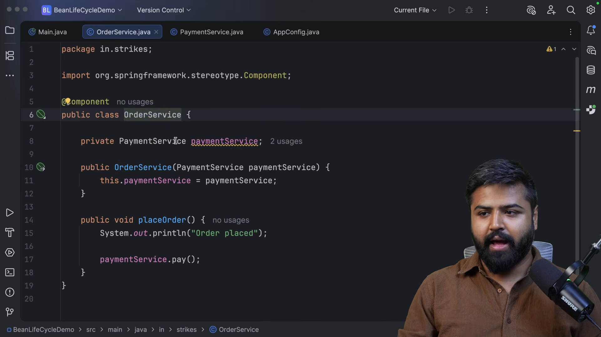
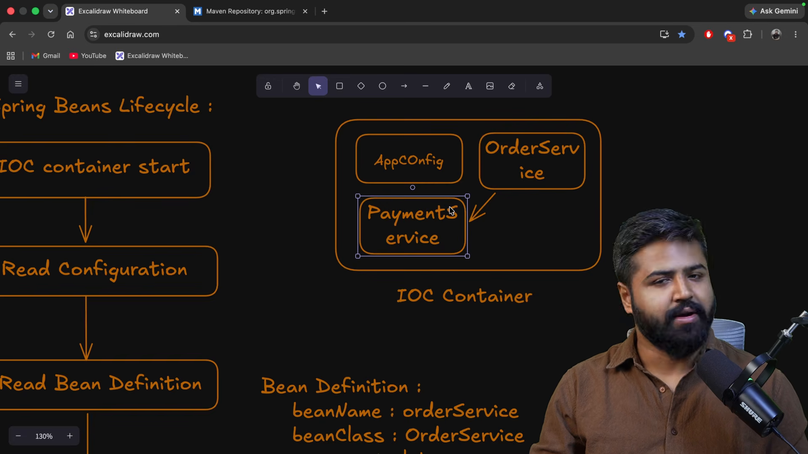
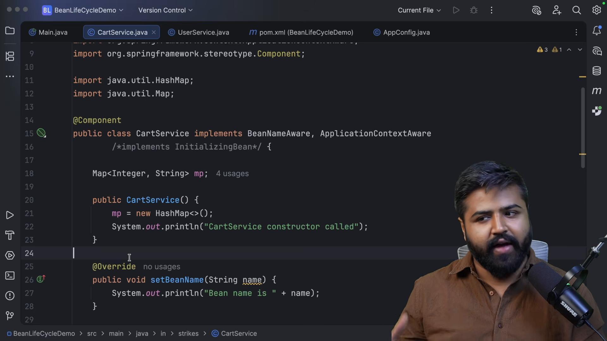
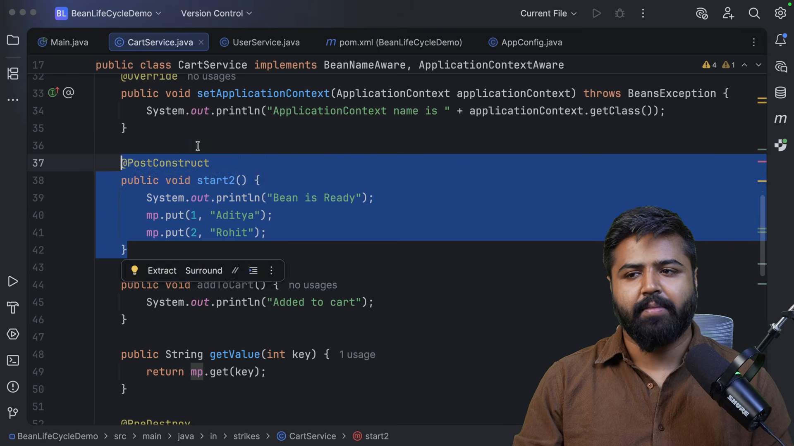
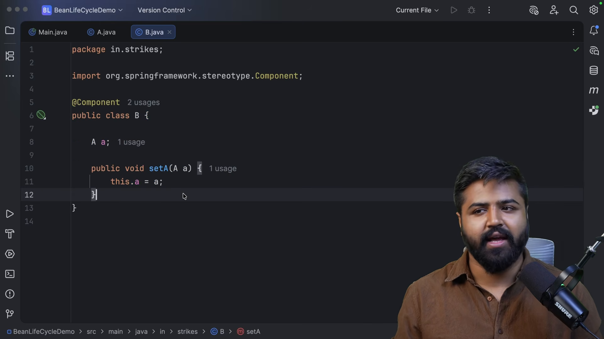

# Vòng đời đối tượng trong Spring

* **Kênh:** Bouali Ali | **Thời lượng:** 01:27:43 | **Ngày:** 2026-03-07
* **Video:** https://www.youtube.com/watch?v=WXg3uyZPqYI

---

## Thuật ngữ

| Thuật ngữ | Tiếng Anh | Giải thích |
| :--- | :--- | :--- |
| Vòng đời Bean | Bean Lifecycle | Chuỗi các giai đoạn kế tiếp nhau từ khi đối tượng được định nghĩa, khởi tạo, tiêm phụ thuộc, gọi callback đến khi bị hủy |
| Định nghĩa đối tượng | BeanDefinition | Đối tượng cấu hình nội bộ chứa siêu dữ liệu mô tả lớp, phạm vi, cách khởi tạo và các thuộc tính của Bean |
| Giao diện nhận biết | Aware Interfaces | Tập hợp các giao diện cho phép Bean nhận biết hạ tầng thùng chứa (BeanNameAware, ApplicationContextAware) |
| Hàm gọi khởi tạo | @PostConstruct | Chú thích đánh dấu phương thức được Spring tự động gọi ngay sau khi toàn bộ phụ thuộc đã được tiêm hoàn tất |
| Hàm gọi giải phóng | @PreDestroy | Chú thích đánh dấu phương thức được gọi ngay trước khi thùng chứa hủy Bean để đóng tài nguyên |
| Khởi tạo qua giao diện | InitializingBean | Giao diện cung cấp phương thức `afterPropertiesSet()` phục vụ logic khởi tạo tùy biến |
| Giải phóng qua giao diện | DisposableBean | Giao diện cung cấp phương thức `destroy()` phục vụ việc đóng kết nối và dọn dẹp bộ nhớ |

---

## Tổng luận chuyên đề

### Các giai đoạn vòng đời cốt lõi

Một Spring Bean trải qua 6 giai đoạn sinh tử tuần tự:
1. **Đọc định nghĩa (Bean Definition):** Spring quét mã nguồn hoặc tệp cấu hình, nạp siêu dữ liệu vào các đối tượng `BeanDefinition`.
2. **Khởi tạo thể hiện (Instantiation):** Gọi hàm tạo (Constructor) của lớp để cấp phát vùng nhớ trên Heap.
3. **Tiêm phụ thuộc (Populate Properties / DI):** Gán các giá trị trường và tiêm các Bean phụ thuộc qua Setter hoặc Reflection.
4. **Nhận biết môi trường (Aware Interfaces):** Tiêm các đối tượng hạ tầng của Spring (`BeanNameAware`, `BeanFactoryAware`, `ApplicationContextAware`).
5. **Khởi tạo tùy biến (Initialization Callbacks):** Kích hoạt `@PostConstruct`, phương thức `afterPropertiesSet()`, và `init-method`. Sau bước này, Bean chính thức sẵn sàng phục vụ yêu cầu.
6. **Hủy bỏ (Destruction Callbacks):** Khi thùng chứa đóng lại (`context.close()`), kích hoạt `@PreDestroy`, phương thức `destroy()`, và `destroy-method`.

### Khác biệt giữa Constructor và @PostConstruct

- **Hàm tạo (Constructor):** Thuộc về ngôn ngữ Java thuần. Tại thời điểm chạy hàm tạo, Spring **chưa** tiêm các phụ thuộc (trừ khi dùng Constructor Injection) và chưa gán các giá trị `@Value`. Nếu truy cập các trường phụ thuộc trong hàm tạo, ứng dụng sẽ bị lỗi `NullPointerException`.
- **`@PostConstruct`:** Thuộc về vòng đời Spring. Phương thức này chỉ được kích hoạt sau khi **tất cả** các phụ thuộc và thuộc tính cấu hình đã được bơm đầy đủ vào đối tượng. Đây là nơi duy nhất an toàn để thực thi logic khởi tạo logic mạng, kết nối cơ sở dữ liệu hoặc làm ấm bộ nhớ đệm (Warm-up Cache).

---

## Bóc tách chi tiết

### Sơ đồ chu trình sinh tử



Luồng thực thi từ lúc khởi động thùng chứa:
- Nạp `BeanDefinition` -> Khởi tạo thể hiện bằng Constructor -> Điền thuộc tính (Populate Properties).
- Gọi các phương thức `setBeanName()`, `setBeanFactory()`, `setApplicationContext()`.
- Tiền xử lý `BeanPostProcessor.postProcessBeforeInitialization()`.
- Kích hoạt callback khởi tạo: `@PostConstruct` -> `InitializingBean.afterPropertiesSet()` -> phương thức `init()`.
- Hậu xử lý `BeanPostProcessor.postProcessAfterInitialization()` (nơi tạo các Dynamic Proxy cho Spring AOP).
- Đưa vào trạng thái hoạt động (Ready for use).

### Giao diện nhận biết hạ tầng



Cung cấp quyền truy cập hạ tầng thùng chứa cho Bean:
- `BeanNameAware`: Cho phép đối tượng biết được tên định danh của chính nó trong thùng chứa (`setBeanName(String name)`).
- `ApplicationContextAware`: Tiêm trực tiếp đối tượng `ApplicationContext` vào Bean, cho phép Bean chủ động gọi `context.getBean()` hoặc xuất bản sự kiện chương trình.
- Tuy nhiên, việc lạm dụng các giao diện Aware làm mã nguồn bị gắn chặt vào thư viện Spring, làm giảm tính độc lập của mã nghiệp vụ thuần túy (POJO).

### Bản chất của @PostConstruct



So sánh hành vi thực thi:
- Trong hàm tạo:
  ```java
  public DatabaseConnector() {
      // url và port lúc này vẫn là NULL vì Spring chưa tiêm thuộc tính cấu hình!
      connect(this.url, this.port); // Ném lỗi NullPointerException!
  }
  ```
- Với `@PostConstruct`:
  ```java
  @PostConstruct
  public void init() {
      // url và port đã được gán giá trị hợp lệ từ application.properties
      connect(this.url, this.port); // Khởi tạo kết nối thành công!
  }
  ```

### Cơ chế dọn dẹp trước khi hủy



Quy trình giải phóng tài nguyên an toàn:
- Khi máy chủ tắt hoặc ngữ cảnh ứng dụng bị đóng qua cơ chế tắt nhẹ nhàng (Graceful Shutdown):
  - Spring quét toàn bộ các Bean Singleton và gọi phương thức gắn chú thích `@PreDestroy`.
  - Đây là vị trí lập trình viên bắt buộc phải đóng các kết nối mở: giải phóng nhóm kết nối CSDL (Connection Pool), đóng tệp tin đang ghi dở, hủy đăng ký lắng nghe hàng đợi tin nhắn (Message Queue Consumer).
- Lưu ý: Với Bean có phạm vi `Prototype`, Spring **không** bao giờ gọi `@PreDestroy`.

### Xử lý bế tắc phụ thuộc vòng



Kỹ thuật kết nối trễ qua `@PostConstruct`:
- Nếu hai dịch vụ cần tham chiếu đến nhau nhưng không muốn dùng Constructor Injection:
  - Sử dụng Setter Injection hoặc Field Injection kết hợp `@PostConstruct`.
  - Hai đối tượng được khởi tạo thể hiện độc lập trước.
  - Trong phương thức `@PostConstruct`, đối tượng A mới chủ động đăng ký chính mình vào danh sách lắng nghe của đối tượng B.
- Tuy nhiên, giải pháp tốt nhất vẫn là tái cấu trúc loại bỏ chu trình phụ thuộc bằng cách thêm lớp trung gian.

---

## Trích dẫn then chốt

* "Hàm tạo là để ngôn ngữ Java cấp phát vùng nhớ, còn @PostConstruct là để Spring Framework hoàn tất cấu hình đối tượng." [61:23](https://www.youtube.com/watch?v=WXg3uyZPqYI&t=3683s)
* "Tuyệt đối không bao giờ thực hiện các tác vụ nặng như gọi mạng hoặc mở CSDL trong hàm tạo; hãy chuyển toàn bộ vào @PostConstruct." [64:02](https://www.youtube.com/watch?v=WXg3uyZPqYI&t=3842s)
* "Spring là người cha có trách nhiệm với Bean Singleton: sinh ra, nuôi dưỡng và dọn dẹp khi chết; nhưng với Prototype, Spring chỉ sinh ra rồi bỏ mặc." [74:37](https://www.youtube.com/watch?v=WXg3uyZPqYI&t=4477s)
* "Aware Interface trao cho bạn quyền lực truy cập thùng chứa, nhưng cái giá phải trả là mã nguồn của bạn mất đi tính thuần khiết POJO." [26:14](https://www.youtube.com/watch?v=WXg3uyZPqYI&t=1574s)

---

## Lệnh & Công cụ

### Triển khai đầy đủ vòng đời một Bean

```java
@Component
public class CacheManager implements InitializingBean, DisposableBean {

    @Value("${cache.size:1000}")
    private int cacheSize;

    public CacheManager() {
        System.out.println("1. Constructor: Cấp phát vùng nhớ, cacheSize = " + cacheSize); // In ra 0
    }

    @PostConstruct
    public void postConstructInit() {
        System.out.println("2. @PostConstruct: Thuộc tính đã gán, cacheSize = " + cacheSize); // In ra 1000
    }

    @Override
    public void afterPropertiesSet() {
        System.out.println("3. InitializingBean: Khởi tạo hoàn tất theo hợp đồng Spring");
    }

    @PreDestroy
    public void preDestroyCleanup() {
        System.out.println("4. @PreDestroy: Xóa sạch bộ đệm trước khi tắt ứng dụng");
    }

    @Override
    public void destroy() {
        System.out.println("5. DisposableBean: Giải phóng toàn bộ bộ nhớ Heap");
    }
}
```

---

## Đánh đổi & Rủi ro

### Rủi ro trì trệ khởi động
- **Tắc nghẽn tại @PostConstruct:** Nếu phương thức `@PostConstruct` thực hiện các tác vụ chặn (Blocking I/O) như gọi API bên ngoài hoặc thực thi truy vấn CSDL phức tạp, toàn bộ tiến trình khởi động của `ApplicationContext` sẽ bị đóng băng.
- **Không có cơ chế thử lại tự động:** Nếu `@PostConstruct` ném ra bất kỳ ngoại lệ nào, Spring sẽ dừng khởi động ngay lập tức và coi toàn bộ ứng dụng là lỗi khởi tạo.

### Điểm mù giải phóng tài nguyên
- **Đóng ứng dụng đột ngột (SIGKILL):** Nếu tiến trình JVM bị chấm dứt cưỡng bức bằng `kill -9`, các phương thức `@PreDestroy` sẽ hoàn toàn không được kích hoạt, dẫn đến nguy cơ dữ liệu lưu tạm chưa kịp đồng bộ xuống đĩa.
- **Rò rỉ tài nguyên trên Prototype:** Cần luôn nhớ rằng mọi đối tượng mở tài nguyên dạng Prototype phải được quản lý và đóng thủ công bởi lớp tiêu thụ.
