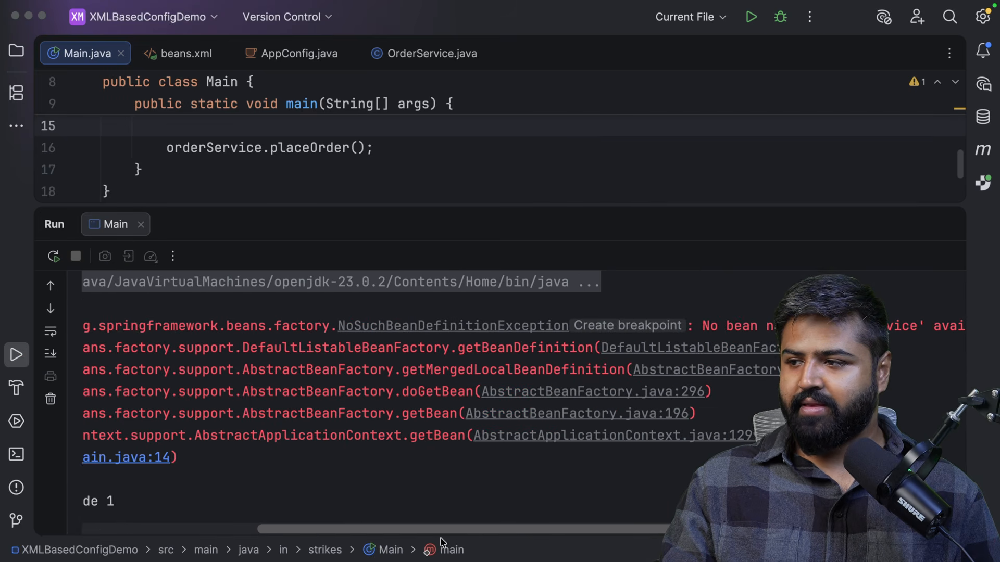
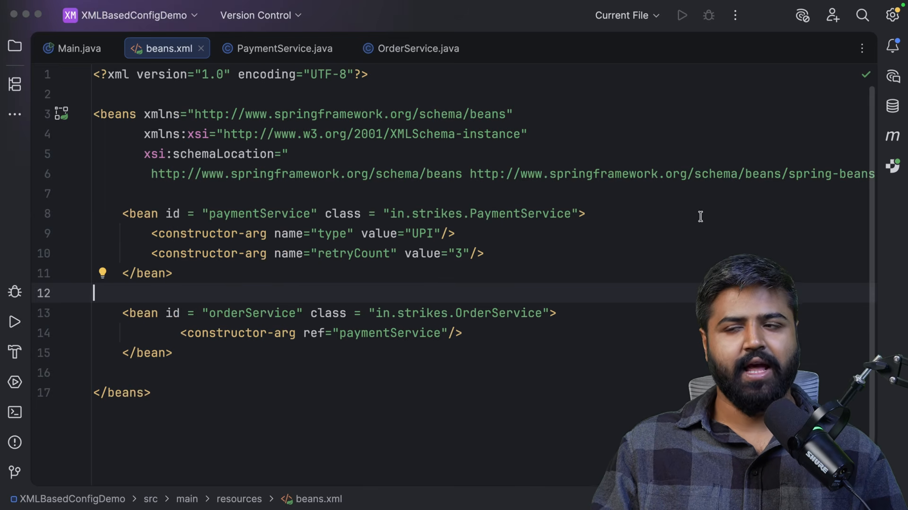
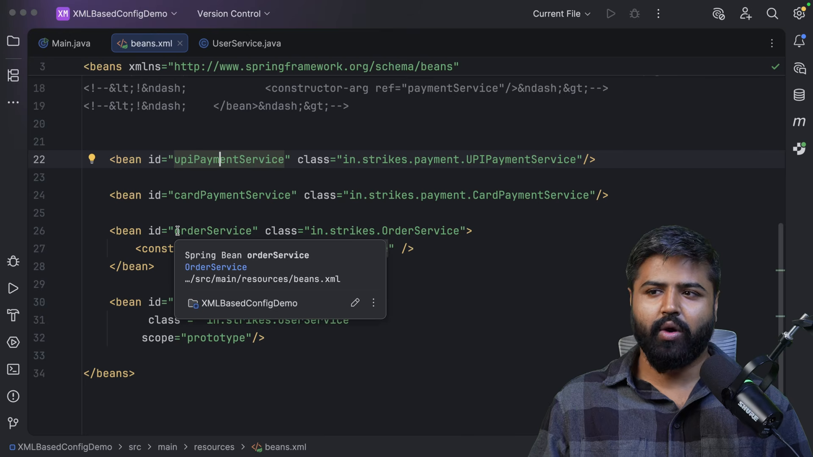
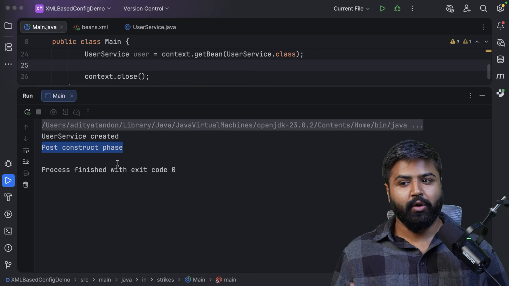
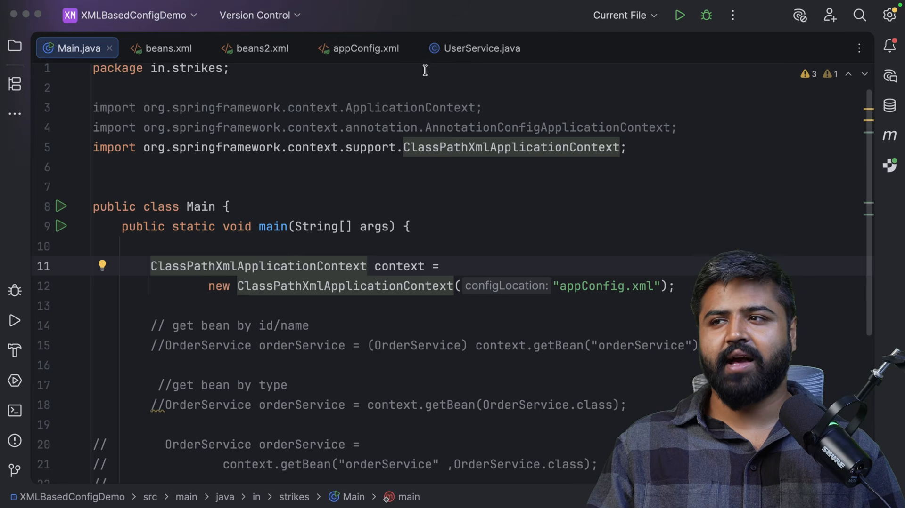

# Cấu hình đối tượng bằng XML

* **Kênh:** Bouali Ali | **Thời lượng:** 01:11:54 | **Ngày:** 2026-03-08
* **Video:** https://www.youtube.com/watch?v=HqBh9hV7rik

---

## Thuật ngữ

| Thuật ngữ | Tiếng Anh | Giải thích |
| :--- | :--- | :--- |
| Cấu hình XML | XML Configuration | Phương pháp khai báo Bean và quan hệ phụ thuộc thông qua tệp XML truyền thống trong Spring |
| Ngữ cảnh từ đường dẫn | ClassPathXmlApplicationContext | Lớp hiện thực ApplicationContext nạp và phân tích định nghĩa Bean từ tệp XML trên classpath |
| Thẻ định nghĩa Bean | `<bean>` | Thẻ XML dùng để khai báo định danh, kiểu lớp và thuộc tính của một Spring Bean |
| Tiêm qua hàm tạo | `<constructor-arg>` | Thẻ con định nghĩa tham số truyền vào hàm tạo khi khởi tạo Bean |
| Tiêm qua thuộc tính | `<property>` | Thẻ con gọi phương thức thiết lập (Setter) để gán giá trị hoặc đối tượng phụ thuộc |
| Tham chiếu đối tượng | `ref` | Thuộc tính XML liên kết tới định danh `id` của một Bean khác trong cùng thùng chứa |
| Phương thức khởi tạo | `init-method` | Thuộc tính XML chỉ định tên phương thức được gọi tự động sau khi tiêm phụ thuộc xong |
| Phương thức giải phóng | `destroy-method` | Thuộc tính XML chỉ định tên phương thức được gọi trước khi hủy thể hiện Bean |

---

## Tổng luận chuyên đề

### Vị thế của cấu hình XML

Trong lịch sử phát triển của Spring Framework (Spring 1.x đến 2.x), XML từng là chuẩn mực duy nhất để cấu hình hệ thống:
- **Ưu điểm lớn nhất:** Tách biệt tuyệt đối giữa mã nguồn Java và siêu dữ liệu cấu hình. Các lớp Java giữ nguyên trạng thái thuần khiết (POJO), không bị "vấy bẩn" bởi bất kỳ chú thích (`@Component`, `@Autowired`) nào của Spring. Có thể thay đổi hành vi và lắp ghép phụ thuộc của hệ thống mà không cần biên dịch lại mã nguồn Java.
- **Hạn chế cố hữu:** Tệp cấu hình XML nhanh chóng phình to hàng nghìn dòng trong các dự án lớn (hiện tượng XML Hell), không được kiểm tra kiểu an toàn lúc biên dịch (Type-safety) và khó tái cấu trúc mã (Refactoring) bằng IDE.

### So sánh ba phương thức cấu hình

| Tiêu chí | Cấu hình XML (`beans.xml`) | Cấu hình chú thích (`@Component`) | Cấu hình mã Java (`@Configuration`) |
| :--- | :--- | :--- | :--- |
| **Vị trí** | Tệp XML độc lập | Đặt trực tiếp trên lớp Java | Lớp cấu hình chuyên biệt |
| **Kiểm tra an toàn kiểu** | Không (kiểm tra lúc chạy) | Có (kiểm tra lúc biên dịch) | Có (kiểm tra lúc biên dịch) |
| **Xử lý thư viện ngoài** | Tốt | Không thể | Tốt nhất |
| **Mức độ phổ biến hiện nay** | Dự án kế thừa (Legacy) | Rất phổ biến | Rất phổ biến |

---

## Bóc tách chi tiết

### Khai báo và nạp ngữ cảnh



Quy trình thiết lập môi trường XML:
- Tạo tệp `src/main/resources/beans.xml` với lược đồ định nghĩa XSD của Spring.
- Khai báo thẻ: `<bean id="userService" class="com.coderarmy.UserService" />`.
  - `id`: Định danh duy nhất của Bean trong thùng chứa.
  - `class`: Tên đầy đủ kèm gói (Fully Qualified Class Name) của lớp Java.
- Khởi tạo thùng chứa trong mã Java:
  ```java
  ApplicationContext context = new ClassPathXmlApplicationContext("beans.xml");
  UserService service = context.getBean("userService", UserService.class);
  ```

### Tiêm phụ thuộc qua hàm tạo và Setter



Cú pháp liên kết phụ thuộc trong XML:
1. **Tiêm qua hàm tạo (Constructor Injection):**
   - Sử dụng thẻ `<constructor-arg>`:
     ```xml
     <bean id="car" class="com.coderarmy.Car">
         <constructor-arg ref="petrolEngine" />
         <constructor-arg value="Toyota Camry" />
     </bean>
     ```
   - Hỗ trợ chỉ định vị trí tham số bằng thuộc tính `index="0"`, hoặc kiểu dữ liệu `type="int"`.
2. **Tiêm qua phương thức thiết lập (Setter Injection):**
   - Sử dụng thẻ `<property>`:
     ```xml
     <bean id="car" class="com.coderarmy.Car">
         <property name="engine" ref="electricEngine" />
         <property name="model" value="Tesla Model 3" />
     </bean>
     ```
   - Yêu cầu lớp `Car` bắt buộc phải có phương thức `setEngine()` và `setModel()`.

### Phạm vi và nạp tập hợp dữ liệu



Thiết lập phạm vi và tập hợp dữ liệu phức tạp:
- **Phạm vi đối tượng:** Thêm thuộc tính `scope="prototype"` trực tiếp vào thẻ `<bean>` để mỗi lần gọi `getBean` trả về thể hiện mới.
- **Tiêm danh sách (Collections):** Hỗ trợ các thẻ con lồng nhau:
  ```xml
  <property name="supportedFeatures">
      <list>
          <value>ABS Brakes</value>
          <value>Cruise Control</value>
      </list>
  </property>
  ```
- Tương tự hỗ trợ `<set>`, `<map>` (với cặp `<entry key="..." value="..." />`) và `<props>`.

### Hàm gọi vòng đời thay thế chú thích



Tái lập tính năng của `@PostConstruct` và `@PreDestroy` trong XML:
- Thay vì gắn chú thích trong mã Java, khai báo hai thuộc tính:
  ```xml
  <bean id="dbConnection" class="com.coderarmy.DatabaseConnection"
        init-method="customInit"
        destroy-method="customCleanUp" />
  ```
- Khi khởi tạo xong, Spring tự động gọi phương thức `customInit()`.
- Khi đóng ngữ cảnh, Spring tự động gọi phương thức `customCleanUp()`.
- Lớp Java hoàn toàn không chứa bất kỳ từ khóa nhập gói (import) nào từ Spring.

### Phân tách và tổ chức tệp tin



Quản lý kiến trúc XML trong các hệ thống lớn:
- Tránh dồn toàn bộ cấu hình vào một tệp `beans.xml` duy nhất.
- Chia nhỏ thành các tệp cấu hình theo phân tầng chức năng:
  - `datasource-config.xml`: Cấu hình kết nối cơ sở dữ liệu và giao dịch.
  - `service-config.xml`: Cấu hình các Bean tầng nghiệp vụ.
  - `security-config.xml`: Cấu hình xác thực và phân quyền.
- Sử dụng thẻ `<import resource="datasource-config.xml" />` bên trong tệp tổng thể `applicationContext.xml` để tích hợp toàn diện.

---

## Trích dẫn then chốt

* "XML mang lại sự tách biệt hoàn hảo: mã nguồn Java của bạn là 100% thuần khiết, không hề biết đến sự tồn tại của Spring." [05:36](https://www.youtube.com/watch?v=HqBh9hV7rik&t=336s)
* "Trong XML, `ref` là sợi dây liên kết giữa các Bean, còn `value` là để gán các giá trị nguyên thủy hoặc chuỗi ký tự." [31:54](https://www.youtube.com/watch?v=HqBh9hV7rik&t=1914s)
* "Thuộc tính init-method và destroy-method giải phóng bạn khỏi việc phải phụ thuộc vào giao diện InitializingBean của Spring." [63:12](https://www.youtube.com/watch?v=HqBh9hV7rik&t=3792s)
* "Mặc dù ngày nay Annotation chiếm ưu thế, hiểu sâu cấu hình XML là chìa khóa sống còn khi bạn phải bảo trì hoặc nâng cấp các hệ thống doanh nghiệp lâu năm." [70:00](https://www.youtube.com/watch?v=HqBh9hV7rik&t=4200s)

---

## Lệnh & Công cụ

### Tệp cấu hình XML hoàn chỉnh mẫu

```xml
<?xml version="1.0" encoding="UTF-8"?>
<beans xmlns="http://www.springframework.org/schema/beans"
       xmlns:xsi="http://www.w3.org/2001/XMLSchema-instance"
       xsi:schemaLocation="http://www.springframework.org/schema/beans
       https://www.springframework.org/schema/beans/spring-beans.xsd">

    <!-- Khai báo Bean phụ thuộc -->
    <bean id="petrolEngine" class="com.coderarmy.PetrolEngine" />

    <!-- Khai báo Bean chính với tiêm Constructor và hàm gọi vòng đời -->
    <bean id="car" class="com.coderarmy.Car"
          scope="singleton"
          init-method="startEngine"
          destroy-method="stopEngine">
        <constructor-arg ref="petrolEngine" />
        <constructor-arg value="Honda Civic" />
        <property name="maxSpeed" value="220" />
    </bean>

</beans>
```

### Khởi tạo ngữ cảnh từ mã Java

```java
import org.springframework.context.support.ClassPathXmlApplicationContext;

public class MainApplication {
    public static void main(String[] args) {
        // Khởi tạo ngữ cảnh nạp từ tệp XML
        ClassPathXmlApplicationContext context = 
                new ClassPathXmlApplicationContext("beans.xml");

        Car myCar = context.getBean("car", Car.class);
        myCar.drive();

        // Đóng ngữ cảnh để kích hoạt destroy-method
        context.close();
    }
}
```

---

## Đánh đổi & Rủi ro

### Nhược điểm cấu hình XML
- **Không kiểm tra lỗi lúc biên dịch:** Nếu gõ sai tên lớp hoặc sai tên thuộc tính trong XML, trình biên dịch Java không thể báo lỗi. Toàn bộ lỗi chỉ bùng nổ khi ứng dụng chạy (`BeanCreationException`).
- **Khó tái cấu trúc:** Khi đổi tên một lớp Java hoặc một phương thức setter trong IDE, IDE không thể tự động cập nhật đồng bộ các chuỗi ký tự bên trong các tệp XML.

### Rủi ro bảo trì
- **Độ cồng kềnh quá mức:** Mã cấu hình XML chiếm dung lượng lớn và tốn thời gian đọc hiểu hơn nhiều so với việc đọc các chú thích `@Service` đặt ngay trên đầu lớp.
- **Hiện tượng phân mảnh ngữ cảnh:** Việc chia nhỏ thành quá nhiều tệp XML có thể gây khó khăn cho việc truy vết nguồn gốc khởi tạo của một Bean cụ thể trong dự án.
