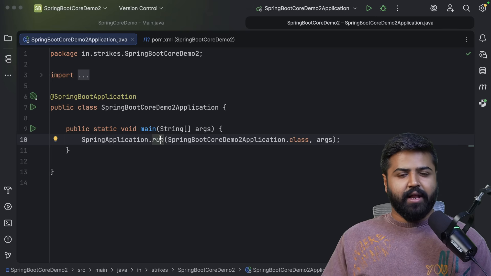
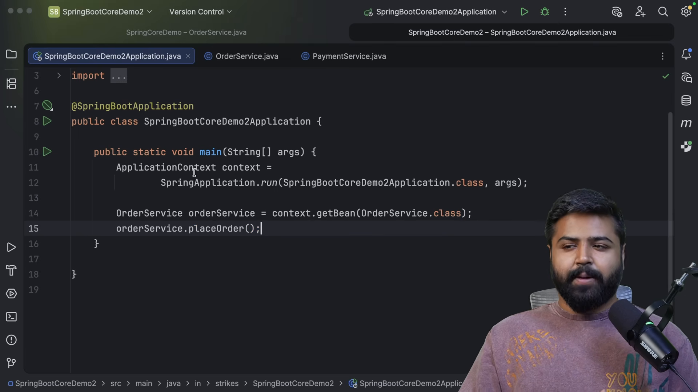
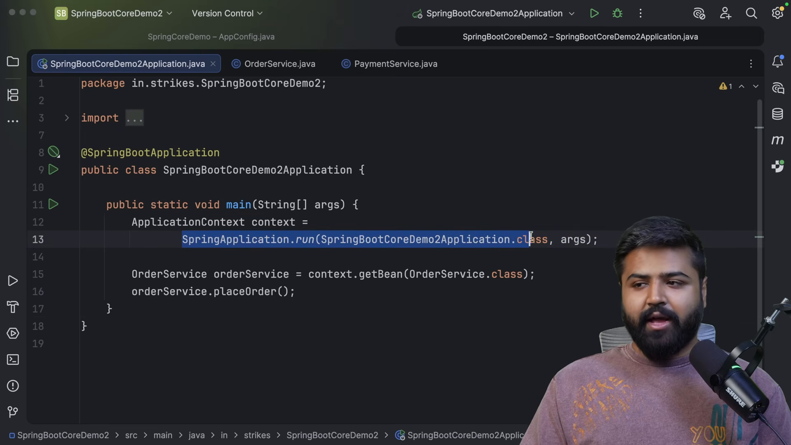
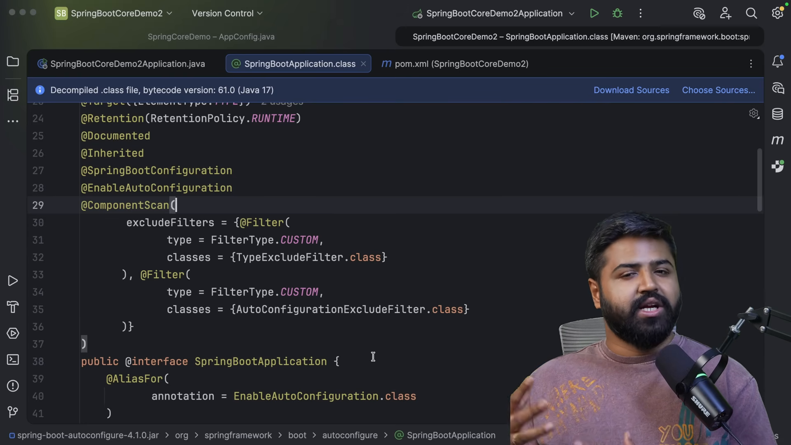

# Lõi Spring Boot và cấu hình tự động

* **Kênh:** Bouali Ali | **Thời lượng:** 01:00:15 | **Ngày:** 2026-03-09
* **Video:** https://www.youtube.com/watch?v=a06KMY209AA

---

## Thuật ngữ

| Thuật ngữ | Tiếng Anh | Giải thích |
| :--- | :--- | :--- |
| Khởi tạo ứng dụng | @SpringBootApplication | Chú thích hợp nhất bao gồm @SpringBootConfiguration, @EnableAutoConfiguration và @ComponentScan |
| Cấu hình tự động | @EnableAutoConfiguration | Cơ chế kích hoạt việc phán đoán và tự động nạp các Bean cấu hình dựa trên các thư viện có sẵn trong classpath |
| Quét gói thành phần | @ComponentScan | Hướng dẫn Spring quét các lớp có gắn chú thích (@Component, @Service, @Repository) từ gói hiện tại và các gói con |
| Gói phụ thuộc khởi động | Starter Dependencies | Các gói phụ thuộc Maven đóng gói sẵn toàn bộ các thư viện liên quan cần thiết cho một tính năng (như spring-boot-starter-web) |
| Dự án cha khởi động | spring-boot-starter-parent | Dự án Maven cha cung cấp quản lý phiên bản thống nhất (Dependency Management) và cấu hình phần bổ trợ chuẩn cho Spring Boot |
| Chú thích điều kiện | Conditional Annotations | Nhóm chú thích (@ConditionalOnClass, @ConditionalOnMissingBean) quyết định một Bean có được tạo hay không dựa trên điều kiện thực tế |

---

## Tổng luận chuyên đề

### Bản chất của @SpringBootApplication

Chú thích `@SpringBootApplication` đặt trên lớp chính chứa hàm `main` là sự kết hợp của ba chú thích cốt lõi:
1. **`@SpringBootConfiguration`:** Kế thừa từ `@Configuration`, xác nhận lớp này là một nguồn định nghĩa Bean cho thùng chứa IoC.
2. **`@ComponentScan`:** Kích hoạt quét thành phần tự động. **Quy tắc vàng:** Chỉ các lớp nằm trong cùng gói (Package) hoặc gói con của lớp chứa `@SpringBootApplication` mới được phát hiện. Nếu đặt một `@Component` ở gói nằm ngoài cây thư mục này, Spring sẽ hoàn toàn bỏ qua.
3. **`@EnableAutoConfiguration`:** "Phép màu" cốt lõi của Spring Boot. Thay vì lập trình viên phải tự viết mã cấu hình cho Tomcat, Jackson, DispatcherServlet hay DataSource, Spring Boot tự động đọc các tệp cấu hình mẫu và nạp chúng vào thùng chứa.

### Triết lý cấu hình tự động

Cấu hình tự động vận hành dựa trên nguyên lý suy đoán thông minh:
- Nếu thấy tệp `.jar` của Tomcat và Spring MVC trên classpath: Tự động khởi tạo máy chủ Tomcat nhúng và cấu hình `DispatcherServlet`.
- Nếu thấy thư viện cơ sở dữ liệu (như MySQL driver): Tự động tìm kiếm cấu hình URL/Username để tạo `DataSource`.
- **Nguyên tắc nhường quyền (Opinionated with Override):** Mọi cấu hình tự động chỉ có hiệu lực khi lập trình viên chưa tự định nghĩa Bean đó. Nếu lập trình viên tự khai báo một Bean tùy biến, Spring Boot sẽ tự động lùi bước và sử dụng Bean của người dùng thông qua `@ConditionalOnMissingBean`.

---

## Bóc tách chi tiết

### Quản trị phụ thuộc đồng nhất



Cơ chế phân giải của Maven trong Spring Boot:
- Khai báo `<parent>` liên kết tới `spring-boot-starter-parent`:
  - Khóa chặt phiên bản tương thích giữa hàng trăm thư viện Java (Spring Framework, Hibernate, Jackson, Tomcat, SLF4J).
  - Lập trình viên khi khai báo các thư viện con trong thẻ `<dependencies>` (ví dụ: `spring-boot-starter-web`) **không cần ghi thẻ `<version>`**.
- Bộ khung Starter đóng vai trò gói tập hợp (Aggregator): Chỉ cần kéo `spring-boot-starter-web`, Maven tự động kéo theo 30+ tệp JAR bao gồm `spring-web`, `spring-webmvc`, `tomcat-embed-core`, `jackson-databind`.

### Thu thập và kiểm tra Bean nội bộ



Quan sát quy mô khởi tạo của Spring Boot:
- Khi thực thi lệnh:
  ```java
  ConfigurableApplicationContext context = SpringApplication.run(DemoApplication.class, args);
  String[] beanNames = context.getBeanDefinitionNames();
  ```
- Dù dự án chỉ có duy nhất một hàm `main`, danh sách `beanNames` in ra màn hình lên tới hơn 150 Bean khác nhau.
- Các Bean hệ thống này bao gồm bộ xử lý ngoại lệ, bộ chuyển đổi JSON, cơ chế giải mã tham số yêu cầu và các bộ lọc bảo mật cơ bản do Spring Boot âm thầm tạo lập.

### Cấu trúc bộ ba chú thích



Quan hệ kế thừa và tác động:
- `@SpringBootApplication` là một chú thích tổng hợp (Meta-Annotation).
- Mặc định, phạm vi của `@ComponentScan` được neo tại gói chứa lớp có chú thích này.
- Nếu di chuyển một lớp `@Service` sang một gói độc lập không cùng nhánh cha mẹ, Spring sẽ không thể tiêm phụ thuộc được lớp đó trừ khi khai báo rõ danh sách gói cần quét:
  ```java
  @SpringBootApplication(scanBasePackages = {"com.coderarmy.main", "com.coderarmy.external"})
  ```

### Cơ chế hoạt động của điều kiện nạp Bean



Cách thức Spring Boot quyết định nạp Bean:
- Spring Boot đọc danh sách các lớp cấu hình tự động từ tệp siêu dữ liệu:
  `META-INF/spring/org.springframework.boot.autoconfigure.AutoConfiguration.imports`.
- Bên trong mỗi lớp cấu hình, Spring sử dụng bộ chú thích `@Conditional`:
  - `@ConditionalOnClass(Servlet.class)`: Chỉ nạp cấu hình nếu tìm thấy lớp `Servlet` trong classpath.
  - `@ConditionalOnMissingBean(DataSource.class)`: Chỉ nạp Bean nguồn dữ liệu mặc định nếu lập trình viên chưa tự định nghĩa một `DataSource` nào khác.
  - `@ConditionalOnProperty(name = "server.ssl.enabled", havingValue = "true")`: Chỉ nạp cấu hình bảo mật SSL khi người dùng bật trong tệp cấu hình.

---

## Trích dẫn then chốt

* "Spring Boot không thay thế Spring Framework; nó là lớp vỏ bọc thông minh giúp bạn sử dụng Spring Framework nhanh hơn gấp 10 lần." [00:47](https://www.youtube.com/watch?v=a06KMY209AA&t=47s)
* "spring-boot-starter-parent giải quyết triệt để vấn đề xung đột phiên bản bằng cách quản lý sẵn một ma trận tương thích hoàn hảo." [17:00](https://www.youtube.com/watch?v=a06KMY209AA&t=1020s)
* "Vị trí đặt tệp chứa @SpringBootApplication mang tính quyết định: hãy luôn đặt nó ở gói gốc cao nhất của dự án để @ComponentScan hoạt động chính xác." [29:01](https://www.youtube.com/watch?v=a06KMY209AA&t=1741s)
* "Phép màu của Auto-Configuration thực chất là hàng trăm câu lệnh điều kiện if-else thông minh được biểu diễn dưới dạng các chú thích @Conditional." [38:32](https://www.youtube.com/watch?v=a06KMY209AA&t=2312s)

---

## Lệnh & Công cụ

### Bóc tách các chú thích điều kiện phổ biến

```java
@AutoConfiguration
@ConditionalOnClass(ObjectMapper.class)
public class JacksonAutoConfiguration {

    @Bean
    @ConditionalOnMissingBean
    public ObjectMapper objectMapper() {
        // Chỉ chạy nếu người dùng chưa tự viết @Bean ObjectMapper
        return new ObjectMapper();
    }
}
```

### Bật chế độ báo cáo điều kiện tự động

```properties
# src/main/resources/application.properties
# In ra toàn bộ báo cáo chi tiết các Bean được nạp hoặc bị loại bỏ
debug=true
```

Khi chạy ứng dụng với `debug=true`, bảng điều khiển hiển thị mục **CONDITIONS EVALUATION REPORT**:
- **Positive matches:** Danh sách các cấu hình tự động thỏa mãn điều kiện và đã được kích hoạt.
- **Negative matches:** Danh sách các cấu hình bị bỏ qua kèm lý do cụ thể (thiếu class hoặc thiếu property).

---

## Đánh đổi & Rủi ro

### Đánh đổi thời gian và tài nguyên
- **Thời gian khởi động ban đầu:** Quá trình đánh giá hàng trăm điều kiện `@Conditional` lúc khởi động làm tốn chu kỳ CPU và tăng thời gian sẵn sàng phục vụ của ứng dụng.
- **Kích thước bộ nhớ đệm:** Hàng loạt Bean mặc định không dùng tới vẫn chiếm dung lượng RAM trong JVM.

### Rủi ro điểm mù cấu hình
- **Nạp ngầm không kiểm soát:** Việc vô tình đưa một thư viện vào `pom.xml` có thể khiến Spring Boot tự động kích hoạt tính năng an ninh hoặc cơ sở dữ liệu ngoài ý muốn (ví dụ kéo `spring-boot-starter-security` sẽ lập tức khóa toàn bộ các API bằng mật khẩu mặc định).
- **Khó loại trừ cấu hình không mong muốn:** Đòi hỏi lập trình viên phải biết cách sử dụng thuộc tính `exclude`:
  ```java
  @SpringBootApplication(exclude = {DataSourceAutoConfiguration.class})
  ```
