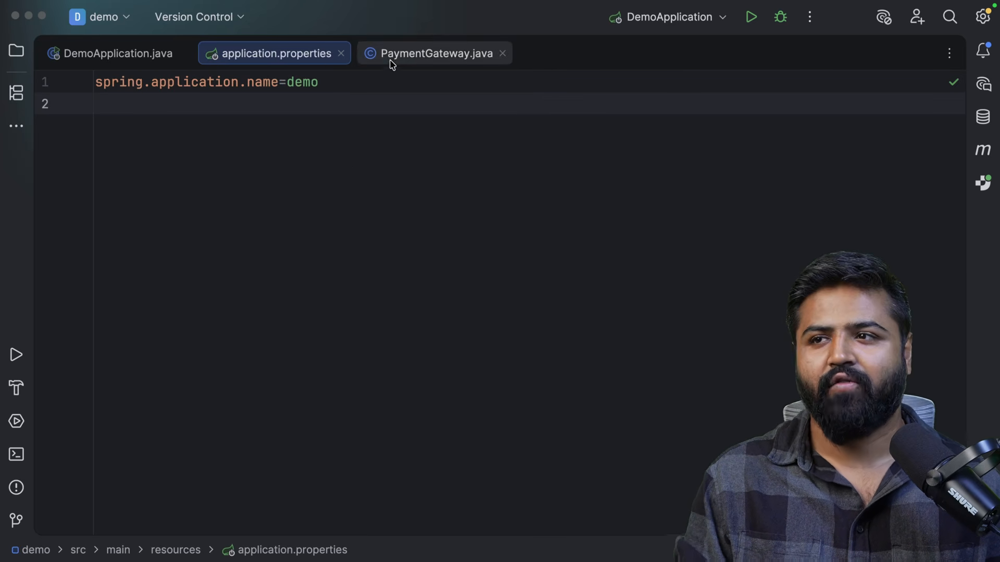
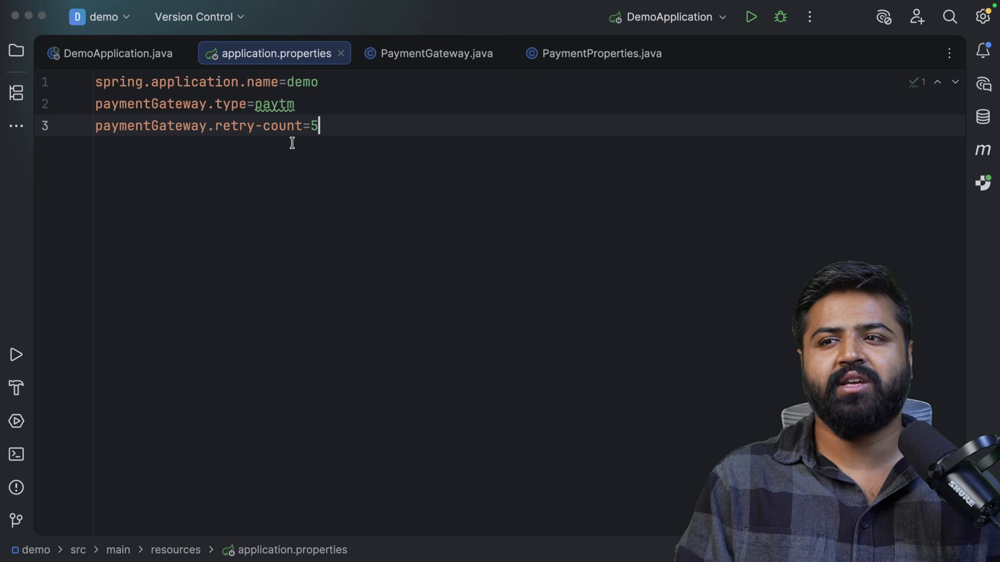
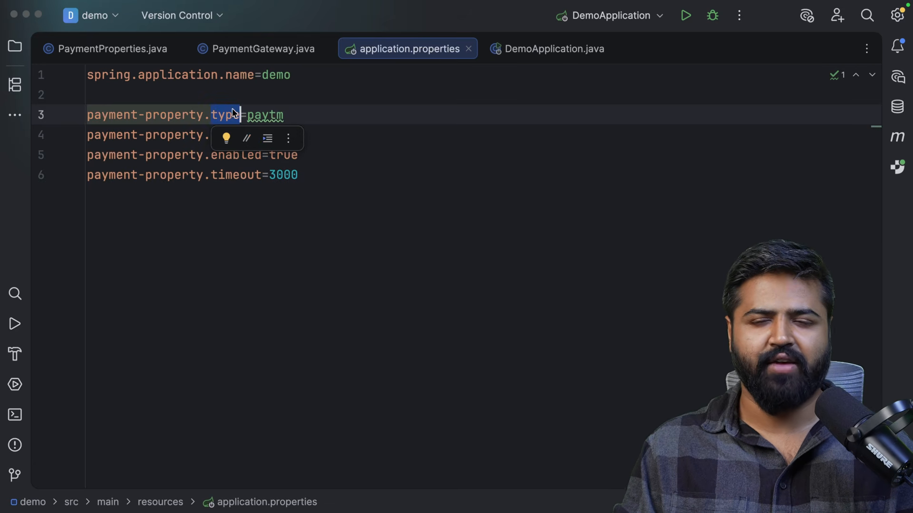
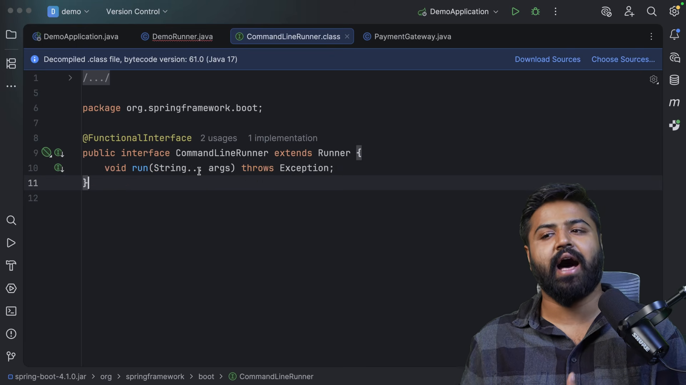

# Tệp thuộc tính và giao diện thực thi

* **Kênh:** Bouali Ali | **Thời lượng:** 00:36:37 | **Ngày:** 2026-03-10
* **Video:** https://www.youtube.com/watch?v=4naCY3vCSfk

---

## Thuật ngữ

| Thuật ngữ | Tiếng Anh | Giải thích |
| :--- | :--- | :--- |
| Tệp thuộc tính ứng dụng | application.properties | Tệp cấu hình dạng cặp khóa - giá trị lưu trữ các tham số vận hành của ứng dụng Spring Boot |
| Tiêm giá trị cấu hình | @Value | Chú thích gán giá trị thuộc tính từ tệp cấu hình hoặc biến môi trường vào trường dữ liệu của Bean |
| Giao diện dòng lệnh | CommandLineRunner | Giao diện hàm có phương thức `run(String... args)` chạy tự động sau khi ApplicationContext khởi tạo xong |
| Giao diện ứng dụng | ApplicationRunner | Biến thể nâng cao của CommandLineRunner, tiếp nhận tham số dưới dạng đối tượng `ApplicationArguments` |
| Thứ tự thực thi | @Order | Chú thích định đoạt thứ tự ưu tiên chạy giữa nhiều Runner trong cùng ứng dụng |
| Giá trị dự phòng | Default Value | Cú pháp gán giá trị mặc định (`${property:default}`) khi thuộc tính không tồn tại trong tệp cấu hình |

---

## Tổng luận chuyên đề

### Cơ chế quản trị cấu hình

Trong Spring Boot, mã nguồn Java và giá trị cấu hình môi trường được tách biệt hoàn toàn theo nguyên tắc 12 Yếu tố (Twelve-Factor App):
1. **Tránh gắn cứng giá trị (Hardcoding):** Không bao giờ ghi trực tiếp URL, cổng dịch vụ, tên người dùng, mật khẩu hoặc khóa bí mật bên trong mã nguồn Java.
2. **Quản lý tập trung qua `application.properties`:** Mọi giá trị biến thiên theo môi trường (phát triển, kiểm thử, sản xuất) đều được đưa ra tệp thuộc tính hoặc ghi đè qua biến môi trường của hệ điều hành.
3. **Tiêm an toàn qua `@Value`:** Sử dụng ngôn ngữ biểu thức Spring (SpEL) để liên kết giá trị thuộc tính với biến Java, hỗ trợ chuyển đổi kiểu dữ liệu tự động (`int`, `boolean`, `String`, `List`).

### Chu trình thực thi sau khởi động

Khi ứng dụng Spring Boot khởi chạy, phương thức `main` chỉ nên đóng vai trò kích hoạt `SpringApplication.run()`. Để thực thi các tác vụ thiết lập hệ thống (như khởi tạo dữ liệu mẫu, làm ấm bộ đệm, kiểm tra kết nối dịch vụ ngoài), Spring Boot cung cấp hai giao diện chuyên dụng:
- **`CommandLineRunner`:** Tiếp nhận mảng chuỗi đối số thô (`String[]`).
- **`ApplicationRunner`:** Tiếp nhận đối tượng `ApplicationArguments` đã được phân tích cú pháp thành các tham số có tên (`--name=value`) và không tên.

---

## Bóc tách chi tiết

### Khai báo thuộc tính tùy biến



Cấu trúc định nghĩa cặp khóa - giá trị:
- Đặt tại đường dẫn chuẩn `src/main/resources/application.properties`.
- Phân nhóm theo tiền tố phân cấp:
  ```properties
  server.port=8080
  app.name=PaymentGateway
  app.timeout=5000
  app.features.enabled=true
  payment.provider=Paytm
  payment.max-limit=3000
  ```
- Spring Boot tự động nhận diện kiểu dữ liệu và chuyển đổi từ chuỗi văn bản sang số nguyên, boolean hoặc chuỗi ký tự tương ứng khi tiêm vào Bean.

### Tiêm thuộc tính với chú thích @Value



Cú pháp và kỹ thuật sử dụng `@Value`:
- **Cú pháp cơ bản:** `@Value("${payment.provider}") private String provider;`
- **Cung cấp giá trị dự phòng (Fallback):**
  ```java
  @Value("${payment.provider:DefaultProvider}")
  private String provider;
  ```
  Nếu khóa `payment.provider` bị thiếu trong tệp cấu hình, Spring sẽ gán giá trị mặc định `"DefaultProvider"` thay vì dừng khởi động ứng dụng với ngoại lệ `IllegalArgumentException`.
- Có thể tiêm trực tiếp vào tham số của hàm tạo (Constructor Injection) để bảo toàn tính bất biến (`final`).

### Giao diện dòng lệnh CommandLineRunner



Vận hành của `CommandLineRunner`:
- Tạo một lớp gắn chú thích `@Component` và hiện thực giao diện `CommandLineRunner`:
  ```java
  @Component
  public class DatabaseSeeder implements CommandLineRunner {

      @Override
      public void run(String... args) throws Exception {
          System.out.println("Thực thi khởi tạo dữ liệu mẫu...");
          // Logic chèn dữ liệu ban đầu
      }
  }
  ```
- Sau khi toàn bộ các Bean trong `ApplicationContext` đã được tạo và kết nối xong, Spring Boot sẽ tự động quét và gọi phương thức `run()` của tất cả các Runner đã đăng ký.

### So sánh hai giao diện thực thi



Khác biệt giữa `CommandLineRunner` và `ApplicationRunner`:
- **CommandLineRunner:** Nhận mảng chuỗi nguyên thủy `args`. Lập trình viên phải tự viết mã phân tích cú pháp nếu dòng lệnh có cờ tham số (ví dụ: `--debug`, `-p 8080`).
- **ApplicationRunner:** Nhận đối tượng `ApplicationArguments`. Cung cấp sẵn các phương thức tiện ích:
  - `args.getOptionNames()`: Lấy danh sách tên tham số có tiền tố `--`.
  - `args.getOptionValues("env")`: Lấy giá trị của tham số `--env=production`.
  - `args.getNonOptionArgs()`: Lấy các đối số không có tiền tố.
- **Điều phối thứ tự:** Khi có nhiều Runner, gắn chú thích `@Order(1)`, `@Order(2)` trên từng lớp để kiểm soát thứ tự thực thi tuần tự từ bé đến lớn.

---

## Trích dẫn then chốt

* "Đừng bao giờ viết logic chạy nghiệp vụ bên trong phương thức main; hãy để main làm đúng một nhiệm vụ duy nhất là khởi động Spring." [26:18](https://www.youtube.com/watch?v=4naCY3vCSfk&t=1578s)
* "Cú pháp dấu hai chấm trong @Value("${prop:default}") là tấm khiên bảo vệ giúp ứng dụng của bạn không bị sập khi thiếu tham số môi trường." [18:45](https://www.youtube.com/watch?v=4naCY3vCSfk&t=1125s)
* "CommandLineRunner và ApplicationRunner chạy chính xác cùng một thời điểm: ngay khi mọi Bean đã sẵn sàng và trước khi ứng dụng bắt đầu nhận yêu cầu HTTP đầu tiên." [34:20](https://www.youtube.com/watch?v=4naCY3vCSfk&t=2060s)

---

## Lệnh & Công cụ

### Mã nguồn hoàn chỉnh sử dụng Runner và @Value

```java
package com.coderarmy.configdemo;

import org.springframework.beans.factory.annotation.Value;
import org.springframework.boot.CommandLineRunner;
import org.springframework.core.annotation.Order;
import org.springframework.stereotype.Component;

@Component
@Order(1)
public class PaymentSystemInitializer implements CommandLineRunner {

    private final String provider;
    private final int maxLimit;
    private final boolean isEnabled;

    // Tiêm thuộc tính qua Constructor an toàn
    public PaymentSystemInitializer(
            @Value("${payment.provider:Paytm}") String provider,
            @Value("${payment.max-limit:1000}") int maxLimit,
            @Value("${payment.enabled:true}") boolean isEnabled) {
        this.provider = provider;
        this.maxLimit = maxLimit;
        this.isEnabled = isEnabled;
    }

    @Override
    public void run(String... args) throws Exception {
        System.out.println("Hệ thống thanh toán đã khởi tạo:");
        System.out.println("- Nhà cung cấp: " + provider);
        System.out.println("- Giới hạn tối đa: " + maxLimit);
        System.out.println("- Trạng thái hoạt động: " + isEnabled);
    }
}
```

### Chạy ứng dụng từ Terminal với tham số môi trường

```bash
# Khởi chạy ứng dụng qua Maven Plugin
mvn spring-boot:run

# Khởi chạy và ghi đè tham số cấu hình từ dòng lệnh
mvn spring-boot:run -Dspring-boot.run.arguments="--payment.provider=Stripe --server.port=9090"

# Chạy tệp JAR đã đóng gói với biến môi trường
java -jar target/config-demo-0.0.1-SNAPSHOT.jar --payment.provider=VNPay
```

---

## Đánh đổi & Rủi ro

### Đánh đổi khi dùng @Value rải rác
- **Thiếu kiểm tra kiểu cấu trúc:** Khi một dự án lớn có hàng chục lớp cùng tiêm `@Value("${some.property}")`, việc phân tán này khiến cấu hình bị phân mảnh, khó quản lý tổng thể. Giải pháp tốt hơn cho các cấu hình phức tạp là chuyển sang dùng `@ConfigurationProperties`.
- **Rủi ro sai chính tả chuỗi ký tự:** Gõ sai một ký tự trong chuỗi `@Value("${paymnt.providr}")` sẽ dẫn đến lỗi lúc khởi động nếu không có giá trị mặc định.

### Rủi ro vận hành với Runner
- **Chặn tiến trình khởi động:** Phương thức `run()` trong các Runner được thực thi đồng bộ trên luồng chính. Nếu một Runner bị treo do chờ kết nối mạng hoặc vòng lặp vô hạn, toàn bộ ứng dụng web sẽ bị kẹt và không bao giờ mở cổng HTTP để phục vụ người dùng.
- **Xử lý ngoại lệ:** Bất kỳ ngoại lệ không được bắt (Uncaught Exception) nào ném ra từ Runner sẽ làm ứng dụng lập tức thoát tiến trình (`System.exit(1)`).
