# Hướng Dẫn Spring Boot Toàn Diện Cho Người Mới Bắt Đầu [2025]

* **Kênh:** Programming with Mosh | **Thời lượng:** 01:11:21 | **Ngày:** 2025-02-26
* **Video:** https://youtu.be/gJrjgg1KVL4

---

## Thuật ngữ

| Thuật ngữ | Tiếng Anh | Giải thích |
| :--- | :--- | :--- |
| Khởi tạo Spring Boot | Spring Initializr | Công cụ web và tích hợp IDE giúp sinh cấu trúc dự án Spring Boot ban đầu với đầy đủ cấu hình phụ thuộc. |
| Phụ thuộc khởi động | Starter Dependency | Gói phụ thuộc tổng hợp đóng gói sẵn các thư viện tương thích đã được kiểm thử (ví dụ: `spring-boot-starter-web`). |
| Bộ bọc Maven | Maven Wrapper (`mvnw`) | Công cụ nhúng cho phép tải và thực thi chính xác phiên bản Maven của dự án mà không cần cài đặt Maven toàn cục. |
| Bộ chứa đảo ngược điều khiển | IoC Container | Thành phần cốt lõi của Spring Framework chịu trách nhiệm khởi tạo, cấu hình và quản lý vòng đời của các Spring Bean. |
| Đối tượng quản lý | Spring Bean | Các đối tượng Java thông thường được quản lý, cấu hình và tiêm phụ thuộc bởi IoC Container. |
| Ngữ cảnh ứng dụng | ApplicationContext | Giao diện đại diện cho IoC Container, đóng vai trò kho lưu trữ và truy xuất các Bean trong bộ nhớ. |
| Tiêm phụ thuộc | Dependency Injection (DI) | Mẫu thiết kế phần mềm trong đó một lớp nhận các đối tượng phụ thuộc từ bên ngoài thay vì tự khởi tạo bằng toán tử `new`. |
| Tiêm qua hàm tạo | Constructor Injection | Cơ chế truyền các phụ thuộc vào lớp thông qua tham số của hàm tạo (khuyến nghị mặc định). |
| Tiêm qua phương thức gán | Setter Injection | Cơ chế truyền các phụ thuộc thông qua phương thức thiết lập (`setter`), chỉ dùng cho phụ thuộc tùy chọn. |
| Tự động đấu nối | Autowiring (`@Autowired`) | Cơ chế của Spring tự động tìm kiếm và gán Bean phù hợp vào các điểm tiêm phụ thuộc. |
| Rác công việc | Work Slop | Tài liệu, mã nguồn rườm rà sinh tự động thiếu cấu trúc tối ưu gây lãng phí tài nguyên xử lý. |
| Tái khởi động tự động | Automatic Restarts | Tính năng của `spring-boot-devtools` giúp nạp lại ứng dụng tự động khi có thay đổi trong mã nguồn. |

---

## Tổng luận chuyên đề

### Bản chất của Spring Boot

Spring Framework là hệ sinh thái khổng lồ bao gồm Spring Data, Spring Security, Spring Cloud, Spring Batch, Spring Integration và Spring Shell. Tuy nhiên, việc cấu hình ứng dụng Spring truyền thống vô cùng phức tạp với hàng tá tệp cấu hình XML hoặc mã nguồn Java khởi tạo rườm rà.

Spring Boot ra đời nhằm giải quyết triệt để vấn đề này với hai cơ chế nền tảng:
1. **Phụ thuộc khởi động (Starter Dependencies):** Thay vì tự khai phá từng thư viện riêng lẻ (như Tomcat nhúng, Jackson cho JSON, Hibernate cho JPA, Logback cho ghi log) và giải quyết xung đột phiên bản, Spring Boot cung cấp các gói phụ thuộc tổng hợp tương thích 100%.
2. **Tự động cấu hình (Auto-configuration):** Tự động phát hiện các thư viện có trong đường dẫn lớp (`classpath`) và sinh ra cấu hình mặc định hợp lý nhất, cho phép nhà phát triển tập trung hoàn toàn vào nghiệp vụ ứng dụng.

### Kiến trúc phân tách Web MVC

Spring MVC vận hành theo mô hình kiến trúc ba lớp:
* **Mô hình (Model):** Đại diện cho dữ liệu và quy tắc nghiệp vụ của ứng dụng, thường kết nối với cơ sở dữ liệu.
* **Giao diện (View):** Lớp hiển thị kết quả cho người dùng (HTML, JSON, XML).
* **Bộ điều khiển (Controller):** Đóng vai trò cầu nối, tiếp nhận yêu cầu HTTP từ máy khách, điều phối xử lý nghiệp vụ tại Model và trả về View tương ứng.

### Cơ chế đảo ngược điều khiển

Mối quan hệ phụ thuộc trong mã nguồn quyết định khả năng mở rộng và kiểm thử tự động của hệ thống:
* **Ghép nối chặt (Tight Coupling):** Một lớp tự tạo thể hiện của lớp phụ thuộc bằng toán tử `new` (`new StripePaymentService()`). Điều này khiến lớp gọi bị gắn chặt vào một hiện thực duy nhất, không thể kiểm thử cô lập (unit test) và buộc phải sửa đổi mã nguồn khi thay đổi nhà cung cấp dịch vụ.
* **Lập trình theo giao diện (Programming against Interfaces):** Tách biệt định nghĩa nghiệp vụ (`PaymentService`) khỏi hiện thực cụ thể (`StripePaymentService`, `PayPalPaymentService`).
* **Đảo ngược điều khiển (Inversion of Control - IoC):** Quyền năng tạo đối tượng và đấu nối dây phụ thuộc được bàn giao hoàn toàn cho Spring IoC Container (`ApplicationContext`). Mã nguồn ứng dụng chỉ khai báo các điểm phụ thuộc cần thiết.

---

## Bóc tách chi tiết

### [[08:00](https://youtu.be/gJrjgg1KVL4?t=480s)] Tổng quan hệ sinh thái

Mosh Hamedani giới thiệu tổng quan hệ sinh thái Spring Framework và lý do Spring Boot trở thành chuẩn mực công nghiệp cho phát triển ứng dụng Java backend hiện đại.

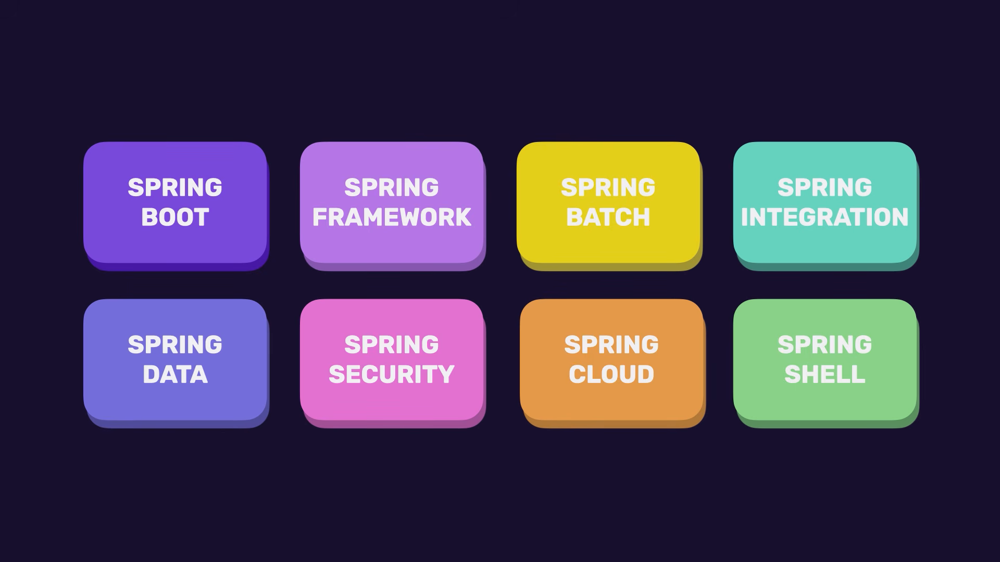

Spring Framework là tập hợp của nhiều dự án thành phần giải quyết từng bài toán chuyên biệt:
* **Spring Boot:** Nền tảng điều phối, tinh giản hóa việc thiết lập và cấu hình ứng dụng.
* **Spring Framework:** Nhân cốt lõi cung cấp cơ chế IoC, Dependency Injection và Spring MVC.
* **Spring Data:** Chuẩn hóa giao tiếp và thao tác trên cơ sở dữ liệu quan hệ (SQL) lẫn phi quan hệ (NoSQL).
* **Spring Security:** Hệ thống xác thực (Authentication) và phân quyền (Authorization) toàn diện.
* **Spring Cloud:** Công cụ xây dựng các dịch vụ vi mô (microservices), khám phá dịch vụ và cân bằng tải.
* **Spring Batch & Integration:** Xử lý dữ liệu hàng loạt và tích hợp các hệ thống doanh nghiệp phức tạp.

### [[11:30](https://youtu.be/gJrjgg1KVL4?t=690s)] Chuẩn bị môi trường

Quy trình thiết lập môi trường phát triển cục bộ chuẩn mực cho Spring Boot:

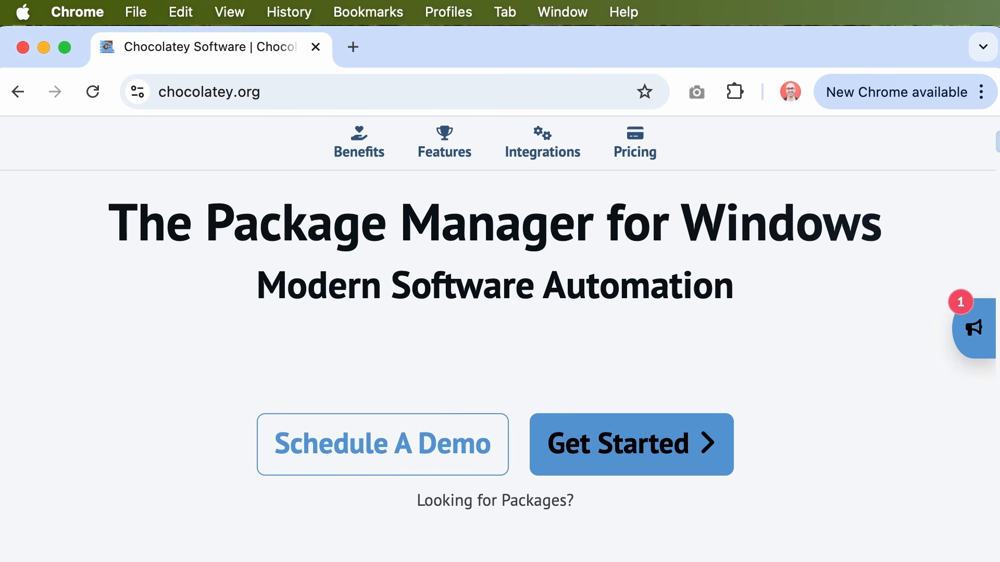

1. **Bộ công cụ phát triển Java (JDK):**
   * Tải bản JDK hiện đại từ Oracle hoặc Adoptium (hỗ trợ JDK 21+ LTS hoặc JDK 23).
   * Kiểm tra phiên bản dòng lệnh:
     ```bash
     java -version
     ```
2. **Môi trường phát triển tích hợp (IDE):**
   * Sử dụng IntelliJ IDEA (phiên bản Ultimate hỗ trợ đầy đủ công cụ Spring Boot tích hợp sẵn; phiên bản Community sử dụng Spring Initializr trên nền web).
   * Cấu hình liên kết JDK với dự án trong IntelliJ qua menu `Project Structure` (`File -> Project Structure -> SDKs`).

### [[15:15](https://youtu.be/gJrjgg1KVL4?t=915s)] Khởi tạo dự án

Khởi tạo dự án Spring Boot thông qua công cụ Spring Initializr tích hợp trong IntelliJ IDEA (tương đương truy cập cổng web `start.spring.io`):

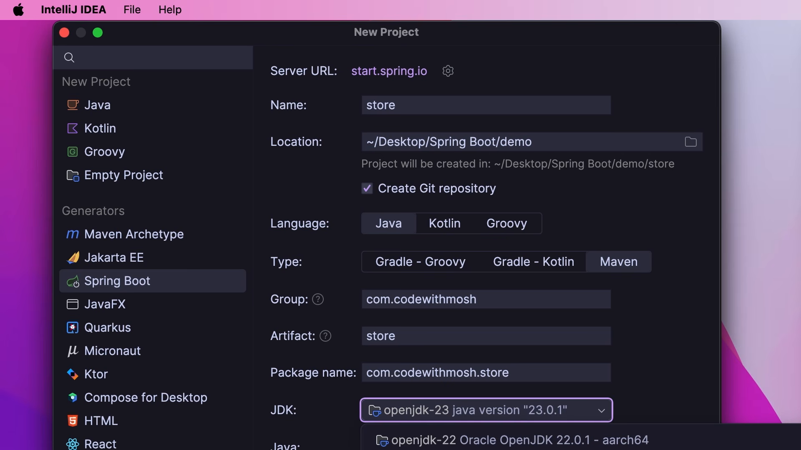

* **Server URL:** `start.spring.io`
* **Tên dự án (Name):** `store`
* **Ngôn ngữ (Language):** Java
* **Hệ thống xây dựng (Type):** Maven (thay vì Gradle)
* **Định danh nhóm (Group ID):** `com.codewithmosh` (định danh ngược theo tên miền tổ chức)
* **Mã cấu phần (Artifact ID):** `store` (tên gói sản phẩm đầu ra)
* **Tên gói mã nguồn (Package name):** `com.codewithmosh.store`
* **Phiên bản Java (JDK):** OpenJDK 23

### [[19:15](https://youtu.be/gJrjgg1KVL4?t=1155s)] Cấu trúc dự án

Phân tích chi tiết từng thư mục và tệp cấu hình trong cấu trúc dự án Spring Boot tiêu chuẩn:

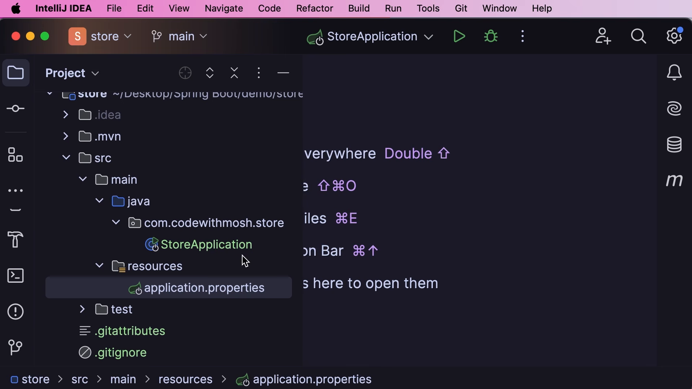

* **`.idea/`:** Thư mục cấu hình nội bộ của IntelliJ IDEA, không cần can thiệp và không đẩy lên Git.
* **`.mvn/` và `mvnw` / `mvnw.cmd`:** Bộ bọc Maven (Maven Wrapper). Cho phép bất kỳ thành viên nào trong nhóm hoặc máy chủ CI/CD biên dịch dự án với phiên bản Maven chuẩn hóa mà không bắt buộc cài Maven vào biến môi trường hệ điều hành:
  ```bash
  ./mvnw clean compile
  ```
* **`pom.xml`:** Tệp mô tả mô hình đối tượng dự án (Project Object Model), quản lý các thông số phiên bản, cấu hình plugin biên dịch và danh sách phụ thuộc.
* **`src/main/java/`:** Thư mục chứa toàn bộ mã nguồn Java của ứng dụng.
* **`src/main/resources/`:** Thư mục tài nguyên tĩnh (`static/` cho ảnh, CSS, JS), giao diện mẫu (`templates/`) và tệp cấu hình tham số (`application.properties`).
* **`src/test/java/`:** Thư mục chứa mã nguồn kiểm thử đơn vị và kiểm thử tích hợp.

### [[27:00](https://youtu.be/gJrjgg1KVL4?t=1620s)] Quản lý phụ thuộc

Cơ chế quản lý gói phụ thuộc thông qua Apache Maven và kho lưu trữ trung tâm Maven Central:

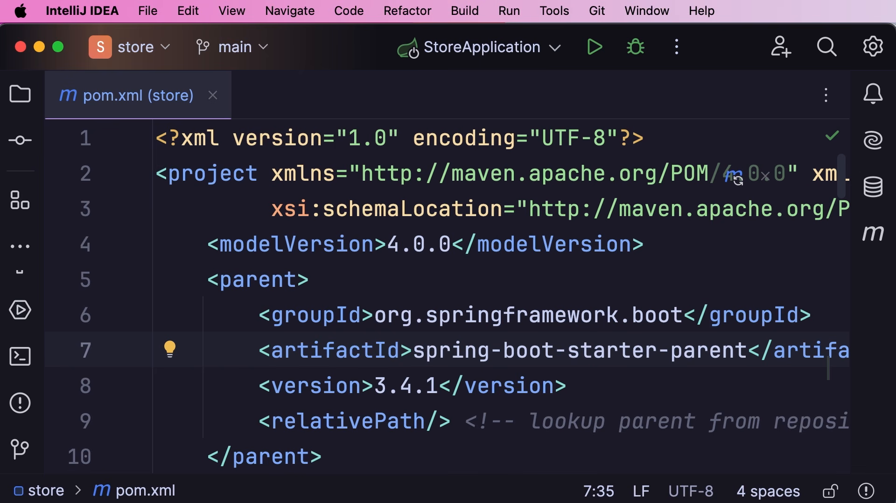

Tệp `pom.xml` định nghĩa cấu trúc phân tầng phụ thuộc:
1. **Phần tử cha (`<parent>`):** Kế thừa cấu hình từ `spring-boot-starter-parent`. Phần tử này kiểm soát toàn bộ thông số phiên bản của hàng trăm thư viện con:
   ```xml
   <parent>
       <groupId>org.springframework.boot</groupId>
       <artifactId>spring-boot-starter-parent</artifactId>
       <version>3.4.1</version>
       <relativePath/>
   </parent>
   ```
2. **Khai báo phụ thuộc (`<dependencies>`):** Khi thêm một phụ thuộc thuộc hệ sinh thái Spring, nhà phát triển không cần chỉ định thẻ `<version>`:
   ```xml
   <dependency>
       <groupId>org.springframework.boot</groupId>
       <artifactId>spring-boot-starter-web</artifactId>
   </dependency>
   ```
   Gói `spring-boot-starter-web` tự động kéo theo Tomcat nhúng, bộ chuyển đổi JSON Jackson, bộ lọc giao thức web và khung điều hướng Spring MVC.

### [[31:20](https://youtu.be/gJrjgg1KVL4?t=1880s)] Xây dựng Controller

Hiện thực bộ điều khiển đầu tiên `HomeController` để tiếp nhận yêu cầu điều hướng trang chủ và trả về tệp HTML tĩnh:

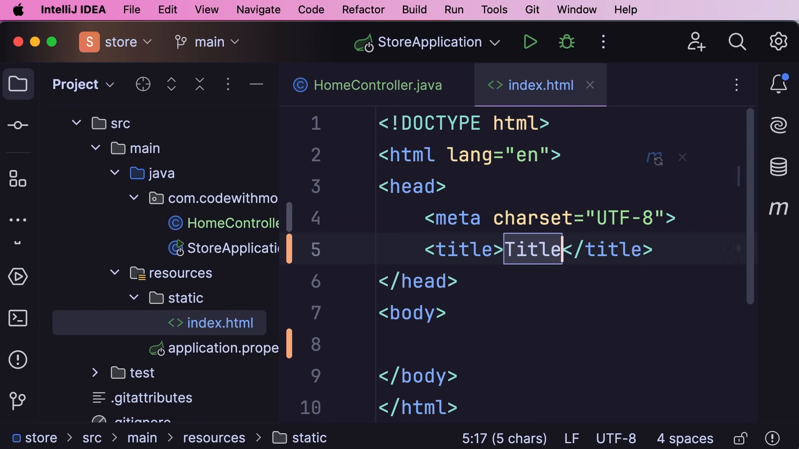

1. Tạo tệp `src/main/resources/static/index.html`:
   ```html
   <!DOCTYPE html>
   <html lang="en">
   <head>
       <meta charset="UTF-8">
       <title>My Store</title>
   </head>
   <body>
       <h1>Welcome to My Store</h1>
   </body>
   </html>
   ```
2. Tạo lớp `HomeController.java` trong gói `com.codewithmosh.store`:
   ```java
   package com.codewithmosh.store;

   import org.springframework.stereotype.Controller;
   import org.springframework.web.bind.annotation.RequestMapping;

   @Controller
   public class HomeController {
       @RequestMapping("/")
       public String index() {
           return "index.html";
       }
   }
   ```
* Annotation `@Controller` đăng ký lớp này vào Spring IoC như một điểm tiếp nhận web.
* Annotation `@RequestMapping("/")` ánh xạ đường dẫn gốc của ứng dụng vào phương thức `index()`.
* Chuỗi trả về `"index.html"` chỉ dẫn cho Spring chuyển tiếp và hiển thị tệp tài nguyên tĩnh tương ứng.

### [[34:20](https://youtu.be/gJrjgg1KVL4?t=2060s)] Thực thi ứng dụng

Quy trình khởi chạy ứng dụng Spring Boot và kiểm tra kết quả trên trình duyệt:

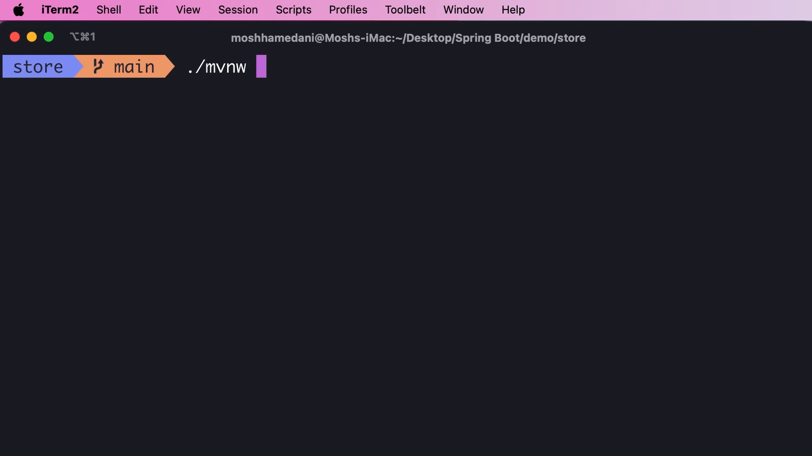

1. **Khởi chạy từ IntelliJ:** Nhấp vào nút Run cạnh lớp `StoreApplication.java`.
2. **Khởi chạy từ dòng lệnh:**
   ```bash
   ./mvnw spring-boot:run
   ```
3. **Phân tích nhật ký bảng điều khiển (Console log):**
   * Spring Boot hiển thị biểu ngữ (ASCII banner).
   * Tomcat nhúng khởi động trên cổng mặc định: `Tomcat started on port 8080 (http)`.
   * Thời gian khởi chạy ứng dụng được ghi nhận (ví dụ: `Started StoreApplication in 1.25 seconds`).
4. **Kiểm tra trên trình duyệt:** Truy cập `http://localhost:8080` để thấy nội dung trang `index.html`.

### [[40:10](https://youtu.be/gJrjgg1KVL4?t=2410s)] Gỡ lỗi ứng dụng

Thực hành kỹ thuật gỡ lỗi (Debugging) chuyên nghiệp trong IntelliJ IDEA để theo dõi luồng thực thi và ngăn chặn lỗi:

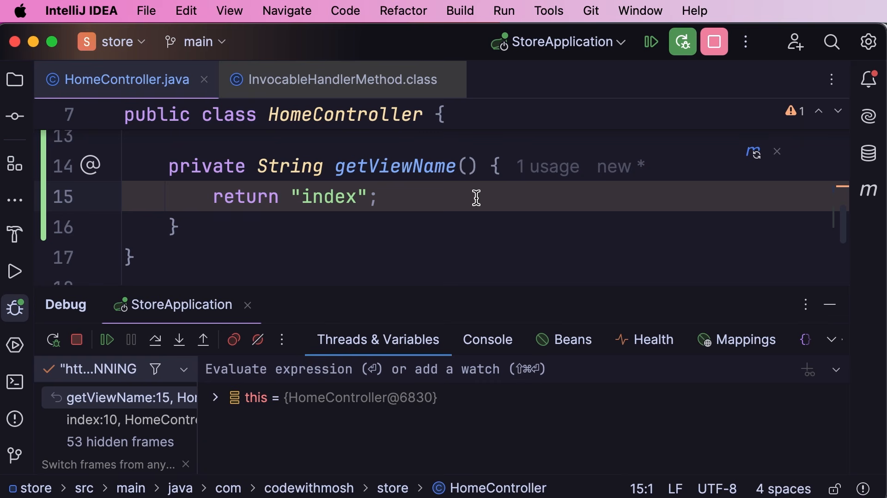

1. Cố tình đưa lỗi vào Controller bằng cách gọi hàm con trả về sai tên trang:
   ```java
   @Controller
   public class HomeController {
       private String getViewName() {
           return "index"; // Lỗi: thiếu .html khiến máy chủ không tìm thấy tài nguyên
       }

       @RequestMapping("/")
       public String index() {
           return getViewName();
       }
   }
   ```
2. **Đặt điểm dừng (Breakpoint):** Nhấp chuột vào lề trái cạnh dòng lệnh cần kiểm tra (`return getViewName();`).
3. **Khởi động chế độ gỡ lỗi (Debug mode):** Bấm biểu tượng con bọ (Debug icon) trong IntelliJ.
4. **Kiểm tra trạng thái thời gian thực:**
   * Mở trình duyệt gọi `http://localhost:8080`, tiến trình ứng dụng lập tức đóng băng tại điểm dừng.
   * Cửa sổ **Debug -> Threads & Variables** hiển thị toàn bộ giá trị biến cục bộ, tham chiếu `this` và ngăn xếp cuộc gọi (Call stack).
   * Sử dụng các phím tắt điều hướng: `Step Over` (F8) để đi tới dòng kế, `Step Into` (F7) để đi vào trong hàm con.

### [[43:50](https://youtu.be/gJrjgg1KVL4?t=2630s)] Tự động tải lại

Cấu hình công cụ `spring-boot-devtools` để tự động khởi động lại ứng dụng mỗi khi phát hiện có thay đổi trong mã nguồn:

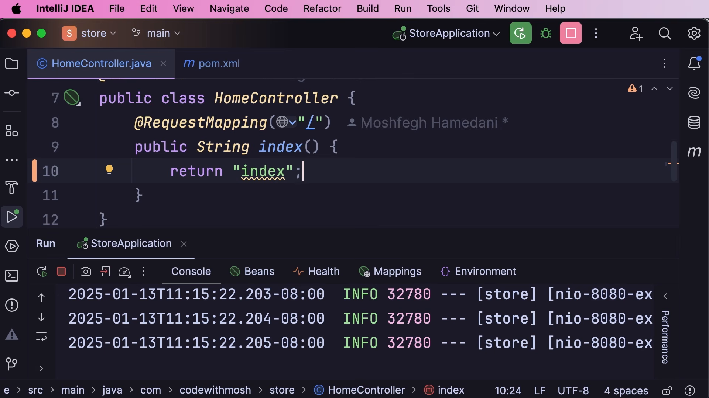

1. Bổ sung phụ thuộc vào `pom.xml`:
   ```xml
   <dependency>
       <groupId>org.springframework.boot</groupId>
       <artifactId>spring-boot-devtools</artifactId>
       <optional>true</optional>
   </dependency>
   ```
   * Thẻ `<optional>true</optional>` bảo đảm thư viện này chỉ phục vụ môi trường lập trình cục bộ và bị loại bỏ khi đóng gói phát hành (`production`).
2. Cấu hình tự động biên dịch trong IntelliJ:
   * Vào `Settings -> Build, Execution, Deployment -> Compiler` -> Tích chọn **Build project automatically**.
   * Vào `Settings -> Advanced Settings` -> Tích chọn **Allow auto-make to start even if developed application is currently running**.
3. Khi chỉnh sửa mã nguồn và lưu lại, Spring Boot tự động nạp lại ngữ cảnh mà không cần bấm nút Restart thủ công.

### [[46:30](https://youtu.be/gJrjgg1KVL4?t=2790s)] Cấu hình thuộc tính

Quản lý các thông số môi trường và cấu hình tùy biến qua tệp `application.properties`:

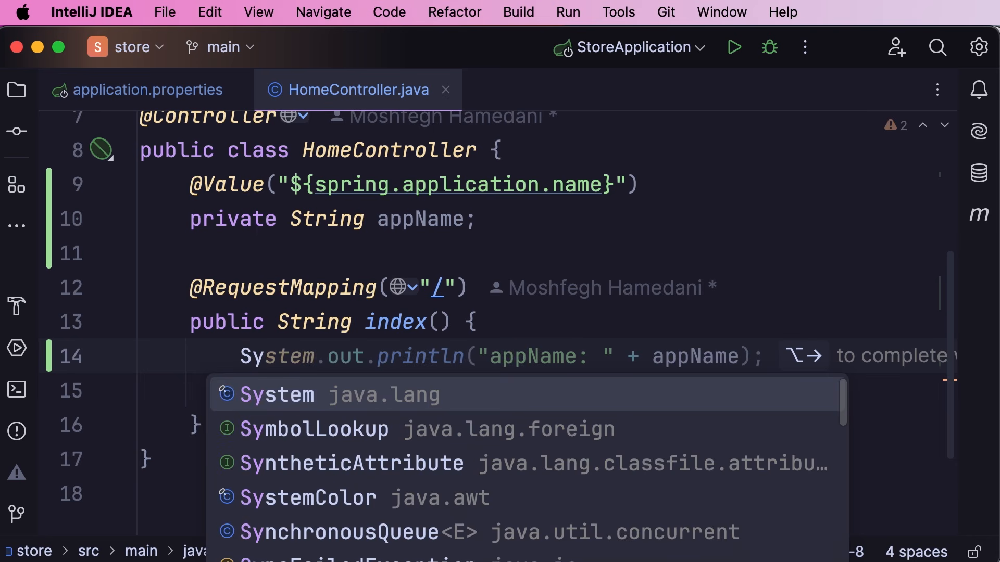

1. Khai báo các tham số trong `src/main/resources/application.properties`:
   ```properties
   spring.application.name=store
   server.port=9000
   ```
2. Tiêm giá trị thuộc tính vào mã nguồn Java thông qua annotation `@Value`:
   ```java
   package com.codewithmosh.store;

   import org.springframework.beans.factory.annotation.Value;
   import org.springframework.stereotype.Controller;
   import org.springframework.web.bind.annotation.RequestMapping;

   @Controller
   public class HomeController {
       @Value("${spring.application.name}")
       private String appName;

       @RequestMapping("/")
       public String index() {
           System.out.println("AppName: " + appName);
           return "index.html";
       }
   }
   ```
   Tại thời điểm khởi chạy, Spring đọc khóa `${spring.application.name}` và tự động gán chuỗi `"store"` vào trường `appName`.

### [[50:30](https://youtu.be/gJrjgg1KVL4?t=3030s)] Khái niệm tiêm phụ thuộc

Phân tích bài toán thiết kế kiến trúc phần mềm trong ứng dụng thương mại điện tử:

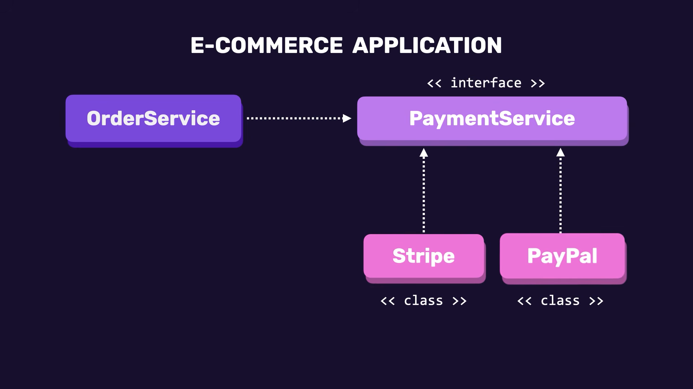

* Lớp `OrderService` chịu trách nhiệm xử lý đơn hàng (`placeOrder()`).
* Khi đặt hàng, hệ thống bắt buộc phải thanh toán tiền, do đó `OrderService` phụ thuộc vào một dịch vụ thanh toán.
* **Mã nguồn ghép nối chặt ban đầu:**
  ```java
  public class OrderService {
      public void placeOrder() {
          var paymentService = new StripePaymentService();
          paymentService.processPayment(10.0);
      }
  }
  ```
* **Nhược điểm nghiêm trọng:**
  1. Không thể kiểm thử đơn vị độc lập: Mọi ca kiểm thử cho `OrderService` đều buộc phải kết nối tới cổng Stripe thật.
  2. Bất khả kháng trong việc mở rộng: Khi doanh nghiệp muốn tích hợp thêm PayPal hoặc chuyển đổi đối tác thanh toán, lập trình viên buộc phải can thiệp sửa đổi và biên dịch lại mã nguồn của `OrderService`.

### [[55:10](https://youtu.be/gJrjgg1KVL4?t=3310s)] Tách rời phụ thuộc

Áp dụng nguyên tắc lập trình hướng giao diện (Programming against Interfaces) để triệt tiêu ghép nối cứng:

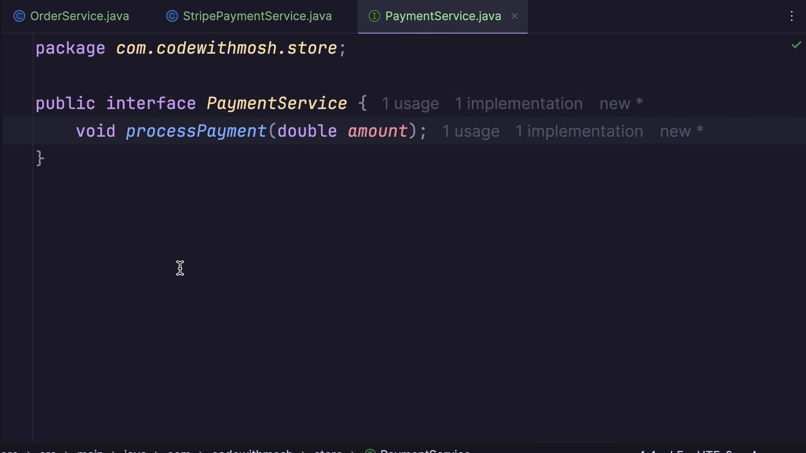

1. Trích xuất giao diện trừu tượng `PaymentService`:
   ```java
   package com.codewithmosh.store;

   public interface PaymentService {
       void processPayment(double amount);
   }
   ```
2. Cho các lớp hiện thực cụ thể triển khai giao diện:
   ```java
   package com.codewithmosh.store;

   public class StripePaymentService implements PaymentService {
       @Override
       public void processPayment(double amount) {
           System.out.println("STRIPE: " + amount);
       }
   }
   ```
   ```java
   package com.codewithmosh.store;

   public class PayPalPaymentService implements PaymentService {
       @Override
       public void processPayment(double amount) {
           System.out.println("PAYPAL: " + amount);
       }
   }
   ```

### [[56:40](https://youtu.be/gJrjgg1KVL4?t=3400s)] Tiêm qua hàm tạo

Thực hiện tiêm phụ thuộc thông qua hàm tạo (Constructor Injection) trong lớp `OrderService`:

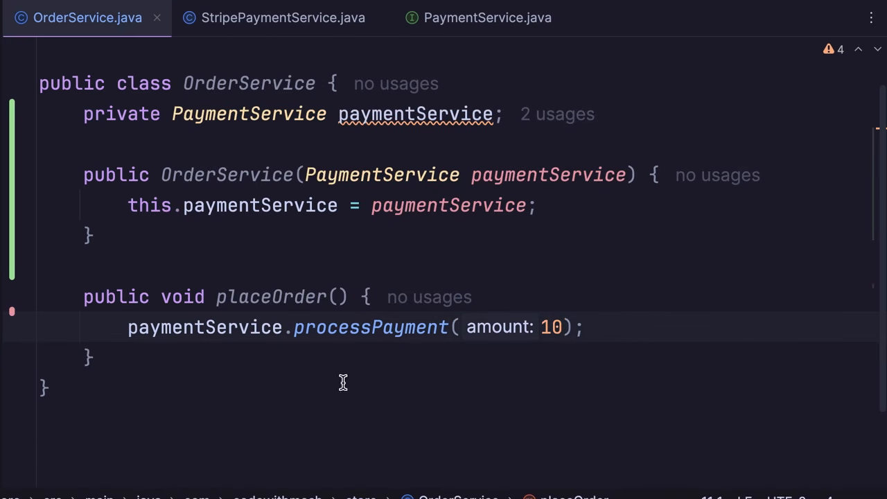

1. Tái cấu trúc lớp `OrderService`:
   ```java
   package com.codewithmosh.store;

   public class OrderService {
       private PaymentService paymentService;

       public OrderService(PaymentService paymentService) {
           this.paymentService = paymentService;
       }

       public void placeOrder() {
           paymentService.processPayment(10);
       }
   }
   ```
2. Khởi tạo và tiêm thủ công từ phương thức `main()`:
   ```java
   public static void main(String[] args) {
       var orderService = new OrderService(new StripePaymentService());
       orderService.placeOrder();

       // Khi muốn đổi sang PayPal, OrderService hoàn toàn không đổi:
       var paypalOrderService = new OrderService(new PayPalPaymentService());
       paypalOrderService.placeOrder();
   }
   ```
   Lớp `OrderService` giờ đây hoàn toàn độc lập với chi tiết hiện thực của nhà cung cấp cổng thanh toán.

### [[62:50](https://youtu.be/gJrjgg1KVL4?t=3770s)] Tiêm qua hàm gán

Khảo sát phương pháp tiêm phụ thuộc qua hàm thiết lập (Setter Injection) và phân tích các rủi ro đi kèm:

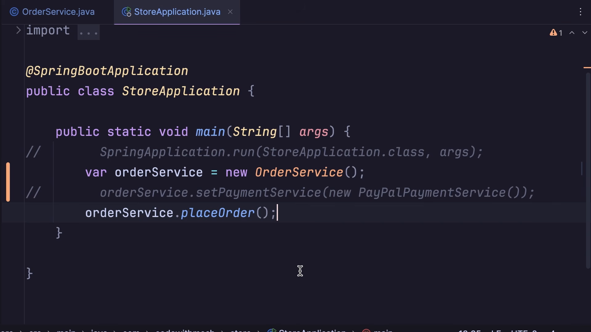

1. Định nghĩa phương thức setter:
   ```java
   public class OrderService {
       private PaymentService paymentService;

       public void setPaymentService(PaymentService paymentService) {
           this.paymentService = paymentService;
       }

       public void placeOrder() {
           paymentService.processPayment(10);
       }
   }
   ```
2. **Lỗ hổng trạng thái chưa khởi tạo:**
   ```java
   var orderService = new OrderService();
   // Quên không gọi orderService.setPaymentService(...)
   orderService.placeOrder(); // Lập tức ném ngoại lệ NullPointerException tại runtime
   ```
* **Khuyến nghị kiến trúc:** Luôn ưu tiên dùng **Constructor Injection** vì nó ép buộc đối tượng phải được cung cấp đầy đủ các phụ thuộc bắt buộc ngay tại thời điểm khởi tạo, bảo đảm tính bất biến (immutability) và ngăn ngừa lỗi ném con trỏ rỗng (`NullPointerException`).

### [[65:40](https://youtu.be/gJrjgg1KVL4?t=3940s)] Vận hành bộ chứa

Chuyển giao quyền điều phối và khởi tạo đối tượng cho Spring IoC Container:

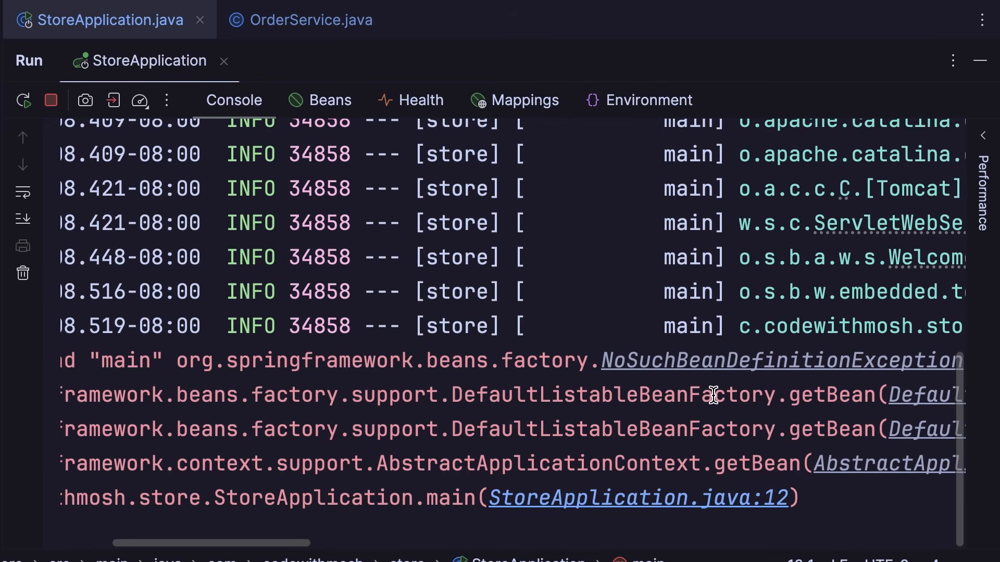

1. Truy xuất đối tượng từ `ApplicationContext`:
   ```java
   package com.codewithmosh.store;

   import org.springframework.boot.SpringApplication;
   import org.springframework.boot.autoconfigure.SpringBootApplication;
   import org.springframework.context.ApplicationContext;

   @SpringBootApplication
   public class StoreApplication {
       public static void main(String[] args) {
           ApplicationContext context = SpringApplication.run(StoreApplication.class, args);
           OrderService orderService = context.getBean(OrderService.class);
           orderService.placeOrder();
       }
   }
   ```
2. **Ngoại lệ phát sinh:**
   Khi chưa đánh dấu annotation, ứng dụng lập tức sập với ngoại lệ:
   ```text
   org.springframework.beans.factory.NoSuchBeanDefinitionException: 
   No qualifying bean of type 'com.codewithmosh.store.OrderService' available
   ```
   Nguyên nhân: Spring chỉ quản lý các lớp được đánh dấu là Spring Bean.

### [[70:40](https://youtu.be/gJrjgg1KVL4?t=4240s)] Đánh dấu định danh

Sử dụng các annotation mẫu rập khuôn (Stereotype Annotations) để đăng ký Bean và giải quyết đấu nối tự động:

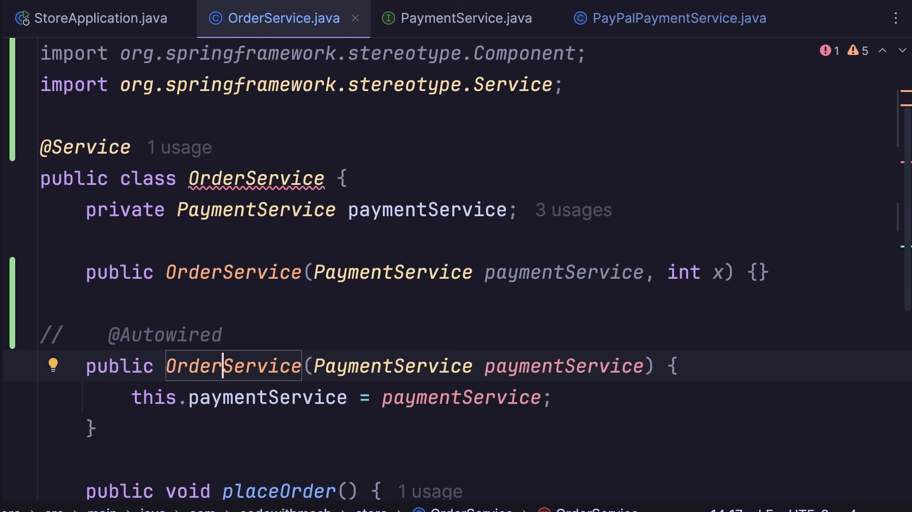

1. **Các annotation định danh Bean:**
   * `@Component`: Annotation tổng quát dùng để đánh dấu bất kỳ lớp Java nào do Spring quản lý.
   * `@Service`: Định danh chuyên biệt dành cho lớp chứa logic nghiệp vụ (về mặt kỹ thuật là bí danh kế thừa từ `@Component`).
   * `@Repository`: Định danh cho lớp truy xuất và thao tác dữ liệu (DAO).
   * `@Controller`: Định danh cho lớp tiếp nhận yêu cầu web HTTP.
2. **Khai báo Bean cho dịch vụ:**
   ```java
   package com.codewithmosh.store;

   import org.springframework.stereotype.Service;

   @Service
   public class OrderService {
       private final PaymentService paymentService;

       // Khi chỉ có 1 constructor duy nhất, @Autowired là tùy chọn (không bắt buộc)
       public OrderService(PaymentService paymentService) {
           this.paymentService = paymentService;
       }

       public void placeOrder() {
           paymentService.processPayment(10);
       }
   }
   ```
3. **Đăng ký hiện thực cho Interface:**
   Nếu `PaymentService` là giao diện không có annotation, Spring sẽ báo lỗi:
   ```text
   Could not autowire. No beans of 'PaymentService' type found.
   ```
   Khắc phục bằng cách đánh dấu `@Service` trên lớp triển khai cụ thể:
   ```java
   @Service
   public class PayPalPaymentService implements PaymentService {
       @Override
       public void processPayment(double amount) {
           System.out.println("PAYPAL: " + amount);
       }
   }
   ```
4. **Quy tắc sử dụng `@Autowired` khi có nhiều hàm tạo:**
   * Nếu một lớp có từ 2 constructor trở lên, Spring mặc định sẽ ưu tiên gọi constructor rỗng (no-arg constructor), dẫn đến các trường phụ thuộc bị bỏ rỗng (`null`).
   * Để chỉ định chính xác constructor mà Spring cần dùng để tiêm phụ thuộc, bắt buộc phải gắn annotation `@Autowired` trên constructor đó:
   ```java
   @Autowired
   public OrderService(PaymentService paymentService) {
       this.paymentService = paymentService;
   }
   ```

---

## Trích dẫn then chốt

* [[19:55](https://youtu.be/gJrjgg1KVL4?t=1195s)] *"A starter dependency is a curated collection of libraries and frameworks that are commonly used together... tested and verified by the Spring development team."*
  (Phụ thuộc khởi động là bộ sưu tập tinh tuyển gồm các thư viện và khung làm việc thường dùng chung với nhau... đã được đội ngũ phát triển Spring kiểm thử và xác thực đồng bộ.)

* [[48:30](https://youtu.be/gJrjgg1KVL4?t=2910s)] *"When one class creates an instance of another class, we say they are tightly coupled. That means we cannot test or modify them in isolation."*
  (Khi một lớp tự khởi tạo thể hiện của một lớp khác, chúng bị ghép nối chặt chẽ. Điều đó đồng nghĩa với việc chúng ta không thể kiểm thử hoặc sửa đổi chúng một cách cô lập.)

* [[54:41](https://youtu.be/gJrjgg1KVL4?t=3281s)] *"Program against interfaces where possible. This allows us to decouple our classes and swap implementations without recompiling the consumer."*
  (Hãy lập trình dựa trên giao diện bất cứ khi nào có thể. Điều này cho phép chúng ta tách rời các lớp và hoán đổi các bản hiện thực mà không cần biên dịch lại lớp sử dụng.)

* [[63:00](https://youtu.be/gJrjgg1KVL4?t=3780s)] *"Constructor injection is the more common and recommended way to inject dependencies because it ensures a class is always initialized in a valid state."*
  (Tiêm qua hàm tạo là cách tiếp cận phổ biến và được khuyến nghị nhất vì nó đảm bảo một lớp luôn luôn được khởi tạo trong một trạng thái hợp lệ.)

* [[64:25](https://youtu.be/gJrjgg1KVL4?t=3865s)] *"Inversion of control inverts the responsibility of creating objects and managing dependencies. Instead of us doing it, we hand over that control to Spring."*
  (Đảo ngược điều khiển đảo ngược trách nhiệm tạo đối tượng và quản lý phụ thuộc. Thay vì chúng ta tự làm việc đó, ta bàn giao hoàn toàn quyền kiểm soát cho Spring.)

---

## Lệnh & Công cụ

### Lệnh thực thi dự án

```bash
# Biên dịch dự án bằng Maven Wrapper
./mvnw clean compile

# Khởi chạy ứng dụng Spring Boot trực tiếp từ dòng lệnh
./mvnw spring-boot:run

# Đóng gói ứng dụng thành tệp JAR độc lập
./mvnw clean package

# Chạy tệp JAR đã đóng gói
java -jar target/store-0.0.1-SNAPSHOT.jar
```

### Cấu hình phụ thuộc chuẩn (`pom.xml`)

```xml
<dependencies>
    <!-- Bộ công cụ Web MVC & Tomcat nhúng -->
    <dependency>
        <groupId>org.springframework.boot</groupId>
        <artifactId>spring-boot-starter-web</artifactId>
    </dependency>

    <!-- Tự động nạp lại ứng dụng khi sửa mã -->
    <dependency>
        <groupId>org.springframework.boot</groupId>
        <artifactId>spring-boot-devtools</artifactId>
        <optional>true</optional>
    </dependency>

    <!-- Kiểm thử tích hợp -->
    <dependency>
        <groupId>org.springframework.boot</groupId>
        <artifactId>spring-boot-starter-test</artifactId>
        <scope>test</scope>
    </dependency>
</dependencies>
```

---

## Đánh đổi & Rủi ro

| Cơ chế | Ưu điểm kiến trúc | Rủi ro tiềm ẩn | Biện pháp kiểm soát |
| :--- | :--- | :--- | :--- |
| **Constructor Injection** | Bảo đảm an toàn luồng, dữ liệu bất biến (`final`), chống hoàn toàn lỗi con trỏ rỗng (`NPE`). | Dễ dẫn đến "Hàm tạo quá tải" (Constructor Overloading) khi lớp có quá nhiều phụ thuộc (vi phạm Single Responsibility). | Tái cấu trúc phân rã lớp lớn thành các dịch vụ nhỏ hơn khi số lượng tham số hàm tạo vượt quá 4-5 đối tượng. |
| **Setter Injection** | Cho phép thay đổi phụ thuộc linh hoạt tại thời điểm thực thi. | Đối tượng có thể rơi vào trạng thái chưa hoàn thiện nếu phương thức setter chưa được gọi; dễ sinh lỗi ngầm. | Chỉ áp dụng cho các phụ thuộc tùy chọn (optional) có giá trị mặc định an toàn. |
| **Spring DevTools** | Rút ngắn chu kỳ phản hồi khi lập trình nhờ cơ chế khởi động lại tức thì. | Gây tốn tài nguyên máy tính cá nhân; xung đột tải lớp (ClassLoader issue) nếu có thư viện nạp động. | Luôn đặt thẻ `<optional>true</optional>` để không bao giờ đóng gói DevTools vào môi trường production. |
| **Stereotype Annotations** | Cấu hình tự động nhanh chóng qua quét gói (Component Scanning). | Thiếu tính tường minh khi có nhiều bản hiện thực cùng triển khai một giao diện (lỗi `NoUniqueBeanDefinitionException`). | Sử dụng `@Primary` hoặc `@Qualifier("beanName")` để chỉ định chính xác bản hiện thực mong muốn. |
