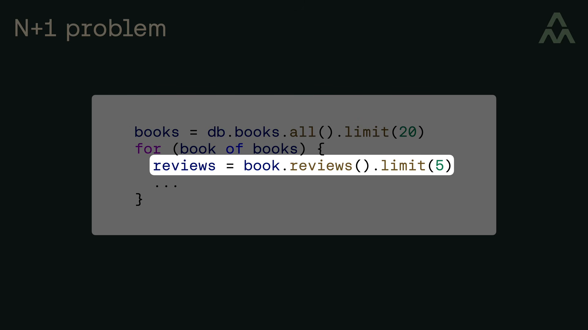
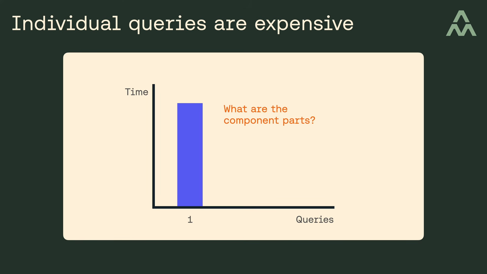
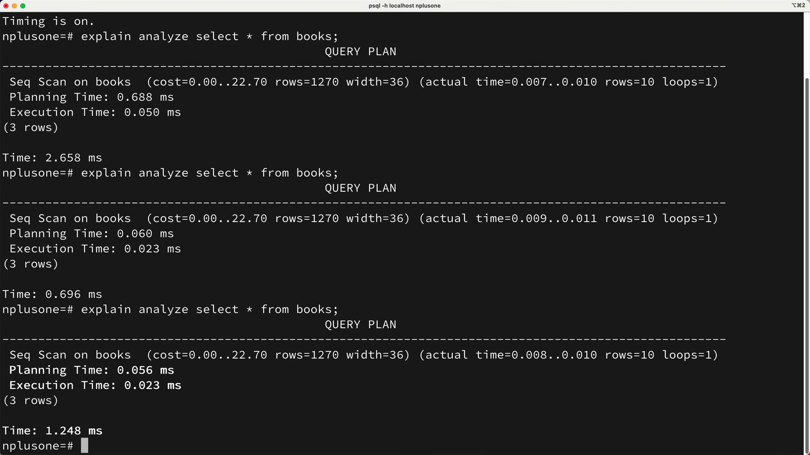
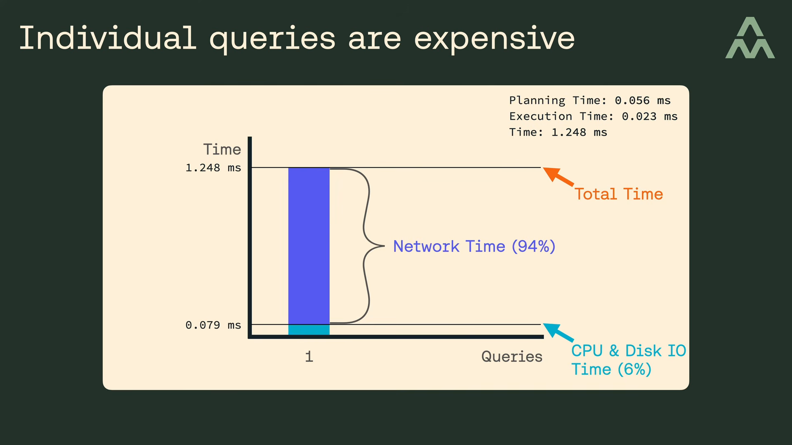
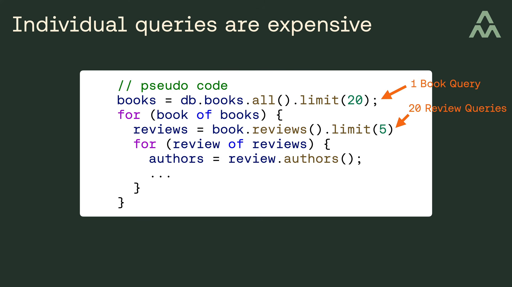
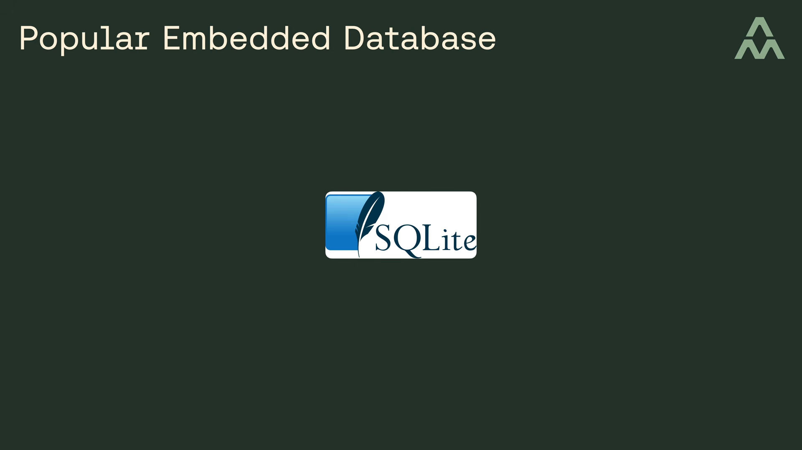
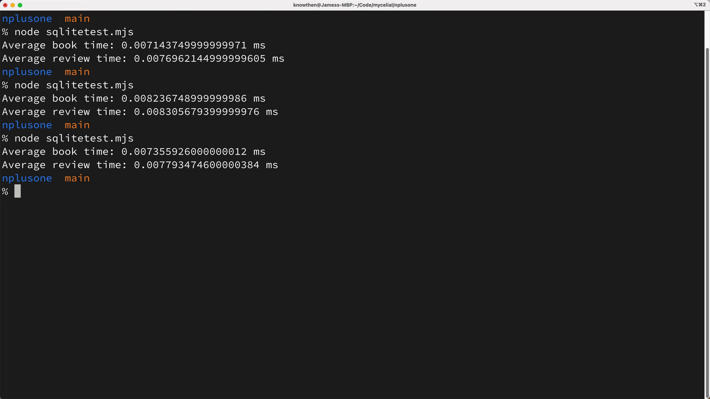
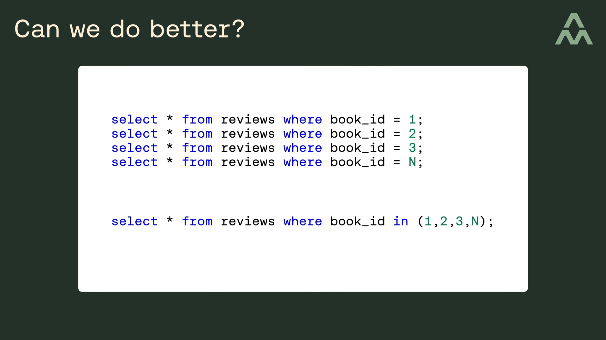
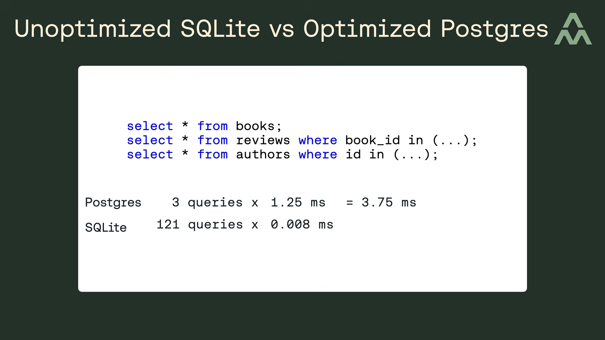

# SQLite Và Bài Toán N+1

* **Kênh:** Mycelial | **Thời lượng:** 00:08:29 | **Ngày:** 2022-10-13
* **Video:** https://youtu.be/qPfAQY_RahA

---

## Thuật ngữ

| Thuật ngữ | Tiếng Anh | Giải thích |
| :--- | :--- | :--- |
| Bài toán truy vấn N+1 | N+1 Query Problem | Hiện tượng suy giảm hiệu năng khi mã nguồn thực thi 1 truy vấn ban đầu để lấy danh sách N phần tử, sau đó tiếp tục kích hoạt thêm N truy vấn phụ lặp lại để lấy dữ liệu liên kết. |
| Ánh xạ quan hệ đối tượng | Object-Relational Mapping (ORM) | Thư viện chuyển đổi dữ liệu giữa các bảng trong cơ sở dữ liệu quan hệ và các đối tượng hướng đối tượng trong mã nguồn (ví dụ: Prisma, Hibernate, TypeORM). |
| Kiến trúc máy khách máy chủ | Client-Server Architecture | Mô hình cơ sở dữ liệu tách biệt tiến trình máy chủ quản lý dữ liệu và tiến trình ứng dụng tiêu thụ dữ liệu, giao tiếp thông qua giao thức mạng TCP/IP hoặc socket. |
| Cơ sở dữ liệu nhúng | Embedded Database | Hệ quản trị cơ sở dữ liệu được biên dịch trực tiếp thành một thư viện liên kết và chạy ngay bên trong cùng không gian địa chỉ bộ nhớ của tiến trình ứng dụng. |
| Độ trễ vào ra mạng | Network I/O Latency | Khoảng thời gian tiêu tốn cho việc truyền tải các gói tin mạng giữa hai tiến trình qua card mạng hoặc giao diện loopback cục bộ. |
| Thời gian lập kế hoạch | Planning Time | Khoảng thời gian công cụ tối ưu hóa của cơ sở dữ liệu phân tích cây cú pháp SQL để chọn ra kế hoạch thực thi hiệu quả nhất. |
| Thời gian thực thi | Execution Time | Khoảng thời gian thực tế CPU và ổ cứng truy xuất, xử lý và quét các trang dữ liệu để trả về kết quả truy vấn. |
| Nạp dữ liệu háo hức | Eager Loading | Kỹ thuật tối ưu hóa truy vấn bằng cách gộp hoặc nạp trước dữ liệu liên quan qua phép JOIN hoặc mệnh đề IN để tránh phát sinh nhiều truy vấn con. |
| Thỏa thuận mức dịch vụ | Service Level Agreement (SLA) | Tiêu chuẩn chất lượng cam kết về thời gian phản hồi của hệ thống dịch vụ mạng (thường đặt ngưỡng phản hồi trong vòng 100 phần nghìn giây). |
| Gánh nặng nhận thức | Cognitive Load | Dung lượng bộ nhớ làm việc và sự tập trung trí tuệ mà lập trình viên cần bỏ ra để đọc hiểu, bảo trì và kiểm thử một đoạn mã nguồn phức tạp. |

---

## Tổng luận chuyên đề

### 1. Bản chất vấn đề N+1
Bài toán N+1 là điểm nghẽn hiệu năng kinh điển xuất hiện phổ biến khi lập trình viên sử dụng các công cụ ORM hoặc GraphQL kết hợp cùng các hệ quản trị cơ sở dữ liệu kiến trúc khách - chủ như PostgreSQL hoặc MySQL.
* Căn nguyên phát sinh không nằm ở sự phức tạp của thuật toán tính toán, mà bắt nguồn từ cơ chế tải dữ liệu lười (Lazy Loading) ngầm định: một truy vấn lấy danh sách N bản ghi cha sẽ kích hoạt thêm N truy vấn riêng lẻ để lấy các bản ghi con tương ứng.
* Đối với các mối quan hệ lồng nhiều cấp (ví dụ: Sách -> Đánh giá -> Tác giả), số lượng truy vấn bùng nổ theo cấp số nhân ($1 + N + N \times M$), nhanh chóng làm cạn kiệt tài nguyên kết nối của hệ thống.

### 2. Nút thắt mạng vật lý
Định kiến thông thường cho rằng mỗi truy vấn đơn lẻ mất khoảng 1 mili-giây là hoàn toàn chấp nhận được. Tuy nhiên, khi phân rã vi mô thời gian xử lý của một câu lệnh SQL trên cơ sở dữ liệu khách - chủ (như PostgreSQL), bản chất cấu thành bộc lộ sự mất cân đối nghiêm trọng:
* **Chi phí tính toán nội tại (CPU + Disk I/O):** Thời gian lập kế hoạch (Planning Time) và thời gian thực thi (Execution Time) chỉ chiếm xấp xỉ **6%** tổng thời gian (khoảng 0.079 ms / 79 micro-giây).
* **Chi phí giao tiếp mạng (Network I/O):** Chiếm tới **94%** tổng thời gian (khoảng 1.169 ms), ngay cả khi máy khách và máy chủ chạy trên cùng một máy tính cá nhân mạnh mẽ thông qua giao diện cục bộ.
* Chính lớp đệm giao tiếp mạng không thể triệt tiêu này là nguyên nhân biến hàng trăm truy vấn nhỏ thành rào cản phá vỡ ngưỡng phản hồi chuẩn 100 ms của ứng dụng web.

### 3. Ưu thế cơ sở nhúng
Khác biệt cốt lõi của SQLite nằm ở kiến trúc nhúng (Embedded / In-Process):
* SQLite không chạy như một tiến trình máy chủ độc lập và không mở bất kỳ cổng kết nối mạng nào. Toàn bộ mã nguồn SQLite được liên kết tĩnh hoặc động trực tiếp vào nhị phân của ứng dụng.
* Mọi thao tác truy vấn thực chất là một lệnh gọi hàm trực tiếp (C function call) truy cập trực tiếp vào vùng nhớ đệm trang của tiến trình, hoàn toàn loại bỏ 94% chi phí Network I/O.
* Với tốc độ thực thi chỉ khoảng **8 micro-giây** (0.008 ms) cho mỗi truy vấn, SQLite có thể thực thi hàng trăm truy vấn N+1 lồng nhau trong vòng chưa đầy 1 mili-giây, vô hiệu hóa hoàn toàn tác hại của bài toán N+1 trong thực tế.

### 4. Đánh đổi nhận thức mã
Khi mã nguồn chạy trên nền SQLite đạt thời gian truy vấn 1 ms (chỉ chiếm 1% ngân sách phản hồi 100 ms), câu hỏi đặt ra là có cần thiết phải viết lại mã nguồn bằng các phép JOIN phức tạp hoặc gộp truy vấn để tối ưu xuống 20-30 micro-giây hay không:
* Quy tắc kiến trúc vàng: Ưu tiên mã nguồn đơn giản, dễ đọc và dễ bảo trì khi hiệu năng hệ thống đã đáp ứng vượt mức yêu cầu kỹ thuật.
* Việc gượng ép tối ưu hóa sớm (Premature Optimization) tạo ra gánh nặng nhận thức không đáng có và làm tăng rủi ro phát sinh lỗi trong quá trình bảo trì phần mềm.

---

## Bóc tách chi tiết

### [[00:00:00](https://youtu.be/qPfAQY_RahA?t=0s)] Vấn đề truy vấn
Bài toán N+1 thường xảy ra khi lập trình viên sử dụng các công cụ trừu tượng hóa tầng dữ liệu như thư viện ORM (Object-Relational Mapping) hoặc giao thức GraphQL kết nối với các cơ sở dữ liệu kiến trúc máy khách - máy chủ. Xét đoạn mã nguồn minh họa truy vấn danh sách sách và các bài đánh giá tương ứng:
```javascript
// Dòng 1: Truy vấn danh sách sách (1 truy vấn)
const books = await orm.books.findMany();

// Vòng lặp: Duyệt qua từng cuốn sách và lấy đánh giá
for (const book of books) {
  // Dòng 4: Kích hoạt truy vấn lấy đánh giá cho từng cuốn sách (N truy vấn)
  const reviews = await book.reviews();
}
```
Phương thức `book.reviews()` được gọi lặp lại một lần cho mỗi cuốn sách trả về. Nếu có 20 cuốn sách, hệ thống sẽ thực thi tổng cộng 21 truy vấn độc lập: 1 truy vấn lấy sách cộng với 20 truy vấn lấy đánh giá.



### [[00:01:05](https://youtu.be/qPfAQY_RahA?t=65s)] Chi phí mỗi lệnh
Tại sao việc phân tách thành nhiều truy vấn riêng lẻ lại trở thành một vấn đề nghiêm trọng? Căn nguyên là vì mỗi truy vấn đơn lẻ trong hầu hết các hệ quản trị cơ sở dữ liệu phổ biến đều phải chịu một khoản chi phí cố định (overhead). Để làm rõ chi phí này bao gồm những thành phần nào, tác giả xây dựng một biểu đồ cột phân tích cấu trúc thời gian của một câu lệnh SQL.



### [[00:01:45](https://youtu.be/qPfAQY_RahA?t=105s)] Đo đạc trên cơ sở
Để đo đạc thực tế, tác giả sử dụng công cụ dòng lệnh `psql` kết nối vào hệ quản trị cơ sở dữ liệu PostgreSQL chạy cục bộ trên máy tính Apple Silicon M1:
* Kích hoạt chế độ đo thời gian bằng lệnh `\timing on`.
* Thực thi câu lệnh phân tích chuyên sâu `EXPLAIN ANALYZE` cho một truy vấn đơn giản lấy thông tin sách:
```sql
EXPLAIN ANALYZE SELECT * FROM books WHERE id = 1;
```
Kết quả ghi nhận:
* **Thời gian lập kế hoạch (Planning Time):** 0.040 ms
* **Thời gian thực thi (Execution Time):** 0.039 ms
* **Tổng thời gian truy vấn phía máy khách (Total Time):** 1.248 ms



### [[00:02:25](https://youtu.be/qPfAQY_RahA?t=145s)] Phân rã thời gian
Khi cộng hai thành phần tính toán nội tại trên máy chủ PostgreSQL:
$$\text{Thời gian CPU và Đĩa} = 0.040\text{ ms} + 0.039\text{ ms} = 0.079\text{ ms}$$
Con số này chỉ chiếm khoảng **6%** tổng thời gian của một truy vấn. Toàn bộ phần thời gian còn lại (khoảng **1.169 ms**, tương đương **94%**) được biểu diễn bằng thanh màu tím, chính là chi phí giao tiếp vào ra mạng (Network I/O) giữa tiến trình ứng dụng và tiến trình cơ sở dữ liệu.



### [[00:03:10](https://youtu.be/qPfAQY_RahA?t=190s)] Mô hình lồng nhau
Một truy vấn tốn khoảng 1 ms có vẻ không đáng kể nếu ứng dụng chỉ thực hiện vài thao tác đơn lẻ. Tuy nhiên, trong thực tế các mối quan hệ thực thể thường lồng nhau nhiều cấp:
```javascript
// Cấp 1: Lấy danh sách 20 cuốn sách (1 truy vấn)
const books = await orm.books.findMany();

for (const book of books) {
  // Cấp 2: Lấy danh sách đánh giá của từng cuốn sách (20 truy vấn)
  const reviews = await book.reviews();

  for (const review of reviews) {
    // Cấp 3: Lấy thông tin tác giả của từng bài đánh giá (20 * 5 = 100 truy vấn)
    const author = await review.author();
  }
}
```
Tính toán tổng số lượng truy vấn:
$$\text{Tổng số truy vấn} = 1 + 20 + (20 \times 5) = 121\text{ truy vấn}$$
Với chi phí trung bình khoảng 1 ms mỗi truy vấn, hệ thống tiêu tốn tới **121 ms** chỉ để lấy dữ liệu.



### [[00:04:15](https://youtu.be/qPfAQY_RahA?t=255s)] Tác động hiệu năng
Thời gian 121 ms chỉ riêng cho việc nạp dữ liệu lập tức phá vỡ tiêu chuẩn trải nghiệm người dùng hiện đại (phản hồi toàn diện trong vòng 100 ms). Nguy hiểm hơn, việc dồn 121 truy vấn độc lập liên tiếp trong một khoảng thời gian ngắn sẽ làm nghẽn hàng đợi kết nối (Connection Pool), chiếm dụng tài nguyên giới hạn của cơ sở dữ liệu và có thể kéo sập toàn bộ hệ thống dưới tải trọng thực tế cao.

### [[00:04:40](https://youtu.be/qPfAQY_RahA?t=280s)] Triệt tiêu độ trễ
Điều gì sẽ xảy ra nếu chúng ta loại bỏ hoàn toàn phần chi phí Network I/O màu tím trong biểu đồ? Hệ thống chỉ còn lại chi phí lập kế hoạch và thực thi thuần túy: xấp xỉ **79 micro-giây** (0.079 ms) mỗi truy vấn.
Khi nhân 121 truy vấn với 79 micro-giây:
$$121 \times 79\text{ }\mu\text{s} \approx 9.559\text{ ms}$$
Tổng thời gian dưới 10 ms là mức hoàn toàn lý tưởng, giúp ứng dụng thoải mái hoàn thành xử lý logic và kết xuất kết quả trong ngưỡng 100 ms.


### [[00:05:35](https://youtu.be/qPfAQY_RahA?t=335s)] Chuyển đổi mô hình
Trong kiến trúc khách - chủ, lập trình viên không có cách nào loại bỏ độ trễ mạng vì đó là đặc tính vật lý bắt buộc của giao tiếp giữa các tiến trình mạng độc lập. Cách duy nhất để xóa bỏ hoàn toàn chi phí này là chuyển sang sử dụng cơ sở dữ liệu nhúng (Embedded Database). Đại diện tiêu biểu nhất chính là **SQLite** — một hệ quản trị cơ sở dữ liệu quan hệ dạng thư viện, vận hành trực tiếp bên trong tiến trình ứng dụng và không tiêu tốn bất kỳ chi phí mạng nào.



### [[00:06:00](https://youtu.be/qPfAQY_RahA?t=360s)] Đo lường thực tế
Tác giả viết một đoạn mã thực tế để đo lường chính xác thời gian thực thi của các truy vấn trên SQLite:
* Truy vấn sách (`books`): tiêu tốn khoảng **8 micro-giây**.
* Truy vấn đánh giá (`reviews`): cũng chỉ tiêu tốn khoảng **8 micro-giây**.
Trong kịch bản xấu nhất với 121 truy vấn N+1 lồng nhau:
$$121 \times 8\text{ }\mu\text{s} \approx 0.968\text{ ms}$$
Toàn bộ 121 truy vấn hoàn tất chỉ trong khoảng **1 mili-giây** — nhanh hơn cả một câu lệnh đơn lẻ trên PostgreSQL. Do đó, SQLite về bản chất miễn nhiễm với bài toán N+1.



### [[00:06:35](https://youtu.be/qPfAQY_RahA?t=395s)] Khả năng tối ưu
Những người theo đuổi hiệu năng cực đoan có thể đặt câu hỏi: liệu có thể tối ưu hơn nữa con số 1 ms trên SQLite hay không? Câu trả lời là có. Chúng ta có thể gộp 121 truy vấn lặp lại thành 3 truy vấn hợp nhất duy nhất bằng mệnh đề `WHERE ... IN (...)` hoặc phép `JOIN`:
```sql
SELECT * FROM books;
SELECT * FROM reviews WHERE book_id IN (...);
SELECT * FROM authors WHERE review_id IN (...);
```
Giải pháp gộp này giảm số truy vấn xuống còn 3, đưa tổng thời gian xử lý xuống mức không tưởng: khoảng **20 đến 30 micro-giây**.



### [[00:07:10](https://youtu.be/qPfAQY_RahA?t=430s)] Gánh nặng nhận thức
Tuy nhiên, tác giả khuyến nghị việc tối ưu hóa này là **không đáng đánh đổi**. Lý do:
* Mục tiêu hệ thống là trả lời người dùng trong 100 ms. Sự chênh lệch giữa 1 ms và 0.03 ms là hoàn toàn vô hình đối với cảm nhận con người.
* Việc viết các câu lệnh gộp, nạp dữ liệu thủ công hoặc ánh xạ cấu trúc dữ liệu phức tạp sẽ làm tăng độ phức tạp của mã nguồn, tạo ra gánh nặng nhận thức lớn cho nhóm phát triển và tiềm ẩn nguy cơ sinh lỗi hồi quy.
* Triết lý thiết kế đúng đắn: Luôn ưu tiên giải pháp mã nguồn đơn giản, sáng sủa chừng nào hiệu năng của nó vẫn đáp ứng vượt ngưỡng mong đợi.

### [[00:07:35](https://youtu.be/qPfAQY_RahA?t=455s)] So sánh trực tiếp
So sánh kết quả đối đầu giữa hai giải pháp:
* **PostgreSQL đã tối ưu (3 truy vấn gộp):** Mỗi truy vấn mất khoảng 1.25 ms $\rightarrow$ Tổng thời gian xấp xỉ **3.75 ms**.
* **SQLite hoàn toàn chưa tối ưu (121 truy vấn N+1):** Mỗi truy vấn mất 8 $\mu$s $\rightarrow$ Tổng thời gian xấp xỉ **1.00 ms**.
Kết quả thực tế chứng minh một giải pháp mã nguồn SQLite chưa tối ưu (giữ nguyên cấu trúc lặp tự nhiên) vẫn chạy **nhanh gấp gần 4 lần** so với giải pháp PostgreSQL đã được tối ưu hóa triệt để.



### [[00:08:10](https://youtu.be/qPfAQY_RahA?t=490s)] Hệ sinh thái mới
Đội ngũ Mycelial khẳng định niềm tin vào tương lai của SQLite trong kiến trúc phần mềm hiện đại. Họ đang phát triển các bộ công cụ xung quanh SQLite cho phép đồng bộ hóa dữ liệu phân tán giữa nhiều máy tính khác nhau mà không xảy ra xung đột, mở ra hướng tiếp cận mới cho các ứng dụng cục bộ phân tán (Local-First Software).

---

## Trích dẫn then chốt

* [[00:01:25](https://youtu.be/qPfAQY_RahA?t=85s)] "The problem is that individual queries are relatively expensive because there's a certain amount of overhead for every query in pretty much all the popular databases... well except for one: SQLite."
* [[00:02:38](https://youtu.be/qPfAQY_RahA?t=158s)] "The largest share of time used comes from Network I/O... about 94% of the total time."
* [[00:03:39](https://youtu.be/qPfAQY_RahA?t=219s)] "In total we've got 121 queries. If each query took about 1 millisecond, then we've got a total time of about 121 milliseconds just to fetch the data."
* [[00:05:48](https://youtu.be/qPfAQY_RahA?t=348s)] "SQLite is a library-based embedded relational database that runs in your application process and it doesn't suffer from any network I/O related overhead."
* [[00:07:19](https://youtu.be/qPfAQY_RahA?t=439s)] "Generally you should tend to favor simpler solutions for cognitive reasons, so long as the simple solutions have satisfactory performance. A 1 millisecond query time is more than good enough."
* [[00:08:04](https://youtu.be/qPfAQY_RahA?t=484s)] "An unoptimized SQLite solution is still about four times faster than the optimized Postgres solution."

---

## Lệnh & Công cụ

### Đo lường hiệu năng truy vấn trên PostgreSQL
```sql
-- Bật hiển thị dấu thời gian thực thi trong công cụ psql
\timing on

-- Phân tích chi tiết kế hoạch thực thi và thời gian thực tế
EXPLAIN (ANALYZE, BUFFERS, TIMING)
SELECT * FROM books WHERE id = 1;

-- Mẫu câu lệnh gộp để giải quyết N+1 trên cơ sở dữ liệu khách - chủ
SELECT b.id AS book_id, b.title, r.id AS review_id, r.content, a.id AS author_id, a.name
FROM books b
LEFT JOIN reviews r ON r.book_id = b.id
LEFT JOIN authors a ON a.id = r.author_id
WHERE b.id IN (1, 2, 3, 4, 5);
```

### Đo đạc độ trễ truy vấn SQLite trong Node.js
```javascript
const Database = require('better-sqlite3');
const db = new Database(':memory:');

// Khởi tạo bảng mẫu
db.exec(`
  CREATE TABLE books (id INTEGER PRIMARY KEY, title TEXT);
  CREATE TABLE reviews (id INTEGER PRIMARY KEY, book_id INTEGER, content TEXT);
`);

// Đo lường thời gian thực thi chính xác bằng hrtime
const stmt = db.prepare('SELECT * FROM reviews WHERE book_id = ?');

const start = process.hrtime.bigint();
const rows = stmt.all(1);
const end = process.hrtime.bigint();

// Chuyển đổi từ nanosecond sang microsecond
const durationMicroseconds = Number(end - start) / 1000;
console.log(`Thời gian thực thi SQLite: ${durationMicroseconds.toFixed(2)} µs`);
```

---

## Đánh đổi & Rủi ro

### 1. Đánh đổi giữa tối ưu vi mô và gánh nặng bảo trì
* **Tối ưu hóa sớm (Premature Optimization):** Việc cố gắng gộp mọi truy vấn thành các khối SQL phức tạp với nhiều tầng JOIN làm tăng đáng kể độ phức tạp của mã nguồn. Khi yêu cầu nghiệp vụ thay đổi, việc bảo trì các câu truy vấn cồng kềnh tiêu tốn nhiều thời gian và dễ phát sinh lỗi logic.
* **Nguyên tắc kỹ thuật thực tế:** Nếu thời gian thực thi của mã nguồn chưa tối ưu trên SQLite đã nằm ở mức 1 ms (chỉ chiếm 1% ngân sách 100 ms của SLA), việc tiêu tốn năng lực trí tuệ để ép thời gian xuống 20 $\mu$s là sự lãng phí tài nguyên phát triển phần mềm.

### 2. Giới hạn kiến trúc của cơ sở dữ liệu nhúng
* **Hạn chế đa tiến trình ghi đồng thời:** Mặc dù SQLite sở hữu tốc độ đọc vượt trội, chế độ ghi mặc định sử dụng khóa ở cấp cơ sở dữ liệu (Database-level Lock). Mặc dù cơ chế WAL (Write-Ahead Logging) cho phép nhiều luồng đọc đồng thời cùng một luồng ghi, SQLite không phù hợp cho các hệ thống yêu cầu hàng nghìn thao tác ghi đồng thời phân tán trên nhiều máy chủ độc lập.
* **Mở rộng theo chiều ngang (Horizontal Scaling):** Khác với PostgreSQL có thể tách máy chủ cơ sở dữ liệu để phục vụ cụm ứng dụng nhiều node, dữ liệu SQLite gắn liền với ổ đĩa cục bộ của từng máy chủ ứng dụng, đòi hỏi các giải pháp đồng bộ dữ liệu chuyên dụng (như LiteFS, Mycelial, rqlite) nếu muốn triển khai đa vùng.

### 3. Điểm mù khi đánh giá hiệu năng trên môi trường phát triển
* Phép đo đạc trong bài giảng được thực hiện trực tiếp trên chip Apple Silicon M1 thông qua socket nội bộ máy trạm. Trong môi trường đám mây sản xuất (Production Cloud), khi máy chủ ứng dụng và máy chủ cơ sở dữ liệu nằm trên hai máy ảo riêng biệt hoặc qua mạng VPC đám mây, độ trễ Network I/O thực tế thường dao động từ **2 ms đến 5 ms** cho mỗi lượt khứ hồi (Round-Trip Time).
* Trên môi trường đám mây đó, tác hại của bài toán 121 truy vấn N+1 đối với PostgreSQL sẽ còn nghiêm trọng hơn gấp nhiều lần (tiêu tốn từ 240 ms đến 600 ms), trong khi hiệu năng của SQLite vẫn duy trì ổn định tuyệt đối ở mức xấp xỉ 1 ms vì không phụ thuộc vào hạ tầng mạng.
