# Bản Chất Giao Diện Lập Trình REST

* **Kênh:** Academind | **Thời lượng:** 00:14:58 | **Ngày:** 2017-11-28
* **Video:** https://youtu.be/0oXYLzuucwE

---

## Thuật ngữ

| Thuật ngữ | Tiếng Anh | Giải thích bản chất |
| :--- | :--- | :--- |
| Chuyển giao trạng thái đại diện | Representational State Transfer (REST) | Phong cách kiến trúc phần mềm được định nghĩa bởi Roy Fielding năm 2000, quy định các nguyên tắc thiết kế cho các hệ thống siêu phương tiện phân tán. |
| Giao diện lập trình ứng dụng | Application Programming Interface (API) | Tập hợp các định nghĩa, giao thức và công cụ cho phép các hệ thống phần mềm khác nhau giao tiếp và trao đổi dữ liệu với nhau. |
| Điểm cuối | Endpoint | Địa chỉ URL cụ thể trên máy chủ đại diện cho một tài nguyên hoặc tập hợp tài nguyên mà máy khách có thể gửi yêu cầu đến. |
| Động từ giao thức mạng | HTTP Verbs / Methods | Các phương thức thao tác chuẩn của giao thức HTTP (`GET`, `POST`, `PUT`, `PATCH`, `DELETE`) biểu thị hành động dự định thực hiện trên tài nguyên. |
| Ứng dụng một trang | Single Page Application (SPA) | Kiến trúc ứng dụng web chỉ tải một tệp HTML duy nhất trong lần truy cập đầu tiên; mọi tương tác và cập nhật giao diện sau đó được JavaScript thực hiện qua trao đổi dữ liệu ngầm. |
| Ứng dụng nhiều trang | Multi-Page Application (MPA) | Kiến trúc web truyền thống trong đó mỗi thao tác điều hướng hoặc gửi biểu mẫu đều yêu cầu máy chủ dựng và trả về một trang HTML hoàn chỉnh mới. |
| Yêu cầu bất đồng bộ | Asynchronous JavaScript and XML (AJAX) | Kỹ thuật cho phép trang web gửi và nhận dữ liệu từ máy chủ trong nền mà không làm gián đoạn hay phải tải lại toàn bộ giao diện hiện tại. |
| Tính phi trạng thái | Statelessness | Ràng buộc kiến trúc bắt buộc mỗi yêu cầu từ máy khách gửi lên máy chủ phải chứa đầy đủ mọi thông tin cần thiết để xử lý độc lập; máy chủ không lưu giữ ngữ cảnh phiên làm việc của máy khách. |
| Khả năng lưu đệm | Cacheability | Ràng buộc yêu cầu các phản hồi từ máy chủ phải được gắn nhãn rõ ràng là có thể lưu đệm hay không nhằm cho phép máy khách hoặc các trạm trung gian tái sử dụng dữ liệu, giảm thiểu lưu lượng mạng. |
| Hệ thống phân tầng | Layered System | Ràng buộc kiến trúc cho phép xen kẽ các tầng trung gian (như máy chủ ủy nhiệm, bộ cân bằng tải, tường lửa) mà không làm thay đổi hành vi giao tiếp giữa máy khách và máy chủ dịch vụ. |
| Giao diện đồng nhất | Uniform Interface | Ràng buộc cốt lõi bảo đảm phương thức truy xuất và thao tác tài nguyên diễn ra nhất quán trên toàn hệ thống, tách rời logic máy khách khỏi cấu trúc lưu trữ nội bộ của máy chủ. |
| Siêu phương tiện dẫn đường | Hypermedia as the Engine of Application State (HATEOAS) | Nguyên lý trong giao diện đồng nhất quy định phản hồi của máy chủ phải chứa kèm các liên kết URL dẫn đường để máy khách tự khám phá các hành động tiếp theo mà không cần gắn cứng đường dẫn. |
| Mã theo yêu cầu | Code on Demand | Ràng buộc tùy chọn cho phép máy chủ mở rộng tính năng của máy khách bằng cách truyền tải mã lệnh thực thi (như mã JavaScript) để máy khách chạy trực tiếp trên môi trường cục bộ. |

---

## Tổng luận chuyên đề

Giao diện lập trình REST (RESTful API) là giải pháp kiến trúc thay thế cho mô hình kết xuất máy chủ truyền thống (Server-Side Rendering), phục vụ nhu cầu trao đổi dữ liệu thuần túy giữa máy chủ với đa dạng nền tảng máy khách hiện đại:

### Động lực kiến trúc

1. **Giới hạn của trang web truyền thống:**
   - Mô hình truyền thống gắn chặt dữ liệu với giao diện hiển thị bằng cách trả về các tệp HTML hoàn chỉnh. Mỗi URL đại diện cho một trang giao diện riêng biệt (`/products`, `/orders`).
   - Kiến trúc này không thể đáp ứng nhu cầu của các ứng dụng di động (iOS, Android), các dịch vụ tích hợp giữa các hệ thống (Microservices, Google Geolocation API), hoặc các ứng dụng web một trang (Single Page Application - SPA) vốn chỉ cần dữ liệu thô để tự vẽ giao diện.
2. **Tách rời dữ liệu và trình bày:**
   - RESTful API loại bỏ hoàn toàn việc tạo lập HTML trên máy chủ. Máy chủ chỉ tập trung vào việc quản lý dữ liệu, thực hiện tính toán nghiệp vụ và trả về dữ liệu thô (chủ yếu dưới định dạng JSON).

### Mô hình giao tiếp

1. **Tài nguyên và định danh URL:**
   - Mọi thực thể trong hệ thống được định nghĩa là một "tài nguyên" (Resource) và được định danh bằng các danh từ số nhiều trên đường dẫn URL (ví dụ: `/users`, `/products`).
2. **Hành vi thao tác qua động từ HTTP:**
   - Thay vì nhúng hành động vào đường dẫn URL (như `/getUser`, `/deleteUser`), REST ánh xạ trực tiếp các thao tác lên các động từ chuẩn của giao thức HTTP:
     - `GET`: Truy xuất dữ liệu của tài nguyên.
     - `POST`: Tạo mới tài nguyên.
     - `PATCH` / `PUT`: Cập nhật một phần hoặc toàn bộ tài nguyên.
     - `DELETE`: Xóa bỏ tài nguyên.
3. **Trao đổi dữ liệu ngầm định:**
   - Máy khách gửi các yêu cầu nền bất đồng bộ (AJAX / Fetch API trên trình duyệt, hoặc thư viện mạng HTTP trên ứng dụng di động) và nhận về chuỗi dữ liệu JSON có cấu trúc để cập nhật cục bộ.

### Sáu ràng buộc chuẩn

Để một hệ thống được phân loại chính xác là đạt chuẩn RESTful theo định nghĩa của Roy Fielding, hệ thống đó phải thỏa mãn 6 ràng buộc kiến trúc (trong đó có 5 ràng buộc bắt buộc và 1 ràng buộc tùy chọn):
1. **Kiến trúc máy khách - máy chủ (Client-Server):** Phân tách tuyệt đối giữa tầng giao diện người dùng và tầng lưu trữ logic dữ liệu.
2. **Tính phi trạng thái (Statelessness):** Máy chủ không lưu giữ bất kỳ phiên làm việc (Session) nào của máy khách; mỗi yêu cầu đều tự chứa đủ thông tin định danh và ủy quyền.
3. **Khả năng lưu đệm (Cacheability):** Phản hồi máy chủ phải công bố rõ tính chất lưu đệm qua tiêu đề HTTP để tối ưu hóa hiệu năng.
4. **Hệ thống phân tầng (Layered System):** Cho phép đặt các tầng trung gian (Proxy, Gateway, Load Balancer) hoàn toàn trong suốt với máy khách.
5. **Giao diện đồng nhất (Uniform Interface):** Nhận diện tài nguyên bằng URI, thông điệp tự mô tả, tách biệt biểu diễn dữ liệu khỏi cấu trúc cơ sở dữ liệu và cung cấp liên kết HATEOAS.
6. **Mã theo yêu cầu (Code on Demand - Tùy chọn):** Cho phép máy chủ gửi mã kịch bản thực thi trực tiếp xuống máy khách.

---

## Bóc tách chi tiết

### [[00:00:30](https://youtu.be/0oXYLzuucwE?t=30s)] Định nghĩa giao diện

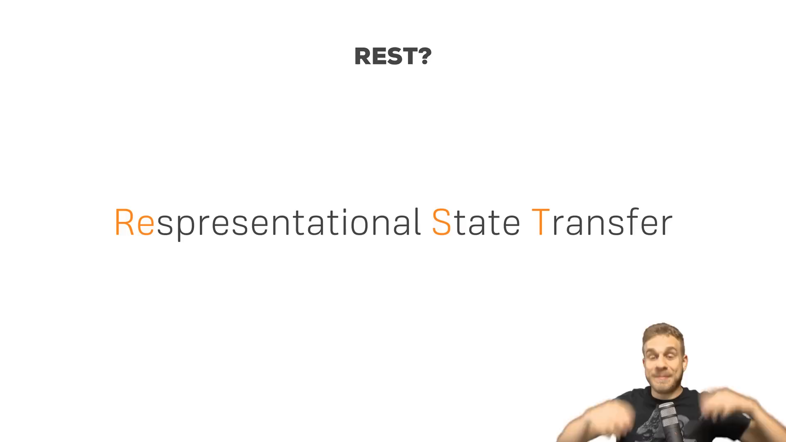

1. **Bản chất tên gọi REST:**
   - Thuật ngữ REST là viết tắt của *Representational State Transfer* (Chuyển giao trạng thái đại diện).
   - Ý tưởng cốt lõi của khái niệm này là cơ chế vận chuyển trạng thái của dữ liệu qua lại giữa các máy tính trong một hệ thống phân tán.
   - Thay vì truyền tải toàn bộ hệ thống hay giao diện người dùng, máy chủ chỉ tạo ra một bản đại diện (Representation) của dữ liệu tại một thời điểm nhất định (thường là tài liệu JSON hoặc XML) và chuyển giao bản đại diện này tới máy khách.

2. **Mục đích ra đời:**
   - RESTful API ra đời như một giải pháp thay thế linh hoạt cho mô hình trang web truyền thống trong những trường hợp mà việc trả về các trang HTML đóng gói sẵn không còn đáp ứng được yêu cầu kỹ thuật hiện đại.

---

### [[00:01:06](https://youtu.be/0oXYLzuucwE?t=66s)] Kiến trúc trang web

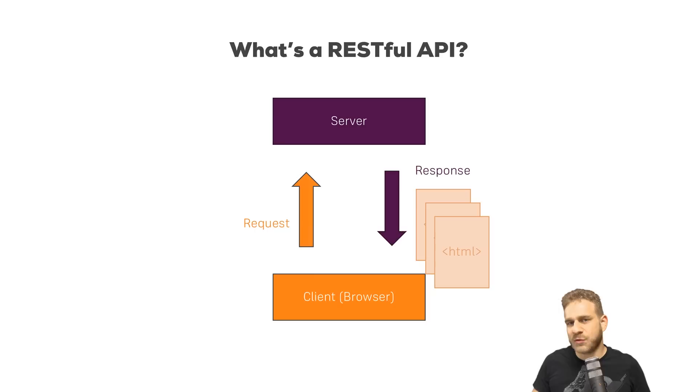

1. **Cơ chế trang web truyền thống:**
   - Máy khách là trình duyệt web, người dùng nhập một địa chỉ URL vào thanh địa chỉ.
   - Trình duyệt gửi một yêu cầu HTTP Request tới máy chủ web.
   - Máy chủ tiếp nhận yêu cầu, truy vấn cơ sở dữ liệu, dựng mã nguồn HTML hoàn chỉnh và trả về một phản hồi HTTP Response chứa tệp HTML đó.
   - Khi người dùng nhấp sang trang sản phẩm (`/products`) hoặc trang đơn hàng (`/orders`), toàn bộ tiến trình này lặp lại: Trình duyệt gửi yêu cầu mới, toàn bộ trang màn hình bị tải lại và máy chủ gửi về một tệp HTML mới hoàn toàn.

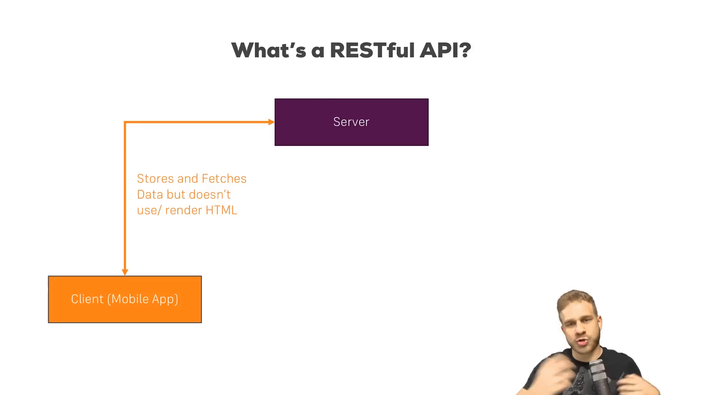

2. **Cơ chế ứng dụng một trang:**
   - Trong kiến trúc ứng dụng một trang (Single Page Application - SPA) được xây dựng bằng các khung làm việc hiện đại (Angular, React, Vue), quy trình tải trang diễn ra hoàn toàn khác biệt:
     - Trong lần truy cập đầu tiên, trình duyệt gửi yêu cầu lên máy chủ và chỉ nhận về đúng một tệp HTML khung duy nhất kèm theo một gói mã kịch bản JavaScript.
     - Sau khi mã JavaScript được thực thi, trình duyệt không bao giờ yêu cầu máy chủ dựng thêm bất kỳ tệp HTML nào khác.
     - Mọi thao tác chuyển trang hoặc tương tác dữ liệu sau đó đều được JavaScript xử lý ngầm trong bộ nhớ và tự động vẽ lại cây phân cấp đối tượng tài liệu (DOM).

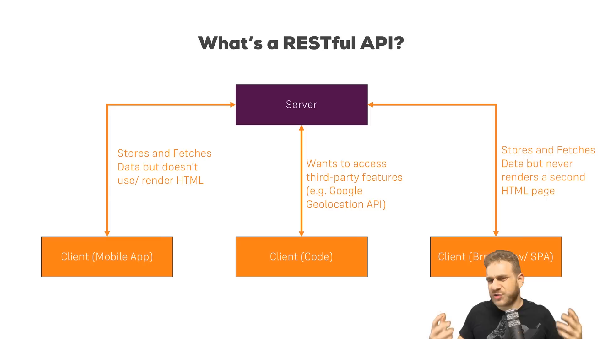

3. **Yêu cầu cấp bách từ các máy khách không dùng HTML:**
   - Bên cạnh trình duyệt web, hệ sinh thái phần mềm xuất hiện hàng loạt máy khách đặc thù:
     - **Ứng dụng di động (Mobile Apps):** Chạy trên hệ điều hành iOS hoặc Android. Các ứng dụng này đã có sẵn bộ mã giao diện gốc (Native UI) được viết bằng Swift, Kotlin hoặc Flutter. Chúng chỉ cần dữ liệu thô để điền vào các thành phần giao diện có sẵn, hoàn toàn không có khả năng và không có nhu cầu giải mã tệp HTML.
     - **Ứng dụng lập trình và tích hợp dịch vụ (Third-party Code / Services):** Điển hình như dịch vụ Google Geolocation API. Một chương trình mã nguồn gửi tọa độ vĩ độ/kinh độ lên máy chủ Google và mong muốn nhận về địa chỉ định danh dạng văn bản có cấu trúc để tiếp tục tính toán, không thể tiếp nhận một trang HTML hiển thị.
     - **Ứng dụng một trang (SPA):** Chỉ cần trao đổi dữ liệu để cập nhật trạng thái giao diện hiện hành.
   - Tất cả các trường hợp trên đều đòi hỏi một loại máy chủ Backend không bận tâm đến việc tạo mã HTML, chỉ tập trung tiếp nhận và hoàn trả dữ liệu thô một cách nhất quán.

---

### [[00:04:15](https://youtu.be/0oXYLzuucwE?t=255s)] Bản chất giao diện

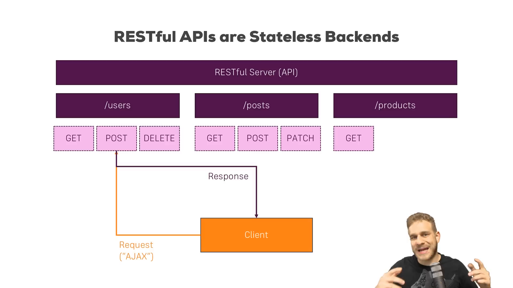

1. **Khái niệm điểm cuối và động từ:**
   - Một máy chủ RESTful API bản chất vẫn là một máy chủ web thông thường tiếp nhận các kết nối mạng, nhưng nó công bố ra một danh sách các đường dẫn URL chuẩn hóa gọi là các Điểm cuối (Endpoints).
   - Mỗi điểm cuối đại diện cho một nhóm tài nguyên nghiệp vụ và hỗ trợ các động từ HTTP tương ứng:
     - Đường dẫn `/users`:
       - Phương thức `GET`: Truy xuất danh sách toàn bộ người dùng.
       - Phương thức `POST`: Tạo mới một bản ghi người dùng dựa trên thông tin gửi kèm.
       - Phương thức `DELETE`: Xóa bỏ một người dùng xác định.
     - Đường dẫn `/posts`: Hỗ trợ phương thức `PATCH` để cập nhật một phần nội dung bài viết.
     - Đường dẫn `/products`: Hỗ trợ phương thức `GET` để lấy thông tin sản phẩm.
   - Việc kết hợp giữa đường dẫn tài nguyên tĩnh và động từ HTTP tạo nên ngữ nghĩa rõ ràng cho từng thao tác mà không làm bùng nổ số lượng URL.

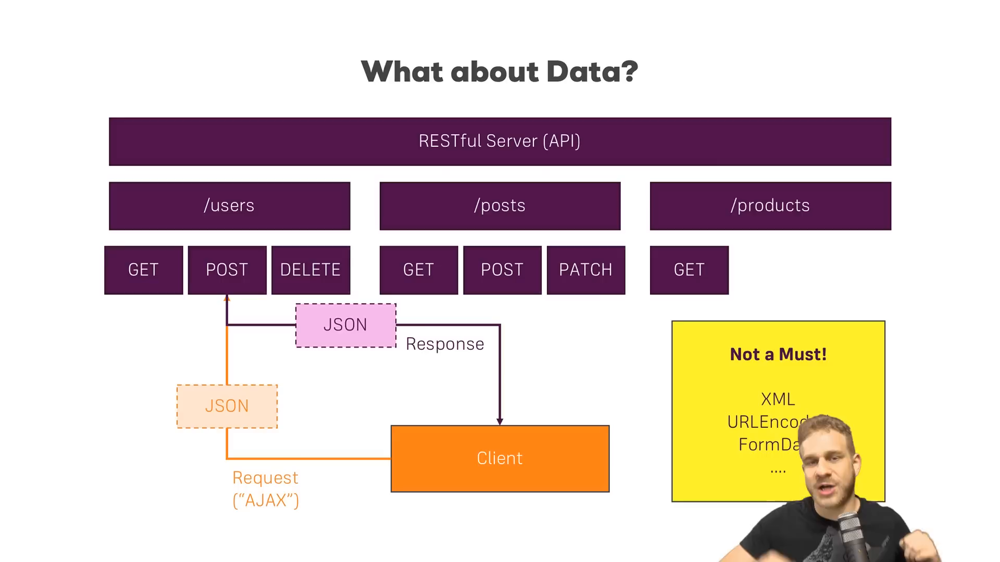

2. **Phương thức truyền nhận dữ liệu qua AJAX:**
   - Đối với ứng dụng web, các yêu cầu gửi đến RESTful API được thực hiện thông qua kỹ thuật AJAX (Yêu cầu HTTP bất đồng bộ). Trang web hiện tại của người dùng vẫn tiếp tục hiển thị và phản hồi thao tác bình thường trong khi yêu cầu đang di chuyển trên mạng.
   - Khi máy chủ phản hồi, mã JavaScript tiếp nhận dữ liệu và thực hiện cập nhật cục bộ lên giao diện mà không gây chớp nháy hay tải lại toàn bộ trang.
   - Đối với ứng dụng di động, các công cụ mạng của Java, Swift hoặc Dart cũng thực hiện tiến trình gửi nhận nền tương tự.

3. **Định dạng dữ liệu trao đổi:**
   - Định dạng phổ biến và trở thành tiêu chuẩn thực tế của RESTful API là JSON (JavaScript Object Notation). JSON có cú pháp gọn nhẹ, dễ đọc đối với con người và được hầu hết mọi ngôn ngữ lập trình giải mã nguyên bản với hiệu năng cao.
   - Chuẩn REST không bắt buộc duy nhất JSON: Lập trình viên vẫn có thể sử dụng định dạng XML hoặc dữ liệu mã hóa URL (URL-encoded data).
   - Quy tắc kỹ thuật cốt tử: RESTful API tuyệt đối không trả về mã HTML cho mục đích kết xuất trình duyệt. Các điểm cuối của API không bao giờ được thiết kế để người dùng nhập trực tiếp từ thanh địa chỉ của trình duyệt mà được kích hoạt ngầm bởi mã nguồn máy khách.

---

### [[00:08:17](https://youtu.be/0oXYLzuucwE?t=497s)] Sáu ràng buộc kiến trúc

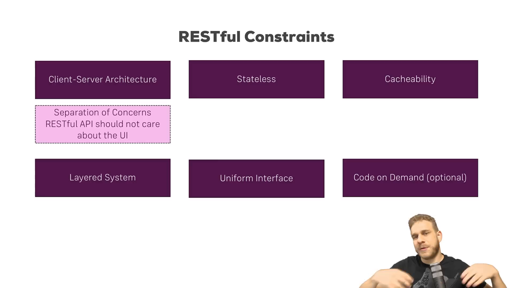

Tác giả nhấn mạnh: Việc chỉ xây dựng một máy chủ cung cấp vài URL trả về JSON chưa đủ để biến hệ thống đó thành một RESTful API chuẩn mực. Theo định nghĩa lý thuyết chính thống, một hệ thống bắt buộc phải tuân thủ 6 ràng buộc kiến trúc sau:

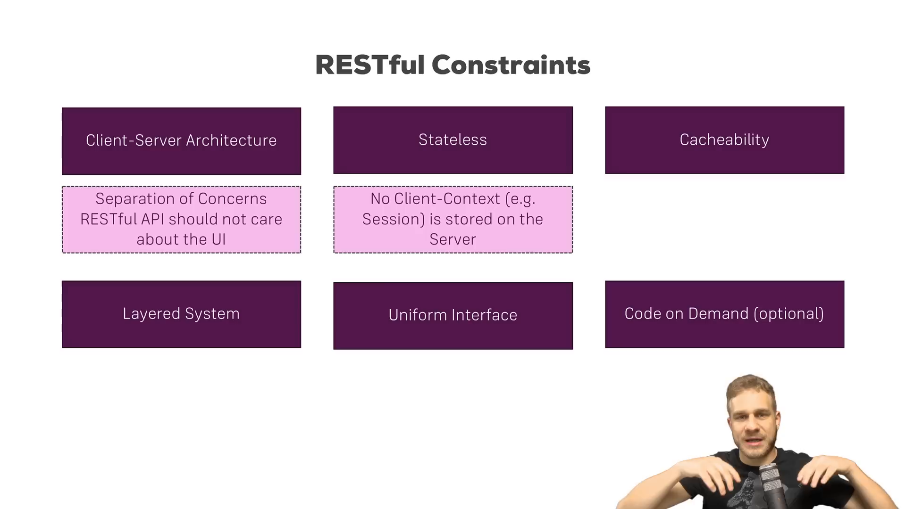

1. **Ràng buộc 1: Kiến trúc máy khách - máy chủ (Client-Server Architecture):**
   - Đòi hỏi sự phân tách rạch ròi về mối quan tâm (Separation of Concerns).
   - Máy chủ chịu trách nhiệm: Quản trị dữ liệu, thực hiện tính toán nghiệp vụ, bảo mật lưu trữ và phản hồi dữ liệu.
   - Máy khách (SPA, ứng dụng di động, mã tích hợp) chịu trách nhiệm: Xây dựng giao diện người dùng, quản lý trải nghiệm hiển thị và thu thập thao tác người dùng.
   - Sự phân tách này cho phép giao diện người dùng có thể thay đổi liên tục hoặc mở rộng sang các nền tảng mới (đồng hồ thông minh, máy tính bảng) mà không làm ảnh hưởng đến mã nguồn của máy chủ.

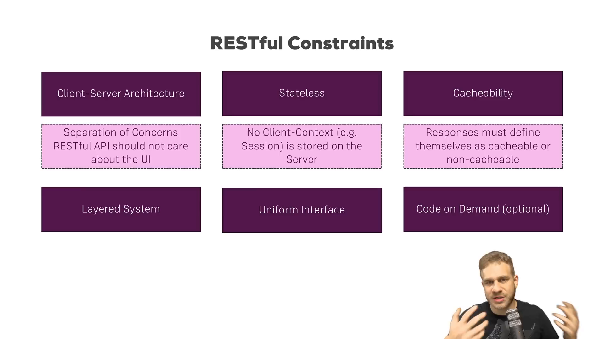

2. **Ràng buộc 2: Tính phi trạng thái (Statelessness):**
   - Đây là một trong hai ràng buộc quan trọng nhất của kiến trúc REST.
   - Máy chủ không bao giờ được phép lưu giữ bất kỳ ngữ cảnh trạng thái nào của máy khách (như phiên làm việc - Session) trong bộ nhớ của nó.
   - Mỗi một yêu cầu gửi lên máy chủ phải là một thực thể hoàn toàn độc lập, chứa đầy đủ mọi thông tin cần thiết để máy chủ xác định quyền hạn và thực thi tác vụ (ví dụ truyền mã xác thực Token trong tiêu đề yêu cầu).
   - *Hệ quả thực tế:* Trong ứng dụng một trang (SPA), câu hỏi thường gặp là "Làm cách nào để tạo Session trên máy chủ?". Câu trả lời chuẩn mực là không thể và không được phép làm điều đó. Khi hệ thống không dùng Session, máy chủ có thể dễ dàng mở rộng theo chiều ngang (Scale-out) thành hàng chục nút mạng mà không cần đồng bộ bộ nhớ phiên làm việc.

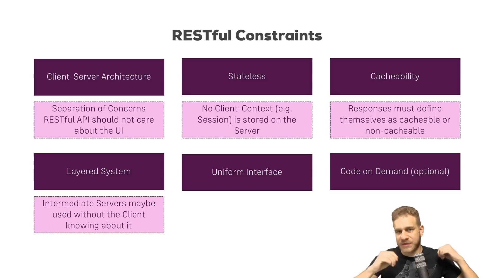

3. **Ràng buộc 3: Khả năng lưu đệm (Cacheability):**
   - Mọi phản hồi dữ liệu từ máy chủ gửi về phải tự công bố rõ ràng rằng nó có được phép lưu đệm hay không và thời hạn lưu đệm là bao lâu (thông qua các tiêu đề HTTP như `Cache-Control`, `Expires`, `ETag`).
   - Đối với các yêu cầu `GET` lấy dữ liệu ít biến động, máy chủ cho phép máy khách hoặc các máy chủ ủy nhiệm trung gian lưu đệm kết quả. Nhờ đó, máy khách có thể tái sử dụng dữ liệu cũ mà không cần gửi thêm yêu cầu qua mạng, giúp tiết kiệm băng thông và tăng tốc độ phản hồi.
   - Đối với dữ liệu biến động liên tục, máy chủ phải minh thị cấm lưu đệm (`no-cache`) để bảo đảm tính chính xác.

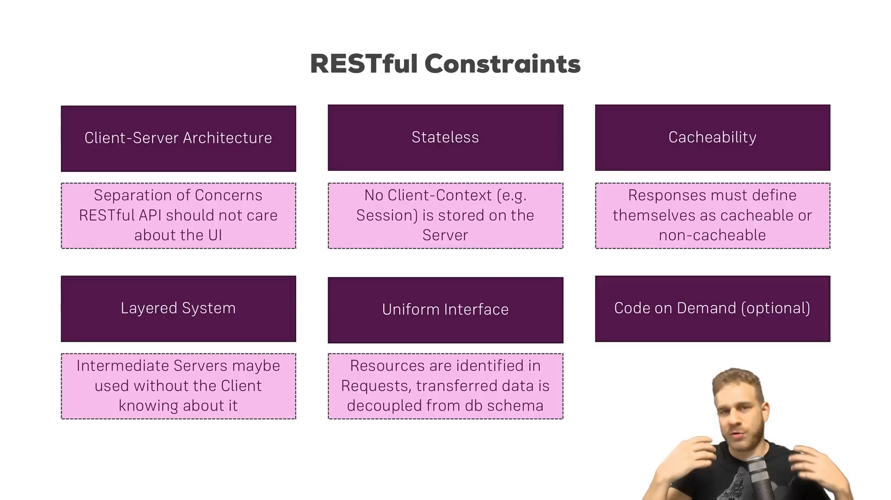

4. **Ràng buộc 4: Hệ thống phân tầng (Layered System):**
   - Kiến trúc cho phép tồn tại nhiều tầng trung gian giữa máy khách và máy chủ chứa dữ liệu thực tế.
   - Các tầng trung gian này có thể là: Máy chủ phân tải (Load Balancer), cổng kết nối tập trung (API Gateway), tường lửa bảo mật, hoặc máy chủ bộ nhớ đệm (Reverse Proxy / CDN).
   - Máy khách hoàn toàn không thể và không cần biết nó đang nói chuyện trực tiếp với máy chủ chứa cơ sở dữ liệu hay đang giao tiếp qua một trạm trung gian. Tính chất này giúp kiến trúc hệ thống linh hoạt nâng cấp hạ tầng mà không làm phá vỡ mã nguồn máy khách.

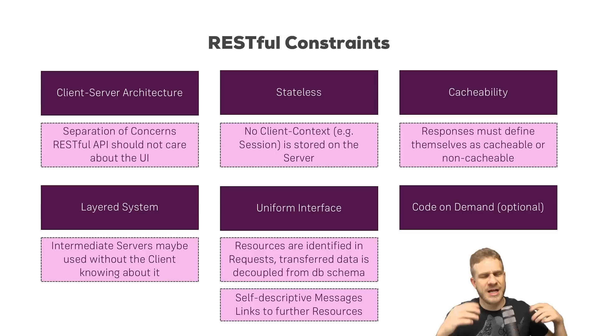

5. **Ràng buộc 5: Giao diện đồng nhất (Uniform Interface):**
   - Đây là ràng buộc phức tạp và đặc trưng nhất của phong cách REST, bao gồm 4 nguyên lý con:
     - **Nhận diện tài nguyên bằng URI:** Tài nguyên được chỉ định rõ ràng qua đường dẫn chuẩn (ví dụ `/users` định danh tập hợp người dùng).
     - **Thao tác tài nguyên qua các biểu diễn:** Dữ liệu trả về cho máy khách (JSON) có thể tách biệt hoàn toàn khỏi lược đồ bảng nội bộ trong cơ sở dữ liệu. Máy chủ có quyền biến đổi, ẩn bớt hoặc định dạng lại trường dữ liệu trước khi gửi đi.
     - **Thông điệp tự mô tả:** Mỗi thông điệp phải mang đầy đủ thông tin để bên nhận hiểu cách xử lý (ví dụ tiêu đề `Content-Type: application/json` báo cho trình duyệt biết đây là dữ liệu JSON).
     - **Siêu phương tiện dẫn đường (HATEOAS):** Trong phản hồi của một tài nguyên, máy chủ nên gửi kèm các liên kết URL dẫn tới các hành động tiếp theo liên quan đến tài nguyên đó.
       - *Ví dụ minh họa:* Khi gọi `GET /users`, trong mỗi đối tượng người dùng ngoài trường `id` và `name`, máy chủ trả kèm liên kết `"url": "/users/123"` hoặc `"orders": "/users/123/orders"`.
       - *Tầm quan trọng:* Máy khách không cần phải gắn cứng các đường dẫn trong mã nguồn hay phải đoán mò API. Giống như người dùng lướt web lần theo các liên kết siêu văn bản trên trang HTML, ứng dụng máy khách có thể tự khám phá luồng điều hướng dựa trên các liên kết do máy chủ trả về.

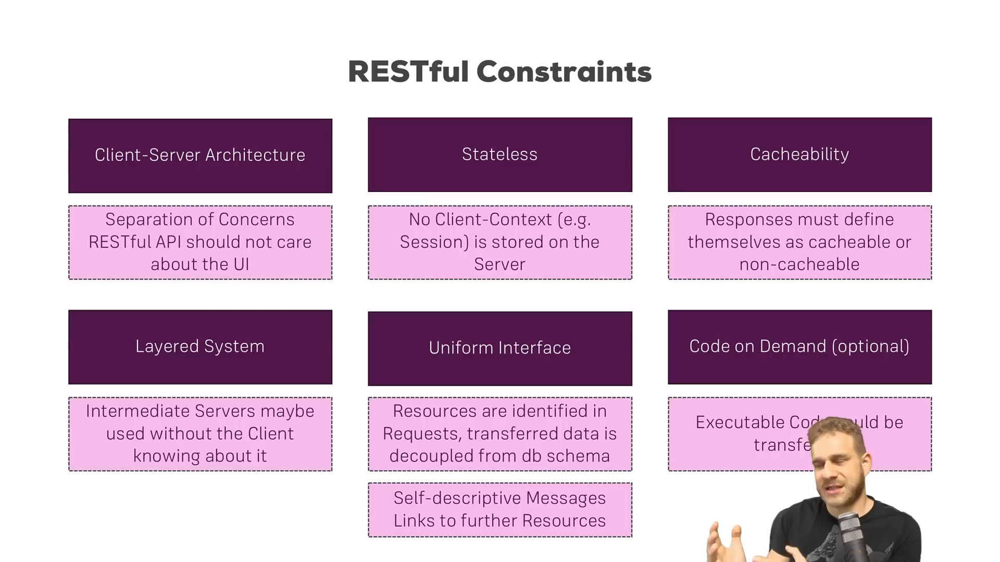

6. **Ràng buộc 6: Mã theo yêu cầu (Code on Demand - Ràng buộc tùy chọn duy nhất):**
   - Ràng buộc này cho phép máy chủ mở rộng chức năng của máy khách bằng cách gửi về mã lệnh thực thi thay vì chỉ gửi dữ liệu tĩnh.
   - Điển hình là việc máy chủ trả về các đoạn mã kịch bản JavaScript để trình duyệt tải về và chạy trực tiếp.
   - Đây là ràng buộc tùy chọn (Optional Constraint); phần lớn các hệ thống RESTful API trong thực tế đều bỏ qua ràng buộc này và chỉ tập trung vào việc luân chuyển dữ liệu thuần túy.

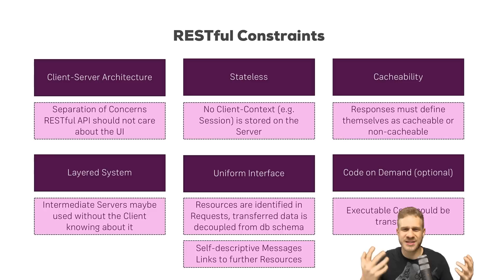

7. **Đúc kết trọng tâm thực tế:**
   - Tác giả khuyến nghị lập trình viên không nên quá sa đà vào việc học vẹt lý thuyết trừu tượng, mà cần nắm vững hai nguyên tắc kiến trúc quan trọng nhất trong phát triển ứng dụng thực tế:
     - **Phân tách tuyệt đối giữa máy khách và máy chủ (Client-Server Separation):** Đảm bảo máy chủ độc lập hoàn toàn với công nghệ giao diện người dùng.
     - **Tính phi trạng thái (Statelessness):** Tuyệt đối không quản lý trạng thái máy khách hay phiên làm việc (Session) trên máy chủ API. Máy chủ phải luôn giữ tính trung lập và độc lập với từng cá thể kết nối đến nó.

---

## Trích dẫn then chốt

* [[00:00:35](https://youtu.be/0oXYLzuucwE?t=35s)] *"REST stands for Representational State Transfer, and the whole idea behind it really is that we can use it to transfer data around as an alternative to a traditional web page."* — REST là viết tắt của chuyển giao trạng thái đại diện, với ý tưởng cốt lõi là vận chuyển dữ liệu thô để thay thế cho mô hình trang web truyền thống khi mô hình cũ không còn đáp ứng được nhu cầu.
* [[00:04:30](https://youtu.be/0oXYLzuucwE?t=270s)] *"A RESTful API in the end is also just a normal server. The big difference is that we don't care about this HTML stuff, we just want to send data back and forth."* — Máy chủ RESTful API về bản chất vẫn là một máy chủ thông thường. Khác biệt lớn nhất là chúng ta không bận tâm đến việc tạo mã HTML, mà chỉ tập trung truyền và nhận dữ liệu thuần túy.
* [[00:09:30](https://youtu.be/0oXYLzuucwE?t=570s)] *"Our RESTful API is stateless, so we don't store any client context like a session on it. That's super important."* — Máy chủ RESTful API bắt buộc phải phi trạng thái, chúng ta không được phép lưu trữ ngữ cảnh máy khách như phiên làm việc trên máy chủ. Đây là nguyên tắc tối quan trọng.
* [[00:12:40](https://youtu.be/0oXYLzuucwE?t=760s)] *"If you compare it to a traditional web application where you have multiple HTML pages with links, it's good if our RESTful API provides links to further resources back to our clients."* — Tương tự như việc người dùng điều hướng qua các liên kết trên trang web truyền thống, một RESTful API chuẩn mực nên cung cấp kèm các liên kết dẫn đường trong dữ liệu phản hồi cho máy khách.
* [[00:14:10](https://youtu.be/0oXYLzuucwE?t=850s)] *"In a single page application you use a RESTful API because you only need the data, and a RESTful API shouldn't really care about the client connected to it."* — Trong ứng dụng một trang, bạn sử dụng RESTful API vì bạn chỉ cần dữ liệu thô, và máy chủ API không bao giờ nên bận tâm hay phụ thuộc vào máy khách đang kết nối tới nó.

---

## Lệnh & Công cụ

### Kiểm tra điểm cuối API

Khối lệnh kiểm tra và tương tác với các điểm cuối RESTful API bằng công cụ dòng lệnh `curl`:

```bash
# 1. Gửi yêu cầu GET lấy danh sách tài nguyên định dạng JSON
curl -X GET http://localhost:3000/users \
  -H "Accept: application/json"

# 2. Gửi yêu cầu POST tạo mới một tài nguyên với thân dữ liệu JSON
curl -X POST http://localhost:3000/users \
  -H "Content-Type: application/json" \
  -d '{"name": "Max", "email": "max@academind.com"}'

# 3. Gửi yêu cầu PATCH cập nhật một phần dữ liệu của tài nguyên
curl -X PATCH http://localhost:3000/posts/101 \
  -H "Content-Type: application/json" \
  -d '{"title": "Cập nhật tiêu đề bài viết mới"}'

# 4. Gửi yêu cầu DELETE xóa bỏ một tài nguyên xác định
curl -X DELETE http://localhost:3000/users/123

# 5. Kiểm tra tiêu đề lưu đệm (Cache Headers) của phản hồi máy chủ
curl -I -X GET http://localhost:3000/products
```

### Công thức thiết kế điểm cuối

* **Quy tắc danh từ số nhiều:** Sử dụng danh từ số nhiều cho tài nguyên (`/users`, `/orders`), không dùng động từ trên đường dẫn (`/getUsers`, `/createOrder`).
* **Ánh xạ hành vi qua phương thức HTTP:**
  * Lấy dữ liệu -> `GET`
  * Tạo dữ liệu -> `POST`
  * Thay thế toàn bộ -> `PUT`
  * Chỉnh sửa một phần -> `PATCH`
  * Xóa dữ liệu -> `DELETE`
* **Cấu trúc tài nguyên lồng nhau (Nested Resources):** Biểu thị mối quan hệ phụ thuộc cha - con:
  * Lấy danh sách đơn hàng của người dùng số 5: `GET /users/5/orders`
  * Lấy chi tiết đơn hàng số 9 của người dùng số 5: `GET /users/5/orders/9`

---

## Đánh đổi & Rủi ro

| Đặc tính thiết kế | Lợi thế kiến trúc | Sự đánh đổi & Thách thức kỹ thuật |
| :--- | :--- | :--- |
| **Tính phi trạng thái (Statelessness)** | Máy chủ dễ dàng mở rộng theo chiều ngang (Scale-out), không cần bộ nhớ chia sẻ phiên làm việc (Session Replication). | Mọi yêu cầu đều phải gửi kèm thông tin ủy quyền (Token/JWT), làm tăng kích thước tiêu đề mạng; máy chủ phải xác thực lại Token ở từng yêu cầu. |
| **Phân tách máy khách và máy chủ** | Tái sử dụng một hệ thống Backend duy nhất cho nhiều nền tảng (Web, Mobile iOS/Android, Desktop, IoT). | Phải quản lý đồng bộ phiên bản API khi máy khách di động cũ chưa kịp cập nhật ứng dụng; logic ứng dụng bị phân tán giữa hai đầu. |
| **Giao diện đồng nhất (HATEOAS)** | Máy khách có tính linh hoạt cao, tự khám phá đường dẫn, giảm thiểu sự phụ thuộc vào việc gắn cứng URL trong mã nguồn. | Tăng dung lượng gói tin phản hồi do phải chứa nhiều liên kết URL; đòi hỏi công sức thiết kế và triển khai chuẩn mực phức tạp. |
| **Lưu đệm dữ liệu (Cacheability)** | Giảm đáng kể lưu lượng truy cập tới cơ sở dữ liệu, tối ưu hóa băng thông mạng và tăng tốc độ phản hồi cho máy khách. | Khó khăn trong việc kiểm soát tính tươi mới của dữ liệu; rủi ro máy khách hiển thị dữ liệu lỗi thời nếu cấu hình tiêu đề bộ nhớ đệm sai lệch. |
| **Mã theo yêu cầu (Code on Demand)** | Cho phép máy chủ mở rộng tính năng của máy khách linh hoạt trong thời gian thực mà không cần cài đặt lại phần mềm. | Tiềm ẩn lỗ hổng bảo mật nghiêm trọng nếu mã lệnh tải về bị can thiệp; máy khách phải có môi trường thực thi tương thích. |
