# Tổng quan Spring Boot và Spring Framework

* **Kênh:** Coder Army | **Thời lượng:** 43:41 | **Ngày:** 2026-03-24
* **Video:** [https://www.youtube.com/watch?v=Q04sTEwC7Kg](https://www.youtube.com/watch?v=Q04sTEwC7Kg)

---

## Thuật ngữ

| Thuật ngữ | Giải thích bản chất kỹ thuật |
| :--- | :--- |
| **Client-Server Architecture** | Mô hình điện toán phân tán chia sẻ khối lượng công việc giữa bên yêu cầu tài nguyên hoặc Client và bên cung cấp, thực thi tác vụ Server. |
| **HTTP / HTTPS** | Giao thức truyền tải siêu văn bản hoạt động ở tầng Application Layer, Stateless, vận hành dựa trên cơ chế bắt tay TCP và mã hóa bảo mật SSL/TLS trên cổng 80 hoặc 443. |
| **Socket & ServerSocket** | Điểm cuối trừu tượng hóa phần mềm ở tầng giao vận trong hệ điều hành, cho phép hai tiến trình giao tiếp hai chiều qua luồng nhị phân bằng địa chỉ IP và số hiệu cổng. |
| **Thread-per-request** | Mô hình xử lý đồng thời cổ điển: mỗi kết nối mạng hoặc yêu cầu gửi đến sẽ sinh ra một Thread độc lập, gây lãng phí bộ nhớ ngăn xếp và quá tải chuyển đổi Context Switching khi tải tăng đột biến. |
| **Servlet** | Giao diện chuẩn của Java Enterprise dùng để tiếp nhận và phản hồi các yêu cầu mạng động, quản lý vòng đời qua ba phương thức cốt lõi: khởi tạo, phục vụ và tiêu hủy. |
| **Servlet Container** | Bộ chứa máy chủ ứng dụng (như Apache Tomcat) chịu trách nhiệm cấp phát tiểu trình từ Thread Pool, chuyển đổi gói tin nhị phân thành đối tượng Java và điều phối vòng đời của Servlet. |
| **Inversion of Control (IoC)** | Nguyên lý thiết kế phần mềm chuyển giao quyền kiểm soát luồng thực thi và khởi tạo đối tượng từ mã nguồn thủ công sang một bộ khung quản lý tập trung. |
| **Dependency Injection (DI)** | Cơ chế hiện thực hóa nguyên lý IoC, trong đó các đối tượng phụ thuộc được cung cấp từ bên ngoài vào thay vì đối tượng tự khởi tạo bằng toán tử `new`. |
| **Spring IoC Container** | Lõi trung tâm của Spring Framework chịu trách nhiệm quét, cấu hình, tạo lập, liên kết và quản lý toàn bộ vòng đời của các thành phần Bean. |
| **Spring Bean** | Đối tượng Java được khởi tạo, lắp ráp và quản lý hoàn toàn bởi Spring IoC Container dựa trên các định nghĩa cấu hình hoặc chỉ dẫn Annotation. |
| **Tight Coupling vs Loose Coupling** | Độ kết dính: kết dính chặt khiến các lớp phụ thuộc cứng vào triển khai cụ thể của nhau, gây khó khăn cho việc kiểm thử và mở rộng; kết dính lỏng phân tách giao diện và hiện thực thông qua cơ chế tiêm phụ thuộc. |
| **Aspect-Oriented Programming (AOP)** | Lập trình hướng khía cạnh: kỹ thuật bóc tách các mối quan tâm xuyên suốt (Cross-cutting Concerns) như ghi nhật ký, kiểm soát giao dịch, bảo mật ra khỏi logic nghiệp vụ cốt lõi bằng cơ chế chặn Proxy. |
| **JDBC** | Giao diện lập trình mức thấp của Java dùng để kết nối và thực thi trực tiếp các câu lệnh truy vấn SQL thô tới hệ quản trị cơ sở dữ liệu quan hệ. |
| **ORM & Hibernate** | Kỹ thuật ánh xạ đối tượng vào cơ sở dữ liệu quan hệ; Hibernate là thư viện cụ thể tự động hóa việc sinh mã SQL và chuyển đổi qua lại giữa bản ghi bảng và lớp thực thể. |
| **JPA & Spring Data JPA** | JPA là tiêu chuẩn kỹ thuật giao diện của Java cho ORM; Spring Data JPA là lớp trừu tượng hóa cấp cao cung cấp mẫu thiết kế Repository giúp tự động hóa toàn bộ thao tác truy vấn dữ liệu mà không cần viết mã triển khai thủ công. |
| **Spring Boot** | Khung phát triển mở rộng từ Spring Framework với triết lý ưu tiên quy ước hơn Convention over Configuration, đóng gói sẵn máy chủ nhúng và các gói phụ thuộc tối ưu để triển khai ứng dụng ngay lập tức. |

---

## Tổng luận chuyên đề

#### Chuyên đề 1: Giới hạn của Java thuần và bế tắc kết nối mạng
Một ứng dụng Java tiêu chuẩn được biên dịch từ tập tin `.java` thành mã Bytecode `.class` và thực thi trên máy ảo JVM với luồng chạy tuyến tính từ phương thức `main` rồi kết thúc. Tuy nhiên, một máy chủ Web đòi hỏi vòng lặp vô hạn luôn lắng nghe trên một cổng mạng. Khi dùng thư viện mạng mức thấp `java.net`, lập trình viên phải tự mở `ServerSocket`, đọc luồng Byte thô từ `InputStream`, bóc tách thủ công tiêu đề và thân bản tin HTTP, tự ánh xạ đường dẫn tới hàm nghiệp vụ và tự đóng gói dữ liệu phản hồi. Nghiêm trọng nhất là mô hình mỗi yêu cầu một tiểu trình (Thread-per-request) dẫn tới cạn kiệt bộ nhớ ngăn xếp và suy sụp hệ thống khi có hàng nghìn kết nối đồng thời.

#### Chuyên đề 2: Bước đệm Servlet và bộ chứa Apache Tomcat
Để giải phóng kỹ sư khỏi việc quản lý kết nối TCP thô và tiểu trình, chuẩn Java Enterprise Edition năm 1997 giới thiệu Servlet và Servlet Container (điển hình là Tomcat). Bộ chứa quản lý sẵn một vùng hồ chứa Thread Pool, tự động chuyển đổi luồng dữ liệu mạng thành đối tượng `HttpServletRequest` và `HttpServletResponse`. Dù vậy, khi ứng dụng doanh nghiệp phình to, việc lập trình trên nền Servlet bộc lộ nhược điểm Tight Coupling, cấu hình tập tin XML khổng lồ, logic nghiệp vụ bị trói buộc trực tiếp vào API của Servlet khiến việc viết mã kiểm thử đơn vị độc lập trở nên bất khả thi.

#### Chuyên đề 3: Cuộc cách mạng Đảo ngược điều khiển của Spring
Năm 2002, Rod Johnson công bố Spring Framework nhằm giải quyết triệt để vấn đề kết dính chặt. Bằng cách áp dụng Inversion of Control và Dependency Injection thông qua Spring IoC Container, vòng đời và sự phụ thuộc giữa các đối tượng không còn do lập trình viên tự tạo bằng toán tử `new` mà do vùng chứa quản lý tập trung. Điều này giúp mã nguồn đạt trạng thái kết dính lỏng hoàn hảo, dễ dàng thay thế triển khai giả lập khi kiểm thử tự động, tái cấu trúc an toàn và mở rộng mô-đun hóa linh hoạt.

#### Chuyên đề 4: Tiến hóa tầng dữ liệu và kiến trúc Spring Boot
Tầng lưu trữ dữ liệu trải qua bốn thế hệ: từ JDBC thủ công với hàng chục dòng mã thiết lập kết nối và phân tích kết quả, đến Hibernate tự động sinh SQL qua ánh xạ thực thể, chuẩn hóa bởi JPA, và đạt đỉnh cao tinh gọn với Spring Data JPA. Trên nền tảng đó, Spring Boot tích hợp toàn bộ các mô-đun (Spring MVC, Spring Security, Spring AOP, Spring Data) cùng máy chủ Tomcat nhúng, biến ứng dụng Java thành một khối kiến trúc độc lập, sẵn sàng vận hành trên môi trường sản xuất mà không cần cấu hình phức tạp.

---

## Bóc tách chi tiết

### [[00:00:00](https://www.youtube.com/watch?v=Q04sTEwC7Kg&t=0s)] Giới thiệu tổng quan
Bài giảng mở đầu cho chuỗi đào tạo chuyên sâu về Spring Boot năm 2026, đi từ các nguyên lý nền tảng nhất của lập trình mạng Java đến kiến trúc hoàn chỉnh của một ứng dụng doanh nghiệp. Giảng viên khẳng định mục tiêu không chỉ là học cách sử dụng cú pháp hay các Annotation của Spring Boot, mà phải hiểu rõ lý do lịch sử và các nút thắt kỹ thuật dẫn đến sự ra đời của từng công nghệ: tại sao Java thuần không làm được Web, Servlet giải quyết vấn đề gì, tại sao cần Spring Framework và Spring Boot hoàn thiện bức tranh như thế nào.

---

### [[00:01:38](https://www.youtube.com/watch?v=Q04sTEwC7Kg&t=98s)] Kiến trúc máy khách
Client đại diện cho bất kỳ tác nhân nào phát sinh nhu cầu truy xuất dữ liệu: trình duyệt Web, ứng dụng di động iOS/Android, giao diện người dùng React/Angular, công cụ kiểm thử Postman hoặc chính một máy chủ dịch vụ khác.

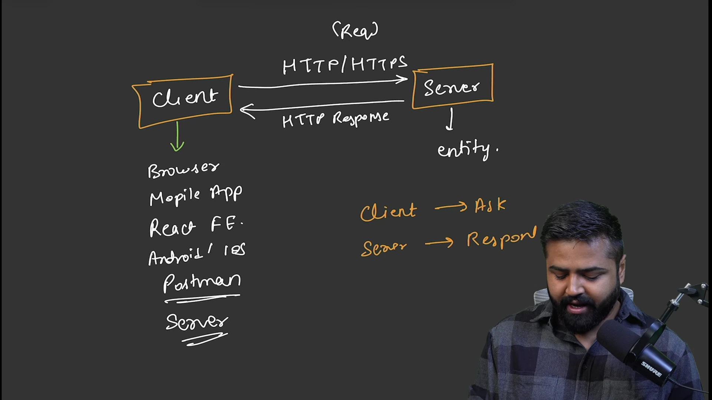

* **Phân định vai trò:** Máy khách gửi yêu cầu Ask và máy chủ đóng vai trò phản hồi Respond. Máy chủ là một thực thể độc lập vận hành trên một máy tính từ xa, sở hữu địa chỉ IP công khai hoặc tên miền xác định.
* **Cơ chế phân giải:** Trình duyệt sử dụng hệ thống DNS để chuyển đổi tên miền `coderarmy.in` thành địa chỉ IP, sau đó thực hiện quá trình bắt tay ba bước TCP (SYN, SYN-ACK, ACK) để thiết lập kênh truyền tin cậy trước khi truyền dữ liệu ứng dụng.

---

### [[00:06:33](https://www.youtube.com/watch?v=Q04sTEwC7Kg&t=393s)] Giao thức mạng
Giao thức là bộ quy tắc bắt buộc mà cả máy khách và máy chủ phải tuân thủ để hiểu được dữ liệu của nhau. Nếu máy khách gửi dữ liệu tự do không theo cấu trúc chuẩn, máy chủ sẽ không thể phân tích cú pháp.

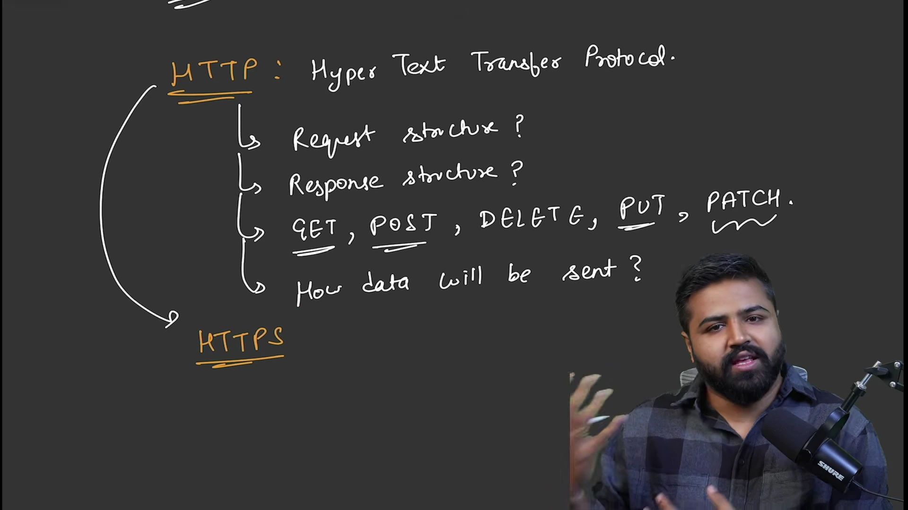

* **HTTP (HyperText Transfer Protocol):** Giao thức chuẩn tầng ứng dụng định nghĩa cú pháp bản tin yêu cầu, bản tin phản hồi và các phương thức thao tác tài nguyên:
  * `GET`: Lấy tài nguyên sẵn có từ máy chủ.
  * `POST`: Tạo mới tài nguyên hoặc gửi dữ liệu cần xử lý.
  * `PUT`: Cập nhật toàn bộ tài nguyên hiện có.
  * `PATCH`: Cập nhật một phần thuộc tính của tài nguyên.
  * `DELETE`: Xóa tài nguyên khỏi hệ thống.
* **HTTPS:** Lớp bảo mật mở rộng của HTTP tích hợp chứng chỉ số SSL/TLS, thực hiện mã hóa bất đối xứng để trao đổi khóa phiên và mã hóa đối xứng toàn bộ dữ liệu đường truyền, bảo vệ thông tin khỏi các cuộc tấn công nghe lén trên đường truyền mạng.

---

### [[00:08:52](https://www.youtube.com/watch?v=Q04sTEwC7Kg&t=532s)] Cấu trúc yêu cầu
Mỗi bản tin yêu cầu gửi qua đường truyền HTTP bắt buộc phải cấu thành từ bốn thành phần chuẩn mực:

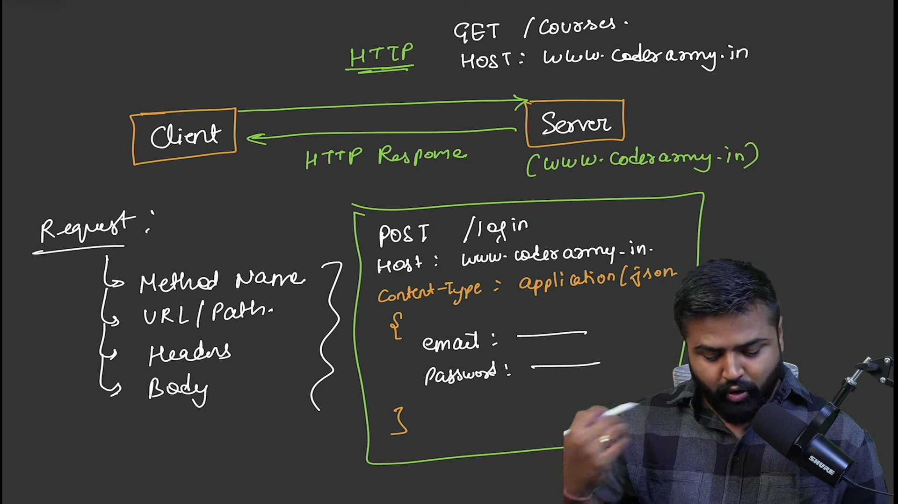

```http
POST /login HTTP/1.1
Host: www.coderarmy.in
Content-Type: application/json
User-Agent: Mozilla/5.0
Accept: application/json

{
  "email": "user@example.com",
  "password": "SecurePassword123"
}
```

* **Dòng Request Line:** Bao gồm phương thức thao tác (`GET`, `POST`), đường dẫn định danh tài nguyên (`URI/Path` như `/courses`, `/login`) và phiên bản giao thức (`HTTP/1.1`).
* **Headers:** Chứa các siêu dữ liệu cấu hình như `Host` (tên máy chủ đích), `Content-Type` (định dạng dữ liệu của thân bản tin như `application/json`), `Authorization` (mã thông báo định danh).
* **dòng trống CRLF:** Phân cách bắt buộc giữa phần tiêu đề và thân bản tin.
* **Thân bản tin (Body):** Khối dữ liệu thực tế mang nội dung cần gửi (chuỗi JSON, XML hoặc dữ liệu biểu mẫu).

---

### [[00:13:29](https://www.youtube.com/watch?v=Q04sTEwC7Kg&t=809s)] Cấu trúc phản hồi
Sau khi xử lý logic nghiệp vụ, máy chủ trả về một bản tin phản hồi mang cấu trúc đối ứng:

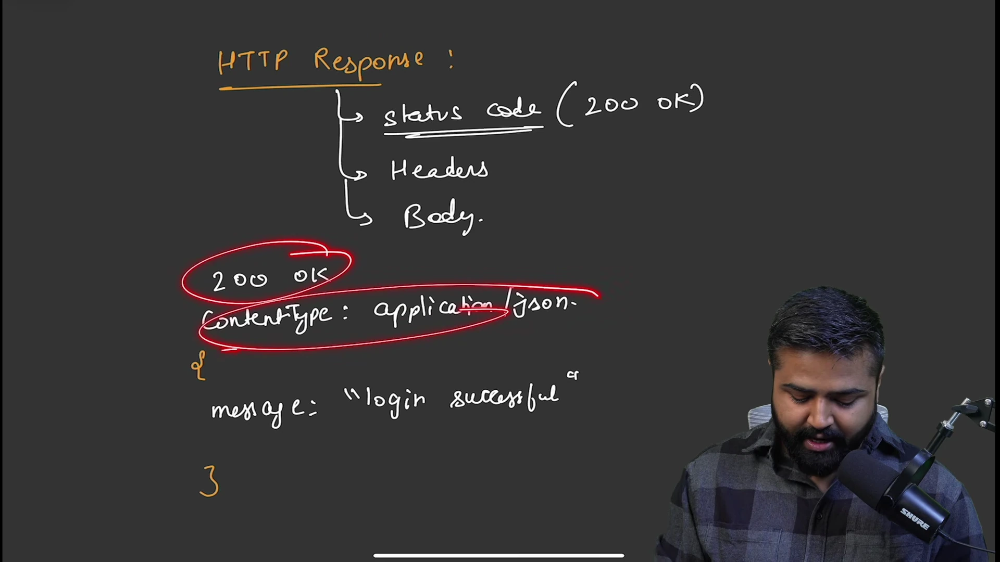

```http
HTTP/1.1 200 OK
Content-Type: application/json
Content-Length: 32

{
  "message": "login successful"
}
```

* **Dòng Status Line:** Gồm phiên bản giao thức và mã trạng thái:
  * `200 OK`: Xử lý thành công.
  * `201 Created`: Tạo mới tài nguyên thành công.
  * `400 Bad Request`: Lỗi dữ liệu đầu vào từ phía máy khách.
  * `401 Unauthorized`: Chưa xác thực danh tính.
  * `404 Not Found`: Không tìm thấy tài nguyên yêu cầu.
  * `500 Internal Server Error`: Lỗi sập ngoại lệ chưa bắt từ phía máy chủ.
* **Tiêu đề Response Headers:** Khai báo kiểu định dạng dữ liệu trả về cho trình duyệt hiển thị chính xác.
* **Thân Response Body:** Dữ liệu trả về (JSON danh sách khóa học, chuỗi thông báo kết quả hoặc mã HTML).

---

### [[00:15:02](https://www.youtube.com/watch?v=Q04sTEwC7Kg&t=902s)] Giới hạn Java gốc
Mô hình hoạt động của một ứng dụng Java truyền thống không tương thích tự nhiên với vai trò máy chủ mạng Web:

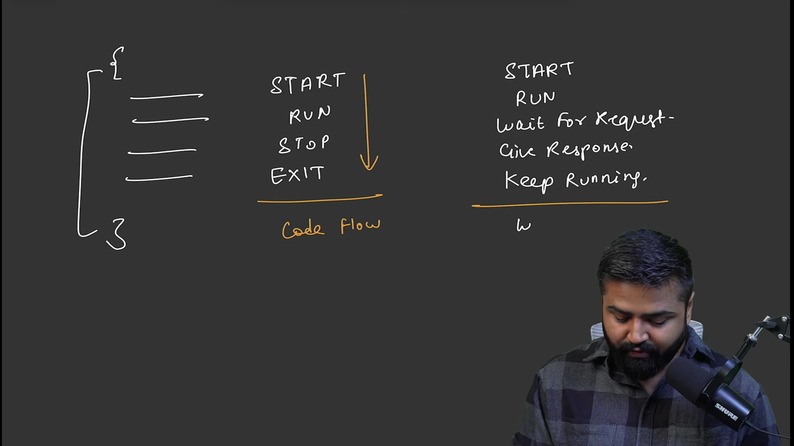

* **Luồng chạy Java tiêu chuẩn:** Đi theo chu trình đóng tuyến tính: `Start -> Run -> Stop -> Exit`. Sau khi thực thi xong khối lệnh trong phương thức `main`, tiến trình JVM tự động giải phóng tài nguyên và chấm dứt.
* **Đặc thù của máy chủ Web:** Đòi hỏi vòng đời bất tận: `Start -> Run -> Wait for Request -> Give Response -> Duy trì trạng thái Keep Running`.
* **Sự thiếu hụt của Java Core:** Ngôn ngữ Java cơ bản chỉ cung cấp cú pháp hướng đối tượng, cấu trúc dữ liệu và logic toán học. Thư viện chuẩn không có sẵn cơ chế để hiểu URL, không tự động bóc tách tiêu đề HTTP, không tự định tuyến phương thức vào lớp tương ứng.

---

### [[00:21:24](https://www.youtube.com/watch?v=Q04sTEwC7Kg&t=1284s)] Bế tắc mạng thuần
Để giải quyết bài toán Web bằng Java cơ bản, lập trình viên buộc phải sử dụng gói thư viện mạng `java.net`. Tuy nhiên, cách tiếp cận này vấp phải năm vấn đề nan giải:

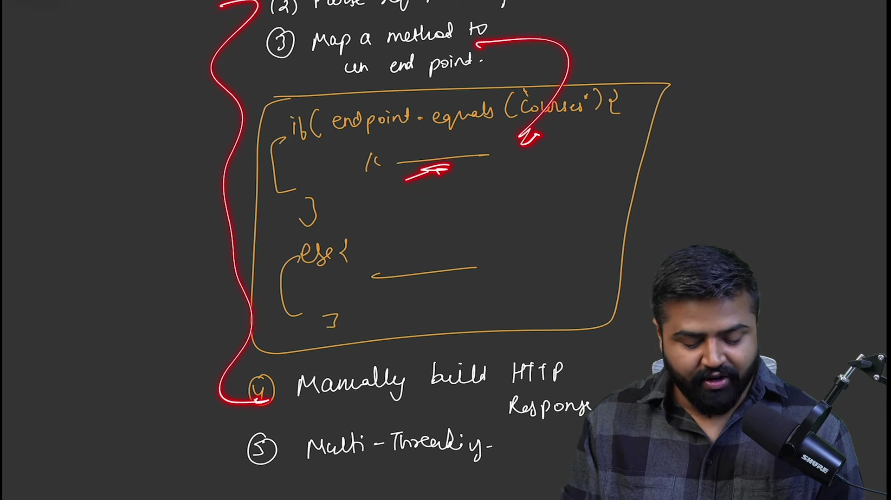

```java
// Mã nguồn minh họa lập trình mạng thuần bằng ServerSocket
ServerSocket serverSocket = new ServerSocket(8080);
while (true) {
    Socket clientSocket = serverSocket.accept(); // Chặn chờ kết nối
    InputStream input = clientSocket.getInputStream();
    BufferedReader reader = new BufferedReader(new InputStreamReader(input));
    
    String line = reader.readLine(); // Đọc thô chuỗi: "GET /courses HTTP/1.1"
    if (line != null && line.contains("/courses")) {
        // Tự phân tích cú pháp chuỗi, tự định tuyến bằng chuỗi câu lệnh if-else
        OutputStream output = clientSocket.getOutputStream();
        String response = "HTTP/1.1 200 OK\r\nContent-Type: text/plain\r\n\r\nDanh sach khoa hoc";
        output.write(response.getBytes());
        output.flush();
    }
    clientSocket.close();
}
```

* **Vấn đề 1: Đọc luồng nhị phân thủ công:** Phải tự kết nối vào `InputStream` để đọc từng mảng Byte hoặc dòng ký tự thô.
* **Vấn đề 2: Bóc tách bản tin HTTP thủ công:** Phải viết các đoạn mã biểu thức chính quy phức tạp để tách dòng yêu cầu, tiêu đề, tham số truy vấn và thân JSON.
* **Vấn đề 3: Định tuyến thủ công:** Khi ứng dụng có hàng trăm chức năng, hệ thống sẽ biến thành một rừng câu lệnh `if (path.equals("/courses")) ... else if ...` hỗn loạn, không thể bảo trì.
* **Vấn đề 4: Xây dựng bản tin phản hồi thủ công:** Lập trình viên phải tự ghép chuỗi các ký tự xuống dòng `\r\n`, tự tính độ dài `Content-Length` và quản lý mã trạng thái bằng tay.
* **Vấn đề 5: Khủng hoảng Multithreading:** Phương thức `accept()` chặn luồng chính. Nếu dùng mô hình tạo mới một tiểu trình cho mỗi yêu cầu (`new Thread().start()`), hệ thống sẽ nhanh chóng cạn kiệt bộ nhớ ngăn xếp và sập hoàn toàn do chi phí chuyển đổi ngữ cảnh của hệ điều hành.

---

### [[00:29:14](https://www.youtube.com/watch?v=Q04sTEwC7Kg&t=1754s)] Cơ chế Servlet
Năm 1997, hãng Sun Microsystems phát hành gói mở rộng Java Enterprise Edition giới thiệu kiến trúc Servlet và Servlet Container nhằm giải quyết toàn bộ các hạn chế tầng mạng cấp thấp.

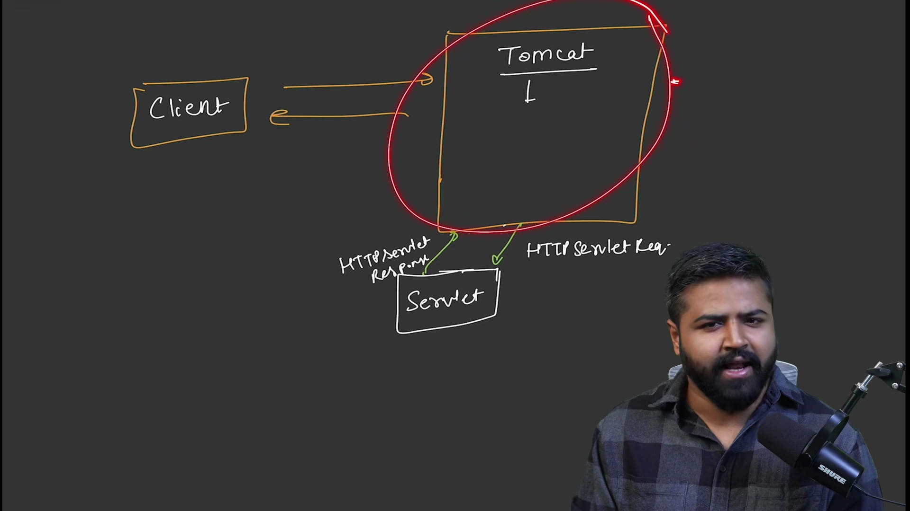

* **Tomcat đóng vai trò Servlet Container:**
  * Duy trì một hồ chứa Thread Pool được khởi tạo sẵn, tái sử dụng các tiểu trình thay vì tạo mới liên tục.
  * Tự động mở cổng mạng, lắng nghe kết nối TCP và đọc luồng Byte thô.
  * Chuyển đổi dữ liệu nhị phân của yêu cầu thành đối tượng Java cấp cao `HttpServletRequest` và tạo sẵn đối tượng `HttpServletResponse`.
* **Cơ chế hoạt động của Servlet:**
  * Lập trình viên chỉ cần kế thừa lớp `HttpServlet` và ghi đè các phương thức tương ứng như `doGet()` hoặc `doPost()`.
  * Bộ chứa tự động tìm kiếm bảng ánh xạ URL trong tập tin cấu hình `web.xml` để gọi đúng Servlet thực thi logic nghiệp vụ.

```java
// Mã nguồn Servlet truyền thống
public class CourseServlet extends HttpServlet {
    @Override
    protected void doGet(HttpServletRequest req, HttpServletResponse resp) 
            throws ServletException, IOException {
        resp.setContentType("application/json");
        PrintWriter out = resp.getWriter();
        out.println("{\"course\": \"Spring Boot\", \"instructor\": \"Coder Army\"}");
    }
}
```

* **Điểm nghẽn mới xuất hiện:** Dù giải quyết được tầng mạng, Servlet khiến mã nguồn bị gắn chặt vào thư viện của máy chủ Web (`HttpServletRequest`), khởi tạo đối tượng nghiệp vụ thủ công gây kết dính chặt, không thể tách rời để viết kiểm thử đơn vị.

---

### [[00:33:11](https://www.youtube.com/watch?v=Q04sTEwC7Kg&t=1991s)] Khởi nguyên Spring
Khi các hệ thống Servlet mở rộng quy mô doanh nghiệp, sự phụ thuộc chéo giữa các đối tượng trở thành thảm họa kiến trúc. Một lớp giao diện Controller tự khởi tạo lớp Service bằng toán tử `new`, lớp dịch vụ lại tự khởi tạo lớp truy xuất Repository. Nếu một lớp thay đổi hàm khởi tạo, toàn bộ các lớp phụ thuộc bên trên đều bị lỗi biên dịch.

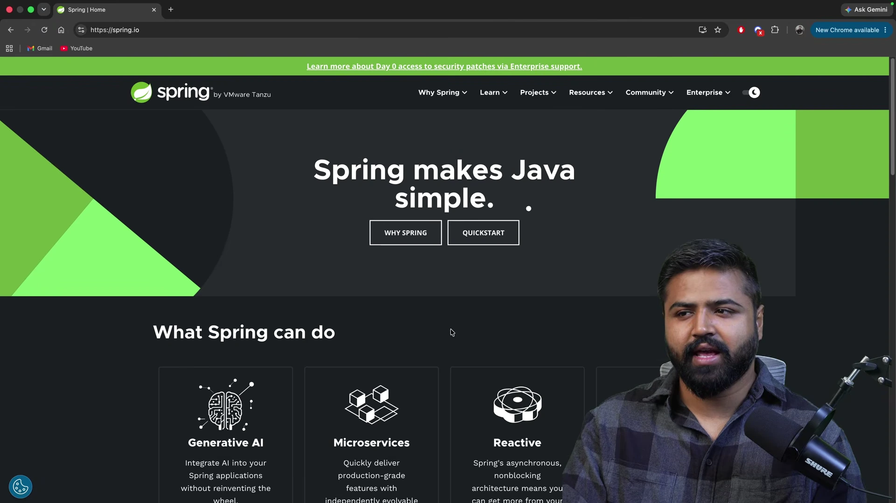

* **Sứ mệnh của Spring Framework:** Rod Johnson ra mắt Spring Framework với khẩu hiệu "Làm cho Java trở nên đơn giản", tập trung xóa bỏ sự kết dính chặt này.
* **Nguyên lý Đảo ngược IoC:** Lập trình viên không còn tự nắm quyền kiểm soát vòng đời đối tượng. Quyền khởi tạo, liên kết và quản lý sự tồn tại của các đối tượng được bàn giao hoàn toàn cho một thực thể trung tâm: Spring IoC Container.
* **Tiêm Dependency Injection:** Khi lớp dịch vụ cần một kho dữ liệu, vùng chứa Spring sẽ tự động tìm kiếm đối tượng tương thích và tiêm vào thông qua hàm khởi tạo hoặc thuộc tính, đảm bảo tính kết dính lỏng và cho phép thay thế bằng đối tượng Mock khi chạy kiểm thử.

---

### [[00:34:51](https://www.youtube.com/watch?v=Q04sTEwC7Kg&t=2091s)] Hệ sinh thái Spring
Spring phát triển từ một thư viện quản lý phụ thuộc thành một hệ sinh thái khổng lồ chia theo các tầng kiến trúc chuyên biệt:

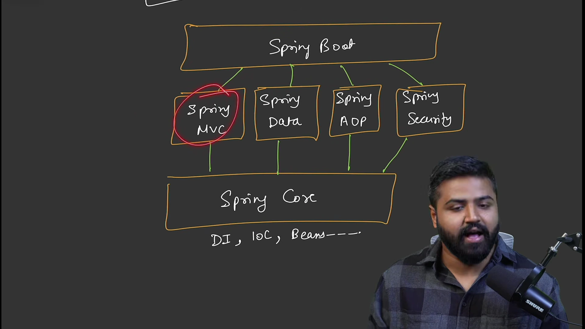

* **Tầng Spring Core:** Nền tảng cốt lõi chứa vùng chứa IoC Container, cơ chế Dependency Injection, định nghĩa Bean và bộ phân giải biểu thức SpEL.
* **Tầng ứng dụng Web (Spring MVC):** Triển khai mẫu thiết kế Model-View-Controller với bộ điều phối trung tâm `DispatcherServlet`, cung cấp các chỉ dẫn hiện đại như `@RestController`, `@GetMapping`, `@PostMapping` để xây dựng API RESTful.
* **Tầng hướng Spring AOP:** Cho phép can thiệp vào các phương thức để xử lý logic ghi nhật ký, kiểm tra quyền hạn và quản lý giao dịch một cách trong suốt mà không làm bẩn mã nghiệp vụ.
* **Tầng Spring Security:** Bộ lọc kiểm soát xác thực danh tính, phân quyền tài nguyên, bảo vệ chống giả mạo CSRF và tấn công định danh.
* **Tầng Spring Data:** Thống nhất và đơn giản hóa việc kết nối cơ sở dữ liệu quan hệ và phi quan hệ.
* **Tầng Spring Boot:** Nằm ở trên cùng, tự động cấu hình các mô-đun bên dưới dựa trên các gói phụ thuộc khai báo trong dự án và tích hợp sẵn máy chủ nhúng Tomcat.

---

### [[00:38:36](https://www.youtube.com/watch?v=Q04sTEwC7Kg&t=2316s)] Tiến hóa dữ liệu
Việc thao tác giữa ứng dụng Java và hệ quản trị cơ sở dữ liệu trải qua ba giai đoạn tiến hóa rõ rệt:

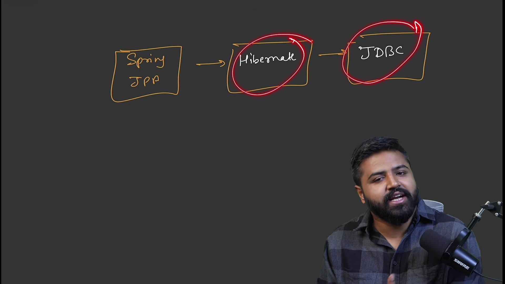

* **Thế hệ 1: JDBC (Java Database Connectivity):**
  * Lập trình viên phải viết truy vấn SQL trực tiếp bằng chuỗi ký tự cứng trong mã nguồn Java.
  * Phải tự quản lý vòng đời kết nối `Connection`, câu lệnh `PreparedStatement` và tự duyệt mảng `ResultSet` để gán từng trường vào thuộc tính của đối tượng.
  * Hàng chục dòng mã thiết lập Boilerplate Code cho một thao tác đơn giản, rất dễ rò rỉ kết nối nếu quên đóng tài nguyên.
* **Thế hệ 2: Hibernate (Object-Relational Mapping - ORM):**
  * Xuất hiện nhằm xóa bỏ việc viết mã SQL thủ công.
  * Tự động ánh xạ một bảng dữ liệu vào một lớp thực thể Java (`@Entity`) và ánh xạ các cột thành các trường thuộc tính.
  * Hibernate tự động sinh mã SQL tối ưu tương ứng với từng hệ cơ sở dữ liệu (MySQL, PostgreSQL, Oracle) và quản lý bộ nhớ đệm cấp một.
* **Thế hệ 3: Chuẩn JPA và Spring Data JPA:**
  * **JPA:** Bộ thông số kỹ thuật giao diện chuẩn của cộng đồng Java, đảm bảo ứng dụng không bị phụ thuộc vào một nhà cung cấp ORM cụ thể (Hibernate là một triển khai của JPA).
  * **Spring Data JPA:** Cung cấp giao diện `JpaRepository`. Lập trình viên chỉ cần khai báo phương thức mà không cần viết một dòng mã thực thi nào; Spring sẽ tự động sinh mã truy vấn tại thời điểm chạy:

```java
// Tối ưu hóa tuyệt đối với Spring Data JPA
public interface CourseRepository extends JpaRepository<Course, Long> {
    List<Course> findByInstructor(String instructor);
}
```

---

### [[00:40:52](https://www.youtube.com/watch?v=Q04sTEwC7Kg&t=2452s)] Kiến trúc hoàn chỉnh
Bài giảng kết thúc bằng việc tổng hợp toàn bộ các mảnh ghép công nghệ thành một sơ đồ kiến trúc ứng dụng Web chuẩn mực trên nền tảng Spring Boot:

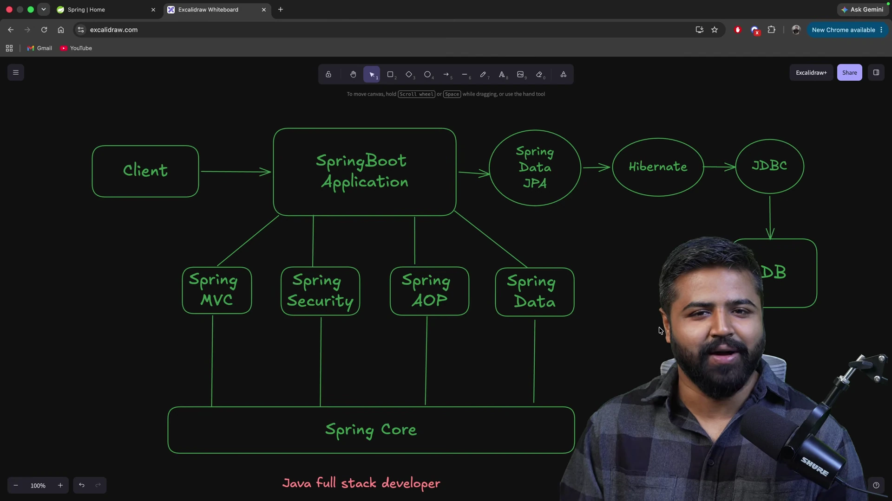

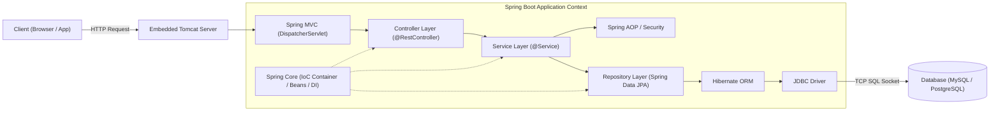

* **Luồng xử lý hoàn chỉnh một yêu cầu:**
  1. Máy khách gửi bản tin HTTP yêu cầu qua mạng Internet tới cổng của máy chủ.
  2. Máy chủ nhúng Tomcat tiếp nhận gói tin, bóc tách luồng Byte và chuyển giao đối tượng yêu cầu cho `DispatcherServlet` của Spring MVC.
  3. Spring MVC kiểm tra đường dẫn, kích hoạt bộ lọc bảo mật của Spring Security và định tuyến yêu cầu tới phương thức tương ứng trong lớp điều khiển (`Controller`).
  4. Lớp điều khiển gọi lớp dịch vụ (`Service`) để thực thi quy tắc nghiệp vụ. Các khía cạnh như bảo mật, kiểm tra quyền hạn và ghi log được Spring AOP xử lý ngầm.
  5. Lớp dịch vụ tương tác với lớp dữ liệu thông qua Spring Data JPA.
  6. Spring Data JPA gọi Hibernate để dịch các thao tác đối tượng thành câu lệnh SQL chuẩn.
  7. Hibernate ủy quyền cho trình điều khiển JDBC giao tiếp trực tiếp với hệ quản trị cơ sở dữ liệu qua mạng TCP.
  8. Dữ liệu từ cơ sở dữ liệu được trả ngược lại qua các tầng, đóng gói thành đối tượng phản hồi JSON và gửi về cho máy khách.
* Toàn bộ các thành phần trong chu trình trên đều là các Bean được quản lý tập trung và tiêm phụ thuộc thông qua Spring Core IoC Container.

---

## Trích dẫn then chốt

* *"Nếu bạn không hiểu giao thức mạng và bản chất của việc đọc luồng nhị phân bằng ServerSocket, bạn sẽ không bao giờ hiểu được tại sao Tomcat và Servlet lại xuất hiện."* — [[00:15:20](https://www.youtube.com/watch?v=Q04sTEwC7Kg&t=920s)]
* *"Mỗi khi bạn dùng từ khóa new để tạo đối tượng bên trong một lớp khác, bạn đang trói chặt số phận của hai lớp đó với nhau và phá vỡ khả năng kiểm thử của hệ thống."* — [[00:33:45](https://www.youtube.com/watch?v=Q04sTEwC7Kg&t=2025s)]
* *"Spring Boot không phải là một ngôn ngữ mới hay một công nghệ hoàn toàn tách biệt; nó là một người quản gia thông minh tập hợp toàn bộ các thư viện tốt nhất của thế giới Java và tự động kết nối chúng lại cho bạn."* — [[00:37:10](https://www.youtube.com/watch?v=Q04sTEwC7Kg&t=2230s)]
* *"Sự tiến hóa từ JDBC lên Hibernate rồi đến Spring Data JPA là minh chứng rõ nhất cho mục tiêu cao nhất của kỹ nghệ phần mềm: loại bỏ mã nguồn thừa thãi để lập trình viên tập trung 100% vào nghiệp vụ."* — [[00:40:15](https://www.youtube.com/watch?v=Q04sTEwC7Kg&t=2415s)]

---

## Lệnh & Công cụ

* **Thư viện mạng lõi:** `java.net.ServerSocket`, `java.net.Socket`, `java.io.InputStream`, `java.io.OutputStream`.
* **Bộ chứa ứng dụng:** Apache Tomcat (phiên bản máy chủ độc lập và phiên bản nhúng bên trong Spring Boot).
* **Đặc tả Servlet:** Giao diện `jakarta.servlet.http.HttpServlet`, `HttpServletRequest`, `HttpServletResponse`.
* **Khung công tác nền tảng:** Spring Framework 6.x / Spring Boot 3.x.
* **Mô-đun chức năng:** Spring Core, Spring MVC, Spring AOP, Spring Security, Spring Data JPA.
* **Truy xuất dữ liệu:** JDBC Driver, Hibernate ORM, JPA Specification, HikariCP Connection Pool.
* **Công cụ kiểm thử & gỡ lỗi:** cURL, Postman, trình duyệt Web DevTools.

---

## Đánh đổi & Rủi ro

| Lựa chọn kỹ thuật | Đánh đổi & Rủi ro tiềm ẩn | Biện pháp giảm thiểu |
| :--- | :--- | :--- |
| **Java thuần vs Spring Boot** | Java thuần kiểm soát tối đa từng byte bộ nhớ và socket nhưng tốn hàng nghìn giờ lập trình mã nền tảng; Spring Boot phát triển nhanh gấp 10 lần nhưng tiêu tốn bộ nhớ khởi động do cơ chế quét Bean và nạp nhiều cấu hình tự động. | Chỉ sử dụng Java Socket thuần cho các hệ thống siêu tối ưu vi mô; ưu tiên Spring Boot cho 99% ứng dụng nghiệp vụ doanh nghiệp. |
| **Mô hình luồng của Tomcat tiêu chuẩn** | Tomcat mặc định sử dụng một tiểu trình hệ điều hành cho mỗi yêu cầu. Khi các tác vụ cơ sở dữ liệu bị nghẽn (I/O Bound), toàn bộ tiểu trình trong Thread Pool sẽ bị treo, dẫn đến từ chối dịch vụ cho các yêu cầu mới. | Cấu hình kích thước Thread Pool hợp lý, kết hợp chuyển đổi sang Virtual Threads (Java 21+) hoặc sử dụng Spring WebFlux cho các luồng xử lý phi chặn. |
| **Trừu tượng hóa ORM & Hibernate** | Hibernate giấu đi các câu lệnh SQL giúp viết mã nhanh, nhưng tiềm ẩn nguy cơ hiệu năng nghiêm trọng như vấn đề truy vấn N+1 (N+1 Query Problem) hoặc tải dữ liệu lười biếng ngoài LazyInitializationException. | Luôn bật ghi nhật ký câu lệnh SQL trong môi trường kiểm thử (`show-sql: true`), sử dụng `join fetch` hoặc `EntityGraph` để nạp dữ liệu quan hệ tối ưu. |
| **Phụ thuộc vào Auto-Configuration** | Cơ chế tự động cấu hình của Spring Boot giống như một chiếc hộp đen; lập trình viên mới vào nghề thường không hiểu tại sao ứng dụng chạy được, dẫn đến bế tắc khi gặp lỗi xung đột cấu hình hoặc ghi đè Bean. | Phải nắm vững nguyên lý hoạt động nội tại của Spring Core, đọc nhật ký điều kiện cấu hình tự động (`debug: true`) khi có lỗi phát sinh. |