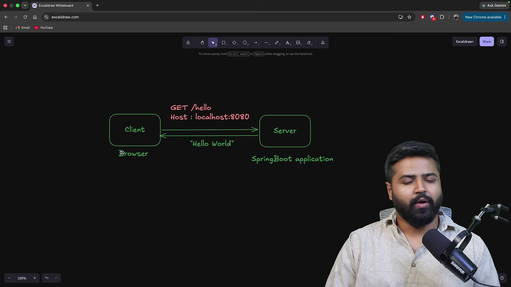
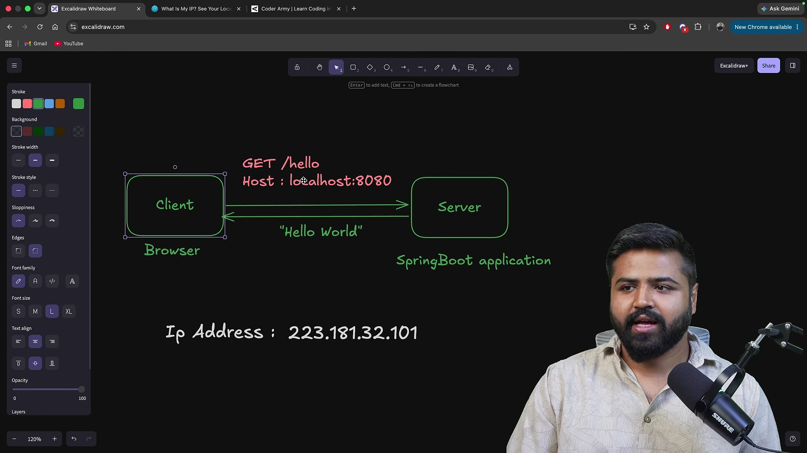
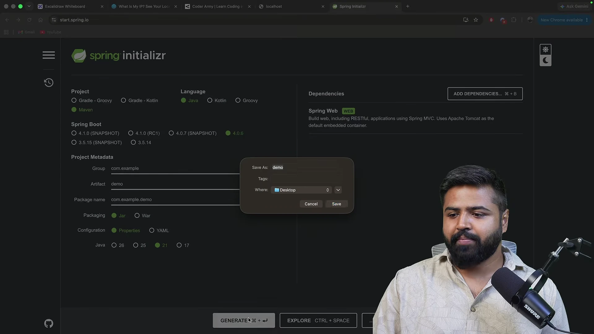
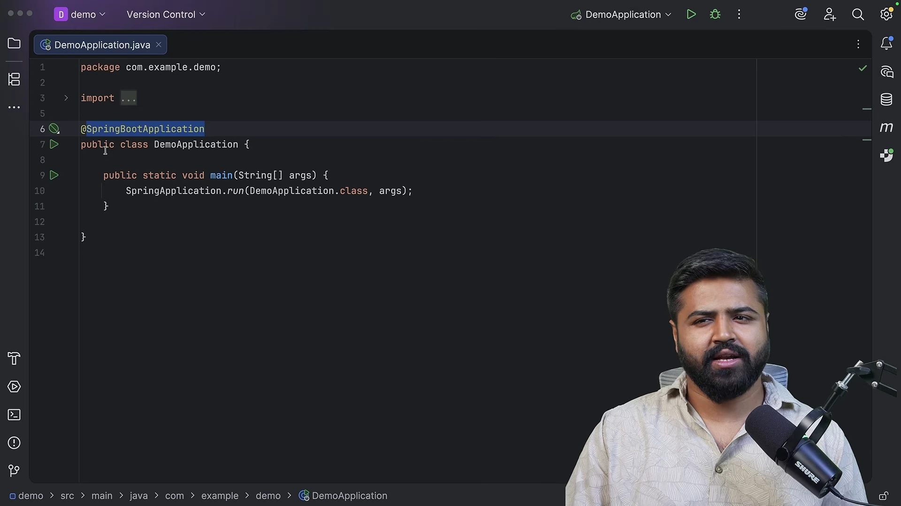
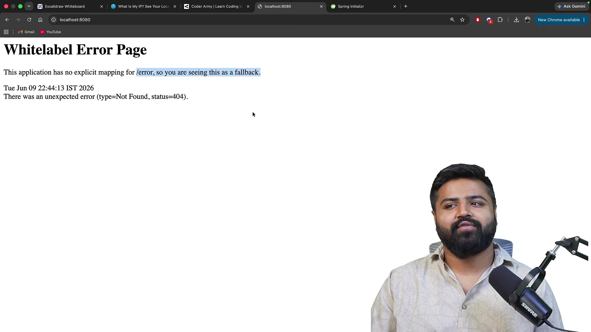
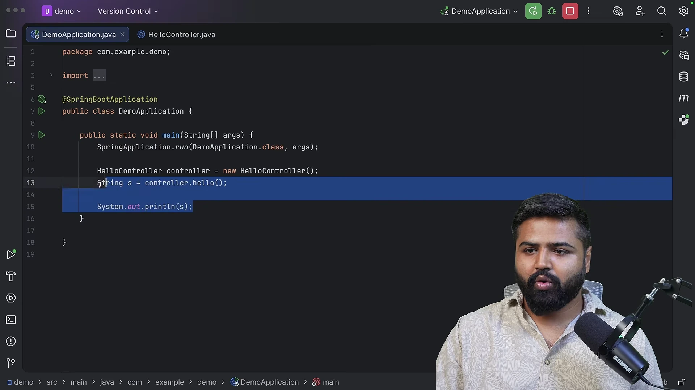
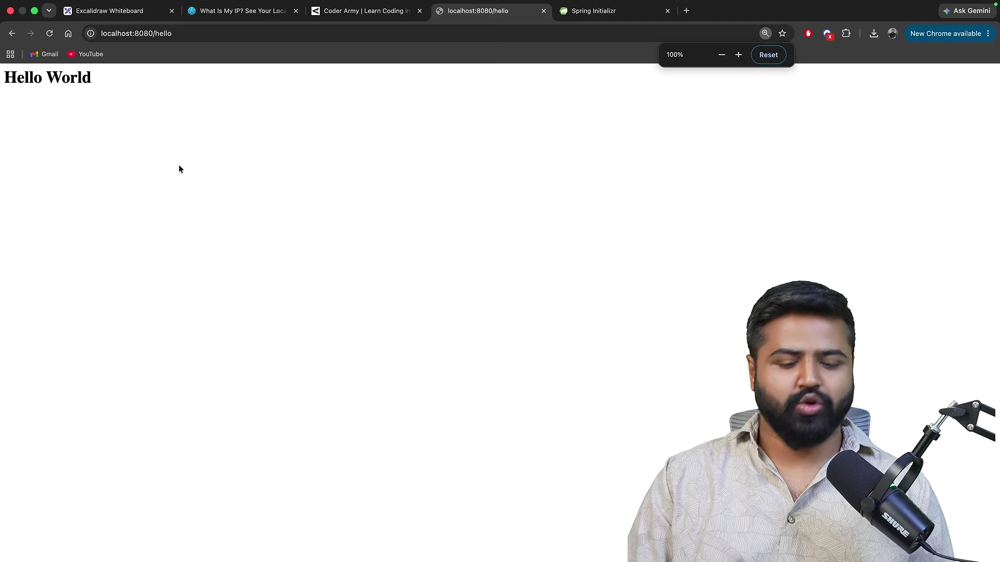
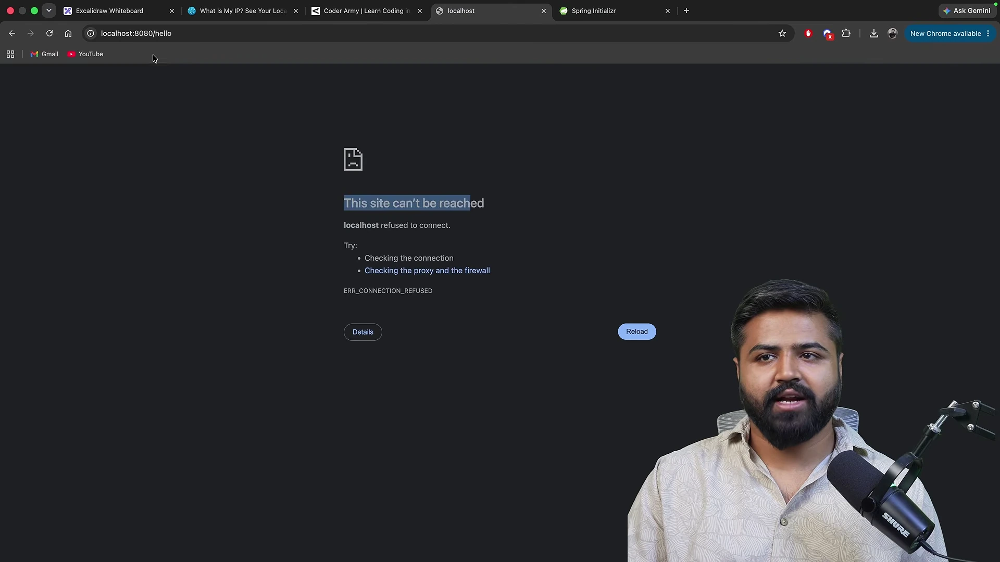
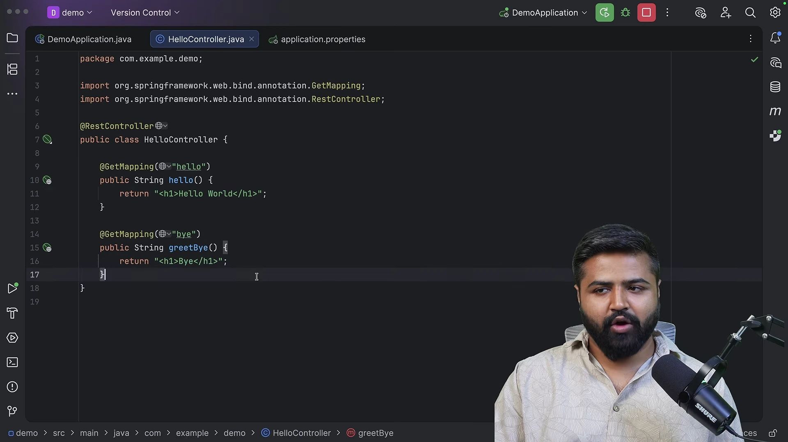

# Khởi tạo ứng dụng Spring Boot và REST API đầu tiên

* **Kênh:** Coder Army | **Thời lượng:** 31:12 | **Ngày:** 2026-06-16
* **Video:** [https://www.youtube.com/watch?v=PVreyET_Q6I](https://www.youtube.com/watch?v=PVreyET_Q6I)

---

## Thuật ngữ

| Thuật ngữ | Giải thích bản chất kỹ thuật |
| :--- | :--- |
| **Client-Server Architecture** | Mô hình điện toán phân tán phân định ranh giới giữa bên yêu cầu tài nguyên hoặc Client và bên tiếp nhận, tính toán, xử lý logic nghiệp vụ và trả Server. |
| **IP Address** | Địa chỉ định danh duy nhất của một giao diện mạng thuộc thiết bị phần cứng trong mạng máy tính, hoạt động ở tầng mạng để định tuyến các gói tin. |
| **Localhost & Loopback** | Dải địa chỉ mạng nội bộ tiêu chuẩn (`127.0.0.1`) do ngăn xếp giao thức của hệ điều hành điều hướng quay ngược trực tiếp lại chính thiết bị hiện tại mà không phát gói tin ra card mạng vật lý. |
| **Port Number** | Số nguyên 16-bit (từ 0 đến 65535) hoạt động ở tầng giao vận dùng để định danh duy nhất một tiến trình hoặc dịch vụ phần mềm đang lắng nghe kết nối trên một địa chỉ IP. |
| **DNS (Domain Name System)** | Hệ thống cơ sở dữ liệu phân tán toàn cầu ánh xạ các tên miền dễ đọc (như `coderarmy.in`) thành địa chỉ IP số học để trình duyệt khởi tạo kết nối mạng. |
| **Reverse Proxy** | Máy chủ trung gian (như NGINX hoặc HAProxy) đứng trước hệ thống backend để tiếp nhận lưu lượng mạng công khai (thường ở cổng 443), thực hiện giải mã SSL, cân bằng tải và định tuyến nội bộ vào cổng ứng dụng (như 8080). |
| **Spring Initializr** | Dịch vụ web chính thức (`start.spring.io`) sinh mã khung sườn dự án tự động, cấu hình sẵn cấu trúc thư mục, phiên bản ngôn ngữ và các phụ thuộc ban đầu cho Spring Boot. |
| **Apache Maven & pom.xml** | Công cụ quản lý vòng đời xây dựng và tự động hóa giải quyết quan hệ phụ thuộc trong Java; `pom.xml` là tập tin cấu hình trung tâm dạng XML khai báo siêu dữ liệu, dependencies và plugins. |
| **JAR vs WAR** | Định dạng đóng gói Java; WAR đòi hỏi máy chủ web độc lập bên ngoài; JAR trong Spring Boot chứa trọn vẹn mã nguồn, thư viện và máy chủ web nhúng cho phép thực thi độc lập qua lệnh `java -jar`. |
| **Spring Boot Starter Web** | Gói phụ thuộc tích hợp sẵn các thư viện cốt lõi cho lập trình web phân tán bao gồm Spring MVC, chuyển đổi dữ liệu và máy chủ nhúng Apache Tomcat. |
| **Embedded Tomcat Container** | Máy chủ web Servlet được đóng gói trực tiếp dưới dạng thư viện bên trong ứng dụng Java, tự động khởi chạy và tiêu hủy cùng vòng đời của tiến trình JVM mà không cần cài đặt ngoài hệ điều hành. |
| **@SpringBootApplication** | Chú thích hợp nhất kích hoạt ba cơ chế nền tảng: cấu hình ngữ cảnh (`@SpringBootConfiguration`), tự động nạp cấu hình theo classpath (`@EnableAutoConfiguration`), và quét tự động các bean (`@ComponentScan`). |
| **@RestController** | Chú thích đánh dấu lớp đóng vai trò Controller trong kiến trúc MVC, tự động đăng ký Bean và gắn thêm hành vi `@ResponseBody` để trả trực tiếp dữ liệu thô về thân bản tin HTTP. |
| **@GetMapping** | Biến thể chuyên biệt của `@RequestMapping(method = RequestMethod.GET)` ánh xạ các yêu cầu mạng phương thức GET tại một đường dẫn URI xác định vào phương thức Java tương ứng. |
| **application.properties** | Tập tin cấu hình khóa-giá trị trung tâm của Spring Boot dùng để tùy biến các thông số vận hành của hệ thống như cổng mạng (`server.port`), đường dẫn ngữ cảnh và kết nối dữ liệu. |

---

## Tổng luận chuyên đề

#### Chuyên đề 1: Hạ tầng mạng và mô hình định vị dịch vụ web
Mô hình Client-Server phân định rõ vai trò giữa tác nhân yêu cầu (trình duyệt web Chrome) và tác nhân phục vụ (máy chủ Spring Boot). Để truyền nhận dữ liệu trên mạng, hệ thống phân tách ranh giới giữa hai khái niệm: địa chỉ IP định vị thiết bị vật lý trong không gian mạng, còn cổng mạng định vị tiến trình phần mềm cụ thể đang vận hành trên thiết bị đó. Khi người dùng truy cập tên miền, hệ thống DNS phân giải thành IP máy chủ, và trình duyệt tự động gán cổng chuẩn (cổng 80 cho HTTP, cổng 443 cho HTTPS). Trong môi trường sản xuất thực tế, máy chủ Reverse Proxy đóng vai trò trạm tiếp nhận tại cổng 443 và chuyển tiếp nội bộ sang cổng 8080 của ứng dụng Spring Boot. Ngược lại, trong môi trường phát triển cục bộ, lập trình viên kết nối trực tiếp qua cơ chế loopback (`localhost:8080`).

#### Chuyên đề 2: Tự động hóa bộ khung dự án với Spring Initializr
Khởi tạo ứng dụng web Java theo phương thức thủ công truyền thống đòi hỏi chi phí thiết lập môi trường rất lớn: tự tạo cấu trúc thư mục quy chuẩn, cấu hình tệp build, quản lý xung đột thư viện và cài đặt máy chủ Tomcat độc lập. Spring Initializr (`start.spring.io`) giải quyết triệt để vấn đề này bằng việc tự động hóa quá trình sinh bộ khung dự án. Bằng cách lựa chọn định dạng đóng gói JAR thay vì WAR cổ điển, Spring Boot kết hợp mã nguồn, các thư viện phụ thuộc và toàn bộ máy chủ nhúng vào một khối duy nhất, hiện thực hóa triết lý phát triển nhanh và triển khai độc lập.

#### Chuyên đề 3: Máy chủ nhúng và chu trình khởi động Spring Boot
Khác biệt cốt lõi của Spring Boot nằm ở sự xuất hiện của gói phụ thuộc `spring-boot-starter-web`. Thư viện này không chỉ cung cấp các lớp trừu tượng của Spring MVC mà còn nhúng trực tiếp máy chủ Apache Tomcat vào bên trong ứng dụng. Khi hàm `main` thực thi dòng lệnh `SpringApplication.run()`, Spring Boot tự động kích hoạt máy ảo JVM, nạp toàn bộ ngữ cảnh ứng dụng và mở máy chủ Tomcat trên cổng mặc định 8080. Sự hiện diện của trang Whitelabel Error Page khi truy cập gốc URL là bằng chứng thực tế chứng minh tầng mạng và máy chủ nhúng đã vận hành ổn định.

#### Chuyên đề 4: Xây dựng REST API và kiểm soát tham số môi trường
Việc khai báo điểm cuối API trong Spring Boot được tinh gọn tối đa thông qua các chú thích hướng khai báo. Bằng cách áp dụng `@RestController` và `@GetMapping`, lập trình viên không cần viết mã định tuyến thủ công hay gọi phương thức từ hàm `main`; hệ thống Spring MVC sẽ tự động quét và ánh xạ yêu cầu mạng vào phương thức tương ứng. Đồng thời, Spring Boot cho phép ghi đè linh hoạt các thông số hạ tầng (như đổi cổng kết nối bằng thuộc tính `server.port` trong `application.properties`) nhằm loại bỏ triệt để nguy cơ xung đột tài nguyên mạng trên máy chủ.

---

## Bóc tách chi tiết

### [[00:00:00](https://www.youtube.com/watch?v=PVreyET_Q6I&t=0s)] Khởi tạo ứng dụng

* **Mục tiêu bài giảng**: Khởi động khóa đào tạo thực hành Spring Framework bằng việc xây dựng một ứng dụng Spring Boot hoàn chỉnh đầu tiên. Ứng dụng phục vụ mục tiêu đơn giản nhưng mang tính nền tảng: kích hoạt một HTTP endpoint trên trình duyệt web và nhận về phản hồi hiển thị chuỗi ký tự "Hello World".
* **Phương pháp tiếp cận thực nghiệm**:
  * Người học không bắt buộc phải nắm vững toàn bộ cú pháp nội tại hay các tầng kiến trúc phức tạp của Spring Boot trước khi bắt tay thực hành.
  * Việc xây dựng ứng dụng ngay từ bài học đầu tiên nhằm chứng minh sức mạnh của cơ chế tự động cấu hình trong Spring Boot. Framework tự động thiết lập máy chủ nhúng, quản lý vòng đời ứng dụng và liên kết các thành phần hạ tầng mà không đòi hỏi lập trình viên phải can thiệp thủ công vào các tệp cấu hình XML rườm rà như các phiên bản Spring Framework truyền thống.
  * Nhờ cơ chế trừu tượng hóa này, lập trình viên có thể tập trung trực tiếp vào logic nghiệp vụ ngay từ những dòng mã đầu tiên. Các nguyên lý vận hành ngầm của framework sẽ được bóc tách có hệ thống trong các bài học tiếp theo.

---

### [[00:00:46](https://www.youtube.com/watch?v=PVreyET_Q6I&t=46s)] Luồng giao tiếp mạng

* **Mô hình Client-Server cơ bản**:
  * **Client**: Trình duyệt web (cụ thể là Google Chrome) đóng vai trò máy khách gửi yêu cầu mạng.
  * **Server**: Ứng dụng Spring Boot đóng vai trò máy chủ tiếp nhận, phân tích và phản hồi yêu cầu.
* **Quy trình truyền nhận yêu cầu HTTP**:
  * Trình duyệt Chrome phát đi một yêu cầu HTTP sử dụng phương thức GET hướng tới endpoint `/hello`.
  * Máy chủ Spring Boot tiếp nhận yêu cầu qua cổng mạng đã chỉ định, tìm kiếm phương thức điều khiển tương ứng với đường dẫn `/hello`.
  * Khối logic xử lý sinh ra phản hồi chứa dữ liệu kiểu chuỗi ký tự `"Hello World"`.
  * Phản hồi được đóng gói vào gói tin HTTP Response và trả ngược về trình duyệt để kết xuất giao diện trực quan cho người dùng.
* **Môi trường phát triển cục bộ**:
  * Trong giai đoạn phát triển phần mềm, cả Client (trình duyệt) và Server (ứng dụng Spring Boot) đều cùng vận hành trên một máy tính vật lý.
  * Trình duyệt không cần gửi gói tin ra mạng Internet công cộng mà định tuyến trực tiếp đến máy chủ nội bộ thông qua tên máy chủ cục bộ `localhost` kết hợp số hiệu cổng mạng `8080`.
  * URL truy cập hoàn chỉnh có cấu trúc: `http://localhost:8080/hello`.



---

### [[00:02:19](https://www.youtube.com/watch?v=PVreyET_Q6I&t=139s)] Địa chỉ mạng máy tính

* **Bản chất của địa chỉ IP**:
  * Mỗi thiết bị kết nối vào mạng máy tính (máy tính để bàn, điện thoại, máy chủ đám mây) bắt buộc phải sở hữu một địa chỉ định danh duy nhất trong không gian mạng đó, gọi là địa chỉ IP.
  * Địa chỉ IP đóng vai trò như tọa độ vị trí của thiết bị, cho phép các gói tin dữ liệu từ khắp nơi trên thế giới tìm đúng đích đến.
* **Các phiên bản địa chỉ IP**:
  * **IPv4**: Định dạng địa chỉ 32 bit, biểu diễn dưới dạng 4 khối số thập phân phân tách bằng dấu chấm (ví dụ: `192.168.1.1` hoặc các dải IP công khai). Do sự bùng nổ của thiết bị Internet, không gian địa chỉ IPv4 đã cạn kiệt.
  * **IPv6**: Định dạng địa chỉ 128 bit, biểu diễn dưới dạng các nhóm ký tự thập lục phân phân tách bằng dấu hai chấm, cung cấp không gian địa chỉ gần như vô hạn cho các thế hệ mạng tương lai.
* **Phương pháp xác định IP công khai**:
  * Để tra cứu địa chỉ IP công khai của máy tính cá nhân khi kết nối Internet, người dùng có thể truy cập các dịch vụ định danh trực tuyến như `whatismyip.com`.
  * Bất kỳ máy khách nào từ Internet muốn truyền dữ liệu đến máy tính cá nhân này đều phải gửi gói tin đến địa chỉ IP công khai đó.
* **Phân giải tên miền qua DNS**:
  * Trong thực tế, con người không ghi nhớ các dãy số IP phức tạp mà sử dụng tên miền đại diện (ví dụ: `coderarmy.in`).
  * Khi người dùng nhập tên miền vào trình duyệt, Client không thể gửi gói tin trực tiếp bằng chuỗi ký tự tên miền. Thay vào đó, trình duyệt gửi truy vấn đến hệ thống DNS.
  * DNS đóng vai trò như cuốn danh bạ mạng toàn cầu, thực hiện tra cứu và phân giải tên miền thành địa chỉ IP tương ứng của máy chủ đích. Sau khi nhận được địa chỉ IP, trình duyệt mới bắt đầu khởi tạo kết nối mạng thực tế.
* **Cơ chế Loopback và Localhost**:
  * Khi cả ứng dụng Client và Server cùng nằm trên một thiết bị máy tính cá nhân, việc gửi gói tin ra ngoài mạng Internet là không cần thiết và gây lãng phí tài nguyên.
  * Hệ điều hành cung cấp một dải địa chỉ mạng đặc biệt gọi là địa chỉ Loopback, với giá trị tiêu chuẩn là `127.0.0.1`.
  * Địa chỉ `127.0.0.1` được ánh xạ mặc định sang tên máy chủ `localhost`.
  * Khi gửi yêu cầu tới `localhost` hoặc `127.0.0.1`, ngăn xếp giao thức mạng của hệ điều hành sẽ lập tức chuyển hướng gói tin quay ngược trở lại chính máy tính đó mà không truyền qua bất kỳ card mạng vật lý hay bộ định tuyến bên ngoài nào.

---

### [[00:06:22](https://www.youtube.com/watch?v=PVreyET_Q6I&t=382s)] Cổng và điều phối mạng

* **Vai trò của cổng mạng trong hệ điều hành**:
  * Địa chỉ IP chỉ chịu trách nhiệm định vị một thiết bị vật lý trong mạng. Tuy nhiên, trên một máy tính cá nhân luôn có hàng loạt ứng dụng mạng vận hành đồng thời (Google Chrome, WhatsApp, Spotify, máy chủ Spring Boot...).
  * Khi một gói tin dữ liệu đến được địa chỉ IP của máy tính, hệ điều hành cần một cơ chế phân loại để biết chính xác ứng dụng nào sẽ tiếp nhận gói tin này.
  * Cổng mạng là một số nguyên không âm có phạm vi từ 0 đến 65535, đóng vai trò số hiệu định danh duy nhất cho từng tiến trình hoặc dịch vụ mạng đang lắng nghe trên thiết bị.
* **Phép ẩn dụ kiến trúc mạng**:
  * Địa chỉ IP tương đương với địa chỉ một tòa nhà chung cư lớn.
  * Cổng mạng tương đương với số căn hộ cụ thể trong tòa chung cư đó.
  * Để một bưu phẩm (gói tin) đến đúng tay người nhận (tiến trình ứng dụng), phong bì phải ghi rõ cả địa chỉ tòa nhà (địa chỉ IP) lẫn số phòng (cổng mạng).
* **Các cổng mạng tiêu chuẩn**:
  * **Cổng 80**: Cổng mặc định dành cho giao thức HTTP không mã hóa.
  * **Cổng 443**: Cổng mặc định dành cho giao thức HTTPS có mã hóa bảo mật SSL/TLS. Khi người dùng nhập `https://coderarmy.in`, trình duyệt tự động gán cổng 443 vào gói tin yêu cầu mà không cần người dùng nhập thủ công `:443`.
  * **Cổng 8080**: Cổng mặc định phổ biến được máy chủ nhúng Apache Tomcat trong Spring Boot sử dụng để lắng nghe các yêu cầu phát triển web.
* **Cơ chế Reverse Proxy trong môi trường sản xuất**:
  * Trong kiến trúc hệ thống thực tế trên máy chủ sản xuất, ứng dụng Spring Boot thường không mở cổng 8080 trực tiếp ra Internet vì lý do bảo mật và hiệu năng.
  * Một máy chủ Reverse Proxy (tiêu biểu như NGINX hoặc HAProxy) được đặt làm cổng đón tiếp phía trước, trực tiếp lắng nghe cổng tiêu chuẩn 443 từ người dùng bên ngoài.
  * Nhiệm vụ của Reverse Proxy là giải mã SSL/TLS, kiểm tra bảo mật, cân bằng tải, sau đó ánh xạ và chuyển tiếp lưu lượng nội bộ từ cổng 443 sang cổng 8080 của ứng dụng Spring Boot.
  * Nhờ cơ chế này, người dùng bên ngoài chỉ cần tương tác qua giao thức chuẩn HTTPS (cổng 443), trong khi ứng dụng Spring Boot phía sau vẫn an toàn lắng nghe ở cổng nội bộ 8080.
* **Thử nghiệm truy cập môi trường cục bộ**:
  * Khi lập trình tại máy cá nhân, lập trình viên truy cập trực tiếp bằng đường dẫn `http://localhost:8080/hello`.
  * Khi giảng viên gửi yêu cầu thử nghiệm trên trình duyệt Chrome trước khi chạy code, trình duyệt xuất hiện thông báo lỗi kết nối `This site can’t be reached` (mã lỗi `ERR_CONNECTION_REFUSED`).
  * Nguyên nhân kỹ thuật: Cổng 8080 trên máy tính hiện tại chưa có bất kỳ tiến trình nào mở để lắng nghe kết nối TCP, dẫn đến việc hệ điều hành từ chối yêu cầu kết nối ngay lập tức. Mục tiêu tiếp theo là khởi chạy ứng dụng Spring Boot để mở cổng này và trả về chuỗi "Hello World".



---

### [[00:10:22](https://www.youtube.com/watch?v=PVreyET_Q6I&t=622s)] Thiết lập môi trường

* **Bộ công cụ JDK**:
  * Để phát triển và biên dịch mã nguồn Java thành bytecode thực thi trên máy ảo Java, máy tính bắt buộc phải cài đặt Java Development Kit (JDK).
  * Khuyến nghị sử dụng các phiên bản hỗ trợ LTS như Java 17 hoặc Java 21 LTS để đảm bảo tính tương thích và độ ổn định cao nhất với Spring Boot phiên bản mới.
  * Kiểm tra trạng thái cài đặt và phiên bản hiện tại trên hệ thống thông qua câu lệnh terminal:
    ```bash
    java -version
    ```
* **Môi trường phát triển tích hợp**:
  * **IntelliJ IDEA**: Lựa chọn khuyến nghị hàng đầu của giảng viên xuyên suốt khóa học. Bản Community miễn phí đáp ứng đầy đủ nhu cầu học tập cơ bản; bản Ultimate hỗ trợ chuyên sâu các tính năng tự động hóa và phân tích Spring Framework.
  * **Các lựa chọn thay thế**: Lập trình viên có thể linh hoạt sử dụng Eclipse IDE hoặc VS Code (kèm gói mở rộng Java Extension Pack). Mọi cấu hình dự án của Spring Boot đều hoạt động hoàn toàn độc lập với IDE nhờ công cụ quản lý phụ thuộc (như Maven hoặc Gradle).

---

### [[00:11:14](https://www.youtube.com/watch?v=PVreyET_Q6I&t=674s)] Khởi tạo dự án

Spring Initializr là cổng dịch vụ trực tuyến chính thức do đội ngũ phát triển Spring cung cấp tại địa chỉ `start.spring.io`. Đây là công cụ chuẩn hóa toàn bộ quy trình thiết lập khung sườn dự án ban đầu cho các ứng dụng chạy trên nền tảng Spring Boot.

Thay vì yêu cầu lập trình viên phải tự khởi tạo dự án Java trống và tự tay chắp vá hàng loạt tệp cấu hình, Spring Initializr hoạt động như một công cụ sinh mã tự động. Người dùng chỉ cần định cấu hình các thông số cơ bản thông qua giao diện web trực quan, hệ thống sẽ tự động tổng hợp toàn bộ các thiết lập tương thích và đóng gói thành một tệp nén sẵn sàng để phát triển.

---

### [[00:11:39](https://www.youtube.com/watch?v=PVreyET_Q6I&t=699s)] Khó khăn cấu hình thô

Khi khởi tạo một ứng dụng web Java từ đầu mà không có công cụ hỗ trợ tự động hóa, lập trình viên phải đối mặt với nhiều rào cản kỹ thuật phức tạp:

* **Tự dựng cấu trúc thư mục quy chuẩn**: Hệ sinh thái Java đòi hỏi cấu trúc phân tầng thư mục cực kỳ chặt chẽ. Khác với các chương trình Java đơn giản có thể đặt tệp mã nguồn tùy ý, một ứng dụng web hoàn chỉnh bắt buộc phải tuân theo cấu trúc phân định rõ ràng giữa mã nguồn chính, tài nguyên tĩnh, cấu hình và mã kiểm thử. Việc tạo thủ công cây thư mục này tốn nhiều công sức và rất dễ xảy ra lỗi định tuyến package.
* **Tải và quản lý dependency thủ công**: Mọi ứng dụng thực tế đều cần liên kết với các thư viện bên ngoài. Ví dụ, để kết nối cơ sở dữ liệu MySQL, dự án cần nạp thư viện MySQL Connector. Trong mô hình thủ công, lập trình viên phải tự tìm kiếm tệp JAR phù hợp, tự giải quyết các xung đột phiên bản và cấu hình thủ công vào hệ thống biên dịch.
* **Cài đặt và duy trì máy chủ độc lập**: Các ứng dụng web Java truyền thống đòi hỏi môi trường phải cài đặt sẵn một Servlet Container bên ngoài như Apache Tomcat độc lập. Lập trình viên phải tự cấu hình biến môi trường, thiết lập tệp điều hướng mạng và thực hiện các thao tác triển khai tệp phức tạp lên máy chủ này.
* **Lãng phí thời gian trước khi viết logic nghiệp vụ**: Toàn bộ chu kỳ khởi tạo ban đầu thường ngốn hàng giờ đồng hồ chỉ để xử lý cấu hình môi trường, giải quyết lỗi xung đột thư viện mà chưa thể viết được bất kỳ dòng mã xử lý logic nghiệp vụ thực tế nào.

Spring Initializr giải quyết triệt để vấn đề này bằng cách tự động sinh bộ khung dự án hoàn chỉnh, chuẩn hóa cây thư mục và đóng gói toàn bộ cấu hình chỉ qua vài cú nhấp chuột.

---

### [[00:14:20](https://www.youtube.com/watch?v=PVreyET_Q6I&t=860s)] Thiết lập tham số

Giao diện web của Spring Initializr cung cấp các tùy chọn thiết lập thông số kỹ thuật cốt lõi cho dự án:

1. **Project**: Chọn **Maven**. Maven là công cụ tự động hóa bản dựng và quản lý dependency tiêu chuẩn, được sử dụng rộng rãi và phổ biến nhất trong hệ sinh thái Java doanh nghiệp.
2. **Language**: Chọn **Java**.
3. **Spring Boot Version**:
   * *Snapshot*: Bản dựng đang trong quá trình phát triển nội bộ, chưa hoàn thiện, có khả năng tồn tại lỗi tiềm ẩn.
   * *RC*: Bản dựng ứng viên phát hành, đã hoàn tất tính năng nhưng chưa được kiểm định toàn diện ở cấp độ sản xuất.
   * *Bản ổn định*: Lựa chọn phiên bản ổn định mới nhất được công bố chính thức (trong bài giảng là phiên bản 4.0.6) để đảm bảo độ tin cậy cao nhất cho hệ thống.
4. **Project Metadata**:
   * *Group*: Định danh tổ chức hoặc công ty sở hữu dự án theo quy ước tên miền đảo ngược, mặc định là `com.example`.
   * *Artifact*: Tên định danh của mô-đun hoặc sản phẩm, đặt là `demo`.
   * *Name*: Tên đại diện của dự án khi hiển thị, đặt là `demo`.
   * *Package name*: Không gian tên gốc chứa toàn bộ các lớp mã nguồn của dự án, tự động hợp nhất thành `com.example.demo`.
5. **Packaging**: Chọn **JAR**.
   * *WAR*: Định dạng nén truyền thống của Java EE, phụ thuộc bắt buộc vào việc triển khai lên một máy chủ web độc lập bên ngoài.
   * *JAR*: Chuẩn mực hiện đại của Spring Boot. Toàn bộ mã nguồn, các thư viện phụ thuộc và một máy chủ web nhúng hoàn chỉnh được đóng gói khép kín trong một tệp thực thi duy nhất, cho phép chạy trực tiếp thông qua máy ảo Java mà không cần cài đặt môi trường máy chủ ngoài.
6. **Configuration**: Sử dụng định dạng `properties` cho tệp cấu hình ứng dụng.
7. **Java Version**: Lựa chọn **Java 21 LTS** nhằm đảm bảo tính ổn định lâu dài, cân bằng tối ưu giữa các tính năng ngôn ngữ hiện đại và hiệu năng vận hành.
8. **Dependencies**: Thêm thư viện `Spring Web`.
   * Bản chất kỹ thuật: Thư viện này nạp Spring MVC để hỗ trợ xây dựng kiến trúc RESTful API, đồng thời tự động tích hợp sẵn Apache Tomcat dưới dạng máy chủ nhúng bên trong ứng dụng.
   * Lợi ích: Lập trình viên không cần cài đặt, không cần cấu hình cổng mạng và không cần quản trị máy chủ Tomcat bên ngoài hệ điều hành.

Sau khi hoàn tất cấu hình, nhấp nút **Generate** để tải về gói tệp nén `demo.zip`.



---

### [[00:18:16](https://www.youtube.com/watch?v=PVreyET_Q6I&t=1096s)] Cấu trúc dự án

Tiến hành giải nén `demo.zip` và mở thư mục mã nguồn bằng IntelliJ IDEA. Bộ khung dự án do Spring Initializr khởi tạo tuân thủ chặt chẽ cấu trúc tiêu chuẩn của Apache Maven:

```text
demo/
├── .mvn/wrapper/
├── mvnw
├── mvnw.cmd
├── pom.xml
└── src/
    ├── main/
    │   ├── java/
    │   │   └── com/example/demo/
    │   │       └── DemoApplication.java
    │   └── resources/
    │       ├── static/
    │       ├── templates/
    │       └── application.properties
    └── test/
        └── java/
            └── com/example/demo/
                └── DemoApplicationTests.java
```

Phân tích chi tiết các thành phần cấu trúc:

* **`pom.xml`**: Tập tin điều phối trung tâm của Maven. Tệp này khai báo quản lý phiên bản thông qua `spring-boot-starter-parent`, các thư viện phụ thuộc cốt lõi như `spring-boot-starter-web` và `spring-boot-starter-test`, cùng plugin đóng gói `spring-boot-maven-plugin`:

```xml
<project xmlns="http://maven.apache.org/POM/4.0.0" 
         xmlns:xsi="http://www.w3.org/2001/XMLSchema-instance"
         xsi:schemaLocation="http://maven.apache.org/POM/4.0.0 https://maven.apache.org/xsd/maven-4.0.0.xsd">
    <modelVersion>4.0.0</modelVersion>
    <parent>
        <groupId>org.springframework.boot</groupId>
        <artifactId>spring-boot-starter-parent</artifactId>
        <version>4.0.6</version>
        <relativePath/>
    </parent>
    <groupId>com.example</groupId>
    <artifactId>demo</artifactId>
    <version>0.0.1-SNAPSHOT</version>
    <name>demo</name>
    <description>Demo project for Spring Boot</description>
    <properties>
        <java.version>21</java.version>
    </properties>
    <dependencies>
        <dependency>
            <groupId>org.springframework.boot</groupId>
            <artifactId>spring-boot-starter-web</artifactId>
        </dependency>
        <dependency>
            <groupId>org.springframework.boot</groupId>
            <artifactId>spring-boot-starter-test</artifactId>
            <scope>test</scope>
        </dependency>
    </dependencies>
    <build>
        <plugins>
            <plugin>
                <groupId>org.springframework.boot</groupId>
                <artifactId>spring-boot-maven-plugin</artifactId>
            </plugin>
        </plugins>
    </build>
</project>
```

* **`src/main/java`**: Nơi lưu trữ toàn bộ mã nguồn Java của ứng dụng, được cấu trúc theo không gian tên package `com.example.demo`. Điểm bắt đầu của ứng dụng là tệp `DemoApplication.java`.
* **`src/main/resources`**: Chứa các tệp tài nguyên tĩnh, giao diện và tệp cấu hình tham số `application.properties` (dùng để cấu hình cổng mạng, kết nối cơ sở dữ liệu và các biến môi trường).
* **`src/test/java`**: Chứa các lớp kiểm thử tự động, tích hợp sẵn khung kiểm thử tiêu chuẩn thông qua lớp `DemoApplicationTests.java`.
* **Maven Wrapper (`mvnw`, `mvnw.cmd`, `.mvn/`)**: Cho phép thực thi các lệnh biên dịch và đóng gói Maven một cách nhất quán trên mọi môi trường máy trạm mà không bắt buộc hệ điều hành phải cài đặt sẵn Maven toàn cục.



---

### [[00:19:33](https://www.youtube.com/watch?v=PVreyET_Q6I&t=1173s)] Khởi chạy thử nghiệm

Mở tệp `DemoApplication.java` tại đường dẫn `src/main/java/com/example/demo/DemoApplication.java`. Đây là lớp thực thi trung tâm của toàn bộ ứng dụng:

```java
package com.example.demo;

import org.springframework.boot.SpringApplication;
import org.springframework.boot.autoconfigure.SpringBootApplication;

@SpringBootApplication
public class DemoApplication {

    public static void main(String[] args) {
        SpringApplication.run(DemoApplication.class, args);
        System.out.println("Hello World");
    }

}
```

Bóc tách các thành phần trong mã nguồn:

* **Chú thích `@SpringBootApplication`**: Đây là chú thích tổng hợp kích hoạt ba cơ chế nền tảng của Spring Boot:
  * `@SpringBootConfiguration`: Xác định lớp hiện tại là nguồn cung cấp cấu hình ngữ cảnh ứng dụng.
  * `@EnableAutoConfiguration`: Kích hoạt cơ chế tự động quét classpath và cấu hình sẵn các thành phần tương ứng (nhận diện `spring-boot-starter-web` để tự khởi động máy chủ Tomcat nhúng).
  * `@ComponentScan`: Tự động quét và đăng ký tất cả các thành phần Spring trong package hiện tại cùng các package nhánh.
* **Phương thức `public static void main`**: Điểm vào thực thi tiêu chuẩn của máy ảo Java. Lệnh `SpringApplication.run(DemoApplication.class, args)` sẽ nạp ngữ cảnh ứng dụng, khởi tạo toàn bộ các Bean và khởi chạy máy chủ nhúng.
* **Lệnh in thử nghiệm**: Bổ sung `System.out.println("Hello World");` ngay phía sau phương thức khởi chạy để kiểm chứng chu trình thực thi mã nguồn.

Khởi chạy ứng dụng từ nút Run trong IntelliJ IDEA. Bảng điều khiển console hiển thị nhật ký khởi động chi tiết:

```text
  .   ____          _            __ _ _
 /\\ / ___'_ __ _ _(_)_ __  __ _ \ \ \ \
( ( )\___ | '_ | '_| | '_ \/ _` | \ \ \ \
 \\/  ___)| |_)| | | | | || (_| |  ) ) ) )
  '  |____| .__|_| |_|_| |_\__, | / / / /
 =========|_|==============|___/=/_/_/_/
 :: Spring Boot ::                (v4.0.6)

2026-10-11T10:35:10.123+07:00  INFO 12345 --- [demo] [           main] c.e.d.DemoApplication                   : Starting DemoApplication using Java 21...
2026-10-11T10:35:11.456+07:00  INFO 12345 --- [demo] [           main] o.s.b.w.e.t.TomcatWebServer             : Tomcat initialized with port 8080 (http)
2026-10-11T10:35:11.470+07:00  INFO 12345 --- [demo] [           main] o.apache.catalina.core.StandardService   : Starting service [Tomcat]
2026-10-11T10:35:11.471+07:00  INFO 12345 --- [demo] [           main] o.apache.catalina.core.StandardEngine    : Starting Servlet engine: [Apache Tomcat/10.1.x]
2026-10-11T10:35:11.890+07:00  INFO 12345 --- [demo] [           main] o.s.b.w.e.t.TomcatWebServer             : Tomcat started on port 8080 (http) with context path '/'
2026-10-11T10:35:11.905+07:00  INFO 12345 --- [demo] [           main] c.e.d.DemoApplication                   : Started DemoApplication in 2.15 seconds
Hello World
```

Phân tích nhật ký vận hành:
* Dòng nhật ký `Tomcat initialized with port 8080 (http)` và `Tomcat started on port 8080` xác nhận máy chủ Tomcat nhúng đã tự động kích hoạt và liên kết thành công với cổng mạng mặc định 8080.
* Dòng chữ `Hello World` được in ra cửa sổ console sau khi ứng dụng hoàn tất quá trình nạp ngữ cảnh.

Kiểm tra kết nối mạng qua trình duyệt web tại địa chỉ `http://localhost:8080`:
* Trình duyệt trả về trang hiển thị giao diện Whitelabel Error Page với mã trạng thái HTTP 404 và nội dung:
  > *Whitelabel Error Page: This application has no explicit mapping for /error, so you are seeing this as a fallback.*
* Bản chất kỹ thuật: Đây là phản hồi tiêu chuẩn và hoàn toàn chính xác. Thông báo này là bằng chứng thực tế chứng minh máy chủ Tomcat nhúng đang lắng nghe và xử lý lưu lượng mạng trên cổng 8080. Vì dự án chưa định nghĩa bất kỳ lớp Controller hay bộ định tuyến URL nào, Spring Boot tự động trả về trang xử lý lỗi mặc định của framework.



---

### [[00:21:20](https://www.youtube.com/watch?v=PVreyET_Q6I&t=1280s)] Khai báo điểm cuối

Trong cấu trúc thư mục dự án, tìm đến gói nguồn `com.example.demo` đã được Spring Initializr khởi tạo sẵn. Nhấp chuột phải tạo một lớp Java mới có tên `HelloController.java`.

Trong kiến trúc ứng dụng web, Controller đóng vai trò là gateway tiếp nhận các request từ phía client gửi tới API. Controller xác định quy tắc: khi một URL hoặc endpoint cụ thể được gọi thì phương thức Java nào sẽ được kích hoạt xử lý.

Để thấy rõ sự khác biệt giữa tư duy Java truyền thống và ứng dụng web, tác giả viết một phương thức trả về chuỗi thông thường:

```java
package com.example.demo;

public class HelloController {
    public String hello() {
        return "Hello World";
    }
}
```

Trong lập trình Java thuần túy, để thực thi phương thức trên, lập trình viên buộc phải tự khởi tạo đối tượng và gọi thủ công trong hàm `main` của `DemoApplication`:

```java
HelloController controller = new HelloController();
String result = controller.hello();
System.out.println(result);
```

Khi chạy ứng dụng, console in ra chuỗi "Hello World". Tuy nhiên, trong mô hình Web API, chúng ta không gọi phương thức thủ công trong hàm `main`. Mục tiêu là phương thức này phải tự động thực thi khi một trình duyệt hoặc client gửi HTTP request đến đường dẫn `/hello`.

Để hiện thực hóa điều đó, Spring cung cấp các chú thích chuyên dụng:

```java
package com.example.demo;

import org.springframework.web.bind.annotation.GetMapping;
import org.springframework.web.bind.annotation.RestController;

@RestController
public class HelloController {

    @GetMapping("/hello")
    public String hello() {
        return "Hello World";
    }
}
```

Chi tiết các thành phần cú pháp:
* `@RestController`: Đánh dấu lớp `HelloController` là một bộ điều khiển REST. Chú thích này báo hiệu cho Spring đăng ký lớp thành một Spring Bean và tự động gắn thêm hành vi trả dữ liệu thô trực tiếp về HTTP response body mà không cần render qua giao diện mẫu.
* `@GetMapping("/hello")`: Định tuyến yêu cầu HTTP phương thức GET có đường dẫn URI `/hello` tới trực tiếp phương thức `hello()`. Tham số đường dẫn có thể viết dạng `"/hello"` hoặc `"hello"`.

Dọn dẹp mã nguồn trong lớp khởi động `DemoApplication`: Xóa bỏ toàn bộ đoạn mã khởi tạo đối tượng thủ công và lệnh in console trước đó, đưa hàm `main` về trạng thái chuẩn mực của Spring Boot:

```java
package com.example.demo;

import org.springframework.boot.SpringApplication;
import org.springframework.boot.autoconfigure.SpringBootApplication;

@SpringBootApplication
public class DemoApplication {

    public static void main(String[] args) {
        SpringApplication.run(DemoApplication.class, args);
    }
}
```



---

### [[00:24:20](https://www.youtube.com/watch?v=PVreyET_Q6I&t=1460s)] Kiểm thử trình duyệt

Sau khi hoàn thành khai báo Controller, khởi động lại ứng dụng bằng nút Rerun trên thanh công cụ của IntelliJ IDEA.

Nhật ký console không còn in dòng chữ từ phương thức `main` nữa, thay vào đó hiển thị thông tin máy chủ nhúng Tomcat đã khởi động thành công trên cổng 8080.

Thao tác kiểm thử trên trình duyệt web:
* Mở trình duyệt và truy cập đường dẫn: `http://localhost:8080/hello`.
* Kết quả phản hồi: Màn hình trình duyệt hiển thị chuỗi văn bản thô `Hello World`.

Tác giả nhấn mạnh tốc độ phát triển vượt trội của Spring Boot: Lập trình viên chỉ cần tải khung dự án từ Spring Initializr, giữ nguyên cấu trúc thư mục, chỉ viết duy nhất một lớp Java với một phương thức và hai chú thích ngắn gọn là đã hoàn thành một dịch vụ Web API sẵn sàng hoạt động.

Thử nghiệm mở rộng định dạng phản hồi HTML: REST Controller có thể trả về các đoạn mã đánh dấu HTML trực tiếp trong phản hồi HTTP. Cập nhật phương thức `hello()` trong `HelloController`:

```java
@GetMapping("/hello")
public String hello() {
    return "<h1>Hello World</h1>";
}
```

Lưu tệp mã nguồn, khởi động lại ứng dụng và tải lại trang trên trình duyệt: Trình duyệt tự động phân tích cú pháp chuỗi trả về thành thẻ tiêu đề HTML cỡ lớn H1 thay vì chuỗi văn bản thuần túy.



---

### [[00:26:02](https://www.youtube.com/watch?v=PVreyET_Q6I&t=1562s)] Bản chất vận hành

Mặc dù ứng dụng được thiết lập rất nhanh, việc thực thi ngầm đặt ra hai câu hỏi kiến trúc cốt lõi mà lập trình viên cần nắm vững:

1. Máy chủ Tomcat từ đâu xuất hiện và ai đã kích hoạt?
   * Lập trình viên không hề thực hiện thao tác cài đặt máy chủ Tomcat độc lập trên hệ điều hành.
   * Bản chất: Khi khai báo phụ thuộc `spring-boot-starter-web` trên Spring Initializr, Spring Boot đã tự động tích hợp sẵn máy chủ nhúng Tomcat bên trong thư viện dự án. Khi hàm `main` thực thi lệnh `SpringApplication.run(...)`, Spring Boot tự động khởi tạo máy chủ nhúng này chạy ngầm trong tiến trình JVM mà không cần cấu hình tập tin máy chủ thủ công.

2. Bằng cách nào HTTP request được ánh xạ tự động vào phương thức Java?
   * Trong phương thức `main`, không có bất kỳ dòng lệnh nào gọi trực tiếp `controller.hello()`.
   * Bản chất: Chú thích `@SpringBootApplication` kích hoạt cơ chế quét thành phần tự động. Spring dò tìm các lớp có gắn `@RestController` trong gói `com.example.demo`, khởi tạo bean tương ứng vào Application Context. Đồng thời, hệ thống Spring MVC sử dụng `DispatcherServlet` và bộ định tuyến `HandlerMapping` để ghi nhận đường dẫn `/hello` gắn liền với phương thức `hello()`. Khi có request gửi đến cổng 8080, `DispatcherServlet` tiếp nhận, tra cứu bảng ánh xạ và chuyển tiếp quyền thực thi vào đúng phương thức.

---

### [[00:27:17](https://www.youtube.com/watch?v=PVreyET_Q6I&t=1637s)] Đổi cổng máy chủ

Trong môi trường thực tế, cổng mặc định 8080 thường xuyên xảy ra xung đột khi máy tính chạy cùng lúc nhiều dịch vụ hoặc hệ quản trị cơ sở dữ liệu.

Quy trình thay đổi cổng kết nối:
* Truy cập thư mục cấu hình `src/main/resources/`.
* Mở tập tin cấu hình `application.properties`.
* Khai báo thuộc tính cổng mới:

```properties
server.port=9090
```

Khởi động lại ứng dụng và quan sát nhật ký console:
* Nhật ký hiển thị rõ ràng cổng lắng nghe mới:
  ```text
  Tomcat started on port 9090 (http) with context path '/'
  ```
* Điểm lưu ý: Bản thân ứng dụng Spring Boot không trực tiếp lắng nghe cổng mạng, mà chính máy chủ nhúng Tomcat lắng nghe theo thông số chỉ định trong `application.properties`.

Kiểm thử kết nối trên trình duyệt web:
* Truy cập `http://localhost:8080/hello`: Trình duyệt báo lỗi mất kết nối vì không còn dịch vụ nào lắng nghe trên cổng 8080.
* Truy cập `http://localhost:9090/hello`: Trình duyệt kết nối thành công và hiển thị chuỗi `<h1>Hello World</h1>`.



---

### [[00:27:54](https://www.youtube.com/watch?v=PVreyET_Q6I&t=1674s)] Điểm cuối thứ hai

Một lớp Controller có thể khai báo nhiều điểm cuối khác nhau để xử lý các yêu cầu đa dạng từ người dùng. Bổ sung phương thức thứ hai vào `HelloController`:

```java
package com.example.demo;

import org.springframework.web.bind.annotation.GetMapping;
import org.springframework.web.bind.annotation.RestController;

@RestController
public class HelloController {

    @GetMapping("/hello")
    public String hello() {
        return "<h1>Hello World</h1>";
    }

    @GetMapping("/bye")
    public String greetBye() {
        return "Bye";
    }
}
```

Nguyên tắc ánh xạ tên phương thức và đường dẫn URI:
* Tên phương thức trong Java (`greetBye`) và giá trị đường dẫn trong chú thích (`/bye`) hoàn toàn độc lập với nhau, không bắt buộc phải đặt trùng tên.
* Tên phương thức tuân thủ quy ước đặt tên của ngôn ngữ Java, còn định tuyến HTTP phụ thuộc hoàn toàn vào chuỗi khai báo bên trong `@GetMapping`.

Kiểm thử thực tế:
* Do Java là ngôn ngữ biên dịch, mỗi khi thay đổi mã nguồn bắt buộc phải khởi động lại ứng dụng để IntelliJ IDEA biên dịch lại mã bytecode và nạp phiên bản mới vào máy chủ.
* Truy cập `http://localhost:9090/hello`: Nhận kết quả `Hello World`.
* Truy cập `http://localhost:9090/bye`: Nhận kết quả văn bản `Bye`.



---

### [[00:28:51](https://www.youtube.com/watch?v=PVreyET_Q6I&t=1731s)] Nền tảng Spring Framework

Đặt vấn đề tư duy kỹ thuật: Nếu Spring Boot có khả năng tạo dự án nhanh chỉ trong 10 phút và tự động hóa toàn bộ cấu hình, tại sao chúng ta vẫn phải học toàn bộ nền tảng Spring Framework và Spring MVC?

Phân tích bản chất:
* **Không thể hiểu sâu Spring Boot nếu thiếu nền móng**: Spring Boot không phải là một framework độc lập thay thế Spring Framework, mà là một lớp trừu tượng hóa và tự động cấu hình dựng trên nền tảng Spring. Các khái niệm cốt lõi như `@RestController`, `@GetMapping`, vòng đời bean, cơ chế Dependency Injection đều thuộc về tầng Spring Core và Spring MVC.
* **Năng lực gỡ lỗi và giải quyết sự cố**: Khi ứng dụng thực tế phát sinh lỗi (ví dụ khai báo endpoint `/bye` nhưng nhận lỗi 404, xung đột bean, bộ lọc filter chặn request), một lập trình viên chỉ học cú pháp bề mặt sẽ hoàn toàn bế tắc vì không hiểu cơ chế vận hành bên dưới của `SpringApplication.run`, cơ chế IoC/DI và bảng định tuyến của `DispatcherServlet`.
* **Làm chủ hệ thống doanh nghiệp**: Việc nắm vững kiến trúc nền tảng Spring Framework giúp lập trình viên hiểu rõ bản chất luồng dữ liệu, làm chủ hệ thống, tối ưu hiệu năng và xử lý linh hoạt mọi bài toán phức tạp trong môi trường sản xuất.

---

## Trích dẫn then chốt

* *"Địa chỉ IP giúp bạn tìm đến đúng ngôi nhà, còn số hiệu cổng mạng chỉ cho bạn biết phải gõ vào cánh cửa phòng nào bên trong ngôi nhà đó."* — [[00:05:40](https://www.youtube.com/watch?v=PVreyET_Q6I&t=340s)]
* *"Spring Initializr không chỉ tải về vài tệp zip đơn giản; nó chuẩn hóa toàn bộ cấu trúc thư mục và giải phóng bạn khỏi hàng giờ đồng hồ vật lộn với các cấu hình thô của Maven và Tomcat."* — [[00:13:50](https://www.youtube.com/watch?v=PVreyET_Q6I&t=830s)]
* *"Khi thêm phụ thuộc Spring Web, bạn không chỉ có Spring MVC để viết REST API mà còn nhận luôn một máy chủ Apache Tomcat nhúng sẵn sàng chạy ngầm trong tiến trình Java."* — [[00:17:15](https://www.youtube.com/watch?v=PVreyET_Q6I&t=1035s)]
* *"Trong lập trình web với Spring Boot, bạn không bao giờ gọi phương thức của Controller từ hàm main; chính cơ chế quét Bean và bộ định tuyến DispatcherServlet sẽ âm thầm làm điều đó khi có yêu cầu mạng gửi đến."* — [[00:23:15](https://www.youtube.com/watch?v=PVreyET_Q6I&t=1395s)]
* *"Nếu bạn chỉ học mẹo dùng Spring Boot mà không hiểu kiến trúc nền tảng của Spring Framework, bạn sẽ hoàn toàn bất lực ngay khi hệ thống gặp lỗi ngoại lệ hoặc xung đột cấu hình trong thực tế."* — [[00:30:10](https://www.youtube.com/watch?v=PVreyET_Q6I&t=1810s)]

---

## Lệnh & Công cụ

* **Môi trường phát triển:** Java Development Kit (JDK 21 LTS), IntelliJ IDEA (Community hoặc Ultimate Edition).
* **Công cụ khởi tạo & Xây dựng:** Spring Initializr (`start.spring.io`), Apache Maven 3.x, Maven Wrapper (`./mvnw`, `mvnw.cmd`).
* **Gói phụ thuộc lõi:** `spring-boot-starter-parent` (4.0.6), `spring-boot-starter-web`, `spring-boot-starter-test`, `spring-boot-maven-plugin`.
* **Chú thích lập trình:** `@SpringBootApplication`, `@RestController`, `@GetMapping`.
* **Máy chủ ứng dụng:** Apache Tomcat nhúng Embedded Tomcat Container.
* **Tập tin cấu hình:** `src/main/resources/application.properties` với thuộc tính `server.port`.
* **Công cụ kiểm thử & Mạng:** Trình duyệt Google Chrome DevTools, cURL, cổng mạng cục bộ `localhost:8080`, `localhost:9090`.

---

## Đánh đổi & Rủi ro

| Lựa chọn kỹ thuật | Đánh đổi & Rủi ro tiềm ẩn | Biện pháp giảm thiểu |
| :--- | :--- | :--- |
| **Máy chủ nhúng Tomcat vs Máy chủ độc lập** | Máy chủ nhúng tăng kích thước tệp JAR đóng gói và khó tùy biến sâu cấu hình tầng kernel của web server; bù lại loại bỏ hoàn toàn sự không nhất quán giữa môi trường phát triển và môi trường chạy thực tế. | Sử dụng các thuộc tính cấu hình chuẩn trong `application.properties` (như cấu hình thread pool, max connections); đối với hệ thống vi dịch vụ phân tán, đóng gói container Docker chứa Fat JAR là phương án tối ưu. |
| **Tự động cấu hình Spring Boot** | Che giấu toàn bộ quá trình khởi tạo đối tượng và định tuyến URL, khiến người mới học xem framework như chiếc "hộp đen" ma thuật, dẫn đến bế tắc khi cần gỡ lỗi luồng request hoặc sửa lỗi cấu hình sai. | Phải nghiên cứu kỹ tài liệu cấu hình, bật cờ `--debug` trong tham số dòng lệnh để quan sát báo cáo điều kiện cấu hình tự động khi khởi động. |
| **Trả về chuỗi trực tiếp từ `@RestController`** | Phương thức trả về chuỗi văn bản thuần túy hoặc mã HTML thô dễ gây nhầm lẫn về định dạng dữ liệu, thiếu tính nhất quán và tiềm ẩn nguy cơ bảo mật như tấn công Cross-Site Scripting nếu đưa dữ liệu người dùng vào mã HTML phản hồi. | Trong các dự án REST API chuyên nghiệp, luôn chuẩn hóa dữ liệu trả về dạng đối tượng DTO để Spring MVC và Jackson tự động tuần tự hóa sang định dạng JSON chuẩn mực kèm mã trạng thái HTTP rõ ràng. |
| **Xung đột cổng mạng mặc định 8080** | Cổng 8080 là cổng mặc định rất phổ biến được dùng bởi nhiều công cụ phần mềm khác (Oracle DB, Jenkins, Proxy cá nhân). Khi xảy ra xung đột cổng, ứng dụng Spring Boot sẽ lập tức bị sập lúc khởi động với lỗi `PortInUseException`. | Chủ động cấu hình cổng thay thế trong `application.properties` (ví dụ `server.port=9090` hoặc cổng ngẫu nhiên `server.port=0` khi chạy kiểm thử tích hợp). |